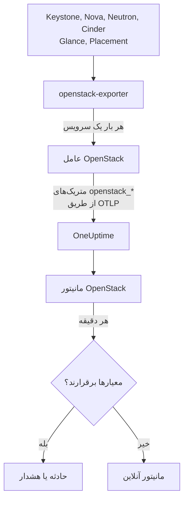

# مانیتور OpenStack

مانیتور OpenStack یک ابر را زیر نظر می‌گیرد - APIها، workerهای پشت آن‌ها، هایپروایزرها، instanceها، شبکه‌ها، استخرهای ذخیره‌سازی و سهمیه‌های پروژه - و وقتی یک API پاسخ نمی‌دهد، یک worker از کار می‌افتد، یک هایپروایزر ظرفیت خالی ندارد یا یک استخر پر می‌شود به شما خبر می‌دهد. این مانیتور سری‌های `openstack_*` را می‌خواند که عامل OpenStack در OneUptime از openstack-exporter جمع‌آوری می‌کند، یا probe از APIهای ابر جمع‌آوری می‌کند.

:::cards
- [ساخت مانیتور](#ساخت-مانیتور-openstack): شش مرحله در داشبورد.
- [قالب‌ها](#قالبهای-هشدار-آماده): هشدارهای آماده، با یک حادثه برای هر worker، instance، شبکه یا منطقه.
- [بررسی‌ها از بیرون](#بررسیها-از-بیرون): اینکه آیا کسی واقعاً می‌تواند یک instance بالا بیاورد، از یک probe بیرون از ابر.
- [ویژگی‌های هویتی](#ویژگیهای-هویتی): چگونه یک منطقه، میزبان یا پروژه را هدف بگیرید.
- [متریک‌ها](#متریکهای-جمعآوریشده): هر سری‌ای که مانیتور می‌تواند برایش هشدار بدهد.
:::

## نحوه کار

عامل (agent) یک OpenTelemetry Collector همراه با یک openstack-exporter است که روی ماشینی اجرا می‌کنید که به APIهای ابر دسترسی دارد. هر سرویس OpenStack را در یک جمع‌آوری جداگانه می‌خواند، بنابراین خرابی Nova فقط سری‌های Nova را از دست می‌دهد، و با ملایمت می‌خواند: compute، network، volume و placement هر ۲ دقیقه، identity و image هر ۵ دقیقه.

روی هر سری نام ابر با `openstack.cloud.name` و روی هر نقطه داده `openstack.region.name` و `openstack_service` درج می‌شود. یک ابر یعنی یک Keystone، و هر مانیتور OpenStack به یک ابر وابسته است. مانیتور هر دقیقه کوئری خود را روی متریک‌های آن ابر اجرا می‌کند و نتیجه را با معیارهایش مقایسه می‌کند.



## پیش از شروع

- **متریک‌های ابر را جمع‌آوری کنید** با عامل OpenStack، یا [یک probe](/docs/telemetry/openstack-agentless). **مستندات**، در **محصولات** > **زیرساخت** > **OpenStack**، نصب عامل را مرحله به مرحله توضیح می‌دهد.
- **بررسی کنید ابر ثبت شده باشد.** پس از نخستین جمع‌آوری، ابر در **محصولات ← زیرساخت ← OpenStack** و با نامِ `OPENSTACK_CLOUD_NAME` عامل ظاهر می‌شود.

## ساخت مانیتور OpenStack

:::steps
### یک مانیتور جدید شروع کنید

به **مانیتورها** بروید و روی **ساخت مانیتور** کلیک کنید.

### OpenStack را انتخاب کنید

زیر **نوع مانیتور** روی **انواع دیگر مانیتور** کلیک کنید و **OpenStack** را زیر **زیرساخت** انتخاب کنید، یا `openstack` را در کادر جست‌وجو بنویسید. یک **نام** وارد کنید - در عنوان حادثه‌ها و هشدارها استفاده می‌شود - و روی **بعدی** کلیک کنید.

### ابر را انتخاب کنید

زیر **پیکربندی مانیتور OpenStack**، ابر را از **ابر OpenStack** انتخاب کنید. هر ابری که داده فرستاده باشد در فهرست است. پس از انتخاب، یک خط زیر فیلد نشان می‌دهد که داده می‌رسد یا نه.

### انتخاب کنید چه چیزی را زیر نظر بگیرید

مانیتور جدید با **Cloud Stopped Reporting** زیر **هشدار برای چه** شروع می‌شود. برای دیدن چیز دیگری:

- **تغییر** - یک [قالب](#قالبهای-هشدار-آماده) دیگر انتخاب کنید. قالب متریک، فیلترهای ویژگی، تجمیع، بازه زمانی، گروه‌بندی و آستانه‌ها را تنظیم می‌کند و معیارهای پایین را با معیارهای خودش جایگزین می‌کند. هنوز می‌توانید **بازه زمانی** را تغییر دهید.
- **Custom Metric** (زیر **فیلدهای بیشتر**) - یک متریک از **متریک OpenStack** انتخاب کنید، سپس **تجمیع** و **بازه زمانی** را تنظیم کنید و با [فیلترها](#تنظیمات-مانیتور) آن را محدود کنید.
- **پیشرفته** (زیر **فیلدهای بیشتر**) - کوئری‌ها و فرمول‌ها را خودتان زیر **انتخاب متریک‌ها** بسازید، با فیلتر روی ویژگی‌هایی مانند `status`، `adminState` یا `resourcetype`. از **گروه‌بندی بر اساس** روی یک [ویژگی هویتی](#ویژگیهای-هویتی) استفاده کنید تا هر بخش جداگانه بررسی شود.

### معیارها را بررسی کنید

هر معیار را زیر **معیارها** باز کنید و **متریک**، **تجمیع**، **شرط** و **آستانه** آن را بررسی کنید. قالب این‌ها را پر می‌کند. با **متریک سفارشی** یا **پیشرفته** مانیتور با معیارهای پیش‌فرض شروع می‌شود که فقط متوجه نرسیدن داده می‌شوند، پس آستانه خودتان را تعیین کنید.

### مانیتور را بسازید

روی **ساخت مانیتور** کلیک کنید. OneUptime صفحه مانیتور را باز می‌کند و آن را هر دقیقه ارزیابی می‌کند. حادثه‌ها و هشدارهایی که مانیتور ایجاد می‌کند در صفحه‌های **حوادث** و **هشدارها** ابر نیز فهرست می‌شوند.
:::

> [!TIP]
> برای راه‌اندازی چند قالب با هم، ابر را از **محصولات ← زیرساخت ← OpenStack** باز کنید و به **توصیه‌ها** بروید. قالب‌های موردنظر را انتخاب کنید، مشخص کنید چه کسی مطلع شود، و OneUptime برای هر قالب یک مانیتور می‌سازد.

## تنظیمات مانیتور

| فیلد | تب | کاربرد |
| --- | --- | --- |
| **ابر OpenStack** | همه | الزامی. هر کوئری را به `resource.openstack.cloud.name` محدود می‌کند. |
| **منطقه** | متریک سفارشی، پیشرفته | اختیاری. یک منطقه: `openstack.region.name`. روی هر سری وجود دارد. |
| **زُن دسترس‌پذیری** | متریک سفارشی، پیشرفته | اختیاری. یک زُن: `availability_zone` روی هایپروایزرها، instanceها، volumeها و agentهای Neutron، و `zone` روی workerهای Nova و Cinder. |
| **هایپروایزر** | متریک سفارشی، پیشرفته | اختیاری. یک میزبان: `hostname` روی workerها، هایپروایزرها و Placement، و `hypervisor_hostname` روی instanceها. workerهای Nova نام کوتاه میزبان را می‌گویند، و هایپروایزرها، Placement و instanceها نام کامل آن را، پس همانی را به کار ببرید که سری می‌گوید. |
| **سرویس** | متریک سفارشی، پیشرفته | اختیاری. باینری یک worker، مانند `nova-compute`: `service`. |
| **شناسه پروژه** | متریک سفارشی، پیشرفته | اختیاری. یک پروژه: `tenant_id` روی سری‌های Nova و Cinder و روی شبکه‌ها و subnetها، و `project_id` روی IPهای شناور، routerها و address availability. |
| **متریک OpenStack** | متریک سفارشی | یک متریک از [فهرست](#متریکهای-جمعآوریشده). |
| **تجمیع** | متریک سفارشی | نحوه ترکیب نمونه‌ها: **میانگین**، **بیشینه**، **کمینه**، **جمع** یا **تعداد**. با تجمیع معمول همان متریک شروع می‌شود. |
| **بازه زمانی** | همه | پنجره غلتانی که کوئری می‌خواند، از **Past 1 Minute** تا **Past 365 Days**. مانیتور جدید روی **۱۵ دقیقه گذشته** شروع می‌شود؛ قالب‌ها بازه خودشان را تعیین می‌کنند. |
| **انتخاب متریک‌ها** | پیشرفته | سازنده کوئری: **متریک**، **تجمیع بر اساس**، **فیلتر بر اساس ویژگی‌ها**، **گروه‌بندی بر اساس**، به‌علاوه **افزودن متریک** و **افزودن فرمول** برای ترکیب کوئری‌ها. |

یک فیلتر فقط سری‌ای را محدود می‌کند که آن label را دارد: `openstack_nova_up` پروژه ندارد، پس فیلتر پروژه آن را همان‌طور که هست می‌گذارد.

پنجره را روی سه بار جمع‌آوری یا بیشتر از چیزی که می‌خوانید نگه دارید: ۶ دقیقه برای compute، network، volume و placement، و ۱۵ دقیقه برای identity و image. پنجره کوتاه‌تر جمع‌آوری‌های کافی ندارد تا **همه مقادیر** معنای یک مدت زمان بدهد.

## ویژگی‌های هویتی

هر سری `openstack.cloud.name` را به‌عنوان **ویژگی منبع** دارد، و `openstack.region.name` و `openstack_service` را به‌عنوان ویژگی‌های نقطه داده. بقیه را labelهای خود exporter می‌گویند:

| بخش | سری | labelهایی که آن را مشخص می‌کنند |
| --- | --- | --- |
| API | `openstack_*_up` | `openstack.region.name`, `openstack_service` |
| Worker | `openstack_nova_agent_state`, `openstack_neutron_agent_state`, `openstack_cinder_agent_state` | `hostname`, `service`. `adminState` می‌گوید اپراتور آن را روشن گذاشته یا نه. هرگز روی `uuid` در Cinder گروه‌بندی نکنید: exporter در هر جمع‌آوری یکی می‌سازد |
| هایپروایزر | `openstack_placement_resource_*`, `openstack_nova_vcpus_*` | `hostname` (نام کامل آن)، و `resourcetype` در Placement |
| Instance | `openstack_nova_server_status` | `uuid`, `name`, `tenant_id`, `hypervisor_hostname`, `status`. مقدار یک کد است: روی کلمه `status` فیلتر کنید |
| Volume | `openstack_cinder_volume_gb` | `id`, `name`, `tenant_id`, `status` |
| استخر ذخیره‌سازی | `openstack_cinder_pool_capacity_*` | `name`, `volume_backend_name` |
| شبکه | `openstack_neutron_network_ip_availabilities_*` | `network_id`, `network_name`, `cidr`, `ip_version` |
| Router | `openstack_neutron_l3_agent_of_router` | `router_id`, `agent_host`, `ha_state`, `agent_alive`, `agent_admin_up` |
| پروژه | `openstack_nova_limits_*`, `openstack_cinder_limits_*` | `tenant_id`, `tenant` |

در فیلترها و کلیدهای group-by مانیتور، resource attribute با `resource.` شروع می‌شود (`resource.openstack.cloud.name`) و ویژگی نقطه داده نه (`openstack.region.name`، `hostname`، `status`). label خالی به OneUptime نمی‌رسد، پس `disabledReason` فقط روی workerی هست که کسی آن را غیرفعال کرده باشد.

## قالب‌های هشدار آماده

OneUptime ‏۱۲۰ قالب برای مشکلات رایج OpenStack دارد و فهرست **هشدار برای چه** آن‌ها را عرضه می‌کند. صفحه Recommendations یک ابر، قالب‌های Heat، Magnum، Ironic، Manila، Octavia، Trove، Designate، Gnocchi یا Swift را فقط به ابری پیشنهاد می‌دهد که آن سرویس را اجرا می‌کند؛ قالب مبتنی بر سری‌ای که فقط probe می‌فرستد را فقط به ابری که probe از آن جمع می‌کند؛ و قالب مبتنی بر [بررسی از بیرون](#بررسیها-از-بیرون) را فقط به ابری که آن بررسی را روشن دارد: در هر ابر دیگر سری‌های آن‌ها وجود ندارد، پس هرگز فعال نمی‌شود. هر قالب یک مانیتور کامل می‌سازد: کوئری متریک، فیلترهای ویژگی، یک group-by روی چیزی که یک حادثه درباره آن است، یک معیار برای فعال شدن و یک معیار برای بازیابی. آستانه‌ها همان خط‌هایی هستند که صفحه‌های خود ابر می‌کشند و نقطه شروع‌اند که می‌توانید ویرایششان کنید.

هر قالب دست‌کم سه بار جمع‌آوری از چیزی که زیر نظر دارد می‌خواند و فقط وقتی فعال می‌شود که شرط در کل پنجره‌اش برقرار باشد. آستانه روی یک سهم، ۱۰٪ آن‌سوی خط خود بازیابی می‌شود، پس مقداری که حوالی آن می‌ماند نوسان نمی‌کند.

| قالب | دسته | شدت | چه چیزی را می‌پاید | چه وقت فعال می‌شود | چه وقت بازیابی می‌شود |
| --- | --- | --- | --- | --- | --- |
| Cloud Stopped Reporting | دسترس‌پذیری | بحرانی | `openstack_identity_up`، Count روی کل ابر، **۱۵ دقیقه گذشته** | در کل پنجره داده‌ای نیست: عامل متوقف شده یا به OneUptime نمی‌رسد، یا exporter نمی‌تواند به Keystone وارد شود | دوباره داده می‌رسد |
| Identity API Down | دسترس‌پذیری | بحرانی | `openstack_identity_up` و `scrape_samples_scraped` برای `identity`، Min در هر منطقه، **۱۵ دقیقه گذشته** | همه فراخوانی‌ها شکست خورده‌اند، یا جمع‌آوری خالی برگشته چون exporter نتوانسته وارد شود | هر دو ۱ یا بیشتر هستند |
| Compute API Down | دسترس‌پذیری | بحرانی | `openstack_nova_up` و `scrape_samples_scraped` برای `compute`، Min در هر منطقه، **۱۰ دقیقه گذشته** | همه فراخوانی‌ها شکست خورده‌اند، یا جمع‌آوری خالی برگشته چون exporter نتوانسته به API نوا برسد | هر دو ۱ یا بیشتر هستند |
| Network API Down | دسترس‌پذیری | بحرانی | `openstack_neutron_up` و `up` برای `network`، Min در هر منطقه، **۱۰ دقیقه گذشته** | همه فراخوانی‌ها شکست خورده‌اند، یا exporter پاسخ نداده | هر دو ۱ هستند |
| Block Storage API Down | دسترس‌پذیری | بحرانی | `openstack_cinder_up` و `up` برای `volume`، Min در هر منطقه، **۱۰ دقیقه گذشته** | همه فراخوانی‌ها شکست خورده‌اند، یا exporter پاسخ نداده | هر دو ۱ هستند |
| Image API Down | دسترس‌پذیری | بحرانی | `openstack_glance_up` و `up` برای `image`، Min در هر منطقه، **۱۵ دقیقه گذشته** | همه فراخوانی‌ها شکست خورده‌اند، یا exporter پاسخ نداده | هر دو ۱ هستند |
| Placement API Down | دسترس‌پذیری | بحرانی | `openstack_placement_up` و `up` برای `placement`، Min در هر منطقه، **۱۰ دقیقه گذشته** | همه فراخوانی‌ها شکست خورده‌اند، یا exporter پاسخ نداده | هر دو ۱ هستند |
| Compute Service Down | صفحه کنترل | بحرانی | `openstack_nova_agent_state` فیلترشده به `service = nova-compute` و `adminState = enabled`، Min در هر میزبان، **۱۰ دقیقه گذشته** | کمتر از ۱: یک nova-compute فعال از کار افتاده است. موردی که کسی غیرفعالش کرده هرگز فعال نمی‌شود | بالا آمده، یا غیرفعال شده |
| Compute Service Disabled | صفحه کنترل | هشدار | `openstack_nova_agent_state` فیلترشده به `service = nova-compute` و `adminState = disabled`، یک Count در هر میزبان، **۱۰ دقیقه گذشته** | بیشتر از ۰: یک `nova-compute` غیرفعال شده و هیچ رویداد نگهداری در جریانی میزبان، زُن دسترس‌پذیری یا ابر آن را پوشش نمی‌دهد. موردی که خودش به‌خاطر از دست رفتن libvirt غیرفعال شده (دلیلش با `AUTO:` شروع می‌شود) تا وقتی libvirt Service Down باز است ساکت می‌ماند. پروژه‌ها از آن مطلع نمی‌شوند | دوباره فعال شده، یا یک رویداد آن را پوشش می‌دهد |
| Scheduler or Conductor Down | صفحه کنترل | هشدار | `openstack_nova_agent_state` فیلترشده به `nova-scheduler` یا `nova-conductor` و `adminState = enabled`، Min در هر میزبان و باینری، **۱۰ دقیقه گذشته** | کمتر از ۱. تا وقتی یکی باقی است بقیه کار را ادامه می‌دهند | بالا آمده، یا غیرفعال شده |
| Every Scheduler or Conductor Down | صفحه کنترل | بحرانی | همان، Max در هر منطقه و باینری، **۱۰ دقیقه گذشته** | کمتر از ۱: هیچ‌کدام زنده نیست، پس چیز جدیدی نمی‌تواند بالا بیاید | یکی بالا است |
| Network Agent Down | صفحه کنترل | بحرانی | `openstack_neutron_agent_state` فیلترشده به `adminState = up`، Min در هر میزبان و باینری، **۱۰ دقیقه گذشته** | کمتر از ۱: یک agent برپاشده زنده نیست. موردی که کسی down کرده هرگز فعال نمی‌شود | زنده است، یا down شده |
| Block Storage Service Down | صفحه کنترل | بحرانی | `openstack_cinder_agent_state` فیلترشده به `adminState = enabled`، Min در هر میزبان و باینری، **۱۰ دقیقه گذشته** | کمتر از ۱: یک سرویس Cinder فعال از کار افتاده است. موردی که کسی غیرفعالش کرده هرگز فعال نمی‌شود | بالا آمده، یا غیرفعال شده |
| vCPU Allocation High | محاسبه | هشدار | `openstack_placement_resource_*` فیلترشده به `resourcetype = VCPU`، usage / ((total - reserved) x ratio)، برای هر هایپروایزر، **۱۰ دقیقه گذشته** | بالای ۹۰٪: تخصیص، نه بار | در ۸۱٪ یا پایین‌تر |
| Memory Allocation High | محاسبه | هشدار | همان، `resourcetype = MEMORY_MB` | بالای ۹۰٪ | در ۸۱٪ یا پایین‌تر |
| Local Disk Allocation High | محاسبه | هشدار | همان، `resourcetype = DISK_GB` | بالای ۹۰٪ | در ۸۱٪ یا پایین‌تر |
| Hypervisor CPU Saturated | محاسبه | هشدار | `openstack.hypervisor.instances.cpu.utilization`، برای هر هایپروایزر، **۱۵ دقیقه گذشته**. به exporter مربوط به libvirt یا Ceilometer نیاز دارد | بالای ۹۰٪ از thread‌های CPU آن: بار، نه تخصیص. صفحه‌اش instanceهای مسئول را نام می‌برد | در ۸۱٪ یا پایین‌تر |
| Hypervisor Memory Pressure | محاسبه | هشدار | `openstack.hypervisor.instances.memory.utilization`، برای هر هایپروایزر، **۱۵ دقیقه گذشته**. به exporter مربوط به libvirt، یا polling مربوط به `memory.resident` در Ceilometer نیاز دارد | بالای ۹۰٪ از حافظه آن: در حال استفاده، نه وعده‌داده‌شده | در ۸۱٪ یا پایین‌تر |
| Instance CPU Saturated | محاسبه | هشدار | `openstack.instance.cpu.utilization`، Max در هر instance، **۱۵ دقیقه گذشته**. به exporter مربوط به libvirt یا Ceilometer نیاز دارد | بالای ۹۵٪ از vCPUهای آن | در ۸۵٫۵٪ یا پایین‌تر |
| Instance Disk Latency High | محاسبه | هشدار | `openstack.instance.disk.read.latency` و `openstack.instance.disk.write.latency`، Max در هر instance و دیسک، **۱۵ دقیقه گذشته**. به exporter مربوط به libvirt، یا polling مربوط به `disk.device.read.latency` و `disk.device.write.latency` در Ceilometer نیاز دارد | بالای ۵۰ میلی‌ثانیه در هر درخواست. دیسکی که درخواستی ندارد تأخیر هم ندارد، پس دیسک بی‌کار هرگز فعال نمی‌شود | در ۴۵ میلی‌ثانیه یا پایین‌تر، یا دیگر استفاده نمی‌شود |
| Instances in Error | محاسبه | هشدار | `openstack_nova_server_status` فیلترشده به `status = ERROR`، Count در هر منطقه، **۱۰ دقیقه گذشته** | بیشتر از ۰ | هیچ‌کدام باقی نمانده |
| Instance Stuck Building | محاسبه | هشدار | `openstack_nova_server_status` فیلترشده به `status = BUILD` یا `BUILD(spawning)`، Max در هر instance، **۱ ساعت گذشته** | در هر جمع‌آوری به مدت یک ساعت در آن وضعیت بوده | از آن خارج شده |
| Instance Stuck Transitioning | محاسبه | هشدار | همان برای `REBUILD`، `RESIZE`، `REVERT_RESIZE`، `MIGRATING`، `REBOOT`، `HARD_REBOOT` و `PASSWORD`، **۱ ساعت گذشته** | در هر جمع‌آوری به مدت یک ساعت در یکی از آن‌ها بوده | از آن خارج شده |
| Instance Stuck in Verify Resize | محاسبه | هشدار | همان برای `VERIFY_RESIZE`، **۱ ساعت گذشته** | یک ساعت منتظر تأیید یا بازگرداندن توسط کسی بوده | تأیید یا بازگردانده شده |
| Router Not Active | شبکه | هشدار | `openstack_neutron_routers_not_active`، Max در هر منطقه، **۱۰ دقیقه گذشته** | بیشتر از ۰ | در ۰ |
| Floating IP Not Active | شبکه | هشدار | `openstack_neutron_floating_ips_associated_not_active`، Max در هر منطقه، **۱۰ دقیقه گذشته** | بیشتر از ۰: یکی که در حال استفاده است ACTIVE نیست. یکی که یدک است قرار است down باشد | در ۰ |
| External IP Pool Nearly Full | شبکه | هشدار | `openstack_neutron_network_ip_availabilities_*` برای `ip_version = 4`، کنار `is_external = true` روی `openstack_neutron_network`، برای هر شبکه، **۱۰ دقیقه گذشته** | بالای ۹۰٪ از آدرس‌های IPv4 یک شبکه بیرونی. شبکه یک tenant هرگز فعال نمی‌شود | در ۸۱٪ یا پایین‌تر |
| Network Out of IPs | شبکه | بحرانی | همان | در ۱۰۰٪: آدرسی باقی نمانده | زیر ۹۰٪ |
| Router Without Active Agent | شبکه | بحرانی | `openstack_neutron_l3_agent_of_router` فیلترشده به `agent_admin_up = true`، Max در هر router، **۱۰ دقیقه گذشته** | کمتر از ۱: هیچ agentی که آن را نگه دارد زنده نیست. روی OVN که چنین agentهایی ندارد ساکت است | یکی زنده است |
| Router With Two Active Agents | شبکه | بحرانی | همان فیلترشده به `ha_state = active` و `agent_alive = true`، Count در هر router، **۱۰ دقیقه گذشته** | بیشتر از ۱: split brain. روی OVN ساکت است | در ۱ یا کمتر |
| Storage Pool Warning | ذخیره‌سازی | هشدار | `openstack_cinder_pool_capacity_*`، (total - free) / total، برای هر استخر، **۱۰ دقیقه گذشته** | بالای ۸۵٪ | در ۷۶٫۵٪ یا پایین‌تر |
| Storage Pool Critical | ذخیره‌سازی | بحرانی | همان | بالای ۹۵٪ | در ۸۵٫۵٪ یا پایین‌تر |
| Volumes in Error | ذخیره‌سازی | هشدار | `openstack_cinder_volume_status_counter` برای هر واژه خطا، Max در هر منطقه و واژه، **۱۰ دقیقه گذشته** | بیشتر از ۰ | در ۰ |
| Volume Stuck | ذخیره‌سازی | هشدار | `openstack_cinder_volume_gb` برای هر واژه وضعیت گذرا، Max در هر volume، **۳۰ دقیقه گذشته** | در هر جمع‌آوری به مدت ۳۰ دقیقه در آن وضعیت بوده | از آن خارج شده |
| Image Stuck | ذخیره‌سازی | هشدار | `openstack_glance_image_created_at` برای هر واژه وضعیت گذرا، Max در هر image، **۱ ساعت گذشته** | در هر جمع‌آوری به مدت یک ساعت در آن وضعیت بوده | از آن خارج شده، یا حذف شده |
| Orchestration API Down | دسترس‌پذیری | بحرانی | `openstack_heat_up` و `up` برای `orchestration`، Min در هر منطقه، **۱۵ دقیقه گذشته** | همه فراخوانی‌ها شکست خورده‌اند، که یک `heat-engine` متوقف هم همین‌طور خوانده می‌شود، یا exporter پاسخ نداده | هر دو ۱ هستند |
| Kubernetes Clusters API Down | دسترس‌پذیری | بحرانی | `openstack_container_infra_up` و `up` برای `container-infra`، Min در هر منطقه، **۱۵ دقیقه گذشته** | همه فراخوانی‌ها شکست خورده‌اند، یا exporter پاسخ نداده | هر دو ۱ هستند |
| Rating API Down | دسترس‌پذیری | بحرانی | `openstack_cloudkitty_up` و `up` برای `rating`، Min در هر منطقه، **۱۵ دقیقه گذشته**. فقط probe این را می‌فرستد | API مربوط به CloudKitty پاسخ نمی‌دهد، پس آنچه برای هر پروژه امتیازدهی شده پیش نمی‌رود | هر دو ۱ هستند |
| Heat Engine Down | صفحه کنترل | هشدار | `openstack_heat_agent_state`، Min در هر میزبان، **۱۵ دقیقه گذشته**. فقط probe این را می‌فرستد | Heat یک `heat-engine` را down فهرست می‌کند. وقتی همه engineها متوقف باشند Heat نمی‌تواند آن‌ها را فهرست کند، و به‌جای آن Orchestration API Down فعال می‌شود | ۱ می‌خواند، یا Heat رکوردش را حذف می‌کند |
| Magnum Conductor Down | صفحه کنترل | بحرانی | `openstack_container_infra_agent_state` با `adminState=enabled`، Min در هر میزبان، **۱۵ دقیقه گذشته**. فقط probe این را می‌فرستد | Magnum یک `magnum-conductor` فعال را down فهرست می‌کند. API مربوط به Magnum به پاسخ دادن ادامه می‌دهد، پس چیز دیگری این را نمی‌گوید | ۱ می‌خواند، یا کسی آن را غیرفعال می‌کند |
| Stack Failed | ارکستراسیون | هشدار | `openstack_heat_stack_status` با هر وضعیت `*_FAILED`، برای هر stack، **۱۵ دقیقه گذشته** | یک stack در کل پنجره وضعیت ناموفق دارد | به‌روزرسانی یا حذف می‌شود |
| Stack Stuck In Progress | ارکستراسیون | هشدار | `openstack_heat_stack_status` با هر وضعیت `*_IN_PROGRESS`، برای هر stack، **۲ ساعت گذشته** | یک stack در کل پنجره وضعیت در-حال-انجام دارد، بیش از ساعتی که Heat می‌دهد مگر اینکه کسی بیشتر انتخاب کرده باشد | به وضعیت بعدی می‌رسد، یا حذف می‌شود |
| Kubernetes Cluster Failed | ارکستراسیون | هشدار | `openstack_container_infra_cluster_status` با هر وضعیت `*_FAILED`، برای هر cluster، **۱۵ دقیقه گذشته** | یک cluster در کل پنجره وضعیت ناموفق دارد | به‌روزرسانی یا حذف می‌شود |
| Kubernetes Cluster Stuck | ارکستراسیون | هشدار | `openstack_container_infra_cluster_status` با هر وضعیت `*_IN_PROGRESS`، برای هر cluster، **۲ ساعت گذشته** | یک cluster در کل پنجره وضعیت در-حال-انجام دارد. فقط conductor مربوط به Magnum آن را جلو می‌برد | به وضعیت بعدی می‌رسد، یا حذف می‌شود |
| Shared File Systems API Down | دسترس‌پذیری | بحرانی | `openstack_sharev2_up` و `up` برای `sharev2`، Min در هر منطقه، **۱۵ دقیقه گذشته** | همه فراخوانی‌ها شکست خورده‌اند، یا exporter پاسخ نداده. هر credential که بتواند وارد شود ۱ می‌خواند، پس این نمی‌تواند رد شدن credential باشد | هر دو ۱ هستند |
| Manila Service Down | صفحه کنترل | هشدار | `openstack_sharev2_agent_state` با `adminState=enabled`، Min در هر میزبان و سرویس، **۱۵ دقیقه گذشته**. فقط probe این را می‌فرستد | Manila یک سرویس فعال را متوقف یا down فهرست می‌کند. API آن به پاسخ دادن ادامه می‌دهد، پس چیز دیگری این را نمی‌گوید | ۱ می‌خواند، یا کسی آن را غیرفعال می‌کند |
| Share in Error | ذخیره‌سازی | هشدار | `openstack_sharev2_share_gb` با هر وضعیت خطا، برای هر اشتراک فایل، **۱۵ دقیقه گذشته** | یک اشتراک فایل در کل پنجره وضعیت خطا دارد | رفع یا حذف می‌شود |
| Share Stuck | ذخیره‌سازی | هشدار | `openstack_sharev2_share_gb` با هر وضعیت گذرا، برای هر اشتراک فایل، **۱ ساعت گذشته** | یک اشتراک فایل در کل پنجره وضعیت گذرا دارد. Manila برای backend کند timeout مخصوص خودش را ندارد. اشتراک فایلی که در حال migrate یا backup است پایش نمی‌شود | به وضعیت بعدی می‌رسد، یا حذف می‌شود |
| Load Balancers API Down | متعادل‌کننده‌های بار | بحرانی | `openstack_loadbalancer_up`، Min در هر منطقه، **۱۵ دقیقه گذشته** | کمتر از ۱. API متوقف Octavia به exporter عامل به‌جای ۰ یک پاسخ خالی می‌دهد، مثل ابری که Octavia ندارد، پس در ابر عامل ساکت می‌ماند و صفحه‌های ابر می‌گویند آخرین بار کِی از Octavia خبری رسیده | ۱ می‌خواند، یا رفته است |
| Load Balancer in Error | متعادل‌کننده‌های بار | بحرانی | `openstack_loadbalancer_loadbalancer_status` با `provisioning_status=ERROR`، Count در هر متعادل‌کننده بار، **۱۵ دقیقه گذشته** | یک متعادل‌کننده بار در کل پنجره provisioning ERROR دارد. Octavia هیچ‌کدام از این‌ها را دوباره تلاش نمی‌کند | به ACTIVE برگشته، یا حذف شده |
| Load Balancer Stuck Pending | متعادل‌کننده‌های بار | هشدار | `openstack_loadbalancer_loadbalancer_status` با هر وضعیت provisioning از نوع `PENDING_*`، Count در هر متعادل‌کننده بار، **۱ ساعت گذشته** | یک متعادل‌کننده بار در کل پنجره وضعیت PENDING دارد: worker مربوط به Octavia متوقف است، یا درخواست را گم کرده | به ACTIVE یا ERROR می‌رسد، یا حذف می‌شود |
| Load Balancer With Two Masters | متعادل‌کننده‌های بار | بحرانی | `openstack_loadbalancer_amphora_status` با `role=MASTER` و `status=ALLOCATED`، Count در هر متعادل‌کننده بار، **۱۵ دقیقه گذشته**. به credentialی نیاز دارد که اجازه فهرست کردن amphoraها را داشته باشد | بیش از یک amphora تخصیص‌یافته برای یک متعادل‌کننده بار MASTER می‌گوید | فقط یکی می‌گوید |
| Amphora in Error | متعادل‌کننده‌های بار | بحرانی | `openstack_loadbalancer_amphora_status` با `status=ERROR`، Count در هر amphora، **۱۵ دقیقه گذشته**. به credentialی نیاز دارد که اجازه فهرست کردن amphoraها را داشته باشد | یک amphora در کل پنجره ERROR دارد: health manager نتوانسته آن را جایگزین کند | جایگزین می‌شود |
| Pool Has No Healthy Members | متعادل‌کننده‌های بار | بحرانی | `openstack_loadbalancer_pool_status` با `operating_status=ERROR`، Count در هر استخر، **۱۵ دقیقه گذشته** | همه اعضای یک استخر در health check شکست می‌خورند، در حالی که استخر و متعادل‌کننده بار آن هنوز ACTIVE provision می‌شوند | یک عضو دوباره سالم است |
| DNS API Down | دسترس‌پذیری | بحرانی | `openstack_designate_up`، Min در هر منطقه، **۱۵ دقیقه گذشته**. فقط probe این را عرضه می‌کند | کمتر از ۱. Designate متوقف به exporter عامل یک پاسخ خالی می‌دهد، مثل ابری که Designate ندارد، پس ابری که عامل از آن جمع می‌کند فقط می‌تواند بگوید ساکت شده | ۱ می‌خواند |
| DNS Zone in Error | شبکه | هشدار | شمارش `openstack_designate_zone_status` با `status=ERROR`، برای هر زُن، **۱۵ دقیقه گذشته** | یک زُن در کل پنجره `ERROR` می‌خواند: worker آن از نوشتنش روی سرور DNS دست کشیده | چیز دیگری می‌خواند |
| DNS Zone Stuck Pending | شبکه | هشدار | شمارش `openstack_designate_zone_status` با `status=PENDING`، برای هر زُن، **۳۰ دقیقه گذشته** | یک زُن در کل پنجره `PENDING` می‌خواند. worker آن در چند دقیقه دست می‌کشد، پس هیچ چیزی روی آن کار نمی‌کند | چیز دیگری می‌خواند |
| DNS Recordset in Error | شبکه | هشدار | شمارش `openstack_designate_recordsets_status` با `status=ERROR` و هر نوعی که کسی بخواهد، برای هر زُن، **۱۵ دقیقه گذشته** | یک مجموعه‌رکورد غیر از SOA و NS خودِ زُن، `ERROR` می‌خواند. آن دو با زُن خود `ERROR` می‌خوانند، پس DNS Zone in Error آن را می‌گوید | چیز دیگری می‌خواند |
| Metrics API Down | دسترس‌پذیری | بحرانی | `openstack_gnocchi_up` و `up` برای `gnocchi`، Min در هر منطقه، **۱۵ دقیقه گذشته** | خواندن exporter از Gnocchi شکست خورده، یا exporter پاسخ نداده. credentialی که Gnocchi رد کند همین‌طور خوانده می‌شود، پس ابری که credential آن هرگز Gnocchi را نخوانده این قالب را پیشنهاد نمی‌گیرد | هر دو ۱ هستند |
| Gnocchi No Processors | متریک‌ها | بحرانی | `openstack_gnocchi_status_metricd_processors`، Max در هر منطقه، **۱۵ دقیقه گذشته** | وضعیت Gnocchi هیچ processor را نام نمی‌برد. API آن به پاسخ دادن و پذیرفتن measure ادامه می‌دهد، پس **Metrics API Down** چیزی از این نمی‌گوید | یکی را نام می‌برد |
| Gnocchi Backlog Growing | متریک‌ها | هشدار | `openstack_gnocchi_status_measures_to_process`، یک خط برازش‌شده روی **۲ ساعت گذشته** | خط در ساعت بعد از ۱۰٬۰۰۰ measure می‌گذرد. صف عقب‌افتاده‌ای که از آن گذشته و کم می‌شود فعال نمی‌شود | خط دیگر به ۹٬۰۰۰ نمی‌رسد |
| Object Storage API Down | دسترس‌پذیری | بحرانی | `openstack_object_store_up` و `up` برای `object-store`، Min در هر منطقه، **۱۵ دقیقه گذشته** | خواندن exporter از Swift شکست خورده، یا exporter پاسخ نداده. credentialی که Swift رد کند همین‌طور خوانده می‌شود، پس ابری که credential آن هرگز Swift را نخوانده این قالب را پیشنهاد نمی‌گیرد | هر دو ۱ هستند |
| Object Container Growth Forecast | ذخیره‌سازی | هشدار | `openstack_object_store_bytes`، یک خط برازش‌شده روی **۷ روز گذشته**، برای هر container | خط در هفته بعد از ۱ TiB می‌گذرد. آن را به چیزی که ابر شما باید از آن باخبر شود تغییر دهید | خط دیگر به ۹۰٪ آن نمی‌رسد |
| Key Manager API Down | دسترس‌پذیری | بحرانی | `openstack_barbican_up`، Min در هر منطقه، **۱۵ دقیقه گذشته**. فقط probe این را عرضه می‌کند | کمتر از ۱. exporter اصلاً خواننده‌ای برای Barbican ندارد | ۱ می‌خواند |
| Swift Storage Server Not Answering | ذخیره‌سازی | هشدار | `openstack_object_store_recon_up`، Min در هر سرور، **۱۵ دقیقه گذشته**. فقط probe این را عرضه می‌کند، آن هم جایی که تنظیمات ابر سرورهای ذخیره‌سازی‌اش را نام ببرد | سرور به `/recon` پاسخ نمی‌دهد. proxy مربوط به Swift بدون آن به پاسخ دادن ادامه می‌دهد | پاسخ می‌دهد |
| Swift Rings Differ | ذخیره‌سازی | هشدار | `openstack_object_store_recon_rings_differ`، Min در هر ring، **۱۵ دقیقه گذشته**. فقط probe این را عرضه می‌کند | سرورهای نام‌برده برای یک ring checksum متفاوت گزارش می‌کنند | توافق دارند |
| Swift Replication Stale | ذخیره‌سازی | هشدار | `openstack_object_store_recon_replication_age_seconds`، Min در هر سرور و ring، **۱۵ دقیقه گذشته**. فقط probe این را عرضه می‌کند | یک سرور آخرین بار بیش از ۶ ساعت پیش یک pass را تمام کرده | یکی تمام می‌کند |
| Databases API Down | دسترس‌پذیری | بحرانی | `openstack_trove_up` و `up` برای `database`، Min در هر منطقه، **۱۵ دقیقه گذشته** | خواندن exporter از Trove شکست خورده، یا exporter پاسخ نداده. این قالب API مربوط به mgmt در Trove را می‌خواند، پس credential ردشده مثل API متوقف خوانده می‌شود، و ابری که credential آن هرگز Trove را نخوانده این قالب را پیشنهاد نمی‌گیرد | هر دو ۱ هستند |
| Database Instance in Error | پایگاه‌های داده | هشدار | شمارش `openstack_trove_instance_status` با هر وضعیت خطا، برای هر instance، **۱۵ دقیقه گذشته** | یک instance در کل پنجره وضعیت خطا دارد | رفع یا حذف می‌شود |
| Database Instance Stuck | پایگاه‌های داده | هشدار | شمارش `openstack_trove_instance_status` با هر وضعیت گذرا، برای هر instance، **۱ ساعت گذشته** | یک instance در کل پنجره وضعیت گذرا دارد. Trove فهرستی از workerهایش ندارد، پس این است که می‌گوید `trove-taskmanager` متوقف شده | به وضعیت بعدی می‌رسد، یا حذف می‌شود |
| Database Volume Nearly Full | پایگاه‌های داده | هشدار | `openstack_trove_instance_volume_used_gb` روی `openstack_trove_instance_volume_size_gb`، برای هر instance، **۱۵ دقیقه گذشته** | در ۸۵٪ یا بیشتر. instanceی که اجرا نمی‌شود ۰ مصرف می‌خواند. هیچ ثبتی برای یک instance در حال اجرا وجود ندارد | اندازه‌اش تغییر می‌کند، یا کوچک می‌شود |
| Bare Metal API Down | Bare Metal | بحرانی | `openstack_ironic_up`، Min در هر منطقه، **۱۵ دقیقه گذشته** | کمتر از ۱. فقط جایی حرف می‌زند که خواندن Ironic بتواند آن را بگوید: یک probe، یا exporter نسخه 1.7.0. Ironic متوقف به exporter عامل چیزی برای خواندن نمی‌دهد، مثل ابری که Ironic ندارد، پس آنجا ساکت می‌ماند و صفحه‌های ابر می‌گویند آخرین بار کِی از Ironic خبری رسیده | ۱ می‌خواند، یا رفته است |
| Bare Metal Conductor Down | Bare Metal | هشدار | `openstack_ironic_agent_state`، Min در هر میزبان، **۱۵ دقیقه گذشته**. فقط probe این را می‌فرستد، آن هم فقط جایی که policy ابر به credential آن اجازه خواندن conductorهای Ironic را بدهد: به‌طور پیش‌فرض credential یک پروژه را رد می‌کند | Ironic یک conductor را زنده‌نبودن فهرست می‌کند. API آن به پاسخ دادن ادامه می‌دهد و هر node همان‌طور که بود می‌خواند، پس چیز دیگری این را نمی‌گوید | ۱ می‌خواند، یا Ironic رکوردش را حذف می‌کند |
| Bare Metal Node in Error | Bare Metal | هشدار | `openstack_ironic_node` برای هر `provision_state` ناموفق، Max در هر node، **۱۵ دقیقه گذشته** | در هر جمع‌آوری به مدت ۱۵ دقیقه در آن حالت بوده، در نگهداری باشد یا نه | از آن خارج شده، یا حذف شده |
| Bare Metal Node Stuck Transitioning | Bare Metal | هشدار | `openstack_ironic_node` برای هر `provision_state` گذرا با `maintenance = false`، Max در هر node، **۲ ساعت گذشته** | در هر جمع‌آوری به مدت ۲ ساعت در آن حالت بوده. پاک کردن طولانی دیسک واقعاً می‌تواند این‌قدر طول بکشد، که صفحه node می‌تواند بگوید و این نمی‌تواند | از آن خارج شده، یا حذف شده |
| Bare Metal Node in Maintenance Too Long | Bare Metal | هشدار | `openstack_ironic_node` با `maintenance = true`، Max در هر node، **۷ روز گذشته** | در هر جمع‌آوری به مدت ۷ روز در نگهداری بوده. لازم است متریک‌های شما این‌قدر نگه داشته شوند | از نگهداری خارج شده، یا حذف شده |
| Bare Metal Power State Unexpected | Bare Metal | هشدار | `openstack_ironic_node` با `provision_state = active`، `power_state = power off` و `maintenance = false`، Max در هر node، **۱۵ دقیقه گذشته** | در هر جمع‌آوری به مدت ۱۵ دقیقه. instanceی که صاحبش متوقف کرده همین‌طور خوانده می‌شود، که صفحه node می‌تواند بگوید و این نمی‌تواند | روشن شده، یا دیگر deploy نیست |
| Project Quota Nearly Reached | پروژه‌ها | هشدار | `openstack_nova_limits_*` و `openstack_cinder_limits_volume_*`، used / max در هر پروژه، **۳ ساعت گذشته** | بالای ۹۰٪ از سهمیه vCPU، حافظه، instance یا volume آن. به [روشن بودن سری‌های limits](#روشن-کردن-سریهای-limits) نیاز دارد | در ۸۱٪ یا پایین‌تر |
| Token Issue Failing | دسترس‌پذیری | بحرانی | `openstack_check_token_success`، Min در هر منطقه، **۵ دقیقه گذشته**. به روشن بودن بررسی‌های API نیاز دارد | کمتر از ۱: Keystone به probe توکنی نداده | توکنی صادر می‌شود |
| Service API Check Failing | دسترس‌پذیری | بحرانی | `openstack_check_api_success`، Min در هر منطقه و `service_type`، **۵ دقیقه گذشته**. به روشن بودن بررسی‌های API نیاز دارد | کمتر از ۱: آن سرویس پاسخ نداده، برای هر سرویس در کاتالوگ | پاسخ می‌دهد، یا از کاتالوگ خارج می‌شود |
| Public Certificate Expiring in 30 Days | دسترس‌پذیری | هشدار | `openstack_check_certificate_expiry_days`، Min در هر منطقه، میزبان و پورت، **۵ دقیقه گذشته**. به روشن بودن بررسی‌های API نیاز دارد | کمتر از ۳۰ روز مانده | ۳۳ روز یا بیشتر مانده، یا endpoint از کاتالوگ خارج می‌شود |
| Public Certificate Expiring in 7 Days | دسترس‌پذیری | بحرانی | همان | کمتر از ۷ روز مانده | ۷٫۷ روز یا بیشتر مانده، یا endpoint از کاتالوگ خارج می‌شود |
| Instance Boot Failing | محاسبه | بحرانی | `openstack_check_lifecycle_phase_success` فیلترشده به `phase = boot`، Min در هر منطقه، **۵ دقیقه گذشته**. به روشن بودن بررسی lifecycle نیاز دارد | کمتر از ۱: آخرین اجرا نتوانست یک instance را بالا بیاورد | یک اجرا آن را بالا می‌آورد |
| Instance Boot Slow | محاسبه | هشدار | `openstack_check_lifecycle_step_duration_seconds` فیلترشده به `step = server_active`، Max در هر منطقه، **۵ دقیقه گذشته**. به روشن بودن بررسی lifecycle نیاز دارد | بالای ۳۰۰ ثانیه، یعنی `build_timeout` خود Tempest | در ۲۷۰ ثانیه یا کمتر، یا اجرایی که بالا نیامد، که Instance Boot Failing جای آن حرف می‌زند |
| Volume Attach Failing | ذخیره‌سازی | بحرانی | `openstack_check_lifecycle_phase_success` فیلترشده به `phase = volume`، Min در هر منطقه، **۵ دقیقه گذشته**. به روشن بودن بخش volume در این بررسی نیاز دارد | کمتر از ۱: آخرین اجرا نتوانست یک volume بسازد یا attach کند | یک اجرا آن را attach می‌کند |
| Floating IP Unreachable | شبکه | بحرانی | `openstack_check_lifecycle_phase_success` فیلترشده به `phase = floating_ip`، Min در هر منطقه، **۵ دقیقه گذشته**. به روشن بودن بخش IP شناور در این بررسی نیاز دارد | کمتر از ۱: آخرین اجرا نتوانست از طریق IP شناور به سرور خود برسد | یک اجرا به آن می‌رسد |
| Flavor Can No Longer Be Placed | ظرفیت | هشدار | `openstack_capacity_flavor_fits`، **برای هر flavor در هر منطقه** | هیچ میزبانی جای یکی دیگر ندارد، به مدت ۱۰ دقیقه. فقط flavorهایی که کسی می‌تواند بخواهد، و هرگز flavorی که برای همه میزبان‌ها بزرگ است یا تنها جایش روی میزبانی است که کسی غیرفعالش کرده | یک میزبان جا دارد، یا flavor دیگر پایش نمی‌شود |
| Capacity Forecast Under 14 Days | ظرفیت | هشدار | `openstack_capacity_days_until_full`، **برای هر زُن و resource class، شبکه بیرونی یا استخر ذخیره‌سازی** | کمتر از ۱۴ روز تا پر شدن با رشد هفته گذشته‌اش، به مدت ۱۰ دقیقه. با کمتر از یک روز تاریخچه، یا وقتی رشد نمی‌کند ساکت است | بیش از ۱۵٫۴ روز، یا دیگر پیش‌بینی‌ای نیست |
| Reserved Headroom Gone | ظرفیت | هشدار | `openstack_capacity_can_lose_a_host`، **برای هر زُن** | نمی‌توانست بزرگ‌ترین میزبانش را از دست بدهد و باز هم آنچه روی آن اجرا می‌شود جا شود، به مدت ۱۰ دقیقه. روی زُن با یک میزبان، یا با میزبانی که کسی غیرفعالش کرده ساکت است | می‌توانست، یا زُن دیگر ارزیابی نمی‌شود |

**شدت** همان برچسبی است که انتخاب‌گر نشان می‌دهد. حادثه و هشداری که یک قالب می‌سازد با شدیدترین شدت حادثه و هشدار پروژه شما شروع می‌شوند؛ آن را در معیارها تغییر دهید.

- **سری‌های up، alive و state از Min استفاده می‌کنند**، پس اگر حتی یکی down باشد ۰ خوانده می‌شود. **سری‌های شمارشی و info از Max استفاده می‌کنند.** هیچ‌کدام از Sum استفاده نمی‌کنند، چون مانیتور باکت‌های یک‌دقیقه‌ای را در سری‌ها و scrapeها می‌خواند و Sum آن‌ها را با هم جمع می‌زند.
- **هر قالب جز Cloud Stopped Reporting بر اساس چیزی که یک حادثه درباره آن است گروه‌بندی می‌کند:** میزبان و باینری یک worker، منطقه یک API، یک instance، یک router، یک شبکه، یک استخر، یک پروژه. حادثه آن را نام می‌برد، همراه با [دستورهایی که باید بعد اجرا کنید](#دستورهایی-که-باید-بعد-اجرا-کنید).
- **مقدار یک سری وضعیت یک کد است**، نه یک شمارش: `openstack_nova_server_status` برای instanceی در ERROR مقدار ۴ می‌خواند. قالب‌ها روی واژه `status` فیلتر می‌کنند.
- **سریِ تازه‌ظاهرشده منتظر یک پنجره کامل می‌ماند،** پس instance، volume یا imageی که فقط یک بار در مسیر رسیدن به چیز دیگری دیده شده چیزی ایجاد نمی‌کند. هر قالب می‌داند سرویسش هر چند وقت یک بار جمع‌آوری می‌شود، از سری `_up` خود آن سرویس.
- **سریِ ناپدیدشده بازیابی‌شده حساب می‌شود:** workerی که کسی غیرفعالش کرده، آخرین instance در ERROR که حذف شده، استخری که برداشته شده. هر قالب سری `_up` خود سرویسش را کنار سری خودش می‌خواند، تا بتواند بخشی که رفته را از ابری که ساکت شده تشخیص دهد. وقتی اصلاً چیزی نمی‌رسد، حادثه‌هایش باز می‌مانند و Cloud Stopped Reporting به‌جای آن‌ها حرف می‌زند.
- **وقتی یک API down است، سری‌های خودش هم می‌روند**، پس قالب‌های دیگر آن سرویس حل می‌شوند، و اگر خطا هنوز باشد یک پنجره پس از بازگشت دوباره فعال می‌شوند. اگر همه APIها یک‌جا down بخوانند، اول exporter را بررسی کنید.
- **ابری که چنین سرویسی ندارد ساکت می‌ماند.** exporter برای سرویسی که در کاتالوگ ابر نیست پاسخ خالی می‌دهد، و **شبکه**، Block Storage، **ایمیج** و **Placement API Down** آن را قطعی نمی‌شمارند. **هویت** و **Compute API Down** می‌شمارند، چون exporter همین‌طور هم گزارش می‌کند که API مربوط به Keystone یا Nova کاملاً متوقف شده، و هر ابری آن‌ها را دارد.

### وقتی یکی فعال می‌شود

وقتی `nova-compute` متوقف شود، ردیف آن در صفحه **سرویس‌ها**ی ابر ظرف چند دقیقه down می‌شود:


وقتی این وضع تمام پنجره قالب دوام بیاورد، **Compute Service Down** یک حادثه باز می‌کند که میزبان را نام می‌برد و وقتی سرویس برگردد خودش حل می‌شود:


### سرویس‌ها چه می‌گویند

هفت قالب دیگر به‌جای متریک‌ها لاگ‌های یک ابر را می‌خوانند، پس مانیتور Logs هستند و به [پروفایل لاگ‌ها](/docs/telemetry/openstack#لاگهای-سرویس)ی عامل نیاز دارند. هر کدام فقط لاگ‌های همین ابر را می‌خواند، آنچه را دنبالش است می‌شمارد، و وقتی شمارش پایین بیاید خودش حل می‌شود.

| قالب | دسته | شدت | چه چیزی را می‌خواند | چه وقت فعال می‌شود | چه وقت بازیابی می‌شود |
| --- | --- | --- | --- | --- | --- |
| No Valid Host | لاگ‌های سرویس | هشدار | خط‌هایی که یک سرویس در سطح `WARNING` یا بدتر نوشته و حاوی `No valid host was found` هستند، **۱۵ دقیقه گذشته** | یکی یا بیشتر | هیچ‌کدام در پنجره نمانده |
| RabbitMQ Connection Lost | لاگ‌های سرویس | بحرانی | `AMQP server on <host> is unreachable`، `Unable to connect to AMQP server`، `Connection failed` یا `MessagingTimeout` از oslo.messaging، **۵ دقیقه گذشته** | ۵ یا بیشتر | کمتر از ۵ |
| Database Connection Lost | لاگ‌های سرویس | بحرانی | `DBConnectionError`، `SQL connection failed`، یا `Lost connection` و `Can't connect` از MySQL، **۵ دقیقه گذشته** | ۵ یا بیشتر | کمتر از ۵ |
| Too Many Errors from a Service | لاگ‌های سرویس | هشدار | خط‌های `ERROR` و `CRITICAL`، برای هر سرویس و ماشین، **۵ دقیقه گذشته** | ۵۰ یا بیشتر | کمتر از ۵۰ |
| Token Validation Failing | لاگ‌های سرویس | بحرانی | `Authorization failed for token` از یک سرویس، **۵ دقیقه گذشته** | ۱۰ یا بیشتر. یکی نشست قدیمی کسی است. controllerی که کلیدهای Fernet آن با بقیه فرق دارد همین‌طور خوانده می‌شود و هیچ خطی بیشتر نمی‌گوید، پس `/etc/keystone/fernet-keys` را روی هر کدام مقایسه کنید | کمتر از ۱۰ |
| Instance Action Failed | رویدادها | هشدار | `compute.exception` و هر `instance.*.error`، برای هر instance، رویداد و دلیل، **۱۵ دقیقه گذشته**. به [notificationها](/docs/telemetry/openstack#اعلانها-را-روشن-کنید) یا یک probe نیاز دارد | یکی یا بیشتر | هیچ‌کدام در پنجره نمانده |
| Scheduling Failed | رویدادها | هشدار | خطای یک compute task که `NoValidHost` را نام ببرد، مانند `compute_task.build_instances.error` که همان چیزی است که Nova می‌فرستد. `scheduler.create_volume` مربوط به Cinder هم، و `scheduler.select_destinations.error` که مستندات Nova نامش را می‌برد و ابرهای آزمایشی ما هرگز نفرستادند. برای هر instance، رویداد و دلیل، **۱۵ دقیقه گذشته**. به همان نیاز دارد | یکی یا بیشتر | هیچ‌کدام در پنجره نمانده |

### آنچه ابر روی آن ایستاده

این‌ها آنچه را [عامل زیر ابر می‌خواند](/docs/telemetry/openstack#آنچه-ابر-بر-آن-ایستاده-است) می‌خوانند، پس از آنکه نامش را گذاشتید. هر پنجره دست‌کم سه جمع‌آوری می‌خواند. هیچ‌کدام از Sum استفاده نمی‌کنند و سریِ ناپدیدشده بازیابی‌شده حساب می‌شود. هر کدام از روی آنچه خوشه‌های واقعی هنگام خراب شدن عمدی گفتند نوشته شده است.

| قالب | شدت | چه چیزی را می‌پاید | چه وقت فعال می‌شود | یک حادثه برای هر |
| --- | --- | --- | --- | --- |
| RabbitMQ Down | بحرانی | `up`، **۵ دقیقه گذشته** | هیچ node پاسخ نمی‌دهد | منطقه |
| RabbitMQ Node Down | هشدار | `up`، **۱۰ دقیقه گذشته** | یک node پاسخ نمی‌دهد | ماشین |
| RabbitMQ Partition Detected | بحرانی | `erlang_vm_dist_node_state`، **۵ دقیقه گذشته** | همه nodeها پاسخ می‌دهند، و پیوند میان دو تا برقرار نیست | منطقه |
| RabbitMQ Memory Alarm | بحرانی | `rabbitmq_alarms_memory_used_watermark`، **۵ دقیقه گذشته** | بالای ۰: پذیرش پیام را متوقف کرده | ماشین |
| RabbitMQ Disk Alarm | بحرانی | `rabbitmq_alarms_free_disk_space_watermark`، **۵ دقیقه گذشته** | بالای ۰: پذیرش پیام را متوقف کرده | ماشین |
| RabbitMQ File Descriptors High | هشدار | بازشده نسبت به مجاز، **۵ دقیقه گذشته** | بیش از ۹۰٪ | ماشین |
| RabbitMQ Messages Unacknowledged | هشدار | `rabbitmq_queue_messages_unacked`، **۱۰ دقیقه گذشته** | بیش از ۱۰۰۰ | ماشین |
| RabbitMQ Queue Without Consumers | هشدار | هر queue از `/metrics/detailed`، **۱۰ دقیقه گذشته** | پیام آماده است و کسی نمی‌خواند. queue پاسخ یا fanout کنار گذاشته می‌شود | Queue |
| MariaDB Cluster Down | بحرانی | `up`، `mysql_up` و `wsrep_cluster_status`، **۵ دقیقه گذشته** | هیچ node پاسخ نمی‌دهد، یا هیچ node در مؤلفه Primary نیست | منطقه |
| Galera Cluster Size Dropped | هشدار | nodeهای خوانده‌شده نسبت به `wsrep_cluster_size`، **۱۰ دقیقه گذشته** | Galera کمتر از تعداد nodeهایی که نام برده‌اید می‌شمارد | منطقه |
| Galera Node Not Ready | هشدار | `wsrep_ready`، **۱۰ دقیقه گذشته** | کمتر از ۱ با Galera روشن | ماشین |
| Galera Node Out of Sync | هشدار | `wsrep_local_state`، **۱۰ دقیقه گذشته** | غیر از Synced، مگر اینکه `wsrep_desync` بگوید کسی آن را خواسته، مثلاً هنگام backup | ماشین |
| MariaDB Too Many Connections | هشدار | متصل نسبت به مجاز، **۵ دقیقه گذشته** | بیش از ۸۰٪ | ماشین |
| MariaDB Slow Queries | هشدار | `mysql_slow_queries_increase`، **۱۰ دقیقه گذشته** | بیش از ۱۰ در دقیقه | ماشین |
| Memcached Cluster Down | هشدار | `memcached_up`، **۵ دقیقه گذشته** | هیچ‌کدام پاسخ نمی‌دهد. چیزی متوقف نمی‌شود، و APIها کند می‌شوند | منطقه |
| Memcached No Connections | هشدار | `memcached_current_connections` و دستورها، **۱۵ دقیقه گذشته** | زیر ۱۰ اتصال و کسی درخواستی ندارد. هرگز ۰ نمی‌خواند: listenerهای خودش و exporter چند تا نگه می‌دارند | منطقه |
| Memcached Evictions High | هشدار | `memcached_items_evicted_increase`، **۱۰ دقیقه گذشته** | بیش از ۱۰۰ در دقیقه | ماشین |
| HAProxy Down | بحرانی | `up`، **۵ دقیقه گذشته** | هیچ‌کدام پاسخ نمی‌دهد | منطقه |
| HAProxy Backend Down | بحرانی | `haproxy_backend_status` برای `DOWN`، **۵ دقیقه گذشته** | روی هر متعادل‌کننده باری که پاسخ می‌دهد down است | Backend |
| HAProxy Server Down | هشدار | `haproxy_server_status` برای `DOWN`، **۱۰ دقیقه گذشته** | یک سرور down است و backend آن سرورهای دیگری دارد | Backend |
| API 5xx Rate High | بحرانی | `haproxy_backend_http_responses_increase`، **۵ دقیقه گذشته** | بیش از ۵٪، در حالی که سرورهایی برای پاسخ دادن مانده‌اند | Backend |
| API 4xx Rate High | هشدار | همان، **۵ دقیقه گذشته** | بیش از ۲۵٪. HAProxy بر اساس کلاس می‌شمارد، پس موج ناگهانی ۴۰۱ها اینجا دیده می‌شود | Backend |
| OVN Controller Not Running | بحرانی | `ovnc_encap_ip` و `ovnc_rconn_queued`، **۵ دقیقه گذشته** | chassisی که داشت دیگر ندارد | ماشین |
| Northbound or Southbound Database Without a Leader | بحرانی | `ovn_raft_cluster_leader`، **۵ دقیقه گذشته** | هیچ عضوی نمی‌گوید رهبر است | پایگاه داده |
| OVN Northd Not Active | بحرانی | `ovn_northd_status`، **۱۰ دقیقه گذشته** | هیچ‌کدام فعال نیست، که توقف همه پایگاه‌های داده OVN هم همین‌طور خوانده می‌شود | منطقه |
| Geneve Transmit Errors | هشدار | `ovs_interface_tx_errors_increase` برای `type = geneve`، **۱۰ دقیقه گذشته** | خطا در هر دقیقه | ماشین |
| Open vSwitch Service Down | بحرانی | `ovs_memory_rules_total`، **۵ دقیقه گذشته** | از ماشینی که داشت رفته، در حالی که exporter پاسخ می‌دهد | ماشین |
| Exporter Lost Open vSwitch's Database | هشدار | `ovs_build_info`، **۱۰ دقیقه گذشته** | از ماشینی که داشت رفته، در حالی که Open vSwitch پاسخ می‌دهد. exporter را راه‌اندازی مجدد کنید | ماشین |
| Network Exporter Target Down | هشدار | `up`، **۱۰ دقیقه گذشته** | openstack-network-exporter پاسخ نمی‌دهد | ماشین |
| libvirt Service Down | بحرانی | `libvirt_up`، **۵ دقیقه گذشته** | کمتر از ۱. nova-compute خودش را غیرفعال می‌کند، پس Compute Service Down و Compute Service Disabled ساکت می‌مانند | ماشین |
| libvirt Exporter Target Down | هشدار | `up`، **۱۰ دقیقه گذشته** | prometheus-libvirt-exporter پاسخ نمی‌دهد | ماشین |

**یک خطا یک حادثه باز می‌کند.** توقف RabbitMQ `nova-compute` و، روی ML2/OVS، agentهای Neutron را هم با خود می‌برد، که هر کدام قالب خودشان را دارند. پس هر چیزی که همراه چیز دیگری می‌رود از آن بیشتر صبر می‌کند، و مانیتورش به آنی که منتظرش است پیوند می‌خورد: یک وابستگی مانیتور، که وقتی هر دو از این قالب‌ها باشند برایتان ساخته می‌شود، هر کدام را اول بسازید. تا وقتی RabbitMQ Down در یک منطقه باز است، وابسته‌هایش آنجا چیزی باز نمی‌کنند و در صفحه خودشان down خوانده می‌شوند. پس از حل شدن RabbitMQ Down هنوز ۱۰ دقیقه صبر می‌کند، چون عامل آن workerها را هر ۲ تا ۵ دقیقه می‌خواند، و workerی که پس از آن هنوز down است مشکل دیگری دارد.

| چه می‌رود | چه چیزی منتظر آن است |
| --- | --- |
| RabbitMQ Down | RabbitMQ Node Down، هر قالب worker و API، و RabbitMQ Connection Lost و Too Many Errors from a Service از لاگ‌ها |
| MariaDB Cluster Down | قالب‌های node و اندازه Galera، هر قالب worker و API، Cloud Stopped Reporting، و Database Connection Lost، Token Validation Failing و Too Many Errors from a Service از لاگ‌ها |
| HAProxy Down | قالب‌های دیگر HAProxy، هر قالب API و Cloud Stopped Reporting |
| OVN Controller Not Running, Open vSwitch Service Down | Network Agent Down، برای `ovn-controller`، `neutron-ovn-agent` و `neutron-openvswitch-agent` و هیچ‌کدام دیگر، در آن منطقه |
| Northbound or Southbound Database Without a Leader | OVN Northd Not Active |

exporter یک ماشین را با نشانی‌ای که به آن می‌رسد نام می‌برد و Neutron با نام میزبان، پس این دو را نمی‌توان بر اساس ماشین تطبیق داد. تا وقتی ovn-controller یک ماشین down است، agent با نام `ovn-controller` که روی ماشین دیگری در منطقه down است با آن منتظر می‌ماند.

حادثه می‌گوید چه چیزی را پایین می‌آورد، و هشدار روی workerی که وابستگی‌اش down است می‌گوید احتمالاً از چه ناشی شده است.

### روشن کردن سری‌های limits

سه قالب **ظرفیت** سری‌هایی را می‌خوانند که خود OneUptime از فهرست دارایی‌های ابر می‌نویسد، هر دو دقیقه تا وقتی ابر گزارش می‌دهد. هیچ سری exporter شمارش زُن یا flavor را ندارد. برای معنای آن‌ها [Capacity](/docs/telemetry/openstack#ظرفیت) را ببینید. هر سه درباره تخصیص‌اند، یعنی آنچه وعده داده شده، و هیچ‌کدام درباره بار نیستند.

**Project Quota Nearly Reached** سری‌های `openstack_nova_limits_*` و `openstack_cinder_limits_*` را می‌خواند که به‌طور پیش‌فرض خاموش‌اند، چون برای هر پروژه هزینه فراخوانی API دارند. قالب تا وقتی آن‌ها را روشن نکنید ساکت می‌ماند: `install.sh` عامل را دوباره با `OPENSTACK_COLLECT_QUOTAS=true` اجرا کنید. سپس یک exporter دوم آن‌ها را ساعتی یک بار می‌خواند، و قالب منتظر سه خواندن از این‌ها می‌ماند. در ابری که یک probe می‌خواند، **محدودیت‌های پروژه** را زیر **جمع‌آوری داده** در صفحه **تنظیمات** آن روشن کنید.

### دستورهایی که باید بعد اجرا کنید

حادثه‌ای که یک قالب باز می‌کند می‌گوید برای بخشی که نام می‌برد چه چیزی اجرا کنید، همیشه فقط‌خواندنی و برای منطقه خودش. برای نمونه:

| حادثه نام می‌برد | پیشنهاد می‌دهد |
| --- | --- |
| یک nova-compute | `openstack compute service list --host <host> --service nova-compute --long`, `openstack server list --all-projects --host <host>` |
| یک agent در Neutron | `openstack network agent list --host <host> --long` |
| یک سرویس Cinder | `openstack volume service list --host <host> --service <binary> --long` |
| یک هایپروایزر | `openstack hypervisor show <hypervisor>` |
| یک instance | `openstack server show <instance>`, `openstack server event list <instance> --long` |
| یک router | `openstack router show <router>`, `openstack network agent list --router <router> --long` |
| یک شبکه | `openstack ip availability show <network>`, `openstack floating ip list --network <network> --long` |
| یک پروژه | `openstack limits show --absolute --project <project>` |
| یک node بدون سیستم‌عامل (bare metal) | `openstack baremetal node show <node>`, `openstack baremetal node maintenance unset <node>` وقتی کار تمام شد |

## متریک‌های جمع‌آوری‌شده

متریک‌های زیر فهرستی هستند که فرم مانیتور عرضه می‌کند. **خواندن‌ها** تجمیع معمول آن است که فرم با آن شروع می‌کند. اندازه‌ها بر حسب GiB و MiB همان چیزی است که فیلدهای `_gb` و `_mb` خود OpenStack نگه می‌دارند.

### دسترس‌پذیری

| متریک | واحد | خواندن‌ها | توضیح |
| --- | --- | --- | --- |
| `up` | - | Min | اینکه exporter اصلاً به این جمع‌آوری پاسخ داد (۱) یا نداد (۰): متوقف بود، timeout شد، یا با خطا پاسخ داد. ۱ چیزی درباره خود API نمی‌گوید، چون exporter حتی وقتی نتوانسته به آن برسد پاسخ می‌دهد. توسط collector عامل گزارش می‌شود، یک سری برای هر سرویس در هر منطقه. |
| `scrape_samples_scraped` | `count` | Min | exporter جمع‌آوری را با چند سری پاسخ داد. ۰ یعنی چیزی برای گفتن نداشت: نتوانست به Keystone وارد شود، یا نتوانست برای توافق روی microversion به API نوا برسد، و این خطاها هیچ سری از exporter باقی نمی‌گذارند. توسط collector عامل گزارش می‌شود، یک سری برای هر سرویس در هر منطقه. |
| `openstack_identity_up` | - | Min | اینکه API مربوط به Keystone به فراخوانی‌های exporter پاسخ داد (۱) یا همه‌شان شکست خوردند (۰). وقتی اصلاً نتوان به Keystone وارد شد، exporter با هیچ پاسخ می‌دهد، پس این سری به‌جای خواندن ۰ ناپدید می‌شود. |
| `openstack_nova_up` | - | Min | اینکه API مربوط به Nova به فراخوانی‌های exporter پاسخ داد (۱) یا همه‌شان شکست خوردند (۰). وقتی اصلاً نتوان به API نوا رسید، exporter با هیچ پاسخ می‌دهد، پس این سری به‌جای خواندن ۰ ناپدید می‌شود. |
| `openstack_neutron_up` | - | Min | اینکه API مربوط به Neutron به فراخوانی‌های exporter پاسخ داد (۱) یا همه‌شان شکست خوردند (۰). |
| `openstack_cinder_up` | - | Min | اینکه API مربوط به Cinder به فراخوانی‌های exporter پاسخ داد (۱) یا همه‌شان شکست خوردند (۰). |
| `openstack_glance_up` | - | Min | اینکه API مربوط به Glance به فراخوانی‌های exporter پاسخ داد (۱) یا همه‌شان شکست خوردند (۰). |
| `openstack_placement_up` | - | Min | اینکه API مربوط به Placement به فراخوانی‌های exporter پاسخ داد (۱) یا همه‌شان شکست خوردند (۰). |

### صفحه کنترل

| متریک | واحد | خواندن‌ها | توضیح |
| --- | --- | --- | --- |
| `openstack_nova_agent_state` | - | Min | اینکه یک worker در Nova (nova-compute، nova-scheduler، nova-conductor) بالا است (۱) یا پایین (۰)، یک سری برای هر worker. adminState می‌گوید فعال است یا غیرفعال، و مورد غیرفعال کاری برنامه‌ریزی‌شده است، با دلیلش در disabledReason. hostname نام کوتاه میزبان در Nova است، در حالی که سری‌های هایپروایزر و Placement نام کامل را می‌گویند. forced_down می‌گوید اپراتور به Nova گفته که پایین است: فقط probe آن را می‌فرستد. |
| `openstack_neutron_agent_state` | - | Min | اینکه یک agent در Neutron زنده است (۱) یا نه (۰)، یک سری برای هر میزبان و باینری. adminState می‌گوید up است یا down، و مورد down کاری برنامه‌ریزی‌شده است. dhcp_network_count می‌گوید یک agent مربوط به DHCP به چند شبکه خدمت می‌دهد: فقط probe آن را می‌فرستد. |
| `openstack_cinder_agent_state` | - | Min | اینکه یک سرویس Cinder (cinder-volume، cinder-scheduler، cinder-backup) بالا است (۱) یا پایین (۰)، یک سری برای هر میزبان و باینری. adminState می‌گوید فعال است یا غیرفعال، و مورد غیرفعال کاری برنامه‌ریزی‌شده است. label مربوط به uuid در هر جمع‌آوری از نو ساخته می‌شود، پس هرگز روی آن گروه‌بندی نکنید. |

### RabbitMQ

| متریک | واحد | خواندن‌ها | توضیح |
| --- | --- | --- | --- |
| `erlang_vm_dist_node_state` | - | Min | وضعیت پیوند این node با node دیگر: ۳ یعنی بالا، ۱ یعنی در انتظار، که همان چیزی است که یک همتای جداشده با partition می‌خواند. همتایی که متوقف شده اصلاً سری ندارد. |
| `rabbitmq_alarms_memory_used_watermark` | - | Max | ۱ تا وقتی این node از watermark حافظه‌اش گذشته باشد. RabbitMQ تا وقتی این ادامه دارد همه publisherهای خوشه را متوقف می‌کند. |
| `rabbitmq_alarms_free_disk_space_watermark` | - | Max | ۱ تا وقتی این node دیسک آزاد کمتر از حدش دارد. RabbitMQ تا وقتی این ادامه دارد همه publisherهای خوشه را متوقف می‌کند. |
| `rabbitmq_process_open_fds` | `count` | Max | file descriptorهایی که این node باز دارد. هر اتصال یکی نگه می‌دارد. |
| `rabbitmq_process_max_fds` | `count` | Max | چند file descriptor را این node مجاز است باز کند. |
| `rabbitmq_queue_messages_unacked` | `count` | Max | پیام‌هایی که queueهای این node تحویل داده و تأییدشان نشده است. شمارشی که فقط بالا می‌رود consumerی است که از کار افتاده و رها نکرده. |
| `rabbitmq_queue_messages` | `count` | Max | پیام‌های queueهای این node، آماده یا تأییدنشده. |
| `rabbitmq_connections` | `count` | Max | اتصال‌هایی که این node نگه دارد. |
| `rabbitmq_detailed_queue_messages_ready` | `count` | Max | پیام‌هایی که در یک queue منتظرند، از endpoint تفصیلی RabbitMQ. queueهای پاسخ و fanout کنار گذاشته می‌شوند. |
| `rabbitmq_detailed_queue_consumers` | `count` | Max | consumerهای یک queue، از endpoint تفصیلی RabbitMQ. queueهای پاسخ و fanout کنار گذاشته می‌شوند. |

### MariaDB و Galera

| متریک | واحد | خواندن‌ها | توضیح |
| --- | --- | --- | --- |
| `mysql_up` | - | Min | اینکه MariaDB به exporter خود پاسخ داد (۱) یا نه (۰). exporter کنار آن است، پس MariaDB متوقف این را روی ۰ می‌گذارد و ناپدید نمی‌شود. |
| `mysql_global_status_wsrep_cluster_status` | - | Max | ۱ تا وقتی این node در مؤلفه Primary است، در غیر این صورت ۰. MariaDBی که کسی خوشه‌اش نکرده هم ۰ می‌خواند، پس آن را کنار Galera On بخوانید. |
| `mysql_global_variables_wsrep_on` | - | Max | ۱ جایی که Galera روشن است. بسته‌های MariaDB، Galera را در خود دارند، پس سروری که کسی خوشه‌اش نکرده هم بقیه این سری‌ها را گزارش می‌کند، با این یکی روی ۰. |
| `mysql_global_status_wsrep_cluster_size` | `count` | Min | این node می‌گوید خوشه چند node دارد. |
| `mysql_global_status_wsrep_ready` | - | Min | ۱ تا وقتی این node کوئری می‌پذیرد، ۰ تا وقتی آن‌ها را رد می‌کند. |
| `mysql_global_status_wsrep_local_state` | - | Min | این node کجا ایستاده، به‌صورت یک کد و نه یک مقدار: ۴ یعنی Synced، ۳ Joined، ۲ Donor یا Desynced، ۱ Joining، و ۰ بیرون از مؤلفه Primary. |
| `mysql_global_variables_wsrep_desync` | - | Max | ۱ تا وقتی کسی به این node گفته از هماهنگی بیرون بیفتد، معمولاً برای backup. این کاری برنامه‌ریزی‌شده است و هیچ هشداری برایش فعال نمی‌شود. |
| `mysql_global_status_threads_connected` | `count` | Max | اتصال‌هایی که این node نگه دارد. |
| `mysql_global_variables_max_connections` | `count` | Max | این node چند اتصال می‌پذیرد. |
| `mysql_slow_queries_increase` | `count` | Max | این node از آخرین جمع‌آوری چند کوئری بیش از long_query_time شمرده است: mysql_global_status_slow_queries چقدر رشد کرده. |

### Memcached

| متریک | واحد | خواندن‌ها | توضیح |
| --- | --- | --- | --- |
| `memcached_up` | - | Min | اینکه Memcached به exporter خود پاسخ داد (۱) یا نه (۰). exporter کنار آن است، پس Memcached متوقف این را روی ۰ می‌گذارد و ناپدید نمی‌شود. |
| `memcached_current_connections` | `count` | Max | اتصال‌هایی که این Memcached نگه دارد. هرگز ۰ نمی‌خواند، چون listenerهای خودش و exporter چند تا نگه می‌دارند. |
| `memcached_commands_increase` | `count` | Max | از آخرین جمع‌آوری چند بار از این Memcached هر چیز خواسته شده: memcached_commands_total چقدر رشد کرده. |
| `memcached_items_evicted_increase` | `count` | Max | از آخرین جمع‌آوری این Memcached چند آیتم را زودتر برای باز کردن جا بیرون انداخته: memcached_items_evicted_total چقدر رشد کرده. |

### HAProxy

| متریک | واحد | خواندن‌ها | توضیح |
| --- | --- | --- | --- |
| `haproxy_backend_status` | - | Max | یک سری برای هر وضعیتی که یک backend می‌تواند داشته باشد، با ۱ روی وضعیتی که در آن است. label مربوط به state همان واژه است. |
| `haproxy_server_status` | - | Max | یک سری برای هر وضعیتی که سرور یک backend می‌تواند داشته باشد، با ۱ روی وضعیتی که در آن است. label مربوط به state همان واژه است. Maintenance نه up خوانده می‌شود نه down. |
| `haproxy_backend_active_servers` | `count` | Min | هر backend چند سرور بالا دارد. بخشی که سروری ندارد برای همیشه ۰ می‌خواند، پس این به‌تنهایی هرگز نمی‌گوید یک backend down است. |
| `haproxy_backend_http_responses_increase` | `count` | Max | از آخرین جمع‌آوری هر backend چند پاسخ داده، بر اساس کلاس: 2xx، 3xx، 4xx و 5xx. HAProxy دقیق‌تر از این نمی‌شمارد، پس یک ۴۰۱ یک 4xx است. |

### OVN و Open vSwitch

| متریک | واحد | خواندن‌ها | توضیح |
| --- | --- | --- | --- |
| `ovnc_encap_ip` | - | Min | ۱ روی ماشینی که به‌عنوان chassis در OVN برپا شده، با label نشانی تونل آن. از Open vSwitch خوانده می‌شود، پس تا وقتی ovn-controller متوقف است می‌ماند و با Open vSwitch می‌رود. |
| `ovnc_rconn_queued` | `count` | Max | از زمان شروع ovn-controller چند پیام OpenFlow در صف گذاشته است. فقط ovn-controller در حال اجرا این سری را دارد، که دلیل خواندن آن در اینجاست. |
| `ovn_raft_cluster_leader` | - | Max | ۱ روی عضوی از پایگاه داده OVN که آن را رهبری می‌کند، و ۰ روی بقیه. openstack-network-exporter پایگاه Southbound را روی ماشینی می‌خواند که socket هر دو پایگاه را دارد، پس Northbound فقط جایی دیده می‌شود که ماشین Southbound برای خواندن ندارد. |
| `ovn_northd_status` | - | Max | ۱ روی ovn-northd فعال، و ۰ روی standby. با توقف پایگاه‌های داده OVN همه‌جا ۰ می‌خواند. |
| `ovs_memory_rules_total` | `count` | Max | ovs-vswitchd چند قانون OpenFlow نگه دارد. از روی socket خود ovs-vswitchd پرسیده می‌شود، پس با توقف آن می‌رود و با شروع آن بلافاصله برمی‌گردد. |
| `ovs_build_info` | - | Max | ۱ تا وقتی openstack-network-exporter بتواند پایگاه داده Open vSwitch را بخواند، با label نسخه آن. نسخه 0.3.0 فقط یک بار به آن پایگاه متصل می‌شود، پس پس از راه‌اندازی مجدد Open vSwitch این تا راه‌اندازی مجدد exporter هم نیست. |
| `ovs_interface_tx_errors_increase` | `count` | Max | از آخرین جمع‌آوری تونل‌های Geneve یک ماشین چند خطای ارسال گزارش کرده‌اند. عامل interfaceهای Geneve را نگه می‌دارد و بقیه را نه، چون هر ماشین برای هر port یک interface دارد. |

### libvirt

| متریک | واحد | خواندن‌ها | توضیح |
| --- | --- | --- | --- |
| `libvirt_up` | - | Min | اینکه libvirt به exporter خود پاسخ داد (۱) یا نه (۰). exporter کنار آن است، پس libvirt متوقف باعث می‌شود exporter با این روی ۰ پاسخ بدهد. |

### محاسبه

| متریک | واحد | خواندن‌ها | توضیح |
| --- | --- | --- | --- |
| `openstack_placement_resource_total` | - | Max | یک هایپروایزر چقدر از یک منبع دارد، پیش از هر allocation ratio: vCPU برای VCPU، MiB برای MEMORY_MB، GiB برای DISK_GB، بر اساس label مربوط به resourcetype. hostname نام کامل هایپروایزر است. |
| `openstack_placement_resource_reserved` | - | Max | Placement چقدر از یک منبع را روی یک هایپروایزر از instanceها نگه می‌دارد، با همان واحدهای Placement Capacity. |
| `openstack_placement_resource_allocation_ratio` | `ratio` | Max | Placement منبع یک هایپروایزر را چند برابر وعده می‌دهد. آنچه وعده می‌دهد (capacity - reserved) x این ratio است. |
| `openstack_placement_resource_usage` | - | Max | Placement چقدر از یک منبع را روی یک هایپروایزر به instanceها وعده داده است. این تخصیص است، نه بار: instance بی‌کار همه‌اش را نگه می‌دارد. |
| `openstack_placement_resource_generation` | `count` | Max | موجودی یک هایپروایزر چند بار تغییر کرده، آن‌طور که Placement می‌شمارد. با هر تغییر بالا می‌رود، پس می‌گوید چیزی تغییر کرده، نه چه چیزی. |
| `openstack_placement_resource_provider_allocations` | - | Max | یک مصرف‌کننده، یعنی uuid آن، چقدر از یک منبع را روی یک هایپروایزر نگه دارد. |
| `openstack_placement_flavor_fits` | `count` | Max | Placement می‌گوید چند تای دیگر از یک flavor جا می‌شود، میزبان به میزبان شمرده، از `GET /allocation_candidates`: یک سری برای منطقه و یک سری برای هر زُن و aggregate. نوبتی خوانده می‌شود، چند flavor در هر جمع‌آوری، و در میان آن‌ها به‌صورت آخرین مقدار خوانده‌شده فرستاده می‌شود. فقط probe این را می‌پرسد. |
| `openstack_nova_vcpus_available` | `count` | Max | vCPUهایی که یک هایپروایزر دارد، هر چه نامش بگوید، پیش از هر allocation ratio. Nova از microversion 2.88 گزارش این را متوقف کرد، پس سری‌های Placement آن‌هایی هستند که باید به آن‌ها اعتماد کرد. |
| `openstack_nova_vcpus_used` | `count` | Max | vCPUهایی که Nova روی یک هایپروایزر به instanceها وعده داده است. تخصیص، نه بار. |
| `openstack_nova_memory_available_bytes` | `bytes` | Max | حافظه‌ای که یک هایپروایزر دارد، هر چه نامش بگوید، پیش از هر allocation ratio. |
| `openstack_nova_memory_used_bytes` | `bytes` | Max | حافظه‌ای که Nova روی یک هایپروایزر به instanceها وعده داده است. تخصیص، نه بار. |
| `openstack_nova_local_storage_available_bytes` | `bytes` | Max | دیسک محلی‌ای که یک هایپروایزر دارد، هر چه نامش بگوید، پیش از هر allocation ratio. |
| `openstack_nova_local_storage_used_bytes` | `bytes` | Max | دیسک محلی‌ای که Nova روی یک هایپروایزر به instanceها وعده داده است. تخصیص، نه مصرف. |
| `openstack_nova_free_disk_bytes` | `bytes` | Min | دیسک محلی‌ای که Nova روی یک هایپروایزر آزاد می‌شمارد. وقتی هایپروایزر بیش از آنچه دارد وعده داده باشد می‌تواند منفی شود. |
| `openstack_nova_current_workload` | `count` | Max | چند عملیات build، resize، snapshot، migrate و rescue روی یک هایپروایزر در حال اجرا است. بار CPU نیست. |
| `openstack_nova_running_vms` | `count` | Max | یک هایپروایزر چند instance در حالت ACTIVE دارد. hostname نام کامل هایپروایزر است. |
| `openstack_nova_server_status` | - | Max | یک سری برای هر instance، که مقدارش یک کد عددی برای وضعیت آن است: ACTIVE برابر ۰، BUILD برابر ۱، ERROR برابر ۴. واژه را از label مربوط به status بخوانید و روی آن فیلتر کنید: کد نه شمارش است نه شدت. exporter عامل در ابر واقعی address_ipv4 و address_ipv6 را خالی می‌گذارد، و probe آن‌ها را از نشانی‌هایی که Nova فهرست می‌کند پر می‌کند. hypervisor_hostname، host_id و availability_zone تا زمانی که instance زمان‌بندی نشده خالی‌اند. image_id نام imageی را می‌دهد که از آن بالا آمده: فقط probe آن را می‌فرستد، و نه برای instanceی که از volume بالا آمده. network_names شبکه‌هایی را که در آن‌ها نشانی دارد، به‌صورت آرایه JSON از نام‌هایشان، فهرست می‌کند: فقط probe آن را می‌فرستد. |
| `openstack_nova_server_local_gb` | `GiB` | Max | دیسک محلی‌ای که یک instance نگه دارد. _به‌طور پیش‌فرض خاموش:_ `--disable-metric=nova-server_local_gb` را از exporter حذف کنید. |
| `openstack_nova_total_vms` | `count` | Max | منطقه چند instance دارد، در هر وضعیتی. |
| `openstack_nova_instances_by_status` | `count` | Max | چند instance در هر وضعیت هستند، یک سری برای هر وضعیت در هر منطقه. ابری که از اندازه خلاصه گذشته باشد این را به‌جای یک سری برای هر instance نگه می‌دارد. ابرهای دیگر آن را نمی‌فرستند. |
| `openstack_nova_instances_by_project` | `count` | Max | هر پروژه چند instance نگه دارد، یک سری برای هر پروژه در هر منطقه. ابری که از اندازه خلاصه گذشته باشد این را به‌جای یک سری برای هر instance نگه می‌دارد. ابرهای دیگر آن را نمی‌فرستند. |
| `openstack_nova_flavors` | `count` | Max | منطقه چند flavor دارد. |
| `openstack_nova_flavor` | `count` | Max | یک سری برای هر flavor، همیشه ۱، با اندازه‌اش در labelهای vcpus، ram (به MiB) و disk (به GiB). |
| `openstack_nova_availability_zones` | `count` | Max | Nova در منطقه چند زُن دسترس‌پذیری دارد. |
| `openstack_nova_security_groups` | `count` | Max | Nova در منطقه چند security group گزارش می‌کند. عامل آن را با `--disable-metric=nova-security_groups` کنار می‌گذارد، چون Nova دیگر این route را ندارد. |
| `openstack.instance.cpu.usage` | `{cpu}` | Max | این instance از چند thread پردازنده هایپروایزرش استفاده می‌کند، از روی زمان CPU تجمعی‌اش محاسبه شده. فقط جایی گزارش می‌شود که exporter مربوط به libvirt یا Ceilometer خوانده شود. |
| `openstack.instance.cpu.utilization` | `%` | Max | آن CPU به‌صورت سهمی از vCPUهای خود instance. ۱۰۰ یعنی همه vCPUها مشغول‌اند، و می‌تواند بیش از ۱۰۰ بخواند وقتی threadهای خود QEMU برایش کار می‌کنند. فقط جایی گزارش می‌شود که exporter مربوط به libvirt یا Ceilometer خوانده شود. |
| `openstack.instance.cpu.contention` | `%` | Max | چه مقدار از زمان vCPUهای instance می‌خواستند اجرا شوند و هایپروایزر وادارشان کرد منتظر بمانند، به‌صورت سهمی از vCPUهایش: guest این را steal می‌نامد. می‌گوید مشکل از همسایه است، نه خود instance. از exporter مربوط به libvirt. هیچ Ceilometer منتشرشده‌ای هنوز meter با نام `cpu.delay` را ندارد، و وقتی داشته باشد خوانده می‌شود. |
| `openstack.instance.memory.usage` | `By` | Max | آنچه guest می‌گوید استفاده می‌کند، از balloon driver آن. guestی که آن را ندارد چنین خوانشی ندارد. فقط جایی گزارش می‌شود که exporter مربوط به libvirt یا Ceilometer خوانده شود. |
| `openstack.instance.memory.resident` | `By` | Max | آنچه instance واقعاً از حافظه هایپروایزرش نگه دارد، هر چه guest بگوید استفاده می‌کند، که بیشتر از اندازه flavor آن است چون خود QEMU هم در آن است. جایی گزارش می‌شود که exporter مربوط به libvirt خوانده شود، یا Ceilometer از `memory.resident` poll کند. |
| `openstack.instance.disk.read.rate` | `By/s` | Max | بایت در ثانیه‌ای که این instance از یک دیسک، یعنی `device` آن، می‌خواند. فقط جایی گزارش می‌شود که exporter مربوط به libvirt یا Ceilometer خوانده شود. |
| `openstack.instance.disk.write.rate` | `By/s` | Max | بایت در ثانیه‌ای که این instance روی یک دیسک می‌نویسد. فقط جایی گزارش می‌شود که exporter مربوط به libvirt یا Ceilometer خوانده شود. |
| `openstack.instance.disk.read.operations` | `{operation}/s` | Max | درخواست‌های خواندن در ثانیه روی یک دیسک این instance. فقط جایی گزارش می‌شود که exporter مربوط به libvirt یا Ceilometer خوانده شود. |
| `openstack.instance.disk.write.operations` | `{operation}/s` | Max | درخواست‌های نوشتن در ثانیه روی یک دیسک این instance. فقط جایی گزارش می‌شود که exporter مربوط به libvirt یا Ceilometer خوانده شود. |
| `openstack.instance.disk.read.latency` | `ms` | Max | یک خواندن روی یک دیسک این instance به‌طور میانگین چقدر طول کشیده. دیسکی که خواندنی ندارد خوانشی هم ندارد، به‌جای اینکه ۰ بخواند. فقط جایی گزارش می‌شود که exporter مربوط به libvirt یا Ceilometer خوانده شود. |
| `openstack.instance.disk.write.latency` | `ms` | Max | یک نوشتن روی یک دیسک این instance به‌طور میانگین چقدر طول کشیده. دیسکی که نوشتنی ندارد خوانشی هم ندارد، به‌جای اینکه ۰ بخواند. فقط جایی گزارش می‌شود که exporter مربوط به libvirt یا Ceilometer خوانده شود. |
| `openstack.instance.network.receive.rate` | `By/s` | Max | بایت در ثانیه‌ای که روی یک interface شبکه، یعنی `device` آن، به این instance می‌رسد. فقط جایی گزارش می‌شود که exporter مربوط به libvirt یا Ceilometer خوانده شود. |
| `openstack.instance.network.transmit.rate` | `By/s` | Max | بایت در ثانیه‌ای که روی یک interface شبکه از این instance خارج می‌شود. فقط جایی گزارش می‌شود که exporter مربوط به libvirt یا Ceilometer خوانده شود. |
| `openstack.hypervisor.instances.cpu.usage` | `{cpu}` | Max | instanceهای این هایپروایزر روی هم از چند thread پردازنده آن استفاده می‌کنند. پردازه‌های خود میزبان در این نیستند: محصول Host آن‌ها را دارد، جایی که عامل OneUptime روی آن اجرا می‌شود. فقط جایی گزارش می‌شود که exporter مربوط به libvirt یا Ceilometer خوانده شود. |
| `openstack.hypervisor.instances.cpu.utilization` | `%` | Max | آن به‌صورت سهمی از threadهای پردازنده‌ای که این هایپروایزر دارد، پیش از هر allocation ratio. ۱۰۰ یعنی همه threadها مشغول‌اند. فقط جایی گزارش می‌شود که exporter مربوط به libvirt یا Ceilometer خوانده شود، و پس از آنکه فهرست دارایی‌ها بداند هایپروایزر چه دارد. |
| `openstack.hypervisor.instances.memory.resident` | `By` | Max | instanceهای این هایپروایزر روی هم واقعاً چقدر از حافظه آن را نگه دارند، هر چه وعده داده شده باشند. فقط جایی گزارش می‌شود که exporter مربوط به libvirt یا Ceilometer خوانده شود. |
| `openstack.hypervisor.instances.memory.utilization` | `%` | Max | آن به‌صورت سهمی از حافظه‌ای که این هایپروایزر دارد، پیش از هر allocation ratio. فقط جایی گزارش می‌شود که exporter مربوط به libvirt یا Ceilometer خوانده شود، و پس از آنکه فهرست دارایی‌ها بداند هایپروایزر چه دارد. |
| `openstack.hypervisor.instances.reporting` | `{instance}` | Max | آن سری‌ها مجموع چند instance هستند، تا بتوان مجموع را از مجموعی که بعضی از آن‌ها کم دارد تشخیص داد. فقط جایی گزارش می‌شود که exporter مربوط به libvirt یا Ceilometer خوانده شود. |

### شبکه

| متریک | واحد | خواندن‌ها | توضیح |
| --- | --- | --- | --- |
| `openstack_neutron_routers_not_active` | `count` | Max | چند router در منطقه وضعیتی غیر از ACTIVE دارند. وقتی همه‌چیز خوب است ۰ می‌خواند. |
| `openstack_neutron_floating_ips_associated_not_active` | `count` | Max | چند IP شناور در منطقه به چیزی وصل است و ACTIVE نیست. مورد یدک قرار است down باشد، پس اینجا شمرده نمی‌شود. وقتی همه‌چیز خوب است ۰ می‌خواند. |
| `openstack_neutron_l3_agent_of_router` | - | Max | یک سری برای هر router و agent مربوط به L3 که آن را نگه می‌دارد: ۱ تا وقتی agent زنده است، ۰ وقتی نیست، با labelهای ha_state (active یا standby) و agent_admin_up. تا وقتی هر agentی زنده باشد router سالم است، پس آن را با Max بر اساس router بخوانید. ابری که روی OVN است چنین agentهایی ندارد، پس چنین سری‌ای هم ندارد. |
| `openstack_neutron_network_ip_availabilities_total` | `count` | Max | یک subnet چند آدرس دارد، یک سری برای هر subnet از هر شبکه. |
| `openstack_neutron_network_ip_availabilities_used` | `count` | Max | چند آدرس از آدرس‌های یک subnet گرفته شده است، یک سری برای هر subnet از هر شبکه. |
| `openstack_neutron_network` | - | Max | یک سری برای هر شبکه، که مقدارش یک کد عددی برای وضعیت آن است: ACTIVE برابر ۰، BUILD برابر ۱، DOWN برابر ۲، ERROR برابر ۳. بیرونی بودن آن در label مربوط به is_external است. |
| `openstack_neutron_networks` | `count` | Max | منطقه چند شبکه دارد. |
| `openstack_neutron_subnet` | `count` | Max | یک سری برای هر subnet، همیشه ۱، با جزئیاتش در labelها. |
| `openstack_neutron_subnets` | `count` | Max | منطقه چند subnet دارد. |
| `openstack_neutron_subnets_total` | `count` | Max | یک استخر ساب‌نت در مجموع چند subnet با یک طول prefix را می‌تواند نگه دارد. _به‌طور پیش‌فرض خاموش:_ `--disable-metric=neutron-subnets_total` را از exporter حذف کنید. |
| `openstack_neutron_subnets_used` | `count` | Max | یک استخر ساب‌نت چند subnet با یک طول prefix را داده است. _به‌طور پیش‌فرض خاموش:_ `--disable-metric=neutron-subnets_total` را از exporter حذف کنید. |
| `openstack_neutron_subnets_free` | `count` | Min | یک استخر ساب‌نت چند subnet با یک طول prefix برای دادن مانده دارد. _به‌طور پیش‌فرض خاموش:_ `--disable-metric=neutron-subnets_total` را از exporter حذف کنید. |
| `openstack_neutron_router` | `count` | Max | یک سری برای هر router، همیشه ۱، با labelهای status و admin_state_up. |
| `openstack_neutron_routers` | `count` | Max | منطقه چند router دارد. |
| `openstack_neutron_floating_ip` | `count` | Max | یک سری برای هر IP شناور، همیشه ۱، با status و routerی که از آن می‌گذرد در labelها. مورد یدک DOWN می‌خواند و router_id ندارد. |
| `openstack_neutron_floating_ips` | `count` | Max | منطقه چند IP شناور دارد. |
| `openstack_neutron_security_groups` | `count` | Max | Neutron در منطقه چند security group دارد. |
| `openstack_neutron_port` | `count` | Max | یک سری برای هر port، همیشه ۱، با labelهای status و binding_vif_type. عامل آن را خاموش نگه می‌دارد، چون فهرست کردن همه portها با credential ادمین می‌تواند Neutron را در ابر بزرگ اشباع کند. _به‌طور پیش‌فرض خاموش:_ `--disable-metric=neutron-port` را از exporter حذف کنید. |
| `openstack_neutron_ports` | `count` | Max | منطقه چند port دارد. عامل آن را خاموش نگه می‌دارد، چون فهرست کردن همه portها با credential ادمین می‌تواند Neutron را در ابر بزرگ اشباع کند. _به‌طور پیش‌فرض خاموش:_ `--disable-metric=neutron-ports` را از exporter حذف کنید. |
| `openstack_neutron_ports_no_ips` | `count` | Max | چند port در حالت ACTIVE آدرس ندارند. عامل آن را همراه سری‌های دیگر port خاموش نگه می‌دارد. _به‌طور پیش‌فرض خاموش:_ `--disable-metric=neutron-ports_no_ips` را از exporter حذف کنید. |
| `openstack_neutron_ports_lb_not_active` | `count` | Max | چند port مربوط به متعادل‌کننده بار ACTIVE نیستند. عامل آن را همراه سری‌های دیگر port خاموش نگه می‌دارد. _به‌طور پیش‌فرض خاموش:_ `--disable-metric=neutron-ports_lb_not_active` را از exporter حذف کنید. |
| `openstack_neutron_vpn_endpoint_groups` | `count` | Max | منطقه چند گروه endpoint در VPN دارد. |
| `openstack_neutron_vpn_ike_policies` | `count` | Max | منطقه چند سیاست IKE در VPN دارد. |
| `openstack_neutron_vpn_ipsec_policies` | `count` | Max | منطقه چند سیاست IPsec در VPN دارد. |
| `openstack_neutron_vpn_services` | `count` | Max | منطقه چند سرویس VPN دارد. |
| `openstack_neutron_vpn_service` | - | Max | یک سری برای هر سرویس VPN، که مقدارش یک کد عددی برای وضعیت آن است: ACTIVE برابر ۰، DOWN برابر ۱، BUILD برابر ۲، ERROR برابر ۳. |
| `openstack_neutron_vpn_siteconnections` | `count` | Max | منطقه چند اتصال site در VPN دارد. |
| `openstack_neutron_vpn_siteconnection` | - | Max | یک سری برای هر اتصال site در VPN، که مقدارش یک کد عددی برای وضعیت آن است: ACTIVE برابر ۰، DOWN برابر ۱، BUILD برابر ۲، ERROR برابر ۳. |

### ذخیره‌سازی

| متریک | واحد | خواندن‌ها | توضیح |
| --- | --- | --- | --- |
| `openstack_cinder_pool_capacity_total_gb` | `GiB` | Max | یک استخر ذخیره‌سازی Cinder چقدر نگه می‌دارد، آن‌طور که backend آن می‌گوید. |
| `openstack_cinder_pool_capacity_free_gb` | `GiB` | Min | چقدر از یک استخر ذخیره‌سازی Cinder آزاد است، آن‌طور که backend آن می‌گوید. |
| `openstack_cinder_volume_status_counter` | `count` | Max | چند volume در هر وضعیت هستند، یک سری برای هر واژه وضعیت در label مربوط به status. وضعیت شناخته‌شده‌ای که volumeی ندارد ۰ می‌خواند. |
| `openstack_cinder_volume_gb` | `GiB` | Max | یک سری برای هر volume، که مقدارش اندازه آن است، با واژه وضعیتش در label مربوط به status. در ابری که probe از آن جمع می‌کند، label مربوط به pool می‌گوید کدام استخر آن را نگه دارد، برای credentialی که Cinder آن را ادمین می‌شمارد. |
| `openstack_cinder_volume_status` | - | Max | یک سری برای هر volume، که مقدارش یک کد عددی برای وضعیت آن است. exporter آن را منسوخ کرده: label مربوط به status در Volume Size، یا Volumes by Status را بخوانید. |
| `openstack_cinder_volumes` | `count` | Max | منطقه چند volume دارد. |
| `openstack_cinder_snapshots` | `count` | Max | منطقه چند snapshot از volume دارد. |
| `openstack_cinder_snapshot_gb` | `GiB` | Max | یک سری برای هر snapshot از volume، که مقدارش اندازه آن است، با واژه وضعیتش در label مربوط به status. فقط probe این را می‌فرستد: exporter عامل فقط snapshotها را می‌شمارد. |
| `openstack_cinder_backup_gb` | `GiB` | Max | یک سری برای هر backup از volume، که مقدارش اندازه آن است، با واژه وضعیتش در label مربوط به status، تا backupی که مدام شکست می‌خورد دیده شود. فقط probe این را می‌فرستد: exporter عامل backup ندارد. |

### ظرفیت

OneUptime این‌ها را خودش از فهرست دارایی‌های ابر می‌نویسد، هر دو دقیقه تا وقتی ابر گزارش می‌دهد. چیزی آن‌ها را جمع‌آوری نمی‌کند. هر کدام تخصیص است، یعنی آنچه وعده داده شده، و هیچ‌کدام بار نیست.

| متریک | واحد | خواندن‌ها | چه چیزی را نگه می‌دارد |
| --- | --- | --- | --- |
| `openstack_capacity_allocated` | - | Max | چه مقدار از چیزی که پر می‌شود تخصیص یافته: resource class یک زُن، آدرس‌های IPv4 یک شبکه بیرونی، یا بایت‌های یک استخر ذخیره‌سازی. `capacity_scope`، `capacity_name` و `resourcetype` می‌گویند کدام. آنچه میزبان‌های ازدست‌رفته و غیرفعال نگه می‌دارند را هم می‌شمارد، چون آن instanceها وجود دارند. |
| `openstack_capacity_total` | - | Max | چه مقدار از آن را می‌شود تخصیص داد، از میزبان‌هایی که می‌توانند بدهند: (total - reserved) x allocation ratio، برای یک زُن. |
| `openstack_capacity_days_until_full` | `d` | Max | با رشد هفته گذشته‌اش چند روز تا پر شدن مانده، و وقتی پر است ۰. با کمتر از یک روز تاریخچه، یا وقتی رشد نمی‌کند، سری‌ای نیست. |
| `openstack_capacity_flavor_fits` | `count` | Max | چند تای دیگر از یک flavor جا می‌شود، میزبان به میزبان شمرده، در هر منطقه. `source` می‌گوید Placement پاسخ داده یا موجودی‌ها جمع زده شده‌اند. فقط flavorهایی که کسی می‌تواند بخواهد، و هیچ‌کدام که برای همه میزبان‌ها بزرگ باشد. |
| `openstack_capacity_can_lose_a_host` | - | Min | ۱ وقتی یک زُن می‌توانست بزرگ‌ترین میزبانش را از دست بدهد و باز هم آنچه روی آن اجرا می‌شود جا شود، و ۰ وقتی نمی‌توانست، برای هر resource class. برای زُن با یک میزبان، یا با میزبانی که کسی غیرفعالش کرده، سری‌ای نیست. |

### ایمیج‌ها

| متریک | واحد | خواندن‌ها | توضیح |
| --- | --- | --- | --- |
| `openstack_glance_images` | `count` | Max | منطقه چند image دارد. |
| `openstack_glance_image_bytes` | `bytes` | Max | یک سری برای هر image، که مقدارش اندازه آن است. |
| `openstack_glance_image_created_at` | `seconds` | Max | یک سری برای هر image، که مقدارش زمان ساخته شدن آن است، به‌صورت زمان Unix. |

### هویت

| متریک | واحد | خواندن‌ها | توضیح |
| --- | --- | --- | --- |
| `openstack_identity_project_info` | `count` | Max | یک سری برای هر پروژه، همیشه ۱، با labelهای name، domain و enabled. |
| `openstack_identity_projects` | `count` | Max | ابر چند پروژه دارد. |
| `openstack_identity_domain_info` | `count` | Max | یک سری برای هر domain، همیشه ۱، با labelهای name و enabled. |
| `openstack_identity_domains` | `count` | Max | ابر چند domain دارد. |
| `openstack_identity_users` | `count` | Max | ابر چند کاربر دارد. |
| `openstack_identity_groups` | `count` | Max | ابر چند گروه دارد. |
| `openstack_identity_regions` | `count` | Max | Keystone چند منطقه می‌شناسد. |

### ارکستراسیون

ابری که Heat یا Magnum را اجرا می‌کند این‌ها را دارد. ابری که اجرا نمی‌کند هیچ‌کدام را ندارد، و هیچ‌یک از صفحه‌ها یا توصیه‌هایش از آن‌ها نامی نمی‌برد.

| متریک | واحد | خواندن‌ها | توضیح |
| --- | --- | --- | --- |
| `openstack_heat_up` | | Min | اینکه API مربوط به Heat پاسخ داد. `heat-engine` متوقف هم ۰ می‌خواند، چون API مربوط به Heat فهرست‌هایش را از یک engine می‌پرسد. |
| `openstack_heat_stack_status` | | Max | یک سری برای هر stack، با `id`، `name`، `project_id` و `status`. مقدارش یک کد است، پس label مربوط به `status` آن را بخوانید. `project_id` برای هر چیزی پایین‌تر از ادمین خالی است. |
| `openstack_heat_stack_status_counter` | `count` | Max | چند stack هر وضعیت را دارند، در هر منطقه. |
| `openstack_heat_agent_state` | | Min | اینکه Heat هر `heat-engine` را up فهرست می‌کند. فقط probe این را می‌فرستد. |
| `openstack_container_infra_up` | | Min | اینکه API مربوط به Magnum پاسخ داد. `magnum-conductor` متوقف آن را روی ۱ می‌گذارد. |
| `openstack_cloudkitty_up` | | Min | اینکه API مربوط به CloudKitty پاسخ داد، در ابری که آن را اجرا می‌کند. فقط probe این را می‌فرستد. |
| `openstack_cloudkitty_rated` | | Max | CloudKitty برای یک پروژه در یک ماه چه امتیازی داده، ساعتی یک بار، بر اساس پروژه و ماه. یک عدد، به هر واحدی که نرخ‌هایش هستند. فقط probe این را می‌فرستد. |
| `openstack_container_infra_total_clusters` | `count` | Max | Magnum برای این credential چند cluster فهرست کرد. |
| `openstack_container_infra_cluster_status` | | Max | یک سری برای هر cluster، با `uuid`، `name`، `stack_id`، `status`، `node_count`، `master_count` و `project_id`. مقدارش یک کد است، پس label مربوط به `status` آن را بخوانید. `project_id` از exporter خالی می‌آید. |
| `openstack_container_infra_cluster_masters` | `count` | Max | از هر cluster چند node مربوط به control plane خواسته شده است. |
| `openstack_container_infra_cluster_nodes` | `count` | Max | از هر cluster چند node مربوط به worker خواسته شده است. |
| `openstack_container_infra_agent_state` | | Min | اینکه Magnum هر `magnum-conductor` را up فهرست می‌کند. فقط probe این را می‌فرستد. |

### Shared File Systems

فقط ابری که Manila را اجرا می‌کند این‌ها را می‌فرستد، و ابری که ندارد هیچ ردی از آن‌ها نشان نمی‌دهد.

| متریک | واحد | خواندن‌ها | توضیح |
| --- | --- | --- | --- |
| `openstack_sharev2_up` | | Min | اینکه API مربوط به Manila پاسخ داد. API متوقف ۰ می‌خواند، و هر credential که بتواند وارد شود ۱ می‌خواند. `manila-share` متوقف این را روی ۱ می‌گذارد. |
| `openstack_sharev2_share_gb` | `GiB` | Max | یک سری برای هر اشتراک فایل، با `id`، `name`، `project_id`، `availability_zone`، `share_proto`، `share_type` و `status`. مقدارش هرگز ۰ نیست، پس می‌گوید یک اشتراک فایل مدتی یک وضعیت را نگه داشته است. |
| `openstack_sharev2_share_status` | | Max | یک سری برای هر اشتراک فایل. مقدارش یک کد است، و کد `creating` برابر ۰ است، پس label مربوط به `status` آن را بخوانید. |
| `openstack_sharev2_share_status_counter` | `count` | Max | چند اشتراک فایل هر وضعیت را دارند، در هر منطقه. |
| `openstack_sharev2_shares_counter` | `count` | Max | Manila برای این credential چند اشتراک فایل فهرست کرد، در هر منطقه. |
| `openstack_sharev2_agent_state` | | Min | اینکه Manila هر سرویس را up فهرست می‌کند، با `state` که برای سرویسی که تمیز بسته شده `stopped` و برای سرویسی که مرده `down` می‌گوید. فقط probe این را می‌فرستد. |

### متعادل‌کننده‌های بار

فقط ابری که Octavia را اجرا می‌کند این‌ها را می‌فرستد، و ابری که ندارد هیچ ردی از آن‌ها نشان نمی‌دهد. سری‌های Octavia وضعیتشان را در labelها و یک کد را در مقدارشان دارند، و کد سری سالم ۰ است، پس قالب می‌خواند کدام سری‌ها هستند و هرگز مقدار را نمی‌خواند.

| متریک | واحد | خواندن‌ها | توضیح |
| --- | --- | --- | --- |
| `openstack_loadbalancer_up` | | Min | اینکه خواندن Octavia آن‌قدر پیش رفت که بتواند بگوید. API متوقف ۰ نمی‌دهد، فقط پاسخ خالی. |
| `openstack_loadbalancer_loadbalancer_status` | | Max | یک سری برای هر متعادل‌کننده بار، با `provisioning_status`، `operating_status`، `provider`، `vip_address` و `project_id`. مقدارش کدی برای operating status است: واژه‌ها را بخوانید. |
| `openstack_loadbalancer_pool_status` | | Max | یک سری برای هر استخر، با `provisioning_status`، `operating_status`، `protocol` و `lb_algorithm`. استخری که همه اعضایش down هستند هنوز ۰ می‌خواند: `operating_status` را بخوانید. |
| `openstack_loadbalancer_amphora_status` | | Max | یک سری برای هر amphora، با `status`، `role`، `compute_id`، `loadbalancer_id` و `cert_expiration`، که متن است و نه عدد. فقط ادمین می‌تواند amphoraها را فهرست کند. |
| `openstack_loadbalancer_listener_status` | | Max | یک سری برای هر listener، همیشه ۱، با `provisioning_status`، `operating_status`، `protocol`، `protocol_port` و `loadbalancer_id`. فقط probe این را می‌فرستد. |
| `openstack_loadbalancer_member_status` | | Max | یک سری برای هر عضو استخر، همیشه ۱، با `operating_status` بالاتر از همه، `pool_id`، `address`، `protocol_port` و `weight`. فقط probe این را می‌فرستد. |
| `openstack_loadbalancer_stats_active_connections` | `{connection}` | Max | اتصال‌های باز در لحظه خواندن، در هر متعادل‌کننده بار. فقط probe این را می‌فرستد: API مربوط به Octavia را می‌خواند. |
| `openstack_loadbalancer_stats_connections_per_second` | `{connection}/s` | Max | اتصال‌هایی که هر ثانیه باز شده‌اند، در هر متعادل‌کننده بار، میان دو خواندن. فقط probe این را می‌فرستد. |
| `openstack_loadbalancer_stats_bytes_in_per_second` | `By/s` | Max | بایت‌هایی که هر ثانیه رسیده‌اند، در هر متعادل‌کننده بار. فقط probe این را می‌فرستد. |
| `openstack_loadbalancer_stats_bytes_out_per_second` | `By/s` | Max | بایت‌هایی که هر ثانیه فرستاده شده‌اند، در هر متعادل‌کننده بار. فقط probe این را می‌فرستد. |
| `openstack_loadbalancer_stats_request_errors_per_second` | `{request}/s` | Max | درخواست‌هایی که هر ثانیه شکست خورده‌اند، در هر متعادل‌کننده بار. فقط probe این را می‌فرستد. |
| `openstack_loadbalancer_listener_stats_active_connections` | `{connection}` | Max | همان، در هر listener. فقط probe این را می‌فرستد. |
| `openstack_loadbalancer_listener_stats_connections_per_second` | `{connection}/s` | Max | همان، در هر listener. فقط probe این را می‌فرستد. |
| `openstack_loadbalancer_listener_stats_bytes_in_per_second` | `By/s` | Max | همان، در هر listener. فقط probe این را می‌فرستد. |
| `openstack_loadbalancer_listener_stats_bytes_out_per_second` | `By/s` | Max | همان، در هر listener. فقط probe این را می‌فرستد. |
| `openstack_loadbalancer_listener_stats_request_errors_per_second` | `{request}/s` | Max | همان، در هر listener. فقط probe این را می‌فرستد. |
| `openstack_loadbalancer_total_loadbalancers` | `count` | Max | Octavia برای این credential چند متعادل‌کننده بار فهرست کرد، در هر منطقه. |
| `openstack_loadbalancer_total_pools` | `count` | Max | Octavia برای این credential چند استخر فهرست کرد، در هر منطقه. |
| `openstack_loadbalancer_total_amphorae` | `count` | Max | Octavia برای این credential چند amphora فهرست کرد، در هر منطقه. |

### DNS

فقط ابری که Designate را اجرا می‌کند این‌ها را می‌فرستد، و ابری که ندارد هیچ ردی از آن‌ها نشان نمی‌دهد.

| متریک | واحد | خواندن‌ها | توضیح |
| --- | --- | --- | --- |
| `openstack_designate_up` | | Min | ۱ وقتی exporter زُن‌های Designate را خوانده باشد. API متوقف اصلاً چیزی نمی‌گوید، پس این به‌جای خواندن ۰ ساکت می‌شود. پس ۰ یعنی Designate پاسخ داد و زُن‌ها را رد کرد، که سرنوشت هر credential پایین‌تر از ادمین است. |
| `openstack_designate_zones` | `count` | Max | Designate چند زُن فهرست کرد، در هر منطقه. |
| `openstack_designate_zone_status` | | Max | یک سری برای هر زُن، با `id`، `name`، `tenant_id`، `type` و `status`. مقدارش یک کد است، و کد `PENDING` برابر ۰ است، پس label مربوط به `status` آن را بخوانید. |
| `openstack_designate_recordsets` | `count` | Max | هر زُن چند مجموعه‌رکورد نگه دارد. exporter برای گفتن این در هر scrape برای هر زُن یک فراخوانی می‌کند. |
| `openstack_designate_recordsets_status` | | Max | یک سری برای هر مجموعه‌رکورد، با `id`، `name`، `type`، `zone_id`، `zone_name` و `status`. مقدارش یک کد است، و کد `PENDING` برابر ۰ است، پس label مربوط به `status` آن را بخوانید. |
| `openstack_designate_agent_state` | | Min | اینکه Designate هر یک از سرویس‌هایش را up فهرست می‌کند. فقط probe این را می‌فرستد. |

### متریک‌ها

فقط ابری که Gnocchi را اجرا می‌کند این‌ها را می‌فرستد، و ابری که ندارد هیچ ردی از آن‌ها نشان نمی‌دهد.

| متریک | واحد | خواندن‌ها | توضیح |
| --- | --- | --- | --- |
| `openstack_gnocchi_up` | | Min | اینکه خواندن exporter از Gnocchi پاسخ داد. وضعیت Gnocchi را می‌خواند، که فقط ادمین اجازه دارد، پس هر credential پایین‌تر از آن مثل API متوقف ۰ می‌خواند. |
| `openstack_gnocchi_status_measures_to_process` | `count` | Max | `gnocchi-metricd` هنوز چند measure برای پردازش دارد. |
| `openstack_gnocchi_status_metric_having_measures_to_process` | `count` | Max | چند متریک measure در انتظار دارند. |
| `openstack_gnocchi_status_metricd_processors` | `count` | Max | وضعیت Gnocchi چند processor را نام می‌برد. |

### ذخیره‌سازی شیء

فقط ابری که Swift را اجرا می‌کند این‌ها را می‌فرستد، و ابری که ندارد هیچ ردی از آن‌ها نشان نمی‌دهد.

| متریک | واحد | خواندن‌ها | توضیح |
| --- | --- | --- | --- |
| `openstack_object_store_up` | | Min | اینکه خواندن exporter از Swift پاسخ داد. credentialی که Swift رد کند مثل proxy متوقف ۰ می‌خواند. |
| `openstack_object_store_bytes` | `bytes` | Max | یک container چقدر نگه دارد، با `container_name`. فقط مربوط به پروژه خود credential، بدون label پروژه. |
| `openstack_object_store_recon_servers` | `count` | Max | تنظیمات ابر چند سرور ذخیره‌سازی Swift را برای `/recon` نام می‌برد. فقط probe این را می‌فرستد. |
| `openstack_object_store_recon_up` | | Min | اینکه یک سرور نام‌برده به `/recon` پاسخ داد، با `address`. فقط probe این را می‌فرستد. |
| `openstack_object_store_recon_servers_not_answering` | `count` | Max | چند تا از سرورهای نام‌برده پاسخ نمی‌دهند. فقط probe این را می‌فرستد. |
| `openstack_object_store_recon_replication_age_seconds` | `s` | Min | یک سرور چقدر پیش آخرین pass از replication را تمام کرده، با `address` و `ring`. فقط probe این را می‌فرستد. |
| `openstack_object_store_recon_replication_failures` | `count` | Max | چند تلاش از آن pass شکست خورده، با `address` و `ring`. فقط probe این را می‌فرستد. |
| `openstack_object_store_recon_oldest_replication_seconds` | `s` | Max | طولانی‌ترین انتظار میان همه آن‌ها. فقط probe این را می‌فرستد. |
| `openstack_object_store_recon_unmounted_drives` | `count` | Max | یک سرور می‌گوید چند drive mount نشده‌اند، با `address`. فقط probe این را می‌فرستد. |
| `openstack_object_store_recon_rings_differ` | | Min | اینکه سرورهای نام‌برده برای یک ring checksum متفاوت گزارش می‌کنند، با `ring`. فقط probe این را می‌فرستد. |
| `openstack_object_store_recon_rings_differing` | `count` | Max | این برای چند ring رخ می‌دهد. فقط probe این را می‌فرستد. |
| `openstack_object_store_objects` | `count` | Max | یک container چند شیء نگه دارد، با `container_name`. فقط مربوط به پروژه خود credential، بدون label پروژه. |

### مدیر کلید

فقط probe این‌ها را می‌فرستد، در ابری که کاتالوگش Barbican را نام می‌برد: exporter خواننده‌ای برای آن ندارد. ابری که ندارد هیچ ردی از آن‌ها نشان نمی‌دهد، و ابری که عامل از آن جمع می‌کند هم همین‌طور.

| متریک | واحد | خواندن‌ها | توضیح |
| --- | --- | --- | --- |
| `openstack_barbican_up` | | Min | اینکه API مربوط به Barbican پاسخ داد. credentialی که رد کند ۱ می‌خواند، چون پاسخ داد. فقط probe این را می‌فرستد. |
| `openstack_barbican_secrets` | `count` | Max | پروژه خود این credential چند secret نگه دارد. فقط probe این را می‌فرستد. |
| `openstack_barbican_orders` | `count` | Max | پروژه خود این credential چند order نگه دارد. فقط probe این را می‌فرستد. |
| `openstack_barbican_containers` | `count` | Max | پروژه خود این credential چند container از secret نگه دارد. فقط probe این را می‌فرستد. |

### پایگاه‌های داده

فقط ابری که Trove را اجرا می‌کند این‌ها را می‌فرستد، و ابری که ندارد هیچ ردی از آن‌ها نشان نمی‌دهد.

| متریک | واحد | خواندن‌ها | توضیح |
| --- | --- | --- | --- |
| `openstack_trove_up` | | Min | اینکه خواندن exporter از Trove پاسخ داد. API مربوط به mgmt در Trove را می‌خواند، که فقط ادمین اجازه دارد، پس هر credential پایین‌تر از آن مثل API متوقف ۰ می‌خواند. `trove-taskmanager` متوقف این را روی ۱ می‌گذارد. |
| `openstack_trove_total_instances` | `count` | Max | Trove چند instance پایگاه داده فهرست کرد، در هر منطقه. |
| `openstack_trove_instance_status` | | Max | یک سری برای هر instance، با `id`، `name`، `tenant_id`، `datastore_type`، `datastore_version` و `status`. مقدارش یک کد است، پس label مربوط به `status` آن را بخوانید. |
| `openstack_trove_instance_volume_size_gb` | `GiB` | Max | volume هر instance چند GiB نگه می‌دارد. |
| `openstack_trove_instance_volume_used_gb` | `GiB` | Max | پایگاه داده هر instance چند GiB از volume آن را استفاده کرده است. instanceی که اجرا نمی‌شود ۰ می‌خواند، هر چه نگه داشته باشد. |

### Bare Metal

فقط ابری که Ironic را اجرا می‌کند این‌ها را می‌فرستد، و ابری که ندارد هیچ ردی از آن‌ها نشان نمی‌دهد.

| متریک | واحد | خواندن‌ها | توضیح |
| --- | --- | --- | --- |
| `openstack_ironic_up` | | Min | ۱ وقتی خواندن Ironic آن‌قدر پیش رفت که بتواند بگوید. وقتی Ironic متوقف است، exporterی که عامل OpenStack اجرا می‌کند یک 200 خالی جواب می‌دهد، مثل ابری که Ironic ندارد، پس این سری به‌جای خواندن ۰ ساکت می‌شود: probe و exporter نسخه 1.7.0 می‌توانند ۰ بگویند. |
| `openstack_ironic_node` | | Max | یک سری برای هر nodeای که Ironic به این credential نشان می‌دهد، همیشه ۱: آنچه می‌گوید در labelهایش است، یعنی provision state، power state و اینکه در نگهداری است یا نه. Ironic به یک پروژه فقط nodeهایی را نشان می‌دهد که مالکشان است. |
| `openstack_ironic_node_provision_updated_at` | `seconds` | Max | آخرین بار که Ironic حرکت provision state این node را دید، به‌صورت زمان Unix. heartbeatهای deploy agent هم آن را حرکت می‌دهند، پس پاک‌سازی طولانی به معنای node گیرکرده نیست. nodeای که هرگز حرکت نکرده چنین سری‌ای ندارد. |
| `openstack_ironic_node_updated_at` | `seconds` | Max | آخرین بار که رکورد این node تغییر کرد، به‌صورت زمان Unix. nodeای که هرگز تغییر نکرده چنین سری‌ای ندارد. |
| `openstack_ironic_agent_state` | | Min | ۱ تا وقتی Ironic یک conductor را زنده می‌خواند، ۰ وقتی heartbeat آن منقضی شده. فقط probe این را می‌فرستد: exporter چنین سری‌ای ندارد، و credential محدود به یک پروژه فهرست را رد می‌شود. |

### پروژه‌ها

| متریک | واحد | خواندن‌ها | توضیح |
| --- | --- | --- | --- |
| `openstack_nova_limits_vcpus_max` | `count` | Max | یک پروژه چند vCPU مجاز به استفاده است، و ‎-1 برای بدون محدودیت. _به‌طور پیش‌فرض خاموش:_ `install.sh` عامل را با `OPENSTACK_COLLECT_QUOTAS=true` اجرا کنید تا ساعتی یک بار خوانده شود. |
| `openstack_nova_limits_vcpus_used` | `count` | Max | instanceهای یک پروژه چند vCPU نگه داشته‌اند. _به‌طور پیش‌فرض خاموش:_ `install.sh` عامل را با `OPENSTACK_COLLECT_QUOTAS=true` اجرا کنید تا ساعتی یک بار خوانده شود. |
| `openstack_nova_limits_memory_max` | `MiB` | Max | یک پروژه چقدر حافظه، به MiB، مجاز به استفاده است، و ‎-1 برای بدون محدودیت. _به‌طور پیش‌فرض خاموش:_ `install.sh` عامل را با `OPENSTACK_COLLECT_QUOTAS=true` اجرا کنید تا ساعتی یک بار خوانده شود. |
| `openstack_nova_limits_memory_used` | `MiB` | Max | instanceهای یک پروژه چقدر حافظه، به MiB، نگه داشته‌اند. _به‌طور پیش‌فرض خاموش:_ `install.sh` عامل را با `OPENSTACK_COLLECT_QUOTAS=true` اجرا کنید تا ساعتی یک بار خوانده شود. |
| `openstack_nova_limits_instances_max` | `count` | Max | یک پروژه چند instance می‌تواند داشته باشد، و ‎-1 برای بدون محدودیت. _به‌طور پیش‌فرض خاموش:_ `install.sh` عامل را با `OPENSTACK_COLLECT_QUOTAS=true` اجرا کنید تا ساعتی یک بار خوانده شود. |
| `openstack_nova_limits_instances_used` | `count` | Max | یک پروژه چند instance دارد. _به‌طور پیش‌فرض خاموش:_ `install.sh` عامل را با `OPENSTACK_COLLECT_QUOTAS=true` اجرا کنید تا ساعتی یک بار خوانده شود. |
| `openstack_cinder_limits_volume_max_gb` | `GiB` | Max | یک پروژه چقدر فضای volume مجاز به استفاده است، و ‎-1 برای بدون محدودیت. _به‌طور پیش‌فرض خاموش:_ `install.sh` عامل را با `OPENSTACK_COLLECT_QUOTAS=true` اجرا کنید تا ساعتی یک بار خوانده شود. |
| `openstack_cinder_limits_volume_used_gb` | `GiB` | Max | یک پروژه چقدر فضای volume نگه داشته است. _به‌طور پیش‌فرض خاموش:_ `install.sh` عامل را با `OPENSTACK_COLLECT_QUOTAS=true` اجرا کنید تا ساعتی یک بار خوانده شود. |
| `openstack_cinder_limits_backup_max_gb` | `GiB` | Max | یک پروژه چقدر فضای backup مجاز به استفاده است، و ‎-1 برای بدون محدودیت. _به‌طور پیش‌فرض خاموش:_ `install.sh` عامل را با `OPENSTACK_COLLECT_QUOTAS=true` اجرا کنید تا ساعتی یک بار خوانده شود. |
| `openstack_cinder_limits_backup_used_gb` | `GiB` | Max | یک پروژه چقدر فضای backup نگه داشته است. _به‌طور پیش‌فرض خاموش:_ `install.sh` عامل را با `OPENSTACK_COLLECT_QUOTAS=true` اجرا کنید تا ساعتی یک بار خوانده شود. |
| `openstack_cinder_volume_type_quota_gigabytes` | `GiB` | Max | یک پروژه چقدر از یک نوع volume را مجاز به استفاده است. _به‌طور پیش‌فرض خاموش:_ `install.sh` عامل را با `OPENSTACK_COLLECT_QUOTAS=true` اجرا کنید تا ساعتی یک بار خوانده شود. |
| `openstack_nova_quota_cores` | `count` | Max | سهمیه vCPU یک پروژه. label مربوط به type می‌گوید این کدام عدد است: in_use، reserved یا limit. _به‌طور پیش‌فرض خاموش:_ `--disable-metric=nova-quota_cores` را از exporter حذف کنید. |
| `openstack_nova_quota_instances` | `count` | Max | سهمیه instance یک پروژه. label مربوط به type می‌گوید این کدام عدد است: in_use، reserved یا limit. _به‌طور پیش‌فرض خاموش:_ `--disable-metric=nova-quota_cores` را از exporter حذف کنید. |
| `openstack_nova_quota_ram` | `MiB` | Max | سهمیه حافظه یک پروژه به MiB. label مربوط به type می‌گوید این کدام عدد است: in_use، reserved یا limit. _به‌طور پیش‌فرض خاموش:_ `--disable-metric=nova-quota_cores` را از exporter حذف کنید. |
| `openstack_nova_quota_key_pairs` | `count` | Max | سهمیه key pair یک پروژه. label مربوط به type می‌گوید این کدام عدد است: in_use، reserved یا limit. _به‌طور پیش‌فرض خاموش:_ `--disable-metric=nova-quota_cores` را از exporter حذف کنید. |
| `openstack_nova_quota_metadata_items` | `count` | Max | سهمیه آیتم‌های metadata برای هر instance در یک پروژه. label مربوط به type می‌گوید این کدام عدد است: in_use، reserved یا limit. _به‌طور پیش‌فرض خاموش:_ `--disable-metric=nova-quota_cores` را از exporter حذف کنید. |
| `openstack_nova_quota_server_groups` | `count` | Max | سهمیه server group یک پروژه. label مربوط به type می‌گوید این کدام عدد است: in_use، reserved یا limit. _به‌طور پیش‌فرض خاموش:_ `--disable-metric=nova-quota_cores` را از exporter حذف کنید. |
| `openstack_nova_quota_server_group_members` | `count` | Max | سهمیه اعضا برای هر server group در یک پروژه. label مربوط به type می‌گوید این کدام عدد است: in_use، reserved یا limit. _به‌طور پیش‌فرض خاموش:_ `--disable-metric=nova-quota_cores` را از exporter حذف کنید. |
| `openstack_nova_quota_fixed_ips` | `count` | Max | سهمیه fixed IP یک پروژه در Nova، که ابرهای امروزی آن را به Neutron می‌سپارند. label مربوط به type می‌گوید این کدام عدد است: in_use، reserved یا limit. _به‌طور پیش‌فرض خاموش:_ `--disable-metric=nova-quota_cores` را از exporter حذف کنید. |
| `openstack_nova_quota_floating_ips` | `count` | Max | سهمیه IP شناور یک پروژه در Nova، که ابرهای امروزی آن را به Neutron می‌سپارند. label مربوط به type می‌گوید این کدام عدد است: in_use، reserved یا limit. _به‌طور پیش‌فرض خاموش:_ `--disable-metric=nova-quota_cores` را از exporter حذف کنید. |
| `openstack_nova_quota_security_groups` | `count` | Max | سهمیه security group یک پروژه در Nova، که ابرهای امروزی آن را به Neutron می‌سپارند. label مربوط به type می‌گوید این کدام عدد است: in_use، reserved یا limit. _به‌طور پیش‌فرض خاموش:_ `--disable-metric=nova-quota_cores` را از exporter حذف کنید. |
| `openstack_nova_quota_security_group_rules` | `count` | Max | سهمیه قانون security group یک پروژه در Nova، که ابرهای امروزی آن را به Neutron می‌سپارند. label مربوط به type می‌گوید این کدام عدد است: in_use، reserved یا limit. _به‌طور پیش‌فرض خاموش:_ `--disable-metric=nova-quota_cores` را از exporter حذف کنید. |
| `openstack_nova_quota_injected_files` | `count` | Max | سهمیه فایل‌های injectشده برای هر instance در یک پروژه. label مربوط به type می‌گوید این کدام عدد است: in_use، reserved یا limit. _به‌طور پیش‌فرض خاموش:_ `--disable-metric=nova-quota_cores` را از exporter حذف کنید. |
| `openstack_nova_quota_injected_file_content_bytes` | `bytes` | Max | سهمیه اندازه یک فایل injectشده در یک پروژه. label مربوط به type می‌گوید این کدام عدد است: in_use، reserved یا limit. _به‌طور پیش‌فرض خاموش:_ `--disable-metric=nova-quota_cores` را از exporter حذف کنید. |
| `openstack_nova_quota_injected_file_path_bytes` | `bytes` | Max | سهمیه طول مسیر یک فایل injectشده در یک پروژه. label مربوط به type می‌گوید این کدام عدد است: in_use، reserved یا limit. _به‌طور پیش‌فرض خاموش:_ `--disable-metric=nova-quota_cores` را از exporter حذف کنید. |
| `openstack_neutron_quota_network` | `count` | Max | سهمیه شبکه یک پروژه. label مربوط به type می‌گوید این کدام عدد است: used، reserved یا limit. _به‌طور پیش‌فرض خاموش:_ `install.sh` عامل را با `OPENSTACK_COLLECT_QUOTAS=true` اجرا کنید تا ساعتی یک بار خوانده شود. |
| `openstack_neutron_quota_subnet` | `count` | Max | سهمیه subnet یک پروژه. label مربوط به type می‌گوید این کدام عدد است: used، reserved یا limit. _به‌طور پیش‌فرض خاموش:_ `install.sh` عامل را با `OPENSTACK_COLLECT_QUOTAS=true` اجرا کنید تا ساعتی یک بار خوانده شود. |
| `openstack_neutron_quota_subnetpool` | `count` | Max | سهمیه استخر ساب‌نت یک پروژه. label مربوط به type می‌گوید این کدام عدد است: used، reserved یا limit. _به‌طور پیش‌فرض خاموش:_ `install.sh` عامل را با `OPENSTACK_COLLECT_QUOTAS=true` اجرا کنید تا ساعتی یک بار خوانده شود. |
| `openstack_neutron_quota_port` | `count` | Max | سهمیه port یک پروژه. label مربوط به type می‌گوید این کدام عدد است: used، reserved یا limit. _به‌طور پیش‌فرض خاموش:_ `install.sh` عامل را با `OPENSTACK_COLLECT_QUOTAS=true` اجرا کنید تا ساعتی یک بار خوانده شود. |
| `openstack_neutron_quota_router` | `count` | Max | سهمیه router یک پروژه. label مربوط به type می‌گوید این کدام عدد است: used، reserved یا limit. _به‌طور پیش‌فرض خاموش:_ `install.sh` عامل را با `OPENSTACK_COLLECT_QUOTAS=true` اجرا کنید تا ساعتی یک بار خوانده شود. |
| `openstack_neutron_quota_floatingip` | `count` | Max | سهمیه IP شناور یک پروژه. label مربوط به type می‌گوید این کدام عدد است: used، reserved یا limit. _به‌طور پیش‌فرض خاموش:_ `install.sh` عامل را با `OPENSTACK_COLLECT_QUOTAS=true` اجرا کنید تا ساعتی یک بار خوانده شود. |
| `openstack_neutron_quota_security_group` | `count` | Max | سهمیه security group یک پروژه. label مربوط به type می‌گوید این کدام عدد است: used، reserved یا limit. _به‌طور پیش‌فرض خاموش:_ `install.sh` عامل را با `OPENSTACK_COLLECT_QUOTAS=true` اجرا کنید تا ساعتی یک بار خوانده شود. |
| `openstack_neutron_quota_security_group_rule` | `count` | Max | سهمیه قانون security group یک پروژه. label مربوط به type می‌گوید این کدام عدد است: used، reserved یا limit. _به‌طور پیش‌فرض خاموش:_ `install.sh` عامل را با `OPENSTACK_COLLECT_QUOTAS=true` اجرا کنید تا ساعتی یک بار خوانده شود. |
| `openstack_neutron_quota_rbac_policy` | `count` | Max | سهمیه سیاست RBAC یک پروژه. label مربوط به type می‌گوید این کدام عدد است: used، reserved یا limit. _به‌طور پیش‌فرض خاموش:_ `install.sh` عامل را با `OPENSTACK_COLLECT_QUOTAS=true` اجرا کنید تا ساعتی یک بار خوانده شود. |

### بررسی‌ها

آنچه probe از بیرون ابر پیدا می‌کند: [بررسی‌ها از بیرون](#بررسیها-از-بیرون) را ببینید. چیزی این‌ها را جمع‌آوری نمی‌کند، پس تا وقتی کسی بررسی‌ها را روشن نکرده خالی‌اند. همه `openstack.region.name` را دارند.

| متریک | واحد | خواندن‌ها | توضیح |
| --- | --- | --- | --- |
| `openstack_check_token_success` | - | Min | اینکه Keystone به probeی که این ابر را از بیرون بررسی می‌کند توکن داد: ۱ وقتی داد، ۰ وقتی نداد. |
| `openstack_check_token_duration_seconds` | `s` | Max | Keystone چقدر طول کشید تا آن توکن را صادر کند. |
| `openstack_check_api_success` | - | Min | اینکه یک سرویس در کاتالوگ به یک خواندن تک‌ردیفی پاسخ داد: ۱ وقتی پاسخ داد، یا این credential را رد کرد، چون آن‌گاه API آن کار می‌کند، و ۰ وقتی شکست خورد، timeout شد یا نتوان به آن رسید. labelها `service_type`، `service_name`، `outcome`. |
| `openstack_check_api_duration_seconds` | `s` | Max | آن سرویس چقدر طول کشید تا پاسخ دهد. labelها `service_type`، `service_name`. |
| `openstack_check_certificate_expiry_days` | `d` | Min | روزهای مانده تا انقضای گواهی روی endpointای که کاتالوگ نام می‌برد، پس از انقضا منفی. labelها `host`، `port`. |
| `openstack_check_lifecycle_success` | - | Min | اینکه آخرین اجرای lifecycle که در یک منطقه تمام شد همه گام‌ها را گذراند: ۱ یا ۰. تا پایان اجرای بعدی هر دقیقه دوباره گفته می‌شود، پس میانگینش در یک ماه نشان می‌دهد چه سهمی از ماه کسی می‌توانست یک instance بالا بیاورد. |
| `openstack_check_lifecycle_phase_success` | - | Min | هر بخش از بررسی lifecycle آخرین بار به چه رسید: label مربوط به `phase`، یکی از `credential`، `boot`، `floating_ip`، `volume` و `cleanup`. بخشی که یک اجرا به آن نرسید همان را نگه می‌دارد که آخرین بار به آن رسیده بود. |
| `openstack_check_lifecycle_step_success` | - | Min | اینکه هر گام از آخرین اجرا گذشت: label مربوط به `step`. گام‌هایی که به آن‌ها نرسید سری ندارند. |
| `openstack_check_lifecycle_step_duration_seconds` | `s` | Max | هر گام از آخرین اجرا چقدر طول کشید، برای گام‌هایی که گذشتند: label مربوط به `step`. `server_active` خود بالا آمدن است. |
| `openstack_check_lifecycle_run_duration_seconds` | `s` | Max | آخرین اجرا چقدر طول کشید، از نخستین درخواست تا آخرین. |
| `openstack_check_lifecycle_run_age_seconds` | `s` | Max | آخرین اجرا چقدر پیش تمام شد. |
| `openstack_check_lifecycle_leftovers` | `count` | Max | آخرین اجرا چند چیز را نتوانست حذف کند. |
| `openstack_check_lifecycle_janitor_removed` | `count` | Max | janitor در آغاز آخرین اجرا چند چیز را حذف کرد: آنچه اجرایی که مرده بود جا گذاشته. |
| `openstack_check_lifecycle_refused` | - | Max | ۱ تا وقتی بررسی از نوشتن با credential خود امتناع می‌کند، پس هیچ اجرایی حکمی ندارد. |

## بررسی‌ها از بیرون

هر سرویس می‌تواند سالم گزارش کند در حالی که هیچ‌کس نمی‌تواند یک instance بالا بیاورد. `/healthcheck` در `oslo.middleware` فقط نشان می‌دهد سرویس در دسترس است، پس درست‌ترین آزمون انجام دادن کاری است که کاربران می‌کنند. probe آن را از بیرون ابر انجام می‌دهد، چون بررسی از درون ابر خراب چیزی نمی‌گوید. آن‌ها را از صفحه **بررسی‌ها**ی ابر روشن کنید. [راهنما](/docs/telemetry/openstack#بررسی-ابر-از-بیرون) می‌گوید چگونه، و بررسی lifecycle دقیقاً چه چیزی می‌سازد و به چه چیزی ممکن است دست بزند.

- **بررسی‌های API** به‌طور پیش‌فرض هر دقیقه اجرا می‌شوند و فقط می‌خوانند. Keystone یک توکن صادر می‌کند، هر سرویس در کاتالوگ به یک خواندن تک‌ردیفی احرازهویت‌شده پاسخ می‌دهد، و گواهی هر endpoint برای زمان انقضا خوانده می‌شود. فهرستی برای نگه داشتن نیست: سرویسی که کسی به کاتالوگ اضافه کند از همان لحظه بررسی می‌شود.
- **بررسی lifecycle** به‌طور پیش‌فرض هر ۳۰ دقیقه اجرا می‌شود، و فقط اگر انتخابش کنید. در پروژه‌ای که خودش دارد: یک server می‌سازد، منتظر `ACTIVE` می‌ماند، اختیاراً یک IP شناور وصل می‌کند و ping می‌زند، اختیاراً یک volume می‌سازد و وصل می‌کند، سپس همه‌چیز را حذف می‌کند. مدت هر گام یک سری است.

### یک حادثه برای هر منطقه، از اجرای ناموفق تا اجرای خوب

یک اجرای lifecycle هر ۳۰ دقیقه یک بار گزارش می‌دهد، و یک قالب چند جمع‌آوری را می‌خواند. پس آنچه آخرین اجرا یافت با بررسی API هر دقیقه دوباره گفته می‌شود، تا وقتی آخرین است. حادثه ظرف چند دقیقه از اجرای ناموفق باز می‌شود، و ظرف چند دقیقه از اجرای بعدی که بگذرد بسته می‌شود، هر فاصله‌ای که باشد. حادثه اجرای ناموفق گام و خطایی را که Nova یا Cinder داد نام می‌برد، از روی آنچه اجرا گزارش کرده. خطا متن آزاد است، پس label نیست: bootی که دفعه بعد به شکل دیگری شکست بخورد هنوز همان حادثه است.

سکوت بازیابی نیست. حکمی که از دو و نیم برابر فاصله قدیمی‌تر باشد دیگر گفته نمی‌شود، و پس از توقف probe هیچ چیز دیگری هم نه، پس حادثه باز باز می‌ماند و حل‌شده خوانده نمی‌شود.

### ساختن روی این سری‌ها

این نام‌ها و labelها پایدارند، و SLOها و صفحه‌های وضعیت می‌توانند روی آن‌ها بایستند.

- `openstack_check_lifecycle_success` درست‌ترین نشانه کار کردن یک منطقه است. در هر لحظه می‌خواند که آخرین اجرا گذشت یا نه، پس میانگینش در یک ماه سهمی از ماه است که کسی می‌توانست یک instance بالا بیاورد.
- `openstack_check_api_success` و `openstack_check_token_success` همین را برای هر API می‌گویند، دقیقه‌ای یک بار.
- بررسی‌ای که credential خودش را رد کند، یا رد شده چون ممکن است اجرای دیگری در جریان باشد، چیزی درباره ابر نمی‌گوید و این سری‌ها را همان‌طور که بودند می‌گذارد.

## معیارهای پایش

یک معیار یکی از کوئری‌ها یا فرمول‌های مانیتور را با یک آستانه مقایسه می‌کند. معیارهای مانیتور OpenStack **نوع فیلتر** ندارند: هر قانون مقدار متریک را بررسی می‌کند، با این فیلدها.

| فیلد | کاربرد |
| --- | --- |
| **متریک** | کوئری یا فرمولی که باید بررسی شود، با نام متغیرش. |
| **تجمیع** | مقادیر پنجره چگونه به یک پاسخ تبدیل می‌شوند: **میانگین**، **جمع**، **مقدار بیشینه**، **مقدار کمینه**، **همه مقادیر** (هر مقدار باید مطابقت کند، در کل پنجره) یا **هر مقدار** (یکی کافی است). |
| **شرط** | **بزرگ‌تر از**، **کوچک‌تر از**، **بزرگ‌تر یا برابر با**، **کوچک‌تر یا برابر با** یا **برابر با** — یا یک شرط ناهنجاری: **به‌طور غیرعادی بالا**، **به‌طور غیرعادی پایین** یا **غیرعادی**. **بدون داده** وقتی مطابقت دارد که کوئری در پنجره چیزی نفرستاده باشد، **دارای داده** وقتی هر چیزی فرستاده باشد. **پیش‌بینی بالاتر از** و **پیش‌بینی پایین‌تر از** وقتی مطابقت دارند که روند متریک در پنجره تا پایان **بازهٔ پیش‌بینی** از آستانه گذشته باشد. |
| **آستانه** | مقداری که با آن مقایسه می‌شود. وقتی متریک واحد دارد، فهرست واحد کنار آن است. برای شرط‌های ناهنجاری نشان داده نمی‌شود. |
| **حساسیت** | فقط شرط‌های ناهنجاری. **پایین** (4σ)، **متوسط** (3σ، پیش‌فرض) یا **بالا** (2σ). |
| **پنجره مبنا** | فقط شرط‌های ناهنجاری. ۱۴ روز (پیش‌فرض)، ۲۸، ۶۰ یا ۹۰ روز تاریخچه. |
| **اگر داده‌ای نبود** | زیر **فیلدهای بیشتر**. وقتی پنجره نمونه‌ای ندارد چه می‌شود: **Ignore** (پیش‌فرض)، **Treat As Zero** یا **تریگر**. |

شرط‌های ناهنجاری هر مقدار را با همان ساعتِ همان روز هفته در مبنا مقایسه می‌کنند. تا وقتی پنجره مبنا تاریخچه کافی نداشته باشد در وضعیت «در حال یادگیری» می‌مانند و چیزی ایجاد نمی‌کنند. این مانیتور کوئری‌هایش را با ویژگی‌ها فیلتر می‌کند، پس هر کوئری، و هر سری از کوئری گروه‌بندی‌شده، با تاریخچه خودش مقایسه می‌شود، تا آنجا که متریک‌های شما نگه داشته می‌شوند. اگر این کمتر از دو هفته باشد، Sum، Count یا کوئری روی histogram برای همیشه در آن وضعیت می‌ماند، و هر چیز دیگر با هر سری آن متریک مقایسه می‌شود. صدک یک histogram همیشه در آن وضعیت می‌ماند.

چند معیار برای شروع:

- **nova-compute یک زُن down است:** `openstack_nova_agent_state` فیلترشده به `service = nova-compute`، `adminState = enabled` و `zone = nova`، کمینه، گروه‌بندی بر اساس `hostname`، **کوچک‌تر از** `1`، در ۱۰ دقیقه گذشته.
- **یک میزبان instance زیادی دارد:** `openstack_nova_running_vms`، بیشینه، گروه‌بندی بر اساس `hostname`، **بزرگ‌تر از** تعدادی که یک میزبان باید داشته باشد.
- **یک استخر ذخیره‌سازی فضای کمی مانده دارد:** `openstack_cinder_pool_capacity_free_gb`، کمینه، گروه‌بندی بر اساس `name`، **کوچک‌تر از** `100`.
- **instanceهای زیادی هم‌زمان در حال build هستند:** `openstack_nova_server_status` فیلترشده به `status = BUILD`، Count، گروه‌بندی بر اساس `openstack.region.name`، **بزرگ‌تر از** `20`.

### معیارهای پیش‌فرض

مانیتوری که از قالب نساخته باشید با دو معیار شروع می‌شود:

| ترتیب | معیار | وقتی مطابقت دارد | آن‌گاه |
| --- | --- | --- | --- |
| 1 | Check if _monitor name_ is offline | کوئری اول در کل پنجره داده ندارد | مانیتور را **آفلاین** علامت می‌زند و حادثه «_monitor name_ is offline» را اعلام می‌کند، که وقتی مانیتور بازیابی شود خودش حل می‌شود. |
| 2 | Check if _monitor name_ is online | کوئری اول داده دارد | مانیتور را **عملیاتی** علامت می‌زند. |

> [!IMPORTANT]
> مقدار `0` داده است، پس متریکی که اغلب صفر است، مانند restartها یا خطاها، مانیتور را آفلاین نمی‌کند. برای هشدار روی یک مقدار، از یک قالب شروع کنید یا معیاری با آستانه اضافه کنید. وقتی اصلاً داده‌ای نمی‌رسد و هیچ معیاری مطابقت ندارد، مانیتور وضعیتش را نگه می‌دارد و حادثه‌های باز باز می‌مانند: سکوت بازیابی نیست. زمانی که خود OneUptime دریافت نمی‌کرد هرگز بدون داده نیست: بررسی‌ای که پنجره‌اش آن را در بر دارد به‌جای آن صبر می‌کند، همان‌طور که [وقتی OneUptime داده دریافت نمی‌کند](/docs/monitor/when-oneuptime-is-not-receiving) توضیح می‌دهد.

## Terraform

[ارائه‌دهنده Terraform برای OneUptime](/docs/terraform/monitor-steps) پیکربندی گام مانیتور OpenStack را در ویژگی `openstack_monitor` حمل می‌کند: JSON خام پیکربندی `openstackMonitor` (شامل `cloudIdentifier`، `resourceFilters`، `metricViewConfig`، `rollingTime`).

```hcl title="main.tf"
monitor_steps = [{
  openstack_monitor = jsonencode({
    cloudIdentifier = "production"
    resourceFilters = { regionName = "RegionOne" }
    rollingTime     = "Past 10 Minutes"
    metricViewConfig = {
      queryConfigs = [{
        metricAliasData = { metricVariable = "compute_service_up", title = "Compute Service", description = "", legend = "" }
        metricQueryData = {
          filterData = {
            metricName     = "openstack_nova_agent_state"
            attributes     = { service = "nova-compute", adminState = "enabled" }
            aggegationType = "Min"
            aggregateBy    = {}
          }
          groupByAttributeKeys = ["openstack.region.name", "hostname", "service"]
        }
      }]
      formulaConfigs = []
    }
  })
  criteria = [ /* ... */ ]
}]
```

`cloudIdentifier` همان `openstack.cloud.name` ابر است - یعنی `OPENSTACK_CLOUD_NAME` که عامل با آن شروع شده - نه شناسه آن در OneUptime.

## عیب‌یابی

:::details ابر در فهرست ابرها نیست
ابر خودش را از داده‌های عامل ثبت می‌کند. بررسی کنید containerهای عامل در حال اجرا باشند و بتوانند با توکنشان به OneUptime برسند.
:::

:::details Project Quota Nearly Reached هرگز فعال نمی‌شود
سری‌هایش به‌طور پیش‌فرض خاموش‌اند. [روشن کردن سری‌های limits](#روشن-کردن-سریهای-limits) را ببینید.
:::

:::details Router Without Active Agent هرگز فعال نمی‌شود
ابری که روی OVN است agent مربوط به L3 ندارد، پس `openstack_neutron_l3_agent_of_router` آنجا وجود ندارد و دو قالب agent مربوط به router ساکت می‌مانند.
:::

:::details Block Storage API Down وقتی Keystone از کار افتاد فعال نشد
بدون Keystone، exporter برای هیچ سرویسی نمی‌تواند چیزی بخواند و به هر جمع‌آوری با هیچ پاسخ می‌دهد. **Identity API Down** و Cloud Stopped Reporting آن‌هایی هستند که فعال می‌شوند.
:::

:::details workerی که غیرفعال کردم هنوز روی نمودار دیده می‌شود
قالب‌ها یک worker را بر اساس `adminState` فیلتر می‌کنند، پس موردی که کسی غیرفعالش کرده هرگز فعال نمی‌شود، اما نمودار بدون فیلتر هنوز آن را می‌کشد. `disabledReason` آن می‌گوید چرا غیرفعال شده.
:::

:::details فیلتر روی یک میزبان با هیچ‌چیز مطابقت ندارد
workerهای Nova نام کوتاه میزبان را در `hostname` می‌گویند، در حالی که هایپروایزرها، Placement و instanceها نام کامل آن را. همان نامی را به کار ببرید که سری می‌گوید.
:::

## گام‌های بعدی

:::cards
- [مانیتور Proxmox](/docs/monitor/proxmox-monitor): همین نوع مانیتور برای Proxmox VE.
- [مانیتور VMware](/docs/monitor/vmware-monitor): همین نوع مانیتور برای vCenter.
- [حوادث](/docs/incidents/index): آنچه پس از اعلام حادثه توسط یک معیار رخ می‌دهد.
:::
