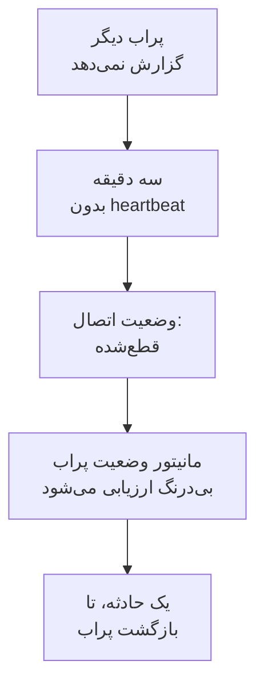

# مانیتور وضعیت پراب

مانیتور وضعیت پراب به شما خبر می‌دهد که پرابی دیگر گزارش نمی‌دهد: وقتی پراب قطع می‌شود یک حادثه، که با بازگشت پراب خودبه‌خود برطرف می‌شود. آن را روی پراب‌های سفارشی خود بگذارید یا، در OneUptime خودمیزبان، روی پراب سراسری‌ای که همهٔ مانیتورها روی آن اجرا می‌شوند، تا پرابی که ساکت شده هرگز مانیتورهایش را بی‌آنکه کسی بداند بدون بررسی رها نکند.

:::cards
- [ساختن یکی](#ساخت-مانیتور-وضعیت-پراب): پراب‌ها را انتخاب کنید و معیارهای پیش‌فرض را نگه دارید.
- [معیارها](#معیارها): پراب‌های متصل یا قطع‌شده را بشمارید، همین حالا یا در یک بازهٔ زمانی.
- [متریک‌ها](#متریکها): چند پراب متصل بوده‌اند، دقیقه به دقیقه.
:::

## چگونه کار می‌کند

OneUptime هر مانیتور وضعیت پراب را هر دقیقه یک بار ارزیابی می‌کند، و دوباره در همان لحظه‌ای که یکی از پراب‌هایش وصل یا قطع می‌شود. وضعیت اتصال هر پراب را می‌خواند، همان که صفحهٔ پراب نشان می‌دهد: پرابی که سه دقیقه از آن خبری نباشد قطع‌شده به شمار می‌آید. پس از آنکه خود OneUptime از کار افتاده یا داده دریافت نکرده باشد، سه دقیقهٔ کامل صبر می‌کند و بعد پرابی را قطع‌شده می‌داند، بنابراین ارتقای OneUptime هرگز حادثه‌ای باز نمی‌کند.

پرابی که قطع بماند یک حادثه است، نه یکی در هر دقیقه. مانیتور با حادثهٔ باز آفلاین می‌ماند تا همهٔ پراب‌هایی که زیر نظر دارد دوباره متصل شوند؛ سپس حادثه خودبه‌خود برطرف می‌شود.

یک مانیتور می‌تواند پراب‌های پروژهٔ خودش و پراب‌های سراسری را زیر نظر بگیرد. پراب حذف‌شده به هیچ سو شمرده نمی‌شود. وقتی هیچ‌یک از پراب‌هایی که مانیتور زیر نظر دارد باقی نماند، وضعیت فعلی خود را نگه می‌دارد و نمای کلی آن پس از یک روز این را می‌گوید.

## ساخت مانیتور وضعیت پراب

:::steps
### شروع یک مانیتور تازه

به **مانیتورها** بروید و روی **ساخت مانیتور** کلیک کنید.

### انتخاب وضعیت پراب

زیر **نوع مانیتور** روی **انواع دیگر مانیتور** کلیک کنید و **وضعیت پراب** را زیر **سایر** انتخاب کنید. **نام** را پر کنید و روی **بعدی** کلیک کنید.

### انتخاب پراب‌ها

زیر **پراب‌های زیر نظر** پراب‌ها را انتخاب کنید. مانیتور تازه با پراب‌های خود پروژهٔ شما شروع می‌شود. OneUptime خودمیزبانی که پراب خودش را ندارد با پراب‌های سراسری‌اش شروع می‌شود؛ در OneUptime Cloud پراب‌های سراسری را خود OneUptime اجرا می‌کند، پس پروژه اگر بخواهد آن‌ها را زیر نظر بگیرد خودش انتخابشان می‌کند.

### ساخت مانیتور

معیارهای پیش‌فرض را که در ادامه آمده نگه دارید و روی **ساخت مانیتور** کلیک کنید. مانیتور بی‌درنگ ارزیابی می‌شود و نمای کلی آن هر پراب را با آخرین زمانی که از آن خبری رسیده فهرست می‌کند.
:::

> [!TIP]
> **پایش این پراب**، در صفحهٔ هر پراب و در منوی ردیف آن زیر **مانیتورها → تنظیمات → پراب‌ها**، **ساخت مانیتور** را با یک مانیتور وضعیت پراب باز می‌کند که همان پراب را زیر نظر دارد و به نام آن است.

## معیارها

فیلترهای مانیتور وضعیت پراب، پراب‌ها را می‌شمارند:

| فیلتر | چه چیزی را می‌شمارد |
| --- | --- |
| **Disconnected Probes** | پراب‌های زیر نظر که قطع‌شده‌اند. |
| **Connected Probes** | پراب‌های زیر نظر که متصل‌اند. |

هر دو عدد صحیح‌اند و با **بزرگ‌تر از**، **کوچک‌تر از**، **برابر با** و دیگر مقایسه‌ها سنجیده می‌شوند. مانیتور تازه با دو معیار شروع می‌شود:

| معیار | فیلتر | چه می‌کند |
| --- | --- | --- |
| Check if a probe is disconnected | **Disconnected Probes** بزرگ‌تر از `0` | مانیتور را آفلاین می‌کند و حادثه‌ای با عنوان `Probe disconnected: {{disconnectedProbeNames}}` اعلام می‌کند که خودبه‌خود برطرف می‌شود. |
| Check if every probe is connected | **Disconnected Probes** برابر با `0` | مانیتور را عملیاتی می‌کند. |

**Connected Probes** برای مانیتوری مناسب است که چند پراب را زیر نظر دارد و از دست دادن یکی را تاب می‌آورد: **Connected Probes** کوچک‌تر از `2` فقط وقتی حادثه اعلام می‌کند که کمتر از دو پراب باقی مانده باشد.

### صبر بیشتر پیش از حادثه

پراب تنها پس از سه دقیقه سکوت قطع‌شده به شمار می‌آید، پس یک راه‌اندازی مجدد کوتاه چیزی باز نمی‌کند. برای صبر بیشتر، زیر فیلتر گزینهٔ **این معیار را در یک بازه زمانی ارزیابی کن** را تیک بزنید، زیر **ارزیابی** گزینهٔ **All Values** و زیر **در (دقیقه) گذشته** یک بازه را انتخاب کنید. با پنج دقیقه، پراب باید پنج دقیقهٔ دیگر قطع بماند تا حادثه اعلام شود.

## متریک‌ها

هر ارزیابی دو سری روی مانیتور ثبت می‌کند: `oneuptime.monitor.probes.connected` و `oneuptime.monitor.probes.disconnected`، یعنی تعداد پراب‌های زیر نظر که متصل و قطع‌شده بوده‌اند. این سری‌ها در صفحهٔ **متریک‌ها**ی مانیتور به شکل نمودار نمایش داده می‌شوند و یک داشبورد یا مانیتور متریک آن‌ها را مانند هر سری دیگری می‌خواند.

## متغیرهای قالب

قالب‌های حادثه و هشدار مانیتور وضعیت پراب، افزون بر متغیرهای هر مانیتور، می‌توانند از این متغیرها استفاده کنند:

| متغیر | مقدار |
| --- | --- |
| `{{disconnectedProbeNames}}` | نام پراب‌های قطع‌شده، جداشده با ویرگول. |
| `{{disconnectedProbeCount}}` | تعداد پراب‌های قطع‌شده. |
| `{{connectedProbeNames}}` | نام پراب‌های متصل، جداشده با ویرگول. |
| `{{connectedProbeCount}}` | تعداد پراب‌های متصل. |
| `{{probeStatusSummary}}` | یک جمله که نام پراب‌های قطع‌شده را می‌آورد، مانند `1 of 3 probes is disconnected: EU Probe.`، یا می‌گوید همهٔ پراب‌ها متصل‌اند. |
| `{{probes}}` | هر پراب، با `probeName`، `isConnected`، `isGlobalProbe` و `lastAliveAt`. |

## عیب‌یابی

:::details مانیتور می‌گوید منتظر داده است
مانیتور تازه نخستین ارزیابی خود را ظرف یکی دو دقیقه نشان می‌دهد. اگر هیچ پرابی را زیر نظر نداشته باشد، به جای آن **Not set up** نشان می‌دهد: پراب‌ها را زیر **معیارها** انتخاب کنید.
:::

:::details پرابی از کار افتاد و حادثه‌ای اعلام نشد
پراب پس از سه دقیقه بدون heartbeat قطع‌شده به شمار می‌آید، و اگر خود OneUptime از کار افتاده بوده باشد دیرتر. بررسی کنید که مانیتور غیرفعال یا در بازهٔ نگهداری نباشد و معیارهایش هنوز حادثه اعلام کنند.
:::

## گام‌های بعدی

:::cards
- [پراب‌های سفارشی](/docs/probe/custom-probe): یک پراب را در شبکهٔ خودتان اجرا کنید.
- [معیارها و وضعیت‌های مانیتور](/docs/monitor/criteria-and-statuses): معیارها چگونه وضعیت یک مانیتور را تعیین می‌کنند.
- [قالب‌های حادثه و هشدار](/docs/monitor/incident-alert-templating): متن حادثه‌ای را که مانیتور اعلام می‌کند بنویسید.
:::
