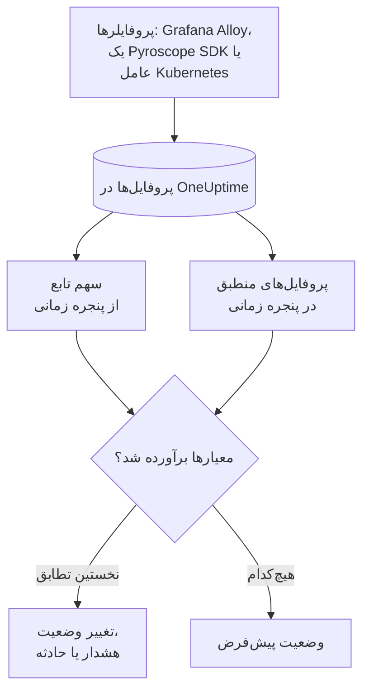

# مانیتور پروفایل‌ها

مانیتور پروفایل‌ها پروفایل‌های پیوسته‌ای را که سرویس‌های شما به OneUptime می‌فرستند می‌خواند و برای دو چیز هشدار می‌دهد: تابعی که سهمی از زمان را می‌گیرد که بیشتر از حد معمول است، مثل تجزیه‌گری که پس از یک استقرار سنگین‌تر شده، و پروفایل‌هایی که دیگر از یک سرویس نمی‌رسند. هر دقیقه می‌سنجد چه مقدار از پنجره زمانی‌اش از تابعی که نام برده‌اید گذشته است، پروفایل‌هایی را که با فیلترهایش منطبق‌اند می‌شمارد، و وقتی معیارهای شما برآورده شوند وضعیت مانیتور را تغییر می‌دهد، هشدار می‌سازد یا حادثه اعلام می‌کند.

:::cards
- [ساخت مانیتور](#ساخت-یک-مانیتور-پروفایلها): از یک تابع در پروفایلر، یا از ساخت مانیتور.
- [چه چیزی را پرس‌وجو می‌کند](#چه-چیزی-را-پرسوجو-میکند): تابع، نوع پروفایل، سرویس‌ها و پنجره.
- [معیارها](#معیارها): سهم یک تابع از پنجره، یا تعداد پروفایل‌ها.
- [تابعی سنگین‌تر می‌شود](#مثال-کاربردی-تابعی-سنگینتر-میشود): وقتی سهم یک تابع ناگهان بالا می‌رود هشدار بگیرید.
:::

## چگونه کار می‌کند



هر دقیقه، OneUptime پروفایل‌هایی را می‌خواند که با فیلترهای مانیتور منطبق‌اند و در پنجره زمانی آن آغاز شده‌اند. آن‌ها را می‌شمارد و، وقتی مانیتور تابعی را نام می‌برد، سهمی از زمان آن پنجره را که از تابع گذشته است می‌سنجد. سپس این عددها را از بالا به پایین با معیارهای مانیتور می‌سنجد و نخستین معیاری که منطبق شود تعیین می‌کند چه اتفاقی بیفتد. وقتی هیچ‌کدام منطبق نشود، مانیتور به وضعیت پیش‌فرض خود برمی‌گردد.

## پیش از شروع

- سرویس‌های شما دادهٔ پروفایل‌گیری پیوسته را از طریق Grafana Alloy (eBPF)، یک Pyroscope SDK یا عامل Kubernetes در OneUptime به OneUptime می‌فرستند. [پروفایل‌گیری پیوسته](/docs/telemetry/profiles) را ببینید.
- برای زیر نظر گرفتن یک تابع، نام آن یا بخشی از مسیر فایل یا بستهٔ آن را، همان‌طور که پروفایلر نشان می‌دهد، می‌دانید.

## ساخت یک مانیتور پروفایل‌ها

:::steps
### شروع از پروفایلر، یا از ساخت مانیتور

سریع‌ترین راه شروع از خود تابع است: در **پروفایل‌های کارایی** تابع را باز کنید و روی پیوندی کلیک کنید که برای سهم آن هشدار پیشنهاد می‌دهد. **ساخت مانیتور** با مانیتوری باز می‌شود که برای آن تابع و سرویسش پر شده و آستانه‌اش بالاتر از سهم امروز تابع است، همان‌طور که در [مثال کاربردی: تابعی سنگین‌تر می‌شود](#مثال-کاربردی-تابعی-سنگینتر-میشود) آمده است. در غیر این صورت، به **مانیتورها** بروید و روی **ساخت مانیتور** کلیک کنید.

### انتخاب Profiles

زیر **نوع مانیتور** روی **انواع دیگر مانیتور** کلیک کنید و **پروفایل‌ها** را زیر **تله‌متری** انتخاب کنید، یا در کادر جست‌وجو `profiles` را تایپ کنید. یک **نام** وارد کنید، سپس روی **بعدی** کلیک کنید.

### انتخاب آنچه می‌خواند

در **پیکربندی مانیتور پروفایل‌ها**، **تابع** را روی تابعی که باید زیر نظر باشد، **چه چیزی تحلیل شود** را روی نوع پروفایل و **پایش پروفایل‌ها برای (زمان)** را روی پنجره تنظیم کنید. مانیتور تازه **زمان پردازنده** را در **۵ دقیقه گذشته** می‌خواند. **این مانیتور اکنون چه می‌خواند** زیر فیلدها نشان می‌دهد چند پروفایل منطبق‌اند و تابع امروز چه مقدار از پنجره را می‌گیرد، تا بتوانید آستانه را بالاتر از آن بگذارید. برای فیلتر بر اساس سرویس تله‌متری یا موجودیت زیرساخت، **فیلدهای بیشتر** را باز کنید.

### تنظیم معیارها

مانیتوری که از **ساخت مانیتور** آغاز شده دو معیار دارد: آفلاین همراه با حادثه، وقتی **تعداد پروفایل‌ها** ۰ است، و آنلاین وقتی بیشتر از ۰ است. برای هشدار دربارهٔ تابع، یک فیلتر **سهم تابع (به %)** اضافه کنید؛ [معیارها](#معیارها) را ببینید.

### ساخت مانیتور

روی **ساخت مانیتور** کلیک کنید. مانیتور در صفحهٔ **نمای کلی** خود باز می‌شود و نخستین ارزیابی آن ظرف یک دقیقه اجرا می‌شود.
:::

### ساخت آن از طریق API یا Terraform

مرحلهٔ یک مانیتور همان تنظیمات پیکربندی `profileMonitor` آن را دارد. این پیکربندی `parseOrder` را در پروفایل‌های CPU یک سرویس در پنج دقیقهٔ گذشته زیر نظر دارد:

```json
{
  "profileMonitor": {
    "telemetryServiceIds": [],
    "profileTypes": ["cpu"],
    "profileType": "",
    "functionName": "parseOrder",
    "attributes": {},
    "lastXSecondsOfProfiles": 300
  }
}
```

شناسهٔ سرویس را در `telemetryServiceIds` بگذارید، یا برای خواندن پروفایل‌های همهٔ سرویس‌ها فهرست را خالی بگذارید، و برای فقط شمردن پروفایل‌ها `functionName` را خالی بگذارید. از طریق [API](/docs/api-reference/api-reference) یا [Terraform](/docs/terraform/monitor-steps) مانیتوری با نوع مانیتور `Profiles` و مرحله‌ای بسازید که این پیکربندی و دست‌کم یک معیار را در خود دارد. در Terraform، پیکربندی را به‌صورت ویژگی `profile_monitor` مرحله بدهید که با `jsonencode()` نوشته شده است.

## چه چیزی را پرس‌وجو می‌کند

| فیلد | با چه چیزی منطبق است | پیش‌فرض |
| --- | --- | --- |
| `profileTypes` | پروفایل‌هایی از هر یک از این نوع‌ها، با تطابق دقیق، مثل `cpu`. | خالی: همهٔ نوع‌ها |
| `profileType` | پروفایل‌هایی که نوعشان این متن را دارد، بدون توجه به بزرگی و کوچکی حروف. وقتی تنظیم شده باشد، `profileTypes` نادیده گرفته می‌شود. | خالی |
| `functionName` | کدی که **سهم تابع (به %)** سهم آن را می‌سنجد: فریم‌های پشته‌ای که نام تابع یا مسیر فایلشان این متن را دارد، بدون توجه به بزرگی و کوچکی حروف. | خالی: هیچ سهمی سنجیده نمی‌شود |
| `telemetryServiceIds` | پروفایل‌های هر یک از این سرویس‌های تله‌متری. | خالی: همهٔ سرویس‌ها |
| `entityKeys` | پروفایل‌های هر یک از این میزبان‌ها، پادها، کانتینرها و دیگر موجودیت‌های زیرساخت. | خالی: همهٔ موجودیت‌ها |
| `attributes` | پروفایل‌هایی که ویژگی‌هایشان این مقادیر را دارند. | خالی: بدون شرط |
| `lastXSecondsOfProfiles` | پروفایل‌هایی که در این تعداد ثانیه پیش از ارزیابی آغاز شده‌اند. | ندارد: همیشه تنظیمش کنید، وگرنه همهٔ پروفایل‌های ذخیره‌شده شمرده می‌شوند و شمارش هرگز به ۰ نمی‌رسد |

برای اینکه یک پروفایل خوانده شود، باید با همهٔ فیلترهایی که تنظیم کرده‌اید منطبق باشد. در فرم، **تابع** مقدار `functionName` را تنظیم می‌کند، **چه چیزی تحلیل شود** مقدار `profileTypes` را (گزینهٔ **همه انواع پروفایل** آن را خالی می‌گذارد)، **پایش پروفایل‌ها برای (زمان)** مقدار `lastXSecondsOfProfiles` را، و **فیلتر بر اساس سرویس تله‌متری** و **فیلتر بر اساس موجودیت زیرساخت** مقادیر `telemetryServiceIds` و `entityKeys` را تنظیم می‌کنند.

## چگونه ارزیابی می‌شود

- **هر دقیقه.** مانیتور پروفایل‌ها را پراب‌ها بررسی نمی‌کنند، پس بازه‌ای برای تنظیم ندارد و صفحهٔ **پراب‌ها و بازه** هم ندارد.
- **دو عدد در هر ارزیابی.** مانیتور پروفایل‌هایی را می‌شمارد که با همهٔ فیلترها منطبق‌اند و در `lastXSecondsOfProfiles` آغاز شده‌اند، و سهم تابع را در همین پروفایل‌ها می‌سنجد. پروفایلر در فاصله‌های منظم بارگذاری می‌کند، پس پنجره را آن‌قدر بزرگ بگیرید که چند بارگذاری در آن جا شود.
- **هر بار یک واحد.** سهم، نمونه‌های یک واحد را جمع می‌زند: وقتی نوع‌هایی که می‌خواند واحدهای مختلف دارند، مثل زمان پردازنده به نانوثانیه از یک SDK و تعداد نمونه‌ها از eBPF، واحدی را می‌خواند که بیشترین نمونه را در پنجره دارد.
- **نبود پروفایل یعنی شمارش ۰ و هیچ سهمی.** سرویسی که پروفایلرش دیگر بارگذاری نمی‌کند شمارش ۰ تولید می‌کند، و معیار **سهم تابع (به %)** با پنجره‌ای که چیزی در آن نیست منطبق نمی‌شود: برای اینکه بفهمید پروفایل‌گیری متوقف شده، روی **تعداد پروفایل‌ها** هشدار بگیرید.
- **قطعی خود OneUptime سکوت نیست.** تا وقتی پنجره زمانی شامل زمانی است که خود OneUptime داده دریافت نمی‌کرد (در حال راه‌اندازی دوباره، ارتقا یا جبران عقب‌ماندگی بود)، بررسی صبر می‌کند: وضعیت تغییر نمی‌کند و هیچ حادثه یا هشداری باز یا رفع نمی‌شود. [وقتی OneUptime داده دریافت نمی‌کند](/docs/monitor/when-oneuptime-is-not-receiving) را ببینید.
- **معیارها از بالا به پایین.** نخستین معیاری که منطبق شود تصمیم می‌گیرد، پس شدیدترین را اول بگذارید.

هر تغییر وضعیت، همراه با دلیل آن، در **خط زمانی وضعیت** مانیتور ثبت می‌شود.

## معیارها

معیارهای مانیتور پروفایل‌ها یکی از دو عدد را با یک مقدار مقایسه می‌کنند.

**سهم تابع (به %)** سهمی از زمان پنجره، از ۰ تا ۱۰۰، است که از تابع مانیتور گذشته است: هر پشته‌ای که فریمی منطبق با `functionName` دارد، در هر عمقی که باشد، یک بار شمرده می‌شود، پس هم کد خود تابع و هم هرچه فراخوانی می‌کند در آن هست.

| شرط فیلتر | منطبق است وقتی سهم تابع… |
| --- | --- |
| **بزرگ‌تر از** | بیشتر از مقدار باشد |
| **بزرگ‌تر یا برابر با** | برابر مقدار یا بیشتر از آن باشد |
| **کوچک‌تر از** | کمتر از مقدار باشد |
| **کوچک‌تر یا برابر با** | برابر مقدار یا کمتر از آن باشد |

**تعداد پروفایل‌ها** تعداد پروفایل‌هایی است که در پنجره منطبق شدند:

| شرط فیلتر | منطبق است وقتی شمارش پروفایل… |
| --- | --- |
| **بزرگ‌تر از** | بیشتر از مقدار باشد |
| **بزرگ‌تر یا برابر با** | برابر مقدار یا بیشتر از آن باشد |
| **کوچک‌تر از** | کمتر از مقدار باشد |
| **کوچک‌تر یا برابر با** | برابر مقدار یا کمتر از آن باشد |
| **برابر با** | دقیقاً برابر مقدار باشد |
| **نابرابر با** | هر چیزی جز مقدار باشد |

شمارش پروفایل‌ها شرط ناهنجاری ندارد: مبنایی برای مقایسه با آن‌ها وجود ندارد.

## مثال کاربردی: تابعی سنگین‌تر می‌شود

در سرویس checkout، `parseOrder` ۱۸٪ از زمان پردازندهٔ آن را می‌گیرد. استقراری که بار بزرگ‌تری را تجزیه می‌کند نباید از چشم بیفتد:

1. در **پروفایل‌های کارایی** سرویس checkout را انتخاب کنید و `parseOrder` را باز کنید.
2. روی پیوندی کلیک کنید که برای سهم آن هشدار پیشنهاد می‌دهد. پروفایلر ۳۰٪ را پیشنهاد می‌کند: یک‌ونیم برابر سهم امروز، دست‌کم ۱۰ واحد بیشتر، گرد شده به بالا تا مضربی از ۵.
3. **ساخت مانیتور** با یک مانیتور پروفایل‌ها برای سرویس checkout باز می‌شود که **زمان پردازنده** را در **۵ دقیقه گذشته** می‌خواند و دو معیار دارد: **سهم تابع (به %)** **بزرگ‌تر از** `30` هشداری می‌سازد که خودبه‌خود رفع می‌شود و مانیتور را افت‌کرده علامت می‌زند؛ **کوچک‌تر یا برابر با** `30` آن را عملیاتی علامت می‌زند. حادثه پر شده اما خاموش است: برای فراخواندن کسی آن را روشن کنید.
4. روی **ساخت مانیتور** کلیک کنید.

وقتی استقرار باعث شود `parseOrder` ۴۵٪ از زمان پردازنده را بگیرد، ارزیابی بعدی هشدار را می‌سازد. وقتی یک اصلاح آن را دوباره به زیر ۳۰٪ برساند، هشدار خودبه‌خود رفع می‌شود.

## مثال کاربردی: پروفایل‌ها دیگر نمی‌رسند

سرویس checkout یک Pyroscope SDK اجرا می‌کند که پروفایل‌های CPU را بارگذاری می‌کند. می‌خواهید وقتی بارگذاری‌ها پنج دقیقه متوقف شوند، حادثه‌ای اعلام شود:

- `profileTypes`: `["cpu"]`، `telemetryServiceIds`: سرویس checkout، `lastXSecondsOfProfiles`: `300`
- معیار ۱: **تعداد پروفایل‌ها** **برابر با** `0`: مانیتور را آفلاین علامت بزن و حادثه اعلام کن
- معیار ۲: **تعداد پروفایل‌ها** **بزرگ‌تر از** `0`: مانیتور را آنلاین علامت بزن

تا وقتی SDK بارگذاری می‌کند، هر ارزیابی چند پروفایل می‌شمارد و معیار ۲ مانیتور را آنلاین نگه می‌دارد. وقتی سرویس بدون SDK مستقر شود، شمارش پنج دقیقه پس از آخرین بارگذاری به ۰ می‌رسد، معیار ۱ منطبق می‌شود و حادثه اعلام می‌شود. نخستین بارگذاری پس از رفع مشکل شمارش را دوباره به بالای ۰ می‌برد، و اگر **رفع خودکار حادثه** برای آن روشن باشد، حادثه خودبه‌خود رفع می‌شود.

## رفع اشکال

:::details مانیتور ۰ می‌شمارد، اما پروفایل‌ها در OneUptime دیده می‌شوند
فیلترها را با پروفایل‌هایی که می‌بینید مقایسه کنید: `profileTypes` باید دقیقاً با نوع منطبق باشد و `telemetryServiceIds` باید شناسه‌های درست سرویس‌ها را داشته باشد. یک `lastXSecondsOfProfiles` کوتاه هم ممکن است میان دو بارگذاری بیفتد.
:::

:::details سهم تابع روی ۰٪ می‌ماند
هیچ فریمی در پنجره متن تابع را ندارد. تابع را در پروفایلر باز کنید و نامش را همان‌طور که آنجا نشان داده می‌شود کپی کنید؛ بخشی از نام هم کافی است و بزرگی و کوچکی حروف مهم نیست. سپس بررسی کنید که سرویس همان نوع پروفایلی را می‌فرستد که **چه چیزی تحلیل شود** می‌خواند.
:::

## گام‌های بعدی

:::cards
- [پروفایل‌گیری پیوسته](/docs/telemetry/profiles): پروفایل‌ها را بفرستید و در پروفایلر بخوانید.
- [مراحل مانیتور](/docs/terraform/monitor-steps): پیکربندی مرحله را از Terraform بدهید.
- [مانیتور ترِیس‌ها](/docs/monitor/traces-monitor): روی اسپن‌های ناموفق هشدار بگیرید.
- [مانیتور متریک‌ها](/docs/monitor/metrics-monitor): روی CPU، حافظه و متریک‌های دیگر هشدار بگیرید.
:::
