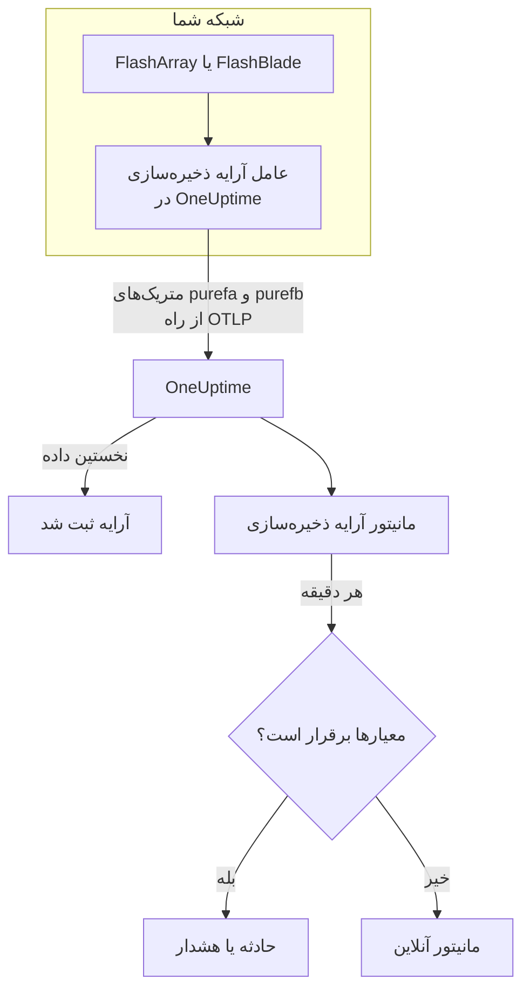

# مانیتور آرایه ذخیره‌سازی

مانیتور آرایه ذخیره‌سازی یک آرایه ذخیره‌سازی را زیر نظر می‌گیرد و وقتی آرایه خودش هشداری می‌دهد، فضایش تمام می‌شود، کند می‌شود، سخت‌افزار یا مسیری به یک میزبان را از دست می‌دهد، یا در همتاسازی عقب می‌افتد به شما خبر می‌دهد. با Pure Storage FlashArray، Pure Storage FlashBlade و NetApp ONTAP (از جمله Amazon FSx for NetApp ONTAP) کار می‌کند و متریک‌هایی را می‌خواند که عامل آرایه ذخیره‌سازی در OneUptime جمع می‌کند: سری‌های `purefa_*` و `purefb_*` در Pure، و سری‌های `netapp_*` که NetApp Harvest از یک خوشه ONTAP می‌خواند.

با Dell PowerStore (`dell.powerstore`) هم کار می‌کند، بر پایه سری‌های `powerstore_*` از Dell.

:::cards
- [ساخت مانیتور](#ساخت-یک-مانیتور-آرایه-ذخیرهسازی): شش گام در داشبورد.
- [قالب‌ها](#قالبهای-هشدار-آماده): هشدارهای آماده، یک حادثه به ازای هر حجم، میزبان، دستگاه اختصاصی یا قطعه.
- [سری‌های Pure چگونه کار می‌کنند](#سریهای-pure-چگونه-شکل-گرفتهاند): یک نام متریک، چند رقم. سری‌های ONTAP [بخش جداگانه خود را دارند](#سریهای-ontap-چگونه-شکل-گرفتهاند).
- [متریک‌ها](#متریکهای-جمعآوریشده): هر سری که مانیتور می‌تواند بر پایه‌اش هشدار دهد.
:::

## چگونه کار می‌کند

عامل آرایه ذخیره‌سازی در OneUptime روی ماشینی اجرا می‌شود که به رابط مدیریتی آرایه دسترسی دارد. متریک‌های آرایه را با یک توکن API فقط‌خواندنی می‌خواند، روی آن‌ها نام آرایه، `storage.array.name`، و پلتفرم آن، `storage.system`، را برچسب می‌زند و آن‌ها را از راه OTLP به OneUptime می‌فرستد. نخستین داده آرایه را ثبت می‌کند.

برای Dell PowerMax به عامل نیازی نیست: یک پراب OneUptime هر ۵ دقیقه با یک حساب فقط‌خواندنی به Unisphere for PowerMax وارد می‌شود و هر آرایه‌ای را که آن Unisphere مدیریت می‌کند به همین شیوه می‌فرستد، با نامی برگرفته از Symmetrix ID آن تا وقتی نامش را تغییر دهید ([Dell PowerMax](/docs/telemetry/storage-arrays#dell-powermax)).

مانیتور آرایه ذخیره‌سازی به یک آرایه وابسته است. هر دقیقه پرس‌وجوی خود را روی متریک‌های آن آرایه اجرا می‌کند و نتیجه را با معیارهایش مقایسه می‌کند.



## پیش از شروع

- **عامل آرایه ذخیره‌سازی را نصب کنید**، جایی که از راه HTTPS به آرایه دسترسی دارد، با توکن API کاربری که نقش **readonly** آرایه را دارد. [راهنمای عامل آرایه ذخیره‌سازی](/docs/telemetry/storage-arrays) کاربر، توکن و نصب را پوشش می‌دهد، از راه `ONEUPTIME_URL`، `ONEUPTIME_TELEMETRY_INGESTION_KEY`، `STORAGE_ARRAY_NAME`، و نشانی و توکن آرایه (`PURE_FA_ENDPOINT` و `PURE_FA_API_TOKEN`، یا `PURE_FB_ENDPOINT` و `PURE_FB_API_TOKEN`)، یا برای ONTAP نشانی خوشه و یک کاربر REST فقط‌خواندنی (`NETAPP_ONTAP_ENDPOINT`، `NETAPP_ONTAP_USERNAME` و `NETAPP_ONTAP_PASSWORD`).
- **بررسی کنید آرایه ثبت شده باشد.** حدود یک دقیقه پس از نخستین خراش، با نام `STORAGE_ARRAY_NAME` عامل زیر **محصولات ← زیرساخت ← آرایه‌های ذخیره‌سازی ← همه آرایه‌های ذخیره‌سازی** پدیدار می‌شود.
- **برای یک Dell PowerMax**، به‌جای آن، Unisphere for PowerMax مدیریت‌کننده آن را زیر **محصولات ← زیرساخت ← آرایه‌های ذخیره‌سازی ← اتصال‌ها** متصل کنید، همان‌طور که [Dell PowerMax](/docs/telemetry/storage-arrays#dell-powermax) توضیح می‌دهد.

## ساخت یک مانیتور آرایه ذخیره‌سازی

:::steps
### یک مانیتور تازه شروع کنید

به **مانیتورها** بروید و روی **ساخت مانیتور** کلیک کنید.

### آرایه ذخیره‌سازی را برگزینید

زیر **نوع مانیتور**، روی **انواع دیگر مانیتور** کلیک کنید و **آرایه ذخیره‌سازی** را زیر **زیرساخت** برگزینید، یا در کادر جست‌وجو `storage` را تایپ کنید. یک **نام** وارد کنید – در عنوان حادثه‌ها و هشدارها به کار می‌رود – و روی **بعدی** کلیک کنید.

### آرایه را برگزینید

زیر **پیکربندی مانیتور آرایه ذخیره‌سازی**، آرایه را از **آرایه ذخیره‌سازی** برگزینید. هر آرایه‌ای که داده فرستاده در فهرست است. پلتفرم آن تعیین می‌کند فرم کدام متریک‌ها و قالب‌ها را ارائه دهد. پس از انتخاب، خطی زیر فیلد نشان می‌دهد که آیا داده می‌رسد. **افزودن آرایه ذخیره‌سازی** گام‌های راه‌اندازی را با کلیدهای پرشده‌تان باز می‌کند که منتظر نخستین داده می‌مانند.

### برگزینید چه چیزی پایش شود

مانیتور تازه با **Array Stopped Reporting** زیر **هشدار برای چه** آغاز می‌شود. برای پایش چیزی دیگر:

- **تغییر** – یک [قالب](#قالبهای-هشدار-آماده) دیگر برگزینید. متریک، فیلترهای برچسب، تجمیع، بازه زمانی و آستانه‌ها را تعیین می‌کند و معیارهای زیر را با معیارهای خودش جایگزین می‌کند. همچنان می‌توانید **بازه زمانی** را تغییر دهید.
- **Custom Metric** (زیر **فیلدهای بیشتر**) – یک متریک از **متریک آرایه ذخیره‌سازی** برگزینید، سپس **تجمیع** و **بازه زمانی** را تعیین کنید. [فیلترها](#تنظیمات-مانیتور) آن را به یک حجم، میزبان، پاد، قطعه، سیستم فایل یا باکت محدود می‌کنند.
- **پیشرفته** (زیر **فیلدهای بیشتر**) – پرس‌وجوها و فرمول‌ها را خودتان زیر **انتخاب متریک‌ها** بسازید، برای نمونه ظرفیت به‌کاررفته به‌صورت `purefa_array_space_bytes` با فیلتر `space=capacity` منهای همان متریک با فیلتر `space=empty`. برای سنجش جداگانه هر شیء از **گروه‌بندی بر اساس** با برچسب آن شیء استفاده کنید.

### معیارها را بررسی کنید

هر معیار را زیر **معیارها** باز کنید و **متریک**، **تجمیع**، **شرط** و **آستانه** آن را بررسی کنید. قالب این‌ها را پر می‌کند. با **Custom Metric** یا **پیشرفته**، مانیتور با [معیارهای پیش‌فرض](#معیارهای-پیشفرض) شروع می‌شود که فقط نرسیدن داده از متریک را می‌بینند، پس آستانه خودتان را تعیین کنید.

### مانیتور را بسازید

روی **ساخت مانیتور** کلیک کنید. OneUptime صفحه مانیتور را باز می‌کند و آن را هر دقیقه ارزیابی می‌کند. حادثه‌ها و هشدارهایی که باز می‌کند در صفحه‌های **حوادث** و **هشدارها**ی آرایه هم فهرست می‌شوند.
:::

> [!TIP]
> برای راه‌اندازی هم‌زمان چند قالب، آرایه را از **محصولات ← زیرساخت ← آرایه‌های ذخیره‌سازی** باز کنید و به **توصیه‌ها** بروید. قالب‌های دلخواه و کسانی را که باید خبر داده شوند برگزینید، و OneUptime به ازای هر قالب یک مانیتور می‌سازد.

## تنظیمات مانیتور

| فیلد | زبانه | چه می‌کند |
| --- | --- | --- |
| **آرایه ذخیره‌سازی** | همه | الزامی. هر پرس‌وجو را به `resource.storage.array.name` محدود می‌کند، پس دو آرایه که هر دو حجمی به نام `vol-01` دارند هرگز با هم قاطی نمی‌شوند. |
| **حجم** | Custom Metric، پیشرفته | یک حجم: روی FlashArray بر پایه برچسب `name`، مانند `vol-db-01` (حجمی که در یک پاد یا یک گروه حجم است `pod::volume` یا `group/volume` نام دارد)؛ روی ONTAP بر پایه برچسب `volume`، که ممکن است در دو SVM یکسان باشد. |
| **میزبان** | Custom Metric، پیشرفته | فقط FlashArray. یک میزبان آن‌طور که آرایه می‌شناسدش، بر پایه برچسب `host`، مانند `esxi-01`. |
| **پاد** | Custom Metric، پیشرفته | فقط FlashArray. یک پاد ActiveCluster یا ActiveDR، بر پایه برچسب `name`، یا `local_pod` روی سری‌های پیوند replica. |
| **قطعه سخت‌افزاری** | Custom Metric، پیشرفته | یک قطعه سخت‌افزاری، مانند `CH0.BAY1` یا `CT0`: برچسب `component_name` روی FlashArray، `name` روی FlashBlade، و روی ONTAP برچسبی که سری‌هایش آن را با آن نام می‌برند (`node`، `disk`، `shelf` یا `port`). |
| **سامانه فایل** | Custom Metric، پیشرفته | فقط FlashBlade. یک سیستم فایل، بر پایه برچسب `name`. |
| **باکت** | Custom Metric، پیشرفته | فقط FlashBlade. یک باکت ذخیره‌سازی شیء، بر پایه برچسب `name`. |
| **متریک آرایه ذخیره‌سازی** | Custom Metric | یک متریک از [فهرست](#متریکهای-جمعآوریشده). فرم فیلتر برچسبی را که به آن معنا می‌دهد اضافه می‌کند و آن را بر پایه شیئی که توصیف می‌کند گروه‌بندی می‌کند، پس هر حجم، میزبان یا قطعه جداگانه سنجیده می‌شود. |
| **تجمیع** | Custom Metric | شیوه ترکیب نمونه‌ها: **میانگین**، **بیشینه**، **کمینه**، **جمع** یا **تعداد**. از تجمیع معمول متریک شروع می‌شود. |
| **بازه زمانی** | همه | پنجره غلتانی که پرس‌وجو می‌خواند، از **Past 1 Minute** تا **Past 365 Days**. مانیتور تازه از **۵ دقیقه گذشته** شروع می‌شود؛ متریک سفارشی یک سیستم فایل یا باکت از **۱۵ دقیقه گذشته**؛ قالب‌ها پنجره خودشان را تعیین می‌کنند. |
| **انتخاب متریک‌ها** | پیشرفته | سازنده پرس‌وجو: **متریک**، **تجمیع بر اساس**، **فیلتر بر اساس ویژگی‌ها**، **گروه‌بندی بر اساس**، به همراه **افزودن متریک** و **افزودن فرمول** برای ترکیب پرس‌وجوها. |

عامل نقطه پایانی آرایه را هر ۶۰ ثانیه، و حجم‌ها، میزبان‌ها و پادها را هر ۲ دقیقه می‌خواند، پس پنجره ۵ دقیقه‌ای همیشه یک نمونه دارد. سیستم‌های فایل و باکت‌های FlashBlade را هر ۵ دقیقه می‌خواند، از همین رو ۱۵، و پوشه‌های FlashArray را هر ۳۰ دقیقه: به مانیتور پوشه پنجره‌ای ۶۰ دقیقه‌ای بدهید. روی ONTAP، Harvest کارایی خوشه را هر دقیقه و پیکربندی، وضعیت و رویدادهای EMS آن را هر ۳ دقیقه می‌خواند، پس پنجره ۵ دقیقه‌ای همیشه یک نمونه دارد.

یک PowerStore را هر ۵ دقیقه، و وضعیت خوشه آن را هر ۶۰ ثانیه می‌خواند: به مانیتور PowerStore پنجره‌ای ۱۵ دقیقه‌ای بدهید.

## سری‌های Pure چگونه شکل گرفته‌اند

Pure چند رقم را روی **یک** نام متریک می‌گذارد و آن‌ها را با یک برچسب از هم جدا می‌کند:

- **`dimension`** روی سری‌های کارایی. `purefa_array_performance_latency_usec` تأخیر خواندن (`usec_per_read_op`)، تأخیر نوشتن (`usec_per_write_op`)، تأخیر نوشتن آینه‌ای، و زمان SAN، صف، QoS و سرویس هر کدام را در خود دارد. همیشه روی یک `dimension` فیلتر کنید: میانگین گرفتن از همه آن‌ها تأخیر خواندن ۲۰۰ µs را با رقم صف قاطی می‌کند.
- **`space`** روی سری‌های ظرفیت: `capacity`، `empty`، `snapshots`، `total_provisioned`، `total_physical`، `available_ratio` و موارد دیگر.

چند سری وضعیت خود را در یک **برچسب** دارند، با مقداری که همیشه ۱ است:

| سری | برچسب وضعیت | یک سری به ازای هر |
| --- | --- | --- |
| `purefa_alerts_open` | `severity`، همراه با `summary`، `code` و `component_type` | هشدار باز |
| `purefa_hw_component_status` | `component_status` | قطعه سخت‌افزاری |
| `purefa_host_connectivity_info` | `status`، همراه با `details` | میزبان |
| `purefa_drive_capacity_bytes` | `component_status` (مقدار، ظرفیت درایو است) | درایو |

سری‌ای که به یک وضعیت بد فیلتر شده فقط تا وقتی چیزی در آن وضعیت است وجود دارد، پس نبودن سری یعنی سالم. برای همین **فعال شدن با Max بیش از ۰ و بهبود با ۰** شکل درست برای آن‌هاست، و قالب‌ها هم همین‌طور ساخته شده‌اند: معیارهای بهبودشان سری غایب را صفر حساب می‌کنند. وقتی هیچ سری‌ای نماند، چنین قالبی فقط اگر `purefa_info`، `purefb_info` یا `powermax_array_info` در همان پنجره رسیده باشد بهبود می‌یابد، پس آرایه‌ای که دیگر گزارش نمی‌دهد چیزی را نمی‌بندد.

هر سری PowerMax فقط یک رقم دارد و به نام همان رقم نام‌گذاری شده است: `powermax_array_response_time_usec` خواندن‌ها را با `operation` از نوشتن‌ها جدا می‌کند. سری‌های وضعیت آن هم به همین شکل فقط تا وقتی چیزی خراب است وجود دارند: `powermax_alert_open` تا وقتی Unisphere هشداری باز دارد، `powermax_director_offline` تا وقتی یک دایرکتور آنلاین نیست، `powermax_port_offline` تا وقتی پورتی که کسی به آن متکی است از کار افتاده است، و `powermax_srdf_group_not_healthy` تا وقتی یک گروه SRDF معلق یا آفلاین است.

در فیلترها و کلیدهای گروه‌بندی مانیتور، ویژگی‌های عامل با `resource.` شروع می‌شوند (`resource.storage.array.name`، `resource.storage.system`)، در حالی که برچسب‌های خود Pure این‌طور نیستند (`name`، `host`، `component_name`، `dimension`، `space`، `severity`)، و برچسب‌های PowerMax هم این‌طور نیستند (`storage_group`، `volume`، `director`، `port_id`، `srdf_group`).

## ساختار سری‌های PowerStore

صادرکننده Dell برای هر نام متریک یک مقدار می‌نویسد، پس یک سری PowerStore به فیلتر برچسب نیاز ندارد. برچسب‌هایش شیء را نام می‌برند: `appliance_id` یک دستگاه اختصاصی، `name` یک بخش، حجم یا سامانه فایل، و `volume_id`، `fc_port_id`، `eth_port_id`، `nas_id` یا `volume_group_id` شیء یک سری کارایی. سری‌های وضعیت آن تا وقتی سالم است 1 و در غیر این صورت 0 هستند، پس قالب‌ها زیر 1 فعال می‌شوند. هشدارهای خود آن با syslog می‌رسند، و قالب‌های آن‌ها، مانیتورهای لاگ، پس از جدول آن در پایین آمده‌اند.

## سری‌های ONTAP چگونه شکل گرفته‌اند

NetApp Harvest هر سری را `netapp_<object>_<counter>` نام می‌گذارد و شیء را با برچسب‌هایش نام‌گذاری می‌کند: یک حجم را با `volume` درون `svm` خودش، یک اگریگیت را با `aggr`، یک LUN را با `lun` درون `volume` و `svm` خودش، یک گره را با `node`، یک دیسک را با `disk`، یک قفسه دیسک را با `shelf`، و یک رابطه SnapMirror را با `destination_location`. تأخیرها میکروثانیه به ازای هر عملیات‌اند، `_ops` عملیات در ثانیه و `_data` بایت در ثانیه.

وضعیت‌های ONTAP به سه شکل می‌آیند:

| سری | وضعیت | یک سری به ازای هر |
| --- | --- | --- |
| `netapp_*_new_status` | ۱ سالم، آنلاین، برقرار یا در حال اجرا، ۰ نه | شیء، در هر پیمایش |
| `netapp_health_*_alerts` | مقدار ۱، با `severity` (`error` یا `warning`) و دلیل در برچسب‌هایش | مشکل باز: دیسک خراب، خطای قفسه دیسک، گره‌ای که نمی‌تواند کار شریکش را بر عهده بگیرد، پورت قطع، هشدار سلامت سامانه |
| `netapp_ems_events` | مقدار ۱، با `message`، `severity` و پارامترهای رویداد | رویداد EMS، فقط برای همان یک پیمایشی که آن را گردآوری کرد؛ پایان یک رویداد جفت‌شده یک بار دیگر با مقدار ۰ صادر می‌شود |

وضعیتی که به‌صورت عدد است وقتی فعال می‌شود که همه خوانش‌های پنجره کمتر از ۱ باشند، و به‌محض آنکه یک خوانش دوباره ۱ شود بهبود می‌یابد. یک مشکل باز تا وقتی سری‌اش هست فعال است و به‌محض ناپدید شدن آن بهبود می‌یابد، به شرط آنکه `netapp_cluster_new_status` هنوز برسد، پس عاملی که متوقف شده چیزی را نمی‌بندد. یک رویداد EMS با همان یک خوانشش فعال می‌شود و تا وقتی در بازه یک‌ساعته قالب است باز می‌ماند؛ وقتی یک ساعت بی رویدادی دیگر بگذرد بهبود می‌یابد.

## قالب‌های هشدار آماده

OneUptime در مجموع ۸۰ قالب دارد – ۱۲ قالب برای FlashArray، ۸ قالب برای FlashBlade، ۱۶ قالب برای PowerStore، ۳۱ قالب برای ONTAP و ۱۳ قالب برای PowerMax – و فهرست **هشدار برای چه** قالب‌های پلتفرم آرایه را ارائه می‌دهد. هر کدام یک مانیتور کامل می‌سازد: پرس‌وجوی متریک، فیلترهای برچسب آن، یک گروه‌بندی بر پایه برچسب خود شیء، یک معیار که فعال می‌شود و یکی که بهبود می‌یابد. آستانه‌ها نقطه شروع‌اند و می‌توانید ویرایششان کنید.

یک معیار فقط وقتی فعال می‌شود که شرط برای **همه** مقدارهای پنجره‌اش برقرار باشد، جز معیار قالب‌های EMS در ONTAP: Harvest هر رویداد را فقط برای یک پیمایش صادر می‌کند، پس یک خوانش کافی است. مانیتوری که بر پایه آستانه ظرفیت، تأخیر، عقب‌ماندگی یا نسبت فعال شده، فقط ۱۰٪ آن‌سوی آن بهبود می‌یابد، تا مقداری که حول آستانه نوسان دارد مدام جابه‌جا نشود. قالب‌های هشدار، سخت‌افزار و اتصال وقتی فعال می‌شوند که وضعیتی در تمام پنجره ۵ دقیقه‌ای‌شان دیده شده باشد، و حدود ۵ دقیقه پس از برطرف شدن آن بهبود می‌یابند.

### FlashArray

| قالب | دسته | شدت | چه چیزی را پایش می‌کند | چه وقت فعال می‌شود |
| --- | --- | --- | --- | --- |
| Array Stopped Reporting | در دسترس بودن | بحرانی | `purefa_info`، Count، ۱۰ دقیقه گذشته | در تمام پنجره هیچ داده‌ای نیست – عامل آرایه ذخیره‌سازی متوقف شده، مسیرش به OneUptime را از دست داده یا توکنش باطل شده است، یا آرایه دیگر به آن پاسخ نمی‌دهد؛ با رسیدن دوباره داده بهبود می‌یابد |
| Critical Array Alert | سلامت آرایه | بحرانی | `purefa_alerts_open` با فیلتر `severity=critical`، Max به ازای هر `summary`، ۵ دقیقه گذشته | > ۰ – آرایه یک هشدار بحرانی باز دارد (قطعه‌ای از کار افتاده، وضعیت اضطراری ظرفیت، شکست همتاسازی). یک حادثه به ازای هر هشدار؛ با بسته شدن هشدار بهبود می‌یابد |
| Warning Array Alert | سلامت آرایه | هشدار | `purefa_alerts_open` با فیلتر `severity=warning`، Max به ازای هر `summary`، ۵ دقیقه گذشته | > ۰ – آرایه یک هشدار سطح warning باز دارد. یک حادثه به ازای هر هشدار؛ با بسته شدن هشدار بهبود می‌یابد |
| Capacity Above 80% | ظرفیت | هشدار | `purefa_array_space_utilization`، Max، ۱۵ دقیقه گذشته | > ۸۰ – نخستین آستانه ظرفیت خود Pure؛ در ≤ ۷۲ بهبود می‌یابد |
| Capacity Above 90% | ظرفیت | بحرانی | `purefa_array_space_utilization`، Max، ۵ دقیقه گذشته | > ۹۰ – آرایه نزدیک است که نوشتن‌ها را رد کند؛ در ≤ ۸۱ بهبود می‌یابد |
| High Read Latency | کارایی | هشدار | `purefa_array_performance_latency_usec` با فیلتر `dimension=usec_per_read_op`، Avg، ۱۰ دقیقه گذشته | > ۵۰۰۰ µs (۵ ms) – خواندن‌های FlashArray معمولاً خیلی زیر ۱ ms کامل می‌شوند؛ در ≤ ۴۵۰۰ بهبود می‌یابد |
| High Write Latency | کارایی | هشدار | `purefa_array_performance_latency_usec` با فیلتر `dimension=usec_per_write_op`، Avg، ۱۰ دقیقه گذشته | > ۵۰۰۰ µs (۵ ms)؛ در ≤ ۴۵۰۰ بهبود می‌یابد |
| Hardware Component Failed | سخت‌افزار | بحرانی | `purefa_hw_component_status` با فیلتر `component_status=critical`، Max به ازای هر `component_name`، ۵ دقیقه گذشته | > ۰ – یک کنترلر، منبع تغذیه، فن، جایگاه یا پورت در وضعیت بحرانی است و افزونگی از دست رفته است. یک حادثه به ازای هر قطعه؛ وقتی ok گزارش دهد بهبود می‌یابد |
| Hardware Component Degraded | سخت‌افزار | هشدار | `purefa_hw_component_status` با فیلتر `component_status=degraded`، Max به ازای هر `component_name`، ۵ دقیقه گذشته | > ۰ – یک قطعه افت کارکرد دارد. یک حادثه به ازای هر قطعه؛ وقتی ok گزارش دهد بهبود می‌یابد |
| Drive Failed | سخت‌افزار | بحرانی | `purefa_drive_capacity_bytes` با فیلتر `component_status=failed`، Max به ازای هر `component_name`، ۵ دقیقه گذشته | > ۰ – یک ماژول DirectFlash یا SSD از کار افتاده و آرایه داده را روی بقیه بازسازی می‌کند. یک حادثه به ازای هر درایو؛ با تعویض آن بهبود می‌یابد |
| Host Lost Redundant Paths | میزبان‌ها | هشدار | `purefa_host_connectivity_info` با فیلتر `status=critical`، Max به ازای هر `host`، ۵ دقیقه گذشته | > ۰ – میزبان از راه یک کنترلر یا هیچ کنترلری به آرایه می‌رسد؛ یک failover کنترلر ذخیره‌سازی آن را آفلاین می‌کند. یک حادثه به ازای هر میزبان؛ با بازگشت مسیرهایش بهبود می‌یابد |
| Replication Lag Above 1 Minute | تکثیر | هشدار | `purefa_pod_replica_links_lag_max_msec`، Max به ازای هر `local_pod`، ۱۰ دقیقه گذشته | > ۶۰۰۰۰ ms (۶۰ s) – failover در این لحظه نوشتن‌های تازه‌تری از آنچه برنامه‌ریزی شده از دست می‌دهد. یک حادثه به ازای هر پاد؛ در ≤ ۵۴۰۰۰ بهبود می‌یابد |

### FlashBlade

| قالب | دسته | شدت | چه چیزی را پایش می‌کند | چه وقت فعال می‌شود |
| --- | --- | --- | --- | --- |
| Array Stopped Reporting | در دسترس بودن | بحرانی | `purefb_info`، Count، ۱۰ دقیقه گذشته | در تمام پنجره هیچ داده‌ای نیست – عامل، صادرکننده آن یا FlashBlade دیگر پاسخ نمی‌دهد؛ با رسیدن دوباره داده بهبود می‌یابد |
| Critical Array Alert | سلامت آرایه | بحرانی | `purefb_alerts_open` با فیلتر `severity=critical`، Max به ازای هر `summary`، ۵ دقیقه گذشته | > ۰ – FlashBlade یک هشدار بحرانی باز دارد. یک حادثه به ازای هر هشدار؛ با بسته شدن هشدار بهبود می‌یابد |
| Warning Array Alert | سلامت آرایه | هشدار | `purefb_alerts_open` با فیلتر `severity=warning`، Max به ازای هر `summary`، ۵ دقیقه گذشته | > ۰ – FlashBlade یک هشدار سطح warning باز دارد. یک حادثه به ازای هر هشدار؛ با بسته شدن هشدار بهبود می‌یابد |
| Capacity Above 80% | ظرفیت | هشدار | `purefb_array_space_utilization` با فیلتر `type=array`، Max، ۱۵ دقیقه گذشته | > ۸۰؛ در ≤ ۷۲ بهبود می‌یابد |
| Capacity Above 90% | ظرفیت | بحرانی | `purefb_array_space_utilization` با فیلتر `type=array`، Max، ۵ دقیقه گذشته | > ۹۰ – وقتی پر شود نوشتن برای همه کلاینت‌ها شکست می‌خورد؛ در ≤ ۸۱ بهبود می‌یابد |
| Hardware Component Unhealthy | سخت‌افزار | بحرانی | `purefb_hardware_health`، Min به ازای هر `name`، ۵ دقیقه گذشته | < ۱ – یک blade، ماژول fabric، منبع تغذیه یا فن سالم نیست (جایگاه بی‌استفاده ۲ گزارش می‌دهد). یک حادثه به ازای هر قطعه؛ در ≥ ۱ بهبود می‌یابد |
| High Read Latency | کارایی | هشدار | `purefb_array_performance_latency_usec` با فیلتر `dimension=usec_per_read_op` و `protocol=all`، Avg، ۱۰ دقیقه گذشته | > ۱۰۰۰۰ µs (۱۰ ms) در همه پروتکل‌ها؛ در ≤ ۹۰۰۰ بهبود می‌یابد |
| File System Near Full | سامانه‌های فایل | هشدار | `purefb_file_systems_space_bytes` با فیلتر `space=available_ratio`، Min به ازای هر `name`، ۱۵ دقیقه گذشته | < ۰٫۱ – کمتر از ۱۰٪ اندازه تأمین‌شده یک سیستم فایل باقی مانده است. یک حادثه به ازای هر سیستم فایل؛ در ≥ ۰٫۱۱ بهبود می‌یابد |

### PowerStore

| قالب | دسته | شدت | چه چیزی را پایش می‌کند | چه وقت فعال می‌شود |
| --- | --- | --- | --- | --- |
| Array Stopped Reporting | در دسترس بودن | بحرانی | `powerstore_cluster`، Count، ۱۰ دقیقه گذشته | در تمام پنجره هیچ داده‌ای نیست – عامل، صادرکننده Dell یا خوشه دیگر پاسخ نمی‌دهد؛ با رسیدن دوباره داده بهبود می‌یابد |
| Capacity Above 80% | ظرفیت | هشدار | `powerstore_cap_physical_used_percent`، Max به ازای هر `appliance_id`، ۱۵ دقیقه گذشته | > ۸۰ – ظرفیت یک دستگاه اختصاصی در حال پر شدن است؛ در ≤ ۷۲ بهبود می‌یابد |
| Capacity Above 90% | ظرفیت | بحرانی | `powerstore_cap_physical_used_percent`، Max به ازای هر `appliance_id`، ۱۵ دقیقه گذشته | > ۹۰ – یک دستگاه اختصاصی نزدیک رد کردن نوشتن‌هاست؛ در ≤ ۸۱ بهبود می‌یابد |
| High Read Latency | کارایی | هشدار | `powerstore_perf_avg_read_latency`، Avg به ازای هر `appliance_id`، ۱۵ دقیقه گذشته | > ۵۰۰۰ µs (۵ ms)؛ در ≤ ۴۵۰۰ بهبود می‌یابد |
| High Write Latency | کارایی | هشدار | `powerstore_perf_avg_write_latency`، Avg به ازای هر `appliance_id`، ۱۵ دقیقه گذشته | > ۵۰۰۰ µs (۵ ms)؛ در ≤ ۴۵۰۰ بهبود می‌یابد |
| Drive Failed | سخت‌افزار | بحرانی | `powerstore_hardware_Drive_state`، Min به ازای هر `name`، ۱۰ دقیقه گذشته | < ۱ – یک درایو خراب یا برداشته شده است؛ در ≥ ۱ بهبود می‌یابد |
| Node Unhealthy | سخت‌افزار | بحرانی | `powerstore_hardware_node_state`، Min به ازای هر `name`، ۱۰ دقیقه گذشته | < ۱ – یک گره Healthy نیست؛ در ≥ ۱ بهبود می‌یابد |
| Power Supply Unhealthy | سخت‌افزار | هشدار | `powerstore_hardware_Power_Supply_state`، Min به ازای هر `name`، ۱۰ دقیقه گذشته | < ۱ – یک منبع تغذیه خراب شده یا برقش قطع شده است؛ در ≥ ۱ بهبود می‌یابد |
| Fan Unhealthy | سخت‌افزار | هشدار | `powerstore_hardware_Fan_state`، Min به ازای هر `name`، ۱۰ دقیقه گذشته | < ۱ – یک فن خراب شده است؛ در ≥ ۱ بهبود می‌یابد |
| Battery Unhealthy | سخت‌افزار | هشدار | `powerstore_hardware_Battery_state`، Min به ازای هر `name`، ۱۰ دقیقه گذشته | < ۱ – یک ماژول باتری پشتیبان دچار خطا شده است؛ در ≥ ۱ بهبود می‌یابد |
| Drive Wearing Out | سخت‌افزار | هشدار | `powerstore_wear_metrics_by_drive`، Min به ازای هر `name`، ۱۵ دقیقه گذشته | < ۱۰ – کمتر از ۱۰٪ از دوام یک درایو باقی مانده است؛ در ≥ ۱۱ بهبود می‌یابد |
| NAS Server Not Started | سامانه‌های فایل | هشدار | `powerstore_nas_server_operational_status`، Max به ازای هر `name`، ۱۰ دقیقه گذشته | < ۱ – یک سرور NAS متوقف شده یا افت کارکرد دارد؛ در ≥ ۱ بهبود می‌یابد |
| Volume Not Ready | سلامت آرایه | هشدار | `powerstore_volume_state`، Max به ازای هر `name`، ۱۵ دقیقه گذشته | < ۱ – یک حجم آفلاین است؛ در ≥ ۱ بهبود می‌یابد |
| File System Near Full | سامانه‌های فایل | هشدار | `powerstore_filesystem_logical_used_percent`، Max به ازای هر `name`، ۱۵ دقیقه گذشته | > ۹۰ – یک سامانه فایل تقریباً پر است؛ در ≤ ۸۱ بهبود می‌یابد |
| Cluster Not Configured | سلامت آرایه | هشدار | `powerstore_cluster`، Max، ۱۰ دقیقه گذشته | < ۱ – خوشه Configured نیست؛ در ≥ ۱ بهبود می‌یابد |
| Metro Witness Not Connected | تکثیر | هشدار | `powerstore_metro_witness_status`، Min به ازای هر `name`، ۱۰ دقیقه گذشته | > ۰ – یک Metro Witness متصل نیست؛ وقتی دوباره OK شود بهبود می‌یابد |

### هشدارهای PowerStore، با syslog

هشدارهای خود PowerStore به‌صورت لاگ می‌رسند، پس قالب‌های آن‌ها مانیتورهای **لاگ‌ها** هستند که در صفحه **توصیه‌ها** آرایه زیر **هشدارهای آرایه** پیشنهاد می‌شوند. هر کدام به ازای هر هشدار PowerStore یک هشدار باز می‌کند، گروه‌بندی‌شده بر اساس `powerstore.resource.name` و `powerstore.alert.id`، و وقتی PowerStore آن هشدار را پاک کند آن را حل می‌کند:

| قالب | شدت | باز می‌شود روی خطی با | حل می‌شود با |
| --- | --- | --- | --- |
| Critical Array Alert | بحرانی | `powerstore.alert.severity=Critical` | `powerstore.alert.state=Cleared` |
| Major Array Alert | هشدار | `powerstore.alert.severity=Major` | `powerstore.alert.state=Cleared` |
| Port Link Down | هشدار | `powerstore.event.code=0x00307404` | `powerstore.alert.state=Cleared` |

### ONTAP

| قالب | دسته | شدت | چه چیزی را پایش می‌کند | چه وقت فعال می‌شود |
| --- | --- | --- | --- | --- |
| Array Stopped Reporting | در دسترس بودن | بحرانی | `netapp_cluster_new_status`، Count، ۱۰ دقیقه گذشته | در تمام پنجره هیچ داده‌ای نیست – عامل یا Harvest متوقف شده، یا خوشه دیگر به Harvest پاسخ نمی‌دهد؛ با رسیدن دوباره داده بهبود می‌یابد |
| Cluster Not Healthy | سلامت آرایه | هشدار | `netapp_cluster_new_status`، Max، ۱۰ دقیقه گذشته | < ۱ – ONTAP خوشه را ناسالم گزارش می‌کند؛ در ≥ ۱ بهبود می‌یابد |
| System Health Alert | سلامت آرایه | هشدار | `netapp_health_support_alerts`، Max به ازای هر `name`، ۵ دقیقه گذشته | > ۰ – پایشگر سلامت سامانه در ONTAP هشداری داده است (مسیری ازدست‌رفته به یک قفسه دیسک، مشکل اتصال یک گره). یک حادثه به ازای هر هشدار؛ وقتی ONTAP آن را پاک کند بهبود می‌یابد |
| Emergency EMS Event | سلامت آرایه | بحرانی | `netapp_ems_events` با فیلتر `severity=emergency`، Max به ازای هر `message`، ۱ ساعت گذشته، هر خوانش | > ۰ – ONTAP رویدادی در سطح emergency ثبت کرده است. یک حادثه به ازای هر رویداد؛ وقتی یک ساعت بی رویدادی دیگر بگذرد بهبود می‌یابد |
| Alert EMS Event | سلامت آرایه | بحرانی | `netapp_ems_events` با فیلتر `severity=alert`، Max به ازای هر `message`، ۱ ساعت گذشته، هر خوانش | > ۰ – ONTAP رویدادی در سطح alert ثبت کرده است (فنی از کار افتاده)؛ وقتی یک ساعت بی رویدادی دیگر بگذرد بهبود می‌یابد |
| Disk Out of Service | سخت‌افزار | هشدار | `netapp_ems_events` با فیلتر `message=disk.outOfService`، Max به ازای هر `disk`، ۱ ساعت گذشته، هر خوانش | > ۰ – ONTAP دیسکی را از سرویس خارج کرده است؛ وقتی یک ساعت بی رویدادی دیگر بگذرد بهبود می‌یابد |
| Node Panic | سخت‌افزار | بحرانی | `netapp_ems_events` با فیلتر `message=sk.panic`، Max به ازای هر `node`، ۱ ساعت گذشته، هر خوانش | > ۰ – یک گره دچار panic شد و دوباره راه‌اندازی شد، و شریکش ذخیره‌سازی آن را بر عهده گرفت؛ وقتی یک ساعت بی رویدادی دیگر بگذرد بهبود می‌یابد |
| Aggregate Above 80% | ظرفیت | هشدار | `netapp_aggr_space_used_percent`، Max به ازای هر `aggr`، ۱۵ دقیقه گذشته | > ۸۰؛ در ≤ ۷۲ بهبود می‌یابد |
| Aggregate Above 90% | ظرفیت | بحرانی | `netapp_aggr_space_used_percent`، Max به ازای هر `aggr`، ۵ دقیقه گذشته | > ۹۰ – حجم‌های روی آن دیگر نمی‌توانند بزرگ‌تر شوند؛ در ≤ ۸۱ بهبود می‌یابد |
| Volume Above 90% | ظرفیت | هشدار | `netapp_volume_size_used_percent`، Max به ازای هر `volume` و `svm`، ۱۵ دقیقه گذشته | > ۹۰؛ در ≤ ۸۱ بهبود می‌یابد |
| Volume Above 98% | ظرفیت | بحرانی | `netapp_volume_size_used_percent`، Max به ازای هر `volume` و `svm`، ۵ دقیقه گذشته | > ۹۸ – کلاینت‌ها خطای کمبود فضا می‌گیرند، و LUNی که در آن است ممکن است آفلاین شود؛ در ≤ ۸۸٫۲ بهبود می‌یابد |
| High Read Latency | کارایی | هشدار | `netapp_cluster_read_latency`، Avg، ۱۵ دقیقه گذشته | > ۱۰۰۰۰ µs (۱۰ ms)؛ در ≤ ۹۰۰۰ بهبود می‌یابد |
| High Write Latency | کارایی | هشدار | `netapp_cluster_write_latency`، Avg، ۱۵ دقیقه گذشته | > ۱۰۰۰۰ µs (۱۰ ms)؛ در ≤ ۹۰۰۰ بهبود می‌یابد |
| Volume Latency Above 20 ms | کارایی | هشدار | `netapp_volume_read_latency`، Avg به ازای هر `volume` و `svm`، ۱۵ دقیقه گذشته | > ۲۰۰۰۰ µs؛ در ≤ ۱۸۰۰۰ بهبود می‌یابد |
| Node Not Healthy | سخت‌افزار | بحرانی | `netapp_node_new_status`، Max به ازای هر `node`، ۱۰ دقیقه گذشته | < ۱ – ONTAP گره را ناسالم گزارش می‌کند؛ در ≥ ۱ بهبود می‌یابد |
| Takeover Not Possible | سخت‌افزار | بحرانی | `netapp_health_ha_alerts`، Max به ازای هر `node`، ۵ دقیقه گذشته | > ۰ – یک گره نمی‌تواند کار شریک HA خود را بر عهده بگیرد، پس یک خرابی ذخیره‌سازی آن شریک را آفلاین می‌کند؛ وقتی دوباره بتواند بهبود می‌یابد |
| Disk Failed | سخت‌افزار | بحرانی | `netapp_health_disk_alerts` با فیلتر `container_type=broken`، Max به ازای هر `disk`، ۵ دقیقه گذشته | > ۰ – یک دیسک خراب است؛ با تعویض آن بهبود می‌یابد |
| Shelf Fault | سخت‌افزار | بحرانی | `netapp_health_shelf_alerts` با فیلتر `severity=error`، Max به ازای هر `shelf`، ۵ دقیقه گذشته | > ۰ – ONTAP خطایی روی یک قفسه دیسک گزارش می‌کند (یک منبع تغذیه، یک ماژول، یک مسیر)؛ وقتی ONTAP آن را پاک کند بهبود می‌یابد |
| Node Fan Failed | سخت‌افزار | هشدار | `netapp_node_failed_fan`، Max به ازای هر `node`، ۱۰ دقیقه گذشته | > ۰ فن خراب؛ در ≤ ۰ بهبود می‌یابد |
| Node Power Supply Failed | سخت‌افزار | بحرانی | `netapp_node_failed_power`، Max به ازای هر `node`، ۱۰ دقیقه گذشته | > ۰ منبع تغذیه خراب؛ در ≤ ۰ بهبود می‌یابد |
| Shelf Power Supply Failed | سخت‌افزار | بحرانی | `netapp_shelf_psu_status`، Max به ازای هر `shelf`، ۱۰ دقیقه گذشته | < ۱ – منبع تغذیه یک قفسه دیسک در وضعیت عادی نیست؛ در ≥ ۱ بهبود می‌یابد |
| Shelf Fan Failed | سخت‌افزار | هشدار | `netapp_shelf_fan_status`، Max به ازای هر `shelf`، ۱۰ دقیقه گذشته | < ۱ – فن یک قفسه دیسک در وضعیت عادی نیست؛ در ≥ ۱ بهبود می‌یابد |
| Ethernet Port Down | سخت‌افزار | هشدار | `netapp_health_network_ethernet_port_alerts`، Max به ازای هر `port` و `node`، ۵ دقیقه گذشته | > ۰ – یک پورت Ethernet فعال قطع است؛ وقتی لینکش دوباره برقرار شود بهبود می‌یابد |
| FC Port Link Failures | سخت‌افزار | هشدار | `netapp_fcp_link_failure`، Max به ازای هر `port` و `node`، ۱۵ دقیقه گذشته | > ۰ – لینک یک پورت Fibre Channel در طول پنجره از کار افتاده است؛ در ≤ ۰ بهبود می‌یابد |
| SnapMirror Behind Schedule | تکثیر | هشدار | `netapp_snapmirror_lag_time` تقسیم بر `netapp_snapmirror_schedule_seconds`، Max به ازای هر `destination_location`، ۱۵ دقیقه گذشته | > ۱٫۵ – یک رابطه بیش از یک و نیم بازه زمان‌بندی‌اش عقب است (برای زمان‌بندی ساعتی، ۹۰ دقیقه)؛ در ≤ ۱٫۳۵ بهبود می‌یابد |
| SnapMirror Relationship Unhealthy | تکثیر | بحرانی | `netapp_snapmirror_labels` با فیلتر `healthy=false`، Max به ازای هر `destination_location`، ۵ دقیقه گذشته | > ۰ – ONTAP رابطه را ناسالم گزارش می‌کند، با دلیل آن در برچسب `unhealthy_reason`؛ وقتی ONTAP آن را سالم گزارش کند بهبود می‌یابد |
| SnapMirror Lag Above 1 Day | تکثیر | هشدار | `netapp_snapmirror_lag_time`، Max به ازای هر `destination_location`، ۱۵ دقیقه گذشته | > ۸۶۴۰۰ s، زمان‌بندی‌اش هرچه باشد؛ در ≤ ۷۷۷۶۰ بهبود می‌یابد |
| Aggregate Offline | در دسترس بودن | بحرانی | `netapp_aggr_new_status`، Max به ازای هر `aggr`، ۱۰ دقیقه گذشته | < ۱ – یک اگریگیت آنلاین نیست، پس به هیچ‌یک از حجم‌هایش نمی‌توان دسترسی داشت؛ در ≥ ۱ بهبود می‌یابد |
| Volume Offline | در دسترس بودن | هشدار | `netapp_volume_new_status`، Max به ازای هر `volume` و `svm`، ۱۰ دقیقه گذشته | < ۱ – یک حجم آنلاین نیست؛ در ≥ ۱ بهبود می‌یابد |
| LUN Offline | در دسترس بودن | بحرانی | `netapp_lun_new_status`، Max به ازای هر `lun`، `volume` و `svm`، ۱۰ دقیقه گذشته | < ۱ – یک LUN آنلاین نیست، و میزبان‌هایش دیسک را از دست داده‌اند؛ در ≥ ۱ بهبود می‌یابد |
| SVM Stopped | در دسترس بودن | هشدار | `netapp_svm_labels` با فیلتر `state=stopped` و `type=data`، Max به ازای هر `svm`، ۱۰ دقیقه گذشته | > ۰ – یک SVM داده متوقف شده است؛ وقتی دوباره اجرا شود بهبود می‌یابد. SVMهایی که ONTAP برای خودش نگه می‌دارد هرگز پایش نمی‌شوند |

### PowerMax

| قالب | دسته | شدت | چه چیزی را پایش می‌کند | چه وقت فعال می‌شود |
| --- | --- | --- | --- | --- |
| Array Stopped Reporting | در دسترس بودن | بحرانی | `powermax_array_info`، Count، ۱۰ دقیقه گذشته | در تمام پنجره هیچ داده‌ای نیست – پراب دیگر آرایه را جمع‌آوری نمی‌کند: اتصال آن شکست می‌خورد (صفحه آن زیر **اتصال‌ها** دلیلش را می‌گوید)، پراب قطع است، یا Unisphere دیگر آرایه را مدیریت نمی‌کند؛ با رسیدن دوباره داده بهبود می‌یابد |
| Critical Unisphere Alert | سلامت آرایه | بحرانی | `powermax_alert_open` با فیلتر `severity=critical`، Max به ازای هر `description`، ۱۰ دقیقه گذشته | > ۰ – Unisphere برای آرایه یک هشدار باز با شدت Critical یا Fatal دارد. یک حادثه به ازای هر هشدار؛ وقتی هشدار در Unisphere تأیید یا پاک شود بهبود می‌یابد |
| Warning Unisphere Alert | سلامت آرایه | هشدار | `powermax_alert_open` با فیلتر `severity=warning`، Max به ازای هر `description`، ۱۰ دقیقه گذشته | > ۰ – Unisphere یک هشدار باز با شدت Warning یا Minor دارد. یک حادثه به ازای هر هشدار؛ وقتی هشدار تأیید یا پاک شود بهبود می‌یابد |
| Performance Collection Off | سلامت آرایه | هشدار | `powermax_array_performance_collection`، Min، ۱۵ دقیقه گذشته | < ۱ – Unisphere کارایی ۵ دقیقه‌ای آرایه را جمع‌آوری نمی‌کند، پس برای هیچ زمان پاسخ، IOPS یا توان عملیاتی نموداری کشیده نمی‌شود و هشداری داده نمی‌شود؛ در ≥ ۱ بهبود می‌یابد |
| Storage Resource Pool Above 80% | ظرفیت | هشدار | `powermax_srp_capacity_used_percent`، Max به ازای هر `srp`، ۱۵ دقیقه گذشته | > ۸۰ – وقتی استخر پر شود، گروه‌های ذخیره‌سازی آن دیگر نوشتن تازه نمی‌پذیرند. یک حادثه به ازای هر استخر؛ در ≤ ۷۲ بهبود می‌یابد |
| Storage Resource Pool Above 90% | ظرفیت | بحرانی | `powermax_srp_capacity_used_percent`، Max به ازای هر `srp`، ۱۵ دقیقه گذشته | > ۹۰ – همین که پر شود، نوشتن در گروه‌های ذخیره‌سازی آن شکست می‌خورد. یک حادثه به ازای هر استخر؛ در ≤ ۸۱ بهبود می‌یابد |
| Storage Group Response Time Above 5 ms | کارایی | هشدار | `powermax_storage_group_response_time_usec`، Avg به ازای هر `storage_group`، ۱۵ دقیقه گذشته | > ۵۰۰۰ µs (۵ ms) – یک PowerMax معمولاً خیلی کمتر از یک میلی‌ثانیه پاسخ می‌دهد. یک حادثه به ازای هر گروه ذخیره‌سازی؛ در ≤ ۴۵۰۰ بهبود می‌یابد |
| High Read Response Time | کارایی | هشدار | `powermax_array_response_time_usec` با فیلتر `operation=read`، Avg، ۱۵ دقیقه گذشته | > ۳۰۰۰ µs (۳ ms)؛ در ≤ ۲۷۰۰ بهبود می‌یابد |
| High Write Response Time | کارایی | هشدار | `powermax_array_response_time_usec` با فیلتر `operation=write`، Avg، ۱۵ دقیقه گذشته | > ۳۰۰۰ µs (۳ ms) – SRDF همگام رفت و برگشت تا آرایه دوردست را به هر نوشتن می‌افزاید؛ در ≤ ۲۷۰۰ بهبود می‌یابد |
| Director Not Online | سخت‌افزار | بحرانی | `powermax_director_offline`، Max به ازای هر `component`، ۱۰ دقیقه گذشته | > ۰ – یک دایرکتور آنلاین نیست و آرایه با بقیه کار می‌کند. یک حادثه به ازای هر دایرکتور؛ وقتی دوباره آنلاین شود بهبود می‌یابد |
| Port Down | سخت‌افزار | هشدار | `powermax_port_offline`، Max به ازای هر `component`، ۱۰ دقیقه گذشته | > ۰ – پورتی در یک port group، masking view یا گروه SRDF فعال نیست. یک حادثه به ازای هر پورت؛ وقتی دوباره فعال شود بهبود می‌یابد |
| SRDF Group Suspended or Offline | تکثیر | بحرانی | `powermax_srdf_group_not_healthy`، Max به ازای هر `srdf_group`، ۱۰ دقیقه گذشته | > ۰ – پیوند گروه آفلاین است یا جفت‌هایش معلق، جداشده یا دچار جابه‌جایی اضطراری‌اند، پس نسخه دوردست به‌روز نگه داشته نمی‌شود. یک حادثه به ازای هر گروه؛ وقتی دوباره همگام شود بهبود می‌یابد |
| SRDF/A Lag Above 2 Minutes | تکثیر | هشدار | `powermax_srdf_group_lag_seconds`، Avg به ازای هر `srdf_group`، ۱۵ دقیقه گذشته | > ۱۲۰ (۲ دقیقه) – failover در این لحظه نوشتن‌های تازه‌تری از آنچه برنامه‌ریزی شده از دست می‌دهد. یک حادثه به ازای هر گروه؛ در ≤ ۱۰۸ بهبود می‌یابد |

**شدت** برچسبی است که فهرست انتخاب نشان می‌دهد. حادثه و هشداری که یک قالب می‌سازد از شدیدترین شدت حادثه و هشدار پروژه شما شروع می‌شوند؛ آن‌ها را در معیارها تغییر دهید.

- **Array Stopped Reporting** سری هویتی پلتفرم را می‌شمارد (`purefa_info` یا `purefb_info`، که هر نقطه پایانی‌ای که عامل می‌خراشد در هر خراش صادر می‌کند، یا `powermax_array_info`، که هر جمع‌آوری PowerMax می‌نویسد). وقتی داده قطع شود، قالب‌های دیگر چیزی برای مقایسه ندارند و آخرین وضعیت خود را نگه می‌دارند، پس این همان قالبی است که به شما خبر می‌دهد.
- **هشدارهای باز و وضعیت‌های سخت‌افزاری از Max استفاده می‌کنند**، روی سری‌ای که فقط تا وقتی هشدار باز است یا قطعه در آن وضعیت است وجود دارد، پس وضعیت وقتی آستانه را رد می‌کند که در تمام پنجره ۵ دقیقه‌ای دیده شده باشد.
- **هر قالبی که به ازای هر شیء است بر پایه برچسب خود شیء گروه‌بندی می‌کند** (`summary`، `component_name`، `host`، `local_pod`، `name`، و روی PowerMax `description`، `component`، `srp`، `srdf_group` و `storage_group`)، پس به ازای هر شیء آسیب‌دیده یک حادثه فعال می‌شود و حادثه نام آن را می‌برد.
- **قالب‌های تأخیر از Avg استفاده می‌کنند**، روی میانگین خود آرایه به ازای هر عملیات، و قالب‌های ظرفیت از **بیشینه** روی درصد استفاده خود آرایه. تأخیرها بر حسب میکروثانیه و ظرفیت بر حسب درصد ثابت شده‌اند.
- **Hardware Component Unhealthy از Min استفاده می‌کند**، به ازای هر قطعه: سلامت آن وقتی سالم است ۱ است و وقتی نیست به ۰ می‌افتد.

برای تأخیر هر حجم در FlashArray قالبی وجود ندارد، چون آستانه درست به بار کاری بستگی دارد: آن را از فهرست با گروه‌بندی بر پایه `name` بسازید. پیش‌بینی ظرفیت به روند رشد نیاز دارد نه آستانه، و فرسودگی درایو هیچ سری‌ای برای هشدار ندارد.

## متریک‌های جمع‌آوری‌شده

عامل هر چیزی را که آرایه صادر می‌کند می‌فرستد، و یک پراب هر چیزی را که از یک PowerMax می‌خواند، با همان یکاها (میلی‌ثانیه‌های Unisphere به‌صورت میکروثانیه، MB در ثانیه آن به‌صورت بایت در ثانیه)؛ سری‌های زیر فهرستی است که فرم مانیتور ارائه می‌دهد. هر مقدار یک gauge است که خود آرایه محاسبه می‌کند – تأخیرها میکروثانیه به ازای هر عملیات‌اند و توان عملیاتی بر ثانیه – پس به محاسبه نرخ نیازی نیست. **فیلتر** فیلتر برچسبی است که به سری معنایی را می‌دهد که سطرش می‌گوید؛ فرم آن را برایتان اعمال می‌کند.

### سلامت آرایه

| متریک | فیلتر | پلتفرم | یکا | توضیح |
| --- | --- | --- | --- | --- |
| `purefa_alerts_open` | — | FlashArray | `count` | یک سری به ازای هر هشدار باز روی آرایه (مقدار ۱)، با برچسب‌های `severity` (`critical`، `warning`، `info`، `hidden`)، `category`، `code`، `component_type` و `summary` |
| `purefb_alerts_open` | — | FlashBlade | `count` | یک سری به ازای هر هشدار باز روی FlashBlade (مقدار ۱)، با برچسب‌های `severity` (`info`، `warning`، `critical`)، `code`، `component_name`، `component_type`، `summary` و `kburl` (مقاله پایگاه دانش Pure) |
| `powerstore_cluster` | — | PowerStore | `count` | 1 تا وقتی خوشه PowerStore در وضعیت Configured (تشکیل‌شده و در حال سرویس‌دهی) است، 0 در هر وضعیت دیگر: Configuring، Expanding، Removing، Clustering_Failed یا Unconfigured. |
| `netapp_cluster_new_status` | — | ONTAP | — | ۱ تا وقتی ONTAP خوشه را سالم گزارش می‌کند؛ همین سری نشان می‌دهد که عامل هنوز آن را می‌خواند |
| `netapp_cluster_subsystem_outstanding_alerts` | — | ONTAP | `count` | هشدارهای باز در هر یک از زیرسامانه‌های سلامت ONTAP، بر پایه `subsystem` |
| `netapp_health_support_alerts` | — | ONTAP | `count` | یک سری به ازای هر هشداری که پایشگر سلامت سامانه در ONTAP باز دارد، تا وقتی باز است |
| `netapp_ems_events` | — | ONTAP | `count` | یک سری به ازای هر رویداد EMS، برای پیمایشی که آن را گردآوری کرد؛ پایان یک رویداد جفت‌شده آن را یک بار دیگر با مقدار ۰ صادر می‌کند |
| `powermax_alert_open` | — | PowerMax | `count` | یک سری برای هر هشداری که Unisphere برای آرایه باز نگه داشته است (مقدار ۱): تأییدنشده، پاک‌نشده، و Minor یا شدیدتر. برچسب severity آن critical (برای Critical و Fatal) یا warning (برای Warning و Minor) است؛ برچسب‌های alert_type، object و description آن می‌گویند هشدار درباره چیست. هشدار را در Unisphere تأیید کنید تا سری از بین برود |
| `powermax_array_health_score` | — | PowerMax | `score` | امتیاز سلامت آرایه از دید Unisphere، از ۰ تا ۱۰۰، به ازای هر health_metric: کلی، و هر حوزه‌ای که امتیاز می‌دهد (ظرفیت، پیکربندی، کارایی، انطباق با سطح سرویس) |
| `powermax_array_performance_collection` | — | PowerMax | `count` | مقدار ۱ یعنی Unisphere داده‌های کارایی ۵ دقیقه‌ای آرایه را جمع‌آوری می‌کند و ۰ یعنی نمی‌کند. وقتی خاموش است، OneUptime همچنان موجودی و هشدارهای آرایه را فهرست می‌کند، اما نموداری از کارایی نمی‌کشد. آن را در Unisphere در Settings > Performance > System Registrations روشن کنید |

### ظرفیت

| متریک | فیلتر | پلتفرم | یکا | توضیح |
| --- | --- | --- | --- | --- |
| `purefa_array_space_utilization` | — | FlashArray | `%` | سهم ظرفیت قابل استفاده آرایه که در حال استفاده است. Pure هشدارهای ظرفیت خودش را در ۸۰٪، ۹۰٪ و ۱۰۰٪ می‌دهد |
| `purefa_array_space_bytes` | `space=capacity` | FlashArray | `bytes` | ظرفیت قابل استفاده آرایه |
| `purefa_array_space_bytes` | `space=empty` | FlashArray | `bytes` | ظرفیت استفاده‌نشده – روندش را دنبال کنید تا پیش‌بینی کنید آرایه کی پر می‌شود |
| `purefa_array_space_bytes` | `space=snapshots` | FlashArray | `bytes` | فضای فیزیکی که فقط snapshotها نگه داشته‌اند؛ بالا رفتن سریع معمولاً یعنی یک protection group بیش از برنامه snapshot نگه می‌دارد |
| `purefa_array_space_data_reduction_ratio` | — | FlashArray | `ratio` | یکتاسازی و فشرده‌سازی در سراسر آرایه، برای نمونه ۴٫۲ برای نسبت ۴٫۲ به ۱. افت پایدار یعنی داده تازه به‌خوبی کاهش نمی‌یابد |
| `purefb_array_space_utilization` | `type=array` | FlashBlade | `%` | سهم ظرفیت قابل استفاده FlashBlade که در حال استفاده است |
| `purefb_array_space_bytes` | `type=array`، `space=empty` | FlashBlade | `bytes` | ظرفیت استفاده‌نشده FlashBlade |
| `purefb_array_space_data_reduction_ratio` | `type=array` | FlashBlade | `ratio` | کاهش داده در سراسر FlashBlade |
| `powerstore_cap_physical_used_percent` | — | PowerStore | `%` | سهم مصرف‌شده از ظرفیت فیزیکی هر دستگاه اختصاصی، به درصد: مصرف فیزیکی آن تقسیم بر کل ظرفیت فیزیکی آن، از جمع‌بندی روزانه فضای PowerStore. PowerStore هشدارهای ظرفیت خودش را از 70% صادر می‌کند. بر اساس appliance_id گروه‌بندی کنید. |
| `powerstore_cap_last_physical_total` | — | PowerStore | `bytes` | ظرفیت فیزیکی قابل استفاده هر دستگاه اختصاصی به بایت. |
| `powerstore_cap_last_physical_used` | — | PowerStore | `bytes` | ظرفیت فیزیکی که هر دستگاه اختصاصی مصرف می‌کند، به بایت، پس از حذف داده‌های تکراری و فشرده‌سازی. روند آن را دنبال کنید تا پیش‌بینی کنید یک دستگاه اختصاصی کی پر می‌شود. |
| `powerstore_cap_last_logical_provisioned` | — | PowerStore | `bytes` | ظرفیت منطقی تأمین‌شده روی هر دستگاه اختصاصی به بایت: اندازه همه حجم‌ها، سامانه‌های فایل و vVolهایی که در خود دارد، که می‌تواند بسیار بیشتر از ظرفیت فیزیکی آن باشد. |
| `powerstore_cap_last_logical_used` | — | PowerStore | `bytes` | داده‌ای که میزبان‌ها در هر دستگاه اختصاصی نوشته‌اند، به بایت، پیش از حذف داده‌های تکراری و فشرده‌سازی. |
| `powerstore_cap_last_data_reduction` | — | PowerStore | `ratio` | حذف داده‌های تکراری و فشرده‌سازی روی هر دستگاه اختصاصی، برای نمونه 3.4 برای 3.4:1. افت پایدار یعنی داده تازه‌نوشته‌شده به‌خوبی کاهش نمی‌یابد: داده رمزگذاری‌شده یا از پیش فشرده‌شده. |
| `powerstore_cap_last_efficiency_ratio` | — | PowerStore | `ratio` | کارایی کلی هر دستگاه اختصاصی: کاهش داده همراه با صرفه‌جویی ناشی از اسنپ‌شات‌ها و تأمین نازک. |
| `netapp_aggr_space_used_percent` | — | ONTAP | `%` | سهم فضای قابل استفاده هر اگریگیت که در حال استفاده است – بر پایه `aggr` گروه‌بندی کنید |
| `netapp_aggr_space_total` | — | ONTAP | `bytes` | فضای قابل استفاده هر اگریگیت؛ ظرفیت خوشه مجموع آن‌هاست |
| `netapp_aggr_space_used` | — | ONTAP | `bytes` | فضایی که هر اگریگیت در حال استفاده دارد یا رزرو کرده است |
| `netapp_aggr_space_available` | — | ONTAP | `bytes` | فضای باقی‌مانده روی هر اگریگیت – روندش را دنبال کنید تا پیش‌بینی کنید کی پر می‌شود |
| `netapp_aggr_inode_used_percent` | — | ONTAP | `%` | سهم فایل‌های (inodeهای) هر اگریگیت که در حال استفاده است |
| `netapp_aggr_new_status` | — | ONTAP | — | ۱ تا وقتی اگریگیت آنلاین است |
| `netapp_aggr_logical_used_wo_snapshots_flexclones` | — | ONTAP | `bytes` | فضایی که داده هر اگریگیت بدون بهره‌وری ذخیره‌سازی می‌گرفت، بی‌احتساب snapshotها و FlexCloneها |
| `netapp_aggr_physical_used_wo_snapshots_flexclones` | — | ONTAP | `bytes` | فضایی که داده هر اگریگیت پس از بهره‌وری ذخیره‌سازی روی دیسک می‌گیرد |
| `powermax_array_capacity_used_percent` | — | PowerMax | `%` | سهم ظرفیت قابل استفاده آرایه که در حال استفاده است، به درصد، در همه استخرهای منابع ذخیره‌سازی آن |
| `powermax_array_capacity_usable_bytes` | — | PowerMax | `bytes` | ظرفیت قابل استفاده آرایه، به بایت، طبق گزارش Unisphere |
| `powermax_array_capacity_used_bytes` | — | PowerMax | `bytes` | ظرفیت قابل استفاده آرایه که در حال استفاده است، به بایت |
| `powermax_array_capacity_subscribed_bytes` | — | PowerMax | `bytes` | ظرفیت همه حجم‌های thin روی آرایه، به بایت: آنچه به میزبان‌ها وعده داده شده است، که می‌تواند از ظرفیت قابل استفاده بیشتر باشد |
| `powermax_array_data_reduction_ratio` | — | PowerMax | `ratio` | داده‌ای که میزبان‌ها نوشته‌اند چند برابر فضایی است که پس از فشرده‌سازی و یکتاسازی اشغال می‌کند، طبق گزارش Unisphere |
| `powermax_srp_capacity_used_percent` | — | PowerMax | `%` | سهم ظرفیت قابل استفاده هر استخر منابع ذخیره‌سازی که در حال استفاده است، به درصد، بر پایه برچسب srp آن. استخری که پر شود، دیگر برای هیچ‌یک از گروه‌های ذخیره‌سازی درونش نوشتن تازه نمی‌پذیرد |
| `powermax_srp_capacity_used_bytes` | — | PowerMax | `bytes` | ظرفیت قابل استفاده هر استخر منابع ذخیره‌سازی که در حال استفاده است، به بایت، بر پایه برچسب srp آن |

### کارایی

| متریک | فیلتر | پلتفرم | یکا | توضیح |
| --- | --- | --- | --- | --- |
| `purefa_array_performance_latency_usec` | `dimension=usec_per_read_op` | FlashArray | `µs` | میانگین تأخیر یک خواندن آن‌طور که میزبان‌ها می‌بینند؛ خواندن‌های FlashArray معمولاً خیلی زیر ۱ ms کامل می‌شوند |
| `purefa_array_performance_latency_usec` | `dimension=usec_per_write_op` | FlashArray | `µs` | میانگین تأخیر یک نوشتن آن‌طور که میزبان‌ها می‌بینند |
| `purefa_array_performance_latency_usec` | `dimension=usec_per_mirrored_write_op` | FlashArray | `µs` | میانگین تأخیر یک نوشتن روی یک پاد گسترده ActiveCluster، شامل رفت و برگشت تا آرایه همتا |
| `purefa_array_performance_latency_usec` | `dimension=san_usec_per_read_op` | FlashArray | `µs` | زمانی که یک خواندن در SAN می‌گذراند؛ تأخیر بالای SAN با تأخیر پایین سرویس به fabric یا میزبان اشاره دارد |
| `purefa_array_performance_throughput_iops` | `dimension=reads_per_sec` | FlashArray | `ops/s` | عملیات خواندن در ثانیه |
| `purefa_array_performance_throughput_iops` | `dimension=writes_per_sec` | FlashArray | `ops/s` | عملیات نوشتن در ثانیه |
| `purefa_array_performance_bandwidth_bytes` | `dimension=read_bytes_per_sec` | FlashArray | `bytes/s` | بایت خوانده‌شده در ثانیه |
| `purefa_array_performance_bandwidth_bytes` | `dimension=write_bytes_per_sec` | FlashArray | `bytes/s` | بایت نوشته‌شده در ثانیه |
| `purefa_array_performance_queue_depth_ops` | — | FlashArray | `ops` | عملیات در صف آرایه؛ صفی که بزرگ می‌شود همراه با تأخیر رو به افزایش یعنی میزبان‌ها بیش از توان پاسخ‌گویی آرایه می‌فرستند |
| `purefa_array_performance_average_bytes` | `dimension=bytes_per_op` | FlashArray | `bytes` | میانگین اندازه یک عملیات – I/O بزرگ تأخیر را بالا می‌برد بی‌آنکه چیزی خراب باشد |
| `purefb_array_performance_latency_usec` | `dimension=usec_per_read_op`، `protocol=all` | FlashBlade | `µs` | میانگین تأخیر خواندن در همه پروتکل‌ها |
| `purefb_array_performance_latency_usec` | `dimension=usec_per_write_op`، `protocol=all` | FlashBlade | `µs` | میانگین تأخیر نوشتن در همه پروتکل‌ها |
| `purefb_array_performance_throughput_iops` | `dimension=reads_per_sec`، `protocol=all` | FlashBlade | `ops/s` | عملیات خواندن در ثانیه در همه پروتکل‌ها |
| `purefb_array_performance_throughput_iops` | `dimension=writes_per_sec`، `protocol=all` | FlashBlade | `ops/s` | عملیات نوشتن در ثانیه در همه پروتکل‌ها |
| `purefb_array_performance_bandwidth_bytes` | `dimension=read_bytes_per_sec`، `protocol=all` | FlashBlade | `bytes/s` | بایت خوانده‌شده در ثانیه در همه پروتکل‌ها |
| `purefb_array_performance_bandwidth_bytes` | `dimension=write_bytes_per_sec`، `protocol=all` | FlashBlade | `bytes/s` | بایت نوشته‌شده در ثانیه در همه پروتکل‌ها |
| `powerstore_perf_avg_read_latency` | — | PowerStore | `µs` | میانگین تأخیر یک خواندن روی هر دستگاه اختصاصی، به میکروثانیه، در آخرین نمونه پنج‌دقیقه‌ای PowerStore. خواندن‌های PowerStore معمولاً خیلی کمتر از 1 ms کامل می‌شوند. |
| `powerstore_perf_avg_write_latency` | — | PowerStore | `µs` | میانگین تأخیر یک نوشتن روی هر دستگاه اختصاصی، به میکروثانیه. |
| `powerstore_perf_avg_read_iops` | — | PowerStore | `ops/s` | عملیات خواندن در ثانیه روی هر دستگاه اختصاصی. |
| `powerstore_perf_avg_write_iops` | — | PowerStore | `ops/s` | عملیات نوشتن در ثانیه روی هر دستگاه اختصاصی. |
| `powerstore_perf_avg_read_bandwidth` | — | PowerStore | `bytes/s` | بایت‌های خوانده‌شده در ثانیه روی هر دستگاه اختصاصی. |
| `powerstore_perf_avg_write_bandwidth` | — | PowerStore | `bytes/s` | بایت‌های نوشته‌شده در ثانیه روی هر دستگاه اختصاصی. |
| `powerstore_perf_avg_io_workload_cpu_utilization` | — | PowerStore | `%` | سهم مشغول از هسته‌های CPU که هر دستگاه اختصاصی به I/O ذخیره‌سازی اختصاص می‌دهد، به درصد. مقادیر بالای پایدار یعنی دستگاه اختصاصی به باری که می‌تواند پاسخ دهد نزدیک است. |
| `netapp_cluster_read_latency` | — | ONTAP | `µs` | میانگین تأخیر یک خواندن در سراسر خوشه |
| `netapp_cluster_write_latency` | — | ONTAP | `µs` | میانگین تأخیر یک نوشتن در سراسر خوشه |
| `netapp_cluster_read_ops` | — | ONTAP | `ops/s` | عملیات خواندن در ثانیه در سراسر خوشه |
| `netapp_cluster_write_ops` | — | ONTAP | `ops/s` | عملیات نوشتن در ثانیه در سراسر خوشه |
| `netapp_cluster_total_ops` | — | ONTAP | `ops/s` | همه عملیات در ثانیه در سراسر خوشه، از جمله فراداده |
| `netapp_cluster_read_data` | — | ONTAP | `bytes/s` | بایت خوانده‌شده در ثانیه در سراسر خوشه |
| `netapp_cluster_write_data` | — | ONTAP | `bytes/s` | بایت نوشته‌شده در ثانیه در سراسر خوشه |
| `netapp_aggr_read_latency` | — | ONTAP | `µs` | میانگین تأخیر یک خواندن روی هر اگریگیت |
| `netapp_aggr_write_latency` | — | ONTAP | `µs` | میانگین تأخیر یک نوشتن روی هر اگریگیت |
| `netapp_aggr_read_ops` | — | ONTAP | `ops/s` | عملیات خواندن در ثانیه روی هر اگریگیت |
| `netapp_aggr_write_ops` | — | ONTAP | `ops/s` | عملیات نوشتن در ثانیه روی هر اگریگیت |
| `netapp_svm_vol_read_latency` | — | ONTAP | `µs` | میانگین تأخیر یک خواندن روی حجم‌های هر SVM |
| `netapp_svm_vol_write_latency` | — | ONTAP | `µs` | میانگین تأخیر یک نوشتن روی حجم‌های هر SVM |
| `netapp_svm_vol_read_ops` | — | ONTAP | `ops/s` | عملیات خواندن در ثانیه روی حجم‌های هر SVM |
| `netapp_svm_vol_write_ops` | — | ONTAP | `ops/s` | عملیات نوشتن در ثانیه روی حجم‌های هر SVM |
| `netapp_svm_vol_read_data` | — | ONTAP | `bytes/s` | بایت خوانده‌شده در ثانیه از حجم‌های هر SVM |
| `netapp_svm_vol_write_data` | — | ONTAP | `bytes/s` | بایت نوشته‌شده در ثانیه روی حجم‌های هر SVM |
| `powermax_array_response_time_usec` | `operation=read` | PowerMax | `µs` | میانگین زمان یک خواندن میزبان روی آرایه، به میکروثانیه، در آخرین بازه ۵ دقیقه‌ای Unisphere (operation read) |
| `powermax_array_response_time_usec` | `operation=write` | PowerMax | `µs` | میانگین زمان یک نوشتن میزبان روی آرایه، به میکروثانیه، در آخرین بازه ۵ دقیقه‌ای Unisphere (operation write) |
| `powermax_array_read_iops` | — | PowerMax | `ops/s` | خواندن‌های میزبان در ثانیه روی آرایه: IOهای میزبان در Unisphere ضرب در سهم خواندن‌ها |
| `powermax_array_write_iops` | — | PowerMax | `ops/s` | نوشتن‌های میزبان در ثانیه روی آرایه: IOهای میزبان در Unisphere ضرب در سهم نوشتن‌ها |
| `powermax_array_read_throughput_bytes` | — | PowerMax | `bytes/s` | بایت در ثانیه‌ای که میزبان‌ها از آرایه می‌خوانند |
| `powermax_array_write_throughput_bytes` | — | PowerMax | `bytes/s` | بایت در ثانیه‌ای که میزبان‌ها روی آرایه می‌نویسند |
| `powermax_array_cache_hit_percent` | — | PowerMax | `%` | سهمی از I/O میزبان که آرایه از حافظه نهان پاسخ داد، به درصد |
| `powermax_array_write_pending_percent` | — | PowerMax | `%` | سهمی از حافظه نهان آرایه که نوشتن‌هایی را نگه می‌دارد که هنوز روی درایوهایش نوشته نشده‌اند، به درصد. نزدیک به حد آرایه، نوشتن‌های میزبان را کند می‌کند |
| `powermax_array_frontend_busy_percent` | — | PowerMax | `%` | میزان مشغولی دایرکتورهایی که به میزبان‌ها سرویس می‌دهند، به درصد |
| `powermax_array_backend_busy_percent` | — | PowerMax | `%` | میزان مشغولی دایرکتورهایی که به درایوها سرویس می‌دهند، به درصد |
| `powermax_array_srdf_busy_percent` | — | PowerMax | `%` | میزان مشغولی دایرکتورهایی که به آرایه‌های دیگر تکثیر می‌کنند، به درصد |
| `powermax_srp_response_time_usec` | — | PowerMax | `µs` | میانگین زمان یک I/O در هر استخر منابع ذخیره‌سازی، به میکروثانیه، بر پایه برچسب srp آن |

### حجم‌ها

| متریک | فیلتر | پلتفرم | یکا | توضیح |
| --- | --- | --- | --- | --- |
| `purefa_volume_performance_latency_usec` | `dimension=usec_per_read_op` | FlashArray | `µs` | میانگین تأخیر خواندن هر حجم – بر پایه `name` گروه‌بندی کنید |
| `purefa_volume_performance_latency_usec` | `dimension=usec_per_write_op` | FlashArray | `µs` | میانگین تأخیر نوشتن هر حجم |
| `purefa_volume_performance_throughput_iops` | `dimension=reads_per_sec` | FlashArray | `ops/s` | عملیات خواندن در ثانیه هر حجم |
| `purefa_volume_performance_throughput_iops` | `dimension=writes_per_sec` | FlashArray | `ops/s` | عملیات نوشتن در ثانیه هر حجم |
| `purefa_volume_performance_bandwidth_bytes` | `dimension=read_bytes_per_sec` | FlashArray | `bytes/s` | بایت خوانده‌شده در ثانیه از هر حجم |
| `purefa_volume_performance_bandwidth_bytes` | `dimension=write_bytes_per_sec` | FlashArray | `bytes/s` | بایت نوشته‌شده در ثانیه روی هر حجم |
| `purefa_volume_space_bytes` | `space=total_provisioned` | FlashArray | `bytes` | اندازه هر حجم آن‌طور که میزبان‌ها می‌بینند |
| `purefa_volume_space_bytes` | `space=total_physical` | FlashArray | `bytes` | فضای فیزیکی که هر حجم پس از کاهش داده مصرف می‌کند |
| `purefa_volume_space_data_reduction_ratio` | — | FlashArray | `ratio` | نسبت کاهش داده هر حجم |
| `powerstore_volume_state` | — | PowerStore | `count` | 1 تا وقتی یک حجم Ready است، 0 تا وقتی Initializing، Offline یا در حال حذف است. برای یافتن حجمی که میزبان‌ها به آن دسترسی ندارند بر اساس name گروه‌بندی کنید. |
| `powerstore_volume_size` | — | PowerStore | `bytes` | اندازه هر حجم از دید میزبان‌ها، به بایت. |
| `powerstore_volume_logical_used` | — | PowerStore | `bytes` | داده‌ای که میزبان‌ها در هر حجم نوشته‌اند، به بایت، پیش از حذف داده‌های تکراری و فشرده‌سازی. |
| `powerstore_metricVolume_avg_read_latency` | — | PowerStore | `µs` | میانگین تأخیر خواندن هر حجم به میکروثانیه. برای یافتن حجم کند بر اساس volume_id گروه‌بندی کنید، که نام حجم را در خود دارد. |
| `powerstore_metricVolume_avg_write_latency` | — | PowerStore | `µs` | میانگین تأخیر نوشتن هر حجم به میکروثانیه. |
| `powerstore_metricVolume_avg_read_iops` | — | PowerStore | `ops/s` | عملیات خواندن در ثانیه هر حجم. |
| `powerstore_metricVolume_avg_write_iops` | — | PowerStore | `ops/s` | عملیات نوشتن در ثانیه هر حجم. |
| `powerstore_metricVolume_avg_read_bandwidth` | — | PowerStore | `bytes/s` | بایت‌های خوانده‌شده در ثانیه از هر حجم. |
| `powerstore_metricVolume_avg_write_bandwidth` | — | PowerStore | `bytes/s` | بایت‌های نوشته‌شده در ثانیه در هر حجم. |
| `powerstore_volumegroup_logical_provisioned` | — | PowerStore | `bytes` | ظرفیت تأمین‌شده برای حجم‌های هر گروه حجم، به بایت. بر اساس name گروه‌بندی کنید. |
| `powerstore_volumegroup_logical_used` | — | PowerStore | `bytes` | داده‌ای که میزبان‌ها در حجم‌های هر گروه حجم نوشته‌اند، به بایت، پیش از حذف داده‌های تکراری و فشرده‌سازی. |
| `powerstore_metricVg_avg_read_latency` | — | PowerStore | `µs` | میانگین تأخیر خواندن در حجم‌های هر گروه حجم، به میکروثانیه. بر اساس volume_group_id گروه‌بندی کنید، که نام گروه را در خود دارد. |
| `powerstore_metricVg_avg_write_latency` | — | PowerStore | `µs` | میانگین تأخیر نوشتن در حجم‌های هر گروه حجم، به میکروثانیه. |
| `powerstore_metricVg_avg_total_iops` | — | PowerStore | `ops/s` | عملیات خواندن و نوشتن در ثانیه در حجم‌های هر گروه حجم. |
| `netapp_svm_new_status` | — | ONTAP | — | ۱ تا وقتی SVM در حال اجراست – بر پایه `svm` گروه‌بندی کنید |
| `netapp_svm_labels` | `state=stopped`، `type=data` | ONTAP | — | یک سری به ازای هر SVM داده که متوقف شده است |
| `netapp_volume_size_used_percent` | — | ONTAP | `%` | سهم فضای هر حجم که در حال استفاده است، آن‌طور که `volume show` گزارش می‌کند – بر پایه `volume` و `svm` گروه‌بندی کنید |
| `netapp_volume_size_total` | — | ONTAP | `bytes` | اندازه قابل استفاده هر حجم، بی‌احتساب فضای رزرو snapshot آن |
| `netapp_volume_size_used` | — | ONTAP | `bytes` | فضایی که هر حجم در حال استفاده دارد |
| `netapp_volume_size_available` | — | ONTAP | `bytes` | فضای باقی‌مانده در هر حجم |
| `netapp_volume_snapshots_size_used` | — | ONTAP | `bytes` | فضایی که snapshotهای هر حجم مصرف می‌کنند |
| `netapp_volume_inode_used_percent` | — | ONTAP | `%` | سهم فایل‌های (inodeهای) هر حجم که در حال استفاده است |
| `netapp_volume_sis_total_saved_percent` | — | ONTAP | `%` | سهمی از داده هر حجم که یکتاسازی و فشرده‌سازی صرفه‌جویی می‌کنند |
| `netapp_volume_new_status` | — | ONTAP | — | ۱ تا وقتی حجم آنلاین است |
| `netapp_volume_read_latency` | — | ONTAP | `µs` | میانگین تأخیر یک خواندن روی هر حجم |
| `netapp_volume_write_latency` | — | ONTAP | `µs` | میانگین تأخیر یک نوشتن روی هر حجم |
| `netapp_volume_read_ops` | — | ONTAP | `ops/s` | عملیات خواندن در ثانیه روی هر حجم |
| `netapp_volume_write_ops` | — | ONTAP | `ops/s` | عملیات نوشتن در ثانیه روی هر حجم |
| `netapp_volume_read_data` | — | ONTAP | `bytes/s` | بایت خوانده‌شده در ثانیه از هر حجم |
| `netapp_volume_write_data` | — | ONTAP | `bytes/s` | بایت نوشته‌شده در ثانیه روی هر حجم |
| `netapp_lun_size_used_percent` | — | ONTAP | `%` | سهمی از اندازه هر LUN که میزبانش نوشته است |
| `netapp_lun_size` | — | ONTAP | `bytes` | اندازه‌ای که هر LUN به میزبان‌هایش ارائه می‌دهد |
| `netapp_lun_size_used` | — | ONTAP | `bytes` | فضایی که هر LUN در حجم خود مصرف می‌کند |
| `netapp_lun_new_status` | — | ONTAP | — | ۱ تا وقتی LUN آنلاین است |
| `netapp_lun_avg_read_latency` | — | ONTAP | `µs` | میانگین تأخیر یک خواندن روی هر LUN |
| `netapp_lun_avg_write_latency` | — | ONTAP | `µs` | میانگین تأخیر یک نوشتن روی هر LUN |
| `netapp_lun_read_ops` | — | ONTAP | `ops/s` | عملیات خواندن در ثانیه روی هر LUN |
| `netapp_lun_write_ops` | — | ONTAP | `ops/s` | عملیات نوشتن در ثانیه روی هر LUN |
| `netapp_lun_read_data` | — | ONTAP | `bytes/s` | بایت خوانده‌شده در ثانیه از هر LUN |
| `netapp_lun_write_data` | — | ONTAP | `bytes/s` | بایت نوشته‌شده در ثانیه روی هر LUN |
| `powermax_storage_group_response_time_usec` | — | PowerMax | `µs` | میانگین زمان یک I/O برای هر گروه ذخیره‌سازی، به میکروثانیه، بر پایه برچسب storage_group آن، در آخرین بازه ۵ دقیقه‌ای Unisphere |
| `powermax_storage_group_read_response_time_usec` | — | PowerMax | `µs` | میانگین زمان یک خواندن برای هر گروه ذخیره‌سازی، به میکروثانیه، بر پایه برچسب storage_group آن |
| `powermax_storage_group_write_response_time_usec` | — | PowerMax | `µs` | میانگین زمان یک نوشتن برای هر گروه ذخیره‌سازی، به میکروثانیه، بر پایه برچسب storage_group آن |
| `powermax_storage_group_iops` | — | PowerMax | `ops/s` | I/Oهای میزبان در ثانیه برای هر گروه ذخیره‌سازی، بر پایه برچسب storage_group آن |
| `powermax_storage_group_throughput_bytes` | — | PowerMax | `bytes/s` | بایت در ثانیه‌ای که میزبان‌ها برای هر گروه ذخیره‌سازی می‌خوانند و می‌نویسند، بر پایه برچسب storage_group آن |
| `powermax_storage_group_used_bytes` | — | PowerMax | `bytes` | ظرفیتی که حجم‌های هر گروه ذخیره‌سازی مصرف می‌کنند، به بایت، بر پایه برچسب storage_group آن |
| `powermax_storage_group_host_io_limit_exceeded_percent` | — | PowerMax | `%` | سهمی از بازه که هر گروه ذخیره‌سازی به‌خاطر حد I/O میزبان خود معطل ماند، به درصد. فقط گروه‌های ذخیره‌سازی که حدی برایشان تعیین شده است آن را گزارش می‌کنند |
| `powermax_storage_group_realtime_read_response_time_usec` | — | PowerMax | `µs` | زمان پاسخ خواندن گروه‌های ذخیره‌سازی ثبت‌شده برای جمع‌آوری بی‌درنگ در Unisphere، به میکروثانیه، هر ۵ ثانیه. برای هر آرایه حداکثر ۱۰۰ گروه ذخیره‌سازی را می‌توان ثبت کرد |
| `powermax_storage_group_realtime_write_response_time_usec` | — | PowerMax | `µs` | زمان پاسخ نوشتن گروه‌های ذخیره‌سازی ثبت‌شده برای جمع‌آوری بی‌درنگ در Unisphere، به میکروثانیه، هر ۵ ثانیه |
| `powermax_storage_group_realtime_iops` | — | PowerMax | `ops/s` | I/Oهای میزبان در ثانیه گروه‌های ذخیره‌سازی ثبت‌شده برای جمع‌آوری بی‌درنگ، هر ۵ ثانیه |
| `powermax_storage_group_realtime_throughput_bytes` | — | PowerMax | `bytes/s` | بایت در ثانیه گروه‌های ذخیره‌سازی ثبت‌شده برای جمع‌آوری بی‌درنگ، هر ۵ ثانیه |
| `powermax_volume_response_time_usec` | — | PowerMax | `µs` | میانگین زمان یک I/O برای هر حجم، به میکروثانیه، بر پایه برچسب volume آن. Unisphere آن را فقط برای حجم‌های گروه‌های ذخیره‌سازی گزارش می‌کند که برای جمع‌آوری بی‌درنگ ثبت شده‌اند |
| `powermax_volume_iops` | — | PowerMax | `ops/s` | I/Oهای میزبان در ثانیه برای هر حجم، بر پایه برچسب volume آن، برای حجم‌های گروه‌های ذخیره‌سازی ثبت‌شده برای جمع‌آوری بی‌درنگ |
| `powermax_volume_used_bytes` | — | PowerMax | `bytes` | ظرفیتی که هر حجم مصرف می‌کند، به بایت، بر پایه برچسب volume آن |

### میزبان‌ها

| متریک | فیلتر | پلتفرم | یکا | توضیح |
| --- | --- | --- | --- | --- |
| `purefa_host_connectivity_info` | — | FlashArray | `count` | یک سری به ازای هر میزبان (مقدار ۱) با برچسب `status` اتصال آن (`healthy`، `critical`، `unused`) و `details` (`Redundant`، `Single Controller`، `None`، ...) |
| `purefa_host_performance_latency_usec` | `dimension=usec_per_read_op` | FlashArray | `µs` | میانگین تأخیر خواندن که هر میزبان می‌بیند – بر پایه `host` گروه‌بندی کنید |
| `purefa_host_performance_latency_usec` | `dimension=usec_per_write_op` | FlashArray | `µs` | میانگین تأخیر نوشتن که هر میزبان می‌بیند |
| `purefa_host_performance_throughput_iops` | `dimension=reads_per_sec` | FlashArray | `ops/s` | عملیات خواندن در ثانیه هر میزبان |
| `purefa_host_performance_throughput_iops` | `dimension=writes_per_sec` | FlashArray | `ops/s` | عملیات نوشتن در ثانیه هر میزبان |

### تکثیر

| متریک | فیلتر | پلتفرم | یکا | توضیح |
| --- | --- | --- | --- | --- |
| `purefa_pod_replica_links_lag_max_msec` | — | FlashArray | `ms` | بیشترین عقب‌ماندگی همتاسازی هر پیوند replica پاد (ActiveDR / ناهمگام)، با برچسب‌های `local_pod`، `remote_pod`، `remote`، `direction` و `status` – بر پایه `local_pod` گروه‌بندی کنید |
| `purefa_pod_replica_links_lag_average_msec` | — | FlashArray | `ms` | میانگین عقب‌ماندگی همتاسازی هر پیوند replica پاد |
| `purefa_pod_performance_replication_bandwidth_bytes` | `direction=total` | FlashArray | `bytes/s` | ترافیک همتاسازی هر پاد، با برچسب‌های `direction` و `dimension` |
| `purefa_pod_performance_latency_usec` | `dimension=usec_per_mirrored_write_op` | FlashArray | `µs` | میانگین تأخیر نوشتن آینه‌ای هر پاد ActiveCluster |
| `powerstore_metro_witness_status` | — | PowerStore | `count` | وضعیت هر Metro Witness: 0 OK، 1 تا حدی متصل، 2 قطع، 3 در حال حذف، 4 در حال راه‌اندازی. بالای 0، ممکن است یک نشست Metro خودبه‌خود failover نکند. |
| `netapp_snapmirror_lag_time` | — | ONTAP | `s` | مقصد هر رابطه SnapMirror چقدر از منبعش عقب است |
| `netapp_snapmirror_schedule_seconds` | — | ONTAP | `s` | زمان‌بندی هر رابطه هر چند وقت یک بار انتقال می‌دهد؛ عامل آن را از روی نام زمان‌بندی می‌نویسد |
| `netapp_snapmirror_last_transfer_duration` | — | ONTAP | `s` | آخرین انتقال هر رابطه چقدر طول کشید |
| `netapp_snapmirror_last_transfer_size` | — | ONTAP | `bytes` | آخرین انتقال هر رابطه چقدر داده فرستاد |
| `netapp_snapmirror_update_failed_count` | — | ONTAP | `count` | چند به‌روزرسانی هر رابطه ناموفق بوده است؛ این شمار فقط بالا می‌رود |
| `netapp_snapmirror_labels` | `healthy=false` | ONTAP | — | یک سری به ازای هر رابطه‌ای که ONTAP آن را ناسالم گزارش می‌کند، با دلیل آن در `unhealthy_reason` |
| `powermax_srdf_group_not_healthy` | — | PowerMax | `count` | یک سری برای هر گروه SRDF که پیوندش آفلاین است یا جفت‌هایش معلق، تفکیک‌شده، جداشده، دچار جابه‌جایی اضطراری یا نامعتبرند (مقدار ۱)، با برچسب‌های srdf_group، state و remote_symmetrix_id آن. تا وقتی گروه تکثیر می‌کند، این سری وجود ندارد |
| `powermax_srdf_group_lag_seconds` | — | PowerMax | `s` | میزان عقب بودن نسخه دوردست هر گروه SRDF ناهمگام، به ثانیه، بر پایه برچسب srdf_group آن. یک failover در این لحظه نوشتن‌های همین مدت را از دست می‌دهد |
| `powermax_srdf_group_throughput_bytes` | — | PowerMax | `bytes/s` | بایت در ثانیه‌ای که هر گروه SRDF به آرایه دوردست خود می‌فرستد، بر پایه برچسب srdf_group آن |
| `powermax_srdf_group_response_time_usec` | — | PowerMax | `µs` | میانگین زمانی که طول می‌کشد تا یک نوشتن تکثیرشده به آرایه دوردست برسد، برای هر گروه SRDF، به میکروثانیه، بر پایه برچسب srdf_group آن |

### سخت‌افزار

| متریک | فیلتر | پلتفرم | یکا | توضیح |
| --- | --- | --- | --- | --- |
| `purefa_hw_component_status` | — | FlashArray | `count` | یک سری به ازای هر قطعه سخت‌افزاری (مقدار ۱) – شاسی، کنترلرها، جایگاه‌های درایو و NVRAM، منابع تغذیه، فن‌ها، حسگرهای دما، پورت‌های Ethernet و Fibre Channel – با برچسب `component_status` (`ok`، `critical`، `degraded`، `device_off`، `identifying`، `not_installed`، `unknown`) |
| `purefa_hw_component_temperature_celsius` | — | FlashArray | `°C` | دمای هر حسگر – بر پایه `component_name` گروه‌بندی کنید |
| `purefa_drive_capacity_bytes` | — | FlashArray | `bytes` | ظرفیت خام هر درایو، با برچسب `component_status` آن (`healthy`، `failed`، `missing`، `recovering`، `unhealthy`، `empty`، ...) و نوعش |
| `purefa_network_interface_performance_errors` | `dimension=total_errors_per_sec` | FlashArray | `errors/s` | خطاها در ثانیه روی هر رابط Ethernet و Fibre Channel – خطاهای پایدار معمولاً یعنی کابل، ماژول نوری یا پورت سوئیچ خراب |
| `purefb_hardware_health` | — | FlashBlade | — | سلامت هر قطعه سخت‌افزاری (bladeها، ماژول‌های fabric، منابع تغذیه، فن‌ها، ...): ۱ = سالم، ۲ = بی‌استفاده، ۰ = ناسالم. کمینه را به ازای هر `name` بگیرید |
| `powerstore_hardware_node_state` | — | PowerStore | `count` | 1 تا وقتی گره یک دستگاه اختصاصی Healthy است، 0 در هر وضعیت دیگری که برچسب state آن نام می‌برد (Failed، Disconnected، Initializing...). بر اساس name و appliance_id گروه‌بندی کنید. |
| `powerstore_hardware_Drive_state` | — | PowerStore | `count` | 1 تا وقتی یک درایو Healthy است، 0 وقتی خراب شده، برداشته شده یا آماده نیست. برای ایجاد یک حادثه به ازای هر درایو بر اساس name گروه‌بندی کنید. |
| `powerstore_wear_metrics_by_drive` | — | PowerStore | `%` | سهم باقی‌مانده از دوام نوشتن هر درایو، به درصد. درایوی نزدیک 0 به پایان عمر خود نزدیک است: تعویض آن را برنامه‌ریزی کنید. |
| `powerstore_hardware_Fan_state` | — | PowerStore | `count` | 1 تا وقتی ماژول فن یک گره Healthy است، 0 وقتی خراب شده یا برداشته شده است. |
| `powerstore_hardware_Power_Supply_state` | — | PowerStore | `count` | 1 تا وقتی منبع تغذیه یک گره Healthy است، 0 وقتی خراب شده، برق ورودی را از دست داده یا قطع شده است. |
| `powerstore_hardware_Battery_state` | — | PowerStore | `count` | 1 تا وقتی ماژول باتری پشتیبان یک گره Healthy است، 0 وقتی دچار خطا شده یا قطع شده است. |
| `powerstore_fc_port_is_link_up` | — | PowerStore | `count` | 1 تا وقتی لینک یک پورت Fibre Channel برقرار است، 0 تا وقتی قطع است؛ پورتی که کابلی به آن وصل نیست همیشه قطع است. بر اساس fc_port_id گروه‌بندی کنید، که نام پورت را در خود دارد. |
| `powerstore_eth_port_is_link_up` | — | PowerStore | `count` | 1 تا وقتی لینک یک پورت Ethernet برقرار است، 0 تا وقتی قطع است. بر اساس eth_port_id گروه‌بندی کنید، که نام پورت را در خود دارد. |
| `powerstore_metricFcPort_avg_read_latency` | — | PowerStore | `µs` | میانگین تأخیر یک خواندن از طریق هر پورت Fibre Channel، به میکروثانیه. |
| `powerstore_metricFcPort_avg_write_latency` | — | PowerStore | `µs` | میانگین تأخیر یک نوشتن از طریق هر پورت Fibre Channel، به میکروثانیه. |
| `powerstore_metricFcPort_avg_total_iops` | — | PowerStore | `ops/s` | عملیات خواندن و نوشتن در ثانیه از طریق هر پورت Fibre Channel. |
| `powerstore_metricFcPort_avg_total_bandwidth` | — | PowerStore | `bytes/s` | بایت‌های خوانده و نوشته‌شده در ثانیه از طریق هر پورت Fibre Channel. |
| `powerstore_metricFcPort_avg_invalid_crc_count_ps` | — | PowerStore | `errors/s` | فریم‌های دریافت‌شده با CRC نامعتبر در ثانیه روی هر پورت Fibre Channel. خطاهای پایدار معمولاً یعنی کابل، ماژول نوری یا پورت سوئیچ معیوب است. |
| `powerstore_metricFcPort_avg_link_failure_count_ps` | — | PowerStore | `errors/s` | خرابی‌های لینک در ثانیه روی هر پورت Fibre Channel. هر کدام ارزش بررسی کابل، ماژول نوری و سوئیچ پورت را دارد. |
| `powerstore_metricEthPort_avg_bytes_rx_ps` | — | PowerStore | `bytes/s` | بایت‌های دریافت‌شده در ثانیه روی هر پورت Ethernet. |
| `powerstore_metricEthPort_avg_bytes_tx_ps` | — | PowerStore | `bytes/s` | بایت‌های ارسال‌شده در ثانیه روی هر پورت Ethernet. |
| `powerstore_metricEthPort_avg_pkt_rx_crc_error_ps` | — | PowerStore | `errors/s` | بسته‌های دریافت‌شده با خطای CRC در ثانیه روی هر پورت Ethernet. خطاهای پایدار معمولاً یعنی کابل، ماژول نوری یا پورت سوئیچ معیوب است. |
| `netapp_node_new_status` | — | ONTAP | — | ۱ تا وقتی ONTAP گره را سالم گزارش می‌کند – بر پایه `node` گروه‌بندی کنید |
| `netapp_node_avg_processor_busy` | — | ONTAP | `%` | پردازنده‌های هر گره چقدر مشغول‌اند |
| `netapp_node_failed_fan` | — | ONTAP | `count` | فن‌های خراب هر گره |
| `netapp_node_failed_power` | — | ONTAP | `count` | منابع تغذیه خراب هر گره |
| `netapp_node_uptime` | — | ONTAP | `s` | مدت روشن بودن هر گره؛ افت آن یعنی راه‌اندازی دوباره یا بازگرداندن کار (giveback) |
| `netapp_disk_new_status` | — | ONTAP | — | ۱ تا وقتی دیسک قطعی گزارش نمی‌کند – بر پایه `disk` گروه‌بندی کنید |
| `netapp_health_disk_alerts` | — | ONTAP | `count` | یک سری به ازای هر دیسکی که ONTAP آن را خراب یا تخصیص‌نیافته گزارش می‌کند، تا وقتی چنین است |
| `netapp_shelf_new_status` | — | ONTAP | — | ۱ تا وقتی قفسه دیسک آنلاین است |
| `netapp_health_shelf_alerts` | — | ONTAP | `count` | یک سری به ازای هر خطایی که ONTAP روی یک قفسه دیسک گزارش می‌کند، تا وقتی ادامه دارد |
| `netapp_shelf_psu_status` | — | ONTAP | — | ۱ تا وقتی منبع تغذیه قفسه دیسک در وضعیت عادی است |
| `netapp_shelf_fan_status` | — | ONTAP | — | ۱ تا وقتی فن قفسه دیسک در وضعیت عادی است |
| `netapp_shelf_temperature_status` | — | ONTAP | — | ۱ تا وقتی حسگر دمای قفسه دیسک در محدوده آستانه‌هایش است |
| `netapp_shelf_temperature_reading` | — | ONTAP | `°C` | آنچه هر حسگر دمای قفسه دیسک نشان می‌دهد |
| `netapp_environment_sensor_status` | — | ONTAP | — | ۱ تا وقتی حسگر محیطی گره در محدوده آستانه‌هایش است |
| `netapp_health_node_alerts` | — | ONTAP | `count` | یک سری به ازای هر گره‌ای که ONTAP آن را ناسالم گزارش می‌کند، تا وقتی چنین است |
| `netapp_health_ha_alerts` | — | ONTAP | `count` | یک سری به ازای هر گره‌ای که نمی‌تواند کار شریک HA خود را بر عهده بگیرد، تا وقتی نمی‌تواند |
| `netapp_net_port_status` | — | ONTAP | — | ۱ تا وقتی لینک پورت Ethernet برقرار است |
| `netapp_health_network_ethernet_port_alerts` | — | ONTAP | `count` | یک سری به ازای هر پورت Ethernet فعالی که قطع است، تا وقتی چنین است |
| `netapp_nic_rx_bytes` | — | ONTAP | `bytes/s` | بایتی که هر پورت Ethernet در ثانیه دریافت می‌کند |
| `netapp_nic_tx_bytes` | — | ONTAP | `bytes/s` | بایتی که هر پورت Ethernet در ثانیه می‌فرستد |
| `netapp_nic_util_percent` | — | ONTAP | `%` | چه مقدار از سرعت هر پورت Ethernet در حال استفاده است |
| `netapp_nic_rx_total_errors` | — | ONTAP | `count` | خطاهای دریافتی که هر پورت Ethernet در دقیقه گذشته شمرده است |
| `netapp_fcp_read_data` | — | ONTAP | `bytes/s` | بایت خوانده‌شده در ثانیه از راه هر پورت Fibre Channel |
| `netapp_fcp_write_data` | — | ONTAP | `bytes/s` | بایت نوشته‌شده در ثانیه از راه هر پورت Fibre Channel |
| `netapp_fcp_util_percent` | — | ONTAP | `%` | چه مقدار از سرعت هر پورت Fibre Channel در حال استفاده است |
| `netapp_fcp_link_failure` | — | ONTAP | `count` | خرابی‌های لینکی که هر پورت Fibre Channel در دقیقه گذشته شمرده است |
| `powermax_director_offline` | — | PowerMax | `count` | یک سری برای هر دایرکتور که آنلاین نیست (مقدار ۱)، با برچسب‌های director، role و status آن. تا وقتی همه دایرکتورها آنلاین‌اند، این سری وجود ندارد |
| `powermax_director_busy_percent` | — | PowerMax | `%` | میزان مشغولی هر دایرکتور، به درصد، بر پایه برچسب component آن (مانند FA-1D) |
| `powermax_port_offline` | — | PowerMax | `count` | یک سری برای هر پورتی که به میزبان‌ها یا SRDF سرویس می‌دهد (در یک port group، یک masking view یا یک گروه SRDF) اما فعال نیست (مقدار ۱)، با برچسب‌های component، protocol و status آن. پورت‌هایی که کسی از آن‌ها استفاده نمی‌کند کنار گذاشته می‌شوند: ممکن است عمداً خاموش باشند |
| `powermax_port_busy_percent` | — | PowerMax | `%` | میزان مشغولی هر پورت، به درصد، بر پایه برچسب component آن (مانند FA-1D:4) |
| `powermax_port_read_throughput_bytes` | — | PowerMax | `bytes/s` | بایت در ثانیه‌ای که از طریق هر پورت خوانده می‌شود، بر پایه برچسب component آن |
| `powermax_port_rx_power_milliwatts` | — | PowerMax | `mW` | توان نوری که هر پورت نوری دریافت می‌کند، به میلی‌وات، بر پایه برچسب component آن. مقدار رو به کاهش نشانه خراب شدن یک ماژول نوری یا کابل است. به Unisphere 10.3 یا جدیدتر نیاز دارد |

### سامانه‌های فایل

| متریک | فیلتر | پلتفرم | یکا | توضیح |
| --- | --- | --- | --- | --- |
| `purefb_file_systems_performance_latency_usec` | `dimension=usec_per_read_op` | FlashBlade | `µs` | میانگین تأخیر خواندن هر سیستم فایل – بر پایه `name` گروه‌بندی کنید |
| `purefb_file_systems_performance_latency_usec` | `dimension=usec_per_write_op` | FlashBlade | `µs` | میانگین تأخیر نوشتن هر سیستم فایل |
| `purefb_file_systems_space_bytes` | `space=total_physical` | FlashBlade | `bytes` | فضای فیزیکی که هر سیستم فایل مصرف می‌کند |
| `purefb_file_systems_space_bytes` | `space=available_ratio` | FlashBlade | `ratio` | سهمی از اندازه تأمین‌شده هر سیستم فایل که هنوز در دسترس است، از ۰ تا ۱ – نزدیک ۰ یعنی در آستانه پر کردن سهمیه‌اش است |
| `powerstore_nas_server_operational_status` | — | PowerStore | `count` | 1 تا وقتی یک سرور NAS در وضعیت Started است، 0 تا وقتی Stopped، Starting، Stopping، failover‌شده یا Degraded (در حال کار بدون گره پشتیبانش) است. بر اساس name گروه‌بندی کنید. |
| `powerstore_metricNas_avg_read_latency` | — | PowerStore | `µs` | میانگین تأخیر یک خواندن که هر سرور NAS پاسخ می‌دهد، به میکروثانیه. بر اساس nas_id گروه‌بندی کنید، که نام سرور را در خود دارد. |
| `powerstore_metricNas_avg_write_latency` | — | PowerStore | `µs` | میانگین تأخیر یک نوشتن که هر سرور NAS پاسخ می‌دهد، به میکروثانیه. |
| `powerstore_metricNas_avg_total_iops` | — | PowerStore | `ops/s` | عملیات خواندن و نوشتن در ثانیه که هر سرور NAS پاسخ می‌دهد. |
| `powerstore_filesystem_logical_used_percent` | — | PowerStore | `%` | سهم مصرف‌شده از اندازه هر سامانه فایل، به درصد: مصرف منطقی آن تقسیم بر اندازه تأمین‌شده آن. بر اساس name گروه‌بندی کنید. |
| `powerstore_filesystem_logical_provisioned` | — | PowerStore | `bytes` | اندازه هر سامانه فایل از دید کلاینت‌ها، به بایت. |
| `powerstore_filesystem_logical_used` | — | PowerStore | `bytes` | داده‌ای که کلاینت‌ها در هر سامانه فایل نوشته‌اند، به بایت. |
| `powerstore_metricFilesystem_avg_read_latency` | — | PowerStore | `µs` | میانگین تأخیر یک خواندن از هر سامانه فایل، به میکروثانیه. بر اساس name گروه‌بندی کنید. |
| `powerstore_metricFilesystem_avg_write_latency` | — | PowerStore | `µs` | میانگین تأخیر یک نوشتن در هر سامانه فایل، به میکروثانیه. |
| `powerstore_metricFilesystem_avg_read_iops` | — | PowerStore | `ops/s` | عملیات خواندن در ثانیه هر سامانه فایل. |
| `powerstore_metricFilesystem_avg_write_iops` | — | PowerStore | `ops/s` | عملیات نوشتن در ثانیه هر سامانه فایل. |

### باکت‌ها

| متریک | فیلتر | پلتفرم | یکا | توضیح |
| --- | --- | --- | --- | --- |
| `purefb_buckets_performance_latency_usec` | `dimension=usec_per_read_op` | FlashBlade | `µs` | میانگین تأخیر خواندن هر باکت – بر پایه `name` گروه‌بندی کنید |
| `purefb_buckets_space_bytes` | `space=total_physical` | FlashBlade | `bytes` | فضای فیزیکی که هر باکت مصرف می‌کند |
| `purefb_buckets_object_count` | — | FlashBlade | `count` | شمار شیءهای هر باکت |

## معیارهای مانیتورینگ

یک معیار یکی از پرس‌وجوها یا فرمول‌های مانیتور را با یک آستانه مقایسه می‌کند. معیارهای مانیتور آرایه ذخیره‌سازی **نوع فیلتر** ندارند: هر قاعده مقدار متریک را با این فیلدها بررسی می‌کند.

| فیلد | چه می‌کند |
| --- | --- |
| **متریک** | پرس‌وجو یا فرمولی که بررسی می‌شود، بر پایه نام متغیرش. |
| **تجمیع** | اینکه مقدارهای پنجره چطور به یک پاسخ تبدیل می‌شوند: **میانگین**، **جمع**، **مقدار بیشینه**، **مقدار کمینه**، **همه مقادیر** (همه مقدارها باید در کل پنجره جور باشند) یا **هر مقدار** (یکی کافی است). |
| **شرط** | **بزرگ‌تر از**، **کوچک‌تر از**، **بزرگ‌تر یا برابر با**، **کوچک‌تر یا برابر با**، **برابر با** یا **نابرابر با** – یا یک شرط ناهنجاری: **به‌طور غیرعادی بالا**، **به‌طور غیرعادی پایین** یا **غیرعادی**. **بدون داده** وقتی برقرار است که پرس‌وجو در بازه هیچ داده‌ای نفرستاده باشد، و **دارای داده** وقتی که چیزی فرستاده باشد. **پیش‌بینی بالاتر از** و **پیش‌بینی پایین‌تر از** وقتی منطبق‌اند که روند متریک در بازه تا پایان **بازهٔ پیش‌بینی** از آستانه گذشته باشد. |
| **آستانه** | مقداری که با آن مقایسه می‌شود. وقتی متریک یکا دارد، فهرستی از یکاها کنارش هست. برای شرط‌های ناهنجاری نشان داده نمی‌شود. |
| **حساسیت** | فقط شرط‌های ناهنجاری. **پایین** (۴σ)، **متوسط** (۳σ، پیش‌فرض) یا **بالا** (۲σ). |
| **پنجره مبنا** | فقط شرط‌های ناهنجاری. ۱۴ روز (پیش‌فرض)، ۲۸، ۶۰ یا ۹۰ روز سابقه. |
| **اگر داده‌ای نبود** | زیر **فیلدهای بیشتر**. وقتی پنجره هیچ نمونه‌ای ندارد چه شود: **Ignore** (پیش‌فرض)، **Treat As Zero** یا **تریگر**. |

شرط‌های ناهنجاری هر مقدار را با همان ساعت از هفته در خط مبنا مقایسه می‌کنند. تا وقتی پنجره مبنا سابقه کافی نداشته باشد، در وضعیت «Learning» می‌مانند و چیزی پدید نمی‌آورند. این مانیتور پرس‌وجوهایش را با ویژگی‌ها فیلتر می‌کند، پس هر پرس‌وجو، و هر سری از یک پرس‌وجوی گروه‌بندی‌شده، با سابقه خودش مقایسه می‌شود، تا جایی که متریک‌های شما نگهداری می‌شوند. اگر این مدت کمتر از دو هفته باشد، مجموع، شمارش یا پرس‌وجو روی هیستوگرام برای همیشه در همان حالت می‌ماند و هر چیز دیگری با همهٔ سری‌های متریک مقایسه می‌شود. صدک یک هیستوگرام همیشه در همان حالت می‌ماند.

چند معیار برای شروع:

- **یک حجم کند است:** `purefa_volume_performance_latency_usec` با فیلتر `dimension=usec_per_read_op`، میانگین، گروه‌بندی‌شده بر پایه `name`، **بزرگ‌تر از** `2000`، در ۱۰ دقیقه گذشته.
- **آرایه در حال پر شدن است:** `purefa_array_space_utilization`، بیشینه، **بزرگ‌تر از** `85`، در ۱۵ دقیقه گذشته.
- **یک میزبان با یک کنترلر کار می‌کند:** `purefa_host_connectivity_info` با فیلتر `status=critical`، بیشینه، گروه‌بندی‌شده بر پایه `host`، **بزرگ‌تر از** `0`.
- **یک سیستم فایل FlashBlade تقریباً پر است:** `purefb_file_systems_space_bytes` با فیلتر `space=available_ratio`، کمینه، گروه‌بندی‌شده بر پایه `name`، **کوچک‌تر از** `0.05`.

### معیارهای پیش‌فرض

مانیتوری که از قالب نمی‌سازید با دو معیار شروع می‌شود:

| ترتیب | معیار | وقتی برقرار است که | سپس |
| --- | --- | --- | --- |
| ۱ | بررسی آفلاین بودن _نام مانیتور_ | پرس‌وجوی اول در کل بازه هیچ داده‌ای ندارد | مانیتور را **آفلاین** علامت می‌زند و حادثه «_نام مانیتور_ آفلاین است» را اعلام می‌کند، که با بهبود مانیتور خودش برطرف می‌شود. |
| ۲ | بررسی آنلاین بودن _نام مانیتور_ | پرس‌وجوی اول داده دارد | مانیتور را **عملیاتی** علامت می‌زند. |

> [!IMPORTANT]
> مقدار `0` هم داده است، پس متریکی که اغلب صفر است، مانند راه‌اندازی‌های دوباره یا خطاها، مانیتور را آفلاین نمی‌کند. برای هشدار روی یک مقدار، از یک الگو شروع کنید یا معیاری با آستانه اضافه کنید. وقتی هیچ داده‌ای نمی‌رسد و هیچ معیاری برقرار نیست، مانیتور وضعیتش را نگه می‌دارد و رخدادهای باز، باز می‌مانند: سکوت به معنای بهبود نیست. زمانی که خود OneUptime داده دریافت نمی‌کرد هرگز «بدون داده» به حساب نمی‌آید: بررسی‌ای که بازه‌اش چنین زمانی دارد منتظر می‌ماند، همان‌طور که [وقتی OneUptime داده دریافت نمی‌کند](/docs/monitor/when-oneuptime-is-not-receiving) توضیح می‌دهد.

## Terraform

[فراهم‌کننده Terraform در OneUptime](/docs/terraform/monitor-steps) پیکربندی گام مانیتور آرایه ذخیره‌سازی را در ویژگی `storage_array_monitor` نگه می‌دارد: JSON خام پیکربندی `storageArrayMonitor` (`arrayIdentifier`، `storageSystem`، `resourceFilters`، `metricViewConfig`، `rollingTime`)، نوشته‌شده با `jsonencode()`:

```hcl title="main.tf"
monitor_steps = [{
  storage_array_monitor = jsonencode({
    arrayIdentifier = "my-storage-array"
    storageSystem   = "purestorage.flasharray"
    resourceFilters = {}
    rollingTime     = "Past 15 Minutes"
    metricViewConfig = {
      queryConfigs = [{
        metricAliasData = { metricVariable = "capacity_used_percent", title = "Capacity Used", description = "", legend = "" }
        metricQueryData = {
          filterData = {
            metricName     = "purefa_array_space_utilization"
            attributes     = {}
            aggegationType = "Max"
            aggregateBy    = {}
          }
        }
      }]
      formulaConfigs = []
    }
  })
  criteria = [ /* ... */ ]
}]
```

`arrayIdentifier` همان `storage.array.name` آرایه است – همان `STORAGE_ARRAY_NAME` که عامل با آن اجرا شده – نه شناسه OneUptime آن. `storageSystem` یکی از `purestorage.flasharray`، `purestorage.flashblade` یا `netapp.ontap` است. تعیین می‌کند فرم کدام فهرست و قالب‌ها را نشان دهد، و اینکه یک فیلتر حجم یا سخت‌افزار کدام برچسب را بخواند.

## رفع اشکال

:::details آرایه در فهرست آرایه ذخیره‌سازی نیست
آرایه‌ها خودشان از روی داده‌های عامل ثبت می‌شوند. بررسی کنید عامل در حال اجرا باشد و داده بفرستد ([راهنمای عامل آرایه ذخیره‌سازی](/docs/telemetry/storage-arrays) را ببینید)، و `STORAGE_ARRAY_NAME` تعیین شده باشد.
:::

:::details یک قالب هشدار یا سخت‌افزار هرگز فعال نمی‌شود
این حالت سالم است. `purefa_alerts_open`، `purefa_hw_component_status`، `purefa_drive_capacity_bytes` و `purefa_host_connectivity_info` وضعیت خود را در یک برچسب دارند، و سری‌ای که به یک وضعیت بد فیلتر شده (`severity=critical`، `component_status=failed`) فقط تا وقتی چیزی در آن وضعیت است وجود دارد. برای دیدن سری پشت یک قالب، پرس‌وجویش را بدون فیلتر در صفحه **متریک‌ها** اجرا کنید.
:::

:::details یک مانیتور تأخیر نادرست می‌خواند
Pure رقم‌های خواندن، نوشتن، نوشتن آینه‌ای، SAN، صف و QoS را روی یک نام متریک می‌گذارد که فقط برچسب `dimension` آن‌ها را از هم جدا می‌کند، و پرس‌وجوی بدون فیلتر `dimension` از همه آن‌ها با هم میانگین می‌گیرد. روی یک dimension فیلتر کنید، همان‌طور که قالب‌ها و فهرست فرم می‌کنند. سری‌های هر حجم و هر میزبان فقط `usec_per_read_op`، `usec_per_write_op` و `usec_per_mirrored_write_op` را نگه می‌دارند: عامل بقیه را برای صرفه‌جویی در سری‌ها کنار می‌گذارد، و فقط `purefa_array_performance_latency_usec` در سطح کل آرایه همه آن‌ها را نگه می‌دارد.
:::

:::details یک قالب ONTAP برای رویداد EMS هرگز فعال نمی‌شود
یک قالب EMS فقط تا وقتی رویدادی از نوع آن در پنجره‌اش باشد فعال می‌شود: Harvest هر رویداد را فقط یک بار صادر می‌کند، برای پیمایشی که آن را گردآوری کرد. بررسی کنید که Harvest عامل، گردآورنده `Ems` را اجرا کند (در فایل‌های همراه بسته اجرا می‌کند)، و اینکه رویداد در فهرست پیش‌فرض Harvest باشد: `sk.panic`، `disk.outOfService` و رویدادهای alert و emergency در آن هستند. خطایی در ONTAP که ادامه دارد (دیسک خراب، خطای قفسه دیسک، گره‌ای که نمی‌تواند کار شریکش را بر عهده بگیرد) را قالب مشکل باز آن هم زیر نظر دارد، که تا وقتی ONTAP آن را پاک نکند باز می‌ماند.
:::

:::details پنجره ۱ دقیقه‌ای هیچ داده‌ای نشان نمی‌دهد
عامل حجم‌ها، میزبان‌ها و پادها را هر ۲ دقیقه، سیستم‌های فایل و باکت‌های FlashBlade را هر ۵ دقیقه، و پوشه‌های FlashArray را هر ۳۰ دقیقه می‌خواند، پس پنجره ۱ دقیقه‌ای ممکن است نمونه‌ای نداشته باشد. ۵ دقیقه یا بیشتر به کار ببرید: ۱۵ برای سیستم‌های فایل و باکت‌ها، ۶۰ برای پوشه‌ها.
:::

:::details یک مانیتور PowerMax هیچ داده‌ای نشان نمی‌دهد
یک پراب هر PowerMax را هر ۵ دقیقه می‌خواند، پس از پنجره‌ای ۱۰ دقیقه‌ای یا بیشتر استفاده کنید. زمان پاسخ، IOPS و توان عملیاتی به جمع‌آوری کارایی Unisphere نیاز دارند، که قالب **Performance Collection Off** آن را پایش می‌کند، و رقم‌های یک حجم نیاز دارند که گروه ذخیره‌سازی آن در Unisphere برای بی‌درنگ ثبت شده باشد. صفحه اتصال زیر **محصولات ← زیرساخت ← آرایه‌های ذخیره‌سازی ← اتصال‌ها** می‌گوید آخرین جمع‌آوری آن چه چیزی را نتوانست بخواند.
:::

:::details حادثه‌ها یک بار برای کل آرایه فعال می‌شوند، نه یک بار برای هر حجم
پرس‌وجو را بر پایه برچسب شیء گروه‌بندی کنید: `name` برای حجم‌ها، پادها، پوشه‌ها، سیستم‌های فایل و باکت‌ها، `host` برای میزبان‌ها، و `component_name` برای سخت‌افزار FlashArray؛ روی PowerMax، `storage_group`، `volume`، `component` یا `srdf_group`. برچسب‌های Pure و PowerMax پیشوند ندارند، پس `resource.name` با هیچ چیز جور نمی‌شود.
:::

## گام‌های بعدی

:::cards
- [عامل آرایه ذخیره‌سازی](/docs/telemetry/storage-arrays): عاملی را نصب کنید که متریک‌ها را می‌فرستد.
- [مانیتور Ceph](/docs/monitor/ceph-monitor): همین نوع مانیتور برای خوشه‌های ذخیره‌سازی Ceph.
- [مانیتور متریک‌ها](/docs/monitor/metrics-monitor): بر پایه هر متریکی از هر منبعی هشدار دهید.
- [نمای کلی حوادث](/docs/incidents/index): پس از آنکه یک معیار حادثه‌ای اعلام کرد چه اتفاقی می‌افتد.
:::
