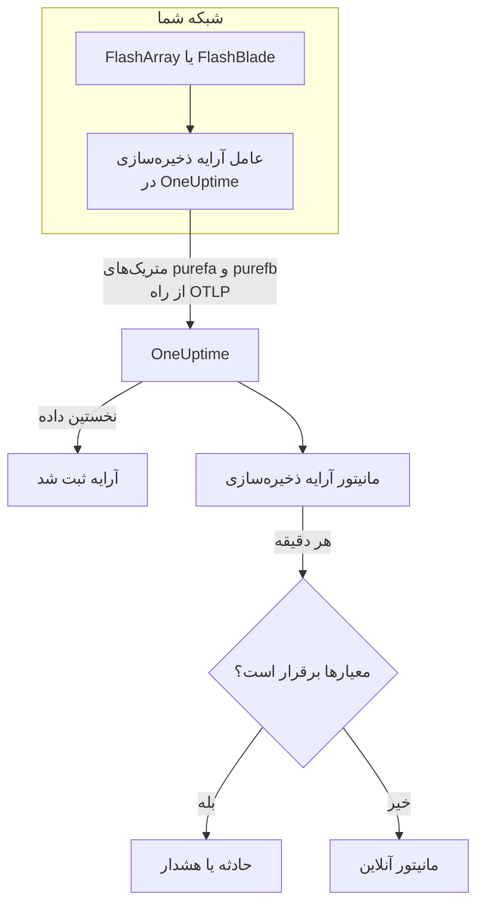

# مانیتور آرایه ذخیره‌سازی

مانیتور آرایه ذخیره‌سازی یک آرایه ذخیره‌سازی را زیر نظر می‌گیرد و وقتی آرایه خودش هشداری می‌دهد، فضایش تمام می‌شود، کند می‌شود، سخت‌افزار یا مسیری به یک میزبان را از دست می‌دهد، یا در همتاسازی عقب می‌افتد به شما خبر می‌دهد. با Pure Storage FlashArray و Pure Storage FlashBlade کار می‌کند و متریک‌هایی را می‌خواند که خود آرایه صادر می‌کند – سری‌های `purefa_*` و `purefb_*` در Pure – و عامل آرایه ذخیره‌سازی در OneUptime آن‌ها را جمع می‌کند.

:::cards
- [ساخت مانیتور](#ساخت-یک-مانیتور-آرایه-ذخیرهسازی): شش گام در داشبورد.
- [قالب‌ها](#قالبهای-هشدار-آماده): هجده هشدار آماده، یک حادثه به ازای هر حجم، میزبان یا قطعه.
- [سری‌های Pure چگونه کار می‌کنند](#سریهای-pure-چگونه-شکل-گرفتهاند): یک نام متریک، چند رقم.
- [متریک‌ها](#متریکهای-جمعآوریشده): هر سری که مانیتور می‌تواند بر پایه‌اش هشدار دهد.
:::

## چگونه کار می‌کند

عامل آرایه ذخیره‌سازی در OneUptime روی ماشینی اجرا می‌شود که به رابط مدیریتی آرایه دسترسی دارد. متریک‌های آرایه را با یک توکن API فقط‌خواندنی می‌خواند، روی آن‌ها نام آرایه، `storage.array.name`، و پلتفرم آن، `storage.system`، را برچسب می‌زند و آن‌ها را از راه OTLP به OneUptime می‌فرستد. نخستین داده آرایه را ثبت می‌کند.

مانیتور آرایه ذخیره‌سازی به یک آرایه وابسته است. هر دقیقه پرس‌وجوی خود را روی متریک‌های آن آرایه اجرا می‌کند و نتیجه را با معیارهایش مقایسه می‌کند.



## پیش از شروع

- **عامل آرایه ذخیره‌سازی را نصب کنید**، جایی که از راه HTTPS به آرایه دسترسی دارد، با توکن API کاربری که نقش **readonly** آرایه را دارد. [راهنمای عامل آرایه ذخیره‌سازی](/docs/telemetry/storage-arrays) کاربر، توکن و نصب را پوشش می‌دهد، از راه `ONEUPTIME_URL`، `ONEUPTIME_TELEMETRY_INGESTION_KEY`، `STORAGE_ARRAY_NAME`، و نشانی و توکن آرایه (`PURE_FA_ENDPOINT` و `PURE_FA_API_TOKEN`، یا `PURE_FB_ENDPOINT` و `PURE_FB_API_TOKEN`).
- **بررسی کنید آرایه ثبت شده باشد.** حدود یک دقیقه پس از نخستین خراش، با نام `STORAGE_ARRAY_NAME` عامل زیر **محصولات → زیرساخت → Storage Arrays → All Storage Arrays** پدیدار می‌شود.

## ساخت یک مانیتور آرایه ذخیره‌سازی

:::steps
### یک مانیتور تازه شروع کنید

به **مانیتورها** بروید و روی **ساخت مانیتور** کلیک کنید.

### آرایه ذخیره‌سازی را برگزینید

زیر **نوع مانیتور**، روی **انواع دیگر مانیتور** کلیک کنید و **آرایه ذخیره‌سازی** را زیر **زیرساخت** برگزینید، یا در کادر جست‌وجو `storage` را تایپ کنید. یک **نام** وارد کنید – در عنوان حادثه‌ها و هشدارها به کار می‌رود – و روی **بعدی** کلیک کنید.

### آرایه را برگزینید

زیر **Storage Array Monitor Configuration**، آرایه را از **آرایه ذخیره‌سازی** برگزینید. هر آرایه‌ای که داده فرستاده در فهرست است. پلتفرم آن تعیین می‌کند فرم کدام متریک‌ها و قالب‌ها را ارائه دهد.

### برگزینید چه چیزی پایش شود

یکی از سه زبانه را برگزینید:

- **Quick Setup** – روی یک [قالب](#قالبهای-هشدار-آماده) کلیک کنید. متریک، فیلترهای برچسب، تجمیع، بازه زمانی و آستانه‌ها را تعیین می‌کند و معیارهای زیر را با معیارهای خودش جایگزین می‌کند. همچنان می‌توانید **بازه زمانی** را تغییر دهید.
- **Custom Metric** – یک متریک از **Storage Array Metric** برگزینید، سپس **تجمیع** و **بازه زمانی** را تعیین کنید. [فیلترها](#تنظیمات-مانیتور) آن را به یک حجم، میزبان، پاد، قطعه، سیستم فایل یا باکت محدود می‌کنند.
- **پیشرفته** – پرس‌وجوها و فرمول‌ها را خودتان زیر **انتخاب متریک‌ها** بسازید، برای نمونه ظرفیت به‌کاررفته به‌صورت `purefa_array_space_bytes` با فیلتر `space=capacity` منهای همان متریک با فیلتر `space=empty`. برای سنجش جداگانه هر شیء از **Group by** با برچسب آن شیء استفاده کنید.

### معیارها را بررسی کنید

هر معیار را زیر **معیارهای مانیتور** باز کنید و **متریک**، **تجمیع**، **شرط** و **Threshold** آن را بررسی کنید. قالب این‌ها را پر می‌کند. با **Custom Metric** یا **پیشرفته**، مانیتور با [معیارهای پیش‌فرض](#معیارهای-پیشفرض) شروع می‌شود که فقط افت متریک به صفر را می‌بینند، پس آستانه خودتان را تعیین کنید.

### مانیتور را بسازید

روی **ساخت مانیتور** کلیک کنید. OneUptime صفحه مانیتور را باز می‌کند و آن را هر دقیقه ارزیابی می‌کند. حادثه‌ها و هشدارهایی که باز می‌کند در صفحه‌های **حوادث** و **هشدارها**ی آرایه هم فهرست می‌شوند.
:::

> [!TIP]
> برای راه‌اندازی هم‌زمان چند قالب، آرایه را از **محصولات → زیرساخت → Storage Arrays** باز کنید و به **Recommendations** بروید. قالب‌های دلخواه و کسانی را که باید خبر داده شوند برگزینید، و OneUptime به ازای هر قالب یک مانیتور می‌سازد.

## تنظیمات مانیتور

| فیلد | زبانه | چه می‌کند |
| --- | --- | --- |
| **آرایه ذخیره‌سازی** | همه | الزامی. هر پرس‌وجو را به `resource.storage.array.name` محدود می‌کند، پس دو آرایه که هر دو حجمی به نام `vol-01` دارند هرگز با هم قاطی نمی‌شوند. |
| **حجم** | Custom Metric، پیشرفته | فقط FlashArray. یک حجم، بر پایه برچسب `name`، مانند `vol-db-01`. حجمی که در یک پاد یا یک گروه حجم است `pod::volume` یا `group/volume` نام دارد. |
| **میزبان** | Custom Metric، پیشرفته | فقط FlashArray. یک میزبان آن‌طور که آرایه می‌شناسدش، بر پایه برچسب `host`، مانند `esxi-01`. |
| **پاد** | Custom Metric، پیشرفته | فقط FlashArray. یک پاد ActiveCluster یا ActiveDR، بر پایه برچسب `name`، یا `local_pod` روی سری‌های پیوند replica. |
| **Hardware Component** | Custom Metric، پیشرفته | یک قطعه سخت‌افزاری، مانند `CH0.BAY1` یا `CT0`: برچسب `component_name` روی FlashArray، و `name` روی FlashBlade. |
| **File System** | Custom Metric، پیشرفته | فقط FlashBlade. یک سیستم فایل، بر پایه برچسب `name`. |
| **Bucket** | Custom Metric، پیشرفته | فقط FlashBlade. یک باکت ذخیره‌سازی شیء، بر پایه برچسب `name`. |
| **Storage Array Metric** | Custom Metric | یک متریک از [فهرست](#متریکهای-جمعآوریشده). فرم فیلتر برچسبی را که به آن معنا می‌دهد اضافه می‌کند و آن را بر پایه شیئی که توصیف می‌کند گروه‌بندی می‌کند، پس هر حجم، میزبان یا قطعه جداگانه سنجیده می‌شود. |
| **تجمیع** | Custom Metric | شیوه ترکیب نمونه‌ها: **میانگین**، **بیشینه**، **کمینه**، **جمع** یا **تعداد**. از تجمیع معمول متریک شروع می‌شود. |
| **بازه زمانی** | همه | پنجره غلتانی که پرس‌وجو می‌خواند، از **Past 1 Minute** تا **Past 365 Days**. مانیتور تازه از **Past 5 Minutes** شروع می‌شود؛ متریک سفارشی یک سیستم فایل یا باکت از **Past 15 Minutes**؛ قالب‌ها پنجره خودشان را تعیین می‌کنند. |
| **انتخاب متریک‌ها** | پیشرفته | سازنده پرس‌وجو: **متریک**، **Aggregate by**، **Filter by attributes**، **Group by**، به همراه **افزودن متریک** و **افزودن فرمول** برای ترکیب پرس‌وجوها. |

عامل نقطه پایانی آرایه را هر ۶۰ ثانیه، و حجم‌ها، میزبان‌ها و پادها را هر ۲ دقیقه می‌خواند، پس پنجره ۵ دقیقه‌ای همیشه یک نمونه دارد. سیستم‌های فایل و باکت‌های FlashBlade را هر ۵ دقیقه می‌خواند، از همین رو ۱۵، و پوشه‌های FlashArray را هر ۳۰ دقیقه: به مانیتور پوشه پنجره‌ای ۶۰ دقیقه‌ای بدهید.

## سری‌های Pure چگونه شکل گرفته‌اند

Pure چند رقم را روی **یک** نام متریک می‌گذارد و آن‌ها را با یک برچسب از هم جدا می‌کند:

- **`dimension`** روی سری‌های کارایی. `purefa_array_performance_latency_usec` تأخیر خواندن (`usec_per_read_op`)، تأخیر نوشتن (`usec_per_write_op`)، تأخیر نوشتن آینه‌ای، و زمان SAN، صف، QoS و سرویس هر کدام را در خود دارد. همیشه روی یک `dimension` فیلتر کنید: میانگین گرفتن از همه آن‌ها تأخیر خواندن ۲۰۰ µs را با رقم صف قاطی می‌کند.
- **`space`** روی سری‌های ظرفیت: `capacity`، `empty`، `snapshots`، `total_provisioned`، `total_physical`، `available_ratio` و موارد دیگر.

چند سری وضعیت خود را در یک **برچسب** دارند، با مقداری که همیشه ۱ است:

| سری | برچسب وضعیت | یک سری به ازای هر |
| --- | --- | --- |
| `purefa_alerts_open` | `severity`، همراه با `summary`، `code` و `component_type` | هشدار باز |
| `purefa_hw_component_status` | `component_status` | قطعه سخت‌افزاری |
| `purefa_host_connectivity_info` | `status`، همراه با `details` | میزبان |
| `purefa_drive_capacity_bytes` | `component_status` (مقدار، ظرفیت درایو است) | درایو |

سری‌ای که به یک وضعیت بد فیلتر شده فقط تا وقتی چیزی در آن وضعیت است وجود دارد، پس نبودن سری یعنی سالم. برای همین **فعال شدن با Max بیش از ۰ و بهبود با ۰** شکل درست برای آن‌هاست، و قالب‌ها هم همین‌طور ساخته شده‌اند: معیارهای بهبودشان سری غایب را صفر حساب می‌کنند.

در فیلترها و کلیدهای گروه‌بندی مانیتور، ویژگی‌های عامل با `resource.` شروع می‌شوند (`resource.storage.array.name`، `resource.storage.system`)، در حالی که برچسب‌های خود Pure این‌طور نیستند (`name`، `host`، `component_name`، `dimension`، `space`، `severity`).

## قالب‌های هشدار آماده

OneUptime در مجموع ۱۸ قالب دارد – ۱۱ قالب برای FlashArray و ۷ قالب برای FlashBlade – و **Quick Setup** قالب‌های پلتفرم آرایه را ارائه می‌دهد. هر کدام یک مانیتور کامل می‌سازد: پرس‌وجوی متریک، فیلترهای برچسب آن، یک گروه‌بندی بر پایه برچسب خود شیء، یک معیار که فعال می‌شود و یکی که بهبود می‌یابد. آستانه‌ها نقطه شروع‌اند و می‌توانید ویرایششان کنید.

یک معیار فقط وقتی فعال می‌شود که شرط برای **همه** مقدارهای پنجره‌اش برقرار باشد. مانیتوری که بر پایه آستانه ظرفیت، تأخیر، عقب‌ماندگی یا نسبت فعال شده، فقط ۱۰٪ آن‌سوی آن بهبود می‌یابد، تا مقداری که حول آستانه نوسان دارد مدام جابه‌جا نشود؛ قالب‌های هشدار و سخت‌افزار به محض برطرف شدن وضعیت بهبود می‌یابند.

### FlashArray

| قالب | دسته | شدت | چه چیزی را پایش می‌کند | چه وقت فعال می‌شود |
| --- | --- | --- | --- | --- |
| Critical Array Alert | Array Health | بحرانی | `purefa_alerts_open` با فیلتر `severity=critical`، Max به ازای هر `summary`، ۵ دقیقه گذشته | > ۰ – آرایه یک هشدار بحرانی باز دارد (قطعه‌ای از کار افتاده، وضعیت اضطراری ظرفیت، شکست همتاسازی). یک حادثه به ازای هر هشدار؛ با بسته شدن هشدار بهبود می‌یابد |
| Warning Array Alert | Array Health | Warning | `purefa_alerts_open` با فیلتر `severity=warning`، Max به ازای هر `summary`، ۵ دقیقه گذشته | > ۰ – آرایه یک هشدار سطح warning باز دارد. یک حادثه به ازای هر هشدار؛ با بسته شدن هشدار بهبود می‌یابد |
| Capacity Above 80% | ظرفیت | Warning | `purefa_array_space_utilization`، Max، ۱۵ دقیقه گذشته | > ۸۰ – نخستین آستانه ظرفیت خود Pure؛ در ≤ ۷۲ بهبود می‌یابد |
| Capacity Above 90% | ظرفیت | بحرانی | `purefa_array_space_utilization`، Max، ۵ دقیقه گذشته | > ۹۰ – آرایه نزدیک است که نوشتن‌ها را رد کند؛ در ≤ ۸۱ بهبود می‌یابد |
| High Read Latency | Performance | Warning | `purefa_array_performance_latency_usec` با فیلتر `dimension=usec_per_read_op`، Avg، ۱۰ دقیقه گذشته | > ۵۰۰۰ µs (۵ ms) – خواندن‌های FlashArray معمولاً خیلی زیر ۱ ms کامل می‌شوند؛ در ≤ ۴۵۰۰ بهبود می‌یابد |
| High Write Latency | Performance | Warning | `purefa_array_performance_latency_usec` با فیلتر `dimension=usec_per_write_op`، Avg، ۱۰ دقیقه گذشته | > ۵۰۰۰ µs (۵ ms)؛ در ≤ ۴۵۰۰ بهبود می‌یابد |
| Hardware Component Failed | Hardware | بحرانی | `purefa_hw_component_status` با فیلتر `component_status=critical`، Max به ازای هر `component_name`، ۵ دقیقه گذشته | > ۰ – یک کنترلر، منبع تغذیه، فن، جایگاه یا پورت در وضعیت بحرانی است و افزونگی از دست رفته است. یک حادثه به ازای هر قطعه؛ وقتی ok گزارش دهد بهبود می‌یابد |
| Hardware Component Degraded | Hardware | Warning | `purefa_hw_component_status` با فیلتر `component_status=degraded`، Max به ازای هر `component_name`، ۵ دقیقه گذشته | > ۰ – یک قطعه افت کارکرد دارد. یک حادثه به ازای هر قطعه؛ وقتی ok گزارش دهد بهبود می‌یابد |
| Drive Failed | Hardware | بحرانی | `purefa_drive_capacity_bytes` با فیلتر `component_status=failed`، Max به ازای هر `component_name`، ۵ دقیقه گذشته | > ۰ – یک ماژول DirectFlash یا SSD از کار افتاده و آرایه داده را روی بقیه بازسازی می‌کند. یک حادثه به ازای هر درایو؛ با تعویض آن بهبود می‌یابد |
| Host Lost Redundant Paths | میزبان‌ها | Warning | `purefa_host_connectivity_info` با فیلتر `status=critical`، Max به ازای هر `host`، ۵ دقیقه گذشته | > ۰ – میزبان از راه یک کنترلر یا هیچ کنترلری به آرایه می‌رسد؛ یک failover کنترلر ذخیره‌سازی آن را آفلاین می‌کند. یک حادثه به ازای هر میزبان؛ با بازگشت مسیرهایش بهبود می‌یابد |
| Replication Lag Above 1 Minute | Replication | Warning | `purefa_pod_replica_links_lag_max_msec`، Max به ازای هر `local_pod`، ۱۰ دقیقه گذشته | > ۶۰۰۰۰ ms (۶۰ s) – failover در این لحظه نوشتن‌های تازه‌تری از آنچه برنامه‌ریزی شده از دست می‌دهد. یک حادثه به ازای هر پاد؛ در ≤ ۵۴۰۰۰ بهبود می‌یابد |

### FlashBlade

| قالب | دسته | شدت | چه چیزی را پایش می‌کند | چه وقت فعال می‌شود |
| --- | --- | --- | --- | --- |
| Critical Array Alert | Array Health | بحرانی | `purefb_alerts_open` با فیلتر `severity=critical`، Max به ازای هر `summary`، ۵ دقیقه گذشته | > ۰ – FlashBlade یک هشدار بحرانی باز دارد. یک حادثه به ازای هر هشدار؛ با بسته شدن هشدار بهبود می‌یابد |
| Warning Array Alert | Array Health | Warning | `purefb_alerts_open` با فیلتر `severity=warning`، Max به ازای هر `summary`، ۵ دقیقه گذشته | > ۰ – FlashBlade یک هشدار سطح warning باز دارد. یک حادثه به ازای هر هشدار؛ با بسته شدن هشدار بهبود می‌یابد |
| Capacity Above 80% | ظرفیت | Warning | `purefb_array_space_utilization` با فیلتر `type=array`، Max، ۱۵ دقیقه گذشته | > ۸۰؛ در ≤ ۷۲ بهبود می‌یابد |
| Capacity Above 90% | ظرفیت | بحرانی | `purefb_array_space_utilization` با فیلتر `type=array`، Max، ۵ دقیقه گذشته | > ۹۰ – وقتی پر شود نوشتن برای همه کلاینت‌ها شکست می‌خورد؛ در ≤ ۸۱ بهبود می‌یابد |
| Hardware Component Unhealthy | Hardware | بحرانی | `purefb_hardware_health`، Min به ازای هر `name`، ۵ دقیقه گذشته | < ۱ – یک blade، ماژول fabric، منبع تغذیه یا فن سالم نیست (جایگاه بی‌استفاده ۲ گزارش می‌دهد). یک حادثه به ازای هر قطعه؛ در ≥ ۱ بهبود می‌یابد |
| High Read Latency | Performance | Warning | `purefb_array_performance_latency_usec` با فیلتر `dimension=usec_per_read_op` و `protocol=all`، Avg، ۱۰ دقیقه گذشته | > ۱۰۰۰۰ µs (۱۰ ms) در همه پروتکل‌ها؛ در ≤ ۹۰۰۰ بهبود می‌یابد |
| File System Near Full | File Systems | Warning | `purefb_file_systems_space_bytes` با فیلتر `space=available_ratio`، Min به ازای هر `name`، ۱۵ دقیقه گذشته | < ۰٫۱ – کمتر از ۱۰٪ اندازه تأمین‌شده یک سیستم فایل باقی مانده است. یک حادثه به ازای هر سیستم فایل؛ در ≥ ۰٫۱۱ بهبود می‌یابد |

**شدت** برچسبی است که فهرست انتخاب نشان می‌دهد. حادثه و هشداری که یک قالب می‌سازد از شدیدترین شدت حادثه و هشدار پروژه شما شروع می‌شوند؛ آن‌ها را در معیارها تغییر دهید.

- **هشدارهای باز و وضعیت‌های سخت‌افزاری از Max استفاده می‌کنند**، روی سری‌ای که فقط تا وقتی هشدار باز است یا قطعه در آن وضعیت است وجود دارد، پس یک خراش که آن را نشان دهد آستانه را رد می‌کند.
- **هر قالبی که به ازای هر شیء است بر پایه برچسب خود شیء گروه‌بندی می‌کند** (`summary`، `component_name`، `host`، `local_pod`، `name`)، پس به ازای هر شیء آسیب‌دیده یک حادثه فعال می‌شود و حادثه نام آن را می‌برد.
- **قالب‌های تأخیر از Avg استفاده می‌کنند**، روی میانگین خود آرایه به ازای هر عملیات، و قالب‌های ظرفیت از **Max** روی درصد استفاده خود آرایه. تأخیرها بر حسب میکروثانیه و ظرفیت بر حسب درصد ثابت شده‌اند.
- **Hardware Component Unhealthy از Min استفاده می‌کند**، به ازای هر قطعه: سلامت آن وقتی سالم است ۱ است و وقتی نیست به ۰ می‌افتد.

برای تأخیر هر حجم قالبی وجود ندارد، چون آستانه درست به بار کاری بستگی دارد: آن را از فهرست با گروه‌بندی بر پایه `name` بسازید. پیش‌بینی ظرفیت به روند رشد نیاز دارد نه آستانه، و فرسودگی درایو هیچ سری‌ای برای هشدار ندارد.

## متریک‌های جمع‌آوری‌شده

عامل هر چیزی را که آرایه صادر می‌کند می‌فرستد؛ سری‌های زیر فهرستی است که فرم مانیتور ارائه می‌دهد. هر مقدار یک gauge است که خود آرایه محاسبه می‌کند – تأخیرها میکروثانیه به ازای هر عملیات‌اند و توان عملیاتی بر ثانیه – پس به محاسبه نرخ نیازی نیست. **فیلتر** فیلتر برچسبی است که به سری معنایی را می‌دهد که سطرش می‌گوید؛ فرم آن را برایتان اعمال می‌کند.

### Array Health

| متریک | فیلتر | پلتفرم | یکا | توضیح |
| --- | --- | --- | --- | --- |
| `purefa_alerts_open` | — | FlashArray | `count` | یک سری به ازای هر هشدار باز روی آرایه (مقدار ۱)، با برچسب‌های `severity` (`critical`، `warning`، `info`، `hidden`)، `category`، `code`، `component_type` و `summary` |
| `purefb_alerts_open` | — | FlashBlade | `count` | یک سری به ازای هر هشدار باز روی FlashBlade (مقدار ۱)، با برچسب‌های `severity` (`info`، `warning`، `critical`)، `code`، `component_name`، `component_type`، `summary` و `kburl` (مقاله پایگاه دانش Pure) |

### Capacity

| متریک | فیلتر | پلتفرم | یکا | توضیح |
| --- | --- | --- | --- | --- |
| `purefa_array_space_utilization` | — | FlashArray | `%` | سهم ظرفیت قابل استفاده آرایه که در حال استفاده است. Pure هشدارهای ظرفیت خودش را در ۸۰٪، ۹۰٪ و ۱۰۰٪ می‌دهد |
| `purefa_array_space_bytes` | `space=capacity` | FlashArray | `bytes` | ظرفیت قابل استفاده آرایه |
| `purefa_array_space_bytes` | `space=empty` | FlashArray | `bytes` | ظرفیت استفاده‌نشده – روندش را دنبال کنید تا پیش‌بینی کنید آرایه کی پر می‌شود |
| `purefa_array_space_bytes` | `space=snapshots` | FlashArray | `bytes` | فضای فیزیکی که فقط snapshotها نگه داشته‌اند؛ بالا رفتن سریع معمولاً یعنی یک protection group بیش از برنامه snapshot نگه می‌دارد |
| `purefa_array_space_data_reduction_ratio` | — | FlashArray | `ratio` | یکتاسازی و فشرده‌سازی در سراسر آرایه، برای نمونه ۴٫۲ برای نسبت ۴٫۲ به ۱. افت پایدار یعنی داده تازه به‌خوبی کاهش نمی‌یابد |
| `purefb_array_space_utilization` | `type=array` | FlashBlade | `%` | سهم ظرفیت قابل استفاده FlashBlade که در حال استفاده است |
| `purefb_array_space_bytes` | `type=array`، `space=empty` | FlashBlade | `bytes` | ظرفیت استفاده‌نشده FlashBlade |
| `purefb_array_space_data_reduction_ratio` | `type=array` | FlashBlade | `ratio` | کاهش داده در سراسر FlashBlade |

### Performance

| متریک | فیلتر | پلتفرم | یکا | توضیح |
| --- | --- | --- | --- | --- |
| `purefa_array_performance_latency_usec` | `dimension=usec_per_read_op` | FlashArray | `µs` | میانگین تأخیر یک خواندن آن‌طور که میزبان‌ها می‌بینند؛ خواندن‌های FlashArray معمولاً خیلی زیر ۱ ms کامل می‌شوند |
| `purefa_array_performance_latency_usec` | `dimension=usec_per_write_op` | FlashArray | `µs` | میانگین تأخیر یک نوشتن آن‌طور که میزبان‌ها می‌بینند |
| `purefa_array_performance_latency_usec` | `dimension=usec_per_mirrored_write_op` | FlashArray | `µs` | میانگین تأخیر یک نوشتن روی یک پاد گسترده ActiveCluster، شامل رفت و برگشت تا آرایه همتا |
| `purefa_array_performance_latency_usec` | `dimension=san_usec_per_read_op` | FlashArray | `µs` | زمانی که یک خواندن در SAN می‌گذراند؛ تأخیر بالای SAN با تأخیر پایین سرویس به fabric یا میزبان اشاره دارد |
| `purefa_array_performance_throughput_iops` | `dimension=reads_per_sec` | FlashArray | `ops/s` | عملیات خواندن در ثانیه |
| `purefa_array_performance_throughput_iops` | `dimension=writes_per_sec` | FlashArray | `ops/s` | عملیات نوشتن در ثانیه |
| `purefa_array_performance_bandwidth_bytes` | `dimension=read_bytes_per_sec` | FlashArray | `bytes/s` | بایت خوانده‌شده در ثانیه |
| `purefa_array_performance_bandwidth_bytes` | `dimension=write_bytes_per_sec` | FlashArray | `bytes/s` | بایت نوشته‌شده در ثانیه |
| `purefa_array_performance_queue_depth_ops` | — | FlashArray | `ops` | عملیات در صف آرایه؛ صفی که بزرگ می‌شود همراه با تأخیر رو به افزایش یعنی میزبان‌ها بیش از توان پاسخ‌گویی آرایه می‌فرستند |
| `purefa_array_performance_average_bytes` | `dimension=bytes_per_op` | FlashArray | `bytes` | میانگین اندازه یک عملیات – I/O بزرگ تأخیر را بالا می‌برد بی‌آنکه چیزی خراب باشد |
| `purefb_array_performance_latency_usec` | `dimension=usec_per_read_op`، `protocol=all` | FlashBlade | `µs` | میانگین تأخیر خواندن در همه پروتکل‌ها |
| `purefb_array_performance_latency_usec` | `dimension=usec_per_write_op`، `protocol=all` | FlashBlade | `µs` | میانگین تأخیر نوشتن در همه پروتکل‌ها |
| `purefb_array_performance_throughput_iops` | `dimension=reads_per_sec`، `protocol=all` | FlashBlade | `ops/s` | عملیات خواندن در ثانیه در همه پروتکل‌ها |
| `purefb_array_performance_throughput_iops` | `dimension=writes_per_sec`، `protocol=all` | FlashBlade | `ops/s` | عملیات نوشتن در ثانیه در همه پروتکل‌ها |
| `purefb_array_performance_bandwidth_bytes` | `dimension=read_bytes_per_sec`، `protocol=all` | FlashBlade | `bytes/s` | بایت خوانده‌شده در ثانیه در همه پروتکل‌ها |
| `purefb_array_performance_bandwidth_bytes` | `dimension=write_bytes_per_sec`، `protocol=all` | FlashBlade | `bytes/s` | بایت نوشته‌شده در ثانیه در همه پروتکل‌ها |

### Volumes

| متریک | فیلتر | پلتفرم | یکا | توضیح |
| --- | --- | --- | --- | --- |
| `purefa_volume_performance_latency_usec` | `dimension=usec_per_read_op` | FlashArray | `µs` | میانگین تأخیر خواندن هر حجم – بر پایه `name` گروه‌بندی کنید |
| `purefa_volume_performance_latency_usec` | `dimension=usec_per_write_op` | FlashArray | `µs` | میانگین تأخیر نوشتن هر حجم |
| `purefa_volume_performance_throughput_iops` | `dimension=reads_per_sec` | FlashArray | `ops/s` | عملیات خواندن در ثانیه هر حجم |
| `purefa_volume_performance_throughput_iops` | `dimension=writes_per_sec` | FlashArray | `ops/s` | عملیات نوشتن در ثانیه هر حجم |
| `purefa_volume_performance_bandwidth_bytes` | `dimension=read_bytes_per_sec` | FlashArray | `bytes/s` | بایت خوانده‌شده در ثانیه از هر حجم |
| `purefa_volume_performance_bandwidth_bytes` | `dimension=write_bytes_per_sec` | FlashArray | `bytes/s` | بایت نوشته‌شده در ثانیه روی هر حجم |
| `purefa_volume_space_bytes` | `space=total_provisioned` | FlashArray | `bytes` | اندازه هر حجم آن‌طور که میزبان‌ها می‌بینند |
| `purefa_volume_space_bytes` | `space=total_physical` | FlashArray | `bytes` | فضای فیزیکی که هر حجم پس از کاهش داده مصرف می‌کند |
| `purefa_volume_space_data_reduction_ratio` | — | FlashArray | `ratio` | نسبت کاهش داده هر حجم |

### Hosts

| متریک | فیلتر | پلتفرم | یکا | توضیح |
| --- | --- | --- | --- | --- |
| `purefa_host_connectivity_info` | — | FlashArray | `count` | یک سری به ازای هر میزبان (مقدار ۱) با برچسب `status` اتصال آن (`healthy`، `critical`، `unused`) و `details` (`Redundant`، `Single Controller`، `None`، ...) |
| `purefa_host_performance_latency_usec` | `dimension=usec_per_read_op` | FlashArray | `µs` | میانگین تأخیر خواندن که هر میزبان می‌بیند – بر پایه `host` گروه‌بندی کنید |
| `purefa_host_performance_latency_usec` | `dimension=usec_per_write_op` | FlashArray | `µs` | میانگین تأخیر نوشتن که هر میزبان می‌بیند |
| `purefa_host_performance_throughput_iops` | `dimension=reads_per_sec` | FlashArray | `ops/s` | عملیات خواندن در ثانیه هر میزبان |
| `purefa_host_performance_throughput_iops` | `dimension=writes_per_sec` | FlashArray | `ops/s` | عملیات نوشتن در ثانیه هر میزبان |

### Replication

| متریک | فیلتر | پلتفرم | یکا | توضیح |
| --- | --- | --- | --- | --- |
| `purefa_pod_replica_links_lag_max_msec` | — | FlashArray | `ms` | بیشترین عقب‌ماندگی همتاسازی هر پیوند replica پاد (ActiveDR / ناهمگام)، با برچسب‌های `local_pod`، `remote_pod`، `remote`، `direction` و `status` – بر پایه `local_pod` گروه‌بندی کنید |
| `purefa_pod_replica_links_lag_average_msec` | — | FlashArray | `ms` | میانگین عقب‌ماندگی همتاسازی هر پیوند replica پاد |
| `purefa_pod_performance_replication_bandwidth_bytes` | — | FlashArray | `bytes/s` | ترافیک همتاسازی هر پاد، با برچسب‌های `direction` و `dimension` |
| `purefa_pod_performance_latency_usec` | `dimension=usec_per_mirrored_write_op` | FlashArray | `µs` | میانگین تأخیر نوشتن آینه‌ای هر پاد ActiveCluster |

### Hardware

| متریک | فیلتر | پلتفرم | یکا | توضیح |
| --- | --- | --- | --- | --- |
| `purefa_hw_component_status` | — | FlashArray | `count` | یک سری به ازای هر قطعه سخت‌افزاری (مقدار ۱) – شاسی، کنترلرها، جایگاه‌های درایو و NVRAM، منابع تغذیه، فن‌ها، حسگرهای دما، پورت‌های Ethernet و Fibre Channel – با برچسب `component_status` (`ok`، `critical`، `degraded`، `device_off`، `identifying`، `not_installed`، `unknown`) |
| `purefa_hw_component_temperature_celsius` | — | FlashArray | `°C` | دمای هر حسگر – بر پایه `component_name` گروه‌بندی کنید |
| `purefa_drive_capacity_bytes` | — | FlashArray | `bytes` | ظرفیت خام هر درایو، با برچسب `component_status` آن (`healthy`، `failed`، `missing`، `recovering`، `unhealthy`، `empty`، ...) و نوعش |
| `purefa_network_interface_performance_errors` | `dimension=total_errors_per_sec` | FlashArray | `errors/s` | خطاها در ثانیه روی هر رابط Ethernet و Fibre Channel – خطاهای پایدار معمولاً یعنی کابل، ماژول نوری یا پورت سوئیچ خراب |
| `purefb_hardware_health` | — | FlashBlade | — | سلامت هر قطعه سخت‌افزاری (bladeها، ماژول‌های fabric، منابع تغذیه، فن‌ها، ...): ۱ = سالم، ۲ = بی‌استفاده، ۰ = ناسالم. کمینه را به ازای هر `name` بگیرید |

### File Systems

| متریک | فیلتر | پلتفرم | یکا | توضیح |
| --- | --- | --- | --- | --- |
| `purefb_file_systems_performance_latency_usec` | `dimension=usec_per_read_op` | FlashBlade | `µs` | میانگین تأخیر خواندن هر سیستم فایل – بر پایه `name` گروه‌بندی کنید |
| `purefb_file_systems_performance_latency_usec` | `dimension=usec_per_write_op` | FlashBlade | `µs` | میانگین تأخیر نوشتن هر سیستم فایل |
| `purefb_file_systems_space_bytes` | `space=total_physical` | FlashBlade | `bytes` | فضای فیزیکی که هر سیستم فایل مصرف می‌کند |
| `purefb_file_systems_space_bytes` | `space=available_ratio` | FlashBlade | `ratio` | سهمی از اندازه تأمین‌شده هر سیستم فایل که هنوز در دسترس است، از ۰ تا ۱ – نزدیک ۰ یعنی در آستانه پر کردن سهمیه‌اش است |

### Buckets

| متریک | فیلتر | پلتفرم | یکا | توضیح |
| --- | --- | --- | --- | --- |
| `purefb_buckets_performance_latency_usec` | `dimension=usec_per_read_op` | FlashBlade | `µs` | میانگین تأخیر خواندن هر باکت – بر پایه `name` گروه‌بندی کنید |
| `purefb_buckets_space_bytes` | `space=total_physical` | FlashBlade | `bytes` | فضای فیزیکی که هر باکت مصرف می‌کند |
| `purefb_buckets_object_count` | — | FlashBlade | `count` | شمار شیءهای هر باکت |

## معیارهای مانیتورینگ

یک معیار یکی از پرس‌وجوها یا فرمول‌های مانیتور را با یک آستانه مقایسه می‌کند. معیارهای مانیتور آرایه ذخیره‌سازی **نوع فیلتر** ندارند: هر قاعده مقدار متریک را با این فیلدها بررسی می‌کند.

| فیلد | چه می‌کند |
| --- | --- |
| **متریک** | پرس‌وجو یا فرمولی که بررسی می‌شود، بر پایه نام متغیرش. |
| **تجمیع** | اینکه مقدارهای پنجره چطور به یک پاسخ تبدیل می‌شوند: **میانگین**، **جمع**، **Maximum Value**، **Minimum Value**، **All Values** (همه مقدارها باید جور باشند) یا **Any Value** (یکی کافی است). |
| **شرط** | **Greater Than**، **Less Than**، **Greater Than Or Equal To**، **Less Than Or Equal To** یا **Equal To** – یا یک شرط ناهنجاری: **Anomalously High**، **Anomalously Low** یا **Anomalous**. |
| **Threshold** | مقداری که با آن مقایسه می‌شود. وقتی متریک یکا دارد، فهرستی از یکاها کنارش هست. برای شرط‌های ناهنجاری نشان داده نمی‌شود. |
| **حساسیت** | فقط شرط‌های ناهنجاری. **پایین** (۴σ)، **متوسط** (۳σ، پیش‌فرض) یا **بالا** (۲σ). |
| **پنجره مبنا** | فقط شرط‌های ناهنجاری. ۱۴ روز (پیش‌فرض)، ۲۸، ۶۰ یا ۹۰ روز سابقه. |
| **اگر داده‌ای نبود** | زیر **فیلدهای بیشتر**. وقتی پنجره هیچ نمونه‌ای ندارد چه شود: **Ignore** (پیش‌فرض)، **Treat As Zero** یا **تریگر**. |

شرط‌های ناهنجاری هر مقدار را با همان ساعت از هفته در خط مبنا مقایسه می‌کنند. تا وقتی پنجره مبنا سابقه کافی نداشته باشد، در وضعیت «Learning» می‌مانند و چیزی پدید نمی‌آورند.

چند معیار برای شروع:

- **یک حجم کند است:** `purefa_volume_performance_latency_usec` با فیلتر `dimension=usec_per_read_op`، میانگین، گروه‌بندی‌شده بر پایه `name`، **Greater Than** `2000`، در ۱۰ دقیقه گذشته.
- **آرایه در حال پر شدن است:** `purefa_array_space_utilization`، بیشینه، **Greater Than** `85`، در ۱۵ دقیقه گذشته.
- **یک میزبان با یک کنترلر کار می‌کند:** `purefa_host_connectivity_info` با فیلتر `status=critical`، بیشینه، گروه‌بندی‌شده بر پایه `host`، **Greater Than** `0`.
- **یک سیستم فایل FlashBlade تقریباً پر است:** `purefb_file_systems_space_bytes` با فیلتر `space=available_ratio`، کمینه، گروه‌بندی‌شده بر پایه `name`، **Less Than** `0.05`.

### معیارهای پیش‌فرض

مانیتوری که از قالب نمی‌سازید با دو معیار شروع می‌شود:

| ترتیب | معیار | وقتی برقرار است که | سپس |
| --- | --- | --- | --- |
| ۱ | Check if _monitor name_ is offline | هر مقداری از نخستین پرس‌وجو `0` باشد | مانیتور را **آفلاین** علامت می‌زند و حادثه «_monitor name_ is offline» را اعلام می‌کند، که با بهبود مانیتور خودش برطرف می‌شود. |
| ۲ | Check if _monitor name_ is online | هر مقداری بیش از `0` باشد | مانیتور را **عملیاتی** علامت می‌زند. |

> [!IMPORTANT]
> سکوت با هیچ‌یک از دو معیار جور نیست: آرایه‌ای که دیگر داده نمی‌فرستد مانیتور را همان‌طور که بود رها می‌کند. برای اینکه وقتی داده قطع شد خبردار شوید، **اگر داده‌ای نبود** را در یک معیار روی **تریگر** بگذارید. زمانی که خود OneUptime داده دریافت نمی‌کرد هرگز «بدون داده» به حساب نمی‌آید: بررسی‌ای که پنجره‌اش چنین زمانی را در بر دارد به جای آن صبر می‌کند، همان‌طور که [وقتی OneUptime داده دریافت نمی‌کند](/docs/monitor/when-oneuptime-is-not-receiving) توضیح می‌دهد.

## Terraform

[فراهم‌کننده Terraform در OneUptime](/docs/terraform/monitor-steps) پیکربندی گام مانیتور آرایه ذخیره‌سازی را در ویژگی `storage_array_monitor` نگه می‌دارد: JSON خام پیکربندی `storageArrayMonitor` (`arrayIdentifier`، `storageSystem`، `resourceFilters`، `metricViewConfig`، `rollingTime`)، نوشته‌شده با `jsonencode()`:

```hcl title="main.tf"
monitor_steps = [{
  storage_array_monitor = jsonencode({
    arrayIdentifier = "my-storage-array"
    storageSystem   = "purestorage.flasharray"
    resourceFilters = {}
    rollingTime     = "Past 15 Minutes"
    metricViewConfig = {
      queryConfigs = [{
        metricAliasData = { metricVariable = "capacity_used_percent", title = "Capacity Used", description = "", legend = "" }
        metricQueryData = {
          filterData = {
            metricName     = "purefa_array_space_utilization"
            attributes     = {}
            aggegationType = "Max"
            aggregateBy    = {}
          }
        }
      }]
      formulaConfigs = []
    }
  })
  criteria = [ /* ... */ ]
}]
```

`arrayIdentifier` همان `storage.array.name` آرایه است – همان `STORAGE_ARRAY_NAME` که عامل با آن اجرا شده – نه شناسه OneUptime آن. `storageSystem` یکی از `purestorage.flasharray` یا `purestorage.flashblade` است. تعیین می‌کند فرم کدام فهرست و قالب‌ها را نشان دهد، و اینکه یک فیلتر سخت‌افزاری `component_name` را بخواند یا `name` را.

## رفع اشکال

:::details آرایه در فهرست آرایه ذخیره‌سازی نیست
آرایه‌ها خودشان از روی داده‌های عامل ثبت می‌شوند. بررسی کنید عامل در حال اجرا باشد و داده بفرستد ([راهنمای عامل آرایه ذخیره‌سازی](/docs/telemetry/storage-arrays) را ببینید)، و `STORAGE_ARRAY_NAME` تعیین شده باشد.
:::

:::details یک قالب هشدار یا سخت‌افزار هرگز فعال نمی‌شود
این حالت سالم است. `purefa_alerts_open`، `purefa_hw_component_status`، `purefa_drive_capacity_bytes` و `purefa_host_connectivity_info` وضعیت خود را در یک برچسب دارند، و سری‌ای که به یک وضعیت بد فیلتر شده (`severity=critical`، `component_status=failed`) فقط تا وقتی چیزی در آن وضعیت است وجود دارد. برای دیدن سری پشت یک قالب، پرس‌وجویش را بدون فیلتر در صفحه **متریک‌ها** اجرا کنید.
:::

:::details یک مانیتور تأخیر نادرست می‌خواند
Pure رقم‌های خواندن، نوشتن، نوشتن آینه‌ای، SAN، صف و QoS را روی یک نام متریک می‌گذارد که فقط برچسب `dimension` آن‌ها را از هم جدا می‌کند، و پرس‌وجوی بدون فیلتر `dimension` از همه آن‌ها با هم میانگین می‌گیرد. روی یک dimension فیلتر کنید، همان‌طور که قالب‌ها و فهرست فرم می‌کنند. سری‌های هر حجم و هر میزبان فقط `usec_per_read_op`، `usec_per_write_op` و `usec_per_mirrored_write_op` را نگه می‌دارند: عامل بقیه را برای صرفه‌جویی در سری‌ها کنار می‌گذارد، و فقط `purefa_array_performance_latency_usec` در سطح کل آرایه همه آن‌ها را نگه می‌دارد.
:::

:::details پنجره ۱ دقیقه‌ای هیچ داده‌ای نشان نمی‌دهد
عامل حجم‌ها، میزبان‌ها و پادها را هر ۲ دقیقه، سیستم‌های فایل و باکت‌های FlashBlade را هر ۵ دقیقه، و پوشه‌های FlashArray را هر ۳۰ دقیقه می‌خواند، پس پنجره ۱ دقیقه‌ای ممکن است نمونه‌ای نداشته باشد. ۵ دقیقه یا بیشتر به کار ببرید: ۱۵ برای سیستم‌های فایل و باکت‌ها، ۶۰ برای پوشه‌ها.
:::

:::details حادثه‌ها یک بار برای کل آرایه فعال می‌شوند، نه یک بار برای هر حجم
پرس‌وجو را بر پایه برچسب شیء گروه‌بندی کنید: `name` برای حجم‌ها، پادها، پوشه‌ها، سیستم‌های فایل و باکت‌ها، `host` برای میزبان‌ها، و `component_name` برای سخت‌افزار FlashArray. برچسب‌های Pure پیشوند ندارند، پس `resource.name` با هیچ چیز جور نمی‌شود.
:::

## گام‌های بعدی

:::cards
- [عامل آرایه ذخیره‌سازی](/docs/telemetry/storage-arrays): عاملی را نصب کنید که متریک‌ها را می‌فرستد.
- [مانیتور Ceph](/docs/monitor/ceph-monitor): همین نوع مانیتور برای خوشه‌های ذخیره‌سازی Ceph.
- [مانیتور متریک‌ها](/docs/monitor/metrics-monitor): بر پایه هر متریکی از هر منبعی هشدار دهید.
- [نمای کلی حوادث](/docs/incidents/index): پس از آنکه یک معیار حادثه‌ای اعلام کرد چه اتفاقی می‌افتد.
:::
