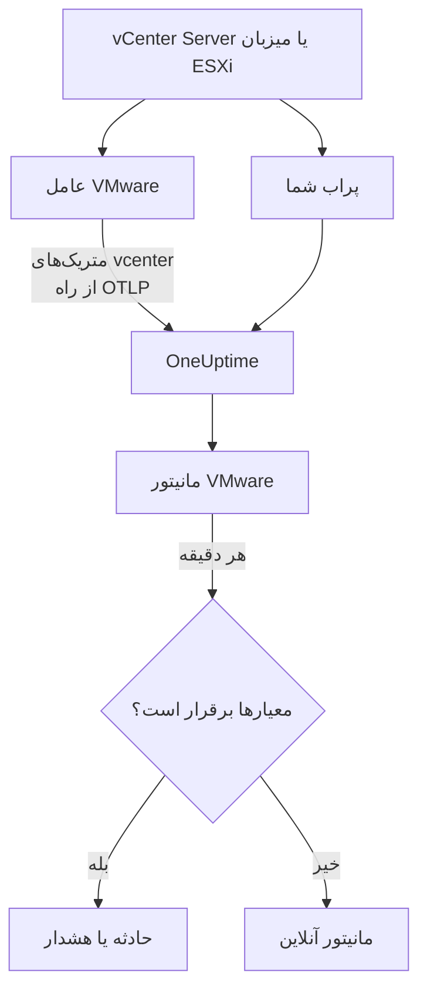

# مانیتور VMware

مانیتور VMware یک vCenter را زیر نظر می‌گیرد – دیتاسنترها، خوشه‌ها، میزبان‌های ESXi، ماشین‌های مجازی، دیتااستورها، استخرهای منبع و vSAN آن – و وقتی میزبانی اشباع می‌شود، ماشین مجازی‌ای کمبود CPU یا حافظه دارد، دیتااستوری در حال پر شدن است یا vSphere هشداری می‌دهد به شما خبر می‌دهد. این مانیتور متریک‌های `vcenter.*` را می‌خواند که عامل VMware در OneUptime جمع می‌کند، یا یکی از پراب‌های شما بدون عامل جمع می‌کند.

:::cards
- [ساخت مانیتور](#ساخت-یک-مانیتور-vmware): شش گام در داشبورد.
- [قالب‌ها](#قالبهای-هشدار-آماده): بیست و سه هشدار آماده، یک حادثه به ازای هر میزبان، ماشین مجازی یا دیتااستور.
- [ویژگی‌های هویتی](#ویژگیهای-هویتی): چگونه یک میزبان، ماشین مجازی یا دیتااستور را هدف بگیرید.
- [متریک‌ها](#متریکهای-جمعآوریشده): هر سری `vcenter.*` که مانیتور می‌تواند بر پایه‌اش هشدار دهد.
:::

## چگونه کار می‌کند

متریک‌ها از API در vCenter می‌آیند و با یک حساب فقط‌خواندنی، به یکی از دو روش، خوانده می‌شوند:

- **عامل VMware**، یک OpenTelemetry Collector با گیرنده `vcenter` خود، که آن را روی ماشینی اجرا می‌کنید که به vCenter دسترسی دارد. [عامل VMware](/docs/telemetry/vmware) را ببینید.
- **یک پراب**، بی‌آنکه چیزی نصب شود: vCenter را در OneUptime وصل می‌کنید و پرابی را برمی‌گزینید که به آن دسترسی دارد. [VMware بدون عامل](/docs/telemetry/vmware-agentless) را ببینید.

هر دو در هر بازه جمع‌آوری (به‌طور پیش‌فرض ۲ دقیقه) همان سری‌ها را می‌فرستند که نام vCenter، یعنی `vmware.vcenter.name`، روی آن‌ها زده شده است. یک vCenter یک نقطه پایانی vSphere است: یک vCenter Server یا یک میزبان ESXi مستقل. مانیتور VMware به یک vCenter وابسته است. هر دقیقه پرس‌وجوی خود را روی متریک‌های آن vCenter اجرا می‌کند و نتیجه را با معیارهایش مقایسه می‌کند.



## پیش از شروع

- **متریک‌های vCenter را جمع کنید**، با [عامل VMware](/docs/telemetry/vmware) یا [بدون عامل](/docs/telemetry/vmware-agentless). هر دو از یک کاربر vSphere استفاده می‌کنند که نقش **Read-Only** را روی شیء vCenter در بالاترین سطح دارد، با گزینه **Propagate to children** تیک‌خورده. عامل `ONEUPTIME_URL`، `ONEUPTIME_TELEMETRY_INGESTION_KEY`، `VMWARE_VCENTER_NAME`، `VCENTER_ENDPOINT`، `VCENTER_USERNAME` و `VCENTER_PASSWORD` را می‌خواند.
- **بررسی کنید vCenter ثبت شده باشد.** زیر **محصولات → زیرساخت → VMware → همهٔ vCenterها** پدیدار می‌شود: از راه عامل، با نام `VMWARE_VCENTER_NAME` آن، پس از نخستین جمع‌آوری کامل؛ بدون عامل، از همان لحظه‌ای که وصلش می‌کنید.

## ساخت یک مانیتور VMware

:::steps
### یک مانیتور تازه شروع کنید

به **مانیتورها** بروید و روی **ساخت مانیتور** کلیک کنید.

### VMware را برگزینید

زیر **نوع مانیتور**، روی **انواع دیگر مانیتور** کلیک کنید و **VMware** را زیر **زیرساخت** برگزینید، یا در کادر جست‌وجو `vmware` را تایپ کنید. یک **نام** وارد کنید – در عنوان حادثه‌ها و هشدارها به کار می‌رود – و روی **بعدی** کلیک کنید.

### vCenter را برگزینید

زیر **VMware Monitor Configuration**، vCenter را از **vCenter** برگزینید. هر vCenter که داده فرستاده، یا بدون عامل وصلش کرده‌اید، در فهرست است.

### برگزینید چه چیزی پایش شود

یکی از سه زبانه را برگزینید:

- **Quick Setup** – روی یک [قالب](#قالبهای-هشدار-آماده) کلیک کنید. متریک، فیلترهای ویژگی، تجمیع، بازه زمانی، گروه‌بندی و آستانه‌ها را تعیین می‌کند و معیارهای زیر را با معیارهای خودش جایگزین می‌کند. همچنان می‌توانید **بازه زمانی** را تغییر دهید.
- **Custom Metric** – یک متریک از **VMware Metric** برگزینید، سپس **تجمیع** و **بازه زمانی** را تعیین کنید. فرم آن را بر پایه شیئی که توصیف می‌کند گروه‌بندی می‌کند، پس هر میزبان، ماشین مجازی یا دیتااستور جداگانه سنجیده می‌شود، و [فیلترها](#تنظیمات-مانیتور) آن را به یک دیتاسنتر، خوشه، میزبان، ماشین مجازی، دیتااستور یا استخر منبع محدود می‌کنند.
- **پیشرفته** – پرس‌وجوها و فرمول‌ها را خودتان زیر **انتخاب متریک‌ها** بسازید، با فیلترهایی روی ویژگی‌هایی مانند `disk_state`، `power_state` یا `status`. برای سنجش جداگانه هر شیء از **Group by** با یک [ویژگی هویتی](#ویژگیهای-هویتی) استفاده کنید.

### معیارها را بررسی کنید

هر معیار را زیر **معیارهای مانیتور** باز کنید و **متریک**، **تجمیع**، **شرط** و **Threshold** آن را بررسی کنید. قالب این‌ها را پر می‌کند. با **Custom Metric** یا **پیشرفته**، مانیتور با [معیارهای پیش‌فرض](#معیارهای-پیشفرض) شروع می‌شود که فقط افت متریک به صفر را می‌بینند، پس آستانه خودتان را تعیین کنید.

### مانیتور را بسازید

روی **ساخت مانیتور** کلیک کنید. OneUptime صفحه مانیتور را باز می‌کند و آن را هر دقیقه ارزیابی می‌کند. حادثه‌ها و هشدارهایی که باز می‌کند در صفحه‌های **حوادث** و **هشدارها**ی vCenter هم فهرست می‌شوند.
:::

> [!TIP]
> برای راه‌اندازی هم‌زمان چند قالب، vCenter را از **محصولات → زیرساخت → VMware** باز کنید و به **Recommendations** بروید. قالب‌های دلخواه و کسانی را که باید خبر داده شوند برگزینید، و OneUptime به ازای هر قالب یک مانیتور می‌سازد.

## تنظیمات مانیتور

| فیلد | زبانه | چه می‌کند |
| --- | --- | --- |
| **vCenter** | همه | الزامی. هر پرس‌وجو را به `resource.vmware.vcenter.name` محدود می‌کند. |
| **Datacenter** | Custom Metric، پیشرفته | اختیاری. یک دیتاسنتر: `resource.vcenter.datacenter.name`. همه سری‌ها آن را دارند. |
| **خوشه** | Custom Metric، پیشرفته | اختیاری. یک خوشه: `resource.vcenter.cluster.name`. با سری‌های خود خوشه و سری‌های میزبان‌ها، ماشین‌های مجازی و استخرهای منبع درون آن جور می‌شود؛ میزبان ESXi مستقل آن را ندارد. |
| **ESXi Host** | Custom Metric، پیشرفته | اختیاری. یک میزبان ESXi: `resource.vcenter.host.name`. با سری‌های خود میزبان **و** سری‌های هر ماشین مجازی‌ای که اجرا می‌کند جور می‌شود، چون ماشین مجازی نام میزبانش را با خود دارد. |
| **Virtual Machine** | Custom Metric، پیشرفته | اختیاری. یک ماشین مجازی: `resource.vcenter.vm.name`. نام ماشین‌های مجازی لازم نیست یکتا باشد: وقتی دو ماشین مجازی هم‌نام‌اند، یک میزبان یا خوشه هم اضافه کنید. |
| **Datastore** | Custom Metric، پیشرفته | اختیاری. یک دیتااستور: `resource.vcenter.datastore.name`. |
| **Resource Pool Path** | Custom Metric، پیشرفته | اختیاری. یک استخر منبع، بر پایه مسیر موجودی‌اش (`/DC/host/Cluster/Resources/pool`): `resource.vcenter.resource_pool.inventory_path`. مسیر، چون نام استخرها فقط درون والدشان یکتاست. |
| **VMware Metric** | Custom Metric | یک متریک از [فهرست](#متریکهای-جمعآوریشده). |
| **تجمیع** | Custom Metric | شیوه ترکیب نمونه‌ها: **میانگین**، **بیشینه**، **کمینه**، **جمع** یا **تعداد**. از تجمیع معمول متریک شروع می‌شود. |
| **بازه زمانی** | همه | پنجره غلتانی که پرس‌وجو می‌خواند، از **Past 1 Minute** تا **Past 365 Days**. مانیتور تازه از **Past 5 Minutes** شروع می‌شود؛ قالب‌ها پنجره خودشان را تعیین می‌کنند. |
| **انتخاب متریک‌ها** | پیشرفته | سازنده پرس‌وجو: **متریک**، **Aggregate by**، **Filter by attributes**، **Group by**، به همراه **افزودن متریک** و **افزودن فرمول** برای ترکیب پرس‌وجوها. |

vCenter در هر بازه جمع‌آوری یک بار خوانده می‌شود، به‌طور پیش‌فرض ۲ دقیقه، پس پنجره ۱ دقیقه‌ای ممکن است اصلاً نمونه‌ای نداشته باشد. پنجره را ۵ دقیقه یا بیشتر نگه دارید، و اگر بازه جمع‌آوری را برای موجودی بزرگ بالا برده‌اید، بلندتر.

## ویژگی‌های هویتی

گیرنده `vcenter` برای هر شیء vSphere یک منبع OpenTelemetry می‌فرستد و آن را با **ویژگی‌های منبع** نام‌گذاری می‌کند. اینکه یک سری کدام‌ها را دارد نشان می‌دهد چه نوع شیئی را توصیف می‌کند:

| شیء vSphere | ویژگی‌های منبع هویتی |
| --- | --- |
| دیتاسنتر | `vcenter.datacenter.name` |
| خوشه | `vcenter.datacenter.name`، `vcenter.cluster.name` |
| میزبان ESXi | `vcenter.datacenter.name`، `vcenter.host.name` (+ `vcenter.cluster.name` وقتی در خوشه است) |
| ماشین مجازی | `vcenter.datacenter.name`، `vcenter.host.name`، `vcenter.vm.name`، `vcenter.vm.id` (+ `vcenter.cluster.name`؛ `vcenter.resource_pool.*` یا `vcenter.virtual_app.*`) |
| قالب ماشین مجازی | `vcenter.datacenter.name`، `vcenter.host.name`، `vcenter.vm_template.name`، `vcenter.vm_template.id` |
| دیتااستور | `vcenter.datacenter.name`، `vcenter.datastore.name` |
| استخر منبع | `vcenter.datacenter.name`، `vcenter.resource_pool.name`، `vcenter.resource_pool.inventory_path` (+ `vcenter.cluster.name` یا `vcenter.host.name`) |

در فیلترها و کلیدهای گروه‌بندی مانیتور، ویژگی‌های منبع با `resource.` شروع می‌شوند (`resource.vcenter.host.name`)، در حالی که ویژگی‌های نقطه‌داده این‌طور نیستند (`disk_state`، `power_state`، `status`، `effective`، `direction`، `object`، `type`). ویژگی بولی `effective` به‌صورت متن `"true"` یا `"false"` ذخیره می‌شود، پس آن را با متن فیلتر کنید. برای هدف گرفتن یک شیء روی یک ویژگی هویتی فیلتر کنید، و برای سنجش جداگانه هر شیء بر پایه آن گروه‌بندی کنید.

## قالب‌های هشدار آماده

OneUptime برای مشکلات رایج VMware در مجموع ۲۳ قالب دارد، و **Quick Setup** همه آن‌ها را ارائه می‌دهد. هر کدام یک مانیتور کامل می‌سازد: پرس‌وجوی متریک، فیلترهای ویژگی آن، یک گروه‌بندی بر پایه ویژگی هویتی خود شیء، یک معیار که فعال می‌شود و یکی که بهبود می‌یابد. آستانه‌ها نقطه شروع‌اند و می‌توانید ویرایششان کنید.

مگر جدول چیز دیگری بگوید، قالب‌ها ۵ دقیقه گذشته را می‌خوانند. یک معیار فقط وقتی فعال می‌شود که شرط در همه دقیقه‌های پنجره‌اش برقرار باشد، و یک معیار آستانه‌ای ۱۰٪ آن‌سوی آستانه‌اش بهبود می‌یابد تا مقداری که حول مرز نوسان دارد مدام جابه‌جا نشود.

| قالب | دسته | شدت | چه چیزی را پایش می‌کند | چه وقت فعال می‌شود | چه وقت بهبود می‌یابد |
| --- | --- | --- | --- | --- | --- |
| Host CPU Saturation | میزبان | Warning | `vcenter.host.cpu.utilization`، Avg به ازای هر `resource.vcenter.host.name` | بیش از ۹۰٪: هر ماشین مجازی روی میزبان بر سر هسته‌ها رقابت می‌کند و زمان CPU ready نشان می‌دهد | ۸۱٪ یا کمتر |
| Host Memory Saturation | میزبان | Warning | `vcenter.host.memory.utilization`، Avg به ازای هر میزبان | بیش از ۹۰٪: میزبان شروع می‌کند حافظه را با بالونینگ، فشرده‌سازی و سواپ پس بگیرد | ۸۱٪ یا کمتر |
| Host Disk Latency High | میزبان | Warning | `vcenter.host.disk.latency.max`، Max به ازای هر میزبان | بیش از ۵۰ ms: هر ماشین مجازی که دیسک‌هایش روی آن مسیر است منتظر ذخیره‌سازی می‌ماند. به سطح ۳ شمارنده کارایی نیاز دارد | ۴۵ ms یا کمتر |
| Host Network Packet Errors | میزبان | Warning | `vcenter.host.network.packet.error.rate`، Max به ازای هر میزبان | بیش از ۰: تقریباً همیشه خرابی کابل، SFP یا پورت سوئیچ | برابر ۰ |
| Host Network Packet Drops | میزبان | Warning | `vcenter.host.network.packet.drop.rate`، Max به ازای هر میزبان | بیش از ۰: یک uplink پربار، یا بافرهای حلقه NIC که سرریز می‌شوند | برابر ۰ |
| VM CPU Saturation | Virtual Machine | Warning | `vcenter.vm.cpu.utilization`، Avg به ازای هر `resource.vcenter.vm.name`، **۱۵ دقیقه گذشته** | بیش از ۹۰٪ vCPUهای ماشین مجازی در تمام ۱۵ دقیقه: ماشین مجازی می‌تواند آنچه به آن داده شده را مصرف کند، پس فقط آن که هرگز پایین نمی‌آید کسی را خبر می‌کند | ۸۱٪ یا کمتر |
| VM CPU Ready Contention | Virtual Machine | Warning | `vcenter.vm.cpu.readiness`، Avg به ازای هر ماشین مجازی | بیش از ۱۰٪: ماشین مجازی آماده اجرا بود، اما میزبان هسته فیزیکی‌ای برایش نداشت. از درون مهمان دیده نمی‌شود | ۹٪ یا کمتر |
| VM Memory Saturation | Virtual Machine | Warning | `vcenter.vm.memory.utilization`، Avg به ازای هر ماشین مجازی | بیش از ۹۰٪ حافظه‌اش: مهمان در آستانه صفحه‌بندی است | ۸۱٪ یا کمتر |
| VM Memory Ballooning | Virtual Machine | Warning | `vcenter.vm.memory.ballooned`، Max به ازای هر ماشین مجازی | بیش از ۰: میزبان کمبود حافظه دارد و از این مهمان حافظه پس می‌گیرد | برابر ۰ |
| VM Memory Swapping | Virtual Machine | بحرانی | `vcenter.vm.memory.swapped`، Max به ازای هر ماشین مجازی | بیش از ۰: میزبان حافظه ماشین مجازی را سواپ می‌کند، آخرین چاره پس از بالونینگ و فشرده‌سازی | برابر ۰ |
| VM Disk Latency High | Virtual Machine | Warning | `vcenter.vm.disk.latency.max`، Max به ازای هر ماشین مجازی | بیش از ۵۰ ms: برنامه‌های درون مهمان در I/O دچار وقفه زمانی می‌شوند | ۴۵ ms یا کمتر |
| VM Disk Usage High | Virtual Machine | Warning | `vcenter.vm.disk.utilization`، Avg به ازای هر ماشین مجازی | بیش از ۹۰٪ ذخیره‌سازی تأمین‌شده‌اش به کار گرفته شده: یک ماشین مجازی thin-provisioned در آستانه گرفتن اندازه کاملش است | ۸۱٪ یا کمتر |
| Datastore Capacity Warning | Datastore | Warning | `vcenter.datastore.disk.utilization`، Avg به ازای هر `resource.vcenter.datastore.name` | بیش از ۸۰٪: یک هشدار زودهنگام، چون دیسک‌های thin و snapshotها باقی‌مانده را به‌سرعت مصرف می‌کنند | ۷۲٪ یا کمتر |
| Datastore Capacity Critical | Datastore | بحرانی | `vcenter.datastore.disk.utilization`، Avg به ازای هر دیتااستور | بیش از ۹۰٪: دیتااستور پر هر ماشین مجازی‌ای را که دیسکی روی آن دارد متوقف می‌کند | ۸۱٪ یا کمتر |
| Cluster Host Not Effective | خوشه | بحرانی | `vcenter.cluster.host.count` با فیلتر `effective = false`، Max به ازای هر `resource.vcenter.cluster.name` | بیش از ۰: یک میزبان در حالت نگهداری، قطع یا بی‌پاسخ است، پس خوشه با ظرفیتی کمتر از آنچه برایش طراحی شده کار می‌کند | برابر ۰ |
| Datacenter Hosts Unhealthy | Datacenter | بحرانی | `vcenter.datacenter.host.count` با فیلتر `status = red`، Max به ازای هر `resource.vcenter.datacenter.name` | بیش از ۰: یک میزبان هشدار بحرانی دارد، مانند یک حسگر سخت‌افزاری، یک مسیر ذخیره‌سازی ازدست‌رفته یا خطای عامل HA | برابر ۰ |
| Datacenter Hosts Degraded | Datacenter | Warning | `vcenter.datacenter.host.count` با فیلتر `status = yellow`، Max به ازای هر دیتاسنتر | بیش از ۰: یک میزبان هشدار سطح Warning دارد | برابر ۰ |
| Datacenter Hosts Powered Off | Datacenter | Warning | `vcenter.datacenter.host.count` با فیلتر `power_state = off`، Max به ازای هر دیتاسنتر | بیش از ۰: یک میزبان خاموش است – از کار افتاده، برقش رفته، یا DPM آن را به حالت آماده‌به‌کار برده است | برابر ۰ |
| Datacenter VMs Unhealthy | Datacenter | Warning | `vcenter.datacenter.vm.count` با فیلتر `status = red`، Max به ازای هر دیتاسنتر | بیش از ۰: یک ماشین مجازی هشدار بحرانی دارد، مانند راه‌اندازی دوباره ناموفق HA، دیتااستور ازدست‌رفته یا ضربان قلب ازدست‌رفته Tools | برابر ۰ |
| Datacenter Clusters Unhealthy | Datacenter | بحرانی | `vcenter.datacenter.cluster.count` با فیلتر `status = red`، Max به ازای هر دیتاسنتر | بیش از ۰: یک خوشه هشدار بحرانی دارد، مانند منابع ناکافی برای failover در HA، انتخاب ناموفق HA یا یک بررسی سلامت بحرانی vSAN | برابر ۰ |
| vSAN Latency High | vSAN | Warning | `vcenter.cluster.vsan.latency.avg`، Avg به ازای هر خوشه | بیش از ۲۰ ۰۰۰ µs (۲۰ ms): ذخیره‌سازی برای هر ماشین مجازی روی دیتااستور vSAN کند می‌شود. روی خوشه‌های بدون vSAN ساکت است | ۱۸ ۰۰۰ µs یا کمتر |
| vSAN Congestion | vSAN | Warning | `vcenter.cluster.vsan.congestions`، Max به ازای هر خوشه | بیش از ۰: یک گروه دیسک نمی‌تواند همپا بماند، و vSAN سرعت I/O کلاینت‌هایش را پایین می‌آورد | برابر ۰ |
| Resource Pool Memory Swapped | خوشه | Warning | `vcenter.resource_pool.memory.swapped`، Max به ازای هر `resource.vcenter.resource_pool.inventory_path` | بیش از ۰: ماشین‌های مجازی استخر از swap میزبان حافظه می‌گیرند، معمولاً چون حد حافظه یا سهم‌های استخر بیش از حد پایین است | برابر ۰ |

**شدت** برچسبی است که فهرست انتخاب نشان می‌دهد. حادثه و هشداری که یک قالب می‌سازد از شدیدترین شدت حادثه و هشدار پروژه شما شروع می‌شوند؛ آن‌ها را در معیارها تغییر دهید.

- **قالب‌های میزان استفاده از Avg استفاده می‌کنند:** گیرنده برای هر شیء یک درصد واقعی از ۰ تا ۱۰۰ گزارش می‌دهد، پس میانگین در یک دقیقه همان میزان استفاده پایدار است.
- **قالب‌های تأخیر از Max استفاده می‌کنند:** متریک خودش بدترین تأخیر در میان دیسک‌های شیء است، پس بالاترین نمونه‌اش همان مقدار درست است.
- **قالب‌های شمارش و وضعیت از Max استفاده می‌کنند**، پس یک جمع‌آوری که آن وضعیت را نشان دهد آن‌ها را فعال می‌کند: خطاهای بسته، بالونینگ، سواپ، وضعیت قرمز و زرد، میزبان‌هایی که مؤثر نیستند، ازدحام.
- **هر قالب بر پایه ویژگی هویتی خود شیء گروه‌بندی می‌کند**، پس به ازای هر شیء آسیب‌دیده یک حادثه فعال می‌شود و حادثه نام آن را می‌برد.
- **آستانه‌ها به یکای خود بسته‌اند** (`%`، `ms`، `us`)، پس هر یکایی که نمودار نشان دهد، معنایشان همان می‌ماند.

## متریک‌های جمع‌آوری‌شده

متریک‌های زیر فهرستی است که فرم مانیتور ارائه می‌دهد. یکاها مال خود گیرنده‌اند: `MHz`، `%`، `MiBy` (مبی‌بایت)، `By` (بایت)، `KiBy`، `ms`، `us` (میکروثانیه)، `{KiBy/s}`، `By/s` و شمارش‌ها. متریکی که با _به‌طور پیش‌فرض خاموش_ علامت خورده تا وقتی آن را در `otel-collector-config.yaml` عامل روشن نکنید جمع نمی‌شود؛ پیکربندی همراه عامل از پیش `vcenter.host.memory.capacity` را روشن می‌کند.

### دیتاسنتر

| متریک | یکا | توضیح |
| --- | --- | --- |
| `vcenter.datacenter.cluster.count` | `{clusters}` | خوشه‌های دیتاسنتر، تفکیک‌شده بر پایه `status` (`red` / `yellow` / `green` / `gray`). برای کل، جمع بگیرید؛ برای خوشه‌های دارای هشدار بحرانی، `status = red` را فیلتر کنید |
| `vcenter.datacenter.cpu.limit` | `MHz` | کل CPU در دسترس دیتاسنتر در همه میزبان‌های ESXi |
| `vcenter.datacenter.datastore.count` | `{datastores}` | دیتااستورهای دیتاسنتر |
| `vcenter.datacenter.disk.space` | `By` | فضای دیتااستورها در سراسر دیتاسنتر، تفکیک‌شده بر پایه `disk_state` (`used` / `available`). used ÷ (used + available) میزان استفاده از ذخیره‌سازی در کل دیتاسنتر است |
| `vcenter.datacenter.host.count` | `{hosts}` | میزبان‌های ESXi دیتاسنتر، تفکیک‌شده بر پایه `status` و `power_state` (`on` / `off` / `standby` / `unknown`). `status = red` یا `power_state = off` را فیلتر کنید |
| `vcenter.datacenter.memory.limit` | `By` | کل حافظه فیزیکی در دسترس دیتاسنتر در همه میزبان‌های ESXi |
| `vcenter.datacenter.vm.count` | `{virtual_machines}` | ماشین‌های مجازی دیتاسنتر، تفکیک‌شده بر پایه `status` و `power_state` (`on` / `off` / `suspended` / `unknown`). برای ماشین‌های مجازی در حال اجرا `power_state = on` را فیلتر کنید |

### خوشه

| متریک | یکا | توضیح |
| --- | --- | --- |
| `vcenter.cluster.cpu.effective` | `MHz` | CPU که خوشه واقعاً می‌تواند زمان‌بندی کند – بدون میزبان‌های در حالت نگهداری یا بی‌پاسخ. برای ظرفیت خارج از سرویس با `vcenter.cluster.cpu.limit` مقایسه کنید |
| `vcenter.cluster.cpu.limit` | `MHz` | کل CPU همه میزبان‌های ESXi خوشه، صرف‌نظر از وضعیت میزبان |
| `vcenter.cluster.host.count` | `{hosts}` | میزبان‌های ESXi خوشه، تفکیک‌شده بر پایه `effective` (`"true"` / `"false"`). میزبان در حالت نگهداری، قطع یا بی‌پاسخ مؤثر نیست |
| `vcenter.cluster.memory.effective` | `By` | حافظه‌ای که خوشه واقعاً می‌تواند به ماشین‌های مجازی بدهد – بدون میزبان‌های در حالت نگهداری / بی‌پاسخ و حافظه رزرو‌شده خود ESXi |
| `vcenter.cluster.memory.limit` | `By` | کل حافظه فیزیکی همه میزبان‌های ESXi خوشه |
| `vcenter.cluster.vm.count` | `{virtual_machines}` | ماشین‌های مجازی خوشه، تفکیک‌شده بر پایه `power_state`. برای کل، جمع بگیرید؛ برای ماشین‌های مجازی در حال اجرا `power_state = on` را فیلتر کنید |
| `vcenter.cluster.vm_template.count` | `{virtual_machine_templates}` | قالب‌های ماشین مجازی در خوشه |

### میزبان (ESXi)

| متریک | یکا | توضیح |
| --- | --- | --- |
| `vcenter.host.cpu.capacity` | `MHz` | کل ظرفیت CPU میزبان ESXi (هسته‌ها × کلاک) – مخرج کسر برای `vcenter.host.cpu.usage` |
| `vcenter.host.cpu.reserved` | `MHz` | CPU رزروشده برای ماشین‌های مجازی، تفکیک‌شده بر پایه `cpu_reservation_type` (`total` / `used`). نزدیک شدن `used` به `total` یعنی رزروهای تازه در کنترل پذیرش رد خواهند شد |
| `vcenter.host.cpu.usage` | `MHz` | CPU که اکنون روی میزبان مصرف می‌شود، در همه ماشین‌های مجازی و خود هایپروایزر |
| `vcenter.host.cpu.utilization` | `%` | میزان استفاده از CPU میزبان به‌صورت درصدی (۰–۱۰۰) از ظرفیت آن |
| `vcenter.host.disk.latency.avg` | `ms` | میانگین تأخیر دیسک (زمان دستگاه + هسته)، تفکیک‌شده بر پایه `direction` (`read` / `write`) و `object` (دستگاه دیسک). به سطح ۲ شمارنده کارایی نیاز دارد |
| `vcenter.host.disk.latency.max` | `ms` | بیشترین تأخیر مشاهده‌شده در همه دیسک‌هایی که میزبان استفاده می‌کند، به ازای هر `object`، در آخرین بازه ۲۰ s. به سطح ۳ شمارنده کارایی نیاز دارد |
| `vcenter.host.disk.throughput` | `{KiBy/s}` | کیلوبایت در ثانیه خوانده‌شده از دیسک‌های میزبان یا نوشته‌شده روی آن‌ها، بر پایه `direction` و `object`. به سطح ۴ شمارنده کارایی نیاز دارد |
| `vcenter.host.memory.active` | `MiBy` | حافظه‌ای که ماشین‌های مجازی روشن میزبان فعالانه به آن دست می‌زنند. _به‌طور پیش‌فرض خاموش_ – `vcenter.host.memory.active` را در پیکربندی عامل روشن کنید |
| `vcenter.host.memory.ballooned` | `MiBy` | حافظه مهمان که درایور بالون از ماشین‌های مجازی میزبان پس گرفته است؛ بیش از ۰ یعنی فشار حافظه روی میزبان. _به‌طور پیش‌فرض خاموش_ |
| `vcenter.host.memory.capacity` | `MiBy` | کل حافظه فیزیکی میزبان – مخرج کسر برای `vcenter.host.memory.usage`. در بالادست به‌طور پیش‌فرض خاموش است؛ پیکربندی همراه عامل آن را روشن می‌کند |
| `vcenter.host.memory.granted` | `MiBy` | حافظه ماشینی که به ماشین‌های مجازی روشن میزبان داده شده است. _به‌طور پیش‌فرض خاموش_ |
| `vcenter.host.memory.usage` | `MiBy` | حافظه‌ای که اکنون روی میزبان مصرف می‌شود، با سربار خود هایپروایزر |
| `vcenter.host.memory.utilization` | `%` | میزان استفاده از حافظه میزبان به‌صورت درصدی (۰–۱۰۰) از ظرفیت فیزیکی آن |
| `vcenter.host.network.packet.drop.rate` | `{packets/s}` | بسته‌های دورریخته‌شده در ثانیه روی هر NIC فیزیکی، بر پایه `direction` (`transmitted` / `received`) و `object` (برای نمونه `vmnic0`) – یک uplink پربار یا یک NIC رو به خرابی |
| `vcenter.host.network.packet.error.rate` | `{errors/s}` | خطاهای بسته در ثانیه روی NICهای فیزیکی میزبان، بر پایه `direction` و `object` – تقریباً همیشه خرابی کابل، SFP یا پورت سوئیچ |
| `vcenter.host.network.packet.rate` | `{packets/s}` | بسته‌های فرستاده یا دریافت‌شده در ثانیه روی هر NIC فیزیکی، بر پایه `direction` و `object` |
| `vcenter.host.network.throughput` | `{KiBy/s}` | کیلوبایت در ثانیه که میزبان فرستاده یا دریافت کرده، بر پایه `direction` و `object` |
| `vcenter.host.network.usage` | `{KiBy/s}` | نرخ ترکیبی فرستادن + دریافت در همه NICهای میزبان، به ازای هر `object` |

### ماشین مجازی

| متریک | یکا | توضیح |
| --- | --- | --- |
| `vcenter.vm.cpu.readiness` | `%` | درصد زمانی که ماشین مجازی آماده اجرا بود اما نتوانست روی یک CPU فیزیکی زمان‌بندی شود (CPU ready). بالای ۵٪ مهمان کند به نظر می‌رسد؛ بالای ۱۰٪ میزبان بیش از ظرفیت بار گرفته است. فقط ماشین‌های مجازی روشن |
| `vcenter.vm.cpu.time` | `%` | زمانی که vCPUهای ماشین مجازی در هر وضعیت گذرانده‌اند، بر پایه `cpu_state` (`idle` / `ready` / `wait`) و `object` (vCPU). _به‌طور پیش‌فرض خاموش_ – `vcenter.vm.cpu.time` را روشن کنید |
| `vcenter.vm.cpu.usage` | `MHz` | CPU که ماشین مجازی مصرف کرده است. فقط ماشین‌های مجازی روشن – OneUptime از روی وجود آن وضعیت روشن/خاموش ماشین مجازی را استنباط می‌کند |
| `vcenter.vm.cpu.utilization` | `%` | میزان استفاده از CPU ماشین مجازی به‌صورت درصدی (۰–۱۰۰) از vCPUهای پیکربندی‌شده‌اش. فقط ماشین‌های مجازی روشن |
| `vcenter.vm.disk.latency.avg` | `ms` | میانگین تأخیر دیسک، بر پایه `direction` (`read` / `write`)، `disk_type` (`virtual` / `physical`) و `object` (دیسک مجازی). به سطح ۲ شمارنده کارایی نیاز دارد |
| `vcenter.vm.disk.latency.max` | `ms` | بیشترین تأخیر کل (زمان دستگاه + هسته) که ماشین مجازی روی هر دیسکی در یک بازه ۲۰ s دیده است، به ازای هر `object` |
| `vcenter.vm.disk.throughput` | `{KiBy/s}` | کیلوبایت در ثانیه خوانده‌شده از دیسک‌های ماشین مجازی یا نوشته‌شده روی آن‌ها، بر پایه `direction` و `object`. به سطح ۲ شمارنده کارایی نیاز دارد |
| `vcenter.vm.disk.usage` | `By` | فضای دیتااستور که فایل‌های ماشین مجازی مصرف می‌کنند، تفکیک‌شده بر پایه `disk_state` (`used` / `available`). برای قالب‌های ماشین مجازی هم فرستاده می‌شود. برای اندازه به‌کارگرفته‌شده `disk_state = used` را فیلتر کنید |
| `vcenter.vm.disk.utilization` | `%` | درصد (۰–۱۰۰) ذخیره‌سازی تأمین‌شده ماشین مجازی که روی دیتااستور به کار گرفته شده – ماشین مجازی thin-provisioned نزدیک به ۱۰۰٪ در آستانه گرفتن اندازه کاملش است |
| `vcenter.vm.memory.ballooned` | `MiBy` | حافظه مهمان که درایور بالون (VMware Tools) از ماشین مجازی پس گرفته است. بیش از ۰ یعنی میزبان ESXi کمبود حافظه دارد |
| `vcenter.vm.memory.granted` | `MiBy` | حافظه ماشینی که میزبان به ماشین مجازی داده است. _به‌طور پیش‌فرض خاموش_ – `vcenter.vm.memory.granted` را روشن کنید |
| `vcenter.vm.memory.swapped` | `MiBy` | حافظه‌ای که از فایل swap میزبان به ماشین مجازی داده شده – آخرین چاره پس از بالونینگ و فشرده‌سازی؛ هر مقدار بیش از ۰ یعنی ماشین مجازی به جای RAM تأخیر دیسک می‌پردازد |
| `vcenter.vm.memory.swapped_ssd` | `KiBy` | حافظه ماشین مجازی که به حافظه نهان swap فلش میزبان سواپ شده – کم‌دردسرتر از فایل swap، اما همچنان فشار حافظه |
| `vcenter.vm.memory.usage` | `MiBy` | حافظه‌ای که مهمان ماشین مجازی فعالانه استفاده می‌کند. برای ماشین‌های مجازی روشن و خاموش هر دو فرستاده می‌شود (وقتی خاموش است ۰) |
| `vcenter.vm.memory.utilization` | `%` | میزان استفاده از حافظه ماشین مجازی به‌صورت درصدی (۰–۱۰۰) از حافظه پیکربندی‌شده‌اش |
| `vcenter.vm.network.broadcast.packet.rate` | `{packets/s}` | بسته‌های broadcast در ثانیه به ازای هر vNIC، بر پایه `direction` و `object`. _به‌طور پیش‌فرض خاموش_ |
| `vcenter.vm.network.multicast.packet.rate` | `{packets/s}` | بسته‌های multicast در ثانیه به ازای هر vNIC، بر پایه `direction` و `object`. _به‌طور پیش‌فرض خاموش_ |
| `vcenter.vm.network.packet.drop.rate` | `{packets/s}` | بسته‌هایی که هر vNIC در ثانیه دور ریخته، بر پایه `direction` و `object`. دورریختن در سمت دریافت معمولاً یعنی مهمان بافر حلقه‌اش را به اندازه کافی سریع خالی نمی‌کند |
| `vcenter.vm.network.packet.rate` | `{packets/s}` | بسته‌هایی که هر vNIC در ثانیه فرستاده یا دریافت کرده، بر پایه `direction` و `object` |
| `vcenter.vm.network.throughput` | `By/s` | بایت در ثانیه فرستاده یا دریافت‌شده روی شبکه ماشین مجازی، بر پایه `direction` و `object` |
| `vcenter.vm.network.usage` | `{KiBy/s}` | نرخ ترکیبی فرستادن + دریافت ماشین مجازی، به ازای هر `object` |

### دیتااستور

| متریک | یکا | توضیح |
| --- | --- | --- |
| `vcenter.datastore.disk.usage` | `By` | فضای روی دیتااستور، تفکیک‌شده بر پایه `disk_state` (`used` / `available`). used + available ظرفیت دیتااستور است |
| `vcenter.datastore.disk.utilization` | `%` | درصد (۰–۱۰۰) ظرفیت دیتااستور که در حال استفاده است. دیتااستور پر هر ماشین مجازی‌ای را که روی آن می‌نویسد متوقف می‌کند، پس خیلی پیش از ۱۰۰٪ هشدار دهید |

### استخر منبع

| متریک | یکا | توضیح |
| --- | --- | --- |
| `vcenter.resource_pool.cpu.shares` | `{shares}` | سهم‌های CPU پیکربندی‌شده روی استخر – اولویت نسبی آن در برابر استخرهای هم‌سطح وقتی والد زیر رقابت است |
| `vcenter.resource_pool.cpu.usage` | `MHz` | CPU که همه ماشین‌های مجازی استخر (و استخرهای فرزندش) مصرف کرده‌اند |
| `vcenter.resource_pool.memory.ballooned` | `MiBy` | حافظه‌ای که درایور بالون از همه ماشین‌های مجازی استخر پس گرفته است |
| `vcenter.resource_pool.memory.granted` | `MiBy` | حافظه میزبان که به ماشین‌های مجازی استخر داده شده، تفکیک‌شده بر پایه `type` (`private` / `shared` – صفحه‌های مشترک با transparent page sharing یکتاسازی می‌شوند) |
| `vcenter.resource_pool.memory.shares` | `{shares}` | سهم‌های حافظه پیکربندی‌شده روی استخر |
| `vcenter.resource_pool.memory.swapped` | `MiBy` | حافظه‌ای که از فضای swap میزبان‌های ESXi به ماشین‌های مجازی استخر داده شده – هر مقدار بیش از ۰ یعنی دست‌کم یک ماشین مجازی در استخر از سوی میزبان سواپ می‌شود |
| `vcenter.resource_pool.memory.usage` | `MiBy` | حافظه‌ای که استخر استفاده می‌کند، در نسخه‌های تازه گردآورنده تفکیک‌شده بر پایه `type` (`guest` / `host` / `overhead`)؛ نسخه‌های قدیمی‌تر یک سری بدون نوع می‌فرستند. `type = guest` را فیلتر کنید |

### vSAN

فقط برای خوشه‌های دارای vSAN، میزبان‌های درون آن‌ها و ماشین‌های مجازی روی یک دیتااستور vSAN فرستاده می‌شود. تأخیرها بر حسب **میکروثانیه** (`us`) هستند، برخلاف تأخیرهای میلی‌ثانیه‌ای میزبان‌ها و ماشین‌های مجازی:

| متریک | یکا | توضیح |
| --- | --- | --- |
| `vcenter.cluster.vsan.congestions` | `{congestions/s}` | رویدادهای ازدحام در ثانیه که در برابر I/O هر کلاینت vSAN در خوشه رخ می‌دهند – سیگنال فشار معکوس خود vSAN |
| `vcenter.cluster.vsan.latency.avg` | `us` | میانگین تأخیری که خوشه هنگام دسترسی به ذخیره‌سازی vSAN می‌بیند، بر پایه `type` (`read` / `write`). ۲۰ ۰۰۰ µs = ۲۰ ms |
| `vcenter.cluster.vsan.operations` | `{operations/s}` | عملیات I/O در vSAN در ثانیه در سراسر خوشه، بر پایه `type` (`read` / `write` / `unmap`) |
| `vcenter.cluster.vsan.throughput` | `By/s` | توان عملیاتی vSAN خوشه، بر پایه `direction` (`read` / `write`) |
| `vcenter.host.vsan.cache.hit_rate` | `%` | درصد I/O خواندن vSAN میزبان که در آخرین بازه ۵ min از حافظه نهان محلی کلاینت آن پاسخ داده شده – نرخ رو به کاهش یعنی خواندن‌ها به لایه ظرفیت می‌رسند |
| `vcenter.host.vsan.congestions` | `{congestions/s}` | رویدادهای ازدحام در ثانیه که در برابر I/O میزبان در vSAN رخ می‌دهند |
| `vcenter.host.vsan.latency.avg` | `us` | میانگین تأخیری که میزبان هنگام دسترسی به ذخیره‌سازی vSAN می‌بیند، بر پایه `type` |
| `vcenter.host.vsan.operations` | `{operations/s}` | عملیات I/O در vSAN در ثانیه که میزبان صادر می‌کند، بر پایه `type` |
| `vcenter.host.vsan.throughput` | `By/s` | توان عملیاتی vSAN میزبان، بر پایه `direction` |
| `vcenter.vm.vsan.latency.avg` | `us` | میانگین تأخیری که ماشین مجازی هنگام دسترسی به ذخیره‌سازی vSAN می‌بیند، بر پایه `type` |
| `vcenter.vm.vsan.operations` | `{operations/s}` | عملیات I/O در vSAN در ثانیه که ماشین مجازی صادر می‌کند، بر پایه `type` |
| `vcenter.vm.vsan.throughput` | `By/s` | توان عملیاتی vSAN ماشین مجازی، بر پایه `direction` |

> [!NOTE]
> وضعیت روشن/خاموش ماشین مجازی یک متریک نیست. گیرنده `vcenter.vm.cpu.*` را فقط برای ماشین‌های مجازی روشن می‌فرستد، پس OneUptime **Powered on** را از **Powered off** با این تشخیص می‌دهد که آیا داده CPU در همان جمع‌آوری‌ای رسیده که داده حافظه و دیسک ماشین مجازی رسیده است؛ صفحه **Virtual Machines** در vCenter نتیجه را نشان می‌دهد. برای هشدار بر پایه میزبان‌های خاموش یا تعداد ماشین‌های مجازی در حال اجرا، از ویژگی `power_state` در `vcenter.datacenter.host.count`، `vcenter.datacenter.vm.count` یا `vcenter.cluster.vm.count` استفاده کنید.

## معیارهای مانیتورینگ

یک معیار یکی از پرس‌وجوها یا فرمول‌های مانیتور را با یک آستانه مقایسه می‌کند. معیارهای مانیتور VMware **نوع فیلتر** ندارند: هر قاعده مقدار متریک را با این فیلدها بررسی می‌کند.

| فیلد | چه می‌کند |
| --- | --- |
| **متریک** | پرس‌وجو یا فرمولی که بررسی می‌شود، بر پایه نام متغیرش. |
| **تجمیع** | اینکه مقدارهای پنجره چطور به یک پاسخ تبدیل می‌شوند: **میانگین**، **جمع**، **Maximum Value**، **Minimum Value**، **All Values** (همه مقدارها باید جور باشند) یا **Any Value** (یکی کافی است). |
| **شرط** | **Greater Than**، **Less Than**، **Greater Than Or Equal To**، **Less Than Or Equal To** یا **Equal To** – یا یک شرط ناهنجاری: **Anomalously High**، **Anomalously Low** یا **Anomalous**. |
| **Threshold** | مقداری که با آن مقایسه می‌شود. وقتی متریک یکا دارد، فهرستی از یکاها کنارش هست. برای شرط‌های ناهنجاری نشان داده نمی‌شود. |
| **حساسیت** | فقط شرط‌های ناهنجاری. **پایین** (۴σ)، **متوسط** (۳σ، پیش‌فرض) یا **بالا** (۲σ). |
| **پنجره مبنا** | فقط شرط‌های ناهنجاری. ۱۴ روز (پیش‌فرض)، ۲۸، ۶۰ یا ۹۰ روز سابقه. |
| **اگر داده‌ای نبود** | زیر **فیلدهای بیشتر**. وقتی پنجره هیچ نمونه‌ای ندارد چه شود: **Ignore** (پیش‌فرض)، **Treat As Zero** یا **تریگر**. |

شرط‌های ناهنجاری هر مقدار را با همان ساعت از هفته در خط مبنا مقایسه می‌کنند. تا وقتی پنجره مبنا سابقه کافی نداشته باشد، در وضعیت «Learning» می‌مانند و چیزی پدید نمی‌آورند.

چند معیار برای شروع:

- **یک میزبان اشباع شده است:** `vcenter.host.cpu.utilization`، میانگین، گروه‌بندی‌شده بر پایه `resource.vcenter.host.name`، **Greater Than** `90`، در ۵ دقیقه گذشته.
- **یک دیتااستور در حال پر شدن است:** `vcenter.datastore.disk.utilization`، میانگین، گروه‌بندی‌شده بر پایه `resource.vcenter.datastore.name`، **Greater Than** `80`.
- **یک خوشه میزبانی را از دست داده است:** `vcenter.cluster.host.count` با فیلتر `effective = false`، بیشینه، گروه‌بندی‌شده بر پایه `resource.vcenter.cluster.name`، **Greater Than** `0`.
- **ماشین‌های مجازی در حال اجرا کمتر از انتظارند:** `vcenter.cluster.vm.count` با فیلتر `power_state = on` و `resource.vcenter.cluster.name = Production`، جمع، **Less Than** عددی که انتظار دارید.
- **میزبان حافظه یک ماشین مجازی را سواپ می‌کند:** `vcenter.vm.memory.swapped`، بیشینه، گروه‌بندی‌شده بر پایه `resource.vcenter.vm.name`، **Greater Than** `0`.

### معیارهای پیش‌فرض

مانیتوری که از قالب نمی‌سازید با دو معیار شروع می‌شود:

| ترتیب | معیار | وقتی برقرار است که | سپس |
| --- | --- | --- | --- |
| ۱ | Check if _monitor name_ is offline | هر مقداری از نخستین پرس‌وجو `0` باشد | مانیتور را **آفلاین** علامت می‌زند و حادثه «_monitor name_ is offline» را اعلام می‌کند، که با بهبود مانیتور خودش برطرف می‌شود. |
| ۲ | Check if _monitor name_ is online | هر مقداری بیش از `0` باشد | مانیتور را **عملیاتی** علامت می‌زند. |

> [!IMPORTANT]
> سکوت با هیچ‌یک از دو معیار جور نیست: vCenter که دیگر داده نمی‌فرستد مانیتور را همان‌طور که بود رها می‌کند. برای اینکه وقتی داده قطع شد خبردار شوید، **اگر داده‌ای نبود** را در یک معیار روی **تریگر** بگذارید. زمانی که خود OneUptime داده دریافت نمی‌کرد هرگز «بدون داده» به حساب نمی‌آید: بررسی‌ای که پنجره‌اش چنین زمانی را در بر دارد به جای آن صبر می‌کند، همان‌طور که [وقتی OneUptime داده دریافت نمی‌کند](/docs/monitor/when-oneuptime-is-not-receiving) توضیح می‌دهد.

## Terraform

[فراهم‌کننده Terraform در OneUptime](/docs/terraform/monitor-steps) پیکربندی گام مانیتور VMware را در ویژگی `vmware_monitor` نگه می‌دارد: JSON خام پیکربندی `vmwareMonitor` (`vcenterIdentifier`، `resourceFilters`، `metricViewConfig`، `rollingTime`)، نوشته‌شده با `jsonencode()`:

```hcl title="main.tf"
monitor_steps = [{
  vmware_monitor = jsonencode({
    vcenterIdentifier = "prod-vcenter"
    resourceFilters   = { clusterName = "Production" }
    rollingTime       = "Past 5 Minutes"
    metricViewConfig = {
      queryConfigs = [{
        metricAliasData = { metricVariable = "host_cpu", title = "Host CPU", description = "", legend = "" }
        metricQueryData = {
          filterData = {
            metricName     = "vcenter.host.cpu.utilization"
            attributes     = {}
            aggegationType = "Avg"
            aggregateBy    = {}
          }
          groupByAttributeKeys = ["resource.vcenter.host.name"]
        }
      }]
      formulaConfigs = []
    }
  })
  criteria = [ /* ... */ ]
}]
```

`vcenterIdentifier` همان `vmware.vcenter.name` در vCenter است – همان `VMWARE_VCENTER_NAME` که عامل با آن اجرا شده – نه شناسه OneUptime آن.

## رفع اشکال

:::details vCenter در فهرست vCenter نیست
vCenter که عامل از آن جمع‌آوری می‌کند خودش از روی داده‌های عامل ثبت می‌شود. بررسی کنید عامل در حال اجرا باشد و داده بفرستد ([تأیید نصب](/docs/telemetry/vmware#تأیید-نصب) را ببینید)، `VMWARE_VCENTER_NAME` تعیین شده باشد، و یک بازه جمع‌آوری گذشته باشد: تا نخستین پیمایش کامل موجودی تمام نشود چیزی فرستاده نمی‌شود.
:::

:::details میزبان‌ها متریک دارند، اما ماشین‌های مجازی، دیتااستورها یا خوشه‌ها ندارند
نقش کاربر فقط‌خواندنی vSphere بدون **Propagate to children** داده شده، یا روی شیئی پایین‌تر از ریشه vCenter. شیءهایی که کاربر نمی‌بیند به‌سادگی در متریک‌ها نیستند. مجوز را روی شیء vCenter در بالاترین سطح تعیین کنید، با گزینه انتشار تیک‌خورده.
:::

:::details Host CPU Saturation هرگز فعال نمی‌شود
قالب `vcenter.host.cpu.utilization` را به ازای هر `resource.vcenter.host.name` میانگین می‌گیرد، پس هر میزبان جداگانه بررسی می‌شود. اگر پرس‌وجوی خودتان را ساخته‌اید، آن را بر پایه ویژگی هویتی با پیشوند `resource.` گروه‌بندی کنید: `vcenter.host.name` بدون پیشوند با هیچ چیز جور نمی‌شود، و میانگین همه میزبان‌ها را میزبان‌های بیکار پایین می‌کشند.
:::

:::details قالب‌های vSAN هرگز فعال نمی‌شوند
`vcenter.cluster.vsan.*`، `vcenter.host.vsan.*` و `vcenter.vm.vsan.*` فقط برای خوشه‌های دارای vSAN، میزبان‌های درون آن‌ها و ماشین‌های مجازی روی یک دیتااستور vSAN فرستاده می‌شوند. بدون vSAN این سری‌ها وجود ندارند و قالب‌ها ساکت می‌مانند.
:::

:::details معیاری که بر پایه effective فیلتر شده با هیچ چیز جور نمی‌شود
ویژگی بولی `effective` در گیرنده به‌صورت متن `"true"` یا `"false"` ذخیره می‌شود. آن را با متن فیلتر کنید، نه با مقدار بولی.
:::

:::details متریک‌های تأخیر یا توان عملیاتی دیسک وجود ندارند
`vcenter.host.disk.latency.avg` و `vcenter.vm.disk.*` به سطح آمار ۲ در vCenter نیاز دارند، `vcenter.host.disk.latency.max` به سطح ۳، و `vcenter.host.disk.throughput` به سطح ۴. سطح آمار بازه ۵ دقیقه‌ای را زیر _vCenter → Configure → General → Statistics_ بالا ببرید.
:::

:::details پنجره ۱ دقیقه‌ای هیچ داده‌ای نشان نمی‌دهد
vCenter در هر بازه جمع‌آوری یک بار خوانده می‌شود، به‌طور پیش‌فرض ۲ دقیقه و برای موجودی بزرگ اغلب بیشتر، پس پنجره ۱ دقیقه‌ای ممکن است نمونه‌ای نداشته باشد. ۵ دقیقه یا بیشتر به کار ببرید.
:::

## گام‌های بعدی

:::cards
- [عامل VMware](/docs/telemetry/vmware): عاملی را نصب کنید که از vCenter جمع‌آوری می‌کند.
- [VMware بدون عامل](/docs/telemetry/vmware-agentless): بگذارید به جای آن یک پراب جمع‌آوری کند.
- [مانیتور Proxmox](/docs/monitor/proxmox-monitor): همین نوع مانیتور برای Proxmox VE.
- [نمای کلی حوادث](/docs/incidents/index): پس از آنکه یک معیار حادثه‌ای اعلام کرد چه اتفاقی می‌افتد.
:::
