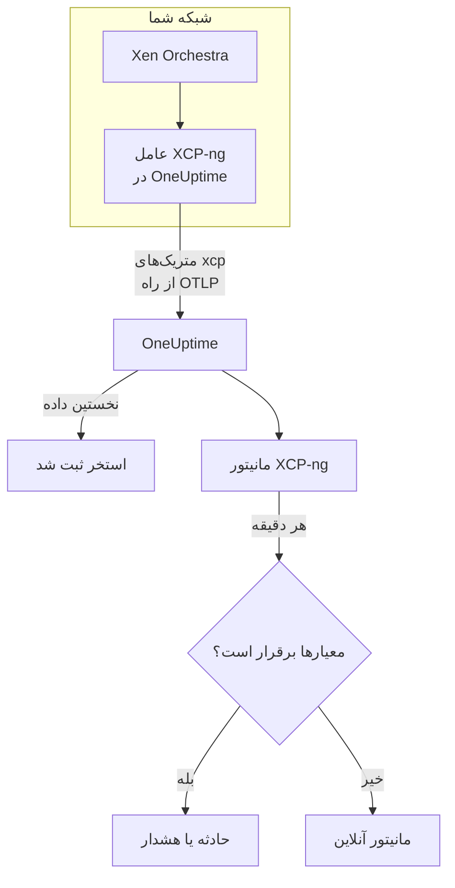

# مانیتور XCP-ng

مانیتور XCP-ng یک استخر XCP-ng را زیر نظر می‌گیرد – میزبان‌ها، ماشین‌های مجازی، مخزن‌های ذخیره‌سازی و دیسک‌های مجازی آن – و وقتی Xen Orchestra استخر را از دست می‌دهد، میزبانی آفلاین می‌شود یا غیرفعال می‌ماند، ماشین مجازی‌ای که کار می‌کرد متوقف می‌شود یا پردازنده کم می‌آورد، یا مخزن ذخیره‌سازی‌ای پر یا کند می‌شود، به شما خبر می‌دهد. سری‌های `xcp_*` افزونه OpenMetrics در Xen Orchestra را می‌خواند، که عامل XCP-ng در OneUptime گردآوری می‌کند، و سری‌های سلامتی را که OneUptime از آن‌ها به دست می‌آورد، پس هیچ چیز از بیرون کاوش نمی‌شود.

:::cards
- [ساخت مانیتور](#ساخت-یک-مانیتور-xcp-ng): شش گام در داشبورد.
- [الگوها](#الگوهای-هشدار-آماده): ده هشدار آماده، یک حادثه به ازای هر میزبان، ماشین مجازی یا مخزن ذخیره‌سازی.
- [هویت منبع](#هویت-منبع): چگونه یک میزبان، ماشین مجازی یا مخزن ذخیره‌سازی را هدف بگیرید.
- [متریک‌ها](#متریکهای-جمعآوریشده): هر سری که مانیتور می‌تواند بر پایه‌اش هشدار دهد.
:::

## چگونه کار می‌کند

عامل XCP-ng در OneUptime روی ماشینی اجرا می‌شود که به Xen Orchestra دسترسی دارد. هر ۶۰ ثانیه افزونه OpenMetrics در Xen Orchestra را می‌خواند، که هر میزبانِ هر استخری را که Xen Orchestra مدیریت می‌کند می‌خواند، و سری‌ها را از راه OTLP به OneUptime می‌فرستد، یک منبع برای هر استخر، با UUID استخر، `xcp_ng.pool.id`. نخستین داده‌ها هر استخر را ثبت می‌کنند.

مانیتور XCP-ng به یک استخر وابسته است. هر دقیقه پرس‌وجوی خود را روی متریک‌های آن استخر اجرا می‌کند و نتیجه را با معیارهایش مقایسه می‌کند.



## پیش از شروع

- **عامل XCP-ng را نصب کنید**، جایی که به Xen Orchestra دسترسی دارد، با راز افزونه OpenMetrics در Xen Orchestra. [راهنمای عامل XCP-ng](/docs/telemetry/xcp-ng) افزونه، گواهی Xen Orchestra و نصب را پوشش می‌دهد.
- **بررسی کنید استخر ثبت شده باشد.** حدود یک دقیقه پس از نخستین خراش، با نامی که Xen Orchestra به آن می‌دهد، زیر **محصولات ← زیرساخت ← XCP-ng ← همه استخرها** پدیدار می‌شود.

## ساخت یک مانیتور XCP-ng

:::steps
### یک مانیتور تازه شروع کنید

به **مانیتورها** بروید و روی **ساخت مانیتور** کلیک کنید.

### XCP-ng را برگزینید

زیر **نوع مانیتور**، روی **انواع دیگر مانیتور** کلیک کنید و **XCP-ng** را زیر **زیرساخت** برگزینید، یا در کادر جست‌وجو `xcp` را تایپ کنید. یک **نام** وارد کنید – در عنوان حادثه‌ها و هشدارها به کار می‌رود – و روی **بعدی** کلیک کنید.

### استخر را برگزینید

زیر **پیکربندی مانیتور XCP-ng**، استخر را از **استخر XCP-ng** برگزینید. هر استخری که داده فرستاده در فهرست است. پس از انتخاب، خطی زیر فیلد نشان می‌دهد که آیا داده می‌رسد. **افزودن استخر XCP-ng** گام‌های راه‌اندازی را با کلیدهای پرشده‌تان باز می‌کند، که منتظر نخستین داده می‌مانند.

### برگزینید چه چیزی پایش شود

مانیتور تازه با **Pool Disconnected** زیر **هشدار برای چه** آغاز می‌شود. برای پایش چیزی دیگر:

- **تغییر** – یک [الگو](#الگوهای-هشدار-آماده) دیگر برگزینید. متریک‌ها، فیلترها، تجمیع، بازه زمانی و آستانه‌ها را تعیین می‌کند و معیارهای زیر را با معیارهای خودش جایگزین می‌کند. همچنان می‌توانید **بازه زمانی** را تغییر دهید.
- **Custom Metric** (زیر **فیلدهای بیشتر**) – یک متریک از **متریک XCP-ng** برگزینید، سپس **تجمیع** و **بازه زمانی** را تعیین کنید. [فیلترها](#تنظیمات-مانیتور) آن را به یک نوع شیء یا یک شیء محدود می‌کنند.
- **پیشرفته** (زیر **فیلدهای بیشتر**) – پرس‌وجوها و فرمول‌ها را خودتان زیر **انتخاب متریک‌ها** بسازید، برای نمونه سهم استفاده‌شده یک مخزن ذخیره‌سازی از `xcp_sr_physical_usage_bytes / xcp_sr_physical_size_bytes`. برای سنجش جداگانه هر شیء از **گروه‌بندی بر اساس** `xcp_ng.id` استفاده کنید.

### معیارها را بررسی کنید

هر معیار را زیر **معیارها** باز کنید و **متریک**، **تجمیع**، **شرط** و **آستانه** آن را بررسی کنید. الگو این‌ها را پر می‌کند. با **Custom Metric** یا **پیشرفته**، مانیتور با [معیارهای پیش‌فرض](#معیارهای-پیشفرض) شروع می‌شود که فقط نرسیدن داده از متریک را می‌بینند، پس آستانه خودتان را تعیین کنید.

### مانیتور را بسازید

روی **ساخت مانیتور** کلیک کنید. OneUptime صفحه مانیتور را باز می‌کند و آن را هر دقیقه ارزیابی می‌کند. حادثه‌ها و هشدارهایی که باز می‌کند در صفحه‌های **حوادث** و **هشدارها**ی استخر هم فهرست می‌شوند.
:::

> [!TIP]
> برای راه‌اندازی هم‌زمان چند الگو، استخر را از **محصولات ← زیرساخت ← XCP-ng** باز کنید و به **توصیه‌ها** بروید. الگوهای دلخواه و کسانی را که باید خبر داده شوند برگزینید، و OneUptime به ازای هر الگو یک مانیتور می‌سازد.

## تنظیمات مانیتور

| فیلد | زبانه | چه می‌کند |
| --- | --- | --- |
| **استخر XCP-ng** | همه | الزامی. هر پرس‌وجو را به `resource.xcp_ng.pool.id`، یعنی UUID استخر، محدود می‌کند، تا دو استخر هم‌نام هرگز با هم قاطی نشوند. |
| **دامنه منبع** | Custom Metric، پیشرفته | اختیاری. **میزبان**، **ماشین مجازی**، **مخزن ذخیره‌سازی**، **دیسک مجازی**، **XOSTOR** یا **استخر XCP-ng** – تطابق دقیق با `xcp_ng.scope`. |
| **UUID** | Custom Metric، پیشرفته | اختیاری. تطابق دقیق با `xcp_ng.id`: UUID یک میزبان، ماشین مجازی، مخزن ذخیره‌سازی یا دیسک مجازی، همان‌گونه که Xen Orchestra نشان می‌دهد. آن را با یک دامنه همراه کنید تا یک شیء را هدف بگیرید. |
| **نام میزبان** | Custom Metric، پیشرفته | اختیاری. تطابق دقیق با برچسب `host_name` در Xen Orchestra: سری‌های خودِ میزبان و سری‌های ماشین‌های مجازی‌ای که روی آن اجرا می‌شوند. |
| **متریک XCP-ng** | Custom Metric | یک متریک از [فهرست](#متریکهای-جمعآوریشده). |
| **تجمیع** | Custom Metric | شیوه ترکیب نمونه‌ها: **میانگین**، **بیشینه**، **کمینه**، **جمع** یا **تعداد**. از تجمیع معمول متریک شروع می‌شود. |
| **بازه زمانی** | همه | پنجره غلتانی که پرس‌وجو می‌خواند، از **Past 1 Minute** تا **Past 365 Days**. مانیتور تازه از **Past 1 Minute** شروع می‌شود؛ الگوها پنجره خودشان را تعیین می‌کنند. |
| **انتخاب متریک‌ها** | پیشرفته | سازنده پرس‌وجو: **متریک**، **تجمیع بر اساس**، **فیلتر بر اساس ویژگی‌ها**، **گروه‌بندی بر اساس**، به همراه **افزودن متریک** و **افزودن فرمول** برای ترکیب پرس‌وجوها. |

عامل هر ۶۰ ثانیه Xen Orchestra را می‌خواند، و Xen Orchestra میزبان‌هایش را با تفکیک ۶۰ ثانیه می‌خواند، پس یک پنجره ۱ دقیقه‌ای حدود یک نمونه دارد؛ الگوها ۵ دقیقه یا بیشتر را می‌خوانند.

## هویت منبع

Xen Orchestra یک میزبان یا ماشین مجازی را با برچسب `uuid` آن، یک مخزن ذخیره‌سازی را با `sr_uuid` و یک دیسک مجازی را با `vdi_uuid` نام می‌برد. OneUptime هنگام رسیدن هر نقطه داده دو ویژگی روی آن می‌گذارد، تا یک فیلتر هر سری یک شیء را بخواند، هر برچسبی که نامش را برده باشد. الگوها به آن‌ها تکیه دارند:

| ویژگی | مقدارها | برای یک ماشین مجازی |
| --- | --- | --- |
| `xcp_ng.scope` | `pool`، `host`، `vm`، `sr` (یک مخزن ذخیره‌سازی)، `vdi` (یک دیسک مجازی)، `xostor` | `vm` |
| `xcp_ng.id` | UUID شیء، با حروف کوچک: `uuid` یک میزبان یا ماشین مجازی، `sr_uuid` یک مخزن ذخیره‌سازی یا یک خوشه XOSTOR، `vdi_uuid` یک دیسک مجازی، و UUID خودِ استخر روی سری‌های استخر | `5c6d7e8f-1a2b-4c3d-9e8f-0a1b2c3d4e5f` |

برای یک نوع شیء روی `xcp_ng.scope`، برای یک شیء روی `xcp_ng.id` فیلتر کنید، و برای سنجش جداگانه هر شیء بر اساس `xcp_ng.id` گروه‌بندی کنید. برچسب‌های خودِ Xen Orchestra همان‌گونه که می‌فرستد می‌مانند: `host_name` روی سری‌های یک میزبان آن میزبان را و روی سری‌های یک ماشین مجازی میزبانِ آن را نام می‌برد، `vm_name`، `sr_name` و `vdi_name` بقیه را نام می‌برند، `power_state` و `enabled` وضعیت یک میزبان یا ماشین مجازی را روی سری‌های وضعیت دارند، و `is_control_domain` روی سری‌های ماشین مجازی یک دامنه کنترلی `true` است.

خودِ استخر منبعی است که سری‌ها روی آن می‌رسند، پس ویژگی‌هایش در فیلترها و کلیدهای گروه‌بندی پیشوند `resource.` می‌گیرند: `resource.xcp_ng.pool.id` (UUID آن)، `resource.xcp_ng.pool.name` (نامش در Xen Orchestra) و `resource.xen_orchestra.name` (Xen Orchestra ای که از آن خوانده می‌شود).

## الگوهای هشدار آماده

فهرست **هشدار برای چه** ۱۲ الگو ارائه می‌دهد. هر کدام یک مانیتور کامل می‌سازد – پرس‌وجوها، فیلترهای ویژگی، یک گروه‌بندی، یک معیار که فعال می‌شود و یکی که بهبود می‌یابد. بیشترشان بر پایه `xcp_ng.id` گروه‌بندی می‌کنند، پس هر میزبان، ماشین مجازی یا مخزن ذخیره‌سازی حادثه و هشدار خودش را می‌گیرد. آستانه‌ها نقطه‌های آغازی‌اند که می‌توانید ویرایش کنید.

یک معیار فقط وقتی فعال می‌شود که شرط در همه دقیقه‌های پنجره‌اش برقرار باشد، و یک معیار آستانه‌ای ۱۰٪ آن‌سوی آستانه‌اش بهبود می‌یابد تا مقداری که حول مرز نوسان دارد پیوسته جابه‌جا نشود. یک سری ۰/۱ روی مقدار دیگر بهبود می‌یابد.

| الگو | دسته | شدت | چه چیزی را پایش می‌کند | چه وقت فعال می‌شود | چه وقت بهبود می‌یابد |
| --- | --- | --- | --- | --- | --- |
| Pool Disconnected | در دسترس بودن | بحرانی | `xcp_pool_connected`، Count روی کل استخر، ۱۰ دقیقه گذشته | در تمام پنجره هیچ داده‌ای نیست | داده دوباره می‌رسد |
| Host Offline | در دسترس بودن | بحرانی | `xcp_ng.host.running` برای `xcp_ng.scope = host`، Min به ازای هر `xcp_ng.id`، ۵ دقیقه گذشته | کمتر از ۱ | برابر ۱ |
| HA Cannot Tolerate a Host Failure | در دسترس بودن | بحرانی | `xcp_ng.pool.ha.can_tolerate_host_failure` برای `xcp_ng.scope = pool`، Max روی کل استخر، ۵ دقیقه گذشته | کمتر از ۱ | برابر ۱ |
| VM Stopped | ماشین مجازی | هشدار | `xcp_ng.vm.stopped_after_running` برای `xcp_ng.scope = vm`، Min به ازای هر `xcp_ng.id`، ۵ دقیقه گذشته | بیش از ۰ | برابر ۰ |
| VM Not Backed Up | ماشین مجازی | هشدار | `xcp_ng.vm.backup_overdue` برای `xcp_ng.scope = vm`، Min به ازای هر `xcp_ng.id`، ۱۰ دقیقه گذشته | بیش از ۰ | برابر ۰ |
| Storage Repository Near Full | ذخیره‌سازی | بحرانی | `xcp_sr_physical_usage_bytes` ÷ `xcp_sr_physical_size_bytes` × ۱۰۰ برای `xcp_ng.scope = sr` (هر دو جمع)، به ازای هر `xcp_ng.id`، ۵ دقیقه گذشته | بیش از ۹۰٪ | ۸۱٪ یا کمتر |
| Host Disabled | میزبان | هشدار | `xcp_ng.host.enabled` برای `xcp_ng.scope = host`، Max به ازای هر `xcp_ng.id`، ۳۰ دقیقه گذشته | کمتر از ۱ | برابر ۱ |
| Host Restarted | میزبان | هشدار | `xcp_host_uptime_seconds` و `xcp_ng.host.running` برای `xcp_ng.scope = host`، Min به ازای هر `xcp_ng.id`، ۵ دقیقه گذشته | `xcp_host_uptime_seconds` کمتر از ۹۰۰ (۱۵ دقیقه) است در حالی که `xcp_ng.host.running` برابر ۱ است | `xcp_host_uptime_seconds` به ۹۹۰ یا بیشتر رسیده است، یا `xcp_ng.host.running` برابر ۰ است |
| High Host CPU Usage | میزبان | هشدار | `xcp_host_cpu_average` برای `xcp_ng.scope = host`، Avg به ازای هر `xcp_ng.id`، ۱۰ دقیقه گذشته | بیش از ۰٫۹ (۹۰٪ پردازنده میزبان) | ۰٫۸۱ یا کمتر |
| High Host Memory Usage | میزبان | هشدار | (`xcp_host_memory_total_bytes` − `xcp_host_memory_free_bytes`) ÷ `xcp_host_memory_total_bytes` × ۱۰۰ برای `xcp_ng.scope = host` (هر دو جمع)، به ازای هر `xcp_ng.id`، ۱۰ دقیقه گذشته | بیش از ۹۵٪ | ۸۵٫۵٪ یا کمتر |
| VM Starved of CPU | ماشین مجازی | هشدار | `xcp_vm_runstate_full_contention` برای `xcp_ng.scope = vm`، Avg به ازای هر `xcp_ng.id`، ۱۵ دقیقه گذشته | بیش از ۰٫۱ (۱۰٪ زمان) | ۰٫۰۹ یا کمتر |
| Storage Repository Slow | ذخیره‌سازی | هشدار | `xcp_host_disk_latency_seconds` برای `xcp_ng.scope = host`، Avg به ازای هر `sr`، ۱۵ دقیقه گذشته | بیش از ۰٫۰۵ (۵۰ میلی‌ثانیه) | ۰٫۰۴۵ یا کمتر |

**شدت** برچسبی است که فهرست انتخاب نشان می‌دهد. حادثه و هشداری که یک الگو می‌سازد از شدیدترین شدت حادثه و هشدار پروژه شما شروع می‌شوند؛ آن‌ها را در معیارها تغییر دهید.

- **Pool Disconnected** وقتی فعال می‌شود که `xcp_pool_connected` به مدت ده دقیقه نرسد. Xen Orchestra تا وقتی به استخر متصل است آن را در هر خراش می‌فرستد، و وقتی ارباب استخر را از دست می‌دهد، به‌جای فرستادن ۰، فرستادنش را متوقف می‌کند؛ همچنین وقتی Xen Orchestra، افزونه‌اش یا عامل XCP-ng متوقف شود، یا عامل مسیرش به OneUptime را از دست بدهد، متوقف می‌شود. وقتی سری برگردد برطرف می‌شود. وقتی داده متوقف می‌شود، الگوهای دیگر چیزی برای مقایسه ندارند و آخرین وضعیت خود را نگه می‌دارند، پس همین الگو است که به شما خبر می‌دهد.
- **Host Offline** سری `xcp_ng.host.running` را می‌خواند، که OneUptime از `xcp_host_status` به دست می‌آورد: ۰ تا وقتی Xen Orchestra میزبان را Halted گزارش می‌کند، یا وضعیتش Unknown است چون ارباب استخر ارتباطش را با آن از دست داده است. ماشین‌های مجازی‌ای که روی میزبان کار می‌کردند هم از کار افتاده‌اند، مگر اینکه HA آن‌ها را جای دیگری دوباره راه‌اندازی کرده باشد.
- **HA Cannot Tolerate a Host Failure** سری `xcp_ng.pool.ha.can_tolerate_host_failure` را می‌خواند. وقتی مستقیم از XAPI خوانده شود، همان طرح خودِ HA است: بیش از ظرفیت متعهد شده، یا پوشش‌دهندهٔ خرابی میزبان کمتری از آنچه قرار است تاب بیاورد. وقتی از راه Xen Orchestra خوانده شود، که REST API آن طرح را گزارش نمی‌کند، یعنی کمتر از دو میزبانِ روشن و فعال برای راه‌اندازی دوبارهٔ ماشین‌های مجازی مانده است؛ پس غیرفعال کردن یک میزبان در یک استخر HA دومیزبانه کافی است. تا وقتی HA خاموش است هرگز فعال نمی‌شود.
- **VM Stopped** سری `xcp_ng.vm.stopped_after_running` را می‌خواند: ۱ تا وقتی ماشین مجازی‌ای که در ۲۴ ساعت گذشته کار کرده است Halted یا Paused باشد. ماشین مجازی‌ای که بیش از یک روز خاموش بوده است عمداً خاموش به شمار می‌آید و دیگر هشدار نمی‌دهد، ماشین مجازی معلق هرگز هشدار نمی‌دهد، و دامنه‌های کنترلی و قالب‌های ماشین مجازی کنار گذاشته می‌شوند.
- **VM Not Backed Up** سری `xcp_ng.vm.backup_overdue` را می‌خواند، برگرفته از گزارش‌های پشتیبان Xen Orchestra: ۱ تا وقتی ماشین مجازی‌ای که یک کار پشتیبان‌گیری زمان‌بندی‌شده آن را در بر دارد، در بازهٔ خود، یعنی بیشترین فاصلهٔ میان دو اجرای زمان‌بندی کارهایش، به‌علاوهٔ یک‌چهارم آن و دست‌کم یک ساعت، هیچ پشتیبان موفقی نداشته باشد. ماشین مجازیِ یک کار شبانه پس از ۳۰ ساعت آن را فعال می‌کند، و ماشین مجازی‌ای که هیچ کار زمان‌بندی‌شده‌ای آن را در بر ندارد هرگز.
- **Host Disabled** برای میزبانی فعال می‌شود که ۳۰ دقیقه غیرفعال بماند: در حالت تعمیر و نگهداری، یا پس از یک تخلیه غیرفعال رها شده. XAPI هیچ ماشین مجازی‌ای را روی آن آغاز نمی‌کند و HA نمی‌تواند به آن جابه‌جا شود. سی دقیقه به یک راه‌اندازی دوباره یا به‌روزرسانی برنامه‌ریزی‌شده فرصت می‌دهد بی‌آنکه کسی خبر شود.
- **Host Restarted** برای میزبانی فعال می‌شود که روشن است اما کمتر از ۱۵ دقیقه است که کار می‌کند: راه‌اندازی دوباره شده، یا از کار افتاده و برگشته است. وقتی میزبان ۱۶٫۵ دقیقه روشن بماند، یعنی ۱۰٪ آن‌سوی آستانه، برطرف می‌شود؛ میزبانی که از کار افتاده است به‌جای آن **Host Offline** را فعال می‌کند.
- **فرمول‌های نسبت** از هر دو طرف **جمع** می‌گیرند. هر دو از یک خراش می‌آیند، پس نتیجه یک درصد واقعی است. مخزن ذخیره‌سازی‌ای که اندازه ۰ گزارش می‌کند، همان‌گونه که برخی کتابخانه‌های ISO و رسانه‌های جداشدنی می‌کنند، هرگز فعال نمی‌شود.
- **VM Starved of CPU** رقابت کامل را می‌خواند: سهمی از زمان که همه vCPUهای یک ماشین مجازی آماده اجرا بودند اما منتظر یک پردازنده فیزیکی ماندند. میزبان آن vCPUهای قابل اجرای بیشتری از رشته‌های پردازنده دارد، پس ماشین مجازی کندتر از آنچه مصرف پردازنده خودش نشان می‌دهد اجرا می‌شود.
- **Storage Repository Slow** بر پایه `sr` گروه‌بندی می‌کند، یعنی شناسه کوتاه Xen Orchestra برای یک مخزن ذخیره‌سازی روی هر سری دیسک میزبان، پس هر مخزن ذخیره‌سازی یک حادثه می‌گیرد، با تأخیری که روی میزبان‌هایی که روی آن می‌خوانند و می‌نویسند میانگین گرفته می‌شود.

**HA Cannot Tolerate a Host Failure** و **VM Not Backed Up** سری‌هایی را می‌خوانند که خواندن استخر به دست یک پراب می‌افزاید، پس به استخری نیاز دارند که از یک پراب وصل شده باشد: افزونه‌ای که عامل XCP-ng می‌خواند هیچ وضعیت HA و هیچ پشتیبانی گزارش نمی‌کند. استخری که یک پراب آن را می‌خواند می‌تواند دربارهٔ پیام‌ها و آلارم‌های XAPI خود، مثل ماشین مجازی‌ای که از کار افتاد یا میزبانی که HA از دست داد، و دربارهٔ کارهای پشتیبان‌گیری ناموفق هم هشدار دهد: این الگوها را از **توصیه‌ها** استخر روشن کنید، همان‌طور که [XCP-ng بدون عامل](/docs/telemetry/xcp-ng-agentless) توضیح می‌دهد.

## متریک‌های جمع‌آوری‌شده

عامل هر سری افزونه OpenMetrics در Xen Orchestra را هر ۶۰ ثانیه می‌خواند؛ سری‌های زیر فهرستی‌اند که فرم مانیتور ارائه می‌کند. Xen Orchestra پیشاپیش KiB، MiB/s و میکروثانیه‌های XAPI را به بایت، بایت در ثانیه و ثانیه تبدیل می‌کند. هشت سری که آن‌ها را `_total` می‌نامد و به‌عنوان شمارنده تعریف می‌کند نرخ‌های در ثانیه را در خود دارند، و OneUptime آن‌ها را همان نرخ‌هایی که هستند ذخیره می‌کند، همان‌گونه که [راهنمای عامل XCP-ng](/docs/telemetry/xcp-ng#آنچه-عامل-گردآوری-میکند) توضیح می‌دهد. سری‌های `xcp_ng.*` از آنِ خودِ OneUptime‌اند: چهارتا هنگام رسیدن از سری‌های وضعیت Xen Orchestra به دست می‌آیند و شش‌تا از آنچه یک پراب فراتر از متریک‌ها می‌خواند، که استخری که فقط عامل XCP-ng آن را می‌خواند ندارد.

### در دسترس بودن

| متریک | یکا | توضیح |
| --- | --- | --- |
| `xcp_pool_connected` | — | ۱ تا وقتی Xen Orchestra به استخر متصل است. Xen Orchestra وقتی استخر را از دست می‌دهد، به‌جای فرستادن ۰، فرستادن آن را متوقف می‌کند: مراقب توقف آن باشید. |
| `xcp_ng.host.running` | — | ۱ تا وقتی Xen Orchestra یک میزبان را Running گزارش می‌کند، ۰ تا وقتی Halted است یا وضعیتش Unknown است. OneUptime آن را از وضعیت میزبان به دست می‌آورد. |
| `xcp_ng.host.enabled` | — | ۱ تا وقتی یک میزبان فعال است، ۰ تا وقتی در حالت تعمیر و نگهداری است یا تخلیه می‌شود، یعنی وقتی XAPI هیچ ماشین مجازی‌ای را روی آن آغاز نمی‌کند. OneUptime آن را از وضعیت میزبان به دست می‌آورد. |
| `xcp_ng.vm.running` | — | ۱ تا وقتی یک ماشین مجازی Running است، ۰ تا وقتی Halted، Paused یا Suspended است. دامنه‌های کنترلی کنار گذاشته می‌شوند. OneUptime آن را از وضعیت ماشین مجازی به دست می‌آورد. |
| `xcp_ng.vm.stopped_after_running` | — | ۱ تا وقتی ماشین مجازی‌ای که در ۲۴ ساعت گذشته کار کرده است Halted یا Paused است، وگرنه ۰. ماشین مجازی‌ای که کسی یک روز کار کردنش را ندیده است عمداً خاموش به شمار می‌آید، و ماشین مجازی معلق هرگز شمرده نمی‌شود. OneUptime آن را به دست می‌آورد. |
| `xcp_ng.pool.ha.enabled` | — | ۱ تا وقتی دسترس‌پذیری بالای استخر روشن است، وگرنه ۰. یک پراب آن را از REST API در Xen Orchestra یا مستقیم از XAPI می‌خواند؛ عامل XCP-ng آن را نمی‌خواند. |
| `xcp_ng.pool.ha.can_tolerate_host_failure` | — | تا وقتی HA روشن است: ۱ تا وقتی هنوز از پس خرابی یک میزبان برمی‌آید، ۰ از لحظه‌ای که برنمی‌آید. مستقیم از XAPI، این طرح خود HA است؛ از راه Xen Orchestra، که طرح را گزارش نمی‌کند، اینکه جز میزبانِ خراب‌شده میزبانی روشن و فعال هست یا نه. OneUptime آن را به دست می‌آورد. |
| `xcp_ng.pool.ha.host_failures_to_tolerate` | — | HA قرار است چند خرابی میزبان را تاب بیاورد. فقط مستقیم از XAPI خوانده می‌شود: REST API در Xen Orchestra آن را گزارش نمی‌کند. |
| `xcp_ng.pool.ha.plan_exists_for` | — | طرح HA با راه‌اندازی دوباره همه VMهای محافظت‌شده هنوز چند خرابی میزبان را تاب می‌آورد. فقط مستقیم از XAPI خوانده می‌شود. |
| `xcp_host_status` | count | همیشه ۱ برای هر میزبان، روشن یا نه؛ وضعیت میزبان در برچسب‌های `power_state` (Running، Halted، Unknown) و `enabled` است. |
| `xcp_vm_status` | count | همیشه ۱ برای هر ماشین مجازی جز دامنه‌های کنترلی و قالب‌ها؛ وضعیت ماشین مجازی در برچسب `power_state` (Running، Halted، Paused، Suspended) است. |
| `xcp_host_uptime_seconds` | seconds | مدتی که یک میزبان از راه‌اندازی‌اش روشن بوده است. |
| `xcp_vm_uptime_seconds` | seconds | مدتی که یک ماشین مجازی در حال اجرا از آغازش روشن بوده است. فقط تا وقتی ماشین مجازی اجرا می‌شود گزارش می‌شود. |

### میزبان

| متریک | یکا | توضیح |
| --- | --- | --- |
| `xcp_ng.host.missing_patches` | — | میزبان چند وصله کم دارد، آن‌طور که Xen Orchestra آخرین بار فهرست کرد (هر شش ساعت بررسی می‌شود). |
| `xcp_host_cpu_average` | ratio | مصرف پردازنده یک میزبان، میانگین‌گرفته روی هسته‌هایش، به‌صورت نسبتی از ۰ تا ۱. |
| `xcp_host_cpu_core_usage` | ratio | مصرف یک رشته پردازنده روی یک میزبان، به‌صورت نسبتی از ۰ تا ۱؛ برچسب `core` می‌گوید کدام. |
| `xcp_host_load` | — | vCPUهایی که روی یک میزبان اجرا می‌شوند یا منتظر اجرا هستند، به ازای هر پردازنده فیزیکی. بالای ۱، ماشین‌های مجازی منتظر پردازنده می‌مانند. |
| `xcp_host_load_average` | — | میانگین بار دامنه کنترلی (dom0) یک میزبان. |
| `xcp_host_memory_total_bytes` | bytes | حافظه فیزیکی یک میزبان. |
| `xcp_host_memory_free_bytes` | bytes | حافظه‌ای از یک میزبان که به هیچ ماشین مجازی‌ای داده نشده است. آن را با `xcp_host_memory_total_bytes` مقایسه کنید تا ببینید میزبان چقدر پر است. |
| `xcp_host_memory_reclaimed_bytes` | bytes | حافظه‌ای که کنترل پویای حافظه از ماشین‌های مجازی یک میزبان پس گرفته است. |
| `xcp_host_memory_reclaimed_max_bytes` | bytes | بیشترین حافظه‌ای که کنترل پویای حافظه می‌توانست از ماشین‌های مجازی یک میزبان پس بگیرد. |
| `xcp_host_running_vcpus` | count | vCPUهای ماشین‌های مجازی‌ای که روی یک میزبان اجرا می‌شوند، روی هم. |
| `xcp_host_power_consumption_watts` | W | توان مصرفی یک میزبان، خوانده‌شده از حسگر DCMI آن. جایی که Xen Orchestra به‌جای آن از راه IPMI می‌خواند، آن مقدار را بدون استخرش می‌فرستد، پس عامل آن را نگه نمی‌دارد؛ سهم برآوردشده هر ماشین مجازی از آن نگه داشته می‌شود. |

### ماشین مجازی

| متریک | یکا | توضیح |
| --- | --- | --- |
| `xcp_ng.vm.backup_overdue` | — | برای یک VM در یک کار پشتیبان‌گیری زمان‌بندی‌شده Xen Orchestra: ۱ تا وقتی در بازه کارهایش به‌علاوه یک‌چهارم آن (دست‌کم یک ساعت) هیچ پشتیبان موفقی نداشته باشد، وگرنه ۰. OneUptime آن را از گزارش‌های پشتیبان‌گیری به دست می‌آورد. |
| `xcp_vm_cpu_usage` | ratio | مصرف پردازنده یک ماشین مجازی، میانگین‌گرفته روی vCPUهایش، به‌صورت نسبتی از ۰ تا ۱. |
| `xcp_vm_cpu_core_usage` | ratio | مصرف یک vCPU، به‌صورت نسبتی از ۰ تا ۱؛ برچسب `core` می‌گوید کدام. |
| `xcp_vm_runstate_full_contention` | ratio | سهمی از زمان که همه vCPUهای یک ماشین مجازی آماده اجرا بودند اما منتظر یک پردازنده فیزیکی ماندند، از ۰ تا ۱. مقدار بالا یعنی همسایه‌ها ماشین مجازی را از پردازنده محروم می‌کنند. |
| `xcp_vm_runstate_partial_contention` | ratio | سهمی از زمان که برخی vCPUهای یک ماشین مجازی منتظر یک پردازنده فیزیکی بودند در حالی که بقیه مسدود بودند، از ۰ تا ۱. |
| `xcp_vm_runstate_concurrency_hazard` | ratio | سهمی از زمان که برخی vCPUهای یک ماشین مجازی اجرا می‌شدند در حالی که بقیه منتظر یک پردازنده فیزیکی بودند، از ۰ تا ۱. |
| `xcp_vm_runstate_fullrun` | ratio | سهمی از زمان که همه vCPUهای یک ماشین مجازی اجرا می‌شدند، از ۰ تا ۱. |
| `xcp_vm_runstate_partial_run` | ratio | سهمی از زمان که برخی vCPUهای یک ماشین مجازی اجرا می‌شدند و بقیه مسدود بودند، از ۰ تا ۱. |
| `xcp_vm_runstate_blocked` | ratio | سهمی از زمان که همه vCPUهای یک ماشین مجازی مسدود بودند، بی‌کار یا منتظر I/O، از ۰ تا ۱. |
| `xcp_vm_memory_bytes` | bytes | حافظه‌ای که به یک ماشین مجازی داده شده است. |
| `xcp_vm_memory_target_bytes` | bytes | حافظه‌ای که کنترل پویای حافظه می‌خواهد به یک ماشین مجازی بدهد. |
| `xcp_vm_memory_internal_free_bytes` | bytes | حافظه‌ای که مهمان آزاد گزارش می‌کند. به ابزارهای مهمان در ماشین مجازی نیاز دارد. |
| `xcp_vm_power_consumption_watts` | W | برآورد Xen Orchestra از سهم یک ماشین مجازی از توان میزبانش، تقسیم‌شده بر پایه بار پردازنده. برچسب `data_complete` آن وقتی مقدار پردازنده ماشین مجازی نبوده است `false` است. |

### ذخیره‌سازی

| متریک | یکا | توضیح |
| --- | --- | --- |
| `xcp_sr_physical_size_bytes` | bytes | اندازه فیزیکی یک مخزن ذخیره‌سازی. برخی کتابخانه‌های ISO و رسانه‌های جداشدنی ۰ گزارش می‌کنند. |
| `xcp_sr_physical_usage_bytes` | bytes | فضای استفاده‌شده روی یک مخزن ذخیره‌سازی. آن را بر اندازه‌اش تقسیم کنید تا ببینید چقدر پر است. |
| `xcp_sr_virtual_size_bytes` | bytes | اندازه مجازی هر دیسک روی یک مخزن ذخیره‌سازی، روی هم. بالاتر از اندازه‌اش، مخزن با تخصیص تُنُک بیش از گنجایشش تخصیص یافته است. |
| `xcp_vdi_virtual_size_bytes` | bytes | اندازه یک دیسک مجازی، همان‌گونه که ماشین مجازی‌اش آن را می‌بیند. |
| `xcp_vdi_physical_usage_bytes` | bytes | فضایی که یک دیسک مجازی روی مخزن ذخیره‌سازی‌اش می‌گیرد. |
| `xcp_host_disk_iops_read` | ops/s | عملیات خواندن در ثانیه از یک میزبان به یک مخزن ذخیره‌سازی؛ برچسب `sr_name` می‌گوید کدام. |
| `xcp_host_disk_iops_write` | ops/s | عملیات نوشتن در ثانیه از یک میزبان به یک مخزن ذخیره‌سازی. |
| `xcp_host_disk_iops_total` | ops/s | عملیات خواندن و نوشتن در ثانیه از یک میزبان به یک مخزن ذخیره‌سازی. |
| `xcp_host_disk_throughput_read_bytes` | bytes/s | بایت در ثانیه‌ای که یک میزبان از یک مخزن ذخیره‌سازی می‌خواند. |
| `xcp_host_disk_throughput_write_bytes` | bytes/s | بایت در ثانیه‌ای که یک میزبان روی یک مخزن ذخیره‌سازی می‌نویسد. |
| `xcp_host_disk_throughput_total_bytes` | bytes/s | بایت در ثانیه‌ای که یک میزبان از یک مخزن ذخیره‌سازی می‌خواند و روی آن می‌نویسد. |
| `xcp_host_disk_read_latency_seconds` | seconds | مدتی که خواندن‌های یک میزبان از یک مخزن ذخیره‌سازی طول می‌کشد. |
| `xcp_host_disk_write_latency_seconds` | seconds | مدتی که نوشتن‌های یک میزبان روی یک مخزن ذخیره‌سازی طول می‌کشد. |
| `xcp_host_disk_latency_seconds` | seconds | مدتی که خواندن‌ها و نوشتن‌های یک میزبان روی یک مخزن ذخیره‌سازی طول می‌کشد. |
| `xcp_host_disk_iowait` | ratio | سهمی از زمان که یک میزبان منتظر یک مخزن ذخیره‌سازی ماند، از ۰ تا ۱. |
| `xcp_vm_disk_read_bytes_total` | bytes/s | بایت در ثانیه‌ای که یک ماشین مجازی از یکی از دیسک‌هایش می‌خواند؛ برچسب `device` می‌گوید کدام. یک نرخ است، هرچند Xen Orchestra آن را `_total` می‌نامد و شمارنده تعریف می‌کند. |
| `xcp_vm_disk_write_bytes_total` | bytes/s | بایت در ثانیه‌ای که یک ماشین مجازی روی یکی از دیسک‌هایش می‌نویسد. یک نرخ است، هرچند Xen Orchestra آن را `_total` می‌نامد و شمارنده تعریف می‌کند. |
| `xcp_vm_disk_iops_read` | ops/s | عملیات خواندن در ثانیه روی دیسک یک ماشین مجازی. |
| `xcp_vm_disk_iops_write` | ops/s | عملیات نوشتن در ثانیه روی دیسک یک ماشین مجازی. |
| `xcp_vm_disk_iops_total` | ops/s | عملیات خواندن و نوشتن در ثانیه روی دیسک یک ماشین مجازی. |
| `xcp_vm_disk_throughput_read_bytes` | bytes/s | بایت در ثانیه‌ای که از دیسک یک ماشین مجازی خوانده می‌شود. |
| `xcp_vm_disk_throughput_write_bytes` | bytes/s | بایت در ثانیه‌ای که روی دیسک یک ماشین مجازی نوشته می‌شود. |
| `xcp_vm_disk_throughput_total_bytes` | bytes/s | بایت در ثانیه‌ای که از دیسک یک ماشین مجازی خوانده و روی آن نوشته می‌شود. |
| `xcp_vm_disk_read_latency_seconds` | seconds | مدتی که خواندن‌ها از دیسک یک ماشین مجازی طول می‌کشد. |
| `xcp_vm_disk_write_latency_seconds` | seconds | مدتی که نوشتن‌ها روی دیسک یک ماشین مجازی طول می‌کشد. |
| `xcp_vm_disk_latency_seconds` | seconds | مدتی که خواندن‌ها و نوشتن‌ها روی دیسک یک ماشین مجازی به‌طور میانگین طول می‌کشد. |
| `xcp_vm_disk_iowait` | ratio | سهمی از زمان که یک ماشین مجازی منتظر یکی از دیسک‌هایش ماند، از ۰ تا ۱. |
| `xcp_vm_disk_inflight` | count | درخواست‌هایی روی دیسک یک ماشین مجازی که هنوز پاسخ داده نشده‌اند. |
| `xcp_vm_disk_queue_size` | count | صف میانگین درخواست‌ها روی دیسک یک ماشین مجازی. |

### شبکه

| متریک | یکا | توضیح |
| --- | --- | --- |
| `xcp_host_network_receive_bytes_total` | bytes/s | بایت در ثانیه‌ای که یک میزبان روی یک رابط فیزیکی دریافت می‌کند؛ برچسب `interface` می‌گوید کدام. یک نرخ است، هرچند Xen Orchestra آن را `_total` می‌نامد و شمارنده تعریف می‌کند. |
| `xcp_host_network_transmit_bytes_total` | bytes/s | بایت در ثانیه‌ای که یک میزبان روی یک رابط فیزیکی می‌فرستد. یک نرخ است، هرچند Xen Orchestra آن را `_total` می‌نامد و شمارنده تعریف می‌کند. |
| `xcp_host_network_aggregated_receive_bytes` | bytes/s | بایت در ثانیه‌ای که یک میزبان روی همه رابط‌های فیزیکی‌اش دریافت می‌کند. |
| `xcp_host_network_aggregated_transmit_bytes` | bytes/s | بایت در ثانیه‌ای که یک میزبان روی همه رابط‌های فیزیکی‌اش می‌فرستد. |
| `xcp_vm_network_receive_bytes_total` | bytes/s | بایت در ثانیه‌ای که یک ماشین مجازی روی یکی از رابط‌های شبکه‌اش دریافت می‌کند؛ برچسب `vif` می‌گوید کدام. یک نرخ است، هرچند Xen Orchestra آن را `_total` می‌نامد و شمارنده تعریف می‌کند. |
| `xcp_vm_network_transmit_bytes_total` | bytes/s | بایت در ثانیه‌ای که یک ماشین مجازی روی یکی از رابط‌های شبکه‌اش می‌فرستد. یک نرخ است، هرچند Xen Orchestra آن را `_total` می‌نامد و شمارنده تعریف می‌کند. |
| `xcp_vm_network_receive_errors_total` | errors/s | خطاهای دریافت در ثانیه روی یکی از رابط‌های شبکه یک ماشین مجازی. یک نرخ است، هرچند Xen Orchestra آن را شمارنده تعریف می‌کند. |
| `xcp_vm_network_transmit_errors_total` | errors/s | خطاهای ارسال در ثانیه روی یکی از رابط‌های شبکه یک ماشین مجازی. یک نرخ است، هرچند Xen Orchestra آن را شمارنده تعریف می‌کند. |

### XOSTOR

فقط برای استخرهایی فرستاده می‌شود که XOSTOR اجرا می‌کنند، ذخیره‌سازی تکثیرشده Vates که بر پایه LINSTOR ساخته شده است.

| متریک | یکا | توضیح |
| --- | --- | --- |
| `xcp_xostor_up` | — | ۱ وقتی Xen Orchestra توانست سلامت یک خوشه XOSTOR را بخواند، ۰ وقتی نتوانست. |
| `xcp_xostor_node_status` | count | همیشه ۱ برای هر گره یک خوشه XOSTOR؛ نقش و وضعیتش در برچسب‌های `role` و `state` است. |
| `xcp_xostor_resource_total` | count | منبع‌های LINSTOR که یک خوشه XOSTOR تعریف می‌کند. |
| `xcp_xostor_resource_state_count` | count | نسخه‌های تکثیرشده منبع‌های یک خوشه XOSTOR در هر وضعیت دیسک؛ برچسب `state` می‌گوید کدام. |
| `xcp_xostor_alarms_up` | — | ۱ وقتی Xen Orchestra توانست آلارم‌های یک خوشه XOSTOR را بخواند، ۰ وقتی نتوانست. |
| `xcp_xostor_alarms_count` | count | آلارم‌های فعال XAPI روی یک مخزن ذخیره‌سازی XOSTOR یا میزبان‌هایش، بر پایه `alarm_name` و `target_type`. وقتی هیچ آلارمی فعال نیست، وجود ندارد. |
| `xcp_xostor_smart_up` | — | ۱ وقتی Xen Orchestra توانست داده‌های SMART یک میزبان را برای XOSTOR بخواند، ۰ وقتی نتوانست. |
| `xcp_xostor_disk_smart_status` | count | همیشه ۱ برای هر دیسک یک میزبان XOSTOR؛ سلامت SMART آن در برچسب `status` است. |
| `xcp_xostor_updates_up` | — | ۱ وقتی بررسی به‌روزرسانی XOSTOR یک میزبان پاسخ داد، ۰ وقتی شکست خورد. |
| `xcp_xostor_package_update_available` | count | ۱ برای هر بسته XOSTOR که به‌روزرسانی‌ای روی یک میزبان منتظر آن است؛ برچسب `package` می‌گوید کدام. |

## معیارهای مانیتورینگ

یک معیار یکی از پرس‌وجوها یا فرمول‌های مانیتور را با یک آستانه مقایسه می‌کند. معیارهای مانیتور XCP-ng **نوع فیلتر** ندارند: هر قاعده مقدار متریک را با این فیلدها بررسی می‌کند.

| فیلد | چه می‌کند |
| --- | --- |
| **متریک** | پرس‌وجو یا فرمولی که بررسی می‌شود، بر پایه نام متغیرش. |
| **تجمیع** | اینکه مقدارهای پنجره چطور به یک پاسخ تبدیل می‌شوند: **میانگین**، **جمع**، **مقدار بیشینه**، **مقدار کمینه**، **همه مقادیر** (همه مقدارها باید در کل پنجره جور باشند) یا **هر مقدار** (یکی کافی است). |
| **شرط** | **بزرگ‌تر از**، **کوچک‌تر از**، **بزرگ‌تر یا برابر با**، **کوچک‌تر یا برابر با**، **برابر با** یا **نابرابر با** – یا یک شرط ناهنجاری: **به‌طور غیرعادی بالا**، **به‌طور غیرعادی پایین** یا **غیرعادی**. **بدون داده** وقتی برقرار است که پرس‌وجو در بازه هیچ داده‌ای نفرستاده باشد، و **دارای داده** وقتی که چیزی فرستاده باشد. **پیش‌بینی بالاتر از** و **پیش‌بینی پایین‌تر از** وقتی منطبق‌اند که روند متریک در بازه تا پایان **بازهٔ پیش‌بینی** از آستانه گذشته باشد. |
| **آستانه** | مقداری که با آن مقایسه می‌شود. وقتی متریک یکا دارد، فهرستی از یکاها کنارش هست. برای شرط‌های ناهنجاری نشان داده نمی‌شود. |
| **حساسیت** | فقط شرط‌های ناهنجاری. **پایین** (۴σ)، **متوسط** (۳σ، پیش‌فرض) یا **بالا** (۲σ). |
| **پنجره مبنا** | فقط شرط‌های ناهنجاری. ۱۴ روز (پیش‌فرض)، ۲۸، ۶۰ یا ۹۰ روز سابقه. |
| **اگر داده‌ای نبود** | زیر **فیلدهای بیشتر**. وقتی پنجره هیچ نمونه‌ای ندارد چه شود: **Ignore** (پیش‌فرض)، **Treat As Zero** یا **تریگر**. |

شرط‌های ناهنجاری هر مقدار را با همان ساعت از هفته در خط مبنا مقایسه می‌کنند. تا وقتی پنجره مبنا سابقه کافی نداشته باشد، در وضعیت «Learning» می‌مانند و چیزی پدید نمی‌آورند. این مانیتور پرس‌وجوهایش را با ویژگی‌ها فیلتر می‌کند، پس هر پرس‌وجو، و هر سری از یک پرس‌وجوی گروه‌بندی‌شده، با سابقه خودش مقایسه می‌شود، تا جایی که متریک‌های شما نگهداری می‌شوند. اگر این مدت کمتر از دو هفته باشد، مجموع، شمارش یا پرس‌وجو روی هیستوگرام برای همیشه در همان حالت می‌ماند و هر چیز دیگری با همهٔ سری‌های متریک مقایسه می‌شود. صدک یک هیستوگرام همیشه در همان حالت می‌ماند.

هر معیار همچنین می‌گوید وقتی برقرار شد چه باید کرد: تغییر وضعیت مانیتور، ساختن یک هشدار یا اعلام یک حادثه. معیارها از بالا به پایین بررسی می‌شوند و نخستین معیاری که برقرار شود تصمیم می‌گیرد.

### معیارهای پیش‌فرض

مانیتوری که از الگو نمی‌سازید با دو معیار شروع می‌شود:

| ترتیب | معیار | وقتی برقرار است که | سپس |
| --- | --- | --- | --- |
| ۱ | بررسی آفلاین بودن _نام مانیتور_ | پرس‌وجوی اول در کل بازه هیچ داده‌ای ندارد | مانیتور را **آفلاین** علامت می‌زند و حادثه «_نام مانیتور_ آفلاین است» را اعلام می‌کند، که با بهبود مانیتور خودش برطرف می‌شود. |
| ۲ | بررسی آنلاین بودن _نام مانیتور_ | پرس‌وجوی اول داده دارد | مانیتور را **عملیاتی** علامت می‌زند. |

> [!IMPORTANT]
> مقدار `0` هم داده است، پس متریکی که اغلب صفر است، مانند خطاهای شبکه یک ماشین مجازی، مانیتور را آفلاین نمی‌کند. برای هشدار روی یک مقدار، از یک الگو شروع کنید یا معیاری با آستانه اضافه کنید. وقتی هیچ داده‌ای نمی‌رسد و هیچ معیاری برقرار نیست، مانیتور وضعیتش را نگه می‌دارد و رخدادهای باز، باز می‌مانند: سکوت به معنای بهبود نیست. زمانی که خود OneUptime داده دریافت نمی‌کرد هرگز «بدون داده» به حساب نمی‌آید: بررسی‌ای که بازه‌اش چنین زمانی دارد منتظر می‌ماند، همان‌طور که [وقتی OneUptime داده دریافت نمی‌کند](/docs/monitor/when-oneuptime-is-not-receiving) توضیح می‌دهد.

## Terraform

[ارائه‌دهنده Terraform در OneUptime](/docs/terraform/monitor-steps) پیکربندی یک گام مانیتور XCP-ng را در ویژگی `xcp_ng_monitor` نگه می‌دارد: JSON خام پیکربندی `xcpNgMonitor` (`poolIdentifier`، `resourceFilters`، `metricViewConfig`، `rollingTime`)، که با `jsonencode()` نوشته می‌شود:

```hcl title="main.tf"
monitor_steps = [{
  xcp_ng_monitor = jsonencode({
    poolIdentifier  = "b7569d99-30f8-178a-7d94-801de3e29b5b"
    resourceFilters = { scope = "host" }
    rollingTime     = "Past 10 Minutes"
    metricViewConfig = {
      queryConfigs = [{
        metricAliasData = { metricVariable = "host_cpu", title = "Host CPU", description = "", legend = "" }
        metricQueryData = {
          filterData = {
            metricName     = "xcp_host_cpu_average"
            attributes     = {}
            aggegationType = "Avg"
            aggregateBy    = {}
          }
          groupByAttributeKeys = ["xcp_ng.id"]
        }
      }]
      formulaConfigs = []
    }
  })
  criteria = [ /* ... */ ]
}]
```

`poolIdentifier` همان UUID استخر است، یعنی `xcp_ng.pool.id` آن، همان‌گونه که **تنظیمات** استخر نشان می‌دهد، نه شناسه OneUptime آن. `resourceFilters` [فیلترهایی](#تنظیمات-مانیتور) را در خود دارد که فرم آن‌ها را **دامنه منبع**، **UUID** و **نام میزبان** می‌نامد: `scope` (`host`، `vm`، `sr`، `vdi`، `xostor` یا `pool`)، `xcpNgId` و `hostName`.

## رفع اشکال

:::details استخر در فهرست استخر XCP-ng نیست
استخرها خود را از روی داده‌های عامل ثبت می‌کنند. بررسی کنید که عامل اجرا می‌شود و داده می‌فرستد ([راهنمای عامل XCP-ng](/docs/telemetry/xcp-ng) را ببینید)، و اینکه Xen Orchestra به استخر متصل است: استخری که Xen Orchestra گزارشش نمی‌کند هرگز به OneUptime نمی‌رسد.
:::

:::details Host Offline یا VM Stopped هرگز فعال نمی‌شود
این دو `xcp_ng.host.running` و `xcp_ng.vm.stopped_after_running` را می‌خوانند، که OneUptime از `xcp_host_status` و `xcp_vm_status` به دست می‌آورد. هر دو سری وضعیت از افزونه OpenMetrics در Xen Orchestra 6.9 یا بعد از آن می‌آیند: یک Xen Orchestra قدیمی‌تر را به‌روزرسانی کنید. **VM Stopped** برای ماشین مجازی‌ای که کسی در ۲۴ ساعت گذشته کار کردنش را ندیده است، و برای ماشین مجازی معلق هم، ساکت می‌ماند.
:::

:::details حادثه‌ها یک بار برای کل استخر فعال می‌شوند، نه یک بار برای هر میزبان
پرس‌وجو را، همان‌گونه که الگوها می‌کنند، بر پایه `xcp_ng.id` گروه‌بندی کنید. بدون گروه‌بندی، پرس‌وجو هر میزبان، ماشین مجازی یا مخزن ذخیره‌سازی استخر را یک سری می‌خواند، و میانگینی روی آن‌ها همان یکی را که مشکل دارد پنهان می‌کند.
:::

:::details یک نمودار توان عملیاتی بسیار بالا نشان می‌دهد، یا زیر صفر می‌رود
هشت سری `_total` که نرخ در خود دارند به‌صورت گیج بر حسب بایت یا خطا در ثانیه ذخیره می‌شوند، یعنی همان مقدارهایی که Xen Orchestra ارائه می‌کند. آن‌ها را همان‌گونه که هستند بخوانید، با **میانگین** یا **بیشینه**: **تبدیل به نرخ در ثانیه** در سازنده پرس‌وجو نرخِ یک نرخ را می‌گیرد. کالکتوری که خودتان پیکربندی کرده‌اید هم باید آن‌ها را به گیج تبدیل کند، همان‌گونه که پردازنده `transform/xcp-ng-rates` در عامل می‌کند؛ OneUptime هم هر کدام را که هنوز به‌صورت شمارنده برسد تبدیل می‌کند.
:::

:::details Pool Disconnected برای همه استخرهای یک Xen Orchestra با هم فعال می‌شود
عامل، Xen Orchestra یا افزونه OpenMetrics آن متوقف شد، یا عامل مسیرش به OneUptime را از دست داد: همه استخرهای آن Xen Orchestra با هم خاموش شدند. `troubleshoot.sh` در عامل گامی را که شکست می‌خورد نام می‌برد، همان‌گونه که [راهنمای عامل XCP-ng](/docs/telemetry/xcp-ng#رفع-اشکال) توضیح می‌دهد.
:::

## گام‌های بعدی

:::cards
- [عامل XCP-ng](/docs/telemetry/xcp-ng): عاملی را نصب کنید که متریک‌ها را می‌فرستد.
- [مانیتور Proxmox](/docs/monitor/proxmox-monitor): همین نوع مانیتور برای Proxmox VE.
- [مانیتور VMware](/docs/monitor/vmware-monitor): همین نوع مانیتور برای vSphere.
- [نمای کلی حوادث](/docs/incidents/index): پس از آنکه یک معیار حادثه‌ای اعلام کرد چه اتفاقی می‌افتد.
:::
