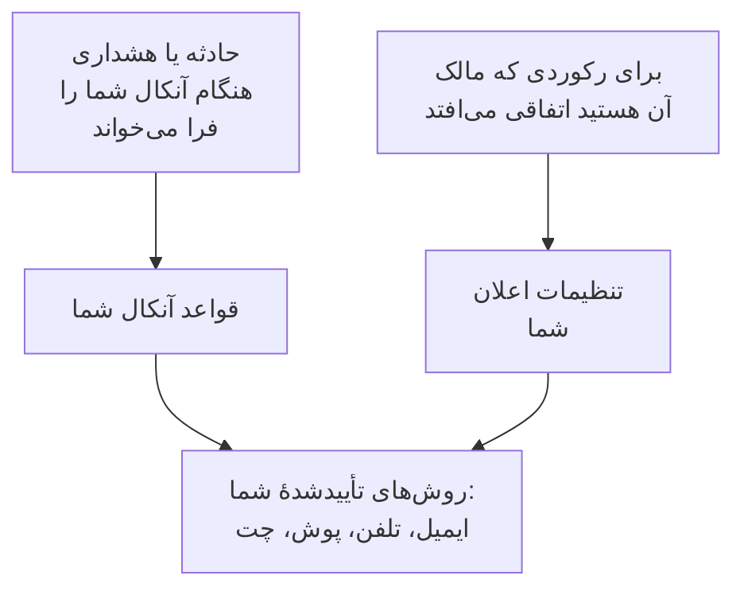

# چگونه OneUptime با شما تماس می‌گیرد

OneUptime از دو راه با شما تماس می‌گیرد. وقتی آنکال هستید و حادثه یا هشداری رخ می‌دهد، شما را فرا می‌خواند؛ و شما را از آنچه مالکش هستید باخبر نگه می‌دارد: یادداشتی روی حادثهٔ شما، مانیتوری که وضعیتش تغییر کرد، نوبت بعدی‌تان. هر دو به نشانی‌هایی می‌رسند که در **تنظیمات کاربر** برای هر پروژه نگه می‌دارید. این صفحه توضیح می‌دهد این اجزا چگونه کنار هم کار می‌کنند، کجا هستند و از ابتدا چه چیزی دارید.

:::cards
- [سه صفحه، سه پرسش](#سه-صفحه-سه-پرسش): روش‌ها، قواعد آنکال و تنظیمات اعلان، و اینکه هر کدام چه تعیین می‌کند.
- [کجا پیدایشان کنید](#کجا-پیدایشان-کنید): صفحه‌های تنظیمات کاربر، بخش به بخش.
- [آنچه از ابتدا دارید](#آنچه-از-ابتدا-دارید): روش‌ها، قواعد و تنظیماتی که عضو تازه می‌گیرد.
- [وقتی هیچ قاعده‌ای مطابقت ندارد](#وقتی-هیچ-قاعدهای-مطابقت-ندارد): فراخوانی چگونه باز هم به شما می‌رسد، و به چه کسی خبر داده می‌شود.
:::

## چگونه کار می‌کند

- یک سیاست آنکال وقتی شما را فرا می‌خواند که یکی از قواعد تشدیدش نام شما، تیمی که در آن هستید، یا برنامه‌ای را ببرد که در آن آنکال هستید. سپس قواعد آنکال شما تعیین می‌کنند OneUptime کدام روش‌های شما را امتحان کند، و پس از چه مدت.
- وقتی برای رکوردی که مالکش هستید یا برای نوبت‌هایتان اتفاقی می‌افتد، تنظیمات اعلان شما تعیین می‌کند این به‌روزرسانی به کدام کانال‌ها برود.
- در هر دو حالت، OneUptime فقط از روش‌هایی استفاده می‌کند که در پروژه‌ای که فراخوانی یا به‌روزرسانی از آن می‌آید تأیید کرده‌اید.

## سه صفحه، سه پرسش

| صفحه | چه چیزی در آن است | به کدام پرسش پاسخ می‌دهد |
| --- | --- | --- |
| **روش‌های اعلان** | نشانی‌های ایمیل، شماره‌های تلفن، شماره‌های WhatsApp، حساب‌های Telegram، Slack و Microsoft Teams، دستگاه‌های پوش و وب‌هوک‌های شما | OneUptime کجا می‌تواند به من برسد؟ |
| **قواعد آنکال** | برای هر نوع فراخوانی و هر شدت، کدام روش و پس از چه مدت امتحان شود | وقتی آنکال هستم چگونه فرا خوانده می‌شوم؟ |
| **تنظیمات اعلان** | برای هر رویداد دربارهٔ رکوردی که مالکش هستید یا دربارهٔ نوبت‌هایتان، از کدام کانال‌ها استفاده شود | دیگر از چه چیزهایی و کجا باخبر می‌شوم؟ |

این‌ها عمداً جدا هستند. روشن کردن همهٔ کانال‌ها در **تنظیمات اعلان** هرگز شما را فرا نمی‌خواند، و روشی که تأیید نکرده‌اید هرگز به کار نمی‌رود، هر چه قواعدتان بگویند.

> [!IMPORTANT]
> روش‌ها، قواعد و تنظیمات به یک پروژه تعلق دارند. آن‌ها را در هر پروژه‌ای که در آن کار می‌کنید تنظیم کنید: **تنظیمات کاربر** همیشه پروژه‌ای را نشان می‌دهد که در آن هستید.

## کجا پیدایشان کنید

**تنظیمات کاربر** را از سمت راست نواری که زیر نوار بالاست باز کنید. منوی کناری آن هر آنچه به چگونگی رسیدن OneUptime به شما مربوط است در خود دارد:

| بخش | صفحه‌ها |
| --- | --- |
| **شروع کنید** | **فهرست راه‌اندازی**: آنچه هنوز باید راه‌اندازی شود، به ترتیب اهمیت |
| **هشدارها و اعلان‌ها** | **روش‌های اعلان**، **قواعد آنکال**، **تنظیمات اعلان** و **ترجیحات ایمیل**، که تعیین می‌کند به‌روزرسانی‌هایتان به چند ایمیل برسند |
| **گزارش‌های آنکال** | **گزارش‌های آنکال**: هر باری که در این پروژه فرا خوانده شدید، و آنچه فرستاده شد |
| **سیاست تماس ورودی** | **شماره‌های تلفن ورودی**: شماره‌ای که سیاست تماس ورودی روی آن با شما تماس می‌گیرد |
| **تقویم** | **فید تقویم**: نوبت‌هایتان در برنامهٔ تقویمتان، و یادآوری پیش از شروعشان |
| **پروفایل** | **فیلدهای سفارشی**: جزئیاتی که پروژه از اعضایش می‌خواهد |
| **فضای کاری** | **Slack** و **Microsoft Teams**: حساب خودتان، در هر فضای کاری که پروژه وصل کرده است |

**شروع کنید** و **هشدارها و اعلان‌ها** باز هستند؛ بخش‌های دیگر بسته شروع می‌شوند، و وقتی در یکی از صفحه‌های یک بخش هستید، آن بخش خودبه‌خود باز می‌شود. **فضای کاری** فقط وقتی دیده می‌شود که پروژه Slack یا Microsoft Teams را وصل کرده باشد.

مالکان و مدیران پروژه هم می‌توانند راه‌اندازی شما را ببینند: در **کاربران**، ردیف شما و بخش **آنکال** آن را باز می‌کنند، با **آمادگی**، **روش‌های اعلان** و **قواعد آنکال**. آن‌ها می‌توانند آنجا برای شما روشی بیفزایند، اما کد به خود آن روش فرستاده می‌شود، پس فقط خودتان می‌توانید تأییدش کنید.

## آنچه از ابتدا دارید

وقتی با یک ایمیل ورود تأییدشده به پروژه‌ای می‌پیوندید، OneUptime شما را طوری راه‌اندازی می‌کند که فراخوانی همیشه به شما برسد:

1. ایمیل ورود شما به‌عنوان یک روش ایمیل تأییدشده افزوده می‌شود.
2. برای هر شدت، روی هر یک از چهار زبانهٔ **قواعد آنکال**، قاعده‌ای به محض فراخوانی به شما ایمیل می‌زند.
3. مجموعه‌ای از به‌روزرسانی‌ها دربارهٔ آنچه مالکش هستید و دربارهٔ نوبت‌هایتان با ایمیل روشن می‌شود. [تنظیمات اعلان](/docs/notifications/notification-settings#برای-عضو-تازه-چه-چیزی-روشن-است) را ببینید.

هر روشی که بعداً تأیید کنید همان قواعد را می‌گیرد: یک قاعده برای هر شدت، که به محض فراخوانی فرستاده می‌شود. پس تأیید یک شمارهٔ تلفن برای SMS یعنی هر فراخوانی برایتان پیامک هم می‌فرستد. برای اینکه پیامک فقط برای فراخوانی‌های بحرانی بماند، قواعد SMS شدت‌های دیگر را حذف کنید. [قواعد آنکال شخصی](/docs/notifications/on-call-rules#قواعدی-که-از-ابتدا-دارید) را ببینید.

## فهرست راه‌اندازی

**تنظیمات کاربر** > **فهرست راه‌اندازی** صفحهٔ **Your setup checklist** را باز می‌کند: هر آنچه OneUptime برای رسیدن به شما لازم دارد، به ترتیب اهمیت. هر گام به صفحه‌ای پیوند دارد که آن کار را انجام می‌دهد، و **بررسی دوباره** همه را دوباره می‌خواند.

| بخش | آنچه بررسی می‌کند |
| --- | --- |
| **So we can reach you** | روشی دارید، هر روشی که افزوده‌اید تأیید شده، و دست‌کم یکی از آن‌ها روی کانالی است که پروژه روشن کرده است |
| **How you want to be paged** | هر شدت روی هر یک از چهار زبانهٔ **قواعد آنکال** قاعده‌ای دارد |
| **Staying informed** | هنگام شروع نوبت باخبر می‌شوید، و پشت هر کانالی که در **تنظیمات اعلان** روشن کرده‌اید یک روش تأییدشده هست |
| **Nice to have** | شماره‌ای برای تماس‌های ورودی، حساب‌های Slack و Microsoft Teams شما، پیوند تقویم و فیلدهای پروفایلتان |

پوش در **Staying informed** شمرده نمی‌شود: فقط به اپلیکیشن موبایل نیاز دارد، و هر به‌روزرسانی‌ای که عضو تازه با پوش می‌گیرد با ایمیل هم می‌رسد.

**Nice to have** در نوار پیشرفت شمرده نمی‌شود، و گامی هم که فقط کس دیگری می‌تواند درستش کند شمرده نمی‌شود. خط بالای صفحه خلاصهٔ وضعیت را می‌گوید:

| عنوان | معنایش |
| --- | --- |
| **همه‌چیز آماده است** | فراخوانی‌ها به شما می‌رسند، و کاری باقی نمانده است |
| **هنوز چند مورد باید راه‌اندازی شود** | شدتی قاعده ندارد، یا گامی هنوز انجام نشده است |
| **هنوز هیچ راهی برای رسیدن به شما نیست** | هیچ‌یک از روش‌هایتان قابل استفاده نیست: هیچ‌کدام تأیید نشده، یا هر روش تأییدشده روی کانالی است که این پروژه خاموش کرده است |
| **همه‌چیز برای شما راه‌اندازی شده و الان آنکال نیستید** | همه‌چیز برای روزی که سیاستی نام شما را ببرد آماده است |

## وقتی هیچ قاعده‌ای مطابقت ندارد

ممکن است فراخوانی‌ای برای نوع و شدتی برسد که برایش قاعده‌ای ندارید: مثلاً شدتی که پس از پیوستن شما افزوده شده است. OneUptime باز هم شما را فرا می‌خواند، روی آنچه تأیید کرده‌اید:

1. همهٔ روش‌های رایگانی که دارید: دستگاه‌های پوش، نشانی‌های ایمیل، Slack و Microsoft Teams.
2. اگر هیچ‌کدام از این‌ها را ندارید، یک روش پولی به این ترتیب: SMS، تماس تلفنی، WhatsApp، Telegram. این نخستین روشی است که تأیید کرده‌اید، روی کانالی که پروژه روشن کرده است.
3. اگر هیچ‌کدام از این‌ها را هم ندارید، یک وب‌هوک.

ایمیلی در این باره برای شما می‌آید، و برای مالکان سیاست آنکال هم، یا اگر سیاست مالکی ندارد برای مالکان پروژه. اگر هیچ چیزی تأیید نشده باشد، فراخوانی تحویل داده نمی‌شود و ایمیل همین را می‌گوید. این ایمیل‌ها تا وقتی فراخوانی‌ها پشت سر هم می‌آیند نگه داشته می‌شوند، تا سیل فراخوانی‌ها سیل ایمیل نشود. برای افزودن قاعدهٔ جاافتاده، [قواعد آنکال شخصی](/docs/notifications/on-call-rules#وقتی-یک-شدت-قاعده-ندارد) را ببینید.

## عیب‌یابی

:::details آنکال بودم، اما هیچ چیزی به من نرسید
**تنظیمات کاربر** > **گزارش‌های آنکال** را باز کنید. اگر ردیفی برای آن حادثه نیست، سیاست آنکالش هرگز شما را فرا نخوانده است: قواعد تشدید آن و اینکه چه کسی آنکال بوده را بررسی کنید. برای ردیفی که وضعیتش **خطا** است، **مشاهده پیام وضعیت** دلیلش را می‌گوید، مثلاً کانالی که پروژه خاموش کرده است. سپس بررسی کنید که روش‌هایتان تأیید شده‌اند، و در **Your setup checklist** زیر **So we can reach you** چیزی باقی نمانده است.
:::

:::details دربارهٔ رکوردهایی ایمیل می‌گیرم که هرگز درخواستشان نکرده‌ام
شما مالک آن رکورد هستید، مستقیم یا از طریق یک تیم، یا رکورد مالکی ندارد و شما مالک پروژه هستید. آن رویداد را در **تنظیمات کاربر** > **تنظیمات اعلان** خاموش کنید، یا حجم را در **تنظیمات کاربر** > **ترجیحات ایمیل** کم کنید.
:::

:::details شمارهٔ تلفنی افزودم، اما در قواعدم نیست
شماره پس از تأیید شدن به قواعد شما می‌پیوندد. روی ردیفش **تأیید** را بزنید و کد را وارد کنید. اگر کارت آن دکمهٔ افزودن ندارد، پروژه آن کانال را خاموش کرده است. [روش‌های اعلان](/docs/notifications/notification-methods#روشن-کردن-کانال-برای-پروژه) را ببینید.
:::

## گام‌های بعدی

:::cards
- [روش‌های اعلان](/docs/notifications/notification-methods): نشانی‌هایی را که OneUptime می‌تواند از آن‌ها به شما برسد بیفزایید و تأیید کنید.
- [قواعد آنکال شخصی](/docs/notifications/on-call-rules): تعیین کنید هر فراخوانی کدام روش را و کی امتحان کند.
- [تنظیمات اعلان](/docs/notifications/notification-settings): به‌روزرسانی‌هایی را که از آن‌ها باخبر می‌شوید، و کانال‌هایشان را انتخاب کنید.
- [قواعد تشدید](/docs/on-call/escalation-rules): سیاست آنکال چگونه سطح به سطح تعیین می‌کند چه کسی فرا خوانده شود.
:::
