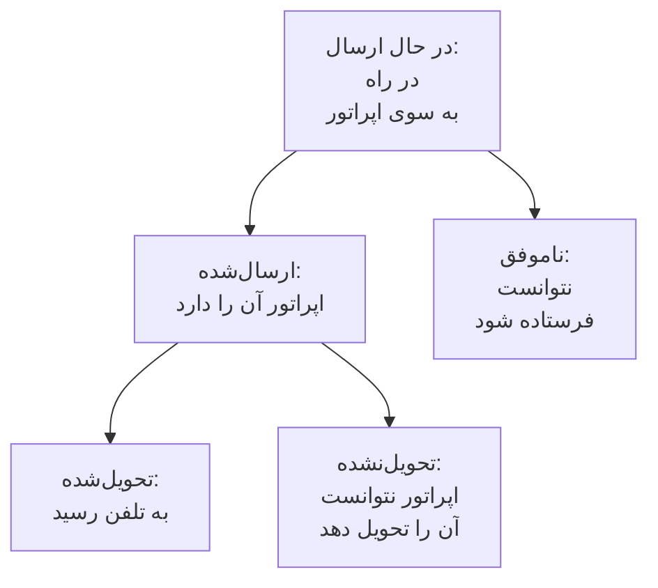

# گزارش‌های اعلان

گزارش‌های اعلان هر پیامی را که OneUptime برای پروژهٔ شما فرستاده است فهرست می‌کنند، یک زبانه برای هر کانال، و نشان می‌دهند سرانجام هر کدام چه شد: آیا فرستاده شد، آیا رسید، و اگر نه، چرا. آن‌ها را در **تنظیمات پروژه** > **اعلان‌ها** > **گزارش‌های اعلان** باز کنید، یا در **گزارش‌های اعلان** یک حادثه، یک هشدار، یک رویداد تعمیر و نگهداری، یک صفحهٔ وضعیت یا یک سیاست آنکال، برای آنچه دربارهٔ آن فرستاده شده است.

:::cards
- [یک وضعیت را چگونه بخوانیم](#یک-وضعیت-را-چگونه-بخوانیم): رنگش می‌گوید پیام کجاست، و اشاره به آن می‌گوید چه معنایی دارد.
- [پیامک](#پیامک): در حال ارسال، سپس ارسال‌شده، سپس تحویل‌شده، همان‌طور که اپراتور گزارش می‌دهد.
- [تماس‌ها](#تماسها): در حال تماس، و سپس اینکه تماس چگونه تمام شد.
- [WhatsApp و Telegram](#whatsapp-و-telegram): آنچه هر برنامه پس از پذیرفتن یک پیام گزارش می‌دهد.
- [ایمیل، پوش، وب‌هوک‌ها و فضاهای کاری](#ایمیل-پوش-وبهوکها-و-فضاهای-کاری): موفق، یا خطا و دلیلش.
- [وقتی پیامکی روی ارسال‌شده می‌ماند](#وقتی-پیامکی-روی-ارسالشده-میماند): اپراتورهایی که هرگز پاسخ نمی‌دهند، و گزارش‌هایی که هرگز نمی‌رسند.
:::

## یک وضعیت را چگونه بخوانیم

هر وضعیت یک برچسب رنگی است که رنگش می‌گوید پیام کجاست:

| رنگ | پیام کجاست |
| --- | --- |
| خاکستری | تحویل داده شده، و هنوز چیزی برنگشته است، مانند **در حال ارسال**. |
| آبی | ارائه‌دهنده آن را دارد، و هنوز نگفته است که چگونه تمام شد، مانند **ارسال‌شده** برای پیامک یا **در حال تماس** برای تماس. |
| سبز | به آن‌ها رسید، مانند **تحویل‌شده**، یا این آخرین وضعیتی است که خواهد داشت. |
| زرد | به تلفن رسید و کسی پاسخ نداد، مانند **تماس از دست رفته**، یا با یک هشدار فرستاده شد. |
| قرمز | به آن‌ها نرسید، مانند **تحویل‌نشده**، **ناموفق**، **خطا** یا **موجودی ناکافی**. |

به یک وضعیت اشاره کنید، روی آن بزنید، یا با کلید Tab به آن بروید، تا بگوید چه معنایی دارد و بعد چه می‌شود. **مشاهده پیام وضعیت**، در منوی ردیف، نشان می‌دهد ارائه‌دهنده چه گفت، مانند شناسهٔ پیام یا اینکه چرا ناموفق شد. فیلتر **وضعیت** هر زبانه همهٔ وضعیت‌هایی را که آن زبانه می‌تواند نشان دهد، به همان ترتیبی که پیام از آن‌ها می‌گذرد، فهرست می‌کند.

## پیامک

| وضعیت | معنایش چیست |
| --- | --- |
| **در حال ارسال** | OneUptime پیامک را به Twilio سپرد، و Twilio دارد آن را به اپراتور می‌رساند. |
| **ارسال‌شده** | اپراتور پیامک را پذیرفت. به‌محض اینکه اپراتور پاسخ دهد، به **تحویل‌شده** یا **تحویل‌نشده** تغییر می‌کند. |
| **تحویل‌شده** | اپراتور تأیید کرد که پیامک به تلفن رسید. این آخرین وضعیت پیامکی است که رسیده است. |
| **تحویل‌نشده** | اپراتور نتوانست آن را تحویل دهد. **کد خطا** دلیلش را می‌گوید: `30003` تلفنی است که خاموش یا خارج از دسترس است، `30005` شماره‌ای که وجود ندارد، `30006` یک تلفن ثابت، و `30007` پیامی که اپراتور آن را فیلتر کرد. |
| **ناموفق** | Twilio نتوانست آن را بفرستد. **کد خطا** دلیلش را می‌گوید. |
| **خطا** | فرستاده نشد، برای نمونه چون پیامک برای پروژه خاموش است، یا Twilio شماره را رد کرد. **مشاهده پیام وضعیت** دلیلش را می‌گوید. |
| **موجودی ناکافی** | فرستاده نشد: موجودی پروژه برای پرداخت هزینه‌اش کافی نبود. |
| **موفق** | پیش از آنکه OneUptime تحویل را پیگیری کند فرستاده شد، و Twilio آن را پذیرفت. |

پیامکی که درگاه پیامک و تماس خود سرور آن را گرفته است، روی **ارسال‌شده** و به رنگ سبز می‌ماند: درگاه تحویل را گزارش نمی‌دهد، پس این آخرین وضعیت آن است.

Twilio هر تغییر را همان لحظه که رخ می‌دهد به OneUptime گزارش می‌دهد، امضاشده با توکن احراز هویت حسابی که پیامک از آن فرستاده شد، و OneUptime هر گزارشی را که از Twilio نباشد رد می‌کند. برای این کار، Twilio باید بتواند به سرور شما برسد: [یکپارچه‌سازی Twilio](/docs/self-hosted/twilio-integration) را ببینید.

## تماس‌ها

| وضعیت | معنایش چیست |
| --- | --- |
| **در حال تماس** | Twilio تماس را برقرار کرد. به‌محض اینکه Twilio بگوید تماس چگونه تمام شد، تغییر می‌کند. |
| **موفق** | به تماس پاسخ داده شد، و **مشاهده پیام وضعیت** می‌گوید چقدر طول کشید. تماسی که درگاه پیامک و تماس خود سرور آن را گرفته است، به‌محض اینکه درگاه آن را بپذیرد **موفق** است. |
| **تماس از دست رفته** | تماس زنگ خورد و تمام شد: کسی پاسخ نداد. |
| **مشغول** | خط مشغول بود، یا تماس رد شد. |
| **پست صوتی** | پست صوتی به یک تماس آنکال پاسخ داد. **مشاهده پیام وضعیت** می‌گوید آیا پیامی گذاشته شد یا نه. |
| **خطا** | تماس برقرار یا وصل نشد. |
| **موجودی ناکافی** | برقرار نشد: موجودی پروژه برای پرداخت هزینه‌اش کافی نبود. |

## WhatsApp و Telegram

یک پیام WhatsApp تا وقتی OneUptime آن را تحویل می‌دهد **در صف** است، به‌محض اینکه WhatsApp آن را بپذیرد **ارسال‌شده**، به‌محض اینکه به تلفن برسد **تحویل‌شده**، و به‌محض اینکه باز شود **خوانده‌شده**، اگر آن شخص رسید خواندن را به اشتراک بگذارد. **ناموفق** پیامی است که WhatsApp نتوانست تحویل دهد، و **هشدار** پیامی که با یک هشدار فرستاد: **مشاهده پیام وضعیت** می‌گوید WhatsApp چه گزارش داد. **خطا** و **موجودی ناکافی** یعنی فرستاده نشد، همانند پیامک.

Telegram پس از پذیرفتن یک پیام چیزی گزارش نمی‌دهد، پس **ارسال‌شده** برای پیام Telegram سبز است: Telegram آن را در گفتگو منتشر کرد، و این آخرین وضعیت آن است.

## ایمیل، پوش، وب‌هوک‌ها و فضاهای کاری

این زبانه‌ها **موفق** یا **خطا** نشان می‌دهند. **موفق** آخرین وضعیت است: سرور ایمیل ایمیل را پذیرفت، سرویس پوش اعلان را پذیرفت، نشانی وب‌هوک پاسخ داد که درخواست را گرفت، یا فضای کاری کاری را که خواسته شده بود انجام داد. OneUptime ایمیل را پس از آنکه سرور ایمیل آن را پذیرفت پیگیری نمی‌کند، و یک اعلان پوش اگر سرویس پوش بعداً گزارش دهد که تحویل نشد، به **خطا** تغییر می‌کند. **مشاهده پیام وضعیت** می‌گوید چرا یک پیام **خطا** است، همان‌طور که **دلیل** در زبانهٔ **فضای کاری** می‌گوید.

## وقتی پیامکی روی ارسال‌شده می‌ماند

**ارسال‌شده** یعنی اپراتور پیامک را دارد و هنوز پاسخی نداده است. بیشتر اپراتورها در چند ثانیه یا چند دقیقه پاسخ می‌دهند، ولی برخی هرگز پاسخ نمی‌دهند: آنگاه Twilio هم پیامک را روی `sent` نگه می‌دارد، همان‌طور که گزارش‌های پیام آن نشان می‌دهند، و OneUptime نمی‌تواند بداند که رسید یا نه.

پیامکی که روی **در حال ارسال** می‌ماند ماجرای دیگری است: گزارش‌های Twilio به OneUptime نمی‌رسند. بررسی کنید که Twilio بتواند به سرور شما برسد، و در گزارش سرور دنبال خط‌هایی بگردید که با `Twilio callback refused` شروع می‌شوند: [یکپارچه‌سازی Twilio](/docs/self-hosted/twilio-integration) را ببینید.

## گام‌های بعدی

:::cards
- [یکپارچه‌سازی Twilio](/docs/self-hosted/twilio-integration): Twilio را وصل کنید، و بگذارید گزارش‌های تحویلش به OneUptime برسند.
- [درگاه پیامک و تماس](/docs/self-hosted/sms-and-call-gateway): پیامک و تماس‌ها را از راه درگاهی از آنِ خودتان بفرستید.
- [متریک‌های تحویل اعلان](/docs/self-hosted/notification-delivery-metrics): آنچه را در سراسر نصب تحویل شد بشمارید.
:::
