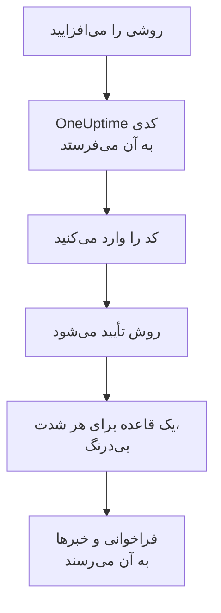

# روش‌های اعلان

روش اعلان نشانی‌ای است که OneUptime می‌تواند در یک پروژه از آن به شما برسد: یک نشانی ایمیل، یک شمارهٔ تلفن برای SMS یا تماس، یک شمارهٔ WhatsApp، یک حساب Telegram، حساب Slack یا Microsoft Teams شما، یک گوشی یا مرورگر برای اعلان‌های پوش، یا یک وب‌هوک. آن‌ها را در **تنظیمات کاربر** > **روش‌های اعلان** می‌افزایید و تأیید می‌کنید، و OneUptime بی‌درنگ برای فراخوانی‌هایتان از آن‌ها استفاده می‌کند.

:::cards
- [یک روش انتخاب کنید](#یک-روش-انتخاب-کنید): هر روش چه لازم دارد، و چگونه تأیید می‌شود.
- [افزودن و تأیید یک روش](#افزودن-و-تأیید-یک-روش): ایمیل، SMS، تماس و WhatsApp، با کدی ۶ رقمی.
- [وب‌هوک‌ها](#وبهوکها): فراخوانی‌ها را به endpoint خودتان بفرستید، اگر خواستید امضاشده.
- [روشن کردن کانال برای پروژه](#روشن-کردن-کانال-برای-پروژه): چرا ممکن است SMS، تماس، WhatsApp یا Telegram نباشند.
:::

## یک روش چگونه فعال می‌شود



روشی که تأیید نکرده‌اید هرگز به کار نمی‌رود. دستگاه‌های پوش، Slack، Microsoft Teams و وب‌هوک‌ها کد نمی‌خواهند: ثبت دستگاه یا وصل کردن حسابتان نشان می‌دهد که مال شماست، و وب‌هوک به اثبات نیازی ندارد. تأیید یک روش [قواعد پیش‌فرض](/docs/notifications/on-call-rules#قواعدی-که-از-ابتدا-دارید) شما را بی‌درنگ برایش می‌افزاید، پس یک شمارهٔ تلفن تازه برای هر شدت شما را فرا می‌خواند تا وقتی قواعدش را تغییر دهید.

## یک روش انتخاب کنید

هر زبانهٔ **روش‌های اعلان** یک یا چند کارت دارد، یکی برای هر نوع روش:

| کارت | زبانه | چه می‌افزایید | چگونه تأیید می‌شود |
| --- | --- | --- | --- |
| **ایمیل‌ها برای اعلان‌ها** | **Direct Contact** | یک نشانی ایمیل | کدی با ایمیل |
| **شماره‌های تلفن برای اعلان‌های پیامکی** | **Direct Contact** | یک شمارهٔ تلفن | کدی با SMS |
| **شماره‌های تلفن برای اعلان‌های تماسی** | **Direct Contact** | یک شمارهٔ تلفن | کدی که در تماس خوانده می‌شود، یا هیچ کدی برای شماره‌ای که برای SMS تأیید شده |
| **شماره‌های WhatsApp برای اعلان‌ها** | **Direct Contact** | یک شمارهٔ WhatsApp | کدی در WhatsApp |
| **حساب‌های Telegram برای اعلان‌ها** | **Direct Contact** | حساب Telegram شما | پیامی به ربات OneUptime |
| **Slack Account for Notifications** | **Workspace Apps** | حساب Slack شما | وصل کردن حسابتان به فضای کاری پروژه |
| **Microsoft Teams Account for Notifications** | **Workspace Apps** | حساب Microsoft Teams شما | وصل کردن حسابتان به فضای کاری پروژه |
| **دستگاه‌های اعلان پوش** | **Push Notifications** | گوشی‌ای با اپلیکیشن OneUptime On-Call، یا یک مرورگر | ثبت دستگاه |
| **وب‌هوک‌ها برای اعلان‌ها** | **Webhooks** | یک endpoint از نوع HTTPS متعلق به خودتان | هیچ |

**Workspace Apps** فقط وقتی دیده می‌شود که پروژه Slack یا Microsoft Teams را وصل کرده باشد، و فقط همان‌هایی را دارد که وصل شده‌اند. SMS، تماس، WhatsApp و Telegram را می‌توان برای کل پروژه خاموش کرد؛ [روشن کردن کانال برای پروژه](#روشن-کردن-کانال-برای-پروژه) را ببینید.

## افزودن و تأیید یک روش

نشانی‌های ایمیل، شماره‌های SMS، شماره‌های تماس و شماره‌های WhatsApp با کدی ۶ رقمی تأیید می‌شوند.

:::steps
### روش‌هایتان را باز کنید

به **تنظیمات کاربر** > **روش‌های اعلان** بروید. **Direct Contact** نخستین زبانه است.

### نشانی را بیفزایید

در کارت آن روش، دکمهٔ افزودنش را بزنید، مثلاً **افزودن شماره تلفن برای اعلان‌های پیامکی**. **ایمیل** را وارد کنید، یا **شماره تلفن** را در قالب بین‌المللی، مثلاً `+11234567890`، و ذخیره کنید.

### کد را وارد کنید

پنجرهٔ تأیید خودبه‌خود باز می‌شود و می‌گوید کد کجا رفت و تا کی کار می‌کند. کد را در **کد تأیید** بنویسید و **تأیید** را بزنید.

### ردیف را بررسی کنید

اکنون ردیف **تأییدشده** نشان داده می‌شود. پنجره را زود بستید؟ برای باز کردن دوباره‌اش **تأیید** را روی ردیف بزنید.
:::

- هر کد ۱۵ دقیقه کار می‌کند. پنج تلاش نادرست آن را باطل می‌کند و به کد تازه نیاز دارید.
- **Send a new code**، یا برای شمارهٔ تماس **Call me with a new code**، در پنجره است. یک دقیقه پس از آخرین کد می‌توانید کد تازه بخواهید.
- شماره‌ای که برای SMS تأیید کرده‌اید برای تماس هم تأییدشده است. افزودنش زیر **شماره‌های تلفن برای اعلان‌های تماسی** کدی نمی‌خواهد، و تأیید یک شمارهٔ SMS شمارهٔ تماسی را هم که برایش افزوده‌اید تأیید می‌کند.
- ایمیل ورود شما از روزی که به پروژه پیوستید، تأییدشده، آنجاست.

## وصل کردن Telegram

:::steps
### حساب را بیفزایید

در **حساب‌های Telegram برای اعلان‌ها**، **افزودن حساب Telegram** را بزنید. **شناسه Telegram (اختیاری)** فقط برچسبی برای خودتان است و می‌تواند خالی بماند.

### به ربات پیام دهید

روی ردیف تازه **تأیید** را بزنید. پنجرهٔ **تأیید حساب Telegram** سه راه برای رسیدن به ربات OneUptime پیش رویتان می‌گذارد: کد QR را با گوشی‌تان اسکن کنید، **Open in Telegram** را بزنید، یا ربات را در Telegram جست‌وجو کنید و فرمان `/start` را که پنجره نشان می‌دهد برایش بفرستید.

### تأییدش کنید

به OneUptime برگردید و **I've sent the message — check** را بزنید. همین که ربات پیامتان را بگیرد، حساب تأیید می‌شود.
:::

**چرخش کد** برای حسابی که هنوز تأیید نشده کد تازه‌ای می‌سازد. کد QR و پیوندی که پیش‌تر باز کردید دیگر کار نمی‌کنند. در OneUptime خودمیزبان، پیش از آنکه کسی بتواند حسابی وصل کند، مدیر سرور یک ربات Telegram وصل می‌کند.

## Slack و Microsoft Teams

1. حساب خودتان را به فضای کاری پروژه وصل کنید: **تنظیمات کاربر** > **فضای کاری** > **Slack**، یا **Microsoft Teams**. [Slack](/docs/workspace-connections/slack) و [Microsoft Teams](/docs/workspace-connections/microsoft-teams) را ببینید.
2. روی زبانهٔ **Workspace Apps**، **Add Slack Account** یا **Add Microsoft Teams Account** را بزنید. حساب همان هنگام افزودن تأیید می‌شود.
3. روی ردیفش **Send Test Message** را بزنید. فراخوانی‌ها به‌صورت پیام مستقیم از اپلیکیشن OneUptime می‌رسند.

## اعلان‌های پوش

زبانهٔ **Push Notifications** فهرست **دستگاه‌های اعلان پوش** شما را دارد.

- **یک گوشی.** اپلیکیشن OneUptime On-Call را نصب کنید، آن را به OneUptime خودتان وصل کنید، وارد شوید و اجازهٔ اعلان بدهید: گوشی خودش را به این فهرست می‌افزاید. [نمای کلی اپلیکیشن‌ها](/docs/mobile-desktop-apps/index) را ببینید.
- **همین مرورگر.** **ثبت دستگاه** را بزنید، یک **نام دستگاه** به آن بدهید، و وقتی مرورگر پرسید اجازهٔ اعلان بدهید.
- **اعلان آزمایشی** روی ردیف یک دستگاه همین حالا یک پوش برایش می‌فرستد.
- **هشدارهای بحرانی** نشان می‌دهد آیا فراخوانی‌های گوشی از حالت بی‌صدا و «مزاحم نشوید» عبور می‌کنند و زنگ می‌زنند. این در اپلیکیشن روشن می‌شود، هرگز اینجا، و مرورگر نمی‌تواند چنین کند. [هشدارهای بحرانی کشیک](/docs/self-hosted/push-notifications#هشدارهای-بحرانی-کشیک-نادیده-گرفتن-حالت-بیصدا) را ببینید.
- به دستگاهی که **اعلان دریافت نمی‌شود** خورده است چیزی فرستاده نمی‌شود. اپلیکیشن را روی آن گوشی باز کنید، یا مرورگر را دوباره ثبت کنید، تا برگردد.

## وب‌هوک‌ها

وب‌هوک هر فراخوانی را به‌صورت JSON به یک endpoint از نوع HTTPS متعلق به شما می‌فرستد، تا ابزار خودتان روی آن کار کند.

:::steps
### وب‌هوک را بیفزایید

روی زبانهٔ **Webhooks**، **افزودن وب‌هوک** را بزنید. یک **نام** که بشناسید، **نشانی وب‌هوک**، و یک **کلید محرمانه امضا (اختیاری)** وارد کنید.

### یک آزمایش بفرستید

روی ردیفش **ارسال آزمایشی** را بزنید. endpoint شما رویدادی می‌گیرد که `eventType` آن `test` است.

### ببینید چه می‌رسد

فراخوانی یک درخواست JSON از نوع `POST` مانند نمونهٔ زیر است. ظرف ۱۰ ثانیه با هر وضعیت `2xx` پاسخ دهید؛ تغییر مسیرها دنبال نمی‌شوند.
:::

```json title="A page, as your endpoint receives it"
{
  "eventType": "on-call.incident.created",
  "timestamp": "2026-10-15T09:30:00.000Z",
  "projectId": "6a3f0d2e-1c4b-4e8a-9b7d-2f5c8e1a0b3c",
  "userId": "0c9e8d7f-6b5a-4c3d-8e2f-1a0b9c8d7e6f",
  "incident": {
    "id": "5b4a3c2d-1e0f-4a9b-8c7d-6e5f4a3b2c1d",
    "title": "Checkout API is down",
    "description": "Health check failed from 3 probes.",
    "incidentNumber": 42,
    "incidentNumberWithPrefix": "INC-42",
    "severity": "Critical Incident",
    "state": "Identified"
  },
  "onCallPolicyId": "7d6c5b4a-3e2f-4d1c-9b8a-7f6e5d4c3b2a",
  "onCallPolicyEscalationRuleId": "8e7d6c5b-4a3f-4e2d-8c1b-9a8f7e6d5c4b"
}
```

| `eventType` | فرستاده‌شده برای | کلید رکورد |
| --- | --- | --- |
| `on-call.incident.created` | یک حادثه | `incident` |
| `on-call.alert.created` | یک هشدار | `alert` |
| `on-call.incidentEpisode.created` | یک اپیزود حادثه | `incidentEpisode` |
| `on-call.alertEpisode.created` | یک اپیزود هشدار | `alertEpisode` |

به‌روزرسانی‌هایی که در **تنظیمات اعلان** برای Webhook روشن می‌کنید به همان endpoint می‌رسند، با رویداد آن تنظیم در `eventType` و خلاصه‌ای کوتاه در `subject` و `message`.

هر درخواست `X-OneUptime-Event`، یعنی نوع رویداد، را با خود دارد. با یک کلید محرمانهٔ امضا، `X-OneUptime-Signature` را هم دارد: `sha256=` و پس از آن HMAC-SHA256 بدنهٔ خام، به‌صورت hex. پیش از اعتماد به درخواست آن را بررسی کنید:

```javascript title="verify-signature.js"
const crypto = require("crypto");

// rawBody: the request body exactly as it arrived, before any JSON parsing.
function isFromOneUptime(rawBody, signatureHeader, secret) {
  const expected =
    "sha256=" + crypto.createHmac("sha256", secret).update(rawBody).digest("hex");
  const received = Buffer.from(signatureHeader || "");
  const wanted = Buffer.from(expected);
  return received.length === wanted.length && crypto.timingSafeEqual(received, wanted);
}
```

وب‌هوک به تأیید نیازی ندارد، پس افزودنش قواعدش را بی‌درنگ می‌افزاید. نشانی‌های خصوصی و داخلی رد می‌شوند، مگر آنکه مدیر یک سرور خودمیزبان اجازه‌شان را بدهد: [دسترسی به شبکه خصوصی](/docs/self-hosted/private-network-access#وبهوکها-و-گردشهای-کاری) را ببینید.

## روشن کردن کانال برای پروژه

**SMS**، **تماس‌های تلفنی**، **WhatsApp** و **Telegram** در هر پروژهٔ تازه خاموش شروع می‌شوند، چون هر پیام هزینه دارد: در OneUptime Cloud از موجودی پروژه پرداخت می‌شود، و اگر حساب Twilio پیش‌فرض خود پروژه آن‌ها را بفرستد، SMS و تماس‌ها به‌جای آن از همان حساب می‌روند. ایمیل، پوش، Slack، Microsoft Teams و وب‌هوک‌ها همیشه روشن‌اند.

تا وقتی کانالی خاموش است، هیچ‌کس در پروژه نمی‌تواند روشی روی آن بیفزاید: کارتش دکمهٔ افزودن ندارد، و می‌گوید چه کسی می‌تواند روشنش کند. مالک پروژه، یک **مدیر صورت‌حساب** یا کسی با **Manage Billing** آن را در کارت **کانال‌های اعلان** در **تنظیمات پروژه** > **اعلان‌ها** > **تنظیمات اعلان** روشن می‌کند. مدیر پروژه نمی‌تواند. در OneUptime خودمیزبان، SMS و تماس‌ها به یک حساب Twilio هم نیاز دارند، و Telegram به رباتی که مدیر سرور وصل می‌کند؛ [یکپارچه‌سازی Twilio](/docs/self-hosted/twilio-integration) را ببینید.

## حذف یک روش

روی ردیف روش **حذف** را بزنید. حذف یک روش هر قاعدهٔ آنکالی را که از آن استفاده می‌کند هم حذف می‌کند، پس پنجره نخست آن قواعد را می‌شمارد و هر شدتی را که این حذف بی هیچ قاعده‌ای می‌گذارد نام می‌برد.

## عیب‌یابی

:::details کارتی دکمهٔ افزودن ندارد
آن کانال در این پروژه خاموش است. کارت می‌گوید چه کسی می‌تواند روشنش کند؛ [روشن کردن کانال برای پروژه](#روشن-کردن-کانال-برای-پروژه) را ببینید.
:::

:::details کد هرگز نرسید
ایمیل‌ها ممکن است چند دقیقه طول بکشند و گاهی به هرزنامه بروند؛ پیامک‌ها ممکن است یک دقیقه طول بکشند. یک دقیقه صبر کنید، سپس در پنجره **Send a new code** را بزنید. **تنظیمات پروژه** > **اعلان‌ها** > **گزارش‌های اعلان** نشان می‌دهد چه بر سر پیام آمد.
:::

:::details افزودن حساب Slack من شکست می‌خورد
نخست حسابتان را در **تنظیمات کاربر** > **فضای کاری** > **Slack** وصل کنید، سپس دوباره **Add Slack Account** را بزنید. پنجرهٔ خطا دکمه‌ای دارد که شما را به آنجا می‌برد.
:::

:::details گوشی‌ام هیچ اعلان پوشی نمی‌گیرد
بررسی کنید که گوشی زیر **دستگاه‌های اعلان پوش** فهرست شده باشد، و یک **اعلان آزمایشی** برایش بفرستید. [پرسش‌های متداول و رفع اشکال](/docs/mobile-desktop-apps/faq-troubleshooting#اعلانها) را ببینید.
:::

## گام‌های بعدی

:::cards
- [قواعد آنکال شخصی](/docs/notifications/on-call-rules): تعیین کنید هر فراخوانی کدام روش را و کی امتحان کند.
- [تنظیمات اعلان](/docs/notifications/notification-settings): به‌روزرسانی‌هایی را که از آن‌ها باخبر می‌شوید، و کانال‌هایشان را انتخاب کنید.
- [نمای کلی اپلیکیشن‌ها](/docs/mobile-desktop-apps/index): فراخوانی‌ها را روی گوشی یا دسکتاپ بگیرید.
- [چگونه OneUptime با شما تماس می‌گیرد](/docs/notifications/index): روش‌ها، قواعد و تنظیمات چگونه کنار هم کار می‌کنند.
:::
