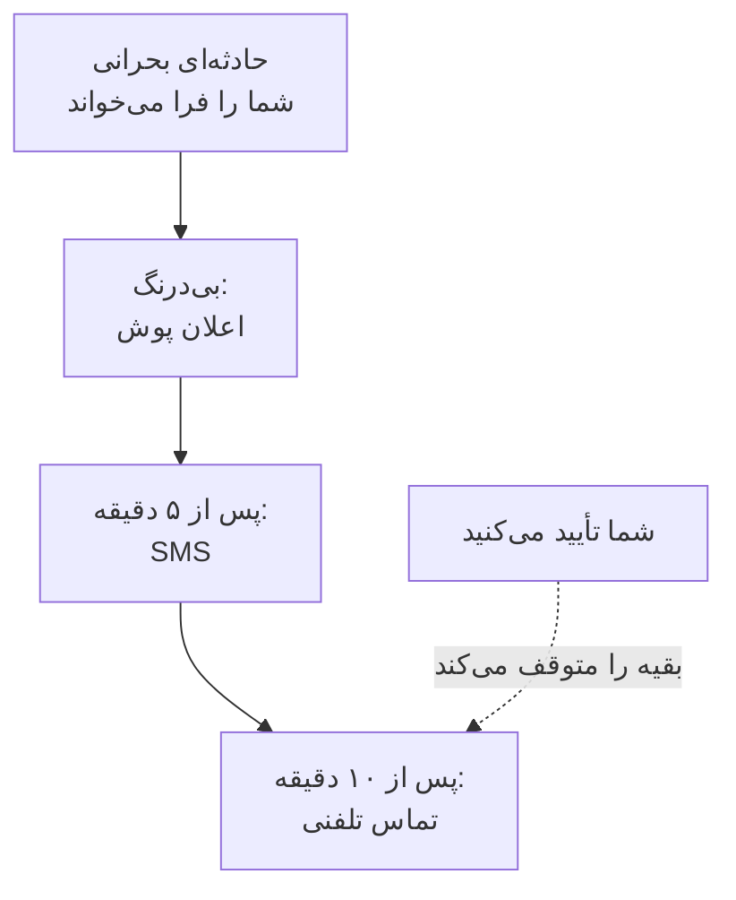

# قواعد آنکال شخصی

قواعد آنکال شما تعیین می‌کنند فراخوانی چگونه به شما برسد: OneUptime کدام روش‌های اعلان شما را امتحان کند، و چه مدت پس از شروع فراخوانی. هر نوع فراخوانی قواعد خودش را دارد، یک مجموعه برای هر شدت، پس یک حادثهٔ بحرانی می‌تواند بی‌درنگ با شما تماس بگیرد، در حالی که یک هشدار کم‌اهمیت منتظر یک ایمیل می‌ماند. آن‌ها را در **تنظیمات کاربر** > **قواعد آنکال** تنظیم می‌کنید.

> [!NOTE]
> این قواعد فقط مال شما هستند. **قواعد آنکال** در **حوادث** > **قواعد** و **هشدارها** > **قواعد** چیز دیگری‌اند: تعیین می‌کنند یک حادثه یا هشدار تازه کدام سیاست‌های آنکال را اجرا کند.

:::cards
- [فراخوانی چگونه به شما می‌رسد](#فراخوانی-چگونه-به-شما-میرسد): قواعد شما برای یک فراخوانی، گام به گام.
- [قواعدی که از ابتدا دارید](#قواعدی-که-از-ابتدا-دارید): هر روش تأییدشده چه می‌افزاید، و چگونه آن را کم کنید.
- [افزودن یک قاعده](#افزودن-یک-قاعده): یک روش و یک تأخیر برای یک شدت.
- [قواعد پوش](#قواعد-پوش): از حالت بی‌صدا عبور کنید، و تکرار کنید تا کسی تأیید کند.
:::

## فراخوانی چگونه به شما می‌رسد

یک سیاست آنکال وقتی شما را فرا می‌خواند که یکی از قواعد تشدیدش نام شما، تیمی که در آن هستید، یا برنامه‌ای را ببرد که در آن آنکال هستید. سپس OneUptime قواعد شما را برای آن نوع فراخوانی و شدتش یکی‌یکی اجرا می‌کند: هر قاعده وقتی تأخیرش از شروع فراخوانی گذشت، روی روش خودش فرستاده می‌شود. تأیید حادثه یا هشدار، از هر پیامی یا در OneUptime، هر قاعده‌ای را که هنوز فرستاده نشده متوقف می‌کند.

بیشتر پیام‌ها می‌توانند فراخوانی را تأیید کنند: ایمیل‌ها، پیامک‌ها و پیام‌های WhatsApp، Telegram، Slack و Microsoft Teams پیوند تأیید دارند، و تماس از شما می‌خواهد ۱ را فشار دهید. اگر نمی‌توانید فراخوانی را بپذیرید، همان پیام‌ها به شما اجازه می‌دهند آن را تشدید کنید، و تماس از شما می‌خواهد ۲ را فشار دهید: سیاست بی‌درنگ سطح بعدی را خبر می‌کند، و دیگر درباره آن به شما خبر داده نمی‌شود. [تشدید یک فراخوانی](/docs/on-call/escalation-rules#تشدید-یک-فراخوانی) را ببینید. هر فراخوانی‌ای که می‌گیرید زیر **تنظیمات کاربر** > **گزارش‌های آنکال** فهرست می‌شود، جایی که **مشاهده خط زمانی** هر پیامی را که فرستاده و اینکه تحویل داده شد یا نه نشان می‌دهد.

## چهار زبانه

**تنظیمات کاربر** > **قواعد آنکال** برای هر نوع فراخوانی یک زبانه دارد. هر زبانه برای هر شدت یک کارت دارد، با همان نام و رنگی که پروژهٔ شما به آن داده است:

| زبانه | فراخوانی‌ها برای | کارت‌ها برای |
| --- | --- | --- |
| **حوادث** | حوادث | شدت‌های حادثه |
| **اپیزودهای حادثه** | اپیزودهایی که حوادث را گروه می‌کنند | شدت‌های حادثه |
| **هشدارها** | هشدارها | شدت‌های هشدار |
| **اپیزودهای هشدار** | اپیزودهایی که هشدارها را گروه می‌کنند | شدت‌های هشدار |

یک اپیزود از طریق سیاست‌های آنکال خودش شما را فرا می‌خواند، جدا از حوادث یا هشدارهای درونش، پس قواعدش روی زبانهٔ خودش است. نشانی صفحه زبانهٔ باز را نام می‌برد، مثلاً `/dashboard/{projectId}/user-settings/on-call-rules?type=alerts`؛ مقدارهای دیگر `incident-episodes` و `alert-episodes` هستند، و بدون `type` صفحه روی **حوادث** باز می‌شود.

## قواعدی که از ابتدا دارید

هر روشی که تأیید می‌کنید روی هر کارتِ هر زبانه یک قاعده می‌گیرد که به محض فراخوانی فرستاده می‌شود. ایمیل ورود شما از روز پیوستن این قواعد را دارد، تا فراخوانی همیشه به شما برسد. یک شمارهٔ تلفن را برای SMS تأیید کنید، و هر فراخوانی برایتان پیامک هم می‌فرستد.

این شروعی امن است، و معمولاً بیش از اندازه. آن را به آنچه هر شدت سزاوارش است کم کنید:

| شدت | مجموعه‌ای معقول |
| --- | --- |
| بحرانی | پوش بی‌درنگ، تماس پس از ۵ دقیقه |
| مهم | پوش بی‌درنگ، SMS پس از ۱۰ دقیقه |
| جزئی یا کم | ایمیل بی‌درنگ |

قواعد خود شما ساعت‌های سکوت ندارند: شدت‌های پایین را روی ایمیل نگه دارید، یا روی یک قاعدهٔ پوش که روی **عادی** تنظیم شده، تا هرگز بیدارتان نکنند. برای اینکه فراخوانی یک شدت پایین برای همه منتظر ساعات کاری بماند، قاعدهٔ آنکالی را که آن را فرا می‌خواند روی **فقط در ساعات کاری** بگذارید: [قواعد آنکال](/docs/alerts/settings#قواعد-آنکال) را ببینید.

## افزودن یک قاعده

:::steps
### کارت را باز کنید

به **تنظیمات کاربر** > **قواعد آنکال** بروید، زبانهٔ آن نوع فراخوانی را باز کنید، و کارت آن شدت را پیدا کنید.

### روش را انتخاب کنید

**افزودن قاعده اعلان** را بزنید. در **روش اعلان**، یکی از روش‌های تأییدشده‌تان را انتخاب کنید؛ روشی که تأیید نکرده‌اید پیشنهاد نمی‌شود.

### صدای پوش را انتخاب کنید

برای گوشی، **اعلان پوش** را انتخاب کنید: **هشدار بحرانی** یا **عادی**. برای هر دستگاه پوش، **تکرار تا زمان تأیید** را انتخاب کنید. [قواعد پوش](#قواعد-پوش) را ببینید.

### تأخیر را تنظیم کنید

**به من اطلاع بده پس از** را انتخاب کنید: **بی‌درنگ**، **۵ دقیقه**، **۱۰ دقیقه**، **۱۵ دقیقه**، **۳۰ دقیقه** یا **۱ ساعت**. سپس در پنجره **افزودن قاعده اعلان** را بزنید.
:::

کارت قواعدش را به ترتیب تأخیرشان فهرست می‌کند، با **روش اعلان** و **اطلاع بده پس از** برای هر کدام.

## تغییر یا حذف یک قاعده

- **ویرایش** روی ردیف یک قاعده تأخیرش را تغییر می‌دهد. برای فرستادن یک قاعده به روشی دیگر، آن را حذف کنید و قاعدهٔ تازه‌ای بیفزایید.
- روی یک قاعدهٔ پوش، برچسب زیر روش را بزنید تا میان **هشدار بحرانی** و **عادی** جابه‌جا شوید، یا اینکه هر چند وقت تکرار شود را تغییر دهید. بی‌درنگ ذخیره می‌شود.
- **حذف** نخست می‌پرسد، و می‌گوید آیا آن شدت بی‌قاعده می‌ماند. شدتی که قاعده ندارد به روش‌های تأییدشدهٔ شما برمی‌گردد؛ [وقتی یک شدت قاعده ندارد](#وقتی-یک-شدت-قاعده-ندارد) را ببینید.

## قواعد پوش

قاعده‌ای که یک گوشی را فرا می‌خواند تعیین می‌کند صدای پوشش چگونه باشد:

| گزینه | گوشی چه می‌کند |
| --- | --- |
| **هشدار بحرانی** | حتی وقتی گوشی بی‌صدا یا روی «مزاحم نشوید» است زنگ می‌زند، به شرطی که Critical On-Call Alerts در اپلیکیشن OneUptime On-Call روشن باشد. هر قاعدهٔ تازهٔ گوشی با این شروع می‌شود. |
| **عادی** | از تنظیمات صدا، بی‌صدا و «مزاحم نشوید» گوشی پیروی می‌کند. |

یک قاعدهٔ پوش، برای گوشی یا مرورگر، می‌تواند پوشش را هم دوباره بفرستد تا کسی تأیید کند: **تکرار نشود**، که پیش‌فرض است، یا **هر دقیقه**، **هر ۲ دقیقه**، **هر ۳ دقیقه**، **هر ۵ دقیقه**، **هر ۱۰ دقیقه**، **هر ۱۵ دقیقه** یا **هر ۳۰ دقیقه**. تا ۱۰ بار دیگر تکرار می‌شود، و به محض تأیید حادثه، هشدار یا اپیزود متوقف می‌شود. [هشدارهای بحرانی کشیک](/docs/self-hosted/push-notifications#هشدارهای-بحرانی-کشیک-نادیده-گرفتن-حالت-بیصدا) را ببینید.

## وقتی یک شدت قاعده ندارد

شدتی که پروژه‌تان بعداً می‌افزاید ظرف چند دقیقه قواعدی می‌گیرد که از انتخاب‌های پیشین شما روی همان زبانه ساخته شده‌اند: همان روش‌ها، پس از همان تأخیرها. اگر روی آن زبانه هیچ قاعده‌ای نداشتید، ایمیل تأییدشدهٔ شما را می‌گیرد، بی‌درنگ.

فراخوانی‌ای که باز هم قاعده‌ای پیدا نکند به هر حال به روش‌های تأییدشدهٔ شما فرستاده می‌شود، و دربارهٔ آن به شما ایمیل زده می‌شود؛ [وقتی هیچ قاعده‌ای مطابقت ندارد](/docs/notifications/index#وقتی-هیچ-قاعدهای-مطابقت-ندارد) را ببینید.

:::details خاموش کردن عمدی یک شدت
API می‌تواند یک قاعدهٔ انصراف ذخیره کند، با `isOptOut` تنظیم‌شده و بدون روش: آنگاه برای آن نوع فراخوانی و شدت اصلاً فرا خوانده نمی‌شوید، و هیچ جایگزینی هم فرستاده نمی‌شود. ردیف **Muted - notifications turned off for this rule** را نشان می‌دهد، و حذفش فراخوانی را دوباره روشن می‌کند. شدتی هم که بعداً افزوده شود بی‌صدا می‌ماند، وقتی همهٔ قواعد شما روی آن زبانه انصراف باشند.
:::

:::details خاموش کردن ارسال جایگزین برای کل پروژه
مالک پروژه، یا کسی با **Manage Billing**، می‌تواند `disableOnCallNotificationFallback` پروژه را از طریق API تنظیم کند. آنگاه فراخوانی‌ای که قاعده‌ای پیدا نکند تحویل داده نمی‌شود، و گزارشش می‌گوید کاربر باید زیر **تنظیمات کاربر** > **قواعد آنکال** قاعده بیفزاید.
:::

## قواعد یک هم‌تیمی

مالکان و مدیران پروژه می‌توانند همین صفحه را برای هر کسی در پروژه ببینند و تغییر دهند: در **کاربران**، آن شخص را باز کنید، سپس **قواعد آنکال** را در بخش **آنکال**. **آمادگی**، در کنارش، نشان می‌دهد آیا هر شدت به او می‌رسد. وقتی کس دیگری قواعد شما را می‌افزاید، تغییر می‌دهد یا حذف می‌کند، دربارهٔ آن ایمیلی می‌گیرید، و هر تغییر در گزارش ممیزی پروژه ثبت می‌شود.

## عیب‌یابی

:::details گوشی‌ام برای یک فراخوانی بحرانی بی‌صدا ماند
بررسی کنید که پوشِ قاعده **هشدار بحرانی** باشد، نه **عادی**، و اینکه **هشدارهای بحرانی** برای گوشی زیر **تنظیمات کاربر** > **روش‌های اعلان**، روی زبانهٔ **Push Notifications**، روشن باشد.
:::

:::details برای هر حادثه دو بار فرا خوانده می‌شوم
هر روش تأییدشده برای هر شدت قاعده‌ای دارد که بی‌درنگ فرستاده می‌شود. قواعدی را که نمی‌خواهید حذف کنید، یا به آن‌ها تأخیر بدهید. حادثه‌ای که در یک اپیزود است می‌تواند شما را از طریق دو سیاست، یک بار برای حادثه و یک بار برای اپیزود، فرا بخواند.
:::

:::details ایمیلی گرفتم، هرچند قاعده‌ام SMS است
فراخوانی برای نوع یا شدتش قاعده‌ای پیدا نکرد و به روش‌های رایگان شما برگشت: قاعده را روی زبانه و کارت درست بیفزایید. یا آن ایمیل به‌روزرسانی‌ای دربارهٔ رکوردی بود که مالکش هستید، که از **تنظیمات اعلان** پیروی می‌کند، نه از قواعد شما. **گزارش‌های آنکال** شما فقط فراخوانی‌ها را فهرست می‌کند.
:::

## گام‌های بعدی

:::cards
- [روش‌های اعلان](/docs/notifications/notification-methods): روش‌هایی را که قواعدتان به آن‌ها اشاره می‌کنند بیفزایید و تأیید کنید.
- [قواعد تشدید](/docs/on-call/escalation-rules): سیاست آنکال چگونه آدم‌ها را سطح به سطح فرا می‌خواند.
- [اعلان‌های پوش](/docs/self-hosted/push-notifications): هشدارهای بحرانی، صداهای زنگ و تکرار روی گوشی‌ها.
- [چگونه OneUptime با شما تماس می‌گیرد](/docs/notifications/index): روش‌ها، قواعد و تنظیمات چگونه کنار هم کار می‌کنند.
:::
