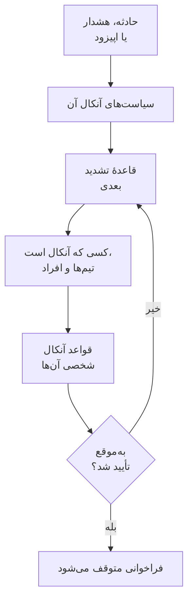

# نمای کلی آنکال

آنکال راهی است که OneUptime در هر ساعتی از شبانه‌روز فردی را سراغ یک مشکل می‌فرستد. وقتی یک حادثه، هشدار یا اپیزود به کسی نیاز دارد، سیاست‌های آنکال آن افراد را سطح به سطح فرا می‌خوانند تا کسی تأیید کند، و هر فرد به همان شکلی دریافت می‌کند که خودش انتخاب کرده است: اعلان پوش، پیامک، تماس، ایمیل یا پیام چت. این صفحه نشان می‌دهد این اجزا چگونه کنار هم قرار می‌گیرند و هر کدام کجاست.

:::cards
- [فراخوانی چگونه به کسی می‌رسد](#فراخوانی-چگونه-به-کسی-میرسد): از یک حادثهٔ تازه تا فردی که پاسخ می‌دهد.
- [اجزای سازنده](#اجزای-سازنده): سیاست‌ها، قواعد تشدید، زمان‌بندی‌ها، جایگزینی‌ها و قواعد شخصی.
- [راه‌اندازی آنکال](#راهاندازی-آنکال): از هیچ تا تیمی که فراخوانده می‌شود، در پنج گام.
- [آنکال کجاست](#آنکال-کجاست): منوی کشیک آنکال، بخش به بخش.
:::

## فراخوانی چگونه به کسی می‌رسد

1. یک حادثه، هشدار یا اپیزود تازه بی‌درنگ سیاست‌های آنکال خود را اجرا می‌کند: سیاست‌هایی که روی آن انتخاب شده‌اند، و سیاست‌هایی که قواعد آنکالش اضافه می‌کنند. هر سیاست جداگانه اجرا می‌شود. قاعدهٔ آنکالی که روی **فقط در ساعات کاری** تنظیم شده، باعث می‌شود سیاست‌هایی که اضافه می‌کند تا آغاز آن ساعت‌ها منتظر بمانند.
2. نخستین قاعدهٔ تشدید یک سیاست بی‌درنگ فرا می‌خواند: هر کسی که همین حالا در زمان‌بندی‌هایش آنکال است، همهٔ اعضای تیم‌هایش، و افرادی که نامشان را می‌برد.
3. اگر یکی از آن‌ها غایب باشد، یک جایگزینی کاربر فراخوانی او را برای فردی می‌فرستد که جایش را پر می‌کند، یا از او رد می‌شود.
4. هر فرد از راه قواعد آنکال شخصی‌اش دریافت می‌کند: کدام روشش امتحان شود، و پس از چه مدت. فراخوانی‌ای که قاعده‌ای ندارد باز هم از راه روش‌هایی که تأیید کرده به او می‌رسد.
5. اگر پیش از پایان زمان انتظار قاعده کسی تأیید نکند، قاعدهٔ بعدی فرا می‌خواند. پس از آخرین قاعده، اگر سیاست تکرار شود از نو شروع می‌شود، و در غیر این صورت متوقف می‌شود.

تأیید یا برطرف کردن حادثه، هشدار یا اپیزود همهٔ سیاست‌هایی را که هنوز برایش فرا می‌خوانند متوقف می‌کند. OneUptime سیاست‌های در حال اجرا را هر دقیقه یک گام جلو می‌برد و هر اجرا را، قاعده به قاعده، در **گزارش اجراها** ثبت می‌کند.

نخستین باری که فراخوانی‌ای به کسی می‌رسد، OneUptime آن را روی حادثه، هشدار یا اپیزود به‌صورت `First Paged At` ثبت می‌کند. یک اندازه‌گیری می‌تواند از همین لحظه شمرده شود: **زمان تا تأیید پس از فراخوانی** می‌سنجد چقدر طول کشید تا افراد پس از فراخوانده شدن پاسخ دهند، نه اینکه رکورد پیش از فراخوانده شدن کسی چقدر منتظر ماند. [زمان تا تأیید پس از فراخوانی](/docs/incidents/settings#زمان-تا-تأیید-پس-از-فراخوانی) را ببینید.

> [!NOTE]
> حادثه، هشدار یا اپیزودی که از همان ابتدا تأییدشده یا برطرف‌شده ساخته شود، هیچ‌یک از سیاست‌هایش را اجرا نمی‌کند، و خوراک آن همین را می‌گوید. [ساخته‌شده در حالت تأییدشده یا برطرف‌شده](/docs/alerts/index#ساختهشده-در-حالت-تأییدشده-یا-برطرفشده) را ببینید.

## اجزای سازنده

| جزء | چه چیزی را تعیین می‌کند | بیشتر بخوانید |
| --- | --- | --- |
| سیاست آنکال | چه کسی برای یک حادثه یا هشدار، سطح به سطح، فراخوانده شود | [سیاست‌های آنکال](/docs/on-call/policies) |
| قاعدهٔ تشدید | یک سطح از سیاست: چه کسی را فرا می‌خواند، و چه مدت منتظر تأیید می‌ماند | [قواعد تشدید](/docs/on-call/escalation-rules) |
| زمان‌بندی آنکال | چه کسی در هر لحظه آنکال است، وقتی افراد به نوبت آنکال می‌شوند | [زمان‌بندی‌های آنکال](/docs/on-call/schedules) |
| جایگزینی کاربر | چه کسی جای فردی را که غایب است پر می‌کند | [جایگزینی‌های کاربر](/docs/on-call/user-overrides) |
| قواعد آنکال شخصی | یک فرد چگونه دریافت می‌کند: با کدام روش، و پس از چه مدت | [قواعد آنکال شخصی](/docs/notifications/on-call-rules) |
| سیاست تماس ورودی | شماره تلفنی که با هر کسی که آنکال است تماس می‌گیرد | [سیاست تماس ورودی](/docs/on-call/incoming-call-policy) |

سیاست‌ها، قواعد تشدید، زمان‌بندی‌ها و جایگزینی‌ها به پروژه تعلق دارند و زیر **کشیک آنکال** هستند. روش‌های اعلان و قواعد آنکال شخصی به خود هر فرد تعلق دارند و زیر **تنظیمات کاربر** هستند: یک مدیر می‌تواند تنظیمات کسی را ببیند، اما فقط خود آن فرد می‌تواند تلفن یا ایمیلش را تأیید کند. [چگونه OneUptime با شما تماس می‌گیرد](/docs/notifications/index) را ببینید.

## راه‌اندازی آنکال

:::steps
### یک زمان‌بندی بسازید

**کشیک آنکال** را از منوی **محصولات** باز کنید و به **زمان‌بندی‌های آنکال** بروید. روی **ساخت زمان‌بندی آنکال** کلیک کنید، برایش نامی بگذارید، و زیر **چه کسانی به نوبت آنکال هستند؟** افراد را به همان ترتیبی که نوبت می‌گیرند انتخاب کنید. [زمان‌بندی‌های آنکال](/docs/on-call/schedules) را ببینید.

### یک سیاست بسازید

به **سیاست‌های آنکال** بروید و روی **ساخت سیاست آنکال** کلیک کنید. زیر **اول به چه کسی خبر داده شود؟** زمان‌بندی را انتخاب کنید. این زمان‌بندی نخستین قاعدهٔ تشدید سیاست می‌شود، یعنی **Level 1**، که ۳۰ دقیقه منتظر تأیید می‌ماند.

### سطح‌های بعدی را اضافه کنید

در صفحهٔ **قواعد تشدید** سیاست، برای هر سطح پس از نخستین، روی **افزودن قاعده تشدید** کلیک کنید: نفر بعدی در چرخش همان زمان‌بندی، یک سرپرست تیم، یک مدیر. [قواعد تشدید](/docs/on-call/escalation-rules) را ببینید.

### سیاست را خودکار اجرا کنید

به **حوادث** > **قواعد** > **قواعد آنکال** یا **هشدارها** > **قواعد** > **قواعد آنکال** بروید و قاعده‌ای اضافه کنید که سیاست را برای حوادث یا هشدارهای منطبق اجرا کند، مثلاً هر حادثهٔ بحرانی. [چه چیزی یک سیاست را اجرا می‌کند](/docs/on-call/policies#چه-چیزی-یک-سیاست-را-اجرا-میکند) را ببینید.

### بررسی کنید که همه در دسترس باشند

**کشیک آنکال** > **آمادگی** را باز کنید. هر کسی که سیاست‌های شما می‌توانند فرا بخوانند، با وضعیت **آماده**، **نیاز به راه‌اندازی** یا **در دسترس نیست** و آنچه کم دارد فهرست می‌شود. [آمادگی و گزارش‌ها](/docs/on-call/readiness) را ببینید.
:::

> [!NOTE]
> در OneUptime Cloud، سیاست‌های آنکال و قواعد تشدید در همهٔ طرح‌ها هستند. زمان‌بندی‌های آنکال، جایگزینی‌های کاربر، گزارش اجراها و گزارش زمان آنکال به طرح **Growth** نیاز دارند.

## آنکال کجاست

**کشیک آنکال** را از منوی **محصولات** در نوار بالا باز کنید. این بخش روی **سیاست‌های آنکال**، در `/dashboard/{projectId}/on-call-duty/policies`، باز می‌شود و منوی کناری‌اش بقیه را در خود دارد:

| بخش | صفحه‌ها |
| --- | --- |
| **سیاست‌ها** | **سیاست‌های آنکال** و **آمادگی**: سیاست‌های شما واقعاً به چه کسانی می‌رسند |
| **زمان‌بندی‌ها** | **زمان‌بندی‌های آنکال**، **خط زمانی زمان‌بندی‌ها** و **فیدهای تقویم** |
| **تماس‌های ورودی** | **سیاست‌های تماس ورودی**: شماره تلفنی که با هر کسی که آنکال است تماس می‌گیرد |
| **پیشرفته** | **جایگزینی‌های کاربر**، **گزارش اجراها** و **سیاست‌های بایگانی‌شده** |
| **گزارش‌ها** | **زمان آنکال کاربر**: هر فرد چه مدت آنکال بوده است |
| **فضای کاری** | **Slack** و **Microsoft Teams**: قواعدی که رویدادهای آنکال را در یک کانال منتشر می‌کنند |
| **تنظیمات** | **فیلدهای سفارشی**، **قواعد برچسب** و **قواعد مالکیت** |
| **توسعه‌دهنده** | **Terraform**، **API** و **دستیارهای هوش مصنوعی**: آنکالی که از کد راه‌اندازی می‌شود |

**سیاست‌ها**، **زمان‌بندی‌ها** و **تماس‌های ورودی** باز هستند؛ بخش‌های دیگر بسته شروع می‌شوند، و وقتی در یکی از صفحه‌های یک بخش هستید، آن بخش خودش باز می‌شود. **فضای کاری** ابزارهای چتی را که پروژه وصل کرده فهرست می‌کند، یا اگر هیچ‌کدام نباشد **اتصال Slack یا Teams** را نشان می‌دهد.

وقتی برای یک سیاست در کشیک هستید، زنگولهٔ بالا سمت راست این را نشان می‌دهد. روی آن کلیک کنید تا **سیاست‌های آنکال من** باز شود: هر سیاستی که در همهٔ پروژه‌هایتان برایش آنکال هستید، و اینکه نام شما مستقیماً در آن است، از راه یک تیم یا از راه یک زمان‌بندی.

## عیب‌یابی

:::details برای یک حادثهٔ تازه هیچ‌کس فراخوانده نشد
صفحهٔ **اجراهای آنکال** حادثه را باز کنید. اگر خالی است، حادثه هیچ سیاست آنکالی نداشته است: هیچ سیاستی روی آن انتخاب نشده و هیچ قاعدهٔ آنکالی با آن منطبق نبوده است. اجرایی با **Execution Completed - No One Notified** از همهٔ قواعد تشدید گذشته و کسی را پیدا نکرده است: معمولاً زمان‌بندی‌ای که کسی در آن آنکال نیست. [گزارش اجراها](/docs/on-call/policies#گزارش-اجراها) را ببینید. اجرایی با **در انتظار** به‌خاطر قاعدهٔ آنکالی که روی **فقط در ساعات کاری** تنظیم شده، منتظر ساعات کاری است و تا آغاز آن‌ها کسی را فرا نمی‌خواند.
:::

:::details کسی روی کانال اشتباه فراخوانده شد، یا اصلاً فراخوانده نشد
**کشیک آنکال** > **آمادگی** را باز کنید و در ردیف آن فرد روی **Coverage** کلیک کنید. روش‌هایی که تأیید کرده و هر شدتی که برایش قاعده‌ای ندارد نمایش داده می‌شود. فقط خود او می‌تواند این را در **تنظیمات کاربر** درست کند: از همان صفحه یک یادآور راه‌اندازی برایش بفرستید. [آمادگی و گزارش‌ها](/docs/on-call/readiness) را ببینید. در OneUptime Cloud، تلفنی که تماس‌گیرندگان ناشناس را مسدود می‌کند ممکن است یک فراخوان را بی‌صدا کند: [شماره‌های OneUptime](/docs/on-call/phone-number-whitelist) را به فهرست مجاز آن اضافه کنید.
:::

:::details فردی که در مرخصی است هنوز فراخوانده می‌شود
یک جایگزینی کاربر با آن فرد زیر **چه کسی غایب است؟** اضافه کنید. جایگزینی‌ای که زیر **کشیک آنکال** > **پیشرفته** > **جایگزینی‌های کاربر** اضافه شود برای همهٔ سیاست‌ها اعمال می‌شود؛ جایگزینی‌ای که در صفحهٔ **جایگزینی‌های کاربر** خود یک سیاست اضافه شود فقط برای همان سیاست اعمال می‌شود. [جایگزینی‌های کاربر](/docs/on-call/user-overrides) را ببینید.
:::

## گام‌های بعدی

:::cards
- [سیاست‌های آنکال](/docs/on-call/policies): یک سیاست بسازید، تعیین کنید چه چیزی آن را اجرا کند، و ببینید چه کرده است.
- [قواعد تشدید](/docs/on-call/escalation-rules): افراد را سطح به سطح فرا بخوانید تا کسی پاسخ دهد.
- [زمان‌بندی‌های آنکال](/docs/on-call/schedules): چرخش‌ها، لایه‌ها و تحویل نوبت.
- [چگونه OneUptime با شما تماس می‌گیرد](/docs/notifications/index): روش‌ها و قواعدی که تعیین می‌کنند هر فرد چگونه دریافت کند.
:::
