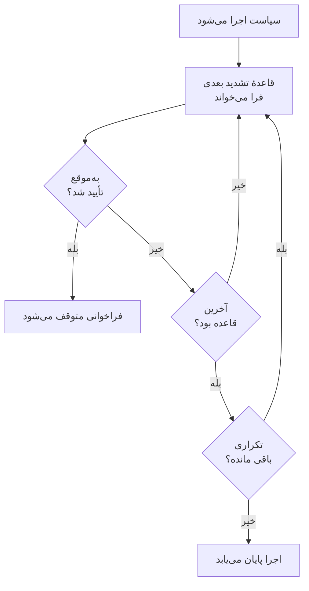

# سیاست‌های آنکال

یک سیاست آنکال تعیین می‌کند برای یک حادثه یا هشدار چه کسی فراخوانده شود، و اگر کسی تأیید نکند نفر بعدی کیست. قواعد تشدیدش سطح‌های آن هستند، و حوادث، هشدارها و اپیزودهایی که از آن استفاده می‌کنند اجرایش می‌کنند. این صفحه ساختن یک سیاست، آنچه آن را اجرا می‌کند، آنچه صفحه‌هایش نشان می‌دهند و شیوهٔ ثبت هر اجرا را پوشش می‌دهد.

:::cards
- [ساختن یک سیاست](#ساختن-یک-سیاست): یک نام، و اینکه اول چه کسی فراخوانده شود.
- [چه چیزی یک سیاست را اجرا می‌کند](#چه-چیزی-یک-سیاست-را-اجرا-میکند): قواعد، قالب‌ها، مانیتورها، چت و خود شما.
- [گزارش اجراها](#گزارش-اجراها): هر اجرا، قاعده به قاعده، و اینکه چرا متوقف شد.
- [بایگانی یا حذف یک سیاست](#بایگانی-یا-حذف-یک-سیاست): یک سیاست را از خدمت خارج کنید.
:::

## ساختن یک سیاست

:::steps
1. به **کشیک آنکال** > **سیاست‌های آنکال** بروید و روی **ساخت سیاست آنکال** کلیک کنید.
2. یک **نام** وارد کنید، مثلاً «پرداخت‌ها، اصلی».
3. زیر **اول به چه کسی خبر داده شود؟** روی **افزودن پاسخ‌دهنده** کلیک کنید و زمان‌بندی‌های آنکال، تیم‌ها و افرادی را که باید اول فراخوانده شوند انتخاب کنید.
4. روی **ساخت سیاست آنکال** کلیک کنید. سیاست در صفحهٔ **قواعد تشدید** خود باز می‌شود و **Level 1** از پیش در جای خود است.
:::

**اول به چه کسی خبر داده شود؟** اختیاری است و فقط از کسانی پرسیده می‌شود که می‌توانند قاعدهٔ تشدید اضافه کنند: اگر خالی بماند، سیاست تا وقتی قاعده‌ای نداشته باشد کسی را فرا نمی‌خواند. **توضیحات** و **برچسب‌ها** زیر **فیلدهای بیشتر** هستند. برای افزودن سطح‌های بعدی، [قواعد تشدید](/docs/on-call/escalation-rules) را ببینید.

برای نخستین سیاست هر پروژه، فرم **برای هر حادثه و هشدار تازه فعال شود** را هم می‌پرسد که از اول روشن است. این گزینه یک قاعده زیر **حوادث** > **قواعد** > **قواعد آنکال** و یکی زیر **هشدارها** > **قواعد** > **قواعد آنکال** اضافه می‌کند که هر کدام با همه چیز جورند و این سیاست را اجرا می‌کنند. این پرسش فقط از کسانی است که می‌توانند قاعدهٔ آنکال اضافه کنند، و فقط تا وقتی پروژه نه سیاست آنکالی دارد نه قاعدهٔ آنکالی.

فهرست **سیاست‌های کشیک آنکال** برای هر سیاست **نام**، **توضیحات**، **برچسب‌ها** و **مالکان** را نشان می‌دهد. سیاست‌هایی را انتخاب کنید تا **افزودن برچسب‌ها**، **حذف برچسب‌ها**، **افزودن مالک**، **حذف مالک**، **بایگانی** یا **خروجی JSON** را روی آن‌ها اجرا کنید یا حذفشان کنید. **واردکردن JSON** از یک خروجی سیاست می‌سازد: خروجی تنظیمات خود سیاست را دارد، نه قواعد تشدید یا مالکانش را.

## چه چیزی یک سیاست را اجرا می‌کند

یک سیاست تا وقتی چیزی اجرایش نکند کسی را فرا نمی‌خواند. هر حادثه، هشدار و اپیزود به محض ساخته شدن سیاست‌هایی را که دارد اجرا می‌کند:

| چه چیزی | سیاست چگونه اضافه می‌شود | بیشتر بخوانید |
| --- | --- | --- |
| خود رکورد | فیلد **سیاست آنکال** هنگام ساختن حادثه یا هشدار، یک قالب حادثه، یا بخش جمع‌شدهٔ **آنکال** در معیارهای یک مانیتور | [اعلام یک حادثه](/docs/incidents/declaring-incidents) |
| قواعد آنکال | **حوادث** > **قواعد** > **قواعد آنکال** و **هشدارها** > **قواعد** > **قواعد آنکال** سیاست‌های هر قاعدهٔ منطبق را اضافه می‌کنند | [قواعد کشیک حادثه](/docs/incidents/settings#قواعد-کشیک-حادثه) |
| قواعد گروه‌بندی | یک قاعدهٔ گروه‌بندی هنگام باز کردن یک اپیزود سیاست‌های خود را اجرا می‌کند | [اپیزودهای هشدار و قواعد گروه‌بندی](/docs/alerts/episodes) |
| دستی | **اجرای سیاست آنکال**، در منوی **اقدام‌ها** یک خوراک، یا روی یک پیام Slack یا Microsoft Teams | [خوراک حادثه](/docs/incidents/notes-owners-and-feed#خوراک-حادثه) |
| چت و گردش‌های کار | `/oneuptime page` در Slack یا Microsoft Teams، و گام **Page an On-Call Policy** یک گردش کار | [Paging](/docs/workflows/components#paging) |

سیاستی که چند قاعده اضافه‌اش می‌کنند یک بار اجرا می‌شود. یک شدت هرگز به‌تنهایی سیاستی را اجرا نمی‌کند: قاعدهٔ آنکالی که با آن شدت منطبق است این کار را می‌کند. حادثه یا هشداری که از همان ابتدا تأییدشده یا برطرف‌شده ساخته شود، هیچ‌یک از سیاست‌هایش را اجرا نمی‌کند. قاعدهٔ آنکالی که روی **فقط در ساعات کاری** تنظیم شده، باعث می‌شود سیاست‌هایی که اضافه می‌کند تا آغاز آن ساعت‌ها منتظر بمانند.

## صفحه‌های یک سیاست

یک سیاست را از فهرست باز کنید. منوی کناری‌اش همه‌چیز دربارهٔ آن را در خود دارد:

| بخش | صفحه‌ها |
| --- | --- |
| **پایه** | **نمای کلی**، **قواعد تشدید** و **مالکان** |
| **لاگ‌ها** | **گزارش اجراها** و **گزارش‌های اعلان** |
| **توسعه‌دهنده** | **Terraform**، **API** و **دستیارهای هوش مصنوعی** |
| **پیشرفته** | **جایگزینی‌های کاربر**، **فیلدهای سفارشی**، **تنظیمات**، **گزارش‌های ممیزی** و **حذف سیاست** |

**پایه** باز است؛ بخش‌های دیگر تا وقتی رویشان کلیک نکنید بسته می‌مانند.

- **نمای کلی** نخست **جزئیات سیاست آنکال** را نشان می‌دهد و سپس **سیاست در یک نگاه** را: سیاست چند سطح و چند پاسخ‌دهنده دارد، تا آخرین سطحش چه مدت طول می‌کشد، و چند بار تکرار می‌شود. **آمادگی پاسخ‌دهندگان** می‌گوید آیا همهٔ کسانی که می‌تواند فرا بخواند همین حالا در دسترس هستند، و **فید سیاست آنکال** تغییرات را فهرست می‌کند: افراد، تیم‌ها و زمان‌بندی‌های افزوده یا حذف‌شده، جایگزینی‌ها و تحویل نوبت‌ها.
- **مالکان** افراد و تیم‌هایی هستند که مسئول سیاست‌اند. وقتی فراخوانی‌ای که سیاست می‌فرستد برای کسی قاعده‌ای پیدا نکند، یا نتواند تحویل داده شود، به آن‌ها ایمیل زده می‌شود؛ سیاستی که مالک ندارد به جای آن به مالکان پروژه ایمیل می‌زند.
- **گزارش‌های اعلان** هر پیامی را که سیاست فرستاده است فهرست می‌کند، با یک زبانه برای هر کانال.
- **جایگزینی‌های کاربر** فقط در همین سیاست جای افراد را پر می‌کند. [جایگزینی‌های کاربر](/docs/on-call/user-overrides) را ببینید.
- **تنظیمات** شامل **خروجی گرفتن از سیاست آنکال** و کارتی است که سیاست را بایگانی می‌کند.

## تکرار یک سیاست

وقتی زمان انتظار آخرین سطح بدون تأیید کسی تمام شود، سیاست متوقف می‌شود، مگر اینکه تکرار شود. برای انتخاب، صفحهٔ **قواعد تشدید** سیاست را باز کنید و روی **ویرایش** در کارت **تکرار سیاست** زیر قواعد کلیک کنید. **ویرایش تکرار سیاست** می‌پرسد **اگر پس از آخرین سطح کسی تأیید نکند**:

| پاسخ | چه می‌کند |
| --- | --- |
| **توقف خبر دادن** | دیگر به کسی خبر داده نمی‌شود، پس سیاست یک بار اجرا می‌شود. سیاست تازه با همین پاسخ شروع می‌شود. |
| **دوباره از Level 1 شروع کن** | به همه سطوح دوباره، به ترتیب، خبر داده می‌شود. **چند بار دیگر؟** تعداد را تعیین می‌کند: ۱ یا بیشتر. |

سیاستی که سه بار دیگر از نو شروع می‌شود، در مجموع چهار بار سطح‌هایش را طی می‌کند. ردیف **پس از آخرین سطح** در کارت می‌گوید سیاست چه می‌کند، و **سیاست در یک نگاه** در **نمای کلی** همین را با کلمات می‌گوید.

## خبر دادن دوباره اگر برطرف نشود

تأیید کردن، خبر دادن سیاست را برای همیشه متوقف می‌کند، حتی اگر بعد از آن کسی حادثه یا هشدار را برطرف نکند. در عوض، سیاست می‌تواند دوباره خبر بدهد: صفحهٔ **قواعد تشدید** سیاست را باز کنید، **تنظیمات بیشتر** را در پایین باز کنید و روی **ویرایش** در کارت **مهلت پس از تأیید** کلیک کنید. **ویرایش مهلت پس از تأیید** می‌پرسد **اگر تأیید شده ولی برطرف نشده باشد**:

| پاسخ | چه می‌کند |
| --- | --- |
| **بدون خبر دادن دوباره** | تأیید کردن، خبر دادن را برای همیشه متوقف می‌کند. سیاست تازه با همین پاسخ شروع می‌شود. |
| **خبر دادن دوباره** | به کسی که تأیید کرده و به کسی که اکنون آنکال است خبر می‌دهد. **پس از چند دقیقه؟** زمانش را تعیین می‌کند: از ۵ تا ۱۴۴۰، در آغاز ۳۰. |

دقیقه‌ها از هر تأیید شمرده می‌شوند، و یک سیاست دربارهٔ یک حادثه، هشدار یا اپیزود حداکثر ۵ بار دوباره خبر می‌دهد. خبر دادن دوباره از سطحی شروع می‌شود که هنگام تأیید در حال خبر دادن بود، به کسی که اکنون در آن سطح آنکال است خبر می‌دهد، و مانند اجرای اول از سطح‌ها می‌گذرد. حادثه یا هشدار تأییدشده می‌ماند: خبر دادن دوباره اجرای جداگانه‌ای است، در خوراک آن و در گزارش اجراهای سیاست، جایی که **وضعیت** آن «دوباره خبر داده شد (۱ از ۵)» را نشان می‌دهد.

کسی که دوباره خبر گرفته، آن را از پیامش یا با **تأیید دوباره** در صفحهٔ حادثه یا هشدار تأیید می‌کند و دقیقه‌ها از نو شمرده می‌شوند؛ **تشدید کن** آن را به سطح بعدی می‌سپارد. برطرف کردن یا حذف حادثه یا هشدار، بایگانی یا حذف سیاست، یا انتخاب **بدون خبر دادن دوباره** آن را متوقف می‌کند. ردیف **پس از تأیید** در کارت می‌گوید سیاست چه می‌کند، و **تنظیمات بیشتر** تا وقتی جمع است دقیقه‌ها را نشان می‌دهد. **سیاست در یک نگاه** در **نمای کلی** و **خلاصه تشدید** همین را با کلمات می‌گویند.

## گزارش اجراها

هر بار که یک سیاست اجرا می‌شود، یک گزارش اجرا می‌نویسد، و این گزارش با پیش رفتن اجرا از وضعیت‌هایش می‌گذرد:

| وضعیت | معنای آن |
| --- | --- |
| **در انتظار** | قاعدهٔ آنکالی که روی **فقط در ساعات کاری** تنظیم شده، باعث می‌شود اجرا تا آغاز آن ساعت‌ها منتظر بماند: می‌گوید فراخوانی کی شروع می‌شود، و تا آن زمان کسی را فرا نمی‌خواند. اگر حادثه یا هشدار پیش از آن تأیید یا برطرف شود، بدون فراخوانی پایان می‌یابد. اگر حادثه یا هشدار تغییر کند و اکنون با قاعدهٔ آنکالی منطبق شود که بی‌درنگ فرا می‌خواند، همان موقع فراخوانی را آغاز می‌کند. |
| **زمان‌بندی‌شده**، **شروع شد** | اجرا در حال آماده شدن است. اجرایی که پس از ۵ دقیقه هنوز اینجا باشد با وضعیت **خطا** متوقف می‌شود. |
| **Executing** | اجرا در حال فراخوانی است. OneUptime هر دقیقه آن را یک گام جلو می‌برد. |
| **Execution Completed** | کسی تأیید کرد، حادثه یا هشدار برطرف شد، همهٔ قواعد و تکرارها مصرف شدند، یا سیاست بایگانی شد. |
| **Execution Completed - No One Notified** | اجرا از همهٔ قواعد گذشت و کسی را فرا نخواند: معمولاً زمان‌بندی‌ای که کسی در آن آنکال نیست. |
| **خطا** | اجرا شکست خورد. **مشاهده پیام وضعیت** دلیلش را می‌گوید. |

گزارش اجراها را در سه جا پیدا می‌کنید:

- در **گزارش اجراها** خود سیاست، زیر **لاگ‌ها**؛
- در **کشیک آنکال** > **پیشرفته** > **گزارش اجراها**، برای همهٔ سیاست‌ها، جایی که فراخوانی‌های مستقیم از گردش‌های کار و چت با عنوان **فراخوانی مستقیم** فهرست می‌شوند؛
- در صفحهٔ **اجراهای آنکال** یک حادثه یا یک هشدار.

هر ردیف نشان می‌دهد چه چیزی اجرا را آغاز کرد، چه زمانی، **وضعیت** آن و چه کسی آن را تأیید کرد. **مشاهده خط زمانی** صفحهٔ **خط زمانی اجرا** را باز می‌کند: هر قاعدهٔ تشدید، کسی که فرا خواند، از راه کدام زمان‌بندی، و اینکه هر فراخوانی چگونه پایان یافت. زمان‌بندی‌ای که کسی در آن آنکال نیست، به جای یک فرد **هیچ‌کس آنکال نبود** را نشان می‌دهد. در OneUptime Cloud، گزارش اجراها به طرح **Growth** نیاز دارد.

## بایگانی یا حذف یک سیاست

بایگانی یک سیاست را از خدمت خارج می‌کند و همه‌چیز را نگه می‌دارد: **تنظیمات** سیاست را باز کنید و روی **بایگانی** در کارت بایگانی آن کلیک کنید، یا سیاست‌هایی را در فهرست انتخاب کنید و **بایگانی** را بزنید.

- سیاست بایگانی‌شده کسی را فرا نمی‌خواند. حوادث و هشدارهایی که از آن استفاده می‌کنند از آن رد می‌شوند، و اجرایی که هنوز در حال تشدید است در گام بعدی‌اش متوقف می‌شود.
- این سیاست از فهرست **سیاست‌های آنکال** به **کشیک آنکال** > **پیشرفته** > **سیاست‌های بایگانی‌شده** می‌رود، جایی که **خروج از بایگانی** آن را دوباره به خدمت برمی‌گرداند.

**حذف سیاست**، زیر **پیشرفته**، سیاست را همراه با قواعد تشدید و جایگزینی‌های کاربرش حذف می‌کند. حذف از فهرست اول تأیید می‌خواهد و پیشنهاد می‌کند به جای آن بایگانی کنید.

## چه کسی می‌تواند یک سیاست را تغییر دهد

**مالک پروژه**، **مدیر پروژه**، **عضو پروژه**، **مدیر آنکال** و **عضو آنکال** می‌توانند سیاست‌ها را بسازند، تغییر دهند و حذف کنند؛ **بیننده** و **بیننده آنکال** می‌توانند آن‌ها را بخوانند. در یک نقش سفارشی، نام مجوزها **Create On-Call Duty Policy**، **Edit On-Call Duty Policy**، **Delete On-Call Duty Policy** و **Read On-Call Duty Policy** است، و نقشی که به برخی برچسب‌ها محدود شده فقط به سیاست‌هایی می‌رسد که آن برچسب‌ها را دارند. افزودن مالکان و فیلدهای سفارشی در OneUptime Cloud به طرح **Growth** نیاز دارد.

## API و Terraform

سیاست‌های آنکال منبع `/api/on-call-duty-policy` هستند، و در Terraform منبع `oneuptime_on_call_policy`:

| تنظیم | فیلد API |
| --- | --- |
| **نام** | `name` |
| **توضیحات** | `description` |
| **اگر پس از آخرین سطح کسی تأیید نکند** | `repeatPolicyIfNoOneAcknowledges` |
| **چند بار دیگر؟** | `repeatPolicyIfNoOneAcknowledgesNoOfTimes` |
| **پس از چند دقیقه؟** | `acknowledgementTimeoutInMinutes` |
| بایگانی‌شده | `isArchived` |

`repeatPolicyIfNoOneAcknowledges` برای **توقف خبر دادن** برابر `false` و برای **دوباره از Level 1 شروع کن** برابر `true` است. با `true`، مقدار `repeatPolicyIfNoOneAcknowledgesNoOfTimes` باید عددی صحیح و دست‌کم ۱ باشد: OneUptime مقدار `0` را رد می‌کند. سیاستی قدیمی که با `0` ذخیره شده هرگز تکرار نمی‌شود و داشبورد آن را **توقف خبر دادن** نشان می‌دهد.

`acknowledgementTimeoutInMinutes` برای **بدون خبر دادن دوباره** برابر `null` و برای **خبر دادن دوباره** عددی صحیح از ۵ تا ۱۴۴۰ دقیقه است. OneUptime هر مقدار دیگری را رد می‌کند.

برای ساختن یک سیاست همراه با نخستین سطحش در یک درخواست، [ساختن قواعد با API یا Terraform](/docs/on-call/escalation-rules#ساختن-قواعد-با-api-یا-terraform) را ببینید.

## عیب‌یابی

:::details یک سیاست اجرا شد، اما کسی فراخوانده نشد
اجرای آن **Execution Completed - No One Notified** را نشان می‌دهد. **مشاهده خط زمانی** را باز کنید: ردیفی با **هیچ‌کس آنکال نبود** به زمان‌بندی‌ای با جای خالی اشاره می‌کند، و پیام وضعیت یک ردیف **نادیده‌گرفته‌شده** دلیلش را می‌گوید، مثلاً کسی که غایب بوده و کسی جایش را پر نکرده است. **کشیک آنکال** > **آمادگی** نشان می‌دهد چه کسانی در دسترس نبودند.
:::

:::details سطح بعدی یک دقیقه پس از زمان انتظارش فراخوانده شد
OneUptime سیاست‌های در حال اجرا را هر دقیقه یک بار جلو می‌برد، پس یک سطح در نخستین بررسی پس از پایان زمان انتظارش فراخوانده می‌شود.
:::

:::details یک حادثه سیاستی را نشان می‌دهد که کسی را فرا نخواند
سیاست بایگانی شده است: سیاست بایگانی‌شده روی حوادث و هشدارهایی که از آن استفاده می‌کنند باقی می‌ماند، کسی را فرا نمی‌خواند، و گزارش اجرای آن می‌گوید که اجرا نشده است. آن را زیر **کشیک آنکال** > **پیشرفته** > **سیاست‌های بایگانی‌شده** از بایگانی خارج کنید.
:::

## گام‌های بعدی

:::cards
- [قواعد تشدید](/docs/on-call/escalation-rules): سطح‌هایی را که یک سیاست فرا می‌خواند، و مدت انتظار هر کدام را اضافه کنید.
- [جایگزینی‌های کاربر](/docs/on-call/user-overrides): فراخوانی‌های یک فرد را تا وقتی غایب است برای یک همکار بفرستید.
- [آمادگی و گزارش‌ها](/docs/on-call/readiness): بررسی کنید که همهٔ کسانی که یک سیاست فرا می‌خواند در دسترس باشند.
:::
