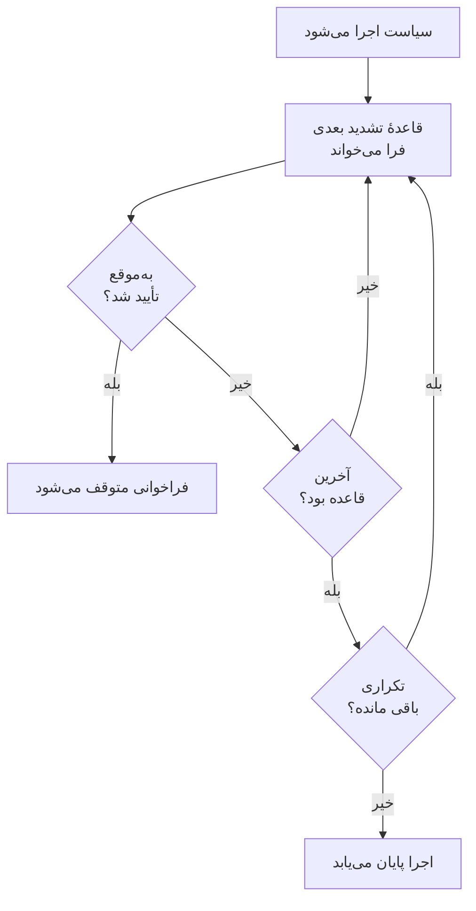

# سیاست‌های آنکال

یک سیاست آنکال تعیین می‌کند برای یک حادثه یا هشدار چه کسی فراخوانده شود، و اگر کسی تأیید نکند نفر بعدی کیست. قواعد تشدیدش سطح‌های آن هستند، و حوادث، هشدارها و اپیزودهایی که از آن استفاده می‌کنند اجرایش می‌کنند. این صفحه ساختن یک سیاست، آنچه آن را اجرا می‌کند، آنچه صفحه‌هایش نشان می‌دهند و شیوهٔ ثبت هر اجرا را پوشش می‌دهد.

:::cards
- [ساختن یک سیاست](#ساختن-یک-سیاست): یک نام، و اینکه اول چه کسی فراخوانده شود.
- [چه چیزی یک سیاست را اجرا می‌کند](#چه-چیزی-یک-سیاست-را-اجرا-میکند): قواعد، قالب‌ها، مانیتورها، چت و خود شما.
- [گزارش اجراها](#گزارش-اجراها): هر اجرا، قاعده به قاعده، و اینکه چرا متوقف شد.
- [بایگانی یا حذف یک سیاست](#بایگانی-یا-حذف-یک-سیاست): یک سیاست را از خدمت خارج کنید.
:::

## ساختن یک سیاست

:::steps
1. به **آنکال** > **سیاست‌های آنکال** بروید و روی **ساخت سیاست آنکال** کلیک کنید.
2. یک **نام** وارد کنید، مثلاً «پرداخت‌ها، اصلی». نامی که سیاست دیگری از پروژه دارد، حتی یک سیاست بایگانی‌شده، بدون توجه به بزرگی و کوچکی حروف و فاصله‌ها پذیرفته نمی‌شود تا هر انتخابگر بتواند سیاست‌ها را از هم تشخیص دهد.
3. زیر **اول به چه کسی خبر داده شود؟** روی **افزودن پاسخ‌دهنده** کلیک کنید و زمان‌بندی‌های آنکال، تیم‌ها و افرادی را که باید اول فراخوانده شوند انتخاب کنید.
4. روی **ساخت سیاست آنکال** کلیک کنید. سیاست در صفحهٔ **قواعد تشدید** خود باز می‌شود و **Level 1** از پیش در جای خود است.
:::

**اول به چه کسی خبر داده شود؟** اختیاری است و فقط از کسانی پرسیده می‌شود که می‌توانند قاعدهٔ تشدید اضافه کنند: اگر خالی بماند، سیاست تا وقتی قاعده‌ای نداشته باشد کسی را فرا نمی‌خواند. **توضیحات** و **برچسب‌ها** زیر **فیلدهای بیشتر** هستند. برای افزودن سطح‌های بعدی، [قواعد تشدید](/docs/on-call/escalation-rules) را ببینید.

فرم از کسانی که می‌توانند قاعدهٔ آنکال اضافه کنند، **برای هر حادثه و هشدار تازه فعال شود** را هم می‌پرسد. این گزینه یک قاعده زیر **حوادث** > **قواعد** > **قواعد آنکال** و یکی زیر **هشدارها** > **قواعد** > **قواعد آنکال** اضافه می‌کند که هر کدام با همه چیز جورند و این سیاست را اجرا می‌کنند. برای نخستین سیاست پروژه، تا وقتی پروژه نه سیاست آنکالی دارد نه قاعدهٔ آنکالی، از اول روشن است و برای سیاست‌های بعدی خاموش: اجرای دو سیاست برای هر حادثه و هشدار تازه انتخابی است که باید خودتان بکنید. اگر خاموش بماند، سیاست کسی را فرا نمی‌خواند تا وقتی یک قاعده، یک مانیتور یا یک نفر آن را اجرا کند.

برای اینکه به‌جای آن گام‌به‌گام راهنمایی شوید، از تلفنتان تا یک فراخوان آزمایشی، روی **راه‌اندازی گام‌به‌گام** کلیک کنید: روی فهرست خالی **سیاست‌های آنکال**، یا زیر **نحوه‌ی کار**. [با تماس، پیامک یا پوش خبر شوید](/docs/guides/paging) را ببینید.

فهرست **سیاست‌های آنکال** برای هر سیاست **نام**، **نخستین فراخوانی**، **توضیحات**، **برچسب‌ها** و **مالکان** را نشان می‌دهد. **نخستین فراخوانی** نشان می‌دهد نخستین قاعدهٔ تشدید سیاست چه کسانی را فرا می‌خواند: زمان‌بندی‌هایش، هر کدام با کسی که همین حالا در آن آنکال است، تیم‌هایش و افرادی که نامشان را می‌برد، یا اگر کسی را فرا نخواند، **بدون قاعده تشدید** یا **بدون پاسخ‌دهنده**. سیاست‌هایی را انتخاب کنید تا **افزودن برچسب‌ها**، **حذف برچسب‌ها**، **افزودن مالک**، **حذف مالک**، **بایگانی** یا **خروجی JSON** را روی آن‌ها اجرا کنید یا حذفشان کنید. **واردکردن JSON** از یک خروجی سیاست می‌سازد: خروجی تنظیمات خود سیاست را دارد، نه قواعد تشدید یا مالکانش را. سیاستی که از پیش از اجباری شدن نام‌های یکتا با سیاستی دیگر هم‌نام است، با **هم‌نام با سیاستی دیگر** علامت می‌خورد و فهرست می‌گوید چند تا از این سیاست‌ها هست: قواعد تشدید آن‌ها را مقایسه کنید، سپس نام یکی را با **تغییر نام** در ردیفش تغییر دهید.

## چه چیزی یک سیاست را اجرا می‌کند

یک سیاست تا وقتی چیزی اجرایش نکند کسی را فرا نمی‌خواند. هر حادثه، هشدار و اپیزود به محض ساخته شدن سیاست‌هایی را که دارد اجرا می‌کند:

| چه چیزی | سیاست چگونه اضافه می‌شود | بیشتر بخوانید |
| --- | --- | --- |
| خود رکورد | فیلد **سیاست آنکال** هنگام ساختن حادثه یا هشدار، یک قالب حادثه، یا بخش جمع‌شدهٔ **آنکال** در معیارهای یک مانیتور | [اعلام یک حادثه](/docs/incidents/declaring-incidents) |
| قواعد آنکال | **حوادث** > **قواعد** > **قواعد آنکال** و **هشدارها** > **قواعد** > **قواعد آنکال** سیاست‌های هر قاعدهٔ منطبق را اضافه می‌کنند | [قواعد کشیک حادثه](/docs/incidents/settings#قواعد-کشیک-حادثه) |
| قواعد گروه‌بندی | یک قاعدهٔ گروه‌بندی هنگام باز کردن یک اپیزود سیاست‌های خود را اجرا می‌کند | [اپیزودهای هشدار و قواعد گروه‌بندی](/docs/alerts/episodes) |
| دستی | **اجرای سیاست آنکال**، در منوی **اقدام‌ها** یک خوراک، یا روی یک پیام Slack یا Microsoft Teams | [خوراک حادثه](/docs/incidents/notes-owners-and-feed#خوراک-حادثه) |
| چت و گردش‌های کار | `/oneuptime page` در Slack یا Microsoft Teams، و گام **Page an On-Call Policy** یک گردش کار | [Paging](/docs/workflows/components#paging) |

سیاستی که چند قاعده اضافه‌اش می‌کنند یک بار اجرا می‌شود. یک شدت هرگز به‌تنهایی سیاستی را اجرا نمی‌کند: قاعدهٔ آنکالی که با آن شدت منطبق است این کار را می‌کند. حادثه یا هشداری که از همان ابتدا تأییدشده یا برطرف‌شده ساخته شود، هیچ‌یک از سیاست‌هایش را اجرا نمی‌کند. قاعدهٔ آنکالی که روی **فقط در ساعات کاری** تنظیم شده، باعث می‌شود سیاست‌هایی که اضافه می‌کند تا آغاز آن ساعت‌ها منتظر بمانند.

## صفحه‌های یک سیاست

یک سیاست را از فهرست باز کنید. منوی کناری‌اش همه‌چیز دربارهٔ آن را در خود دارد:

| بخش | صفحه‌ها |
| --- | --- |
| **پایه** | **نمای کلی**، **قواعد تشدید** و **مالکان** |
| **لاگ‌ها** | **گزارش اجراها** و **گزارش‌های اعلان** |
| **توسعه‌دهنده** | **Terraform**، **API**، **CLI** و **دستیارهای هوش مصنوعی** |
| **پیشرفته** | **جایگزینی‌های کاربر**، **فیلدهای سفارشی**، **تنظیمات**، **گزارش‌های ممیزی** و **حذف سیاست** |

**پایه** باز است؛ بخش‌های دیگر تا وقتی رویشان کلیک نکنید بسته می‌مانند.

- **نمای کلی** نخست **جزئیات سیاست آنکال** را نشان می‌دهد و سپس **سیاست در یک نگاه** را: سیاست چند سطح و چند پاسخ‌دهنده دارد، تا آخرین سطحش چه مدت طول می‌کشد، و چند بار تکرار می‌شود. **آمادگی پاسخ‌دهندگان** می‌گوید آیا همهٔ کسانی که می‌تواند فرا بخواند همین حالا در دسترس هستند، و **فید سیاست آنکال** تغییرات را فهرست می‌کند: افراد، تیم‌ها و زمان‌بندی‌های افزوده یا حذف‌شده، جایگزینی‌ها و تحویل نوبت‌ها. قاعده‌های Slack، Microsoft Teams و Mattermost آن این‌ها را در کانال‌های شما منتشر می‌کنند، هر تحویل شیفت در یک خط: نگاه کنید به [پیام‌های آنکال](/docs/workspace-connections/slack#پیامهای-آنکال).
- **مالکان** افراد و تیم‌هایی هستند که مسئول سیاست‌اند. وقتی فراخوانی‌ای که سیاست می‌فرستد برای کسی قاعده‌ای پیدا نکند، یا نتواند تحویل داده شود، به آن‌ها ایمیل زده می‌شود؛ سیاستی که مالک ندارد به جای آن به مالکان پروژه ایمیل می‌زند.
- **گزارش‌های اعلان** هر پیامی را که سیاست فرستاده است فهرست می‌کند، با یک زبانه برای هر کانال.
- **جایگزینی‌های کاربر** فقط در همین سیاست جای افراد را پر می‌کند. [جایگزینی‌های کاربر](/docs/on-call/user-overrides) را ببینید.
- **تنظیمات** شامل **خروجی گرفتن از سیاست آنکال** و کارتی است که سیاست را بایگانی می‌کند.

**چه چیزی این سیاست را اجرا می‌کند** در **نمای کلی**، قواعد آنکال، مانیتورهایی که معیارهایشان سیاست را اجرا می‌کنند، قالب‌ها و قواعد دیگری که آن را اجرا می‌کنند، و گردش‌های کاری که چنین می‌کنند را فهرست می‌کند، هر کدام با یک پیوند. قاعده‌ای که خاموش است **خاموش** نشان می‌دهد. وقتی هیچ چیزی سیاست را اجرا نکند، کارت همین را می‌گوید: تا چیزی اجرایش نکند، هیچ‌کس را فرا نمی‌خواند. حذف یا بایگانی سیاست اول همین را می‌گوید. آنچه اجازه‌ی باز کردنش را ندارید شمرده می‌شود، اما نامش آورده نمی‌شود.

## تکرار یک سیاست

وقتی زمان انتظار آخرین سطح بدون تأیید کسی تمام شود، سیاست متوقف می‌شود، مگر اینکه تکرار شود. برای انتخاب، صفحهٔ **قواعد تشدید** سیاست را باز کنید و روی **ویرایش** در کارت **تکرار سیاست** زیر قواعد کلیک کنید. **ویرایش تکرار سیاست** می‌پرسد **اگر پس از آخرین سطح کسی تأیید نکند**:

| پاسخ | چه می‌کند |
| --- | --- |
| **توقف خبر دادن** | دیگر به کسی خبر داده نمی‌شود، پس سیاست یک بار اجرا می‌شود. سیاست تازه با همین پاسخ شروع می‌شود. |
| **دوباره از Level 1 شروع کن** | به همه سطوح دوباره، به ترتیب، خبر داده می‌شود. **چند بار دیگر؟** تعداد را تعیین می‌کند: ۱ یا بیشتر. |

سیاستی که سه بار دیگر از نو شروع می‌شود، در مجموع چهار بار سطح‌هایش را طی می‌کند. دوری که در آن هیچ سطحی کسی برای فراخواندن نداشت تکرار نمی‌شود: دور دیگری هم کسی را فرا نمی‌خواند، پس سیاست متوقف می‌شود. ردیف **پس از آخرین سطح** در کارت می‌گوید سیاست چه می‌کند، و **سیاست در یک نگاه** در **نمای کلی** همین را با کلمات می‌گوید.

## خبر دادن دوباره اگر برطرف نشود

تأیید کردن، خبر دادن سیاست را برای همیشه متوقف می‌کند، حتی اگر بعد از آن کسی حادثه یا هشدار را برطرف نکند. در عوض، سیاست می‌تواند دوباره خبر بدهد: صفحهٔ **قواعد تشدید** سیاست را باز کنید، **تنظیمات بیشتر** را در پایین باز کنید و روی **ویرایش** در کارت **مهلت پس از تأیید** کلیک کنید. **ویرایش مهلت پس از تأیید** می‌پرسد **اگر تأیید شده ولی برطرف نشده باشد**:

| پاسخ | چه می‌کند |
| --- | --- |
| **بدون خبر دادن دوباره** | تأیید کردن، خبر دادن را برای همیشه متوقف می‌کند. سیاست تازه با همین پاسخ شروع می‌شود. |
| **خبر دادن دوباره** | به کسی که تأیید کرده و به کسی که اکنون آنکال است خبر می‌دهد. **پس از چند دقیقه؟** زمانش را تعیین می‌کند: از ۵ تا ۱۴۴۰، در آغاز ۳۰. |

دقیقه‌ها از هر تأیید شمرده می‌شوند، و یک سیاست دربارهٔ یک حادثه، هشدار یا اپیزود حداکثر ۵ بار دوباره خبر می‌دهد. خبر دادن دوباره از سطحی شروع می‌شود که هنگام تأیید در حال خبر دادن بود، به کسی که اکنون در آن سطح آنکال است خبر می‌دهد، و مانند اجرای اول از سطح‌ها می‌گذرد. حادثه یا هشدار تأییدشده می‌ماند: خبر دادن دوباره اجرای جداگانه‌ای است، در خوراک آن و در گزارش اجراهای سیاست، جایی که **وضعیت** آن «دوباره خبر داده شد (۱ از ۵)» را نشان می‌دهد.

کسی که دوباره خبر گرفته، آن را از پیامش یا با **تأیید دوباره** در صفحهٔ حادثه یا هشدار تأیید می‌کند و دقیقه‌ها از نو شمرده می‌شوند؛ **تشدید کن** آن را به سطح بعدی می‌سپارد. برطرف کردن یا حذف حادثه یا هشدار، بایگانی یا حذف سیاست، یا انتخاب **بدون خبر دادن دوباره** آن را متوقف می‌کند. ردیف **پس از تأیید** در کارت می‌گوید سیاست چه می‌کند، و **تنظیمات بیشتر** تا وقتی جمع است دقیقه‌ها را نشان می‌دهد. **سیاست در یک نگاه** در **نمای کلی** و **خلاصه تشدید** همین را با کلمات می‌گویند.

## وقتی چند سیاست فرا می‌خوانند

یک حادثه، هشدار یا اپیزود هر یک از سیاست‌هایش را جداگانه و هم‌زمان اجرا می‌کند.

- کسی که در دو تا از آن‌ها آنکال است، فقط یک بار فراخوانده می‌شود. وقتی سطحی از یک سیاست به کسی می‌رسد که سیاست دیگری از پیش دربارهٔ آن او را فرا می‌خواند، آن سیاست او را بار دیگر فرا نمی‌خواند: گزارش اجرای آن، او را با **پیش‌تر فراخوانده شده** نشان می‌دهد، و خوراک حادثه و پیام سیاست در Slack و Microsoft Teams نام سیاستی را می‌برند که او را فرا می‌خواند. آن سطح باز هم پیش از سطح بعدی به اندازهٔ دقیقه‌هایش منتظر می‌ماند، همان‌طور که برای هر کسی که فرا خوانده منتظر می‌ماند. پاسخ دادن به همان یک فراخوان، برای هر دو سیاست پاسخ به شمار می‌آید. درون یک سیاست، کسی که یک سطح دو بار نامش را می‌آورد، مستقیم و از طریق یک تیم یا یک زمان‌بندی، فقط یک بار فراخوانده می‌شود.
- فراخوانی که مستقیم برای افراد فرستاده شده هم به شمار می‌آید. وقتی سطحی از یک سیاست به کسی می‌رسد که فراخوانی از Slack یا Microsoft Teams یا بلوک فراخوانی یک گردش کاری از پیش دربارهٔ آن او را فرا می‌خواند، آن سیاست او را بار دیگر فرا نمی‌خواند: گزارش اجرای آن نام کسی را می‌برد که آن فراخوان را فرستاده، یا نام گردش کاری را. بلوک فراخوانی یک گردش کاری هم کسی را که یک سیاست یا فراخوان دیگری از پیش فرا می‌خواند، بار دیگر فرا نمی‌خواند.
- تأیید حادثه یا هشدار، هر سیاستی را که برایش در حال اجراست ظرف یک دقیقه متوقف می‌کند، هر جا که تأیید شود: از هر فراخوانی دربارهٔ آن، در صفحهٔ خودش، در اپلیکیشن موبایل، یا در Slack یا Microsoft Teams. سطح بعدی فراخوانده نمی‌شود و هیچ تماس یا پیامکی که هنوز در انتظار است فرستاده نمی‌شود. اعلان‌هایی که پیش‌تر فرستاده شده‌اند، فرستاده‌شده می‌مانند.

هیچ‌کس به خاطر یک بار فراخوانده شدن فراخوانی را از دست نمی‌دهد. فراخوان او ممکن است بی‌آنکه پاسخ دهد پایان یابد: او آن را از یکی از پیام‌هایش تشدید می‌کند، که فقط همان فراخوان را تشدید می‌کند، فرستادنش ممکن نیست، یا متوقف می‌شود. آنگاه سیاست دیگر، یا بلوک گردش کاری، ظرف یک دقیقه خودش او را فرا می‌خواند، بی‌آنکه آنچه را به او رسیده دوباره بفرستد. **تشدید کن** در صفحهٔ حادثه یا در اپلیکیشن موبایل هر دو را تشدید می‌کند. خبر دادن دوباره، سیاستی که دستی آغاز شده و فراخوانی که کسی از Slack یا Microsoft Teams فرستاده، همیشه خودشان افرادشان را فرا می‌خوانند، حتی کسی را که سیاست دیگری هم‌اکنون فرا می‌خواند. فراخوان یک ناظر و فراخوان یک پاسخ‌دهنده هرگز یکی نمی‌شوند.

برخی فراخوان‌ها پس از تأیید هم ادامه می‌یابند، تا وقتی که یکی از فراخوانده‌شدگانشان پاسخ دهد یا برطرف شود: خبر دادن دوباره، فراخوانی برای ناظران، فراخوانی که کسی از Slack یا Microsoft Teams برای افراد فرستاده، و سیاستی که دستی آغاز شده است.

سیاستی که دستی آغاز شده، سیاستی است که با **اجرای سیاست آنکال** یا با فراخوانی از Slack یا Microsoft Teams که نامش را می‌برد آغاز شده باشد. مانند هر اجرایی سطح به سطح فرا می‌خواند، با تماس‌ها و اعلان‌های پوش تکراری، و تأیید حادثه به دست کس دیگری آن را متوقف نمی‌کند: این‌گونه تیم دیگری را برای حادثه‌ای فرا می‌خوانید که کسی از قبل روی آن کار می‌کند. کسی که فراخوانده شده، از پیام فراخوانش، با یک تماس یا پیامک، یا با اینکه خودش حادثه را تأیید کند پاسخ می‌دهد؛ وقتی حادثه تأیید شده باشد، صفحهٔ حادثه **تأیید دوباره** را به او پیشنهاد می‌دهد. **تشدید کن** آن را به سطح بعدی می‌سپارد. روی حادثه، هشدار یا اپیزودی که برطرف شده، چیزی آغاز نمی‌شود و دلیلش به شما گفته می‌شود: داشبورد **اجرای سیاست آنکال** را خاموش می‌کند و دلیلش را نشان می‌دهد. اعلان‌های آن می‌گویند چه کسی کدام سیاست را آغاز کرده است، و پیامی را که با یک فراخوان از Slack یا Microsoft Teams فرستاده شده همراه دارند.

## آزمایش یک سیاست

**آزمایش این سیاست**، در قاعده‌های تشدید یک سیاست، نخستین سطح آن را به‌صورت آزمایشی فرا می‌خواند، بی‌آنکه حادثه‌ای پشت آن باشد: در هر پیام TEST نوشته می‌شود و به هیچ صفحهٔ وضعیت، مشترک یا کانالی خبر داده نمی‌شود. **گذر از همهٔ سطح‌های ارتقا** را روشن کنید تا هر سطح به نوبت فراخوانده شود، با فاصلهٔ حداکثر 2 دقیقه، تا کسی آن را تأیید کند. پیش از فرستادن هر چیزی، گفت‌وگو نشان می‌دهد آزمایش چه کسی را و چگونه فرا می‌خواند و هزینه‌اش در OneUptime Cloud چقدر است.

تا وقتی آزمایش به کسی نرسد، **فرستادن فراخوان آزمایشی** خاموش می‌ماند: همهٔ کسانی که فرا می‌خواند از آن شدت انصراف داده‌اند، قاعده‌ای برای آن و راه جایگزینی ندارند، یا فقط روش‌هایی دارند که تأیید نشده‌اند یا در پروژه خاموش‌اند. یک سطر زیر فهرست دلیلش را می‌گوید. وقتی فقط سطحی بعدی در دسترس است، آن سطر **گذر از همهٔ سطح‌های ارتقا** را با یک کلیک پیشنهاد می‌کند.

کسی که فراخوانده می‌شود، آزمایش را از هر یک از پیام‌هایش تأیید می‌کند: پیوند یک ایمیل، پیامک یا پیام گفتگو، فشردن 1 در تماس، یا اعلان فوری آن در برنامهٔ OneUptime On-Call، در نسخه‌های جدیدتر از 1.6.0. هر سیاست را می‌توان هر 5 دقیقه یک بار آزمایش کرد و هر پروژه در هر ساعت حداکثر 20 آزمایش می‌فرستد.

### اجرای مانور روی یک مانیتور

**اجرای مانور**، روی کارت **وقتی از کار بیفتد** یک مانیتور، یکی از خرابی‌های آن را تمرین می‌کند: حادثه یا هشداری که یکی از معیارهایش باز می‌کند، یا حادثه‌ای که یک قاعده اعلام حادثه از هشدار از چنین هشداری اعلام می‌کند. هر سیاست آنکالی را که آن خرابی فرا می‌خواند، هر یک را همان‌گونه که **آزمایش این سیاست** می‌آزماید، آزمایش می‌کند و هیچ چیز عمومی رخ نمی‌دهد: هیچ حادثه یا هشداری ساخته نمی‌شود و به هیچ صفحهٔ وضعیت، مشترک یا کانالی خبر داده نمی‌شود. پیش از فرستادن هر چیزی، گفت‌وگو خرابی، هر سیاست و کسی را که آن سیاست اکنون فرا می‌خواند نام می‌برد. برای حادثهٔ اعلام‌شده، قاعده را هم نام می‌برد و اینکه هشدار پیش از آن چه مدت باز می‌ماند: مانور سیاست‌های حادثه را بی‌درنگ و بی آن انتظار می‌آزماید.

مانور نخستین سطح هر سیاست را فرا می‌خواند. زیر **فیلدهای بیشتر**، **گذر از همهٔ سطح‌های ارتقا** را روشن کنید تا سطح‌های هر سیاست به نوبت فراخوانده شوند، با فاصلهٔ حداکثر 2 دقیقه، تا کسی تأیید کند: آنگاه گفت‌وگو هر سطحی را که هر سیاست به آن می‌رسد و بیشترین هزینهٔ این گذر را نشان می‌دهد. وقتی در سطح‌های نخست کسی در دسترس نیست اما در یک سطح بعدی هست، سطر زیر فهرست **گذر از همهٔ سطح‌های ارتقا** را با یک کلیک پیشنهاد می‌کند.

تا وقتی یکی از آن سیاست‌ها سیاستی است که نمی‌توانید بیازمایید، چون نمی‌توانید ویرایشش کنید، یا تا وقتی هیچ‌یک از کسانی که فرا می‌خوانند در دسترس نیست، **شروع مانور** خاموش می‌ماند. هر سیاست یک مانور آزمایشی جداگانه شمرده می‌شود: سیاستی که در 5 دقیقهٔ گذشته آزمایش شده باشد کل مانور را متوقف می‌کند و مانوری با سه سیاست، سه آزمایش از 20 آزمایش ساعتی پروژه را می‌گیرد.

پس از بستن گفت‌وگو، **آخرین مانور** روی کارت می‌گوید آخرین مانور مانیتور کدام خرابی را تمرین کرد، کی و به دست چه کسی آغاز شد و چند آزمایش آن تأیید شد. **نمایش جزئیات** آزمایش هر سیاست را نشان می‌دهد: اینکه تأیید شد یا نه، به دست چه کسی، از چه راهی و با چه سرعتی. هر آزمایش در گزارش اجراهای سیاستش می‌ماند و به‌عنوان مانور آن مانیتور نشان‌گذاری می‌شود. نتیجه‌های یک مانور را کسی می‌بیند که بتواند مانیتور و همهٔ آن گزارش‌های اجرا را بخواند.

## گزارش اجراها

هر بار که یک سیاست اجرا می‌شود، یک گزارش اجرا می‌نویسد، و این گزارش با پیش رفتن اجرا از وضعیت‌هایش می‌گذرد:

| وضعیت | معنای آن |
| --- | --- |
| **در انتظار** | قاعدهٔ آنکالی که روی **فقط در ساعات کاری** تنظیم شده، باعث می‌شود اجرا تا آغاز آن ساعت‌ها منتظر بماند: می‌گوید فراخوانی کی شروع می‌شود، و تا آن زمان کسی را فرا نمی‌خواند. اگر حادثه یا هشدار پیش از آن تأیید یا برطرف شود، بدون فراخوانی پایان می‌یابد. اگر حادثه یا هشدار تغییر کند و اکنون با قاعدهٔ آنکالی منطبق شود که بی‌درنگ فرا می‌خواند، همان موقع فراخوانی را آغاز می‌کند. |
| **زمان‌بندی‌شده**، **شروع شد** | اجرا در حال آماده شدن است. اجرایی که پس از ۵ دقیقه هنوز اینجا باشد، شروعش کامل نشده است: به **در حال اجرا** می‌رود و از جایی که شروعش متوقف شد فراخوانی می‌کند. فراخوانی مستقیم یا فراخوانی آزمایشی که هنوز اینجا باشد با وضعیت **خطا** متوقف می‌شود. |
| **در حال اجرا** | اجرا در حال فراخوانی است. OneUptime هر دقیقه آن را یک گام جلو می‌برد. گامی که لحظه‌ای شکست بخورد، برای نمونه چون پایگاه داده در دسترس نبود، یک دقیقه بعد دوباره امتحان می‌شود، سپس ۲ و ۴ دقیقه بعد، و پس از آن هر ۵ دقیقه. |
| **اجرا کامل شد** | کسی تأیید کرد، حادثه یا هشدار برطرف شد، همهٔ قواعد و تکرارها مصرف شدند، یا سیاست بایگانی شد. |
| **اجرا کامل شد - به هیچ‌کس اطلاع داده نشد** | اجرا از همهٔ قواعد گذشت و کسی را فرا نخواند: معمولاً زمان‌بندی‌ای که کسی در آن آنکال نیست، یا سطحی بدون پاسخ‌دهنده. |
| **خطا** | اجرا شکست خورد: گامی به شکلی شکست خورد که تلاش دوباره درستش نمی‌کند، مانند قانون تشدیدی که حذف شده است، یا ۱۰ تلاش پشت سر هم در حدود ۳۷ دقیقه شکست خورد. **مشاهده پیام وضعیت** دلیلش را می‌گوید. |

گزارش اجراها را در سه جا پیدا می‌کنید:

- در **گزارش اجراها** خود سیاست، زیر **لاگ‌ها**؛
- در **آنکال** > **پیشرفته** > **گزارش اجراها**، برای همهٔ سیاست‌ها، جایی که فراخوانی‌های مستقیم از گردش‌های کار و چت با عنوان **فراخوانی مستقیم** فهرست می‌شوند؛
- در صفحهٔ **اجراهای آنکال** یک حادثه یا یک هشدار.

هر ردیف نشان می‌دهد چه چیزی اجرا را آغاز کرد، چه زمانی، **وضعیت** آن و چه کسی آن را تأیید کرد. **مشاهده خط زمانی** صفحهٔ **خط زمانی اجرا** را باز می‌کند: هر قاعدهٔ تشدید، کسی که فرا خواند، از راه کدام زمان‌بندی، و اینکه هر فراخوانی چگونه پایان یافت. **اطلاع‌رسانی از طریق** نشان می‌دهد هر فراخوانی از چه راهی به فرد رسید: تماس تلفنی، پیامک، ایمیل، اعلان پوش و مانند آن. زمان‌بندی‌ای که کسی در آن آنکال نیست، به جای یک فرد **هیچ‌کس آنکال نبود** را نشان می‌دهد. سطحی که کسی را فرا نخواند دلیلش را می‌گوید، با **بی‌درنگ ادامه یافت** زیر آن: سیاست منتظر آن نماند. کسی که سیاست دیگری یا فراخوانی مستقیم از پیش او را فرا می‌خواند، با **پیش‌تر فراخوانده شده** نشان داده می‌شود: [وقتی چند سیاست فرا می‌خوانند](#وقتی-چند-سیاست-فرا-میخوانند) را ببینید. در OneUptime Cloud، گزارش اجراها به طرح **Growth** نیاز دارد.

## بایگانی یا حذف یک سیاست

بایگانی یک سیاست را از خدمت خارج می‌کند و همه‌چیز را نگه می‌دارد: **تنظیمات** سیاست را باز کنید و روی **بایگانی** در کارت بایگانی آن کلیک کنید، یا سیاست‌هایی را در فهرست انتخاب کنید و **بایگانی** را بزنید.

- سیاست بایگانی‌شده کسی را فرا نمی‌خواند. حوادث و هشدارهایی که از آن استفاده می‌کنند از آن رد می‌شوند، و اجرایی که هنوز در حال تشدید است در گام بعدی‌اش متوقف می‌شود.
- این سیاست از فهرست **سیاست‌های آنکال** به **آنکال** > **پیشرفته** > **سیاست‌های بایگانی‌شده** می‌رود، جایی که **خروج از بایگانی** آن را دوباره به خدمت برمی‌گرداند. نامش را نگه می‌دارد: به کسی که سیاست تازه‌ای با همین نام بسازد گفته می‌شود به‌جای آن، این یکی را از بایگانی خارج کند.

**حذف سیاست**، زیر **پیشرفته**، سیاست را همراه با قواعد تشدید و جایگزینی‌های کاربرش حذف می‌کند. حذف از فهرست اول تأیید می‌خواهد و پیشنهاد می‌کند به جای آن بایگانی کنید.

## چه کسی می‌تواند یک سیاست را تغییر دهد

**مالک پروژه**، **مدیر پروژه**، **عضو پروژه**، **مدیر آنکال** و **عضو آنکال** می‌توانند سیاست‌ها را بسازند، تغییر دهند و حذف کنند؛ **بیننده** و **بیننده آنکال** می‌توانند آن‌ها را بخوانند. در یک نقش سفارشی، نام مجوزها **Create On-Call Policy**، **Edit On-Call Policy**، **Delete On-Call Policy** و **Read On-Call Policy** است، و نقشی که به برخی برچسب‌ها محدود شده فقط به سیاست‌هایی می‌رسد که آن برچسب‌ها را دارند. افزودن مالکان و فیلدهای سفارشی در OneUptime Cloud به طرح **Growth** نیاز دارد.

## API و Terraform

سیاست‌های آنکال منبع `/api/on-call-duty-policy` هستند، و در Terraform منبع `oneuptime_on_call_policy`:

| تنظیم | فیلد API |
| --- | --- |
| **نام** | `name` |
| **توضیحات** | `description` |
| **اگر پس از آخرین سطح کسی تأیید نکند** | `repeatPolicyIfNoOneAcknowledges` |
| **چند بار دیگر؟** | `repeatPolicyIfNoOneAcknowledgesNoOfTimes` |
| **پس از چند دقیقه؟** | `acknowledgementTimeoutInMinutes` |
| بایگانی‌شده | `isArchived` |

`repeatPolicyIfNoOneAcknowledges` برای **توقف خبر دادن** برابر `false` و برای **دوباره از Level 1 شروع کن** برابر `true` است. با `true`، مقدار `repeatPolicyIfNoOneAcknowledgesNoOfTimes` باید عددی صحیح و دست‌کم ۱ باشد: OneUptime مقدار `0` را رد می‌کند. سیاستی قدیمی که با `0` ذخیره شده هرگز تکرار نمی‌شود و داشبورد آن را **توقف خبر دادن** نشان می‌دهد.

`acknowledgementTimeoutInMinutes` برای **بدون خبر دادن دوباره** برابر `null` و برای **خبر دادن دوباره** عددی صحیح از ۵ تا ۱۴۴۰ دقیقه است. OneUptime هر مقدار دیگری را رد می‌کند.

برای ساختن یک سیاست همراه با نخستین سطحش در یک درخواست، [ساختن قواعد با API یا Terraform](/docs/on-call/escalation-rules#ساختن-قواعد-با-api-یا-terraform) را ببینید.

## عیب‌یابی

:::details یک سیاست اجرا شد، اما کسی فراخوانده نشد
اجرای آن **اجرا کامل شد - به هیچ‌کس اطلاع داده نشد** را نشان می‌دهد. **مشاهده خط زمانی** را باز کنید: ردیفی با **هیچ‌کس آنکال نبود** به زمان‌بندی‌ای با جای خالی اشاره می‌کند، و پیام وضعیت یک ردیف **نادیده‌گرفته‌شده** دلیلش را می‌گوید، مثلاً کسی که غایب بوده و کسی جایش را پر نکرده است. **آنکال** > **آمادگی** نشان می‌دهد چه کسانی در دسترس نبودند.
:::

:::details سطح بعدی یک دقیقه پس از زمان انتظارش فراخوانده شد
OneUptime سیاست‌های در حال اجرا را هر دقیقه یک بار جلو می‌برد، پس یک سطح در نخستین بررسی پس از پایان زمان انتظارش فراخوانده می‌شود.
:::

:::details سطح بعدی بی‌درنگ و بدون انتظار فراخوانده شد
سطح پیش از آن کسی برای فراخواندن نداشت: پاسخ‌دهنده‌ای نداشت، کسی در زمان‌بندی‌هایش آنکال نبود، یا کسی در دسترس نبود. سطحی که کسی را فرا نمی‌خواند انتظاری ندارد، پس سطح بعدی همین که سیاست به آن برسد فراخوانده می‌شود. **مشاهده خط زمانی** نشان می‌دهد چرا آن سطح کسی را فرا نخواند.
:::

:::details یک حادثه سیاستی را نشان می‌دهد که کسی را فرا نخواند
سیاست بایگانی شده است: سیاست بایگانی‌شده روی حوادث و هشدارهایی که از آن استفاده می‌کنند باقی می‌ماند، کسی را فرا نمی‌خواند، و گزارش اجرای آن می‌گوید که اجرا نشده است. آن را زیر **آنکال** > **پیشرفته** > **سیاست‌های بایگانی‌شده** از بایگانی خارج کنید.
:::

:::details کسی برای یک حادثه دو بار فراخوانده شد
کسی که در دو تا از سیاست‌هایی که حادثه اجرا می‌کند آنکال است، فقط یک بار فراخوانده می‌شود، به دست نخستین سیاستی که به او برسد، و همین‌طور کسی که هم یک سیاست و هم فراخوانی از Slack، Microsoft Teams یا یک گردش کاری به او برسند. سیاست دوم هم او را فرا می‌خواند اگر خبر دادن دوباره، سیاستی که دستی آغاز شده، فراخوانی از Slack یا Microsoft Teams یا فراخوانی برای ناظران باشد، که خودشان افرادشان را فرا می‌خوانند، یا اگر نخستین فراخوان او پیش از آنکه سیاست دوم به او برسد تمام شده بود: او آن را تشدید کرده بود، یا متوقف شده بود. کسی که فراخوان دوم او را بار دیگر فرا نخواند، در **مشاهده خط زمانی** آن با **پیش‌تر فراخوانده شده** نشان داده می‌شود.
:::

:::details یک سیاست پس از تأیید حادثه هم به فراخواندن ادامه داد
دستی آغاز شده بود، یا خبر دادن دوباره است: ادامه می‌یابد تا یکی از فراخوانده‌شدگانش پاسخ دهد، یا حادثه برطرف شود. [وقتی چند سیاست فرا می‌خوانند](#وقتی-چند-سیاست-فرا-میخوانند) را ببینید.
:::

## گام‌های بعدی

:::cards
- [قواعد تشدید](/docs/on-call/escalation-rules): سطح‌هایی را که یک سیاست فرا می‌خواند، و مدت انتظار هر کدام را اضافه کنید.
- [جایگزینی‌های کاربر](/docs/on-call/user-overrides): فراخوانی‌های یک فرد را تا وقتی غایب است برای یک همکار بفرستید.
- [آمادگی و گزارش‌ها](/docs/on-call/readiness): بررسی کنید که همهٔ کسانی که یک سیاست فرا می‌خواند در دسترس باشند.
:::
