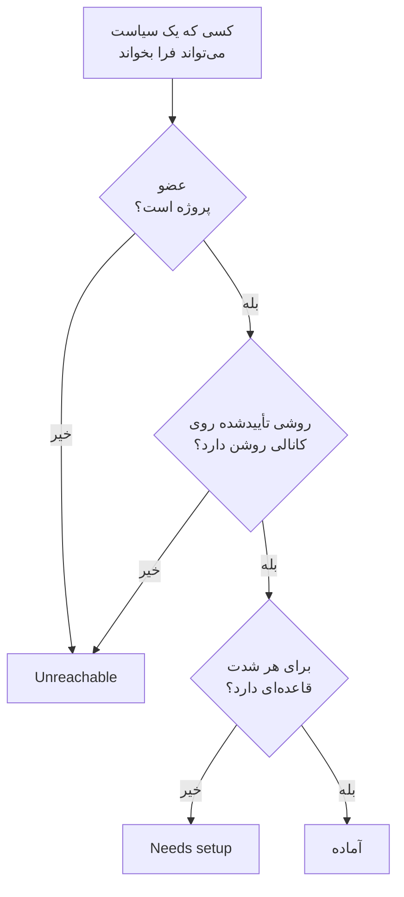

# آمادگی و گزارش‌ها

آمادگی پیش از آنکه یک حادثه پاسخ دهد، به یک پرسش پاسخ می‌دهد: اگر همین حالا چیزی رخ دهد، آیا واقعاً به همهٔ کسانی که سیاست‌های آنکال شما فرا می‌خوانند می‌توان رسید؟ این صفحه همهٔ پاسخ‌دهندگان پروژه را فهرست می‌کند، می‌گوید چه کسی آماده است و چه کسی نیست، و به شما اجازه می‌دهد به افراد یادآوری کنید راه‌اندازی‌شان را کامل کنند. سپس گزارش **زمان آنکال کاربر** نشان می‌دهد هر فرد چه مدت آنکال بوده است.

:::cards
- [وضعیت چگونه تعیین می‌شود](#وضعیت-چگونه-تعیین-میشود): آماده، Needs setup یا Unreachable، و چرا.
- [صفحهٔ آمادگی](#صفحهٔ-آمادگی): همهٔ پاسخ‌دهندگان پروژه، در یک فهرست.
- [به افراد یادآوری کنید راه‌اندازی را کامل کنند](#به-افراد-یادآوری-کنید-راهاندازی-را-کامل-کنند): ایمیلی که می‌گوید چه چیزی کم است.
- [زمان آنکال کاربر](#زمان-آنکال-کاربر): هر فرد چه مدت آنکال بوده است.
:::

## وضعیت چگونه تعیین می‌شود

پاسخ‌دهنده هر کسی است که یک سیاست آنکال می‌تواند فرا بخواند: فردی که در یک قاعدهٔ تشدید نام برده شده، عضو تیمی که یک قاعده فرا می‌خواند، کسی در لایه‌ای از زمان‌بندی‌ای که یک قاعده فرا می‌خواند، و جانشین در جایگزینی کاربری که هنوز تمام نشده است. زمان‌بندی‌ای که هیچ سیاستی فرا نمی‌خواند کسی را اضافه نمی‌کند.

| وضعیت | معنای آن |
| --- | --- |
| **آماده** | روشی تأییدشده روی کانالی دارد که پروژه روشن کرده، و برای هر شدت، در هر زبانهٔ قواعد آنکالش، یک قاعده دارد. |
| **نیاز به راه‌اندازی** | می‌توان به او رسید، اما برخی شدت‌ها قاعده ندارند. ردیف این کمبودها را می‌شمارد. |
| **در دسترس نیست** | هیچ‌چیز به او نمی‌رسد: روش تأییدشده‌ای ندارد، همهٔ روش‌های تأییدشده‌اش روی کانال‌هایی هستند که پروژه خاموش کرده، یا عضو پروژه نیست. |

کمبود یعنی شدتی بدون قاعده، در زبانهٔ حوادث، اپیزودهای حادثه، هشدارها یا اپیزودهای هشدار. قاعده‌ای که عمداً یک شدت را خاموش می‌کند کمبود نیست. فراخوانی‌ای که به کمبود می‌خورد باز هم از راه روش‌های تأییدشدهٔ فرد به او می‌رسد، مگر اینکه پروژه این پشتیبان را خاموش کرده باشد: [وقتی هیچ قاعده‌ای مطابقت ندارد](/docs/notifications/index#وقتی-هیچ-قاعدهای-مطابقت-ندارد) را ببینید.

## صفحهٔ آمادگی

**کشیک آنکال** > **آمادگی** را باز کنید. کارت **On-call readiness** همهٔ کسانی را که هر سیاست آنکالی در پروژه می‌تواند به آن‌ها برسد فهرست می‌کند، و کسانی که اول به چیزی نیاز دارند در بالا. هر کسی در پروژه می‌تواند آن را باز کند.

بالای فهرست، کاشی‌ها **پاسخ‌دهندگان**، **آماده**، **نیاز به راه‌اندازی** و **در دسترس نیست** را می‌شمارند. روی **آماده**، **نیاز به راه‌اندازی** یا **در دسترس نیست** کلیک کنید تا فقط همان پاسخ‌دهندگان فهرست شوند، و دوباره کلیک کنید تا همه فهرست شوند.

| ستون | چه چیزی نشان می‌دهد |
| --- | --- |
| **پاسخ‌دهنده** | فرد، همراه با نشانی ایمیلش. |
| **وضعیت** | **آماده**، **در دسترس نیست**، یا اینکه چند کمبود دارد. |
| **کانال‌ها** | یک بخش برای هر کانال: پر برای روشی تأییدشده، توخالی برای روشی که هنوز تأیید نشده است. |
| **Coverage** | چند شدت، در هر زبانه، از میان همهٔ شدت‌ها قاعده دارند. |
| **Reached via** | سیاست‌ها چگونه به او می‌رسند: هر تیمی که از راه یک قاعدهٔ تشدید او را فرا می‌خواند، با نامش، یا **Direct**، **زمان‌بندی** یا **جایگزینی**. |

**Coverage** در یک ردیف روش‌های اعلان فرد، دلیل وضعیتش و جدولی از همهٔ شدت‌ها با قاعده یا بدون قاعده را نشان می‌دهد. قیف فهرست را بر اساس **پاسخ‌دهنده**، **وضعیت**، **تیم** یا **Reached via** فیلتر می‌کند. پاسخ ممکن است یک دقیقه قدیمی باشد: **تازه‌سازی** آن را دوباره تعیین می‌کند.

## به افراد یادآوری کنید راه‌اندازی را کامل کنند

فقط خود فرد می‌تواند روش‌های اعلان و قواعدش را اضافه و تأیید کند، پس راه‌حل این است که از او بخواهید.

:::steps
1. در صفحهٔ آمادگی، پاسخ‌دهندگانی را که باید یادآوری شوند علامت بزنید. پاسخ‌دهندگان آماده را نمی‌توان علامت زد: چیزی برای یادآوری به آن‌ها نیست.
2. روی **ارسال یادآوری راه‌اندازی** کلیک کنید. پنجرهٔ تأیید نام همهٔ کسانی را که قرار است ایمیل بگیرند می‌آورد.
3. تأیید کنید. هر فرد یک ایمیل می‌گیرد که می‌گوید چه چیزی از راه‌اندازی خودش کم است، همراه با پیوندی به صفحه‌ای که آن را درست می‌کند.
:::

سپس یک بنر می‌گوید چند یادآوری فرستاده شد، رد شد یا ناموفق بود، و برای هر کدام که فرستاده نشد دلیلش را. به هیچ‌کس در ۲۴ ساعت بیش از یک بار یادآوری نمی‌شود، و هر بار حداکثر به ۲۵۰ نفر یادآوری می‌شود. فرستادن یادآوری به **مالک پروژه**، **مدیر پروژه** یا **مدیر آنکال**، یا به **Edit On-Call Duty Policy** در یک نقش سفارشی نیاز دارد.

## آمادگی در صفحه‌های دیگر

- در **نمای کلی** یک سیاست، **آمادگی پاسخ‌دهندگان** همهٔ کسانی را که آن سیاست می‌تواند فرا بخواند و نیاز به توجه دارند فهرست می‌کند، و **بررسی دوباره** آن را دوباره می‌خواند. ردیف خود شما دکمه‌ای به صفحه‌ای دارد که مشکل را درست می‌کند؛ ردیف دیگران در برنامهٔ ایمیل خودتان ایمیلی به آن‌ها باز می‌کند که راه‌حل در آن آمده است.
- در **قواعد تشدید** یک سیاست، سطحی که نمی‌توان همهٔ پاسخ‌دهندگانش را فرا خواند، این را روی کارتش می‌گوید. [خلاصه تشدید](/docs/on-call/escalation-rules#خلاصه-تشدید) را ببینید.
- زیر **کاربران**، یک عضو را باز کنید، سپس **آمادگی** را در بخش **آنکال**: وضعیت، روش‌ها و جدول شدت‌های او.
- برای راه‌اندازی خودتان، **تنظیمات کاربر** > **فهرست راه‌اندازی** شما را گام به گام پیش می‌برد. [فهرست راه‌اندازی](/docs/notifications/index#فهرست-راهاندازی) را ببینید.

## ایمیل هفتگی آمادگی

OneUptime هفته‌ای یک بار هر پروژه‌ای را که سیاست آنکال دارد بررسی می‌کند. وقتی کسی در آن **در دسترس نیست** یا **نیاز به راه‌اندازی** باشد، مالکان پروژه یک ایمیل می‌گیرند که آن افراد را در دو گروه فهرست می‌کند، کسانی که اصلاً نمی‌توان فراخواند و کسانی که با کمبود در دسترس‌اند، تا ۲۰ نام در هر گروه، همراه با پیوندی به صفحهٔ آمادگی.

هفته‌ای که همه آماده باشند چیزی فرستاده نمی‌شود، پس این ایمیل همیشه یعنی چیزی باید درست شود. وقتی کسی اصلاً قابل فراخواندن نباشد، موضوع آن با `[Action Required]` شروع می‌شود.

## زمان آنکال کاربر

**کشیک آنکال** > **گزارش‌ها** > **زمان آنکال کاربر** نشان می‌دهد هر فرد در بازه‌ای که انتخاب می‌کنید چه مدت آنکال بوده است: در ابتدا **۱ ماه گذشته**.

| ستون | چه چیزی نشان می‌دهد |
| --- | --- |
| **کاربر** | فرد. |
| **مدتی که کاربر آنکال بوده است** | زمان آنکال او در آن بازه، به ساعت و دقیقه. |

زمان با آنکال شدن و خارج شدن افراد ثبت می‌شود: از وقتی که زمان‌بندی‌ای که یک قاعده فرا می‌خواند نوبتی به آن‌ها می‌دهد، یا مستقیماً یا از راه یک تیم به یک قاعده افزوده می‌شوند، تا تحویل نوبت یا تا وقتی کنار گذاشته شوند. زمانی که کسی هم‌زمان از راه دو سیاست آنکال است یک بار شمرده می‌شود، و زمانی که هنوز ادامه دارد تا همین حالا شمرده می‌شود.

**خط زمانی زمان‌بندی‌ها** و فیدهای تقویم نوبت‌های گذشته را همان‌طور که چرخش امروز تنظیم شده نشان می‌دهند. این گزارش هم‌زمان با رخ دادن رویدادها نوشته می‌شود، پس از آن برای بررسی عدالت در تقسیم و پرداخت کشیک استفاده کنید.

> [!NOTE]
> در OneUptime Cloud، این گزارش به طرح **Growth** نیاز دارد، و زمانی که بیش از ۲۰۰ روز پیش تمام شده حذف می‌شود. نصب خودمیزبان همهٔ آن را نگه می‌دارد.

## عیب‌یابی

:::details به کسی نمی‌توان رسید، اما شماره تلفن تأییدشده دارد
شاید همهٔ روش‌هایش روی کانال‌هایی باشند که پروژه خاموش کرده است: در یک پروژهٔ تازه، پیامک، تماس، WhatsApp و Telegram خاموش شروع می‌شوند. [روشن کردن کانال برای پروژه](/docs/notifications/notification-methods#روشن-کردن-کانال-برای-پروژه) را ببینید.
:::

:::details کسی در فهرست نیست
فهرست فقط کسانی را دارد که یک سیاست آنکال می‌تواند فرا بخواند. عضو تیمی که دعوتش را نپذیرفته، کسی در زمان‌بندی‌ای که هیچ سیاستی فرا نمی‌خواند، و جانشینی که جایگزینی‌اش تمام شده، کنار گذاشته می‌شوند.
:::

:::details مالکان هرگز ایمیل هفتگی را نمی‌گیرند
فقط در هفته‌ای فرستاده می‌شود که کسی **در دسترس نیست** یا **نیاز به راه‌اندازی** باشد، و فقط به مالکان پروژه.
:::

## گام‌های بعدی

:::cards
- [چگونه OneUptime با شما تماس می‌گیرد](/docs/notifications/index): روش‌ها، قواعد و پشتیبانی که پشت هر وضعیت هستند.
- [روش‌های اعلان](/docs/notifications/notification-methods): راه‌هایی را که OneUptime به کسی می‌رسد اضافه و تأیید کنید.
- [قواعد آنکال شخصی](/docs/notifications/on-call-rules): کمبودها را، شدت به شدت، برطرف کنید.
:::
