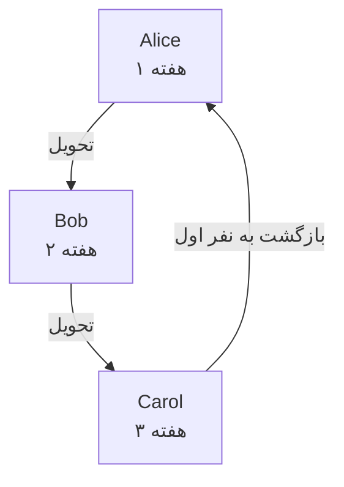
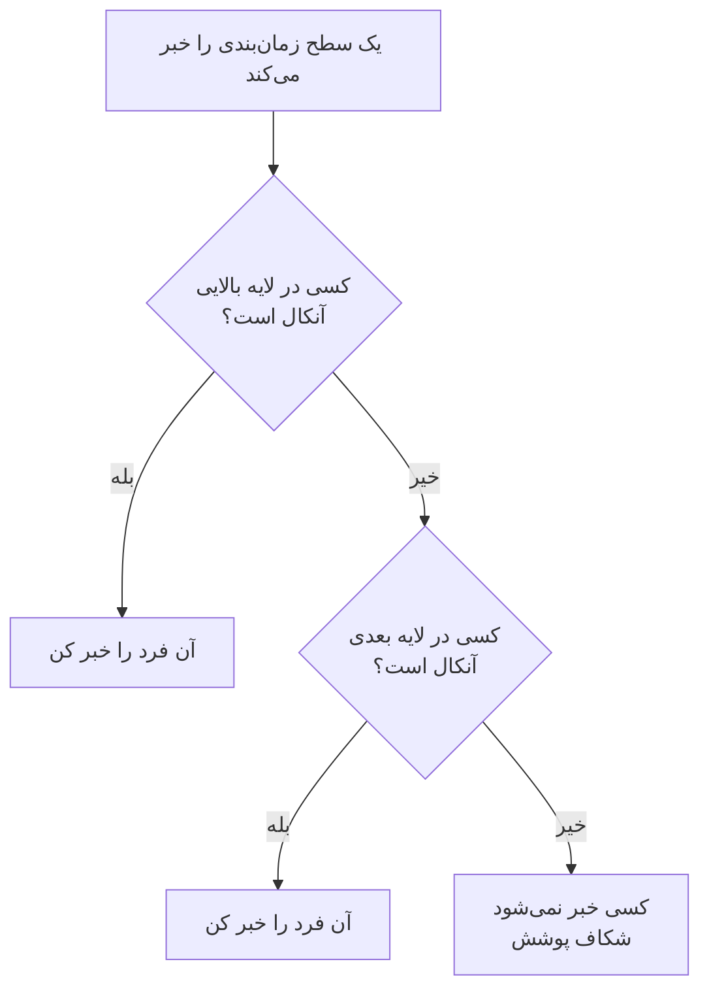

# زمان‌بندی‌های آنکال

زمان‌بندی آنکال تعیین می‌کند در هر لحظه چه کسی آنکال است. افراد در آن به نوبت آنکال می‌شوند: هرکدام مدتی آنکال است، سپس نفر بعدی جای او را می‌گیرد. یک زمان‌بندی را به قواعد تشدید یک سیاست آنکال اضافه کنید، و سیاست وقتی آن سطح اجرا می‌شود هر کسی را که در آن آنکال است خبر می‌کند.

> [!NOTE]
> در OneUptime Cloud، زمان‌بندی‌های آنکال در طرح **Growth** و بالاتر هستند. زمان‌بندی‌ای که پروژه هنوز دارد، پس از پایان دوره آزمایشی Growth یا پایین آمدن طرح، از راه قواعد تشدیدی که نامش را می‌برند همچنان افرادش را خبر می‌کند. برای همین زیر **Growth**، صفحه **زمان‌بندی‌های آنکال** یادداشت طرح را نشان می‌دهد و زمان‌بندی‌هایی را که هنوز تنظیم شده‌اند زیر آن، جایی که می‌توانید حذفشان کنید. ساختن یا تغییر یک زمان‌بندی به **Growth** نیاز دارد.

:::cards
- [چه کسانی به نوبت آنکال هستند](#چه-کسانی-به-نوبت-آنکال-هستند): یک زمان‌بندی با نخستین چرخشش بسازید.
- [لایه‌ها](#لایهها): چرخش‌ها را روی هم بگذارید، ساعت‌های آنکال را محدود کنید و پوشش پشتیبان اضافه کنید.
- [وقتی کسی غایب است](#وقتی-کسی-غایب-است): کسی را تا زمان بازگشتش در چرخش رد کنید.
- [API و Terraform](#ساختن-زمانبندیها-با-api-یا-terraform): زمان‌بندی‌ها و چرخش‌هایشان را به‌صورت کد بسازید.
:::

## چه کسانی به نوبت آنکال هستند

وقتی در صفحه **زمان‌بندی‌های آنکال** یک زمان‌بندی می‌سازید، فرم **نام** آن و **چه کسانی به نوبت آنکال هستند؟** را می‌پرسد. افرادی که انتخاب می‌کنید نخستین لایه زمان‌بندی، یعنی **Layer 1**، می‌شوند که شبانه‌روزی آنکال است.

:::steps
1. به **آنکال** > **زمان‌بندی‌های آنکال** بروید و روی **ساخت زمان‌بندی آنکال** کلیک کنید.
2. یک **نام** وارد کنید. نامی که زمان‌بندی دیگری از پروژه دارد، بدون توجه به بزرگی و کوچکی حروف و فاصله‌ها پذیرفته نمی‌شود تا هر انتخابگر بتواند زمان‌بندی‌ها را از هم تشخیص دهد.
3. زیر **چه کسانی به نوبت آنکال هستند؟** روی **افزودن کاربر** کلیک کنید و افراد را به همان ترتیبی که نوبت می‌گیرند انتخاب کنید.
4. در صورت نیاز **فیلدهای بیشتر** را باز کنید تا مدت هر نوبت، منطقه زمانی، توضیحات یا برچسب‌ها را تغییر دهید.
5. روی **ساخت زمان‌بندی آنکال** کلیک کنید. زمان‌بندی تازه سپس در صفحه **لایه‌ها** خود باز می‌شود، جایی که می‌توانید چرخش را تغییر دهید یا لایه‌های بیشتری اضافه کنید.
:::

افراد یکی‌یکی نوبت می‌گیرند، و نخستین نفر به محض ساخته شدن زمان‌بندی آنکال می‌شود:



**چه کسانی به نوبت آنکال هستند؟** اختیاری است. اگر آن را خالی بگذارید، زمان‌بندی بدون لایه شروع می‌شود: تا وقتی در صفحه **لایه‌ها** آن لایه‌ای اضافه نکنید، کسی را آنکال نمی‌کند. این پرسش فقط از کسانی پرسیده می‌شود که می‌توانند لایه اضافه کنند.

همه چیزهای دیگر زیر **فیلدهای بیشتر** هستند که تا بازش نکنید جمع‌شده می‌ماند:

| فیلد | چه می‌کند |
| --- | --- |
| **مدت هر نوبت** | **۱ روز**، **۱ هفته**، **۲ هفته** یا **۱ ماه**، و اگر تغییرش ندهید **۱ هفته**. وقتی کسی نوبت بگیرد پرسیده می‌شود. هر فرد همین مدت آنکال است، سپس نفر بعدی در همان ساعتی از روز که زمان‌بندی ساخته شد جای او را می‌گیرد. |
| **منطقه زمانی** | منطقه زمانی‌ای که زمان‌های تحویل و ساعت‌های آنکال در آن نگه داشته می‌شوند. از منطقه زمانی شما شروع می‌شود. اگر بعداً آن را تغییر دهید، هر زمان همان‌طور که خوانده می‌شود می‌ماند: تحویل ساعت ۰۹:۰۰ در ساعت ۰۹:۰۰ می‌ماند و بازه‌ای در روز دوشنبه در دوشنبه می‌ماند. هر منطقه زمانی از قواعد فعلی منطقهٔ خود پیروی می‌کند: America/Vancouver (بریتیش کلمبیا) از ۲۰۲۶ در تمام سال روی UTC-7 می‌ماند. |
| **توضیحات** | یادداشت‌هایی درباره زمان‌بندی. |
| **برچسب‌ها** | برچسب‌هایی برای پیدا کردن و گروه‌بندی زمان‌بندی. |

تا وقتی کسی نوبت می‌گیرد و چیزی زیر **فیلدهای بیشتر** تغییر نکرده، سرتیتر جمع‌شده آن می‌گوید چه خواهد شد: هر فرد یک هفته آنکال است، سپس نفر بعدی جای او را می‌گیرد.

کسی که به پروژه دعوت شده و هنوز به آن نپیوسته هم می‌تواند به نوبت آنکال باشد، اما تا وقتی دعوتش را نپذیرد چیزی او را خبر نمی‌کند، و چیزی هم به او گفته نمی‌شود. نوبت او یک شکاف پوشش است، و کانال‌ها و فید هر سیاست آنکالی که این زمان‌بندی را خبر می‌کند همین را می‌گویند و او را با نامی که همراه دعوتش نوشته شده می‌نامند، هرگز با نشانی ایمیلش: "⚠️ Nobody is paged for Payments through schedule Primary until tomorrow at 5:50 PM, when @bob takes over: Ivy is on call but hasn't joined the project yet." `/oneuptime oncall` در Slack و `oncall` در Microsoft Teams هم همین را می‌گویند. وقتی بپیوندد، خبرها به او می‌رسند، به او گفته می‌شود اکنون کدام سیاست‌های آنکال او را خبر می‌کنند، و کانال‌ها می‌شنوند "📞 Ivy has joined the project and is now on call for Payments until tomorrow at 5:50 PM, then @bob." تا آن زمان، [آمادگی و گزارش‌ها](/docs/on-call/readiness) او را فهرست می‌کند، همراه با کاری که باید کرد.

## لایه‌ها

چرخش یک زمان‌بندی از لایه‌هایی در صفحه **لایه‌ها** آن ساخته می‌شود. لایه‌ها از بالا به پایین خوانده می‌شوند: بالاترین لایه‌ای که کسی در آن آنکال است همان است که خبر می‌کند، پس چرخش اصلی را بالا بگذارید و پوشش پشتیبان را زیر آن.



**افزودن لایه** لایه‌ای اضافه می‌کند که مثل لایه نخست شروع می‌شود: آنکال از همین حالا، هر فرد یک هفته، شبانه‌روزی. یک لایه را باز کنید تا افرادی به آن اضافه کنید، و تغییر دهید کی شروع می‌شود، هر چند وقت یک بار تحویل می‌دهد، نخستین تحویلش کی است و در چه ساعت‌هایی آنکال است:

| فیلد | چه چیزی را تنظیم می‌کند |
| --- | --- |
| **نام لایه** | آنچه لایه پوشش می‌دهد، مثلاً «اصلی روزهای کاری». |
| **شروع چرخش** | تاریخ و ساعتی که چرخش لایه آغاز می‌شود. |
| **چرخش هر** | هر چند وقت یک بار آنکالی به نفر بعدی لایه می‌رسد. |
| **زمان نخستین تحویل** | نخستین تحویل به نفر بعدی، در لحظه شروع یا پس از آن. تحویل‌های بعدی در هر بازه چرخش انجام می‌شوند. |
| **محدودیت‌ها** | ساعت‌هایی که لایه آنکال است (**ساعت‌های فعال**): **بدون محدودیت**، **زمان‌های مشخصی از روز** یا **زمان‌های مشخصی از هفته**، در منطقه زمانی زمان‌بندی. بیرون از آن‌ها لایه‌های پایین‌تر جای آن را می‌گیرند. |

بازه‌ای از **زمان‌های مشخصی از هفته** از روز و ساعت زیر **از:** تا روز و ساعت زیر **تا:** ادامه دارد و روزهایی که نشان می‌دهد همان روزهایی است که آنکال است. بازه‌ای که زمان‌هایش بر روزهایی جز روزهایی که با آن‌ها ذخیره شده است می‌افتد، مثل بازه‌ای که از راه API با زمان‌هایی به تاریخ روزهای دیگر نوشته شده، یا بازه‌ای که پیش از تغییر منطقه زمانی زمان‌بندی‌اش ذخیره شده، روی لایه‌اش با **ساعت‌های فعال نیازمند بررسی** علامت می‌خورد و زیر آن می‌گوید با چه روزهایی ذخیره شده است. این بازه در روزهای نمایش‌داده‌شده آنکال می‌ماند و **ذخیره لایه** آن را همان‌جا نگه می‌دارد: پیش از ذخیره کردن، روزهای موردنظرتان را انتخاب کنید.

با ساعت‌های فعال، هر بازه یک نوبت جداگانه است. از ۱۷:۰۰ تا ۰۷:۰۰ یک نوبت است که ساعت ۰۷:۰۰ صبح روز بعد تمام می‌شود: در **خط زمانی زمان‌بندی‌ها**، در ایمیل‌ها، در اپلیکیشن موبایل و در Slack و Microsoft Teams به یک شکل، در منطقه زمانی زمان‌بندی و حتی در شب‌هایی که ساعت‌ها جابه‌جا می‌شوند. نوبت هر فرد همه بازه‌های او تا تحویل بعدی است و در هر جهت یک بار به او خبر داده می‌شود: "You are now on-call" وقتی نخستین بازه نوبتش شروع می‌شود، همراه با زمان پایان آن بازه و زمان پایان نوبتش، و "You are no longer on-call" وقتی آخرین بازه‌اش تمام می‌شود، نه در هر بازه. برای اینکه پیش از هر بازه به شما یادآوری شود، در **پیش از نوبت‌ها به من یادآوری کن** زمانی انتخاب کنید، همان‌طور که [فیدهای تقویم](/docs/on-call/calendar-feeds#یادآوریها-و-اعلانهای-واگذاری-دوباره) توضیح می‌دهد. وقتی میان دو بازه او کس دیگری آنکال است، با یک جایگزینی یا یک لایه پایین‌تر، یا تغییری در لایه‌ها بازه بعدی را به کس دیگری می‌دهد، این یک تحویل است و همان‌طور اعلام می‌شود. زمان آنکال او همچنان بازه به بازه ثبت می‌شود و کانال‌ها و فید سیاست آنکال همچنان هر بار می‌گویند چه کسی آنکال است.

برای تغییر اینکه کدام لایه اول بیاید، از پیکان‌های روی کارت یک لایه استفاده کنید: **انتقال لایه به بالا (اولویت بالاتر)** یا **انتقال لایه به پایین (اولویت پایین‌تر)**.

تغییر در اینکه چه کسانی نوبتی کار می‌کنند تا وقتی ذخیره‌اش نکنید منتظر می‌ماند، پس می‌توانید چند تغییر بدهید و پیش از آنکه نوبت کسی جابه‌جا شود آن‌ها را بررسی کنید. افراد را به ترتیب تازه‌ای بکشید، افرادی را اضافه کنید یا بردارید،لایه‌ای را بالا یا پایین ببرید یا حذف کنید؛ صفحه هر تغییر را پیش از ذخیره نشان می‌دهد:

- کسی که اضافه کرده‌اید با **جدید** و کسی که به جای تازه‌ای کشیده‌اید با **جابه‌جا شده** علامت می‌خورد. افرادی که برداشته‌اید زیر **هنگام ذخیره برداشته می‌شوند** فهرست می‌شوند، هر کدام با **واگرد**.
- لایه‌ای که حذف می‌کنید نشان می‌دهد که هنگام ذخیره حذف می‌شود، با **واگرد**.
- هر لایه و زمان‌بندی نهایی، چرخش را همان‌طور که خواهد بود نشان می‌دهند. زمان‌بندی نهایی با **شامل تغییرات ذخیره‌نشده** علامت می‌خورد.
- نواری در پایین صفحه تغییرات را نام می‌برد، با **ذخیرهٔ تغییرات** و **نادیده گرفتن**.

**ذخیرهٔ تغییرات** همهٔ تغییرات را یک‌جا ذخیره می‌کند. سپس اینکه چه کسی آنکال است یک بار، برای لایه‌ها به همان شکلی که ذخیره شده‌اند، تعیین می‌شود: کسی که آنکال می‌شود، از آنکال بیرون می‌آید یا نفر بعدی است، یک بار باخبر می‌شود، نه یک بار برای هر تغییر. **نادیده گرفتن** لایه‌ها را به آخرین حالت ذخیره‌شده برمی‌گرداند. ترک صفحه پیش از ذخیره، اول می‌پرسد: **ذخیره تغییرات** ذخیره می‌کند و سپس خارج می‌شود، **ادامه ویرایش** در صفحه می‌ماند و **نادیده گرفتن تغییرها** بدون ذخیره خارج می‌شود.

اگر شخص دیگری پس از باز کردن صفحه لایه‌ها را تغییر داده باشد، تغییرات شما روی تغییرات او ذخیره نمی‌شود. نوار این را می‌گوید و **بارگذاری دوبارهٔ لایه‌ها** لایه‌ها را همان‌طور که اکنون هستند نشان می‌دهد تا تغییرات خود را دوباره اعمال کنید. **افزودن لایه** لایه را فوراً اضافه می‌کند و تنظیمات هر لایه با دکمهٔ **ذخیره لایه** خود آن ذخیره می‌شود.

هر فرد همه‌جا یک رنگ را نگه می‌دارد تا بتوانید با یک نگاه دنبالش کنید: در هر لایه، در زمان‌بندی نهایی و بازنویسی‌هایش، و در **خط زمانی زمان‌بندی‌ها**.

## وقتی کسی غایب است

وقتی کسی به مرخصی می‌رود، تا زمان بازگشتش از او رد شوید. در صفحه **لایه‌ها** زمان‌بندی، یک لایه را باز کنید و روی **رد کردن تا…** کنار نام او کلیک کنید. فرم غیبت باز می‌شود؛ او در **چه کسی غایب است؟** است، **نفر بعدی در چرخش** در **چه کسی جایگزین است؟** و **شروع** از همین حالا: **پایان** را روی زمان بازگشت او بگذارید و ذخیره کنید. اگر او در آن زمان از قبل غیبتی داشته باشد، فرم هنگام انتخاب زمان‌ها این را کنار زمان‌ها می‌گوید، همراه با **ویرایش آن جایگزینی** تا به‌جایش آن یکی را تغییر دهید.

تا زمانی که غایب است:

- هر نوبت او، در هر زمان‌بندی‌ای که در آن است، به نفر بعدی لایه که غایب نیست می‌رسد. نوبت‌های دیگران جابه‌جا نمی‌شود و نوبت‌های او پس از بازگشتش دوباره مال خودش است.
- اگر همه افراد یک لایه غایب باشند، آن لایه کسی را در کشیک ندارد و لایه‌های پایین‌تر جای آن را می‌گیرند. لایه **همه افراد این لایه اکنون غایب‌اند** را نشان می‌دهد.
- قواعد تشدیدی که مستقیماً یا از طریق یک تیم به او خبر می‌دهند، از او رد می‌شوند. اجرای سیاست می‌گوید که او غایب است و تا کی.
- ردیف او در لایه نشان می‌دهد تا کی غایب است، و زمان‌بندی نهایی و **خط زمانی زمان‌بندی‌ها** نشان می‌دهند هر نوبت او با چه کسی است.

اگر به جای آن کسی را در **چه کسی جایگزین است؟** انتخاب کنید، آن فرد همه خبرهای او را از همه زمان‌بندی‌ها و همه سیاست‌ها دریافت می‌کند، به جای اینکه چرخش نوبت‌های او را بگیرد.

غیبتی که این‌گونه اضافه شود برای همه سیاست‌های آنکال اعمال می‌شود، پس افزودن آن به دسترسی بازنویسی روی کل پروژه نیاز دارد. اگر نقش تیم شما به سیاست‌های خودش یا به چند برچسب محدود است، به جای آن روی سیاست‌هایی از این زمان‌بندی اضافه می‌شود که می‌توانید روی آن‌ها بازنویسی اضافه کنید، با یک بازنویسی برای هر سیاست، که در صفحه **جایگزینی‌های کاربر** خود هر سیاست فهرست می‌شود؛ اگر چند تا باشند، آن‌ها را زیر **سیاست‌های آنکال** تیک می‌زنید. **رد کردن تا…** فقط جایی قفل است و دلیلش را می‌گوید که روی هیچ‌کدام نمی‌توانید. در **آنکال** > **زمان‌بندی‌ها** > **جایگزینی‌های کاربر** و در میان جایگزینی‌های کاربر زمان‌بندی در صفحه **لایه‌ها** آن فهرست می‌شود، و آنجا **پایان همین حالا** او را زودتر برمی‌گرداند. برای رد کردن کسی فقط در یک سیاست، بازنویسی را در صفحه **جایگزینی‌های کاربر** همان سیاست اضافه کنید و **چه کسی جایگزین است؟** را همان‌طور که هست بگذارید. [جایگزینی‌های کاربر](/docs/on-call/user-overrides) را ببینید.

با API، بازنویسی کاربری (`/api/on-call-duty-policy-user-override`) که بدون `routeAlertsToUserId` ساخته شود، از فرد `overrideUserId` از `startsAt` تا `endsAt` رد می‌شود.

**نمای کلی** یک زمان‌بندی کارت **استفاده‌شده توسط** دارد: سیاست‌های آنکالی که قواعد تشدیدشان فرد آنکال را فرا می‌خوانند، همراه با قواعدی که این کار را می‌کنند. اگر هیچ‌کدام چنین نکند، کارت همین را می‌گوید و به سیاست‌های آنکال پیوند می‌دهد. حذف زمان‌بندی، در صفحه‌اش یا از فهرست، اول می‌گوید کدام سیاست‌ها از طریق آن فرا می‌خوانند. سیاست‌هایی که اجازه‌ی باز کردنشان را ندارید شمرده می‌شوند، اما نامشان آورده نمی‌شود. زمان‌بندی‌ای که از پیش از اجباری شدن نام‌های یکتا با زمان‌بندی دیگری هم‌نام است، در فهرست **زمان‌بندی‌های آنکال** با **هم‌نام با زمان‌بندی دیگری** علامت می‌خورد و این فهرست می‌گوید چند تا از این زمان‌بندی‌ها هست: لایه‌هایشان را مقایسه کنید، سپس نام یکی را با **تغییر نام** در ردیفش تغییر دهید.

## ساختن زمان‌بندی‌ها با API یا Terraform

زمان‌بندی‌های آنکال منبع `/api/on-call-duty-policy-schedule` هستند؛ لایه‌هایشان و افراد درون آن‌ها منابع `/api/on-call-duty-schedule-layer` و `/api/on-call-duty-schedule-layer-user` هستند.

- ساختن یک زمان‌بندی با `firstLayerUsers` (فهرستی از شناسه‌های کاربر، به ترتیبی که نوبت می‌گیرند) در `miscDataProps` آن، مثل داشبورد نخستین لایه‌اش را به آن می‌دهد: **Layer 1**، آنکال از همین حالا، شبانه‌روزی. `firstLayerRotation` می‌گوید هر نوبت چه مدت طول می‌کشد، به‌صورت چرخشی مثل `{"_type": "Recurring", "value": {"intervalType": "Week", "intervalCount": 1}}`؛ بدون آن، یک هفته. هر کاربر باید عضو پروژه باشد و فراخوان باید اجازه ساختن لایه داشته باشد، وگرنه زمان‌بندی ساخته نمی‌شود.
- زمان‌بندی‌ای که بدون آن‌ها ساخته شود، مثل قبل هیچ لایه‌ای ندارد؛ منبع زمان‌بندی Terraform آن‌ها را نمی‌فرستد.
- لایه‌ای که بدون `rotation` ساخته شود هر هفته تحویل می‌دهد، و لایه‌ای بدون `restrictionTimes` شبانه‌روز آنکال است، همان‌طور که یک لایه تازه در داشبورد شروع می‌شود.
- `restrictionTimes` یک لایه، یعنی ساعت‌های فعال آن، نوعش را زیر `restrictionType` می‌گوید: `None` (آنکال شبانه‌روزی)، `Daily` یا `Weekly`. `restictionType`، املای قدیمی‌تر آن بدون "r" دوم، هم خوانده می‌شود و هر پاسخ نوع را زیر هر دو می‌آورد، تا کلاینت یا پیکربندی Terraform نوشته‌شده با هرکدام همچنان کار کند؛ لایه با `restrictionType` ذخیره می‌شود. `restictionType` در پاسخ‌ها منسوخ شده است: پاسخ‌ها آن را تا نخستین نسخهٔ اصلی‌ای که در 1 ژوئن 2027 یا پس از آن منتشر شود دارند و نوشتن‌ها همیشه آن را خواهند خواند. `restrictionType` را بنویسید.
- یک بازه `Weekly`، یعنی `{"startDay", "startTime", "endDay", "endTime"}`، در روزهایی که نام می‌برد آنکال است: `startTime` و `endTime` آن باید در منطقه زمانی زمان‌بندی بر `startDay` و `endDay` آن بیفتند. بازه‌ای که زمانش بر روز دیگری بیفتد با یک `400` رد می‌شود که بازه را، روزی را که زمانش بر آن می‌افتد، و زمانی در روز نام‌برده را که می‌توان به‌جای آن فرستاد نام می‌برد. روزی که جا انداخته شود همان روزی است که زمانش بر آن می‌افتد. بازه‌ای که دقیقاً همان‌طور که لایه نگهش می‌دارد پس فرستاده شود دوباره سنجیده نمی‌شود، پس کلاینتی که لایه‌ای را می‌خواند و همان را پس می‌نویسد به این خاطر رد نمی‌شود. در زمان‌بندی‌ای بدون منطقه زمانی، که زمان‌هایش در منطقه زمانی سرور خوانده می‌شوند، یک زمان فقط وقتی رد می‌شود که در هیچ منطقه زمانی‌ای بر روزش نیفتد.
- ارتقای OneUptime هر بازه ذخیره‌شده‌ای را که زمان‌هایش بر روزهایی جز روزهایی که نام می‌برد می‌افتد، و در هیچ منطقه زمانی‌ای بر آن روزها نمی‌افتد، با همان ساعت از روز به روزهایی که نام می‌برد منتقل می‌کند و دوباره معلوم می‌کند چه کسی آنکال است. بازه‌ای که زمان‌هایش در منطقه زمانی دیگری بر روزهایش می‌افتد، چنان‌که ممکن است برای بازه‌ای پیش بیاید که در منطقه دیگری تنظیم شده یا پیش از تغییر منطقه زمانی زمان‌بندی‌اش ذخیره شده است، بدون تغییر می‌ماند تا همان‌طور که تاکنون فرا می‌خواند فرا بخواند، و با **ساعت‌های فعال نیازمند بررسی** علامت می‌خورد.
- تغییر `timezone` یک زمان‌بندی از یک منطقه به منطقه‌ای دیگر، `startsAt`، `handOffTime` و `restrictionTimes` لایه‌هایش را به ساعت منطقه جدید می‌برد: هرکدام در آن‌جا همان تاریخ، همان روز و همان ساعت از روز را نشان می‌دهد که پیش‌تر نشان می‌داد. دادن نخستین منطقه زمانی به یک زمان‌بندی، یا برداشتن آن، لحظه‌ها را همان‌طور که هستند نگه می‌دارد.
- نوشتنی که لایه را در هیچ زمانی آنکال نگذارد با یک `400` رد می‌شود که نام کلید را می‌گوید: نوعی که نیست، ناشناخته است یا زیر دو املا متفاوت است (به‌روزرسانی همانی را می‌گیرد که با نوع فعلی لایه فرق دارد)؛ بازه `Daily` که `startTime` و `endTime` آن تاریخ و ساعت نیستند (`"09:00"` به‌تنهایی رد می‌شود)؛ محدودیت `Weekly` بدون `weeklyRestrictionTimes`؛ یا بازه‌ای که در یک زمان باز و بسته می‌شود. `rotation` که `intervalType` آن `Hour`، `Day`، `Week`، `Month` یا `Year` نباشد هم به همین شکل رد می‌شود.
- لایه‌ای که پیش از رد شدن این نوشتن‌ها و بدون نوعی که خوانده شود ذخیره شده بود، هرگز آنکال نبود. ارتقای OneUptime هر چنین لایه‌ای را بر اساس ساعت‌هایی که دارد می‌خواند، همان‌طور ذخیره می‌کند و دوباره معلوم می‌کند چه کسی در زمان‌بندی آن آنکال است، تا افرادش از آن پس فراخوانده شوند و از آن باخبر شوند.
- تغییری در لایه‌های یک زمان‌بندی و افراد درون آن‌ها که با API یا Terraform انجام شود، به‌عنوان یک تغییر اطلاع داده می‌شود: اینکه چه کسی آنکال است وقتی تعیین می‌شود که لایه‌ها نیم دقیقه تغییری نکرده باشند، و کسی که آنکال می‌شود، از آنکال بیرون می‌آید یا نفر بعدی است، یک بار باخبر می‌شود، نه یک بار برای هر لایه یا فردی که نوشته می‌شود. هشدارها از همان لحظه‌ای که هر تغییر ذخیره شود به کسی می‌رسند که لایه‌ها آنکال کرده‌اند.
- برای اینکه یکجا تغییر دهید چه کسانی در لایه‌های یک زمان‌بندی نوبت می‌گیرند، همان‌طور که **ذخیرهٔ تغییرات** در صفحه **لایه‌ها** می‌کند، لایه‌ها را با `GET /api/on-call-duty-policy-schedule/<schedule-id>/layers` بخوانید و آن‌ها را تغییریافته به `POST /api/on-call-duty-policy-schedule/<schedule-id>/save-layers` برگردانید. در آن‌ها هر لایه‌ای که زمان‌بندی نگه می‌دارد آمده است، اول آنکه بالاترین اولویت را دارد، و هر کدام با افرادش به ترتیب نوبت: کسی که از قبل در لایه‌ای است با `layerUserId` خودش، و کسی که اضافه می‌شود فقط با `userId`. `deletedLayerIds` لایه‌هایی را می‌آورد که حذف می‌شوند.
- یک ذخیره یا کامل نوشته می‌شود یا اصلاً نوشته نمی‌شود، و اینکه چه کسی آنکال است یک بار و بی‌درنگ تعیین می‌شود. ذخیره‌ای که پس از تغییر لایه‌ها به دست کسی دیگر انجام شود با 409 رد می‌شود، چون `basedOnVersion` آن دیگر مال لایه‌ها نیست: لایه‌ها را دوباره بخوانید و تغییر را روی آنچه اکنون هست انجام دهید. منبع `oneuptime_on_call_schedule_layers` در Terraform لایه‌های یک زمان‌بندی را به همین شکل ذخیره می‌کند.

```bash
curl -X POST https://oneuptime.com/api/on-call-duty-policy-schedule \
  -H "apikey: $ONEUPTIME_API_KEY" \
  -H "Content-Type: application/json" \
  -d '{
    "data": {
      "projectId": "<project-id>",
      "name": "Primary on-call",
      "timezone": "Europe/Berlin"
    },
    "miscDataProps": {
      "firstLayerUsers": ["<user-id-1>", "<user-id-2>", "<user-id-3>"],
      "firstLayerRotation": {"_type": "Recurring", "value": {"intervalType": "Week", "intervalCount": 1}}
    }
  }'
```

```bash
curl -X POST https://oneuptime.com/api/on-call-duty-schedule-layer \
  -H "apikey: $ONEUPTIME_API_KEY" \
  -H "Content-Type: application/json" \
  -d '{
    "data": {
      "name": "Nights",
      "onCallDutyPolicyScheduleId": "<schedule-id>",
      "startsAt": "2026-11-23T08:00:00.000Z",
      "handOffTime": "2026-11-30T08:00:00.000Z",
      "rotation": {"_type": "Recurring", "value": {"intervalType": "Week", "intervalCount": {"_type": "PositiveNumber", "value": 1}}},
      "restrictionTimes": {"_type": "RestrictionTimes", "value": {
        "restrictionType": "Daily",
        "dayRestrictionTimes": {
          "startTime": {"_type": "DateTime", "value": "2026-01-05T17:00:00+01:00"},
          "endTime": {"_type": "DateTime", "value": "2026-01-05T07:00:00+01:00"}
        }
      }}
    }
  }'
```

```bash
curl -X PUT https://oneuptime.com/api/on-call-duty-schedule-layer/<layer-id> \
  -H "apikey: $ONEUPTIME_API_KEY" \
  -H "Content-Type: application/json" \
  -d '{
    "data": {
      "restrictionTimes": {"_type": "RestrictionTimes", "value": {
        "restrictionType": "Weekly",
        "weeklyRestrictionTimes": [{
          "startDay": "Monday",
          "startTime": {"_type": "DateTime", "value": "2026-01-05T09:00:00+01:00"},
          "endDay": "Friday",
          "endTime": {"_type": "DateTime", "value": "2026-01-09T17:00:00+01:00"}
        }]
      }}
    }
  }'
```

```bash
curl https://oneuptime.com/api/on-call-duty-policy-schedule/<schedule-id>/layers \
  -H "apikey: $ONEUPTIME_API_KEY"

curl -X POST https://oneuptime.com/api/on-call-duty-policy-schedule/<schedule-id>/save-layers \
  -H "apikey: $ONEUPTIME_API_KEY" \
  -H "Content-Type: application/json" \
  -d '{
    "basedOnVersion": "<the version the read answered>",
    "layers": [
      {
        "layerId": "<layer-id>",
        "users": [
          {"layerUserId": "<row-of-user-2>", "userId": "<user-id-2>"},
          {"layerUserId": "<row-of-user-1>", "userId": "<user-id-1>"},
          {"userId": "<user-id-4>"}
        ]
      }
    ],
    "deletedLayerIds": []
  }'
```

## گام‌های بعدی

:::cards
- [قواعد تشدید](/docs/on-call/escalation-rules): این زمان‌بندی را از یک سطح سیاست آنکال خبر کنید.
- [خط زمانی زمان‌بندی‌ها](/docs/on-call/schedule-timeline): همه زمان‌بندی‌ها را کنار هم، با شکاف‌های پوشش، ببینید.
- [فیدهای تقویم](/docs/on-call/calendar-feeds): نوبت‌ها را در Google Calendar، Outlook یا تقویم Apple بگذارید.
- [راه‌های تماس با من](/docs/notifications/on-call-rules): تعیین کنید وقتی آنکال هستید، خبرها چگونه به شما برسند.
:::
