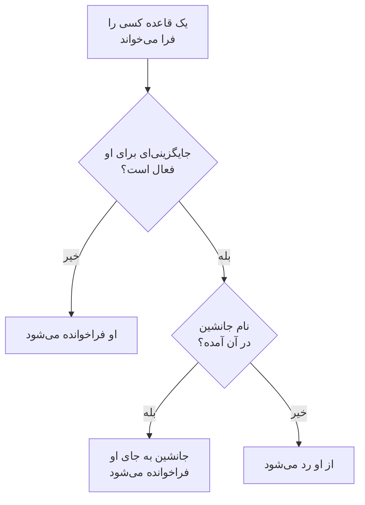

# جایگزینی‌های کاربر

تا وقتی کسی غایب است، یک جایگزینی کاربر برای مدتی مشخص فراخوانی‌هایی را که به او می‌رسیدند برای کسی می‌فرستد که جایش را پر می‌کند. اگر کسی برای جانشینی نام برده نشده باشد، به جای آن از او رد می‌شود: هر نوبت او در یک زمان‌بندی آنکال به نفر بعدی در چرخش می‌رسد. از آن برای تعطیلات، روز بیماری یا نوبتی که جابه‌جا شده استفاده کنید.

:::cards
- [جایگزینی چگونه یک فراخوانی را تغییر می‌دهد](#جایگزینی-چگونه-یک-فراخوانی-را-تغییر-میدهد): چه کسی به جای او فراخوانده می‌شود، و چه زمانی.
- [افزودن یک جایگزینی](#افزودن-یک-جایگزینی): چه کسی غایب است، چه کسی جایش را پر می‌کند، از کی و تا کی.
- [همهٔ سیاست‌ها، یا یکی](#همهٔ-سیاستها-یا-یکی): جایگزینی را کجا اضافه کنید، و کدام یک مقدم است.
- [راه‌های دیگر افزودن](#راههای-دیگر-افزودن): از یک زمان‌بندی، و از نوبت‌های پیش‌روی شما.
:::

## جایگزینی چگونه یک فراخوانی را تغییر می‌دهد



تا وقتی یک جایگزینی برقرار است، از آغاز تا پایانش:

- اگر کسی زیر **چه کسی جایگزین است؟** باشد، آن فرد همهٔ فراخوانی‌های فرد غایب را دریافت می‌کند، از هر زمان‌بندی، تیم و قاعده‌ای که جایگزینی برایش اعمال می‌شود. فراخوانی از راه قواعد آنکال شخصی خود جانشین به او می‌رسد.
- اگر کسی برای جانشینی نباشد، از آن فرد رد می‌شود. در یک زمان‌بندی آنکال، هر نوبت او به نفر بعدی در چرخش می‌رسد که غایب نیست؛ اگر همهٔ افراد یک لایه غایب باشند، لایه‌های زیر آن کار را به دست می‌گیرند. قاعده‌ای که نام او را مستقیماً یا از راه یک تیم می‌برد او را فرا نمی‌خواند، و اجرای سیاست می‌گوید که او غایب است، و تا کی.
- جایگزینی‌ها زنجیره نمی‌شوند. اگر جانشین هم غایب باشد، باز هم خود او برای فردی که جایش را پر می‌کند فراخوانده می‌شود.

وقتی جایگزینی تمام شود، فراخوانی‌ها دوباره مال خود آن فرد هستند. **خط زمانی زمان‌بندی‌ها**، لایه‌های یک زمان‌بندی و فیدهای تقویم همگی نشان می‌دهند هر نوبتی که جایش پر شده دست چه کسی است.

## افزودن یک جایگزینی

:::steps
### جایگزینی‌ها را باز کنید

برای پر کردن جای کسی در همهٔ سیاست‌های آنکال به **کشیک آنکال** > **پیشرفته** > **جایگزینی‌های کاربر** بروید، یا برای پر کردن جایش فقط در یک سیاست به صفحهٔ **جایگزینی‌های کاربر** خود آن سیاست، زیر **پیشرفته**، بروید. روی **افزودن جایگزینی کاربر** کلیک کنید.

### بگویید چه کسی غایب است

**چه کسی غایب است؟** با شما شروع می‌شود، چون ثبت مرخصی خودتان رایج‌ترین حالت است. برای ترتیب دادن جانشین برای کس دیگری، او را انتخاب کنید.

### بگویید چه کسی جایش را پر می‌کند

برای رد شدن از او، **چه کسی جایگزین است؟** را روی **نفر بعدی در چرخش** بگذارید، یا همکاری را انتخاب کنید که همهٔ فراخوانی‌هایش را بر عهده می‌گیرد. فرد غایب در گزینه‌ها نمی‌آید.

### زمان را تنظیم کنید

**شروع** همین حالا است، مگر اینکه زمان دیگری انتخاب کنید. **پایان** را روی زمانی بگذارید که او برمی‌گردد: باید پس از شروع باشد. روی **افزودن جایگزینی کاربر** کلیک کنید.
:::

هر جایگزینی یک ردیف است: **غایب**، **جایگزین**، **شروع** و **پایان**، که با شروع و پایانش فیلتر می‌شود. برای رد شدن، **جایگزین** عبارت **نفر بعدی در چرخش** را نشان می‌دهد. یک جایگزینی را نمی‌توان ویرایش کرد: آن را حذف کنید و یکی تازه اضافه کنید، یا حذفش کنید تا کسی زودتر برگردد.

## همهٔ سیاست‌ها، یا یکی

| کجا اضافه شده | کارت | برای چه اعمال می‌شود |
| --- | --- | --- |
| **کشیک آنکال** > **پیشرفته** > **جایگزینی‌های کاربر** | **جایگزینی‌های سراسری کاربر** | همهٔ سیاست‌های آنکال پروژه |
| **جایگزینی‌های کاربر** یک سیاست | **جایگزینی‌های کاربر در سیاست آنکال** | فقط همان سیاست |

وقتی دو جایگزینی برای یک فرد هم‌پوشانی دارند، جایگزینی خود سیاست بر جایگزینی سراسری مقدم است، و جایگزینی‌ای که نام جانشین را دارد بر رد شدن مقدم است. فراخوانی‌ای که بدون سیاست فرستاده می‌شود، از یک گردش کار یا از چت، فقط از جایگزینی‌های سراسری پیروی می‌کند.

## راه‌های دیگر افزودن

- از یک زمان‌بندی: در صفحهٔ **لایه‌ها** یک زمان‌بندی، یک لایه را باز کنید و کنار یک فرد روی **رد کردن تا…** کلیک کنید. همان فرم باز می‌شود، با آن فرد به‌عنوان غایب و چرخش به‌عنوان جانشین، به شکل یک جایگزینی سراسری. [وقتی کسی غایب است](/docs/on-call/schedules#وقتی-کسی-غایب-است) را ببینید.
- از نوبت‌های پیش‌روی شما: **گرفتن جانشین** روی یکی از نوبت‌هایتان، زیر **تنظیمات کاربر** > **تقویم** > **فید تقویم**، فرم را با شما به‌عنوان غایب برای زمان‌های آن نوبت باز می‌کند، پس فقط **چه کسی جایگزین است؟** باقی می‌ماند. [نوبت‌های پیش‌رو و جانشین](/docs/on-call/calendar-feeds#نوبتهای-پیشرو-و-جانشین) را ببینید.

وقتی کسی پروژه را ترک می‌کند، هر جایگزینی‌ای که نام او را دارد و هنوز تمام نشده، از هر دو سو، حذف می‌شود.

## چه کسی می‌تواند جایگزینی اضافه کند

**مالک پروژه**، **مدیر پروژه**، **عضو پروژه**، **مدیر آنکال** و **عضو آنکال** می‌توانند جایگزینی‌ها را اضافه و حذف کنند؛ **بیننده** و **بیننده آنکال** می‌توانند آن‌ها را ببینند. در یک نقش سفارشی، نام مجوزها **Create On-Call Duty Policy User Override**، **Delete On-Call Duty Policy User Override** و **Read On-Call Duty Policy User Override** است. در **خط زمانی زمان‌بندی‌ها** فقط کسانی که می‌توانند جایگزینی‌ها را بخوانند می‌بینند نوبت چه کسی پر شده است.

در OneUptime Cloud، جایگزینی‌های کاربر به طرح **Growth** نیاز دارند.

## API

جایگزینی‌های کاربر منبع `/api/on-call-duty-policy-user-override` هستند:

| فیلد | چه چیزی در آن است |
| --- | --- |
| `overrideUserId` | فردی که غایب است. الزامی. |
| `routeAlertsToUserId` | فردی که جایش را پر می‌کند. برای رد شدن از آن فرد، آن را حذف کنید. |
| `startsAt`, `endsAt` | زمان شروع و پایان جایگزینی. هر دو الزامی‌اند، و پایان پس از شروع است. |
| `onCallDutyPolicyId` | سیاستی که جایگزینی برای آن است. برای جایگزینی سراسری آن را حذف کنید. |

```bash
curl -X POST https://oneuptime.com/api/on-call-duty-policy-user-override \
  -H "apikey: $ONEUPTIME_API_KEY" \
  -H "Content-Type: application/json" \
  -d '{
    "data": {
      "projectId": "<project-id>",
      "overrideUserId": "<away-user-id>",
      "routeAlertsToUserId": "<cover-user-id>",
      "startsAt": "2026-12-22T09:00:00Z",
      "endsAt": "2027-01-05T09:00:00Z"
    }
  }'
```

جایگزینی‌ای که فرد غایب و جانشینش یک نفر باشند رد می‌شود، و همین‌طور جایگزینی‌ای که پیش از شروعش تمام شود.

## عیب‌یابی

:::details فردی که در مرخصی بود باز هم فراخوانده شد
بررسی کنید جایگزینی کجا اضافه شده است. جایگزینی‌ای که در صفحهٔ **جایگزینی‌های کاربر** یک سیاست باشد فقط همان سیاست را پوشش می‌دهد، و سیاست‌های دیگر همچنان او را فرا می‌خوانند: برای پوشش همهٔ سیاست‌ها آن را زیر **کشیک آنکال** > **پیشرفته** > **جایگزینی‌های کاربر** اضافه کنید. **شروع** و **پایان** آن را هم بررسی کنید: زمان‌ها به منطقهٔ زمانی شما نمایش داده می‌شوند.
:::

:::details جانشین هم فراخوانده نشد
او از راه قواعد آنکال شخصی و روش‌های تأییدشدهٔ خودش دریافت می‌کند. او را در **کشیک آنکال** > **آمادگی** پیدا کنید، و اجرا را در **گزارش اجراها** سیاست بررسی کنید.
:::

:::details نمی‌توانم جایگزینی اضافه کنم
افزودن آن به یکی از نقش‌های بالا نیاز دارد، و در OneUptime Cloud به طرح **Growth**.
:::

## گام‌های بعدی

:::cards
- [زمان‌بندی‌های آنکال](/docs/on-call/schedules): چرخش‌ها، لایه‌ها، و رد شدن از کسی در یک لایه.
- [خط زمانی زمان‌بندی‌ها](/docs/on-call/schedule-timeline): هر نوبتی را که جایش پر شده در همهٔ زمان‌بندی‌ها ببینید.
- [فیدهای تقویم](/docs/on-call/calendar-feeds): برای یکی از نوبت‌های خودتان جانشین بگیرید.
:::
