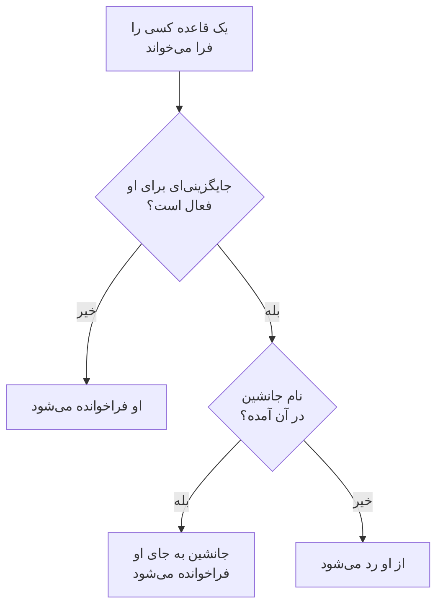

# جایگزینی‌های کاربر

تا وقتی کسی غایب است، یک جایگزینی کاربر برای مدتی مشخص فراخوانی‌هایی را که به او می‌رسیدند برای کسی می‌فرستد که جایش را پر می‌کند. اگر کسی برای جانشینی نام برده نشده باشد، به جای آن از او رد می‌شود: هر نوبت او در یک زمان‌بندی آنکال به نفر بعدی در چرخش می‌رسد. از آن برای تعطیلات، روز بیماری یا نوبتی که جابه‌جا شده استفاده کنید.

:::cards
- [جایگزینی چگونه یک فراخوانی را تغییر می‌دهد](#جایگزینی-چگونه-یک-فراخوانی-را-تغییر-میدهد): چه کسی به جای او فراخوانده می‌شود، و چه زمانی.
- [افزودن یک جایگزینی](#افزودن-یک-جایگزینی): چه کسی غایب است، چه کسی جایش را پر می‌کند، از کی و تا کی.
- [ویرایش یک جایگزینی](#ویرایش-یک-جایگزینی): تغییر اینکه چه کسی جایش را پر می‌کند، یا اینکه کی شروع و کی تمام می‌شود.
- [همهٔ سیاست‌ها، یا یکی](#همهٔ-سیاستها-یا-یکی): جایگزینی را کجا اضافه کنید، و کدام یک مقدم است.
- [راه‌های دیگر افزودن](#راههای-دیگر-افزودن): از یک زمان‌بندی، و از نوبت‌های پیش‌روی شما.
:::

## جایگزینی چگونه یک فراخوانی را تغییر می‌دهد



تا وقتی یک جایگزینی برقرار است، از آغاز تا پایانش:

- اگر کسی زیر **چه کسی جایگزین است؟** باشد، آن فرد همهٔ فراخوانی‌های فرد غایب را دریافت می‌کند، از هر زمان‌بندی، تیم و قاعده‌ای که جایگزینی برایش اعمال می‌شود. فراخوانی از راه راه‌های تماس با من خود جانشین به او می‌رسد.
- اگر کسی برای جانشینی نباشد، از آن فرد رد می‌شود. در یک زمان‌بندی آنکال، هر نوبت او به نفر بعدی در چرخش می‌رسد که غایب نیست؛ اگر همهٔ افراد یک لایه غایب باشند، لایه‌های زیر آن کار را به دست می‌گیرند. قاعده‌ای که نام او را مستقیماً یا از راه یک تیم می‌برد او را فرا نمی‌خواند، و اجرای سیاست می‌گوید که او غایب است، و تا کی.
- جایگزینی‌ها زنجیره نمی‌شوند. اگر جانشین هم غایب باشد، باز هم خود او برای فردی که جایش را پر می‌کند فراخوانده می‌شود.

وقتی جایگزینی تمام شود، فراخوانی‌ها دوباره مال خود آن فرد هستند. **خط زمانی زمان‌بندی‌ها**، لایه‌های یک زمان‌بندی و فیدهای تقویم همگی نشان می‌دهند هر نوبتی که جایش پر شده دست چه کسی است.

## افزودن یک جایگزینی

:::steps
### جایگزینی‌ها را باز کنید

برای پر کردن جای کسی در همهٔ سیاست‌های آنکال به **آنکال** > **پیشرفته** > **جایگزینی‌های کاربر** بروید، یا برای پر کردن جایش فقط در یک سیاست به صفحهٔ **جایگزینی‌های کاربر** خود آن سیاست، زیر **پیشرفته**، بروید. روی **افزودن جایگزینی کاربر** کلیک کنید.

### بگویید چه کسی غایب است

**چه کسی غایب است؟** با شما شروع می‌شود، چون ثبت مرخصی خودتان رایج‌ترین حالت است. برای ترتیب دادن جانشین برای کس دیگری، او را انتخاب کنید.

### بگویید چه کسی جایش را پر می‌کند

برای رد شدن از او، **چه کسی جایگزین است؟** را روی **نفر بعدی در چرخش** بگذارید، یا همکاری را انتخاب کنید که همهٔ فراخوانی‌هایش را بر عهده می‌گیرد. فرد غایب در گزینه‌ها نمی‌آید.

### زمان را تنظیم کنید

**شروع** همین حالا است، مگر اینکه زمان دیگری انتخاب کنید. **پایان** را روی زمانی بگذارید که او برمی‌گردد: باید پس از شروع باشد. روی **افزودن جایگزینی کاربر** کلیک کنید.
:::

هر جایگزینی یک ردیف است: **غایب**، **جایگزین**، **شروع** و **پایان**، که با شروع و پایانش فیلتر می‌شود. برای رد شدن، **جایگزین** عبارت **نفر بعدی در چرخش** را نشان می‌دهد.

## ویرایش یک جایگزینی

در ردیف یک جایگزینی روی **ویرایش** کلیک کنید، در هر یک از دو صفحهٔ **جایگزینی‌های کاربر**، یا در فهرست جایگزینی‌های کاربر در صفحهٔ **لایه‌ها** یک زمان‌بندی. فرم با جایگزینی، همان‌طور که ذخیره شده بود، باز می‌شود: آن را تغییر دهید و روی **ذخیره تغییرات** کلیک کنید.

- **چه کسی جایگزین است؟** تا وقتی جایگزینی تمام نشده تغییر می‌کند. برای اینکه به‌جای آن از فرد رد شوید، آن را به **نفر بعدی در چرخش** برگردانید.
- **شروع** تا وقتی جایگزینی شروع نشده جابه‌جا می‌شود و پس از آن همان‌طور می‌ماند. **پایان** تا وقتی جایگزینی تمام نشده جابه‌جا می‌شود: برای تمام کردن زودتر جایگزینی، آن را روی همین حالا بگذارید. هیچ‌کدام را نمی‌توان به گذشته برد.
- **چه کسی غایب است؟** تغییر نمی‌کند. برای کس دیگری یک جایگزینی تازه اضافه کنید.

جایگزینی‌ای که تمام شده دیگر تغییر نمی‌کند: **ویرایش** آن قفل است و دلیلش را می‌گوید.

## همهٔ سیاست‌ها، یا یکی

| کجا اضافه شده | کارت | برای چه اعمال می‌شود |
| --- | --- | --- |
| **آنکال** > **پیشرفته** > **جایگزینی‌های کاربر** | **جایگزینی‌های سراسری کاربر** | همهٔ سیاست‌های آنکال پروژه |
| **جایگزینی‌های کاربر** یک سیاست | **جایگزینی‌های کاربر در سیاست آنکال** | فقط همان سیاست |

دو جایگزینی برای یک فرد نمی‌توانند روی یک سیاست، یا وقتی هر دو سراسری‌اند، هم‌پوشانی داشته باشند. فرم به‌محض انتخاب زمان‌ها این را می‌گوید، همراه با **ویرایش آن جایگزینی** تا به‌جایش آن یکی را تغییر دهید. یکی می‌تواند درست وقتی تمام شود که بعدی شروع می‌شود.

جایگزینی خود یک سیاست می‌تواند با جایگزینی سراسری همان فرد هم‌پوشانی داشته باشد: روی آن سیاست، تا وقتی هر دو برقرارند، جایگزینی خود سیاست به کار می‌رود، و فرم این را می‌گوید. فراخوانی‌ای که بدون سیاست فرستاده می‌شود، از یک گردش کار یا از چت، فقط از جایگزینی‌های سراسری پیروی می‌کند.

جایگزینی‌هایی که پیش از این قاعده هم‌پوشانی داشتند همان‌طور می‌مانند. هر دو با **هم‌پوشانی** علامت می‌خورند که می‌گوید کدام به کار می‌رود: جایگزینی‌ای که نام جانشین را دارد پیش از رد شدن، سپس آنکه زودتر شروع می‌شود، سپس آنکه زودتر اضافه شده است.

## راه‌های دیگر افزودن

- از یک زمان‌بندی: در صفحهٔ **لایه‌ها** یک زمان‌بندی، یک لایه را باز کنید و کنار یک فرد روی **رد کردن تا…** کلیک کنید. همان فرم باز می‌شود، با آن فرد به‌عنوان غایب و چرخش به‌عنوان جانشین، به شکل یک جایگزینی سراسری. [وقتی کسی غایب است](/docs/on-call/schedules#وقتی-کسی-غایب-است) را ببینید.
- از نوبت‌های پیش‌روی شما: **گرفتن جانشین** روی یکی از نوبت‌هایتان، زیر **تنظیمات کاربر** > **تقویم** > **فید تقویم**، فرم را با شما به‌عنوان غایب برای زمان‌های آن نوبت باز می‌کند، پس فقط **چه کسی جایگزین است؟** باقی می‌ماند. [نوبت‌های پیش‌رو و جانشین](/docs/on-call/calendar-feeds#نوبتهای-پیشرو-و-جانشین) را ببینید.

وقتی کسی پروژه را ترک می‌کند، هر جایگزینی‌ای که نام او را دارد و هنوز تمام نشده، از هر دو سو، حذف می‌شود.

## چه کسی می‌تواند جایگزینی اضافه کند

**مالک پروژه**، **مدیر پروژه**، **عضو پروژه**، **مدیر آنکال** و **عضو آنکال** می‌توانند جایگزینی‌ها را اضافه، ویرایش و حذف کنند؛ **بیننده** و **بیننده آنکال** می‌توانند آن‌ها را ببینند. در یک نقش سفارشی، نام مجوزها **Create On-Call Policy User Override**، **Edit On-Call Policy User Override**، **Delete On-Call Policy User Override** و **Read On-Call Policy User Override** است. در **خط زمانی زمان‌بندی‌ها** فقط کسانی که می‌توانند جایگزینی‌ها را بخوانند می‌بینند نوبت چه کسی پر شده است.

جایگزینی روی یک سیاست از دامنهٔ همان سیاست پیروی می‌کند. به تیمی **عضو آنکال** محدود به سیاست‌هایی که مالکشان است، یا به برچسبش، بدهید تا اعضایش فقط روی همان سیاست‌ها جایگزینی اضافه، ویرایش و حذف کنند. یک جایگزینی سراسری روی همهٔ سیاست‌ها اعمال می‌شود، از جمله سیاست‌های تیمی دیگر، پس افزودن، ویرایش یا حذف آن به دسترسی جایگزینی روی کل پروژه نیاز دارد. با دسترسی‌ای محدودتر، **افزودن جایگزینی کاربر**، **ویرایش** و **حذف** در **آنکال** > **پیشرفته** > **جایگزینی‌های کاربر** قفل‌اند و دلیلش را می‌گویند. **رد کردن تا…** روی لایه‌های یک زمان‌بندی و **گرفتن جانشین** روی نوبت‌های پیش‌روی شما، که جایگزینی سراسری اضافه می‌کنند، به جای آن سیاست‌هایی را پیشنهاد می‌کنند که می‌توانید روی آن‌ها جایگزینی اضافه کنید، با یک جایگزینی برای هر سیاست، و جانشین در برنامهٔ موبایل هم همین‌طور است؛ جایی که روی هیچ‌کدام نمی‌توانید، قفل‌اند و دلیلش را می‌گویند. تیم جایگزینی‌هایش را در صفحهٔ **جایگزینی‌های کاربر** خود هر سیاست اضافه می‌کند. همین برای API هم صادق است: جایگزینی بدون `onCallDutyPolicyId` برای دسترسی‌ای که به برچسب‌ها یا سیاست‌های تحت مالکیت محدود است رد می‌شود.

در OneUptime Cloud، جایگزینی‌های کاربر به طرح **رشد** نیاز دارند.

## API

جایگزینی‌های کاربر منبع `/api/on-call-duty-policy-user-override` هستند:

| فیلد | چه چیزی در آن است |
| --- | --- |
| `overrideUserId` | فردی که غایب است. الزامی. |
| `routeAlertsToUserId` | فردی که جایش را پر می‌کند. برای رد شدن از آن فرد، آن را حذف کنید. |
| `startsAt`, `endsAt` | زمان شروع و پایان جایگزینی. هر دو الزامی‌اند، و پایان پس از شروع است. |
| `onCallDutyPolicyId` | سیاستی که جایگزینی برای آن است. برای جایگزینی سراسری آن را حذف کنید. |

```bash
curl -X POST https://oneuptime.com/api/on-call-duty-policy-user-override \
  -H "apikey: $ONEUPTIME_API_KEY" \
  -H "Content-Type: application/json" \
  -d '{
    "data": {
      "projectId": "<project-id>",
      "overrideUserId": "<away-user-id>",
      "routeAlertsToUserId": "<cover-user-id>",
      "startsAt": "2026-12-22T09:00:00Z",
      "endsAt": "2027-01-05T09:00:00Z"
    }
  }'
```

جایگزینی‌ای که فرد غایب و جانشینش یک نفر باشند رد می‌شود، و همین‌طور جایگزینی‌ای که پیش از شروعش تمام شود. همین‌طور جایگزینی‌ای که با جایگزینی دیگری برای همان فرد روی همان سیاست، یا وقتی هر دو سراسری‌اند، هم‌پوشانی دارد: پیام رد، جایگزینی‌ای را که با آن هم‌پوشانی دارد نام می‌برد.

برای تغییر یک جایگزینی، `PUT /api/on-call-duty-policy-user-override/<override-id>` را با فیلدهایی که تغییر می‌کنند در `data` بفرستید: `routeAlertsToUserId` (`null` برای اینکه به‌جای آن از فرد رد شوید)، `startsAt` و `endsAt`. `overrideUserId` و `onCallDutyPolicyId` تغییر نمی‌کنند. جایگزینی‌ای که تمام شده تغییر نمی‌کند، شروع جایگزینی‌ای که شروع شده هم همین‌طور، و زمانی را که تغییر می‌کند نمی‌توان به گذشته برد.

## عیب‌یابی

:::details فردی که در مرخصی بود باز هم فراخوانده شد
بررسی کنید جایگزینی کجا اضافه شده است. جایگزینی‌ای که در صفحهٔ **جایگزینی‌های کاربر** یک سیاست باشد فقط همان سیاست را پوشش می‌دهد، و سیاست‌های دیگر همچنان او را فرا می‌خوانند: برای پوشش همهٔ سیاست‌ها آن را زیر **آنکال** > **پیشرفته** > **جایگزینی‌های کاربر** اضافه کنید. **شروع** و **پایان** آن را هم بررسی کنید: زمان‌ها به منطقه زمانی شما نمایش داده می‌شوند.
:::

:::details جانشین هم فراخوانده نشد
او از راه راه‌های تماس با من و روش‌های تأییدشدهٔ خودش دریافت می‌کند. او را در **آنکال** > **آمادگی** پیدا کنید، و اجرا را در **گزارش اجراها** سیاست بررسی کنید.
:::

:::details نمی‌توانم جایگزینی اضافه کنم
افزودن آن به یکی از نقش‌های بالا نیاز دارد، و در OneUptime Cloud به طرح **رشد**. جایگزینی سراسری به آن نقش روی کل پروژه نیاز دارد: اگر نقش تیم شما به سیاست‌های خودش یا به چند برچسب محدود است، جایگزینی را در صفحهٔ **جایگزینی‌های کاربر** خود آن سیاست اضافه کنید. آن‌وقت **رد کردن تا…**، **گرفتن جانشین** و برنامهٔ موبایل فقط سیاست‌هایی را پیشنهاد می‌کنند که می‌توانید روی آن‌ها جایگزینی اضافه کنید، و جایی که روی هیچ‌کدام نمی‌توانید قفل‌اند.
:::

:::details یک جایگزینی ذخیره نمی‌شود، چون با جایگزینی دیگری هم‌پوشانی دارد
این فرد در بخشی از این زمان‌ها از قبل یک جایگزینی دارد: روی همان سیاست، یا یک جایگزینی سراسری وقتی این یکی هم سراسری است. برای اینکه به‌جایش آن یکی را تغییر دهید، زیر **پایان** روی **ویرایش آن جایگزینی** کلیک کنید، یا زمان‌هایی انتخاب کنید که با آن هم‌پوشانی نداشته باشند.
:::

## گام‌های بعدی

:::cards
- [زمان‌بندی‌های آنکال](/docs/on-call/schedules): چرخش‌ها، لایه‌ها، و رد شدن از کسی در یک لایه.
- [خط زمانی زمان‌بندی‌ها](/docs/on-call/schedule-timeline): هر نوبتی را که جایش پر شده در همهٔ زمان‌بندی‌ها ببینید.
- [فیدهای تقویم](/docs/on-call/calendar-feeds): برای یکی از نوبت‌های خودتان جانشین بگیرید.
:::
