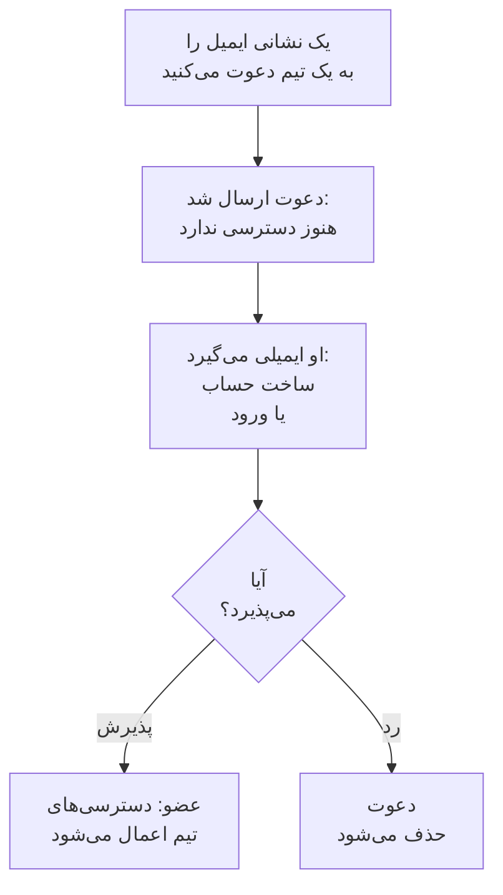

# دعوت از افراد

افراد از راه دعوت وارد یک پروژه می‌شوند. شما نشانی ایمیل یک نفر را به یک تیم دعوت می‌کنید، او می‌پذیرد، و از آن پس تیمش تعیین می‌کند که چه کاری می‌تواند انجام دهد. این صفحه نشان می‌دهد چگونه افراد را دعوت کنید، آن‌ها چه می‌بینند، و چگونه بعداً دسترسی‌شان را تغییر دهید یا به پایان برسانید.

:::cards
- [دعوت از یک نفر](#دعوت-از-یک-نفر): یک نشانی ایمیل و یک تیم.
- [پذیرفتن دعوت](#پذیرفتن-دعوت): آنچه فرد دعوت‌شده می‌بیند و انجام می‌دهد.
- [تغییر تیم‌های یک نفر](#تغییر-تیمهای-یک-نفر): دسترسی بیشتر یا کمتر بدهید.
- [حذف یک نفر](#حذف-یک-نفر-از-پروژه): ترک پروژه چه چیزهایی را با خود می‌برد.
:::

## دعوت چگونه کار می‌کند

- **تیم تعیین می‌کند که او چه کاری می‌تواند انجام دهد.** هیچ‌کس دسترسی شخصی ندارد: هر کس کاری را می‌تواند انجام دهد که تیم‌هایش اجازه می‌دهند. [کاربران، تیم‌ها و دسترسی‌ها](/docs/permissions/index) را ببینید.
- **تا وقتی نپذیرد، چیزی داده نمی‌شود.** دعوت در انتظار به‌صورت **دعوت ارسال شد** نمایش داده می‌شود و هیچ دسترسی‌ای به پروژه نمی‌دهد.
- **یک بار پذیرفتن برای کل پروژه کافی است.** وقتی دعوتی پذیرفته شود، همهٔ دعوت‌های دیگر آن فرد به همان پروژه هم پذیرفته می‌شوند. عضوی که بعداً به تیم دیگری اضافه می‌کنید، بی‌درنگ در آن تیم است و چیزی برای پذیرفتن ندارد.

## پیش از شروع

- **نقشی که بتواند دعوت کند.** Project Owner، Project Admin یا نقشی با دسترسی **Invite New Members**. فقط می‌توانید افراد را به تیمی دعوت کنید که دسترسی‌هایش را خودتان دارید، چون دعوت دسترسی آن تیم را به آن‌ها می‌دهد. Project Admin بدون هیچ مسدودسازی، در اینجا همه‌ی آنچه Project Admin از پیش می‌تواند انجام دهد را در اختیار دارد: می‌تواند افراد را به **Members** یا به تیمی با هر نقش محدودتری دعوت کند، اما نه به تیمی که Project Owner، یک مجوز صورتحساب، **Delete Project**، **Edit Project**، **Edit Team** یا **Invite New Members** دارد.
- **در OneUptime Cloud، جای خالی در طرح شما.** هر فرد در پروژه، از لحظه‌ای که دعوت می‌شود، یک نشست در صورت‌حساب است. طرح Free جای یک نفر را دارد. [صورت‌حساب و مصرف](/docs/configuration/billing#طرح-و-نشستهای-شما) را ببینید.
- **بدون SCIM Push Groups.** تا وقتی ارائه‌دهنده هویت شما تیم‌های پروژه را از راه SCIM Push Groups مدیریت می‌کند، افراد را همان‌جا دعوت و حذف می‌کنید، نه در OneUptime.

## دعوت از یک نفر

:::steps
### فهرست کاربران را باز کنید

به **محصولات** > **تنظیمات** > **کاربران** بروید. فهرست **کاربران** همهٔ افراد پروژه، تیم‌هایشان و اینکه پیوسته‌اند یا نه را نشان می‌دهد.

### پنجرهٔ دعوت را باز کنید

روی **دعوت کاربر** کلیک کنید. پنجرهٔ **دعوت کاربر جدید** باز می‌شود.

### نشانی ایمیل را وارد کنید

نشانی را در **ایمیل** بنویسید. اگر هنوز هیچ حساب OneUptime از آن استفاده نمی‌کند، پنجره یک **نام** هم می‌خواهد که حساب تازه با آن ساخته می‌شود.

### تیم را انتخاب کنید

**تیم** روی تیم اعضای پروژه قرار دارد: تیمی که Project Member را برای کل پروژه دارد، وگرنه تیمی که Members نام دارد. برای دسترسی بیشتر یا کمتر، تیم دیگری انتخاب کنید. وقتی پروژه چنین تیمی ندارد، یا خودتان نمی‌توانید کسی را به آن دعوت کنید، **تیم** خالی می‌ماند.

### دعوت را بفرستید

روی **دعوت** کلیک کنید. OneUptime دعوت را ایمیل می‌کند و صفحهٔ آن فرد را باز می‌کند. تا دعوت پذیرفته نشود، فرد به‌صورت **دعوت ارسال شد** نمایش داده می‌شود.
:::

> [!TIP]
> افراد را به کوچک‌ترین تیمی دعوت کنید که بگذارد کارشان را انجام دهند. بعداً می‌توانید آن‌ها را به تیم‌های بیشتری اضافه کنید، و هر تیمی که به آن می‌پیوندند، کارهایی را که می‌توانند انجام دهند بیشتر می‌کند.

## پذیرفتن دعوت

ایمیل دعوت نام پروژه را می‌آورد. دکمهٔ آن برای کسی که هنوز حساب OneUptime ندارد **Create Your Account** است، و برای کسی که دارد **Sign In to OneUptime**. پس از ورود، فرد در یکی از دو جا می‌پذیرد:

| فرد کجاست | چه می‌بیند | روی چه کلیک می‌کند |
| --- | --- | --- |
| هنوز در هیچ پروژه‌ای نیست | دعوت، روی صفحه‌ای که پس از ورود به آن می‌رسد | **Accept & Join** یا **Decline** |
| از قبل در پروژهٔ دیگری است | دعوت در انتظار روی زنگولهٔ بالا سمت راست، که **دعوت‌های پروژه** را باز می‌کند | **پذیرش** یا **رد کردن** |

پذیرفتن فرد را بی‌درنگ وارد پروژه می‌کند، با دسترسی‌های تیمش و تنظیمات اعلانی که هر عضو با آن شروع می‌کند: [آنچه از ابتدا دارید](/docs/notifications/index#آنچه-از-ابتدا-دارید) را ببینید. رد کردن دعوت را حذف می‌کند، پس برای پیوستن در آینده دعوت تازه‌ای لازم است.

## ببینید چه کسانی در پروژه هستند

**کاربران** برای هر فرد یک ردیف دارد:

| ستون | چه نشان می‌دهد |
| --- | --- |
| **کاربر** | نام و نشانی ایمیل. |
| **تیم‌ها** | هر تیمی از پروژه که فرد در آن است یا به آن دعوت شده است. |
| **وضعیت** | پس از پیوستن **عضو**، همراه با شمار دعوت‌هایی به تیم‌های دیگر که هنوز نپذیرفته است. تا آن زمان **دعوت ارسال شد**. |

فهرست را بر اساس **کاربر**، **وضعیت** یا **تیم** فیلتر کنید. برای باز کردن صفحهٔ فرد روی یک ردیف کلیک کنید:

| صفحه | کاربردش |
| --- | --- |
| **پروفایل** | نام، نشانی ایمیل، تصویر و شناسهٔ کاربری. |
| **تیم‌ها** | تیم‌هایی که فرد در آن‌هاست. یک تیم را اینجا اضافه یا حذف کنید. |
| **آمادگی**، **روش‌های اعلان**، **قواعد آنکال** | اینکه آیا می‌توان او را فراخواند، و چگونه. به Project Owner و Project Admin، خود فرد و هر کسی که می‌تواند قواعد اعلان دیگران را بخواند نشان داده می‌شود. [آمادگی و گزارش‌ها](/docs/on-call/readiness) را ببینید. |
| **فیلدهای سفارشی** | فیلدهای سفارشی پروژه برای افراد، اگر داشته باشد. |
| **حذف از پروژه** | فرد را از پروژه بیرون می‌برد. |

## تغییر تیم‌های یک نفر

:::steps
### صفحهٔ تیم‌های او را باز کنید

در **کاربران**، روی فرد و سپس روی **تیم‌ها** کلیک کنید.

### او را به یک تیم اضافه کنید

روی **دعوت** کلیک کنید، **تیم** را انتخاب کنید، و در پنجره روی **دعوت** کلیک کنید. عضو بی‌درنگ در تیم تازه است. کسی که هنوز نپیوسته یک دعوت دیگر می‌گیرد، و پذیرفتن هر یک از آن‌ها هر دو را می‌پذیرد.

### او را از یک تیم بیرون ببرید

در ردیف تیم روی **حذف** کلیک کنید. اگر این آخرین تیمی باشد که فرد به آن پیوسته، حذفش او را از پروژه بیرون می‌برد، و پنجره پیش از هر تغییری این را می‌گوید.
:::

تیم Owners همیشه دست‌کم یک عضو پیوسته را نگه می‌دارد، تا پروژه هرگز آخرین مالکش را از دست ندهد.

## حذف یک نفر از پروژه

در **کاربران**، منوی ردیف فرد، **⋯**، را باز کنید و روی **حذف از پروژه** کلیک کنید. یا فرد را باز کنید و در منوی کناری‌اش **حذف از پروژه** را انتخاب کنید. برای حذف چند نفر با هم، ردیف‌هایشان را انتخاب و انتخاب را حذف کنید: هر یک از آن‌ها به همان شیوه حذف می‌شود.

حذف یک نفر او را از همهٔ تیم‌های پروژه بیرون می‌برد. او بی‌درنگ دسترسی‌اش را از دست می‌دهد، حتی اگر وارد شده باشد، از برنامه‌های آنکال و قواعد تشدید پروژه کنار گذاشته می‌شود و دیگر اعلان‌های آن را دریافت نمی‌کند. حساب OneUptime او حذف نمی‌شود، و می‌توانید دوباره دعوتش کنید. [کاربران، تیم‌ها و دسترسی‌ها](/docs/permissions/index#کاربران) همهٔ آنچه را ترک پروژه با خود می‌برد فهرست می‌کند.

## راه‌های دیگر پیوستن

- **ورود یکپارچه.** کسی که برای نخستین بار با ارائه‌دهنده هویت پروژه وارد می‌شود، به تیم‌هایی می‌پیوندد که ارائه‌دهنده نام می‌برد. [نقش‌ها و تیم‌ها برای کاربران SSO](/docs/identity/sso#نقشها-و-تیمها-برای-کاربران-sso) را ببینید.
- **SCIM.** ارائه‌دهنده هویت شما افراد را می‌سازد و آن‌ها را به تیم‌های پیش‌فرض اتصال اضافه می‌کند. [SCIM](/docs/identity/scim#کاربر-پروژه-چگونه-تأمین-میشود) را ببینید.
- **Admin Dashboard.** در نصب خودمیزبان، مدیر اصلی می‌تواند کسی را به پروژه اضافه کند و دعوت را به جای او بپذیرد. [کاربران، تیم‌ها و دسترسی‌ها](/docs/permissions/index#کاربران) را ببینید.

## عیب‌یابی

:::details "This user has already been invited to this team"
او از قبل در آن تیم است، به‌عنوان عضو یا با دعوتی که نپذیرفته است. برای دیدن تیم‌هایش او را در **کاربران** باز کنید، یا او را به تیم دیگری دعوت کنید.
:::

:::details "You have reached the user limit for the free plan"
در OneUptime Cloud، پروژه‌ای با طرح Free جای یک نفر را دارد. طرح را تغییر دهید و دوباره دعوت کنید. [تغییر طرح](/docs/configuration/billing#تغییر-طرح) را ببینید.
:::

:::details "Too many invitations were sent to this email address in the last hour"
به یک نشانی در هر ساعت ۱۰ دعوت‌نامه می‌توان فرستاد، به پروژه‌ها و صفحه‌های وضعیت خصوصی با هم، هر که آن‌ها را بفرستد. یک ساعت صبر کنید، سپس دوباره دعوتشان کنید.
:::

:::details ایمیل دعوت نرسید، یا پیوندش منقضی شد
دعوت به ایمیل وابسته نیست. از فرد بخواهید با نشانی‌ای که دعوت کرده‌اید ثبت‌نام کند: OneUptime پیوند تازه‌ای برای تکمیل ساخت حساب به آن نشانی ایمیل می‌کند. کسی که از قبل حساب دارد، وارد می‌شود و دعوت را در انتظار خود می‌یابد.
:::

:::details دعوت کاربر می‌گوید کاربران با SCIM Push Groups مدیریت می‌شوند
ارائه‌دهنده هویت شما تیم‌های پروژه را مدیریت می‌کند. افراد را در ارائه‌دهنده هویت دعوت یا حذف کنید، یا برای مدیریت آن‌ها در اینجا، Push Groups را در **تنظیمات پروژه** > **امنیت** > **SCIM** خاموش کنید.
:::

## گام‌های بعدی

:::cards
- [کاربران، تیم‌ها و دسترسی‌ها](/docs/permissions/index): تعیین کنید هر تیم چه کاری می‌تواند انجام دهد.
- [تنظیمات پروژه](/docs/configuration/project-settings): هر آنچه برای کل پروژه اعمال می‌شود.
- [حساب کاربری شما](/docs/introduction/your-account): ورود، پروفایل و پروژه‌هایی که در آن‌ها هستید.
- [SCIM](/docs/identity/scim): بگذارید ارائه‌دهنده هویت شما افراد و تیم‌ها را مدیریت کند.
:::
