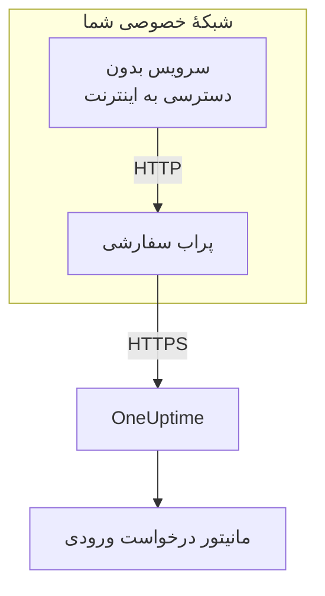

# ورودی درخواست‌های دریافتی

سرویسی که به اینترنت دسترسی ندارد هم می‌تواند به یک [مانیتور درخواست ورودی](/docs/monitor/incoming-request-monitor) ضربان بفرستد. آن‌ها را به‌جای OneUptime به یک [پراب سفارشی](/docs/probe/custom-probe) در شبکهٔ خودش می‌فرستد، و پراب آن‌ها را به OneUptime می‌رساند.

:::cards
- [چگونه کار می‌کند](#چگونه-کار-میکند): از سرویس شما، از راه پراب، تا مانیتور.
- [روشن کردن شنونده](#روشن-کردن-شنونده): یک تنظیم روی پراب، برای Docker، Docker Compose یا Kubernetes.
- [فرستادن درخواست به پراب](#فرستادن-درخواست-به-پراب): نشانی‌ای را که سرویس شما به آن می‌فرستد عوض کنید، و دیگر هیچ.
- [عیب‌یابی](#عیبیابی): وقتی درخواستی نمی‌رسد پراب چه چیزی ثبت می‌کند.
:::

## چگونه کار می‌کند



1. **سرویس شما درخواست را به پراب می‌فرستد.** همان `GET` یا `POST`، با همان کلید مخفی، که به OneUptime می‌فرستاد، به درگاهی که پراب به آن گوش می‌دهد.
2. **پراب بی‌درنگ پاسخ می‌دهد.** پیش از فرستادن درخواست به جلو، `200` برمی‌گرداند، پس سرویس شما هرگز منتظر OneUptime نمی‌ماند.
3. **پراب آن را جلو می‌فرستد.** درخواست را با متد، سرآیندها و بدنه‌اش به OneUptime می‌فرستد و یک سرآیند `OneUptime-Probe-Id` می‌افزاید که پراب را نام می‌برد.
4. **OneUptime آن را مثل همیشه می‌خواند.** معیارهای مانیتور درخواست را طوری می‌بینند که گویی سرویس مستقیم فرستاده است.

شنونده روی درگاه جداگانهٔ خودش اجرا می‌شود، جدا از بررسی‌های سلامت پراب، پس می‌توانید آن را برای شبکهٔ خصوصی خود باز کنید بی‌آنکه چیز دیگری را باز کنید.

## چه زمانی از آن استفاده کنید

از شنونده استفاده کنید وقتی:

- سرویس‌های شما در یک بخش شبکهٔ جدا بدون دسترسی HTTPS خروجی اجرا می‌شوند
- باید همهٔ ترافیک پایش را درون VPC یا شبکهٔ داخلی خود نگه دارید
- یک نقطهٔ خروج واحد می‌خواهید، یعنی پراب، که اجازهٔ رسیدن به OneUptime را دارد
- از پیش یک [پراب سفارشی](/docs/probe/custom-probe) راه انداخته‌اید و می‌خواهید آن را برای ضربان‌های ورودی هم به کار ببرید

اگر سرویس‌های شما از پیش مستقیم به `https://oneuptime.com` (یا نشانی خودمیزبان شما) می‌رسند، به این قابلیت **نیازی ندارید**: نشانی ضربان را مستقیم از سرویس صدا بزنید.

## پیش از شروع

- **یک پراب سفارشی در حال اجرا.** **وضعیت** آن **متصل** نشان می‌دهد. برای نصب یکی، [پراب‌های سفارشی](/docs/probe/custom-probe) را ببینید.
- **یک مانیتور درخواست ورودی.** نشانی ضربانش کلید مخفی‌ای را که سرویس شما می‌فرستد در بر دارد: [مانیتور درخواست ورودی](/docs/monitor/incoming-request-monitor) را ببینید.
- **درگاهی روی میزبان پراب که سرویس‌های شما به آن می‌رسند.** نمونه‌ها از `3875` استفاده می‌کنند.

## روشن کردن شنونده

`PROBE_INGRESS_PORT` را روی درگاهی بگذارید که شنونده باید به کار ببرد. هر مقدار بزرگ‌تر از `0` آن را روشن می‌کند؛ تنظیم‌نشده، یا `0`، آن را خاموش نگه می‌دارد.

:::tabs
@tab Docker
```bash
docker run --name oneuptime-probe --network host \
  -e PROBE_KEY=<probe-key> \
  -e PROBE_ID=<probe-id> \
  -e ONEUPTIME_URL=https://oneuptime.com \
  -e PROBE_INGRESS_PORT=3875 \
  -d oneuptime/probe:release
```

بدون `--network host`، درگاه را با `-p 3875:3875` منتشر کنید.
@tab Docker Compose
```yaml title="docker-compose.yml"
services:
  oneuptime-probe:
    image: oneuptime/probe:release
    container_name: oneuptime-probe
    environment:
      - PROBE_KEY=<probe-key>
      - PROBE_ID=<probe-id>
      - ONEUPTIME_URL=https://oneuptime.com
      - PROBE_INGRESS_PORT=3875
    network_mode: host
    restart: always
```

بدون `network_mode: host`، درگاه را زیر `ports:` به شکل `"3875:3875"` منتشر کنید.
@tab Kubernetes
```yaml title="oneuptime-probe.yaml"
apiVersion: apps/v1
kind: Deployment
metadata:
  name: oneuptime-probe
spec:
  selector:
    matchLabels:
      app: oneuptime-probe
  template:
    metadata:
      labels:
        app: oneuptime-probe
    spec:
      containers:
        - name: oneuptime-probe
          image: oneuptime/probe:release
          env:
            - name: PROBE_KEY
              value: "<probe-key>"
            - name: PROBE_ID
              value: "<probe-id>"
            - name: ONEUPTIME_URL
              value: "https://oneuptime.com"
            - name: PROBE_INGRESS_PORT
              value: "3875"
          ports:
            - name: ingress
              containerPort: 3875
---
apiVersion: v1
kind: Service
metadata:
  name: oneuptime-probe-ingress
spec:
  selector:
    app: oneuptime-probe
  ports:
    - name: ingress
      port: 3875
      targetPort: 3875
  type: ClusterIP
```

سپس سرویس‌های درون کلاستر به `http://oneuptime-probe-ingress.<namespace>.svc.cluster.local:3875/heartbeat/<secret-key>` می‌فرستند.
:::

وقتی شنونده بالا آمد، لاگ پراب می‌گوید `Probe ingress listener started on port 3875 (heartbeat / incoming-request endpoints)`.

## فرستادن درخواست به پراب

سرویس شما به‌جای OneUptime به پراب می‌فرستد. نشانی عمومی ضربان:

```text
https://oneuptime.com/heartbeat/<secret-key>
```

را با نشانی ورودی پراب جایگزین کنید:

```text
http://<probe-host>:<PROBE_INGRESS_PORT>/heartbeat/<secret-key>
```

مسیر، متد، بدنه و سرآیندها در بقیهٔ موارد یکسان‌اند، پس هر کد کلاینت موجود فقط باید نشانی پایه را تغییر دهد. پراب `/incoming-request/<secret-key>` را هم می‌پذیرد، که به همان شکل کار می‌کند.

```bash
# GET heartbeat
curl http://probe.internal:3875/heartbeat/YOUR_SECRET_KEY

# POST heartbeat with JSON body
curl -X POST http://probe.internal:3875/heartbeat/YOUR_SECRET_KEY \
  -H "Content-Type: application/json" \
  -d '{"status": "healthy", "version": "1.2.3"}'

# Cron job
*/5 * * * * curl -s http://probe.internal:3875/heartbeat/YOUR_SECRET_KEY > /dev/null
```

## درخواست‌ها چگونه جلو فرستاده می‌شوند

| چه | پراب چگونه با آن برخورد می‌کند |
| --- | --- |
| پاسخ | `200` با یک شیء JSON خالی (`{}`)، که پیش از جلو فرستادن درخواست ارسال می‌شود. مثل OneUptime، هر چه پس از آن پیش بیاید فرستاده می‌شود: یک کلید مخفی نادرست هم آن را می‌گیرد. |
| متدها | `POST` به‌صورت `POST` جلو فرستاده می‌شود. `GET`، و `HEAD`، به‌صورت `GET` جلو فرستاده می‌شوند. متدهای دیگر از پراب `404` می‌گیرند. |
| سرآیندها | همهٔ آن‌ها جز سرآیندهای hop-by-hop (`Host`، `Connection`، `Content-Length`، `Transfer-Encoding`، `Keep-Alive`، `Proxy-Authenticate`، `Proxy-Authorization`، `TE`، `Trailer`، `Upgrade`). پراب `OneUptime-Probe-Id` را می‌افزاید. |
| بدنه | بدنه‌های JSON و فرم تا ۵۰ مگابایت، همان‌طور که وقتی مستقیم به OneUptime می‌فرستید. مثل آنجا، هر بدنهٔ دیگری خالی به مانیتور می‌رسد. |
| تلاش دوباره | وقتی جلو فرستادن شکست بخورد، پراب تا `PROBE_INGRESS_FORWARD_RETRY_LIMIT` بار دوباره تلاش می‌کند و ۲ ثانیه، سپس ۴ ثانیه، سپس ۸ ثانیه صبر می‌کند، و هرگز بیش از ۱۵ ثانیه نه. سپس شکست را ثبت می‌کند و درخواست را کنار می‌گذارد. |
| پراکسی‌ها | وقتی `HTTP_PROXY_URL` یا `HTTPS_PROXY_URL` تنظیم شده باشد، جلو فرستادن از پراکسی پراب می‌گذرد. |
| به کجا می‌رود | `ONEUPTIME_URL` و پس از آن `/incoming-request-ingest/incoming-request/<secret-key>`. |

## متغیرهای محیطی

| متغیر | پیش‌فرض | چه می‌کند |
| --- | --- | --- |
| `PROBE_INGRESS_PORT` | تنظیم‌نشده (خاموش) | درگاهی که شنونده به کار می‌برد. هر مقدار بزرگ‌تر از `0` آن را روشن می‌کند. |
| `PROBE_INGRESS_FORWARD_TIMEOUT_MS` | `10000` | هر بار جلو فرستادن به OneUptime چقدر می‌تواند طول بکشد، به میلی‌ثانیه. مقداری کمتر از `1000` به پیش‌فرض برمی‌گردد. |
| `PROBE_INGRESS_FORWARD_RETRY_LIMIT` | `3` | جلو فرستادن ناموفق چند بار دوباره تلاش می‌شود. `0` تلاش دوباره را خاموش می‌کند. |

متغیرهای معمول پراب (`PROBE_KEY`، `PROBE_ID`، `ONEUPTIME_URL` و متغیرهای پراکسی) همگی اعمال می‌شوند: برای فهرست کامل [پراب‌های سفارشی](/docs/probe/custom-probe) را ببینید.

## ملاحظات امنیتی

- **این نقطهٔ پایانی عمداً بدون احراز هویت است**: کلید مخفی در مسیر نشانی *خودش* احراز هویت است، درست مانند نقطهٔ پایانی عمومی `oneuptime.com`. با کلید مخفی مثل یک گذرواژه رفتار کنید.
- **شنونده را در شبکهٔ خصوصی خود نگه دارید.** نباید از اینترنت در دسترس باشد. با یک خط‌مشی شبکه، یک قاعدهٔ فایروال یا یک سرویس `ClusterIP` محدود کنید چه کسی به آن می‌رسد.
- **اگر درون شبکه به رمزگذاری نیاز دارید، TLS را جلوی آن بگذارید.** شنونده HTTP ساده صحبت می‌کند. برای TLS روی این بخش، آن را پشت یک متعادل‌کنندهٔ بار داخلی یا یک ingress controller بگذارید. جلو فرستادن از پراب به OneUptime وقتی `ONEUPTIME_URL` با `https://` آغاز شود از HTTPS استفاده می‌کند.
- **اگر ۵۰ مگابایت زیاد است، اندازهٔ بدنه را خودتان محدود کنید.** یک پراکسی معکوس با سقف پایین‌تر جلوی شنونده بگذارید.

## عیب‌یابی

:::details لاگ پراب هرگز نمی‌گوید شنونده راه افتاده است
`PROBE_INGRESS_PORT` تنظیم‌نشده، `0` یا غیرعددی است. آن را روی یک شمارهٔ درگاه بگذارید و پراب را دوباره راه‌اندازی کنید. خط لاگ این است: `Probe ingress listener started on port <port> (heartbeat / incoming-request endpoints)`.
:::

:::details پراب `Probe ingress: failed to forward to <url> after N attempts` را ثبت می‌کند
پراب حتی پس از تلاش‌های دوباره‌اش نتوانست به OneUptime برسد. اتصال خروجی پراب، تنظیمات پراکسی‌اش و مقدار `ONEUPTIME_URL` را بررسی کنید. اگر پراب **قطع‌شده** هم نشان می‌دهد، [پراب‌های سفارشی](/docs/probe/custom-probe) را ببینید تا پیدا کنید درخواست‌هایش کجا متوقف می‌شوند.
:::

:::details پراب `Probe ingress: probe ID not available, forwarding without it` را ثبت می‌کند
پراب هنوز اتصالش به OneUptime را تمام نکرده، پس درخواست را بدون سرآیند `OneUptime-Probe-Id` جلو می‌فرستد. درخواست همچنان به مانیتور می‌رسد.
:::

:::details مانیتور درخواست‌ها را می‌گیرد، اما نه از راه پراب
سرویس شما هنوز به نشانی عمومی می‌فرستد. بررسی کنید که به `http://<probe-host>:<port>/...` بفرستد: یک نام DNS یا یک ورودی `/etc/hosts` که به جای دیگری اشاره می‌کند علت معمول است.
:::

:::details مانیتور هیچ چیز نمی‌گیرد، و پراب هیچ چیز ثبت نمی‌کند
درخواست هرگز به پراب نرسید. بررسی کنید که سرویس روی آن درگاه به میزبان پراب برسد: یک قاعدهٔ فایروال، درگاهی که منتشر نشده، یا یک Service در Kubernetes که پاد پراب را انتخاب نمی‌کند.
:::

## گام‌های بعدی

:::cards
- [مانیتور درخواست ورودی](/docs/monitor/incoming-request-monitor): تعیین کنید چه ضربانی سالم به شمار می‌آید.
- [پراب‌های سفارشی](/docs/probe/custom-probe): پراب را نصب کنید، و هر تنظیمی را که می‌خواند ببینید.
:::
