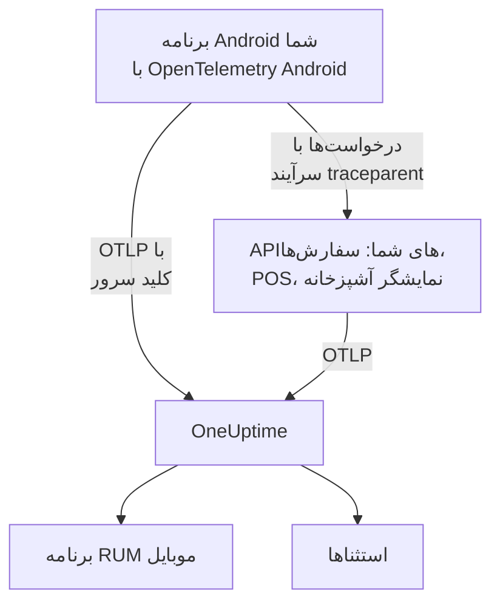

# راه‌اندازی اندروید

یک برنامه بومی Android را با OpenTelemetry Android ابزارگذاری کنید تا به‌عنوان برنامه RUM موبایل به OneUptime گزارش دهد: کرش‌ها و ANRهایش، فریم‌های کند و یخ‌زده، شروع‌های برنامه، صفحه‌ها، نشست‌ها و درخواست‌های شبکه‌اش، که تا بک‌اند شما ردیابی می‌شوند.

:::cards
- [OpenTelemetry Android را بیفزایید](#opentelemetry-android-را-بیفزایید): یک وابستگی Gradle، و چند خط هنگام شروع برنامه.
- [چه چیزهایی گزارش می‌دهد](#چه-چیزهایی-گزارش-میدهد): کرش‌ها، ANRها، فریم‌های یخ‌زده، شروع‌ها و نشست‌ها، و اینکه هر کدام کجا می‌رسد.
- [درخواست‌ها را تا بک‌اندتان ردیابی کنید](#درخواستها-را-تا-بکاندتان-ردیابی-کنید): یک اسپن برای هر فراخوانی OkHttp، و یک `traceparent` روی آن.
- [گردش‌کارهای خودتان را ردیابی کنید](#گردشکارهای-خودتان-را-ردیابی-کنید): سفارشی از منو تا آشپزخانه، یک پایانه پرداخت، یک چاپگر.
- [کیوسک‌ها و دیگر دستگاه‌های خودتان](#کیوسکها-و-دیگر-دستگاههای-خودتان): برای هر دستگاه نامی بگذارید، آن را از MDM خود پیکربندی کنید، و داده را در حالت آفلاین نگه دارید.
:::

## چگونه کار می‌کند

OpenTelemetry Android درون برنامه شما اجرا می‌شود. ردیابی‌ها، لاگ‌ها و متریک‌ها را با کلید دریافت داده **سرور** از راه OTLP به OneUptime می‌فرستد، و به درخواست‌هایی که برنامه‌تان می‌فرستد سرآیند `traceparent` استاندارد W3C را می‌افزاید تا اسپن‌های بک‌اند شما به ردیابی‌های برنامه بپیوندند.



## پیش از شروع

- یک برنامه Android که `minSdk` آن 23 یا بالاتر است و با `compileSdk` 34 یا بالاتر ساخته می‌شود. با `minSdk` پایین‌تر از 26، [desugaring کتابخانه‌های هسته](https://developer.android.com/studio/write/java8-support#library-desugaring) را روشن کنید، با Android Gradle Plugin 8.3.0 یا جدیدتر و `android.useFullClasspathForDexingTransform=true` در `gradle.properties`.
- یک کلید دریافت داده **سرور** که در **تنظیمات پروژه** > **تله‌متری و APM** > **کلیدهای دریافت داده** با **ساخت کلید دریافت داده** ساخته شده باشد. کلید **مرورگر** از برنامه رد می‌شود: با سرآیند `Origin` بررسی می‌شود که برنامه آن را نمی‌فرستد.
- این تنظیم‌های OTLP. اگر OneUptime را خودتان میزبانی می‌کنید، `https://oneuptime.com` را با میزبان خودتان جایگزین کنید.

| تنظیم | مقدار |
| --- | --- |
| نقطه پایانی OTLP | `https://oneuptime.com/otlp` |
| سرآیند | `x-oneuptime-token: YOUR_TELEMETRY_INGESTION_TOKEN` |

> [!WARNING]
> کلید درون برنامه‌تان منتشر می‌شود و برنامه را می‌توان باز کرد، پس فرض کنید کسی آن را کپی می‌کند. در صفحه کلید، **نام سرویس سنجاق‌شده**، **محدودیت درخواست در دقیقه** و تاریخی در **تاریخ انقضا** تنظیم کنید، و کلید را با هر انتشار عوض کنید.

## OpenTelemetry Android را بیفزایید

:::steps
### وابستگی را بیفزایید

```kotlin title="app/build.gradle.kts"
dependencies {
    implementation("io.opentelemetry.android:android-agent:1.8.1")
}
```

عامل، ابزارگذاری کرش، ANR، رندر کند، اکتیویتی، فرگمنت، شبکه و نشست را با خود می‌آورد. برای نسخه‌ای جدیدتر، [انتشارهای آن](https://github.com/open-telemetry/opentelemetry-android/releases) را ببینید.

### آن را هنگام شروع برنامه راه بیندازید

```kotlin title="KioskApplication.kt"
import android.app.Application
import io.opentelemetry.android.OpenTelemetryRum
import io.opentelemetry.android.agent.OpenTelemetryRumInitializer

class KioskApplication : Application() {
    lateinit var otelRum: OpenTelemetryRum

    override fun onCreate() {
        super.onCreate()

        otelRum = OpenTelemetryRumInitializer.initialize(this) {
            httpExport {
                baseUrl = "https://oneuptime.com/otlp"
                baseHeaders = mapOf("x-oneuptime-token" to BuildConfig.ONEUPTIME_TOKEN)
            }
            resource {
                put("service.name", "kiosk-ordering")
                put("deployment.environment.name", "production")
            }
        }
    }
}
```

`baseUrl` نقطه پایانی بدون سیگنال است: عامل خودش `/v1/traces`، `/v1/logs` و `/v1/metrics` را به آن می‌افزاید. `service.name` را تنظیم کنید، وگرنه برنامه به نام برچسبش در لانچر نامیده می‌شود. این هویت برنامه در OneUptime است، پس آن را از انتشاری به انتشار دیگر یکسان نگه دارید.

کلاس را در `android:name` عنصر `<application>` مانیفست خود نام ببرید. `BuildConfig.ONEUPTIME_TOKEN` نماینده هر جایی است که بیلد شما کلید را در آن نگه می‌دارد؛ یک ناوگان می‌تواند به‌جای آن، کلید را از MDM خود بگیرد، همان‌طور که [کیوسک‌ها و دیگر دستگاه‌های خودتان](#کیوسکها-و-دیگر-دستگاههای-خودتان) نشان می‌دهد.

### برنامه را اجرا کنید و بررسی کنید که داده می‌رسد

```bash
curl -i https://oneuptime.com/otlp/v1/validate \
  -H "x-oneuptime-token: YOUR_TELEMETRY_INGESTION_TOKEN"
```

`200` همراه `"valid": true` یعنی کلید پذیرفته شده است. سپس برنامه را اجرا کنید و کمی با آن کار کنید: به نام `service.name` خودش زیر **محصولات** > **منابع** > **پایش کاربر واقعی** پدیدار می‌شود. عامل تله‌متری را پیش از فرستادن روی دیسک می‌نویسد، پس ممکن است رسیدن نخستین دسته یک دقیقه طول بکشد.
:::

## چه چیزهایی گزارش می‌دهد

OpenTelemetry Android همه این‌ها را خودش ثبت می‌کند. ویژگی‌های دستگاهی که تنظیم می‌کند، یعنی `device.model.identifier`، `device.model.name` و `device.manufacturer`، برنامه را به‌عنوان برنامه RUM موبایل ثبت می‌کنند و صفحه **کلاینت‌ها** آن را پر می‌کنند. همچنین `os.name`، `os.version` و یک `app.installation.id` برای هر نصب تنظیم می‌کند، و `device.id` را تنظیم نمی‌کند.

| چه چیزی | عامل چگونه آن را می‌فرستد | کجای OneUptime دیده می‌شود |
| --- | --- | --- |
| کرش‌ها | رویداد `app.crash` با نوع، پیام و ردیابی پشته استثنا | **استثناها**، به‌عنوان مدیریت‌نشده |
| ANRها | رویداد `device.anr` با پشته رشته اصلی، وقتی برنامه حدود 5 ثانیه پاسخ ندهد | **استثناها**، به‌عنوان مدیریت‌نشده، با نوع `ANR` |
| فریم‌های کند و یخ‌زده | رویداد `app.jank` با `app.jank.frame_count`، یعنی شمار فریم‌هایی که کندتر از 16 میلی‌ثانیه (`app.jank.threshold` برابر `0.016` است) یا 700 میلی‌ثانیه (`0.7`) بوده‌اند | **لاگ‌ها**، با `@event.name:app.jank` |
| شروع برنامه | اسپن `AppStart`، با `start.type` برابر `cold`، `warm` یا `hot` | **ترِیس‌ها** |
| صفحه‌ها | یک اسپن برای هر مرحله از چرخه عمر یک اکتیویتی یا فرگمنت، و `app.screen.name` روی هر اسپن و لاگ | **ترِیس‌ها** |
| نشست‌ها | `session.id` روی هر اسپن و لاگ، و رویدادهای `session.start` و `session.end` | **ترِیس‌ها** و **لاگ‌ها**، با جست‌وجوی `@session.id:` |
| تغییرهای شبکه | رویداد `network.change`، و `network.connection.type` روی هر اسپن و لاگ | **لاگ‌ها** |

کرش‌ها و ANRها به‌عنوان مدیریت‌نشده به **استثناها** می‌رسند، بر اساس ردیابی‌های پشته‌شان گروه‌بندی می‌شوند و نشستی که در آن رخ داده‌اند همراهشان است. عامل کرش را هنگام از کار افتادن برنامه روی دیسک ذخیره می‌کند و از همان‌جا می‌فرستد، پس کرشی که در حالت آفلاین رخ دهد باز هم می‌رسد، همین که برنامه دوباره با شبکه اجرا شود.

نشست پس از ۱۵ دقیقه در پس‌زمینه، یا پس از ۴ ساعت پایان می‌یابد. برنامه‌ای که هرگز به پس‌زمینه نمی‌رود، مانند یک کیوسک، یک نشست را ۴ ساعت نگه می‌دارد، پس بازدید هر مشتری را به‌صورت اسپنی جداگانه ردیابی کنید، همان‌طور که [گردش‌کارهای خودتان را ردیابی کنید](#گردشکارهای-خودتان-را-ردیابی-کنید) نشان می‌دهد.

فراخوانی‌های `android.util.Log` خود برنامه‌تان هم وقتی `android-log-library` و `android-log-agent` را کنار ماژول‌های OkHttp زیر بیفزایید لاگ می‌شوند: برچسب هر فراخوانی در `android.log.tag` قرار می‌گیرد، و فراخوانی‌ای که throwable دارد استثنایی در **استثناها** می‌شود. OpenTelemetry Android چیزی از Logcat نمی‌خواند.

## درخواست‌ها را تا بک‌اندتان ردیابی کنید

ابزارگذاری OkHttp و افزونه ByteBuddy را که با آن ساخته می‌شود بیفزایید:

```kotlin title="app/build.gradle.kts"
plugins {
    // ...the plugins your app already applies, then:
    id("net.bytebuddy.byte-buddy-gradle-plugin") version "1.18.15"
}

dependencies {
    implementation("io.opentelemetry.android:android-agent:1.8.1")
    implementation("io.opentelemetry.android.instrumentation:okhttp3-library:1.8.1-alpha")
    byteBuddy("io.opentelemetry.android.instrumentation:okhttp3-agent:1.8.1-alpha")
}
```

این افزونه خود کلاس `OkHttpClient` را ابزارگذاری می‌کند، پس هر کلاینتی در برنامه ردیابی می‌شود، حتی آن‌هایی که کتابخانه‌ها می‌سازند. هر درخواست یک اسپن کلاینت می‌شود که به نام متدش نام‌گذاری شده است، با URL، کد وضعیت و مدت آن، و سرآیند `traceparent` استاندارد W3C را با خود می‌برد. بک‌اندی که با [OpenTelemetry](/docs/telemetry/open-telemetry) ابزارگذاری شده، ردیابی را از همان سرآیند ادامه می‌دهد، پس API سفارش، پل POS و سرویس نمایشگر آشپزخانه اسپن‌هایشان را به همان ردیابیِ لمس روی کیوسک می‌افزایند.

- `HttpURLConnection` همین جفت ماژول را دارد: `httpurlconnection-library` و `httpurlconnection-agent`.
- بدون افزونه، کلاینت را خودتان بپیچید: `OkHttpTelemetry.builder(otelRum.openTelemetry).build().createCallFactory(client)`، از `io.opentelemetry.instrumentation:opentelemetry-okhttp-3.0`.
- اسپنی که در کد شما باز شود، مانند بخش بعدی، والد درخواست‌هایی است که درون آن انجام می‌شوند.

## گردش‌کارهای خودتان را ردیابی کنید

از عامل یک ردیاب بگیرید و برای سفارش یک مشتری یک اسپن بسازید، با یک اسپن فرزند برای هر گام آن. آن‌وقت هر گام مدت و خطاهای خودش را دارد، و سفارش می‌گوید چگونه پایان یافت:

```kotlin title="OrderTrace.kt"
import io.opentelemetry.api.trace.Span
import io.opentelemetry.api.trace.StatusCode
import io.opentelemetry.api.trace.Tracer
import io.opentelemetry.context.Context

class OrderTrace(private val tracer: Tracer) {
    // order.session: from the first tap to the order reaching the kitchen.
    private val order: Span = tracer.spanBuilder("order.session").startSpan()
    private val parent: Context = Context.current().with(order)

    // One step: menu.browse, cart.customize, payment.process, pos.inject.
    fun <T> step(name: String, block: (Span) -> T): T {
        val span = tracer.spanBuilder(name).setParent(parent).startSpan()
        return try {
            span.makeCurrent().use { block(span) }
        } catch (error: Throwable) {
            span.recordException(error)
            span.setStatus(StatusCode.ERROR)
            throw error
        } finally {
            span.end()
        }
    }

    fun complete() = finish("completed")

    fun abandon(reason: String) {
        order.setAttribute("order.abandon_reason", reason)
        finish("abandoned")
    }

    private fun finish(outcome: String) {
        order.setAttribute("order.outcome", outcome)
        order.end()
    }
}
```

```kotlin title="CheckoutFlow.kt"
val order = OrderTrace(otelRum.openTelemetry.getTracer("kiosk.ordering"))

order.step("cart.customize") { span ->
    span.setAttribute("cart.items", cart.size.toLong())
}
order.step("payment.process") { terminal.charge(cart.total) }
order.step("pos.inject") { posApi.submit(cart) } // its OkHttp span is a child
order.complete()
```

هر فراخوانی به SDK یک پایانه پرداخت، چاپگر، اسکنر یا کارت‌خوان NFC را به همین شکل بپیچید و بگویید کدام دستگاه بوده است، تا دستگاهی کند یا معیوب به اسپنی کند یا ناموفق تبدیل شود:

```kotlin title="ReceiptPrinter.kt"
order.step("printer.print") { span ->
    span.setAttribute("peripheral.type", "printer")
    span.setAttribute("peripheral.model", printer.model)
    span.setAttribute("peripheral.connection", "usb")
    printer.print(receipt, timeoutMillis = 10_000)
}
```

نام ویژگی‌ها را خودتان انتخاب می‌کنید: آن‌ها را در همه برنامه‌ها یکسان نگه دارید تا یک فیلتر همه چاپگرها را پیدا کند. برای هر فراخوانی یک مهلت زمانی بگذارید، چون اسپن فقط وقتی پایان می‌یابد که فراخوانی‌اش برگردد. گامی که چند صفحه را در بر می‌گیرد، مانند مرور منو، اسپنی است که هنگام باز شدن صفحه آغازش می‌کنید و هنگام بسته شدنش پایانش می‌دهید، با همان والد. برای واقعیتی بی‌مدت، مانند تمام شدن کاغذ چاپگر، یک رویداد بفرستید: `otelRum.emitEvent("printer.paper_low")`.

در **ترِیس‌ها**، بر نام یک گام فیلتر کنید تا ببینید چقدر طول می‌کشد و چند وقت یک بار شکست می‌خورد، و بر `@order.outcome:abandoned` تا سفارش‌هایی را بیابید که هرگز تمام نشدند.

## کیوسک‌ها و دیگر دستگاه‌های خودتان

### برای هر دستگاه نامی بگذارید

OneUptime برنامه موبایل را بر اساس برنامه ثبت می‌کند، هرگز بر اساس دستگاه، پس برنامه‌ای که روی هزاران گوشی است هرگز گوشی‌های کاربرانش را فهرست نمی‌کند. برای دستگاه‌هایی که مال خودتان است، هر کدام را در `host.name` نام‌گذاری کنید. آن‌وقت هر دستگاه به‌عنوان یک میزبان در **موجودی** پدیدار می‌شود، کنار دیگر ماشین‌هایتان، با سازنده، مدل و نسخه سیستم‌عاملی که عامل گزارش می‌دهد، آنچه در زیر می‌افزایید و زمانی که آخرین بار دیده شده است:

```kotlin title="KioskApplication.kt"
resource {
    put("service.name", "kiosk-ordering")
    put("host.name", deviceName)
    put("host.serial_number", serialNumber)
    put("device.type", "kiosk")
    put("device.location", "Store 0412")
}
```

تله‌متری برنامه نزد برنامه RUM آن می‌ماند، و دستگاه در **میزبان‌ها** به میزبان تبدیل نمی‌شود: برنامه هیچ متریک میزبانی گزارش نمی‌دهد، پس چیزی برای نمایش در آنجا نمی‌ماند. صفحه دستگاه در **موجودی** لاگ‌ها، ردیابی‌ها و استثناهای خود آن را نشان می‌دهد، و `@resource.host.name:` آن‌ها را در **ترِیس‌ها** و **لاگ‌ها** پیدا می‌کند. دستگاهی که ۳۰ روز چیزی نفرستد از **موجودی** بیرون می‌رود.

### ناوگان را از MDM خود پیکربندی کنید

برنامه می‌تواند پیکربندی‌های مدیریت‌شده Android را بخواند، که هر سرویس مدیریت دستگاه به دستگاه‌هایش می‌فرستد. کلید و نام دستگاه را به‌جای ساختن آن‌ها درون برنامه، از همین پیکربندی‌ها بخوانید:

```kotlin title="KioskApplication.kt"
import android.content.RestrictionsManager

val restrictions = (getSystemService(RESTRICTIONS_SERVICE) as RestrictionsManager)
    .applicationRestrictions
val token = restrictions.getString("oneuptime_token").orEmpty()
val deviceName = restrictions.getString("device_name") ?: android.os.Build.MODEL
val serialNumber = restrictions.getString("device_serial").orEmpty()
```

سپس `token` را به‌جای `BuildConfig.ONEUPTIME_TOKEN` به `baseHeaders` بدهید، و `deviceName` و `serialNumber` را به منبع بالا. در Esper، پیکربندی زیر را زیر **Managed Configuration** برنامه در یک blueprint بچسبانید. Esper جای‌نگهدارها را روی هر دستگاه پر می‌کند، با Esper Agent 8.00.0764 یا جدیدتر:

```json title="Managed configuration"
{
  "oneuptime_token": "YOUR_TELEMETRY_INGESTION_TOKEN",
  "device_name": "${esper.deviceName}",
  "device_serial": "${esper.serialNumber}"
}
```

پس از هر تغییر، دستگاه‌ها را Converge کنید تا مقدارهای تازه را بخوانند. اگر MDM شما طرح‌واره می‌خواهد، همین کلیدها را در یک `app_restrictions.xml` اعلام کنید. Esper هر APKای را که امضای v1 ندارد رد می‌کند، پس نسخه انتشار را افزون بر v2 یا v3 با طرح امضای v1 هم امضا کنید.

### آنچه را در حالت آفلاین ثبت می‌شود نگه دارید

عامل هر اسپن، لاگ و متریک را پیش از فرستادن روی دیسک می‌نویسد. تا وقتی شبکه قطع است آن‌ها را همان‌جا نگه می‌دارد و همین که شبکه برگشت، تا ۱۸ ساعت بعد، آن‌ها را می‌فرستد. عامل ۱۰ مگابایت نگه می‌دارد؛ برای دستگاهی که اغلب آفلاین است این مقدار را بالا ببرید:

```kotlin title="KioskApplication.kt"
diskBuffering {
    maxCacheSize = 50 * 1024 * 1024
}
```

## رفع اشکال

:::details برنامه به‌جای پایش کاربر واقعی زیر سرویس‌ها پدیدار می‌شود
OpenTelemetry Android خودش `device.model.identifier` را تنظیم می‌کند، پس برنامه با SDK دیگری راه‌اندازی شده، یا منبعش با `resource(Resource)` جایگزین شده است که ویژگی‌های خود عامل را دور می‌اندازد. از بلوک `resource { }` استفاده کنید که به آن‌ها می‌افزاید. سرویسی که پیش‌تر ساخته شده به برنامه RUM تبدیل نمی‌شود، پس وقتی تله‌متری RUM رسید، آن را زیر **محصولات** > **سرویس‌ها** حذف کنید.
:::

:::details چیزی نمی‌رسد، یا کلید رد می‌شود
بررسی کلید را در [OpenTelemetry Android را بیفزایید](#opentelemetry-android-را-بیفزایید) اجرا کنید. `401` یعنی کلید ناشناخته، باطل‌شده، خاموش یا منقضی است. کلید **مرورگر** از برنامه رد می‌شود: از کلید **سرور** استفاده کنید. بررسی کنید که `baseUrl` به `/otlp` ختم شود، بدون `/v1/traces`: عامل خودش مسیر را می‌افزاید.
:::

:::details یک کرش یا ANR در استثناها نیست
کرش هنگام از کار افتادن برنامه ذخیره می‌شود، و ANR وقتی رشته اصلی حدود ۵ ثانیه گیر کرده باشد. هر دو روی دیسک می‌مانند تا دستگاه بتواند آن‌ها را بفرستد، پس وقتی برنامه یک دقیقه با شبکه اجرا شد دوباره نگاه کنید. عامل را در ابتدای `onCreate` کلاس `Application` خود راه بیندازید، پیش از هر چیزی که ممکن است کرش کند، تا کنترل‌کننده کرش آن زودتر از همه سر جایش باشد.
:::

:::details دستگاهی در موجودی نیست
فقط دستگاهی فهرست می‌شود که برنامه‌اش `host.name` را تنظیم کند. مقدار را در ویژگی‌های منبع یک اسپن بررسی کنید: مقدار خالی هیچ دستگاهی را نام نمی‌برد، و دو دستگاه با نام یکسان یک سطر هستند.
:::

## گام‌های بعدی

:::cards
- [راه‌اندازی موبایل](/docs/rum/mobile-setup): iOS، React Native و پلتفرم‌های دیگر.
- [استثناها](/docs/telemetry/exceptions): کرش‌ها و ANRهایی را که برنامه‌تان گزارش می‌دهد دسته‌بندی کنید.
- [کاوشگر ترِیس](/docs/telemetry/traces-explorer): سفارشی را از کیوسک تا آشپزخانه دنبال کنید.
- [مدیریت برنامه‌ها](/docs/rum/applications): نام‌ها، برچسب‌ها، مالکان و نگهداشت.
:::
