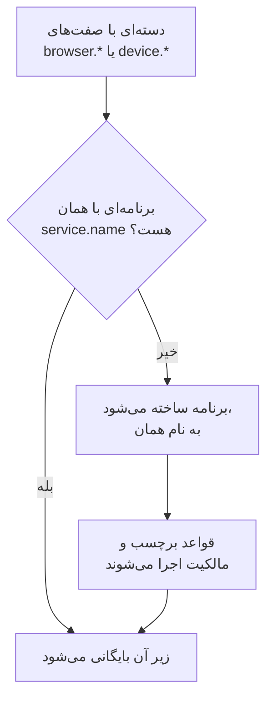

# مدیریت برنامه‌ها

OneUptime نخستین باری که تله‌متری برنامه شما می‌رسد یک برنامه RUM می‌سازد. این صفحه آنچه را پس از آن مدیریت می‌کنید پوشش می‌دهد: نام برنامه، برچسب‌ها و مالکانش، مدت نگهداری داده‌اش، بایگانی، اینکه چه کسی می‌تواند ببیندش، و هشدارها.

:::cards
- [یک برنامه چگونه ساخته می‌شود](#یک-برنامه-چگونه-ساخته-میشود): با `service.name` تطبیق داده و با نخستین دسته‌اش ساخته می‌شود.
- [برچسب‌ها](#برچسبها): برنامه‌ها را گروه کنید و تعیین کنید چه کسی به آن‌ها دسترسی دارد.
- [نگهداشت](#نگهداشت): تله‌متری و ضبط‌ها چه مدت نگه داشته می‌شوند.
- [دسترسی‌ها](#دسترسیها): چه کسی برنامه‌ها را می‌بیند، و چه کسی ضبط‌ها را تماشا می‌کند.
:::

## یک برنامه چگونه ساخته می‌شود

لازم نیست برنامه RUM را خودتان بسازید. وقتی دسته‌ای از تله‌متری با صفت‌های مرورگر یا دستگاه و یک `service.name` می‌رسد، OneUptime آن را زیر برنامه‌ای با همان `service.name` بایگانی می‌کند، و وقتی پروژه چنین برنامه‌ای ندارد آن را می‌سازد.



- `service.name` هویت برنامه است و بی‌توجه به بزرگی و کوچکی حروف مقایسه می‌شود: `Storefront-Web` و `storefront-web` یک برنامه‌اند.
- `service.name` تازه برنامه‌ای تازه آغاز می‌کند. برنامه قدیمی تاریخچه‌اش را نگه می‌دارد و **قطع‌شده** می‌شود، برنامه تازه خالی آغاز می‌شود، و این دو هرگز ادغام نمی‌شوند.
- برای هر برنامه یک `service.name` به کار ببرید، نه یکی برای هر محیط. محیط‌ها را با برچسبی مانند `oneuptime.label.env=production` از هم جدا کنید، تا یک برنامه و یک تاریخچه داشته باشند.

### نام برنامه را عوض کنید

**نام نمایشی** در آغاز همان `service.name` است. برای تغییرش، صفحه **تنظیمات** برنامه را باز کنید و روی **ویرایش جزئیات** در کارت **جزئیات برنامه** کلیک کنید، جایی که توضیحات و برچسب‌هایش را هم ویرایش می‌کنید. تله‌متری بر پایه **نام اپلیکیشن (service.name)** تطبیق داده می‌شود، که کارت نشانش می‌دهد و هرگز تغییر نمی‌کند، پس تغییر نام بی‌خطر است.

### خودتان برنامه‌ای بیفزایید

وقتی می‌خواهید برچسب‌ها، مالکان یا سیاست بازپخش برنامه پیش از رسیدن نخستین بازدیدکننده سر جایش باشد، خودتان برنامه را بسازید.

:::steps
#### فهرست برنامه‌ها را باز کنید

به **محصولات** > **منابع** > **پایش کاربر واقعی** بروید و روی **ساخت برنامه RUM** کلیک کنید.

#### نام اپلیکیشن را وارد کنید

**نام اپلیکیشن (service.name)** را با همان `service.name` که برنامه‌تان گزارش خواهد داد پر کنید، دقیقاً همان‌گونه که برنامه گزارشش می‌دهد.

#### نامی بدهید و ذخیره کنید

برنامه به نام اپلیکیشنش نام‌گذاری می‌شود، همان‌گونه که برنامه‌ای کشف‌شده. برای نمایش نامی دیگر، **فیلدهای بیشتر** را باز کنید و یک **نام نمایشی** بنویسید؛ توضیحات و برچسب‌ها هم آنجایند. سپس فرم را ذخیره کنید.
:::

سپس راهنمای راه‌اندازی آن خودبه‌خود باز می‌شود، با نام اپلیکیشن به‌عنوان `service.name` قطعه کد. گام آخر آن، **منتظر اتصال بمانید**، می‌گوید نخستین داده‌ها چه زمانی می‌رسند.

اگر پروژه از پیش برنامه‌ای با آن `service.name` دارد، چه کشف‌شده، چه پیش‌تر افزوده‌شده و چه بایگانی‌شده، فرم به‌جای ساختن برنامه دوم همین را می‌گوید.

## وضعیت اتصال

برنامه تا وقتی تله‌متری می‌رسد **متصل** و پس از ۱۵ دقیقه بی هیچ تله‌متری **قطع‌شده** نشان می‌دهد. تله‌متری OpenTelemetry و ترافیک بازپخش نشست هر دو به حساب می‌آیند.

**آخرین مشاهده** به‌جای هر دسته، هر چند دقیقه یک بار تازه می‌شود، پس ممکن است تا حدود پنج دقیقه از ترافیک زنده عقب باشد، و آن ۱۵ دقیقه برای همین جا دارد. زمانی که خود OneUptime از کار افتاده بود یا صف دریافتش را جبران می‌کرد به حساب آن‌ها نمی‌آید.

**قطع‌شده** به‌تنهایی خطا نیست: ابزاری داخلی که شب بازدیدکننده‌ای ندارد واقعاً قطع است. اگر کسانی از برنامه استفاده می‌کنند، [رفع اشکال RUM](/docs/rum/troubleshooting) را ببینید.

## برچسب‌ها

برچسب‌ها برنامه‌ها را در فهرست‌ها و پالایه‌ها گروه می‌کنند. همچنین تعیین می‌کنند عضوی که به برخی برچسب‌ها محدود شده به چه چیزی می‌رسد: چنین عضوی فقط برنامه‌هایی را می‌بیند که یکی از آن برچسب‌ها را دارند. برنامه برچسب‌هایش را از سه راه می‌گیرد:

| چگونه | کجا |
| --- | --- |
| به‌دست | در فرم ساخت، زیر **فیلدهای بیشتر**، یا بعداً با **ویرایش جزئیات** در کارت **جزئیات برنامه** در صفحه **تنظیمات** برنامه. برای چند برنامه با هم، آن‌ها را در فهرست انتخاب کنید و **افزودن برچسب‌ها** را از **اقدامات گروهی** بزنید. |
| از تله‌متری | صفت منبعی با نام `oneuptime.label.<name>` برچسب `<name>:<value>` را می‌افزاید، همان‌گونه که پایین آمده. |
| از قاعده برچسب | قاعده‌ای که به هر برنامه تازه‌ای که تطبیق دهد برچسب می‌افزاید. [قواعد برچسب و قواعد مالکیت](#قواعد-برچسب-و-قواعد-مالکیت) را ببینید. |

صفت‌ها را روی همان منبعی بگذارید که `service.name` روی آن است، برای نمونه در فایل `src/telemetry.ts` از [راه‌اندازی مرورگر](/docs/rum/browser-setup):

```ts
const resource = defaultResource().merge(
  resourceFromAttributes({
    [ATTR_SERVICE_NAME]: "storefront-web",
    "oneuptime.label.team": "payments",
    "oneuptime.label.env": "production",
  }),
);
```

این برچسب‌های `team:payments` و `env:production` را می‌افزاید، و اگر در پروژه نباشند آن‌ها را می‌سازد. نوشتن نام صفت در برچسب، `oneuptime.label.team=prod` و `oneuptime.label.env=prod` را از هم جدا نگه می‌دارد. برچسبی بلندتر از ۱۰۰ نویسه به ۱۰۰ بریده می‌شود، و مقدار خالی یا غیررشته‌ای چیزی نمی‌افزاید.

## قواعد برچسب و قواعد مالکیت

قاعده به هر برنامه تازه‌ای که تطبیق دهد برچسب یا مالک می‌افزاید. **پایش کاربر واقعی** > **تنظیمات** > **قواعد برچسب**، یا **قواعد مالکیت** را باز کنید، و قاعده را در دو گام بسازید:

1. در **تطبیق**، **همه برنامه‌های RUM**، که قاعده تازه با آن آغاز می‌شود، با هر برنامه‌ای تطبیق دارد. برای محدود کردن آن، **فقط آن دسته از برنامه‌های RUM که با شرط‌ها مطابقت دارند** را برگزینید و شرط‌هایی روی **برچسب‌های برنامه** (هر یک، همه یا هیچ‌کدام از برچسب‌هایی که برمی‌گزینید را دارد)، **نام برنامه** یا **توضیحات برنامه** (برابر است، شامل است، با آن آغاز می‌شود، با آن پایان می‌یابد، یا با الگویی می‌خواند) بیفزایید.
2. در **برچسب‌ها**، یا **مالکان** برای قاعده مالکیت، آنچه را قاعده می‌افزاید برگزینید. قاعده تازه باید دست‌کم یک برچسب یا مالک بیفزاید. **نام** از روی گزینش‌هایتان پر می‌شود، مانند _Add team:payments_ یا _Add Payments as owners_، تا وقتی نامی از خودتان بنویسید. **توضیحات**، و **اطلاع به مالکان** در قاعده مالکیت، زیر **فیلدهای بیشتر** منتظرند.

قاعده‌ها هنگام ساخته شدن برنامه اجرا می‌شوند، برنامه‌های کشف‌شده هم. برای اعمال قاعده‌ای بر برنامه‌هایی که از پیش دارید، منوی **⋯** روی سطرش را باز کنید و **اجرا همین حالا** را برگزینید: [اجرای قواعد روی منابع موجود](/docs/configuration/run-rules-now) را ببینید. قاعده‌ای که پس از ویرایش چیزی برای افزودن ندارد در فهرست با **چیزی نمی‌افزاید** علامت می‌خورد. [قواعد برچسب و مالکیت](/docs/configuration/label-and-owner-rules) فرم‌ها را به‌طور کامل پوشش می‌دهد.

### مالکان

مالکان افراد و تیم‌هایی‌اند که مسئول یک برنامه‌اند. قواعد مالکیت آن‌ها را به برنامه‌های تازه می‌افزایند. برای افزودن یا برداشتن دستی‌شان، برنامه‌ها را در فهرست انتخاب کنید و **افزودن مالک** یا **حذف مالک** را از **اقدامات گروهی** بزنید؛ API آن‌ها را از راه `/rum-application-owner-user` و `/rum-application-owner-team` می‌افزاید. با روشن بودن **اطلاع به مالکان**، که پیش‌فرض است، به هر مالکی که قاعده‌ای بیفزاید خبر داده می‌شود. اگر نباید به کسی خبر داده شود، پیش از اجرای قاعده‌ای روی برنامه‌های بسیار خاموشش کنید.

## نگهداشت

تله‌متری یک برنامه و ضبط‌هایش برای مدت‌های متفاوتی نگه داشته می‌شوند:

| داده | نگه داشته می‌شود برای | تنظیم در |
| --- | --- | --- |
| لاگ‌ها، متریک‌ها، ردیابی‌ها و پروفایل‌ها | نگهداشت پروژه، مگر آنکه برنامه آن را بازنویسی کند | صفحه **تنظیمات** برنامه |
| ضبط‌های بازپخش نشست | ۷ روز به‌طور پیش‌فرض، یا ۱، ۱۴، ۳۰ یا ۹۰ روز | **Replay Policy**، با **ویرایش سیاست** > **محدودیت‌ها** |

### نگهداشت تله‌متری

به‌طور پیش‌فرض تله‌متری یک برنامه به اندازه نگهداشت پروژه نگه داشته می‌شود، که زیر **تنظیمات پروژه** > **تله‌متری و APM** > **نگهداری داده** تنظیم می‌شود. دو کارت در صفحه **تنظیمات** برنامه آن را بازنویسی می‌کنند:

- **نگهداری داده تله‌متری** فیلد **نگهداری داده تله‌متری به مدت (روز)** را دارد، یک مقدار برای همه تله‌متری برنامه. برای به کار بردن نگهداشت پروژه خالی‌اش بگذارید.
- **نگهداری بر اساس نوع تله‌متری** برای لاگ‌ها، ردیابی‌ها، متریک‌ها و پروفایل‌ها هر کدام یک پیش‌فرض دارد، و برای لاگ‌ها بر پایه شدت و ردیابی‌ها بر پایه وضعیت. مقداری که خالی بماند به مقدار برنامه برمی‌گردد، سپس به مقدار پروژه.

بازنویسی‌های نگهداشت بخشی از [نسخه سازمانی](/docs/self-hosted/enterprise) هستند، و در OneUptime Cloud بخشی از طرح Scale و بالاتر. بدون آن‌ها، کارت‌ها نشان می‌دهند طرح چه می‌افزاید، و برنامه نگهداشت پروژه را نگه می‌دارد.

در طرح پایین‌تری از Cloud، بازنویسی‌ای که از دوره آزمایشی مانده همچنان بر تله‌متری تازه اعمال می‌شود. صفحه **تنظیمات** آن را در کارت **بازنویسی نگهداری** با دکمه **حذف بازنویسی** نشان می‌دهد، که در هر طرحی کار می‌کند: از آن پس برنامه نگهداشت پروژه را نگه می‌دارد، و آنچه از پیش ذخیره شده با همان نگهداشتی می‌ماند که با آن ذخیره شده بود. تنظیم دوباره بازنویسی به طرح Scale نیاز دارد.

### نگهداشت بازپخش نشست

ضبط‌ها نگهداشت خودشان را دارند، که در صفحه **Replay Policy** برنامه با **ویرایش سیاست** > **محدودیت‌ها** تنظیم می‌شود: ۷ روز به‌طور پیش‌فرض، یا ۱، ۱۴، ۳۰ یا ۹۰ روز. عمداً کوتاه است، چون ضبط بسیار حساس‌تر، و بسیار بزرگ‌تر، از یک اسپن است. کارت **نگهداری بازپخش نشست** در صفحه **تنظیمات** آن را نشان می‌دهد (_Session replays are kept for 7 days._)، و دکمه **ویرایش در Replay Policy** آن سیاست را باز می‌کند.

نگهداشت طولانی‌تر تله‌متری ضبط‌ها را بیشتر نگه نمی‌دارد. شمارها، سیگنال‌ها و دستگاه یک نشست همراه فیلمش منقضی می‌شوند؛ فقط لاگ‌ها، اسپن‌ها و استثناهای نشست از نگهداشت تله‌متری پیروی می‌کنند. [نگهداشت و حذف](/docs/telemetry/session-replay#نگهداشت-و-حذف) را ببینید.

> [!TIP]
> RUM اغلب پرحجم‌ترین تله‌متری یک پروژه است، چون با کاربرانتان رشد می‌کند نه با کارسازهایتان. نگهداشتی کوتاه‌تر اینجا، و بلندتر روی سرویس‌های بک‌اند، پیکربندی رایجی است.

## بایگانی و حذف

**بایگانی** برنامه‌ای را از **همه برنامه‌ها** پنهان می‌کند در حالی که همچنان تله‌متری گرد می‌آورد. برنامه‌ای را بایگانی کنید که دیگر زیر نظرش ندارید اما می‌خواهید تاریخچه‌اش بماند.

- در صفحه **تنظیمات** برنامه روی **بایگانی** کلیک کنید، یا چند برنامه را در فهرست برگزینید و با هم بایگانی‌شان کنید.
- برنامه‌های بایگانی‌شده زیر **پایش کاربر واقعی** > **پیشرفته** > **بایگانی‌شده** هستند. **پیشرفته** در منوی کناری جمع‌شده آغاز می‌شود: برای نمایش **بایگانی‌شده** رویش کلیک کنید. برنامه‌ای را، یا چندتایی را با هم، آنجا **خروج از بایگانی** کنید.

**حذف برنامه**، در بخش **پیشرفته** منوی کناری برنامه، برنامه را برای همیشه برمی‌دارد. اگر برنامه هنوز تله‌متری می‌فرستد، دسته بعدی‌اش برنامه را دوباره می‌سازد، بی هیچ‌یک از تنظیم‌هایش، پس نخست ابزارگذاری را متوقف کنید.

برای پاک کردن داده یک نفر به‌جای کل برنامه، درخواست پاک‌سازی ثبت کنید: [پاک کردن نشست‌ها](/docs/telemetry/session-replay#پاک-کردن-نشستها) را ببینید.

## دسترسی‌ها

هر کسی با نقش Viewer پروژه می‌تواند برنامه‌های RUM و تله‌متری‌شان را ببیند. بازپخش نشست عمداً جزو این نقش نیست: فهرست کردن ضبط‌ها، تماشای یکی و خواندن اینکه چه کسی تماشا کرده دسترسی‌هایی جداگانه‌اند. مالکان و مدیران پروژه همه آن‌ها را دارند. انتخابگرهای دسترسی هر دسترسی را با عنوانش فهرست می‌کنند، که اینجا به‌صورت ایتالیک آمده است.

| دسترسی | به عضو اجازه می‌دهد |
| --- | --- |
| `ReadRumApplication` (_Read RUM Application_) | برنامه‌ها و صفحه‌های تله‌متری‌شان را ببیند. |
| `CreateRumApplication`، `EditRumApplication`، `DeleteRumApplication` | برنامه‌ها را بیفزاید، ویرایش کند و حذف کند. |
| `ReadRumSessionReplay` (_List Session Replays_) | نشست‌های ضبط‌شده و جزئیاتشان را فهرست کند، بی آنکه پخششان کند یا بداند کاربر که بوده. |
| `ReadRumSessionReplayPayload` (_Watch Session Replays_) | ضبط‌ها را پخش کند، و ارجاع و خصیصه‌های کاربر شناسایی‌شده را بخواند. |
| `ReadRumSessionReplayAudit` (_Read Session Replay Audit_) | **گزارش دسترسی به بازپخش** را بخواند: چه کسی کدام ضبط را تماشا کرده. |
| `DeleteRumSessionReplay` (_Delete Session Replays_) | ضبط‌ها را حذف کند. |
| `CreateRumSessionErasureRequest`، `ReadRumSessionErasureRequest` | درخواست‌های پاک‌سازی ثبت کند و پیگیری‌شان کند. |
| `ReadRumApplicationLabelRule`، `ReadRumApplicationOwnerRule` (و Create، Edit و Delete آن‌ها) | قواعد برچسب و قواعد مالکیت را مدیریت کند. |
| `ReadRumApplicationOwnerUser`، `ReadRumApplicationOwnerTeam` (و Create، Edit و Delete آن‌ها) | از راه API مالکان را بیفزاید و بردارد. |

تقسیمی سودمند: به مهندس پشتیبانی `ReadRumApplication` و `ReadRumSessionReplay` بدهید. او می‌تواند ببیند کدام نشست‌ها به خطا خورده‌اند بی آنکه صفحه کسی را تماشا کند یا بداند کاربر که بوده. `ReadRumSessionReplayPayload` را فقط به کسانی بدهید که لازمش دارند؛ آنگاه اعضایی که `ReadRumSessionReplayAudit` دارند هر پخشی را در صفحه **گزارش دسترسی به بازپخش** برنامه می‌بینند. [چه کسی می‌تواند ضبطی را تماشا کند](/docs/telemetry/session-replay#چه-کسی-میتواند-ضبطی-را-تماشا-کند) نشان می‌دهد هر دسترسی در فهرست نشست‌ها و پخش‌کننده چه چیزی را باز می‌کند.

## هشدار بر داده RUM

تله‌متری RUM همان لاگ‌ها، متریک‌ها و ردیابی‌های معمولی است، پس مانیتور RUM جداگانه‌ای نیست: مانیتورهای معمول روی آن کار می‌کنند. سریع‌ترین شروع صفحه **توصیه‌ها** برنامه است، که مانیتورهایی پیشنهاد می‌دهد که از پیش به برنامه محدود شده‌اند:

| گروه | توصیه‌ها |
| --- | --- |
| Core Web Vitals | Poor Largest Contentful Paint، Poor Interaction to Next Paint، Poor Cumulative Layout Shift، Slow First Contentful Paint و Slow Time to First Byte. [Core Web Vitals](/docs/rum/web-vitals) را ببینید. |
| خطاها | Failed User Operations، و Unhandled Browser Exceptions. |
| بازپخش نشست | چهار [هشدار بودجه ذخیره‌سازی](/docs/telemetry/session-replay#هشدارهای-بودجه-ذخیرهسازی)، که پیش از تمام شدن محدودیت روزانه پروژه یا بودجه ماهانه برنامه هشدار می‌دهند. همین که برنامه بازپخشی ضبط کرده باشد پیشنهاد می‌شوند، و جفت ماهانه وقتی افزون بر آن بودجه ماهانه هم داشته باشد. |

برای ساختن مانیتور خودتان، مانیتوری را برگزینید که آن سیگنال را می‌خواند:

- [مانیتور متریک‌ها](/docs/monitor/metrics-monitor): یک Core Web Vital، یا هر متریکی که برنامه‌تان می‌فرستد.
- [مانیتور ترِیس‌ها](/docs/monitor/traces-monitor): نرخ خطا یا تأخیر سمت کلاینت.
- [مانیتور لاگ‌ها](/docs/monitor/logs-monitor): الگویی در لاگ‌های مرورگر.
- [مانیتور استثناها](/docs/monitor/exceptions-monitor): استثناهای سمت کلاینتِ تازه یا جهش‌یافته.

مانیتوری را که می‌سازید به برنامه محدود کنید، تا سرویس بک‌اندی با امضای مشابه فعالش نکند.

## گام‌های بعدی

:::cards
- [بازپخش نشست](/docs/telemetry/session-replay): آنچه کاربران دیدند را ضبط کنید، با سیاست و نگهداشت خودش.
- [قواعد برچسب و مالکیت](/docs/configuration/label-and-owner-rules): هر دو فرم قاعده، گام به گام.
- [اجرای قواعد روی منابع موجود](/docs/configuration/run-rules-now): قاعده‌ای تازه را بر برنامه‌هایی که از پیش دارید اعمال کنید.
- [رفع اشکال RUM](/docs/rum/troubleshooting): وقتی برنامه‌ای نیست، خالی است یا قطع‌شده است.
:::
