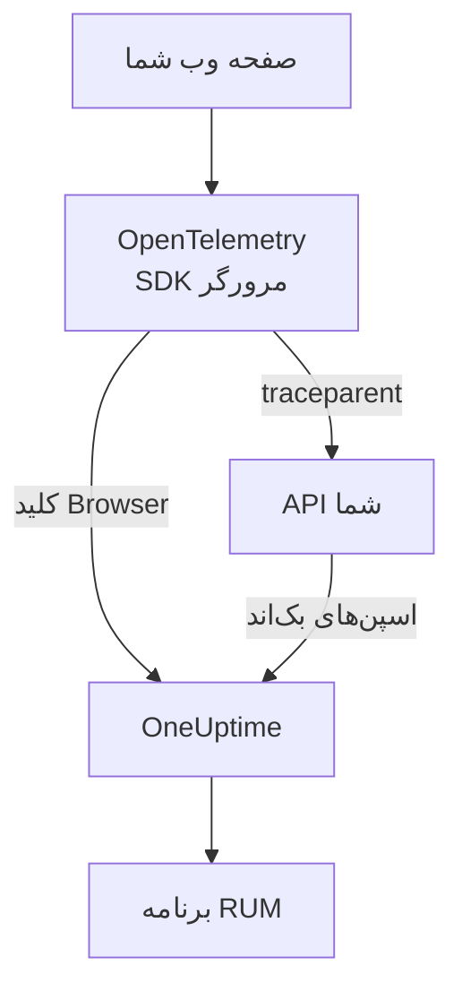

# راه‌اندازی مرورگر

برنامه‌ای وب را با SDK مرورگر OpenTelemetry ابزارگذاری کنید تا به‌عنوان یک برنامه RUM به OneUptime گزارش دهد. بارگذاری صفحه‌ها و درخواست‌ها به‌صورت ردیابی می‌رسند و همین راه‌اندازی خطاها، لاگ‌ها، متریک‌ها و Core Web Vitals شما را هم می‌برد.

:::cards
- [راه‌اندازی](#راهاندازی): شش گام از کلید Browser تا نخستین بارگذاری صفحه.
- [پیوند به بک‌اند](#پیوند-دادن-به-ردیابیهای-بکاندتان): اسپن‌های مرورگر را به ردیابی‌های بک‌اندی که آغاز می‌کنند وصل کنید.
- [گزارش خطاها](#گزارش-خطاهای-مهارنشده): خطاهای مهارنشده را به نمای استثناها بفرستید.
- [رفع اشکال](#رفع-اشکال): وقتی چیزی نمی‌رسد چه را بررسی کنید.
:::

## چگونه کار می‌کند

SDK در مرورگر بازدیدکنندگان شما اجرا می‌شود. برای هر بارگذاری صفحه و هر درخواست یک اسپن ثبت می‌کند و آن‌ها را با کلید دریافت داده **مرورگر** مستقیم به OneUptime صادر می‌کند، بی‌آنکه کالکتور یا پراکسی خودتان در میان باشد.



## پیش از شروع

- برنامه‌ای وب که می‌توانید کدش را تغییر دهید و دوباره مستقر کنید و وابستگی‌هایش با npm نصب می‌شوند.
- مبدأهایی که صفحه‌هایتان از آن‌ها ارائه می‌شوند، مانند `https://app.example.com`. کلید Browser فقط درخواست‌های مبدأهایی را می‌پذیرد که رویش فهرست می‌کنید.
- نقشی که بتواند کلید دریافت داده بسازد: مالکان و مدیران پروژه می‌توانند، و هر کسی که مجوز **Create Telemetry Ingestion Key** را دارد هم می‌تواند.

## راه‌اندازی

:::steps
### یک کلید دریافت داده Browser بسازید

1. به **محصولات** > **تنظیمات پروژه** بروید.
2. در منوی کناری **تله‌متری و APM** را باز کنید و **کلیدهای دریافت داده** را برگزینید.
3. روی **ساخت کلید دریافت داده** کلیک کنید و **مرورگر** را به‌عنوان **نوع کلید** برگزینید.
4. در گام **تنظیمات مرورگر**، مبدأهایتان را در **مبداهای مجاز** به‌صورت آرایه JSON فهرست کنید، مانند `["https://app.example.com"]`، سپس کلید را بسازید. در پلن Free سرویس OneUptime Cloud، گام پایانی **صورت‌حساب** نخست بهای تله‌متری را نشان می‌دهد.


کلید تازه در صفحه خودش باز می‌شود. **کلید محرمانه** آن را کپی کنید: این همان توکنی است که SDK به‌صورت `x-oneuptime-token` می‌فرستد.


### بسته‌ها را نصب کنید

```bash
npm install @opentelemetry/api \
  @opentelemetry/sdk-trace-web \
  @opentelemetry/resources \
  @opentelemetry/semantic-conventions \
  @opentelemetry/opentelemetry-browser-detector \
  @opentelemetry/exporter-trace-otlp-http \
  @opentelemetry/context-zone \
  @opentelemetry/instrumentation \
  @opentelemetry/instrumentation-document-load \
  @opentelemetry/instrumentation-fetch \
  @opentelemetry/instrumentation-xml-http-request
```

### فایل تله‌متری را بسازید

`src/telemetry.ts` را بسازید. `browserDetector` ویژگی‌های `browser.*` را می‌افزاید که تله‌متری را RUM ثبت می‌کنند، و `service.name` نام برنامه را تعیین می‌کند.

```ts title="src/telemetry.ts"
import {
  WebTracerProvider,
  BatchSpanProcessor,
} from "@opentelemetry/sdk-trace-web";
import { OTLPTraceExporter } from "@opentelemetry/exporter-trace-otlp-http";
import { ZoneContextManager } from "@opentelemetry/context-zone";
import { registerInstrumentations } from "@opentelemetry/instrumentation";
import { DocumentLoadInstrumentation } from "@opentelemetry/instrumentation-document-load";
import { FetchInstrumentation } from "@opentelemetry/instrumentation-fetch";
import { XMLHttpRequestInstrumentation } from "@opentelemetry/instrumentation-xml-http-request";
import {
  defaultResource,
  detectResources,
  resourceFromAttributes,
} from "@opentelemetry/resources";
import { browserDetector } from "@opentelemetry/opentelemetry-browser-detector";
import { ATTR_SERVICE_NAME } from "@opentelemetry/semantic-conventions";

const ONEUPTIME_URL = "https://oneuptime.com";
// Public: it ships in your page. It must be a Browser ingestion key.
const ONEUPTIME_TOKEN = "YOUR_TELEMETRY_INGESTION_TOKEN";

/*
 * browserDetector supplies the browser.* attributes. Without them this
 * telemetry is classified as a backend Service, not a RUM application.
 * The attributes set last win, so service.name here overrides the
 * "unknown_service" that defaultResource() provides.
 */
const resource = defaultResource()
  .merge(detectResources({ detectors: [browserDetector] }))
  .merge(
    resourceFromAttributes({
      [ATTR_SERVICE_NAME]: "storefront-web",
    }),
  );

const provider = new WebTracerProvider({
  resource: resource,
  spanProcessors: [
    new BatchSpanProcessor(
      new OTLPTraceExporter({
        url: `${ONEUPTIME_URL}/otlp/v1/traces`,
        headers: { "x-oneuptime-token": ONEUPTIME_TOKEN },
      }),
    ),
  ],
});

provider.register({
  contextManager: new ZoneContextManager(),
});

registerInstrumentations({
  instrumentations: [
    new DocumentLoadInstrumentation(),
    new FetchInstrumentation({
      // See "Linking to your backend traces" before widening this.
      propagateTraceHeaderCorsUrls: [/^https:\/\/api\.example\.com/],
    }),
    new XMLHttpRequestInstrumentation({
      propagateTraceHeaderCorsUrls: [/^https:\/\/api\.example\.com/],
    }),
  ],
});
```

### آن را پیش از همه وارد کنید

آن را نخستین import برنامه‌تان کنید. ابزارگذاری‌ها `fetch` و `XMLHttpRequest` را وصله می‌کنند و درخواستی که پیش از وصله فرستاده شود ردیابی نمی‌شود.

```ts
// src/index.tsx (React), src/main.ts (Vue / Angular), etc.
import "./telemetry";
import React from "react";
// ... the rest of your app
```

### کلید را بررسی کنید

پیش از اینکه جای دیگری را بگردید، از OneUptime بپرسید که آیا کلید را می‌پذیرد:

```bash
curl -i https://oneuptime.com/otlp/v1/validate \
  -H "x-oneuptime-token: YOUR_TELEMETRY_INGESTION_TOKEN"
```

`200` همراه `"valid": true` یعنی کلید پذیرفته شده است؛ برای کلید Browser پیام می‌افزاید که فقط از مرورگر و از یکی از مبدأهای مجازش کار می‌کند. `401` یعنی کلید ناشناخته، باطل‌شده، خاموش یا منقضی است.

### یک صفحه را بارگذاری کنید

سایتتان را باز کنید. در کمتر از یک دقیقه، برنامه به نام `service.name` خودش زیر **محصولات** > **منابع** > **پایش کاربر واقعی** پدیدار می‌شود.
:::

## کلید Browser چه اجازه‌ای می‌دهد

هر چیزی که در قطعه کد است به دست بازدیدکنندگانتان می‌رسد، پس هر کسی می‌تواند توکن را از صفحه‌تان کپی کند. کلید Browser کاری را که یک نسخه کپی‌شده می‌تواند بکند محدود می‌کند:

| تنظیم | کارکرد |
| --- | --- |
| **مبداهای مجاز** | درخواست‌ها فقط از این مبدأها پذیرفته می‌شوند، هر کدام با طرح نشانی و درگاهش اگر داشته باشد. یک میزبان می‌تواند با یک نویسه عام `*.` آغاز شود: `https://*.example.com` همه زیردامنه‌های `example.com` را در بر می‌گیرد، اما خود `example.com` را نه. |
| **Requests Per Minute Limit** | یک سقف برای همه بازدیدکنندگانی که از کلید استفاده می‌کنند: ۶۰۰۰ درخواست در دقیقه، مگر اینکه سقف خودتان را بگذارید. |
| **نام سرویس سنجاق‌شده** | `service.name` را روی هر چیزی که کلید می‌نویسد تحمیل می‌کند تا نسخه کپی‌شده نتواند تله‌متری‌اش را به‌جای یکی از سرویس‌های بک‌اندتان جا بزند. |
| **تاریخ انقضا** | پس از این تاریخ کلید دیگر پذیرفته نمی‌شود. |
| **فعال** | خاموشش کنید تا کلیدی که لو رفته فوراً از کار بیفتد. |

کلید Browser فقط ردیابی‌ها، لاگ‌ها و متریک‌های OTLP و بازپخش‌های نشست را می‌نویسد؛ هر مسیر دریافت دیگری آن را رد می‌کند. این تنظیم‌ها را در صفحه خود کلید تغییر می‌دهید. نوع کلید پس از ساختن آن تغییرپذیر نیست.

> [!WARNING]
> هرگز کلید **سرور** را در صفحه نگذارید. کلید سرور هر نوع تله‌متری را از هر جایی و بی بررسی مبدأ می‌نویسد، پس هر کسی که صفحه‌تان را بخواند می‌تواند در پروژه‌تان بنویسد.

## تنظیم `browser.*` بدون آشکارساز

`browserDetector` [UA Client Hints API](https://wicg.github.io/ua-client-hints/) را می‌خواند که فقط مرورگرهای Chromium آن را دارند. در Safari و Firefox، `browser.language` و `user_agent.original` را تنظیم می‌کند، اما `browser.platform`، `browser.brands` یا `browser.mobile` را نه.

این برای ثبت تله‌متری به‌عنوان RUM همچنان کافی است، چون `browser.language` به‌تنهایی دسته را RUM مرورگر علامت می‌زند. اما صفحه **کلاینت‌ها** پلتفرم‌ها را از `browser.platform` فهرست می‌کند، پس بازدیدهای Safari و Firefox آنجا سطری نمی‌افزایند.

برای کنار گذاشتن آشکارساز، یا برای اینکه هر مرورگری پلتفرم داشته باشد، ویژگی‌ها را خودتان تنظیم کنید:

```ts
const resource = defaultResource().merge(
  resourceFromAttributes({
    [ATTR_SERVICE_NAME]: "storefront-web",
    // browser.language or browser.platform marks the telemetry as browser RUM.
    "browser.language": navigator.language,
    "browser.platform":
      (navigator as any).userAgentData?.platform ?? "unknown",
    "browser.mobile": (navigator as any).userAgentData?.mobile ?? false,
    "user_agent.original": navigator.userAgent,
  }),
);
```

`browser.platform` را کلی نگه دارید. هر مقدار متمایز یک سطر در صفحه **کلاینت‌ها** می‌شود، پس رشته کامل user-agent یا مقداری جدا برای هر کاربر در آنجا فهرستی بی‌پایان می‌سازد و مشکل حریم خصوصی هم هست.

## ردیابی تغییر مسیرها

`DocumentLoadInstrumentation` فقط نخستین بارگذاری را ردیابی می‌کند. در یک برنامه تک‌صفحه‌ای، تغییر مسیرها تا وقتی ثبتشان نکنید دیده نمی‌شوند، و این کار چند خط در مسیریاب شما می‌خواهد:

```ts
import { trace } from "@opentelemetry/api";

const tracer = trace.getTracer("app-router");

function onRouteChange(to: string): void {
  const span = tracer.startSpan("route-change", {
    attributes: { "app.route": to },
  });
  // End it when the route's data has loaded and the view has painted.
  requestAnimationFrame(() => {
    return span.end();
  });
}
```

برای ردیابی کلیک‌ها و دیگر رویدادهای DOM هم `@opentelemetry/instrumentation-user-interaction` را بیفزایید. برای INP در هر مسیر، [برنامه‌های تک‌صفحه‌ای](/docs/rum/web-vitals#برنامههای-تکصفحهای) را ببینید.

## پیوند دادن به ردیابی‌های بک‌اندتان

`propagateTraceHeaderCorsUrls` تعیین می‌کند کدام درخواست‌های میان‌مبدأیی سرآیند `traceparent` استاندارد W3C را حمل کنند؛ این سرآیند اسپن مرورگر را به ردیابی بک‌اندی که آغاز کرده وصل می‌کند. درخواست‌ها به مبدأ خود صفحه آن را بی هیچ پیکربندی حمل می‌کنند.

> [!WARNING]
> آن را `/.*/` نگذارید. این سرآیند درخواست میان‌مبدأیی ساده را به درخواستی با پیش‌پرواز تبدیل می‌کند، پس هر API شخص ثالثی که `traceparent` را در `Access-Control-Allow-Headers` خود فهرست نکرده، شروع به شکست می‌کند.

فقط مبدأهایی را فهرست کنید که در اختیار شماست و پیکربندی‌شان کرده‌اید:

```ts
new FetchInstrumentation({
  propagateTraceHeaderCorsUrls: [
    /^https:\/\/api\.example\.com/,
    /^https:\/\/auth\.example\.com/,
  ],
});
```

با نصب [بازپخش نشست](/docs/telemetry/session-replay)، درخواست‌ها به مبدأ خودتان شناسه نشست بازپخش را هم حمل می‌کنند که تله‌متری بک‌اندتان را زیر ضبط ثبت می‌کند: [پیوستن ردیابی‌ها به بازپخش نشست](#پیوستن-ردیابیها-به-بازپخش-نشست) را ببینید.

## پیوستن ردیابی‌ها به بازپخش نشست

اگر [بازپخش نشست](/docs/telemetry/session-replay) را هم به کار می‌برید، تله‌متری **بک‌اند** شما بی نوشتن کدی در اینجا به ضبط می‌پیوندد. هنگامی که نشست بارگذاری می‌شود، ضبط‌کننده به درخواست‌هایی که صفحه به مبدأ خودش می‌فرستد یک عضو `tracestate` حامل شناسه نشست می‌افزاید و `traceparent` را به `FetchInstrumentation` / `XMLHttpRequestInstrumentation` شما وامی‌گذارد. اسپن‌های بک‌اند شما هنگام دریافت، در هر سرویسی که زمینه ردیابی W3C را ادامه می‌دهد، با شناسه نشست مهر می‌خورند و لاگ‌ها و استثناهای آن با شناسه ردیابی به ضبط می‌پیوندند. برای اینکه چگونه کار می‌کند، چه چیزهایی را پوشش نمی‌دهد و کلیدی که آن را خاموش می‌کند، [همبسته کردن با باقی تله‌متری‌تان](/docs/telemetry/session-replay#همبسته-کردن-با-باقی-تلهمتریتان) را ببینید.

ضبط‌کننده `traceparent`ای را هم که ابزارگذاری‌های شما می‌گذارند بازمی‌خواند، چه فراخوانی یک نشانی بدهد (با شیء init یا بی آن) و چه شیئی از نوع `Request`، پس سطر هر درخواست در بازپخش به ردیابی بک‌اندش پیوند می‌خورد. برای APIای روی مبدأی دیگر، آن را در `propagateTraceHeaderCorsUrls` بالا فهرست کنید؛ درخواست‌هایش هیچ شناسه نشستی حمل نمی‌کنند و با شناسه ردیابی به ضبط می‌پیوندند. **مبدأهای انتشار ترِیس** در سیاست بازپخش برنامه همین کار را برای صفحه‌هایی می‌کند که این SDK را *ندارند*.

چیزی که سرآیندها به آن نمی‌رسند، اسپن‌های مرورگری خود این SDK است: بارگذاری سند، تغییر مسیرها و خطاهایی که گزارش می‌کنید. برای اینکه این‌ها هم زیر ضبط ثبت شوند، `session.id` را هنگام آغاز هر اسپن رویش مهر بزنید. ضبط‌کننده شناسه را از راه `onSessionChange` به شما می‌گوید که اگر نشستی از پیش باشد بی‌درنگ اجرا می‌شود، و هر بار که شناسه عوض شود دوباره: وقتی بازدیدکننده پس از ۳۰ دقیقه بیکاری برمی‌گردد، در سقف ۴ ساعته، وقتی `identify()` کاربر دیگری را نام می‌برد، یا وقتی زبانه دیگری از همان بازدیدکننده زودتر آن را عوض کرده باشد.

```ts title="src/replaySession.ts"
import type { Context } from "@opentelemetry/api";
import type {
  ReadableSpan,
  Span,
  SpanProcessor,
} from "@opentelemetry/sdk-trace-web";

declare global {
  interface Window {
    OneUptimeReplayQueue?: Array<Array<unknown>>;
  }
}

let replaySessionId: string | null = null;

// The recorder script loads asynchronously. The queue is applied the
// moment it starts and stays live afterwards, so this works either way.
(window.OneUptimeReplayQueue = window.OneUptimeReplayQueue || []).push([
  "onSessionChange",
  (sessionId: string): void => {
    replaySessionId = sessionId;
  },
]);

export class ReplaySessionSpanProcessor implements SpanProcessor {
  public onStart(span: Span, _parentContext: Context): void {
    if (replaySessionId) {
      span.setAttribute("session.id", replaySessionId);
    }
  }

  public onEnd(_span: ReadableSpan): void {}

  public forceFlush(): Promise<void> {
    return Promise.resolve();
  }

  public shutdown(): Promise<void> {
    return Promise.resolve();
  }
}
```

سپس آن را در `src/telemetry.ts` نخستین پردازشگر اسپن ارائه‌دهنده کنید:

```ts
import { ReplaySessionSpanProcessor } from "./replaySession";

const provider = new WebTracerProvider({
  resource: resource,
  spanProcessors: [
    new ReplaySessionSpanProcessor(),
    new BatchSpanProcessor(
      new OTLPTraceExporter({
        url: `${ONEUPTIME_URL}/otlp/v1/traces`,
        headers: { "x-oneuptime-token": ONEUPTIME_TOKEN },
      }),
    ),
  ],
});
```

اسپن‌هایی که پس از آن آغاز می‌شوند شناسه را دارند، زبانه **ترِیس‌ها** در پخش‌کننده بازپخش آن‌ها را روی ساعت ضبط فهرست می‌کند و هر کدام در داشبورد به همان لحظه بازپخش پیوند می‌خورد. پردازشگر اسپن هر اسپن را با شناسه‌ای مهر می‌زند که هنگام آغاز آن جاری بوده؛ نوشتن شناسه در `resource.attributes` به‌جای آن، اسپن‌هایی را که هنگام چرخش نشست هنوز در دسته صدور منتظرند دوباره برچسب می‌زند. شناسه به‌محض آغاز ضبط‌کننده، پیش از رضایت یا تریگر ضبط، به شنونده گفته می‌شود، پس اگر این اهمیت دارد، فقط وقتی مهر بزنید که صفحه‌تان رضایت گرفته باشد.

## سیاست امنیت محتوا

اگر سایت شما Content Security Policy می‌فرستد، تا وقتی OneUptime را در `connect-src` مجاز نکنید، مرورگر درخواست‌های صادرکننده را مسدود می‌کند. هیچ خطایی جایی که ببینید رخ نمی‌دهد: صفحه فقط چیزی گزارش نمی‌کند.

```text
connect-src 'self' https://oneuptime.com;
```

آن را با دستور `connect-src` موجودتان ادغام کنید. اگر OneUptime را خودتان میزبانی می‌کنید، از میزبان خودتان استفاده کنید.

## گزارش خطاهای مهارنشده

SDK مرورگر OpenTelemetry خطاهای مهارنشده را ثبت نمی‌کند. خودتان گزارششان کنید تا کنار خطاهای بک‌اندتان زیر **استثناها** پدیدار شوند:

```ts
import { trace, SpanStatusCode } from "@opentelemetry/api";

const tracer = trace.getTracer("app-errors");

window.addEventListener("error", (event: ErrorEvent) => {
  const span = tracer.startSpan("window.onerror");
  span.recordException(event.error ?? new Error(event.message));
  span.setStatus({ code: SpanStatusCode.ERROR });
  span.end();
});

window.addEventListener("unhandledrejection", (event: PromiseRejectionEvent) => {
  const span = tracer.startSpan("unhandledrejection");
  span.recordException(
    event.reason instanceof Error ? event.reason : new Error(String(event.reason)),
  );
  span.setStatus({ code: SpanStatusCode.ERROR });
  span.end();
});
```

با [بازپخش نشست](/docs/telemetry/session-replay)، ضبط‌کننده هم خطاهای مهارنشده را ثبت می‌کند و روی خط زمانی بازپخش علامت می‌گذارد. آن‌گاه صفحه استثنا کارت **Watch what the user saw** را نشان می‌دهد که بازپخش را ده ثانیه پیش از خطا باز می‌کند. با سیاست پیش‌فرض، هر نشست ضبط می‌شود، چه چیزی خطا بدهد چه ندهد؛ خطا فقط تعیین می‌کند کارت از کجا باز شود.

## افزودن لاگ‌ها و متریک‌ها

ردیابی‌ها برای پر کردن نمای کلی کافی‌اند. وقتی لاگ‌های مرورگر را در OneUptime می‌خواهید، یا برای فرستادن [Core Web Vitals](/docs/rum/web-vitals)، خط لوله‌های لاگ و متریک را بیفزایید:

```bash
npm install @opentelemetry/api-logs @opentelemetry/sdk-logs \
  @opentelemetry/exporter-logs-otlp-http \
  @opentelemetry/sdk-metrics @opentelemetry/exporter-metrics-otlp-http
```

```ts
import { LoggerProvider, BatchLogRecordProcessor } from "@opentelemetry/sdk-logs";
import { OTLPLogExporter } from "@opentelemetry/exporter-logs-otlp-http";
import { MeterProvider, PeriodicExportingMetricReader } from "@opentelemetry/sdk-metrics";
import { OTLPMetricExporter } from "@opentelemetry/exporter-metrics-otlp-http";
import { logs } from "@opentelemetry/api-logs";
import { metrics } from "@opentelemetry/api";

const headers = { "x-oneuptime-token": ONEUPTIME_TOKEN };

logs.setGlobalLoggerProvider(
  new LoggerProvider({
    resource: resource,
    processors: [
      new BatchLogRecordProcessor({
        exporter: new OTLPLogExporter({
          url: `${ONEUPTIME_URL}/otlp/v1/logs`,
          headers,
        }),
      }),
    ],
  }),
);

metrics.setGlobalMeterProvider(
  new MeterProvider({
    resource: resource,
    readers: [
      new PeriodicExportingMetricReader({
        exporter: new OTLPMetricExporter({
          url: `${ONEUPTIME_URL}/otlp/v1/metrics`,
          headers,
        }),
        exportIntervalMillis: 30000,
      }),
    ],
  }),
);
```

آن‌ها را با همان شیء `resource` بسازید. خط لوله لاگ یا متریکی که منبعش `browser.*` ندارد، به‌عنوان سرویس بک‌اندی جداگانه ثبت می‌شود.

## مرجع نقطه‌های پایانی

| سیگنال | نقطه پایانی | سرآیند |
| --- | --- | --- |
| ردیابی‌ها | `POST {host}/otlp/v1/traces` | `x-oneuptime-token: <token>` |
| متریک‌ها | `POST {host}/otlp/v1/metrics` | `x-oneuptime-token: <token>` |
| لاگ‌ها | `POST {host}/otlp/v1/logs` | `x-oneuptime-token: <token>` |

`{host}` همان `https://oneuptime.com` است، یا اگر OneUptime را خودتان اجرا می‌کنید میزبان خودتان؛ آن را در نشانی‌های OTLP و در مدخل Content Security Policy تغییر دهید. OneUptime قالب‌های OTLP/JSON و OTLP/protobuf را می‌پذیرد. نقطه‌های پایانی به درخواست‌های میان‌مبدأیی از هر مبدأی پاسخ می‌دهند و سرآیند `x-oneuptime-token` را مجاز می‌دانند، پس مرورگر مستقیم به آن‌ها صادر می‌کند.

## رفع اشکال

:::details در زبانه Network هیچ درخواستی به OneUptime نیست
ابزارهای توسعه‌دهنده مرورگرتان را باز کنید، به زبانه Network بروید و با `otlp` پالایش کنید: دنبال `POST /otlp/v1/traces` می‌گردید. نبودن هیچ درخواستی یعنی SDK هرگز آغاز نشده است:

- `telemetry.ts` نخستین import نیست، یا باندلر شما آن را کنار گذاشته است.
- پردازشگر دسته‌ای هنوز صادر نکرده است. چند ثانیه صبر می‌کند تا دسته‌ای پر شود، پس پیش از اینکه نتیجه بگیرید چیزی فرستاده نمی‌شود، صبر کنید یا به صفحه دیگری بروید.
- یک متغیر محیطی زمان ساخت `undefined` از آب درآمده، پس نشانی صادرکننده خراب است. نشانی را یک بار هنگام آغاز در لاگ بنویسید.
:::

:::details مرورگر درخواست را مسدود می‌کند
- خطای Content Security Policy در کنسول یعنی `connect-src` هنوز OneUptime را مجاز نکرده است: [سیاست امنیت محتوا](#سیاست-امنیت-محتوا) را ببینید.
- خطای CORS تقریباً همیشه یعنی درخواست هرگز به OneUptime نرسیده، چون نقطه‌های پایانی آن هر مبدأیی را مجاز می‌دانند: دنبال پراکسی سازمانی، مسدودکننده تبلیغات یا غلط تایپی در میزبان بگردید.
:::

:::details OneUptime درخواست را رد می‌کند
- `422` همراه `Origin https://app.example.com is not allowed for this browser ingestion key.` یعنی مبدأ دقیق صفحه (طرح نشانی، میزبان و درگاه) در **مبداهای مجاز** کلید نیست.
- `422` همراه `This telemetry ingestion key has been disabled.` یعنی کسی کلید را خاموش کرده است. دوباره روشنش کنید یا از کلید دیگری استفاده کنید.
- `401` یعنی کلید ناشناخته، باطل‌شده یا منقضی است. بررسی کلید را در [راه‌اندازی](#راهاندازی) اجرا کنید، سپس یک کلید Browser فعال بسازید.
- `404` یعنی نشانی نادرست است. صادرکننده ردیابی به مسیر کامل `/otlp/v1/traces` نیاز دارد.
:::

:::details برنامه به‌جای پایش کاربر واقعی زیر سرویس‌ها پدیدار می‌شود
منبع هیچ ویژگی `browser.*` ندارد، پس تله‌متری به‌عنوان سرویس بک‌اند ثبت شد. `browserDetector` را بیفزایید، یا ویژگی‌ها را مانند [تنظیم `browser.*` بدون آشکارساز](#تنظیم-browser-بدون-آشکارساز) تنظیم کنید.

آنچه می‌فرستید را در زبانه Network، در محتوای درخواست بررسی کنید: `resourceSpans[0].resource.attributes` همان فهرستی است که تصمیم را می‌گیرد. سرویسی که پیش‌تر ساخته شده به برنامه RUM تبدیل نمی‌شود، پس وقتی تله‌متری RUM رسید، آن را زیر **محصولات** > **سرویس‌ها** حذف کنید.
:::

:::details صفحه کلاینت‌ها در Safari یا Firefox خالی است
سطرهای کلاینت از `browser.platform` می‌آیند که `browserDetector` فقط در مرورگرهای Chromium تنظیمش می‌کند. برای فهرست شدن بازدیدهای Safari و Firefox آن را خودتان تنظیم کنید: [تنظیم `browser.*` بدون آشکارساز](#تنظیم-browser-بدون-آشکارساز) را ببینید.
:::

## گام‌های بعدی

:::cards
- [Core Web Vitals](/docs/rum/web-vitals): LCP، INP، CLS، FCP و TTFB را از همان صفحه بفرستید.
- [بازپخش نشست](/docs/telemetry/session-replay): آنچه کاربر دید را کنار این ردیابی‌ها ضبط کنید.
- [مدیریت برنامه‌ها](/docs/rum/applications): نام‌ها، برچسب‌ها، مالکان و نگهداشت.
- [رفع اشکال RUM](/docs/rum/troubleshooting): همه بررسی‌ها، به همان ترتیبی که مشکل‌ها معمولاً پیش می‌آیند.
:::
