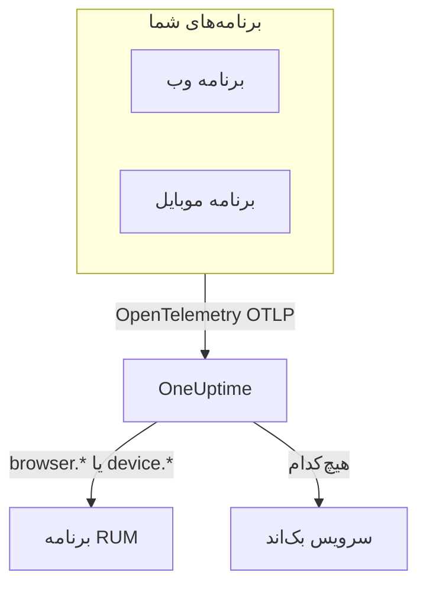

# نمای کلی RUM

پایش کاربر واقعی (RUM) نشان می‌دهد کاربران واقعی در برنامه‌های وب و موبایل شما چه تجربه‌ای دارند: بارگذاری صفحه‌ها، درخواست‌ها، خطاها و Core Web Vitals، آن‌طور که خود برنامه گزارش می‌دهد، نه یک کاوشگر. OneUptime این تله‌متری را زیر یک برنامه RUM نگه می‌دارد که می‌توانید برایش نمودار بکشید، در آن جست‌وجو کنید و رویش هشدار بگذارید.

:::cards
- [چگونه کار می‌کند](#چگونه-کار-میکند): یک خط لوله OpenTelemetry که هنگام رسیدن به‌عنوان RUM ثبت می‌شود.
- [OneUptime چگونه RUM را تشخیص می‌دهد](#oneuptime-چگونه-rum-را-تشخیص-میدهد): ویژگی‌های منبعی که این را تعیین می‌کنند.
- [آنچه به دست می‌آورید](#آنچه-به-دست-میآورید): نمای کلی، شاخص‌های وب، کاوشگرها و بازپخش‌ها.
- [شروع کنید](#شروع-کنید): از کلید دریافت داده تا نخستین بارگذاری صفحه.
:::

## چگونه کار می‌کند

RUM از همان خط لوله OpenTelemetry استفاده می‌کند که بقیه OneUptime به کار می‌برد. نه عامل ویژه RUM در کار است و نه قالب انتقال جداگانه‌ای: یک SDK مرورگر یا موبایل OpenTelemetry را به OneUptime نشانه می‌روید و تله‌متری هنگام رسیدن به‌عنوان RUM ثبت می‌شود.

- **برای هر برنامه، یک برنامه RUM.** هویت آن همان `service.name` است که SDK شما گزارش می‌دهد و OneUptime با نخستین دسته تله‌متری برنامه را می‌سازد.
- **هرگز دو بار شمرده نمی‌شود.** تله‌متری سمت کاربر فقط به برنامه RUM خودش تعلق دارد و به‌عنوان سرویس بک‌اند هم فهرست نمی‌شود.
- **بازپخش نشست لایه‌ای جدا و اختیاری است.** قطعه کد و کنترل‌های حریم خصوصی خودش را دارد: [بازپخش نشست](/docs/telemetry/session-replay) را ببینید.

## کجا پیدایش کنید

**محصولات** > **منابع** > **پایش کاربر واقعی** را باز کنید. **همه برنامه‌ها** برنامه‌هایتان را با **نوع کلاینت**، **وضعیت** و **آخرین مشاهده** فهرست می‌کند. دو بخش دیگر منوی کناری در آغاز بسته‌اند:

- **تنظیمات**: **قواعد مالکیت**، **قواعد برچسب** و کلید **بازپخش نشست** برای کل پروژه.
- **پیشرفته**: **بایگانی‌شده**، یعنی برنامه‌هایی که بایگانی کرده‌اید.

منوی کناری خود هر برنامه صفحه‌هایش را این‌گونه دسته‌بندی می‌کند؛ **تنظیمات**، **توسعه‌دهنده** و **پیشرفته** در آغاز بسته‌اند:

| بخش | صفحه‌ها |
| --- | --- |
| **پایه** | **نمای کلی**، **توصیه‌ها**، **مستندات** |
| **مشاهده‌پذیری** | **متریک‌ها**، **لاگ‌ها**، **ترِیس‌ها**، **کلاینت‌ها** |
| **بازپخش نشست** | **بازپخش نشست**، **User Flows**، **Replay Users**، **سلامت**، **Replay Policy**، **گزارش دسترسی به بازپخش**، **مستندات** |
| **تنظیمات** | **تنظیمات** |
| **توسعه‌دهنده** | **Terraform**، **API**، **دستیارهای هوش مصنوعی** |
| **پیشرفته** | **حذف برنامه** |

## OneUptime چگونه RUM را تشخیص می‌دهد

بیشتر پرسش‌های «برنامه‌ام دیده نمی‌شود» همین‌جا پاسخ می‌گیرند. OneUptime برای هر دسته تله‌متری، هنگام رسیدن، از روی **ویژگی‌های منبع** آن دسته تصمیم می‌گیرد:

1. دسته‌ای که منبعش `browser.platform`، `browser.language` یا `browser.brands` ناخالی دارد، RUM **مرورگر** است.
2. در غیر این صورت، دسته‌ای که `device.id` یا `device.model.identifier` دارد، RUM **موبایل** است.
3. در غیر این صورت، دسته‌ای که `device.manufacturer` دارد و هویت میزبان (`host.name`، `host.id` یا `k8s.node.name`) ندارد هم RUM **موبایل** است.
4. هر چیز دیگری سرویس بک‌اند است.

SDKهای بک‌اند هرگز `browser.*`، `device.id` یا `device.model.identifier` را تنظیم نمی‌کنند، پس این‌ها نشانه‌های روشنی‌اند. `device.manufacturer` استثناست: موجودی یک میزبان هم سازنده ماشین را با آن گزارش می‌دهد، پس فقط روی منبعی که هویت میزبان ندارد به حساب می‌آید. [ویژگی‌های موجودی](/docs/telemetry/host-otel-collector#ویژگیهای-موجودی-ip-mac-شماره-سریال-سازنده-مدل-میانافزار) را ببینید.

| ویژگی | لازم | کارکرد |
| --- | --- | --- |
| `service.name` | **بله** | هویت برنامه، مانند `storefront-web`. بدون آن هیچ برنامه RUM ساخته نمی‌شود. |
| `browser.platform`، `browser.language`، `browser.brands` | یکی از آن‌ها، در وب | دسته را RUM مرورگر علامت می‌زند. `browser.platform` صفحه **کلاینت‌ها** را هم پر می‌کند. |
| `device.id`، `device.model.identifier` | یکی از آن‌ها، در موبایل | دسته را RUM موبایل علامت می‌زند. `device.model.identifier` صفحه **کلاینت‌ها** را هم پر می‌کند. |
| `device.manufacturer` | خیر | دسته را فقط وقتی RUM موبایل علامت می‌زند که منبع هیچ هویت میزبانی نداشته باشد. |
| `telemetry.sdk.language` | خیر | در نمای کلی نشان داده می‌شود، مانند `webjs` یا `swift`. |
| `telemetry.sdk.version` | خیر | به‌عنوان نسخه SDK نشان داده می‌شود؛ اگر نباشد، `oneuptime.agent.version` خوانده می‌شود. |
| `oneuptime.label.<name>` | خیر | برچسب پروژه `<name>:<value>` را به برنامه می‌افزاید. |

OneUptime برنامه را بدون توجه به کوچکی و بزرگی حروف با `service.name` پیدا می‌کند و اگر پروژه چنین برنامه‌ای نداشته باشد، آن را می‌سازد. هر `service.name` تازه برنامه تازه‌ای می‌سازد، پس آن را ثابت نگه دارید و محیط‌ها را با برچسب از هم جدا کنید، نه با نامی تازه. [مدیریت برنامه‌ها](/docs/rum/applications) نام‌ها، برچسب‌ها، مالکان و نگهداشت را شرح می‌دهد.

> [!IMPORTANT]
> SDK مرورگر OpenTelemetry هیچ ویژگی `browser.*` نمی‌افزاید، مگر اینکه آشکارساز منبع مرورگر را اضافه کنید یا خودتان آن‌ها را تنظیم کنید. با `service.name` تنها، تله‌متری سرویس بک‌اند می‌شود، نه برنامه RUM. [راه‌اندازی مرورگر](/docs/rum/browser-setup) هر دو راه را نشان می‌دهد.

## آنچه به دست می‌آورید

| کجا | چه نشان می‌دهد |
| --- | --- |
| **نمای کلی** | کاشی‌های **بارگذاری‌های صفحه**، **زمان بارگذاری صفحه (p95)**، **رویدادها**، **نرخ خطا**، **Event duration (p95)**، **استثناها**، **کلاینت‌ها** و **Sessions recorded**، و نمودارهای روند در بازه زمانی‌ای که برمی‌گزینید. |
| **Core Web Vitals** | کارتی در نمای کلی با LCP، INP، CLS، FCP و TTFB که هر کدام با آستانه‌های Google سنجیده می‌شوند، و INP برای هر مسیر یک برنامه تک‌صفحه‌ای. [Core Web Vitals](/docs/rum/web-vitals) و [برنامه‌های تک‌صفحه‌ای](/docs/rum/web-vitals#برنامههای-تکصفحهای) را ببینید. |
| **متریک‌ها**، **لاگ‌ها**، **ترِیس‌ها** | کاوشگرهای تله‌متری که فقط داده همین برنامه را نشان می‌دهند. |
| **کلاینت‌ها** | پلتفرم‌های مرورگر و مدل‌های دستگاهی که برنامه روی آن‌ها به کار رفته: فهرستی کوتاه بر پایه پلتفرم، هرگز یک سطر برای هر کاربر. |
| **بازپخش نشست** | ضبط نشست‌های واقعی، کنار خطاها، ردیابی‌ها و لاگ‌هایشان: [بازپخش نشست](/docs/telemetry/session-replay) را ببینید. |
| **توصیه‌ها** | مانیتورهای آماده برای برنامه: Core Web Vitals ضعیف، درخواست‌های ناموفق، استثناهای مرورگر و، وقتی ضبط آغاز شد، بودجه‌های بازپخش نشست. |

شمارش‌ها از اسپن‌هایی می‌آیند که ابزارگذاری شما می‌فرستد. **بارگذاری‌های صفحه** اسپن `documentLoad` را می‌شمارد که ابزارگذاری بارگذاری صفحه برای هر بارگذاری کامل ثبت می‌کند، پس تغییر مسیر درون یک برنامه تک‌صفحه‌ای بارگذاری صفحه به حساب نمی‌آید.

برنامه تا وقتی تله‌متری می‌رسد **متصل** نشان داده می‌شود و پس از ۱۵ دقیقه بی‌داده **قطع‌شده**. زمانی که خود OneUptime از کار افتاده بود یا داشت صف دریافت داده‌اش را جبران می‌کرد، جزو این ۱۵ دقیقه شمرده نمی‌شود.

## شروع کنید

:::steps
### کلید دریافت داده بسازید

**تنظیمات پروژه** > **تله‌متری و APM** > **کلیدهای دریافت داده** را باز کنید و روی **ساخت کلید دریافت داده** کلیک کنید. برنامه وب به کلید **مرورگر** نیاز دارد که فقط از مبدأهایی که فهرست می‌کنید کار می‌کند. برنامه موبایل به کلید **سرور** نیاز دارد، چون SDK موبایل هیچ سرآیند `Origin` نمی‌فرستد.

### برنامه‌تان را ابزارگذاری کنید

برای برنامه وب [راه‌اندازی مرورگر](/docs/rum/browser-setup) را دنبال کنید و برای Android، iOS، React Native و پلتفرم‌های دیگر [راه‌اندازی موبایل](/docs/rum/mobile-setup) را.

### یک صفحه را باز کنید

صفحه‌ای از سایتتان را بارگذاری کنید یا برنامه‌تان را اجرا کنید. برنامه با نخستین دسته تله‌متری، به نام `service.name` خودش، زیر **محصولات** > **منابع** > **پایش کاربر واقعی** پدیدار می‌شود. لازم نیست آن را از پیش بسازید.

### شاخص‌ها و بازپخش‌ها را بیفزایید

وقتی داده‌های پایه رسید، [Core Web Vitals](/docs/rum/web-vitals) را بفرستید و [بازپخش نشست](/docs/telemetry/session-replay) را اضافه کنید. هر دو اختیاری‌اند.
:::

اگر چیزی پدیدار نشد، [رفع اشکال RUM](/docs/rum/troubleshooting) علت‌ها را به همان ترتیبی که معمولاً پیش می‌آیند بررسی می‌کند.

## گام‌های بعدی

:::cards
- [راه‌اندازی مرورگر](/docs/rum/browser-setup): برنامه وب را با SDK مرورگر OpenTelemetry ابزارگذاری کنید.
- [راه‌اندازی موبایل](/docs/rum/mobile-setup): Android، iOS، React Native و هر SDK دیگر OpenTelemetry.
- [Core Web Vitals](/docs/rum/web-vitals): LCP، INP، CLS، FCP و TTFB را بفرستید و INP را مسیر به مسیر بخوانید.
- [بازپخش نشست](/docs/telemetry/session-replay): ببینید کاربر چه دید، کنار خطاها و ردیابی‌هایش.
:::
