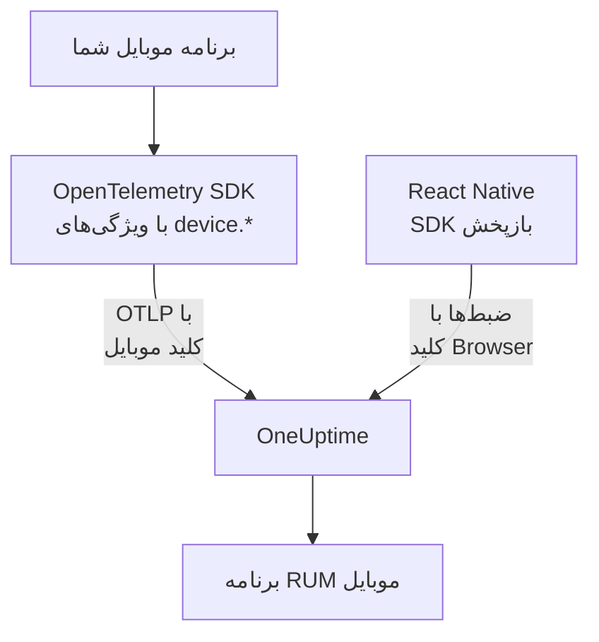

# راه‌اندازی موبایل

یک برنامه Android، iOS یا React Native را با OpenTelemetry ابزارگذاری کنید تا به‌عنوان برنامه RUM موبایل به OneUptime گزارش دهد. هر پلتفرم دیگری که SDK OpenTelemetry دارد هم به همین شکل کار می‌کند.

:::cards
- [آنچه OneUptime لازم دارد](#آنچه-oneuptime-لازم-دارد): دو ویژگی منبع که با کلید موبایل فرستاده می‌شوند.
- [پلتفرمتان را راه‌اندازی کنید](#پلتفرمتان-را-راهاندازی-کنید): Android، iOS، React Native و بقیه.
- [کرش‌ها و هنگ‌های iOS](#کرشها-و-هنگهای-ios): گزارش‌های MetricKit و KSCrash در استثناها، با نام‌هایی که dSYMهای شما می‌دهند.
- [بررسی کنید که داده می‌رسد](#بررسی-کنید-که-داده-میرسد): کلید را بیازمایید، سپس برنامه را پیدا کنید.
- [بازپخش نشست در موبایل](#بازپخش-نشست-در-موبایل): ضبط‌ها برای برنامه‌های React Native.
:::

## چگونه کار می‌کند

برنامه شما OTLP را با کلید دریافت داده **موبایل** که به برنامه سنجاق شده است مستقیم به OneUptime صادر می‌کند، پس هر چه می‌فرستد به‌عنوان همان برنامه RUM موبایل ثبت می‌شود. با هر کلید دیگری، ویژگی‌های `device.*` روی منبع آن است که آن را به‌جای سرویس بک‌اند، RUM موبایل ثبت می‌کند.



## آنچه OneUptime لازم دارد

دو ویژگی منبع، روی هر دسته‌ای که برنامه‌تان صادر می‌کند:

| ویژگی | چیست |
| --- | --- |
| `service.name` | هویت برنامه، مانند `storefront-android`. |
| `device.id` یا `device.model.identifier` | تله‌متری را RUM موبایل علامت می‌زند. `device.model.identifier` صفحه **کلاینت‌ها** را هم پر می‌کند. |

اگر با کلید دیگری فرستاده شود، تله‌متری بدون ویژگی دستگاه باز هم می‌رسد و می‌توانید از آن پرس‌وجو کنید، اما به‌جای برنامه RUM به‌عنوان سرویس بک‌اند ثبت می‌شود.

`device.manufacturer` هم دسته را موبایل علامت می‌زند، اما فقط روی منبعی که هویت میزبان ندارد، چون موجودی یک میزبان سازنده ماشین را با آن گزارش می‌دهد. `device.id` یا `device.model.identifier` را هم تنظیم کنید، همان‌طور که هر دستور زیر می‌کند، و این هرگز اهمیتی پیدا نمی‌کند.

`device.id` را شناسه‌ای در حد نصب برنامه بگذارید، هرگز شناسه تبلیغاتی یا هر چیز دیگری که یک شخص را شناسایی کند. OneUptime آن را فقط برای تشخیص تله‌متری موبایل می‌خواند.

## پیش از شروع

- برنامه‌ای با یک SDK OpenTelemetry: OpenTelemetry Java SDK یا OpenTelemetry Android، opentelemetry-swift، یا OpenTelemetry JavaScript SDK برای React Native.
- یک کلید دریافت داده **موبایل** که در **تنظیمات پروژه** > **تله‌متری و APM** > **کلیدهای دریافت داده** با **ساخت کلید دریافت داده** ساخته شده باشد و `service.name` برنامه‌تان در **نام سرویس سنجاق‌شده** آن باشد. کلید **مرورگر** از برنامه موبایل رد می‌شود: با سرآیند `Origin` بررسی می‌شود که SDKهای موبایل نمی‌فرستند. هرگز کلید **سرور** را درون برنامه منتشر نکنید.
- این تنظیم‌های OTLP. اگر OneUptime را خودتان میزبانی می‌کنید، `https://oneuptime.com` را با میزبان خودتان جایگزین کنید.

| تنظیم | مقدار |
| --- | --- |
| نقطه پایانی OTLP | `https://oneuptime.com/otlp` |
| سرآیند | `x-oneuptime-token: YOUR_TELEMETRY_INGESTION_TOKEN` |
| ردیابی‌ها | `POST https://oneuptime.com/otlp/v1/traces` |
| متریک‌ها | `POST https://oneuptime.com/otlp/v1/metrics` |
| لاگ‌ها | `POST https://oneuptime.com/otlp/v1/logs` |

> [!WARNING]
> کلید درون برنامه‌تان منتشر می‌شود و برنامه را می‌توان باز کرد، پس فرض کنید کسی آن را کپی می‌کند. نسخه کپی‌شده کلید موبایل فقط می‌تواند ردیابی‌ها، لاگ‌ها و متریک‌های همین برنامه را بفرستد که زیر **نام سرویس سنجاق‌شده** آن ثبت می‌شوند، و هرگز از صفحه وب. با این حال می‌تواند تا **محدودیت درخواست در دقیقه** کلید، داده ساختگی برای این برنامه بفرستد، پس تاریخی در **تاریخ انقضا** بیفزایید و کلید را با هر انتشار عوض کنید.

## پلتفرمتان را راه‌اندازی کنید

قطعه کدها شکل کلی راه‌اندازی را نشان می‌دهند. SDKهای موبایل OpenTelemetry میان انتشارها APIهایشان را تغییر می‌دهند، پس نام متدها را با نسخه‌ای که ثابت کرده‌اید مقایسه کنید. آنچه OneUptime لازم دارد هرگز تغییر نمی‌کند: نقطه پایانی، سرآیند، `service.name` و یک ویژگی `device.*`.

:::tabs
@tab Android
از OpenTelemetry Java SDK و صادرکننده OTLP آن استفاده کنید که روی Android اجرا می‌شوند:

```kotlin title="app/build.gradle.kts"
dependencies {
    implementation(platform("io.opentelemetry:opentelemetry-bom:<latest>"))
    implementation("io.opentelemetry:opentelemetry-sdk")
    implementation("io.opentelemetry:opentelemetry-exporter-otlp")
}
```

```kotlin title="StorefrontApplication.kt"
import android.app.Application
import android.os.Build
import io.opentelemetry.exporter.otlp.http.trace.OtlpHttpSpanExporter
import io.opentelemetry.sdk.OpenTelemetrySdk
import io.opentelemetry.sdk.resources.Resource
import io.opentelemetry.sdk.trace.SdkTracerProvider
import io.opentelemetry.sdk.trace.export.BatchSpanProcessor

class StorefrontApplication : Application() {
    override fun onCreate() {
        super.onCreate()

        val resource = Resource.getDefault().toBuilder()
            .put("service.name", "storefront-android")
            .put("device.manufacturer", Build.MANUFACTURER)
            .put("device.model.identifier", Build.MODEL)
            .build()

        val exporter = OtlpHttpSpanExporter.builder()
            .setEndpoint("https://oneuptime.com/otlp/v1/traces")
            .addHeader("x-oneuptime-token", BuildConfig.ONEUPTIME_TOKEN)
            .build()

        OpenTelemetrySdk.builder()
            .setTracerProvider(
                SdkTracerProvider.builder()
                    .setResource(resource)
                    .addSpanProcessor(BatchSpanProcessor.builder(exporter).build())
                    .build()
            )
            .buildAndRegisterGlobal()
    }
}
```

عامل [OpenTelemetry Android](https://github.com/open-telemetry/opentelemetry-android) کرش‌ها، ANRها، فریم‌های کند و یخ‌زده و شروع‌های برنامه را هم بر آن می‌افزاید و `device.model.identifier` و `device.manufacturer` را روی منبع خودش تنظیم می‌کند. [راه‌اندازی اندروید](/docs/rum/android-setup) آن را به‌جای کد بالا راه‌اندازی می‌کند.
@tab iOS
از [opentelemetry-swift](https://github.com/open-telemetry/opentelemetry-swift) استفاده کنید و ویژگی‌های دستگاه را خودتان تنظیم کنید: منبعی که هر نسخه خودش می‌افزاید میان انتشارها تغییر کرده است.

```swift
let resource = Resource(attributes: [
    "service.name": .string("storefront-ios"),
    "device.model.identifier": .string(UIDevice.current.model),
    "device.manufacturer": .string("Apple"),
    "device.id": .string(UIDevice.current.identifierForVendor?.uuidString ?? ""),
    "telemetry.sdk.language": .string("swift"),
])

let exporter = OtlpHttpTraceExporter(
    endpoint: URL(string: "https://oneuptime.com/otlp/v1/traces")!,
    config: OtlpConfiguration(
        headers: [("x-oneuptime-token", oneUptimeToken)]
    )
)

OpenTelemetry.registerTracerProvider(
    tracerProvider: TracerProviderBuilder()
        .with(resource: resource)
        .add(spanProcessor: BatchSpanProcessor(spanExporter: exporter))
        .build()
)
```

`UIDevice.current.model` نامی کوتاه مانند `iPhone` می‌دهد که صفحه **کلاینت‌ها** را برای هر نوع دستگاه به یک سطر محدود نگه می‌دارد. `identifierForVendor` همان نصبی است که OneUptime نصب‌های بدون کرش را با آن می‌شمارد، همان‌طور که [نشست‌ها را ثبت کنید](#نشستها-را-ثبت-کنید) می‌گوید.
@tab React Native
React Native همان OpenTelemetry JavaScript SDK را اجرا می‌کند، پس ارائه‌دهنده، صادرکننده OTLP و پردازشگر دسته‌ای را مانند [راه‌اندازی مرورگر](/docs/rum/browser-setup) بسازید، با سه تغییر: با کلید **موبایل** بفرستید، `browserDetector` و `DocumentLoadInstrumentation` را کنار بگذارید، و ویژگی‌های دستگاه را خودتان تنظیم کنید.

```ts
import { Platform } from "react-native";
import * as Device from "expo-device"; // or react-native-device-info
import {
  defaultResource,
  resourceFromAttributes,
} from "@opentelemetry/resources";

const resource = defaultResource().merge(
  resourceFromAttributes({
    "service.name": "storefront-mobile",
    "device.manufacturer": Device.manufacturer ?? Platform.OS,
    "device.model.identifier":
      Device.modelId ?? Device.modelName ?? "unknown",
    "telemetry.sdk.language": "webjs",
  }),
);
```

`Device.modelId` فقط در iOS تنظیم می‌شود، پس Android به `Device.modelName` برمی‌گردد.
@tab پلتفرم‌های دیگر
Flutter، Unity، .NET MAUI، یک کلاینت تعبیه‌شده یا نویسنده OTLP خودتان همگی کار می‌کنند، به شرط اینکه منبع `service.name` و یک ویژگی `device.*` داشته باشد. SDKای که متغیرهای محیطی استاندارد OpenTelemetry را می‌خواند، این‌ها را همان‌طور که هستند می‌پذیرد:

```bash
OTEL_EXPORTER_OTLP_ENDPOINT="https://oneuptime.com/otlp"
OTEL_EXPORTER_OTLP_HEADERS="x-oneuptime-token=YOUR_TELEMETRY_INGESTION_TOKEN"
OTEL_RESOURCE_ATTRIBUTES="service.name=storefront-mobile,device.manufacturer=Acme,device.model.identifier=AC-100"
```

خود SDK مسیرهای `/v1/traces`، `/v1/metrics` و `/v1/logs` را به نقطه پایانی می‌افزاید.
:::

## کرش‌ها و هنگ‌های iOS

opentelemetry-swift نسخهٔ 2.3 و بعد از آن، کرش‌ها و هنگ‌های یک برنامه iOS را از راه ابزارگذاری MetricKit خود گزارش می‌کند، که هر گزارش تشخیصی Apple را به‌صورت یک رکورد لاگ به OpenTelemetry می‌سپارد. OneUptime آن‌ها را همان‌طور ثبت می‌کند که کرش‌ها و ANRهای OpenTelemetry Android را، پس در **استثناها** و در **نمای کلی** برنامه نمایش داده می‌شوند:

| گزارش تشخیصی Apple | نام رویداد | در استثناها |
| --- | --- | --- |
| یک کرش | `metrickit.diagnostic.crash` | یک استثنای مدیریت‌نشده که نوعش را چیزی تعیین می‌کند که برنامه را بست: استثنای Objective-C در iOS 17 و بعد از آن، وگرنه استثنای Mach (`EXC_BAD_ACCESS`)، وگرنه سیگنال (`SIGSEGV`) |
| یک هنگ | `metrickit.diagnostic.hang` | یک استثنای مدیریت‌نشده از نوع **Hang**، همتای ANR در iOS، که مدت هنگ را نگه می‌دارد |

کاشی **کرش‌ها** در نمای کلی کرش‌ها را می‌شمارد، و کاشی **ANRها** هنگ‌ها را همراه با ANRهای Android می‌شمارد. هر ردیابی پشته به شکل رشته‌های یک گزارش کرش رسم می‌شود و رشته‌ای که کرش کرد یا هنگ کرد اول می‌آید. فریمی از کد برنامهٔ شما، وقتی dSYM بیلدش بارگذاری شده باشد، با نام تابعش نامیده می‌شود، مانند `CartViewController.checkout()`، همان‌طور که در [فایل‌های dSYM را بارگذاری کنید](#فایلهای-dsym-را-بارگذاری-کنید) آمده است. هر فریم دیگر نام باینری خود و فاصلهٔ کد از ابتدای آن را می‌گوید، و **Binary Images** شناسهٔ UUID هر باینری را فهرست می‌کند، که نشان می‌دهد dSYM کدام بیلد آن را نام‌گذاری می‌کند.

کرش‌ها و هنگ‌ها بر اساس فریم‌های برنامهٔ شما روی رشته‌ای که کرش کرد یا هنگ کرد گروه‌بندی می‌شوند: هر جا dSYM آن‌ها را نام‌گذاری کرده باشد بر اساس تابع‌هایشان، پس یک کرش از یک انتشار به انتشار بعدی یک استثنا می‌ماند، و هر جا هیچ dSYMی این کار را نکرده باشد بر اساس فاصله‌شان درون باینری، که با هر بیلد تغییر می‌کند. هر گزارش همان وقتی که می‌رسد نام‌گذاری می‌شود، پس dSYMهای هر بیلد را پیش از انتشار آن بارگذاری کنید: کرشی که پیش از dSYM خود رسیده باشد فاصله‌هایش را نگه می‌دارد.

:::steps
### لاگ‌ها را هم در کنار اسپن‌ها صادر کنید

MetricKit گزارش‌های تشخیصی را به‌صورت رکوردهای لاگ می‌فرستد، پس در کنار ارائه‌دهندهٔ ردیاب، یک ارائه‌دهندهٔ لاگ‌گیر هم با همان منبع، نقطه پایانی و سرآیند ثبت کنید:

```swift
let logExporter = OtlpHttpLogExporter(
    endpoint: URL(string: "https://oneuptime.com/otlp/v1/logs")!,
    config: OtlpConfiguration(
        headers: [("x-oneuptime-token", oneUptimeToken)]
    )
)

OpenTelemetry.registerLoggerProvider(
    loggerProvider: LoggerProviderBuilder()
        .with(resource: resource)
        .with(processors: [
            BatchLogRecordProcessor(logRecordExporter: logExporter),
        ])
        .build()
)
```

### ابزارگذاری MetricKit را ثبت کنید

محصول `MetricKitInstrumentation` از opentelemetry-swift را بیفزایید و وقتی ارائه‌دهندهٔ لاگ‌گیر ثبت شد، آن را در MetricKit ثبت کنید:

```swift
import MetricKit
import MetricKitInstrumentation

// MXMetricManager keeps only a weak reference: hold this for the app's lifetime.
let metricKitInstrumentation = MetricKitInstrumentation()
MXMetricManager.shared.add(metricKitInstrumentation)
```

### نشست‌ها را ثبت کنید

کاشی‌های **نشست‌ها** و **نشست‌های بدون کرش** مقدار `session.id` روی اسپن‌های شما را می‌شمارند. محصول `Sessions` از opentelemetry-swift آن را تنظیم می‌کند: `SessionSpanProcessor` را به ارائه‌دهندهٔ ردیاب بیفزایید و پردازشگر لاگ را درون `SessionLogRecordProcessor` بپیچید، تا گزارش‌های تشخیصی هم نشست داشته باشند.

خط زیر **نشست‌های بدون کرش** سهم نصب‌هایی را که کرش نکردند نشان می‌دهد، و **Daily Crash Rate** و **Daily ANR Rate** بر اساس سهم نصب‌هایی که کرش کردند هشدار می‌دهند. هر نصب همان `device.id` در منبع بالاست، یعنی شناسهٔ فروشندهٔ برنامه: برای همهٔ برنامه‌های شما روی هر دستگاه یکی است و تا وقتی یکی از آن‌ها نصب بماند ثابت می‌ماند، پس نصب دوبارهٔ تنها برنامهٔ شما یک نصب تازه می‌سازد و نصب دوبارهٔ یکی از دو برنامه نه. اگر انتشاری از opentelemetry-swift مقدار `app.installation.id` را تنظیم کند، نصب‌ها به‌جای آن با همین شناسه شمرده می‌شوند.

### فایل‌های dSYM را بارگذاری کنید

Xcode هنگام بایگانی کردن برنامه برای هر باینری برنامهٔ شما یک dSYM می‌نویسد، و App Store Connect آن‌ها را زیر **Download dSYMs** پس می‌دهد. پس از هر بایگانی، از CI یا یک مرحلهٔ ساخت Xcode، آن‌ها را با [CLI OneUptime](/docs/cli/index) و یک کلید سرور مخصوص ساخت خودتان بارگذاری کنید: کلیدی که **نام سرویس سنجاق‌شده** دارد، مانند کلیدی که برنامه‌تان با آن منتشر می‌شود، رد می‌شود، زیرا هر dSYM فریم‌های همهٔ برنامه‌های پروژه را که باینری آن را منتشر می‌کنند نام‌گذاری می‌کند.

```bash
oneuptime dsym upload "$ARCHIVE_PATH/dSYMs" --app storefront-ios --url https://oneuptime.com --ingestion-key YOUR_TELEMETRY_INGESTION_TOKEN
```

CLI بسته‌های `.dSYM`، پوشه‌ها و فایل‌های zip آن‌ها، و فایل‌های DWARF را هر جا که باشند می‌خواند، و فقط UUID، معماری و نام تابع‌های هر باینری را می‌فرستد: dSYMهای یک برنامهٔ بزرگ صدها مگابایت‌اند و نام‌هایشان چند مگابایت. بدون CLI، فایل DWARF یک dSYM، یا یک zip از بسته‌های `.dSYM` را همان‌طور که هست بفرستید، تا ۵۰ مگابایت برای هر فایل:

```bash
curl --fail -X POST "https://oneuptime.com/dsyms/v1/upload" \
  -H "x-oneuptime-token: YOUR_TELEMETRY_INGESTION_TOKEN" \
  -F "appName=storefront-ios" \
  -F "dsym=@MyApp.app.dSYM/Contents/Resources/DWARF/MyApp"
```

هر باینری بر اساس UUID خود ۴۰۰ روز نگه داشته می‌شود، پس انتشاری که ماه‌ها بعد هنوز روی گوشی‌های مردم است همچنان نام‌گذاری می‌شود، و بارگذاری دوبارهٔ یک بیلد آنچه را برای آن نگه داشته شده بود جایگزین می‌کند. هر dSYM به پروژه تعلق دارد، نه به یک برنامه: چارچوبی که دو برنامهٔ شما در خود جای داده‌اند در هر دو نام‌گذاری می‌شود.
:::

> [!NOTE]
> Apple گزارش‌های تشخیصی MetricKit را در یکی از اجراهای بعدی به برنامه می‌سپارد، در iOS 15 و بعد از آن بی‌درنگ و پیش از آن روزی یک بار، پس یک کرش یا هنگ ممکن است چند دقیقه یا یک روز پس از رخ دادنش برسد، و وقتی برسد شمرده می‌شود. «۰ کرش در یک ساعت گذشته» در نمای کلی یک برنامه iOS هنوز خبر خوبی نیست. هر گزارش تشخیصی نشستی را همراه دارد که آن را گزارش کرد، نه نشستی را که به آن پایان داد.

opentelemetry-swift هنگام شروع برنامه هیچ اسپنی ثبت نمی‌کند، پس کاشی‌های **شروع‌های برنامه** و **شروع سرد (p95)** خالی می‌مانند تا برنامهٔ شما خودش یکی ثبت کند: اسپنی به نام `AppStart` که `start.type` آن روی `cold`، `warm` یا `hot` تنظیم شده باشد، از شروع فرایند تا آماده شدن نخستین صفحه.

### وقتی KSCrash هم کرش را گزارش می‌دهد

opentelemetry-swift می‌تواند کرش‌ها را از راه KSCrash هم گزارش کند، که گزارشش را دفعهٔ بعد که برنامه باز شود به‌صورت یک رکورد لاگ `device.crash` می‌فرستد، همراه با زمانی که برنامه کرش کرد. برنامه‌ای که هر دو را ثبت کند هر کرش را دو بار گزارش می‌کند: KSCrash در اجرای بعدی، و MetricKit در اجرای بعدی یا تا یک روز بعد. OneUptime چنین کرشی را یک بار می‌شمارد: نخستین گزارشی که برسد رخداد است، و گزارش دوم در کنار آن، در همان استثنا، به‌عنوان شاهدی از همان کرش نگه داشته می‌شود و در هیچ کاشی، نمودار یا مانیتوری شمرده نمی‌شود. در بخش **رخدادها** در استثنا، کنار آن رخداد **دو بار گزارش‌شده** نوشته می‌شود.

دو گزارش فقط وقتی یک کرش به حساب می‌آیند که همهٔ این شرط‌ها برقرار باشد:

- از دو گزارش‌دهندهٔ متفاوت، یعنی KSCrash و MetricKit، می‌آیند. هیچ‌کدام یک کرش را دو بار گزارش نمی‌کند، پس دو گزارش از یک گزارش‌دهنده دو کرش‌اند.
- از یک نصب می‌آیند: همان `app.installation.id`، یا `device.id`.
- فاصلهٔ آن‌ها بیش از ۲۶ ساعت نیست: MetricKit زمان کرش را پایان روزی می‌گذارد که دربارهٔ آن گزارش می‌دهد، و KSCrash لحظهٔ کرش را.
- دربارهٔ سیگنال، استثنای Mach و استثنای Objective-C، هر جا هر دو یکی را نام ببرند، با هم هم‌خوان‌اند.
- رشته‌هایی که کرش کردند فریم به فریم، از جایی که رشته شروع شد به سمت درون، بر اساس باینری و فاصله، در همهٔ فریم‌های کد برنامهٔ شما که هر یک از دو گزارش نام می‌برد، با هم هم‌خوان‌اند. کرشی که سراسر در کد Apple رخ داده باشد باید دست‌کم در سه فریم هم‌خوان باشد، و در همهٔ آن‌ها.

هر گزارش یک بار جفت می‌شود، با نزدیک‌ترین گزارش از نظر زمانی، پس دو کرش از یک باگ روی یک نصب، با چند دقیقه فاصله، دو رخدادند، هر کدام با گزارش دوم خودش. وقتی OneUptime نتواند گزارشی را با گزارش‌های دیگر نصب آن مقایسه کند، آن را می‌شمارد، پس یک کرش در بدترین حالت دو بار شمرده می‌شود، و هرگز گم نمی‌شود.

## بررسی کنید که داده می‌رسد

:::steps
### کلید را بیازمایید

پیش از اینکه تنظیم‌های SDK را بگردید، از OneUptime بپرسید که آیا کلید را می‌پذیرد:

```bash
curl -i https://oneuptime.com/otlp/v1/validate \
  -H "x-oneuptime-token: YOUR_TELEMETRY_INGESTION_TOKEN"
```

`200` همراه `"valid": true` یعنی کلید پذیرفته شده است. کلید Browser هم `200` پاسخ می‌دهد، اما پیامش می‌گوید فقط از مرورگر کار می‌کند: برنامه موبایل به کلید موبایل نیاز دارد. `401` یعنی کلید ناشناخته، باطل‌شده، خاموش یا منقضی است و هیچ تنظیم SDKای آن را درست نمی‌کند.

### برنامه را اجرا کنید

برنامه را اجرا کنید و کمی با آن کار کنید. با نخستین دسته تله‌متری، به نام `service.name` خودش، زیر **محصولات** > **منابع** > **پایش کاربر واقعی** پدیدار می‌شود.

### صفحه کلاینت‌ها را باز کنید

صفحه **کلاینت‌ها** برنامه را باز کنید: هر مدل دستگاه از `device.model.identifier` یک سطر دارد. اگر این صفحه خالی بماند در حالی که **ترِیس‌ها** پر می‌شود، ویژگی‌های دستگاه به منبع نمی‌رسند.
:::

## بازپخش نشست در موبایل

برنامه‌های React Native می‌توانند با `@oneuptime/react-native-replay` نشست‌ها را ضبط کنند. این بسته درخت نماهای بومی را به شکل قاب‌بندی ساده ضبط می‌کند، هرگز تصویر صفحه یا متن روی صفحه را، و ضبط‌هایش در همان پخش‌کننده ضبط‌های وب باز می‌شوند. با کلید **مرورگر** می‌فرستد که **مبداهای مجاز** آن برنامه شما را به‌صورت `app://` و پس از آن شناسه برنامه Android یا شناسه بسته iOS فهرست می‌کند: این کلیدی جدا از کلید موبایلی است که SDK OpenTelemetry شما به کار می‌برد. [نصب در React Native](/docs/telemetry/session-replay#نصب-در-react-native) گام به گام آن را شرح می‌دهد.

برنامه‌های بومی Android و iOS و پلتفرم‌های دیگر ضبط‌کننده نشست ندارند: صفحه **بازپخش نشست** آن‌ها خالی می‌ماند، در حالی که ردیابی‌ها، لاگ‌ها، متریک‌ها، استثناها و صفحه **کلاینت‌ها** مثل همیشه کار می‌کنند.

## رفع اشکال

:::details بررسی کلید 401 برمی‌گرداند، یا کلید رد می‌شود
`401` یعنی کلید ناشناخته، باطل‌شده، خاموش یا منقضی است: یک کلید موبایل بسازید و برنامه را با آن دوباره بسازید.

کلید Browser از بررسی می‌گذرد، اما هر صدوری از برنامه موبایل با `422` رد می‌شود که می‌گوید `This request did not send an Origin header, so it cannot be checked against the allowed origins of this browser ingestion key. Use a mobile ingestion key in a mobile app, and a server ingestion key on a server.` از کلید **موبایل** استفاده کنید. کلید موبایل هم از راه gRPC و از صفحه وب با `422` رد می‌شود: از راه OTLP/HTTP صادر کنید.
:::

:::details برنامه به‌جای پایش کاربر واقعی زیر سرویس‌ها پدیدار می‌شود
تله‌متری با کلیدی جز کلید موبایل فرستاده شده است و منبع آن نه `device.id` دارد نه `device.model.identifier`، پس به‌عنوان سرویس بک‌اند ثبت شد. با کلید موبایل بفرستید، یا آن‌ها را مانند [پلتفرمتان را راه‌اندازی کنید](#پلتفرمتان-را-راهاندازی-کنید) تنظیم کنید.

سرویسی که پیش‌تر ساخته شده به برنامه RUM تبدیل نمی‌شود، پس وقتی تله‌متری RUM رسید، آن را زیر **محصولات** > **سرویس‌ها** حذف کنید.
:::

:::details صفحه کلاینت‌ها خالی است
سطرهای کلاینت فقط از `device.model.identifier` می‌آیند. SDKای که فقط `device.id` یا `device.manufacturer` را تنظیم می‌کند، برنامه را RUM موبایل ثبت می‌کند اما هیچ کلاینتی فهرست نمی‌کند: `device.model.identifier` را هم تنظیم کنید.
:::

:::details وضعیت بدون ترافیک اخیر است در حالی که مردم از برنامه استفاده می‌کنند
وضعیت پس از ۱۵ دقیقه بی‌تله‌متری **بدون ترافیک اخیر** می‌شود. اگر مردم از برنامه استفاده می‌کنند:

- شاید یک نمونه‌بردار همه چیز را دور می‌ریزد: دنبال نمونه‌برداری always-off یا نسبتی بسیار پایین بگردید.
- شاید برنامه فقط برای کارهایی تله‌متری می‌فرستد که در آن مدت کسی انجامشان نداده است.
- شاید کلید از زمان انتشار باطل یا منقضی شده است: آن را مانند [بررسی کنید که داده می‌رسد](#بررسی-کنید-که-داده-میرسد) بیازمایید.
:::

## گام‌های بعدی

:::cards
- [بازپخش نشست](/docs/telemetry/session-replay): نشست‌های React Native را کنار ردیابی‌هایشان ضبط کنید.
- [مدیریت برنامه‌ها](/docs/rum/applications): نام‌ها، برچسب‌ها، مالکان و نگهداشت.
- [OpenTelemetry](/docs/telemetry/open-telemetry): نقطه‌های پایانی OTLP، محدودیت‌ها و خطاها به‌طور کامل.
- [رفع اشکال RUM](/docs/rum/troubleshooting): همه بررسی‌ها، به همان ترتیبی که مشکل‌ها معمولاً پیش می‌آیند.
:::
