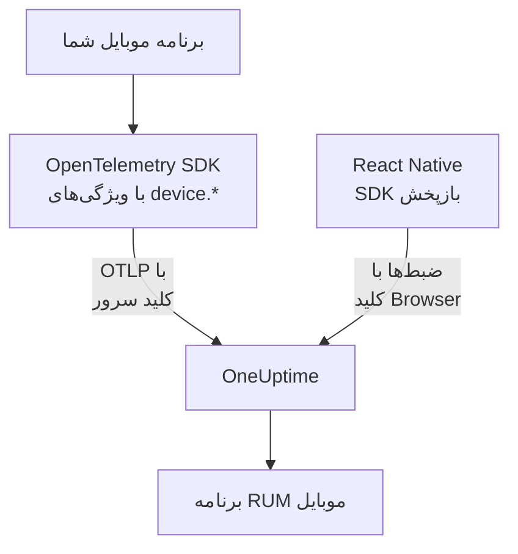

# راه‌اندازی موبایل

یک برنامه Android، iOS یا React Native را با OpenTelemetry ابزارگذاری کنید تا به‌عنوان برنامه RUM موبایل به OneUptime گزارش دهد. هر پلتفرم دیگری که SDK OpenTelemetry دارد هم به همین شکل کار می‌کند.

:::cards
- [آنچه OneUptime لازم دارد](#آنچه-oneuptime-لازم-دارد): دو ویژگی منبع که با کلید سرور فرستاده می‌شوند.
- [پلتفرمتان را راه‌اندازی کنید](#پلتفرمتان-را-راهاندازی-کنید): Android، iOS، React Native و بقیه.
- [بررسی کنید که داده می‌رسد](#بررسی-کنید-که-داده-میرسد): کلید را بیازمایید، سپس برنامه را پیدا کنید.
- [بازپخش نشست در موبایل](#بازپخش-نشست-در-موبایل): ضبط‌ها برای برنامه‌های React Native.
:::

## چگونه کار می‌کند

برنامه شما OTLP را با کلید دریافت داده **سرور** مستقیم به OneUptime صادر می‌کند. ویژگی‌های `device.*` روی منبع آن است که آن را به‌جای سرویس بک‌اند، RUM موبایل ثبت می‌کند.



## آنچه OneUptime لازم دارد

دو ویژگی منبع، روی هر دسته‌ای که برنامه‌تان صادر می‌کند:

| ویژگی | چیست |
| --- | --- |
| `service.name` | هویت برنامه، مانند `storefront-android`. |
| `device.id` یا `device.model.identifier` | تله‌متری را RUM موبایل علامت می‌زند. `device.model.identifier` صفحه **کلاینت‌ها** را هم پر می‌کند. |

بدون ویژگی دستگاه، تله‌متری باز هم می‌رسد و می‌توانید از آن پرس‌وجو کنید، اما به‌جای برنامه RUM به‌عنوان سرویس بک‌اند ثبت می‌شود.

`device.manufacturer` هم دسته را موبایل علامت می‌زند، اما فقط روی منبعی که هویت میزبان ندارد، چون موجودی یک میزبان سازنده ماشین را با آن گزارش می‌دهد. `device.id` یا `device.model.identifier` را هم تنظیم کنید، همان‌طور که هر دستور زیر می‌کند، و این هرگز اهمیتی پیدا نمی‌کند.

`device.id` را شناسه‌ای در حد نصب برنامه بگذارید، هرگز شناسه تبلیغاتی یا هر چیز دیگری که یک شخص را شناسایی کند. OneUptime آن را فقط برای تشخیص تله‌متری موبایل می‌خواند.

## پیش از شروع

- برنامه‌ای با یک SDK OpenTelemetry: OpenTelemetry Java SDK یا OpenTelemetry Android، opentelemetry-swift، یا OpenTelemetry JavaScript SDK برای React Native.
- یک کلید دریافت داده **سرور** که در **تنظیمات پروژه** > **تله‌متری و APM** > **کلیدهای دریافت داده** با **ساخت کلید دریافت داده** ساخته شده باشد. کلید **Browser** از برنامه موبایل رد می‌شود: با سرآیند `Origin` بررسی می‌شود که SDKهای موبایل نمی‌فرستند.
- این تنظیم‌های OTLP. اگر OneUptime را خودتان میزبانی می‌کنید، `https://oneuptime.com` را با میزبان خودتان جایگزین کنید.

| تنظیم | مقدار |
| --- | --- |
| نقطه پایانی OTLP | `https://oneuptime.com/otlp` |
| سرآیند | `x-oneuptime-token: YOUR_TELEMETRY_INGESTION_TOKEN` |
| ردیابی‌ها | `POST https://oneuptime.com/otlp/v1/traces` |
| متریک‌ها | `POST https://oneuptime.com/otlp/v1/metrics` |
| لاگ‌ها | `POST https://oneuptime.com/otlp/v1/logs` |

> [!WARNING]
> کلید درون برنامه‌تان منتشر می‌شود و برنامه را می‌توان باز کرد، پس فرض کنید کسی آن را کپی می‌کند. در صفحه کلید، **Pinned Service Name** را تنظیم کنید تا نسخه کپی‌شده نتواند به نام سرویس‌های بک‌اندتان بنویسد، **Requests Per Minute Limit** و تاریخی در **تاریخ انقضا** بیفزایید، و کلید را با هر انتشار عوض کنید.

## پلتفرمتان را راه‌اندازی کنید

قطعه کدها شکل کلی راه‌اندازی را نشان می‌دهند. SDKهای موبایل OpenTelemetry میان انتشارها APIهایشان را تغییر می‌دهند، پس نام متدها را با نسخه‌ای که ثابت کرده‌اید مقایسه کنید. آنچه OneUptime لازم دارد هرگز تغییر نمی‌کند: نقطه پایانی، سرآیند، `service.name` و یک ویژگی `device.*`.

:::tabs
@tab Android
از OpenTelemetry Java SDK و صادرکننده OTLP آن استفاده کنید که روی Android اجرا می‌شوند:

```kotlin title="app/build.gradle.kts"
dependencies {
    implementation(platform("io.opentelemetry:opentelemetry-bom:<latest>"))
    implementation("io.opentelemetry:opentelemetry-sdk")
    implementation("io.opentelemetry:opentelemetry-exporter-otlp")
}
```

```kotlin title="StorefrontApplication.kt"
import android.app.Application
import android.os.Build
import io.opentelemetry.exporter.otlp.http.trace.OtlpHttpSpanExporter
import io.opentelemetry.sdk.OpenTelemetrySdk
import io.opentelemetry.sdk.resources.Resource
import io.opentelemetry.sdk.trace.SdkTracerProvider
import io.opentelemetry.sdk.trace.export.BatchSpanProcessor

class StorefrontApplication : Application() {
    override fun onCreate() {
        super.onCreate()

        val resource = Resource.getDefault().toBuilder()
            .put("service.name", "storefront-android")
            .put("device.manufacturer", Build.MANUFACTURER)
            .put("device.model.identifier", Build.MODEL)
            .build()

        val exporter = OtlpHttpSpanExporter.builder()
            .setEndpoint("https://oneuptime.com/otlp/v1/traces")
            .addHeader("x-oneuptime-token", BuildConfig.ONEUPTIME_TOKEN)
            .build()

        OpenTelemetrySdk.builder()
            .setTracerProvider(
                SdkTracerProvider.builder()
                    .setResource(resource)
                    .addSpanProcessor(BatchSpanProcessor.builder(exporter).build())
                    .build()
            )
            .buildAndRegisterGlobal()
    }
}
```

عامل [OpenTelemetry Android](https://github.com/open-telemetry/opentelemetry-android) ابزارگذاری خودکار را بر آن می‌افزاید و ویژگی‌های دستگاه را روی منبع خودش تنظیم می‌کند. اگر از آن استفاده می‌کنید، صادرکننده‌اش را به همان نقطه پایانی و سرآیند نشانه بروید و بررسی کنید که در نسخه شما `device.model.identifier` به منبع می‌رسد.
@tab iOS
از [opentelemetry-swift](https://github.com/open-telemetry/opentelemetry-swift) استفاده کنید و ویژگی‌های دستگاه را خودتان تنظیم کنید: منبعی که هر نسخه خودش می‌افزاید میان انتشارها تغییر کرده است.

```swift
let resource = Resource(attributes: [
    "service.name": .string("storefront-ios"),
    "device.model.identifier": .string(UIDevice.current.model),
    "device.manufacturer": .string("Apple"),
    "telemetry.sdk.language": .string("swift"),
])

let exporter = OtlpHttpTraceExporter(
    endpoint: URL(string: "https://oneuptime.com/otlp/v1/traces")!,
    config: OtlpConfiguration(
        headers: [("x-oneuptime-token", oneUptimeToken)]
    )
)

OpenTelemetry.registerTracerProvider(
    tracerProvider: TracerProviderBuilder()
        .with(resource: resource)
        .add(spanProcessor: BatchSpanProcessor(spanExporter: exporter))
        .build()
)
```

`UIDevice.current.model` نامی کوتاه مانند `iPhone` می‌دهد که صفحه **کلاینت‌ها** را برای هر نوع دستگاه به یک سطر محدود نگه می‌دارد.
@tab React Native
React Native همان OpenTelemetry JavaScript SDK را اجرا می‌کند، پس ارائه‌دهنده، صادرکننده OTLP و پردازشگر دسته‌ای را مانند [راه‌اندازی مرورگر](/docs/rum/browser-setup) بسازید، با سه تغییر: با کلید **سرور** بفرستید، `browserDetector` و `DocumentLoadInstrumentation` را کنار بگذارید، و ویژگی‌های دستگاه را خودتان تنظیم کنید.

```ts
import { Platform } from "react-native";
import * as Device from "expo-device"; // or react-native-device-info
import {
  defaultResource,
  resourceFromAttributes,
} from "@opentelemetry/resources";

const resource = defaultResource().merge(
  resourceFromAttributes({
    "service.name": "storefront-mobile",
    "device.manufacturer": Device.manufacturer ?? Platform.OS,
    "device.model.identifier":
      Device.modelId ?? Device.modelName ?? "unknown",
    "telemetry.sdk.language": "webjs",
  }),
);
```

`Device.modelId` فقط در iOS تنظیم می‌شود، پس Android به `Device.modelName` برمی‌گردد.
@tab پلتفرم‌های دیگر
Flutter، Unity، .NET MAUI، یک کلاینت تعبیه‌شده یا نویسنده OTLP خودتان همگی کار می‌کنند، به شرط اینکه منبع `service.name` و یک ویژگی `device.*` داشته باشد. SDKای که متغیرهای محیطی استاندارد OpenTelemetry را می‌خواند، این‌ها را همان‌طور که هستند می‌پذیرد:

```bash
OTEL_EXPORTER_OTLP_ENDPOINT="https://oneuptime.com/otlp"
OTEL_EXPORTER_OTLP_HEADERS="x-oneuptime-token=YOUR_TELEMETRY_INGESTION_TOKEN"
OTEL_RESOURCE_ATTRIBUTES="service.name=storefront-mobile,device.manufacturer=Acme,device.model.identifier=AC-100"
```

خود SDK مسیرهای `/v1/traces`، `/v1/metrics` و `/v1/logs` را به نقطه پایانی می‌افزاید.
:::

## بررسی کنید که داده می‌رسد

:::steps
### کلید را بیازمایید

پیش از اینکه تنظیم‌های SDK را بگردید، از OneUptime بپرسید که آیا کلید را می‌پذیرد:

```bash
curl -i https://oneuptime.com/otlp/v1/validate \
  -H "x-oneuptime-token: YOUR_TELEMETRY_INGESTION_TOKEN"
```

`200` همراه `"valid": true` یعنی کلید پذیرفته شده است. کلید Browser هم `200` پاسخ می‌دهد، اما پیامش می‌گوید فقط از مرورگر کار می‌کند: برنامه موبایل به کلید سرور نیاز دارد. `401` یعنی کلید ناشناخته، باطل‌شده، خاموش یا منقضی است و هیچ تنظیم SDKای آن را درست نمی‌کند.

### برنامه را اجرا کنید

برنامه را اجرا کنید و کمی با آن کار کنید. با نخستین دسته تله‌متری، به نام `service.name` خودش، زیر **محصولات** > **منابع** > **پایش کاربر واقعی** پدیدار می‌شود.

### صفحه کلاینت‌ها را باز کنید

صفحه **کلاینت‌ها** برنامه را باز کنید: هر مدل دستگاه از `device.model.identifier` یک سطر دارد. اگر این صفحه خالی بماند در حالی که **ترِیس‌ها** پر می‌شود، ویژگی‌های دستگاه به منبع نمی‌رسند.
:::

## بازپخش نشست در موبایل

برنامه‌های React Native می‌توانند با `@oneuptime/react-native-replay` نشست‌ها را ضبط کنند. این بسته درخت نماهای بومی را به شکل قاب‌بندی ساده ضبط می‌کند، هرگز تصویر صفحه یا متن روی صفحه را، و ضبط‌هایش در همان پخش‌کننده ضبط‌های وب باز می‌شوند. با کلید **Browser** می‌فرستد که **Allowed Origins** آن برنامه شما را به‌صورت `app://` و پس از آن شناسه برنامه Android یا شناسه بسته iOS فهرست می‌کند: این کلیدی جدا از کلید سروری است که SDK OpenTelemetry شما به کار می‌برد. [نصب در React Native](/docs/telemetry/session-replay) گام به گام آن را شرح می‌دهد.

برنامه‌های بومی Android و iOS و پلتفرم‌های دیگر ضبط‌کننده نشست ندارند: صفحه **Session Replay** آن‌ها خالی می‌ماند، در حالی که ردیابی‌ها، لاگ‌ها، متریک‌ها، استثناها و صفحه **کلاینت‌ها** مثل همیشه کار می‌کنند.

## رفع اشکال

:::details بررسی کلید 401 برمی‌گرداند، یا کلید رد می‌شود
`401` یعنی کلید ناشناخته، باطل‌شده، خاموش یا منقضی است: یک کلید سرور بسازید و برنامه را با آن دوباره بسازید.

کلید Browser از بررسی می‌گذرد، اما هر صدوری از برنامه موبایل با `422` رد می‌شود که می‌گوید `This request did not send an Origin header, so it cannot be checked against the allowed origins of this browser ingestion key. Use a server ingestion key for requests that are not sent by a browser.` از کلید **سرور** استفاده کنید.
:::

:::details برنامه به‌جای پایش کاربر واقعی زیر سرویس‌ها پدیدار می‌شود
منبع نه `device.id` دارد نه `device.model.identifier`، پس تله‌متری به‌عنوان سرویس بک‌اند ثبت شد. آن‌ها را مانند [پلتفرمتان را راه‌اندازی کنید](#پلتفرمتان-را-راهاندازی-کنید) تنظیم کنید.

سرویسی که پیش‌تر ساخته شده به برنامه RUM تبدیل نمی‌شود، پس وقتی تله‌متری RUM رسید، آن را زیر **محصولات** > **سرویس‌ها** حذف کنید.
:::

:::details صفحه کلاینت‌ها خالی است
سطرهای کلاینت فقط از `device.model.identifier` می‌آیند. SDKای که فقط `device.id` یا `device.manufacturer` را تنظیم می‌کند، برنامه را RUM موبایل ثبت می‌کند اما هیچ کلاینتی فهرست نمی‌کند: `device.model.identifier` را هم تنظیم کنید.
:::

:::details وضعیت قطع‌شده است در حالی که مردم از برنامه استفاده می‌کنند
وضعیت پس از ۱۵ دقیقه بی‌تله‌متری **قطع‌شده** می‌شود. اگر مردم از برنامه استفاده می‌کنند:

- شاید یک نمونه‌بردار همه چیز را دور می‌ریزد: دنبال نمونه‌برداری always-off یا نسبتی بسیار پایین بگردید.
- شاید برنامه فقط برای کارهایی تله‌متری می‌فرستد که در آن مدت کسی انجامشان نداده است.
- شاید کلید از زمان انتشار باطل یا منقضی شده است: آن را مانند [بررسی کنید که داده می‌رسد](#بررسی-کنید-که-داده-میرسد) بیازمایید.
:::

## گام‌های بعدی

:::cards
- [بازپخش نشست](/docs/telemetry/session-replay): نشست‌های React Native را کنار ردیابی‌هایشان ضبط کنید.
- [مدیریت برنامه‌ها](/docs/rum/applications): نام‌ها، برچسب‌ها، مالکان و نگهداشت.
- [OpenTelemetry](/docs/telemetry/open-telemetry): نقطه‌های پایانی OTLP، محدودیت‌ها و خطاها به‌طور کامل.
- [رفع اشکال RUM](/docs/rum/troubleshooting): همه بررسی‌ها، به همان ترتیبی که مشکل‌ها معمولاً پیش می‌آیند.
:::
