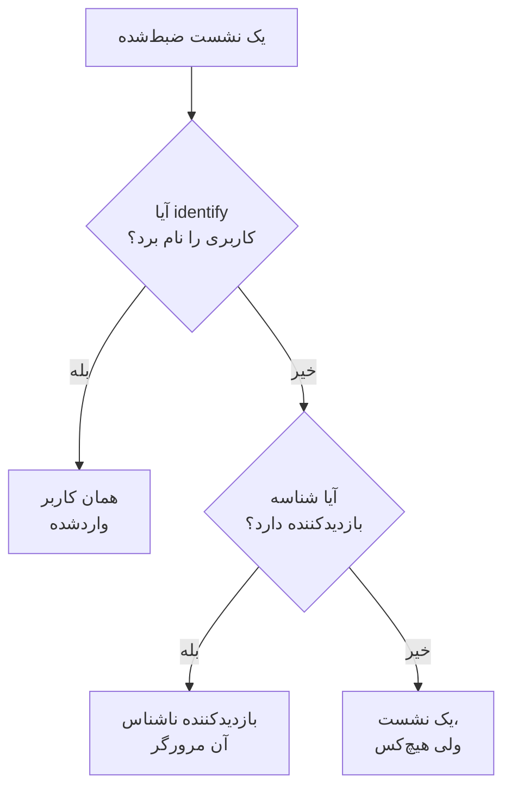

# تحلیل محصول

تحلیل محصول افرادی را که از یک برنامه RUM استفاده می‌کنند، روند نشست‌هایشان و کارهایی را که انجام می‌دهند می‌شمارد: کاربران فعال، جدید، بازگشتی، واردشده و غیرفعال، نشست‌ها بر اساس دستگاه، مرورگر، کشور و صفحه، و رویدادهایی که برنامه شما می‌فرستد، به‌صورت روند، قیف و ماندگاری. این بخش نشست‌هایی را که [بازپخش نشست](/docs/telemetry/session-replay) ضبط می‌کند و رویدادهایی را که ضبط‌کننده آن می‌فرستد می‌شمارد، پس به قطعه‌کد جداگانه‌ای نیاز ندارد، و عددهایش را ۱۳ ماه نگه می‌دارد، مدت‌ها پس از آنکه ضبط‌ها منقضی شده‌اند.

:::cards
- [کاربران](#کاربران): کاربران فعال، جدید، بازگشتی، واردشده، کل و غیرفعال.
- [نشست‌ها](#نشستها): چند تا، چه مدت، و بر اساس دستگاه، مرورگر، کشور و صفحه.
- [فرستادن رویدادها و متریک‌ها](#فرستادن-رویدادها-و-متریکها): کارهایی که افراد انجام می‌دهند، و عددهایی که صفحه شما اندازه می‌گیرد.
- [رویدادها](#رویدادها): چیزی چند بار رخ داده، چه کسی آن را انجام داده و کجا.
- [قیف‌ها](#قیفها): چه کسی گام‌به‌گام پیش رفته و چقدر طول کشیده.
- [ماندگاری کاربران](#ماندگاری-کاربران): چه کسی برگشته، کوهورت به کوهورت.
:::

## افراد چگونه شمرده می‌شوند

منوی کناری هر برنامه بخشی به نام **تحلیل محصول** دارد: **کاربران**، **نشست‌ها**، **رویدادها**، **قیف‌ها**، **ماندگاری کاربران**، **جریان‌های کاربر** و **تنظیمات تحلیل**. **کاربران** و **نشست‌ها** نشست‌هایی را می‌شمارند که بازپخش نشست ضبط می‌کند، پس با شروع ضبط‌کننده برنامه شروع می‌شوند، و نشستی که سیاست بازپخش ضبطش نمی‌کند شمرده نمی‌شود. هر نشست برای یک نفر شمرده می‌شود، یا برای هیچ‌کس:



- **هر کاربر واردشده یک بار شمرده می‌شود**، در هر مرورگر و دستگاهی که به کار می‌برد: او با درهم‌سازی یک‌طرفه ارجاعی شناخته می‌شود که صفحه شما به `identify()` داده است (نگاه کنید به [کاربرانتان را شناسایی کنید](/docs/telemetry/session-replay#کاربرانتان-را-شناسایی-کنید)).
- **هر مرورگر ناشناس یک بار شمرده می‌شود**، با [شناسه بازدیدکننده ناشناس](/docs/telemetry/session-replay#بازدیدکنندگان-ناشناس) خودش. دو مرورگر دو بازدیدکننده‌اند، و نشست‌هایی که یک مرورگر پیش از ورود کسی در آن داشته، از آنِ بازدیدکننده‌اش می‌مانند.
- **نشستی از یک ضبط‌کننده قدیمی‌تر**، که شناسه بازدیدکننده نمی‌فرستاد، به‌عنوان نشست شمرده می‌شود ولی به‌عنوان یک نفر نه.

**رویدادها**، **قیف‌ها** و **ماندگاری کاربران** افراد را به همین شیوه می‌شمارند، از روی رویدادهایی که ضبط‌کننده از هر نشست، ضبط‌شده یا نه، می‌فرستد (نگاه کنید به [فرستادن رویدادها و متریک‌ها](#فرستادن-رویدادها-و-متریکها)).

روزها در منطقه زمانی خودتان شمرده می‌شوند.

## کاربران

**کاربران** افراد بازه‌ای را که انتخاب می‌کنید می‌شمارد:

| کاشی | چه چیزی را می‌شمارد |
| --- | --- |
| **کاربران فعال** | هر کسی که در این بازه آمده: هر کاربر واردشده یک بار و هر مرورگر ناشناس یک بار. |
| **کاربران جدید** | کاربران فعالی که نخستین بازدیدشان در این بازه بوده است. |
| **کاربران بازگشتی** | کاربران فعالی که پیش از آغاز این بازه هم آمده بودند. |
| **کاربران واردشده** | کاربران فعالی که برنامه شما با `identify()` واردشان کرده، و سهمشان از همه کاربران فعال. |
| **کل کاربران** | هر کسی که برنامه در ۱۳ ماه گذشته دیده است. |
| **کاربران غیرفعال** | افرادی که پیش‌تر آمده‌اند ولی در ۳۰ روز گذشته نیامده‌اند، یا در ۷، ۱۴، ۶۰ یا ۹۰ روزی که انتخاب می‌کنید. |

سه کاشی نخست همچنین نشان می‌دهند نسبت به دوره پیش از بازه چه تغییری کرده‌اند. زیر کاشی‌ها، **کاربران فعال** برای هر روز افرادی را که آن روز آمده‌اند، افرادی را که در ۷ روزِ منتهی به آن آمده‌اند و افرادی را که در ۳۰ روزِ منتهی به آن آمده‌اند رسم می‌کند، و **کاربران جدید و بازگشتی** افراد هر روز را به دو دسته تقسیم می‌کند.

**افراد** همه کسانی را که کاشی‌ها می‌شمارند فهرست می‌کند، هر نفر یک سطر، با تازه‌ترین دیده‌شده‌ها در آغاز، و فیلترش افراد یک کاشی، بازدیدکنندگان ناشناس یا همه را نشان می‌دهد. با باز کردن یک نفر، نخستین و آخرین بازدید او و همه نشست‌هایش در ۱۳ ماه گذشته را می‌بینید، و هر نشستی که ضبطش هنوز نگه داشته می‌شود **تماشا** دارد.

## نشست‌ها

**نشست‌ها** نشست‌هایی را که در این بازه آغاز شده‌اند می‌شمارد: **نشست‌ها**، **نشست‌های کاربران واردشده**، **میانه مدت نشست**، **صفحه در هر نشست**، **نشست‌های دارای خطا** و **نشست‌های همراه با کلافگی**. زیر کاشی‌ها:

- **نشست‌ها بر اساس دستگاه** نشست‌های هر روز را بر اساس رایانه‌های رومیزی، گوشی‌ها و تبلت‌ها رسم می‌کند. نشست یک برنامه موبایل روی صفحه‌ای که ضلع کوتاه‌ترش ۶۰۰ نقطه یا بیشتر است، نشست تبلت شمرده می‌شود.
- **مدت نشست** نشست‌های پایان‌یافته را بر اساس مدتشان دسته‌بندی می‌کند، از کمتر از ۱۰ ثانیه تا بیش از ۳۰ دقیقه. نشستی که هنوز در حال ضبط است هنوز مدتی ندارد.
- **تفکیک** کاربران و نشست‌ها را بر اساس نوع دستگاه، مرورگر، سیستم‌عامل، کشور، نسخه برنامه، صفحه ورود یا صفحه مرتب می‌کند، با بیشترین کاربران در آغاز.

## فرستادن رویدادها و متریک‌ها

رویدادها تا وقتی فرستاده می‌شوند که **فرستادن رویدادهای تحلیل محصول** در صفحه **تنظیمات تحلیل** برنامه روشن باشد. این گزینه برای برنامه تازه از آغاز روشن است، و برای برنامه‌ای که پیش از وجود آن ساخته شده خاموش، پس آنجا روشنش کنید. بازپخش نشست هم باید برای برنامه روشن باشد، چون ضبط‌کننده آن رویدادها را می‌فرستد؛ ضبط‌کننده React Native هنوز هیچ رویدادی نمی‌فرستد.

هر نشستی که ضبط‌کننده مرورگر در آن اجرا می‌شود، آغاز خود و هر صفحه‌ای را که می‌بیند خودش می‌فرستد، از جمله تغییر مسیرهای یک برنامه تک‌صفحه‌ای، چه نمونه‌گیری و سیاست بازپخش آن نشست را ضبط کنند چه نه. رویدادها و عددهای خودتان از کد صفحه‌تان می‌آیند:

```js
OneUptimeReplay.track("Signed up", { plan: "pro" });
OneUptimeReplay.metric("cart.value", 42.5, { currency: "EUR" });
```

| فراخوانی | چه می‌فرستد |
| --- | --- |
| `track(name, properties?)` | رویدادی که **رویدادها**، **قیف‌ها** و **ماندگاری کاربران** می‌شمارند، و نشانگری روی خط زمانی بازپخش وقتی نشست ضبط می‌شود. مقدار `name` ≤ ۶۴ نویسه؛ ≤ ۲۰ ویژگی با مقدار رشته، عدد یا بولی، کلید ≤ ۴۰ نویسه، مقدار ≤ ۲۰۰ نویسه. |
| `metric(name, value, attributes?)` | عددی که صفحه شما اندازه گرفته، به‌عنوان نقطه‌ای از یک متریک برنامه (نگاه کنید به [داشبوردها و هشدارها](#داشبوردها-و-هشدارها)). مقدار `name` ≤ ۱۰۰ نویسه از حروف، رقم‌ها، `_`، `.`، `-` و `/`، که با یک حرف آغاز می‌شود و نه با `oneuptime.`؛ مقدار `value` یک عدد متناهی؛ و `attributes` مانند ویژگی‌های `track()`. |

پیش از بارگذاری ضبط‌کننده، همین فراخوانی‌ها را به‌صورت `["track", name, properties]` و `["metric", name, value, attributes]` در `window.OneUptimeReplayQueue` بگذارید (نگاه کنید به [API جاوااسکریپت](/docs/telemetry/session-replay#api-جاوااسکریپت)).

- **هر نشست، ضبط‌شده یا نه.** نمونه‌گیری و سیاست ارسال بازپخش تعیین می‌کنند کدام نشست‌ها ضبط شوند، نه کدام شمرده شوند. زیر Do Not Track یا Global Privacy Control چیزی فرستاده نمی‌شود، و از مبدایی که برنامه اجازه نمی‌دهد چیزی نگه داشته نمی‌شود. وقتی سیاست رضایت می‌خواهد، رویدادها منتظر `grantConsent()` می‌مانند، حداکثر ۵۰۰ تا، و `revokeConsent()` آن‌ها را دور می‌اندازد.
- **پوشانده مانند ضبط.** زیر _Mask all text_، مقدار ویژگی‌ها و صفت‌ها پیش از ترک صفحه پوشانده می‌شوند. هر صفحه به‌صورت مسیرش فرستاده می‌شود، بدون رشته پرس‌وجو و قطعه.
- **در دسته‌های کوچک**، هر ۵ ثانیه و وقتی زبانه پنهان می‌شود. رویدادی که بیش از ۳ روز پس از رخ دادنش به OneUptime برسد دور انداخته می‌شود، و یک پروژه می‌تواند در هر دقیقه ۶۰٬۰۰۰ رویداد و نقطه متریک بفرستد، همه برنامه‌هایش با هم؛ فراتر از آن، ضبط‌کننده صبر می‌کند و دوباره آن‌ها را می‌فرستد.

فراخوانی `metric()` تا وقتی رویدادها خاموش‌اند چیزی نمی‌فرستد، و `getDiagnostics().productAnalytics` می‌گوید روشن‌اند یا نه (نگاه کنید به [`getDiagnostics()`](/docs/telemetry/session-replay#getdiagnostics)).

### ویژگی‌های کاربر

برای تفکیک و بخش‌بندی رویدادها بر اساس کسی که انجامشان داده، کلیدهای خصیصه‌های `identify()` را زیر **ویژگی‌های کاربر برای تحلیل** در **تنظیمات تحلیل** فهرست کنید، مثلاً `["plan", "role"]`، حداکثر ۲۰ تا، که دقیقاً همان‌طور که نوشته شده‌اند تطبیق داده می‌شوند. آنگاه هر رویداد این خصیصه‌های کاربر واردشده را همراه دارد، همان‌طور که صفحه شما آن‌ها را به `identify()` داده است. خصیصه‌های دیگر هرگز صفحه را ترک نمی‌کنند، و تا وقتی **ثبت هویت کاربر نهایی** خاموش است هیچ‌کدام ترک نمی‌کند. خصیصه‌هایی را که داده شخصی دارند، مانند نشانی ایمیل، فهرست نکنید.

## رویدادها

**رویدادها** هر بار یک رویداد را نشان می‌دهد: پرتکرارترین رویداد برنامه شما تا وقتی رویداد دیگری انتخاب کنید، یا پربازدیدترین صفحه تا وقتی برنامه هیچ رویدادی نمی‌فرستد. فهرست انتخاب **نشست آغاز شد** و هر صفحه دیده‌شده را هم دارد، و **همهٔ رویدادها** در پایین همه رویدادهای بازه را با شمار دفعاتی که رخ داده‌اند و شمار افرادی که انجامشان داده‌اند فهرست می‌کند؛ یکی را انتخاب کنید تا در بالا ببینیدش.

- کاشی‌ها **رویدادها** رویداد را، همراه با میانگین آن برای هر نفر، و **کاربران** و **نشست‌ها** آن را می‌شمارند.
- **رویدادها و کاربران** برای هر روز شمار رخ دادن رویداد و شمار افرادی را که آن روز انجامش داده‌اند رسم می‌کند.
- **تفکیک** رویداد را بر اساس نوع دستگاه، مرورگر، سیستم‌عامل، کشور، نسخه برنامه، صفحه، ویژگی رویداد یا ویژگی کاربر مرتب می‌کند، با رویدادها، کاربران و سهم هر مقدار. مقداری را انتخاب کنید تا فقط همان نمایش داده شود.

**سگمنت** صفحه را به رویدادهایی محدود می‌کند که فیلدهایشان مقدارهای انتخابی شما را دارند: **افزودن فیلتر**، سپس یک فیلد و یک مقدار، با تطبیق دقیق. هر سگمنت حداکثر ۵ فیلتر دارد، و رویداد باید با همه آن‌ها جور باشد. نشانی صفحه رویداد، بازه، سگمنت و تفکیک را نگه می‌دارد، پس یک پیوند همان نما را باز می‌کند.

## قیف‌ها

**قیف‌ها** افراد را در ۲ تا ۶ گام به ترتیب دنبال می‌کند، که هر کدام رویدادی است همان‌طور که **رویدادها** فهرستشان می‌کند. از میان افرادی که گام نخست را در بازه انجام داده‌اند، می‌شمارد چند نفر پس از آن گام دوم را انجام داده‌اند، سپس گام سوم را، همه در زمانی که از گام نخستشان انتخاب می‌کنید: **ظرف ۱ ساعت**، **ظرف ۱ روز**، **ظرف ۷ روز**، **ظرف ۱۴ روز** یا **ظرف ۳۰ روز**. **افزودن مرحله** یک گام می‌افزاید.

زیر **تبدیل** سهم افرادی که همه گام‌ها را انجام داده‌اند آمده است، و برای هر گام، چند نفر به آن رسیده‌اند، این چه سهمی از افراد گام نخست است، چند نفر از گام پیشین به بعد ریزش کرده‌اند، و میانه زمانی که از آنجا صرف کرده‌اند. کسی که بیش از یک بار تلاش کرده، یک بار شمرده می‌شود، بر پایه تلاشی که از همه پیش‌تر رفته است.

سگمنت یک قیف، و سگمنت یک جدول ماندگاری، فیلدهایی را که هر رویداد همراه دارد و ویژگی‌های کاربر را به کار می‌برد، نه ویژگی‌های خود یک رویداد را، چون گام‌هایش رویدادهای متفاوتی هستند.

## ماندگاری کاربران

**ماندگاری کاربران** افراد را بر اساس روز، هفته یا ماهی از بازه که نخستین بار یک رویداد را انجام داده‌اند، **افرادی که انجام دادند**، گروه‌بندی می‌کند و نشان می‌دهد چه سهمی از هر گروه رویداد دیگری را، **و برگشتند تا انجام دهند**، در آن دوره و در هر دوره پس از آن انجام داده‌اند. هر دو تا وقتی رویدادهای دیگری انتخاب کنید **نشست آغاز شد** هستند.

**کوهورت‌ها** دوره را تعیین می‌کند: **روزانه**، **هفتگی** یا **ماهانه**. وقتی بازه بیش از دوره‌هایی را که یک جدول نشان می‌دهد در بر دارد، یعنی ۳۲ روز، ۲۶ هفته یا ۱۳ ماه، صفحه کوهورت‌ها را بلندتر می‌کند و این را می‌گوید.

هر سطر یک کوهورت و شمار افراد آن است، و هر خانه سهمی از آن‌ها که در آن دوره برگشته‌اند، هر چه بیشتر، تیره‌تر. دوره‌ای که هنوز آغاز نشده خالی می‌ماند.

## داشبوردها و هشدارها

هر رویداد دقیقه به دقیقه به‌عنوان یک متریک برنامه نیز شمرده می‌شود، و هر فراخوانی `metric()` نقطه‌ای از یک متریک جداگانه با نامی است که می‌دهد. آن‌ها را در صفحه **متریک‌ها** برنامه نمودار کنید، به یک داشبورد بیفزایید، یا با یک مانیتور متریکی رویشان هشدار بگذارید؛ **باز کردن متریک‌ها** زیر **همهٔ رویدادها** آن صفحه را باز می‌کند.

| متریک | چه می‌شمارد | بر اساس |
| --- | --- | --- |
| `oneuptime.rum.product.events` | رویدادهای `track()` شما، هر دقیقه | `event.name` |
| `oneuptime.rum.product.sessions` | نشست‌هایی که آغاز شده‌اند، هر دقیقه | `device.type` |
| `oneuptime.rum.product.page.views` | صفحه‌های دیده‌شده، هر دقیقه | `device.type` |

این سه صورت‌حساب نمی‌شوند، و `metric()` نامی را که با `oneuptime.` آغاز شود رد می‌کند، پس هیچ چیزی که صفحه شما می‌فرستد جای آن‌ها جا زده نمی‌شود. نقطه‌های `metric()` شما مانند دیگر متریک‌های برنامه نگه داشته و صورت‌حساب می‌شوند.

## حریم خصوصی و نگهداری

- **۱۳ ماه.** عددهای هر ماه در نخستین روزِ سیزدهمین ماه پس از آن حذف می‌شوند، پس ۱۲ ماه کامل اخیر همیشه در دسترس است، هر چه باشد نگهداری خود ضبط‌ها (به‌طور پیش‌فرض ۷ روز). رویدادها هم به همین شیوه نگه داشته می‌شوند.
- **بدون ذخیره نام.** عددها کلید یک‌طرفه کاربر واردشده و شناسه بازدیدکننده مرورگر را نگه می‌دارند، هرگز ارجاع یا نشانی IP را، و از خصیصه‌ها فقط ویژگی‌های کاربری را که فهرست می‌کنید. یک سطر نام کاربر واردشده را فقط تا وقتی نشان می‌دهد که یکی از ضبط‌های او هنوز نگه داشته می‌شود، و فقط به نقشی که می‌تواند هویت را بخواند؛ در غیر این صورت **کاربر واردشده** یا **بازدیدکننده ناشناس** و آغاز شناسه را نشان می‌دهد.
- **پاک‌شدن بنا به درخواست.** یک درخواست پاک‌سازی عددها و رویدادهای متناظر را اینجا هم حذف می‌کند (نگاه کنید به [پاک کردن نشست‌ها](/docs/telemetry/session-replay#پاک-کردن-نشستها)).

## چه کسی می‌تواند آن را ببیند

خواندن این صفحه‌ها همان چیزی را می‌خواهد که خواندن فهرست نشست‌ها: `ReadRumSessionReplay` (_List Session Replays_) یا `ReadRumSessionReplayPayload` (_Watch Session Replays_)، که مالکان و مدیران پروژه دارند. دیدن اینکه یک کاربر واردشده کیست، و جستجوی افراد بر اساس نام، به مجوز هویتی نیاز دارد که در [چه کسی می‌تواند ضبطی را تماشا کند](/docs/telemetry/session-replay#چه-کسی-میتواند-ضبطی-را-تماشا-کند) توضیح داده شده است.

روشن یا خاموش کردن رویدادها به `EditRumApplication` (_Edit RUM Application_) یا نقش مالک، مدیر یا عضو پروژه نیاز دارد. فهرست کردن ویژگی‌های کاربر به `EditRumApplication` یا نقش مالک یا مدیر نیاز دارد، چون تعیین می‌کند چه چیزی درباره افراد واردشده نگه داشته شود.

## گام‌های بعدی

:::cards
- [بازپخش نشست](/docs/telemetry/session-replay): نشست‌هایی را که این صفحه‌ها می‌شمارند ضبط و تماشا کنید.
- [مدیریت برنامه‌ها](/docs/rum/applications): نام‌ها، برچسب‌ها، مالکان و نگهداری.
- [نمای کلی RUM](/docs/rum/index): یک برنامه RUM دیگر چه چیزهایی نشان می‌دهد.
:::
