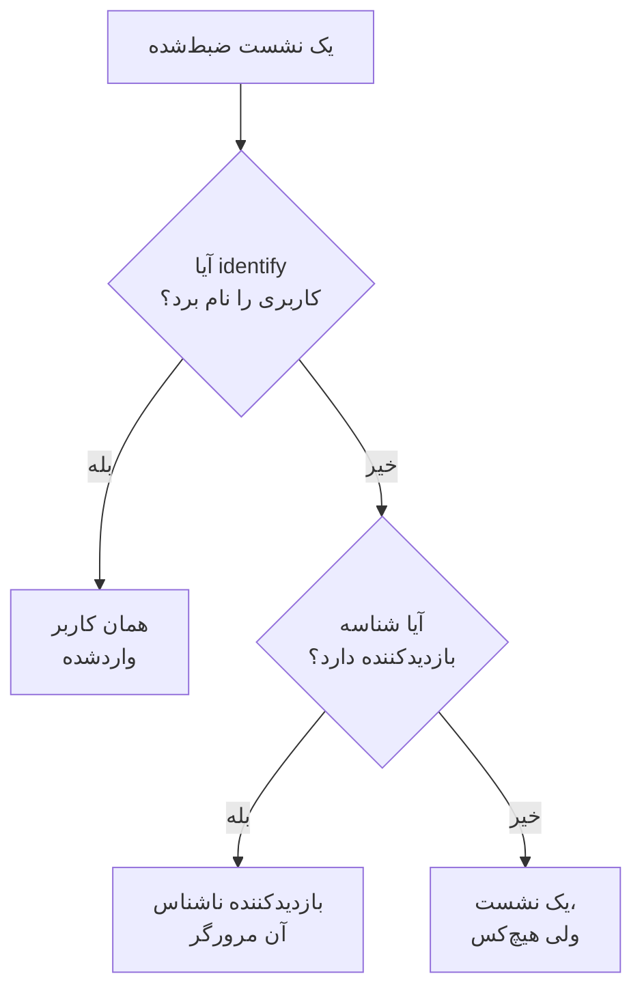

# تحلیل محصول

تحلیل محصول افرادی را که از یک برنامه RUM استفاده می‌کنند و روند نشست‌هایشان را می‌شمارد: کاربران فعال، جدید، بازگشتی، واردشده و غیرفعال، و نشست‌ها بر اساس دستگاه، مرورگر، کشور و صفحه. این بخش نشست‌هایی را می‌شمارد که [بازپخش نشست](/docs/telemetry/session-replay) ضبط می‌کند، پس به قطعه‌کد جداگانه‌ای نیاز ندارد، و عددهایش را ۱۳ ماه نگه می‌دارد، مدت‌ها پس از آنکه ضبط‌ها منقضی شده‌اند.

:::cards
- [افراد چگونه شمرده می‌شوند](#افراد-چگونه-شمرده-میشوند): هر کاربر واردشده یک بار، هر مرورگر ناشناس یک بار.
- [کاربران](#کاربران): کاربران فعال، جدید، بازگشتی، واردشده، کل و غیرفعال.
- [نشست‌ها](#نشستها): چند تا، چه مدت، و بر اساس دستگاه، مرورگر، کشور و صفحه.
- [حریم خصوصی و نگهداری](#حریم-خصوصی-و-نگهداری): ۱۳ ماه، بدون ذخیره نام، پاک‌شدن بنا به درخواست.
:::

## افراد چگونه شمرده می‌شوند

منوی کناری هر برنامه بخشی به نام **تحلیل محصول** دارد با دو صفحه، **کاربران** و **نشست‌ها**. هر دو نشست‌هایی را می‌شمارند که بازپخش نشست ضبط می‌کند، پس با شروع ضبط‌کننده برنامه شروع می‌شوند، و نشستی که سیاست بازپخش ضبطش نمی‌کند شمرده نمی‌شود. هر نشست برای یک نفر شمرده می‌شود، یا برای هیچ‌کس:

- **هر کاربر واردشده یک بار شمرده می‌شود**، در هر مرورگر و دستگاهی که به کار می‌برد: او با درهم‌سازی یک‌طرفه ارجاعی شناخته می‌شود که صفحه شما به `identify()` داده است (نگاه کنید به [کاربرانتان را شناسایی کنید](/docs/telemetry/session-replay#کاربرانتان-را-شناسایی-کنید)).
- **هر مرورگر ناشناس یک بار شمرده می‌شود**، با [شناسه بازدیدکننده ناشناس](/docs/telemetry/session-replay#بازدیدکنندگان-ناشناس) خودش. دو مرورگر دو بازدیدکننده‌اند، و نشست‌هایی که یک مرورگر پیش از ورود کسی در آن داشته، از آنِ بازدیدکننده‌اش می‌مانند.
- **نشستی از یک ضبط‌کننده قدیمی‌تر**، که شناسه بازدیدکننده نمی‌فرستاد، به‌عنوان نشست شمرده می‌شود ولی به‌عنوان یک نفر نه.

روزها در منطقه زمانی خودتان شمرده می‌شوند.

## کاربران

**کاربران** افراد بازه‌ای را که انتخاب می‌کنید می‌شمارد:

| کاشی | چه چیزی را می‌شمارد |
| --- | --- |
| **کاربران فعال** | هر کسی که در این بازه آمده: هر کاربر واردشده یک بار و هر مرورگر ناشناس یک بار. |
| **کاربران جدید** | کاربران فعالی که نخستین بازدیدشان در این بازه بوده است. |
| **کاربران بازگشتی** | کاربران فعالی که پیش از آغاز این بازه هم آمده بودند. |
| **کاربران واردشده** | کاربران فعالی که برنامه شما با `identify()` واردشان کرده، و سهمشان از همه کاربران فعال. |
| **کل کاربران** | هر کسی که برنامه در ۱۳ ماه گذشته دیده است. |
| **کاربران غیرفعال** | افرادی که پیش‌تر آمده‌اند ولی در ۳۰ روز گذشته نیامده‌اند، یا در ۷، ۱۴، ۶۰ یا ۹۰ روزی که انتخاب می‌کنید. |

سه کاشی نخست همچنین نشان می‌دهند نسبت به دوره پیش از بازه چه تغییری کرده‌اند. زیر کاشی‌ها، **کاربران فعال** برای هر روز افرادی را که آن روز آمده‌اند، افرادی را که در ۷ روزِ منتهی به آن آمده‌اند و افرادی را که در ۳۰ روزِ منتهی به آن آمده‌اند رسم می‌کند، و **کاربران جدید و بازگشتی** افراد هر روز را به دو دسته تقسیم می‌کند.

**افراد** همه کسانی را که کاشی‌ها می‌شمارند فهرست می‌کند، هر نفر یک سطر، با تازه‌ترین دیده‌شده‌ها در آغاز، و فیلترش افراد یک کاشی، بازدیدکنندگان ناشناس یا همه را نشان می‌دهد. با باز کردن یک نفر، نخستین و آخرین بازدید او و همه نشست‌هایش در ۱۳ ماه گذشته را می‌بینید، و هر نشستی که ضبطش هنوز نگه داشته می‌شود **تماشا** دارد.

## نشست‌ها

**نشست‌ها** نشست‌هایی را که در این بازه آغاز شده‌اند می‌شمارد: **نشست‌ها**، **نشست‌های کاربران واردشده**، **میانه مدت نشست**، **صفحه در هر نشست**، **نشست‌های دارای خطا** و **نشست‌های همراه با کلافگی**. زیر کاشی‌ها:

- **نشست‌ها بر اساس دستگاه** نشست‌های هر روز را بر اساس رایانه‌های رومیزی، گوشی‌ها و تبلت‌ها رسم می‌کند. نشست یک برنامه موبایل روی صفحه‌ای که ضلع کوتاه‌ترش ۶۰۰ نقطه یا بیشتر است، نشست تبلت شمرده می‌شود.
- **مدت نشست** نشست‌های پایان‌یافته را بر اساس مدتشان دسته‌بندی می‌کند، از کمتر از ۱۰ ثانیه تا بیش از ۳۰ دقیقه. نشستی که هنوز در حال ضبط است هنوز مدتی ندارد.
- **تفکیک** کاربران و نشست‌ها را بر اساس نوع دستگاه، مرورگر، سیستم‌عامل، کشور، نسخه برنامه، صفحه ورود یا صفحه مرتب می‌کند، با بیشترین کاربران در آغاز.

## حریم خصوصی و نگهداری

- **۱۳ ماه.** عددهای هر ماه در نخستین روزِ سیزدهمین ماه پس از آن حذف می‌شوند، پس ۱۲ ماه کامل اخیر همیشه در دسترس است، هر چه باشد نگهداری خود ضبط‌ها (به‌طور پیش‌فرض ۷ روز).
- **بدون ذخیره نام.** عددها کلید یک‌طرفه کاربر واردشده و شناسه بازدیدکننده مرورگر را نگه می‌دارند، هرگز ارجاع، ویژگی‌ها یا نشانی IP را. یک سطر نام کاربر واردشده را فقط تا وقتی نشان می‌دهد که یکی از ضبط‌های او هنوز نگه داشته می‌شود، و فقط به نقشی که می‌تواند هویت را بخواند؛ در غیر این صورت **کاربر واردشده** یا **بازدیدکننده ناشناس** و آغاز شناسه را نشان می‌دهد.
- **پاک‌شدن بنا به درخواست.** یک درخواست پاک‌سازی عددهای متناظر را اینجا هم حذف می‌کند (نگاه کنید به [پاک کردن نشست‌ها](/docs/telemetry/session-replay#پاک-کردن-نشستها)).

## چه کسی می‌تواند آن را ببیند

خواندن این دو صفحه همان چیزی را می‌خواهد که خواندن فهرست نشست‌ها: `ReadRumSessionReplay` (_List Session Replays_) یا `ReadRumSessionReplayPayload` (_Watch Session Replays_)، که مالکان و مدیران پروژه دارند. دیدن اینکه یک کاربر واردشده کیست، و جستجوی افراد بر اساس نام، به مجوز هویتی نیاز دارد که در [چه کسی می‌تواند ضبطی را تماشا کند](/docs/telemetry/session-replay#چه-کسی-میتواند-ضبطی-را-تماشا-کند) توضیح داده شده است.

## گام‌های بعدی

:::cards
- [بازپخش نشست](/docs/telemetry/session-replay): نشست‌هایی را که این صفحه‌ها می‌شمارند ضبط و تماشا کنید.
- [مدیریت برنامه‌ها](/docs/rum/applications): نام‌ها، برچسب‌ها، مالکان و نگهداری.
- [نمای کلی RUM](/docs/rum/index): یک برنامه RUM دیگر چه چیزهایی نشان می‌دهد.
:::
