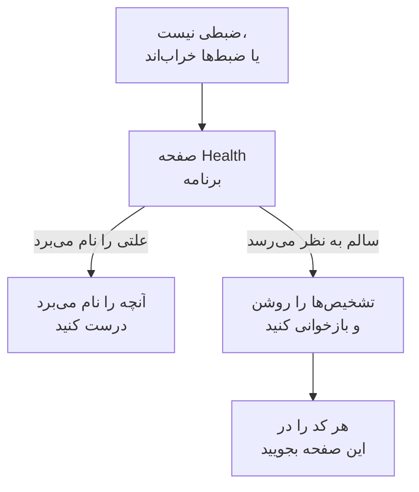

# رفع اشکال بازپخش نشست

وقتی هیچ ضبطی نمی‌رسد، یا خراب می‌رسد، این صفحه دلیلش را پیدا می‌کند. بازپخش نشست به‌طور پیش‌فرض هر نشستی را ضبط و همان‌طور که پیش می‌رود ارسال می‌کند، پس صفحه‌ای سالم تا وقتی کاربر کاری انجام می‌دهد تقریباً هر ۱۵ ثانیه یک قطعه می‌فرستد. زبانه‌ای بیکار رویدادی تولید نمی‌کند و چیزی نمی‌فرستد، و پس از پنج دقیقه بدون ورودی ضبط‌کننده یکسره متوقف می‌شود (`recording-paused-idle`)، پس پیش از آنکه از روی زبانه Network درباره نصب داوری کنید ماوس را حرکت دهید یا کلیک کنید. اگر حتی آنگاه هم هیچ درخواستی به OneUptime نمی‌بینید، یکی از موارد پایین دلیلش است.

:::cards
- [تشخیص‌ها را روشن کنید](#تشخیصها-را-روشن-کنید): کاری کنید ضبط‌کننده هر تصمیم را در کنسول توضیح دهد.
- [کدها](#کدها): هر خطی که ضبط‌کننده چاپ می‌کند، و کاری که باید درباره‌اش کرد.
- [دیواره آتشی جلوی OneUptime قطعه‌ها را رد می‌کند](#دیواره-آتشی-جلوی-oneuptime-قطعهها-را-رد-میکند): قاعده‌هایی که باید بررسی کرد، و استثناهایی که باید افزود.
- [تصویرها، آیکون‌ها یا سبک‌ها در بازپخش غایب‌اند](#تصویرها-آیکونها-یا-سبکها-در-بازپخش-غایباند): ضبط‌هایی که پخش می‌شوند، اما نه آن‌گونه که کاربرتان دید.
:::



تنها تنظیمی که در آن سکوت عادی است ارسال _On error or frustration_ (`OnErrorOrFrustration`) است: ضبط‌کننده آنگاه بافری چرخان در حافظه نگه می‌دارد و فقط وقتی چیزی خراب شود ارسال می‌کند، که تا شلیک شدن تریگری درست مانند نصبی خراب به نظر می‌رسد. پیش از آنکه دنبال چیز دیگری بگردید بررسی کنید روی کدام هستید: خط `config-accepted` در پایین آن را چاپ می‌کند.

اگر می‌توانید از سوی کارساز آغاز کنید. صفحه **سلامت** برنامه، در بخش **بازپخش نشست** منوی کناری‌اش، وقتی چیزی نمی‌رسد علت را نام می‌برد: ضبط‌کننده هرگز بارگذاری نشد، بارگذاری شد اما چیزی ارسال نشد و چرا، ارسال‌ها رد می‌شوند و به چه دلیل، یا بودجه خرج شده است. [سلامت ضبط](/docs/telemetry/session-replay#سلامت-ضبط) را ببینید. آنچه در پی می‌آید سوی مرورگر است: تشخیص‌ها را روشن کنید، یک بار بازخوانی کنید، و کنسول را بخوانید.

ضبط‌ها می‌رسند، اما با تصویرهای شکسته، آیکون‌های غایب یا ناحیه‌های بی‌سبک پخش می‌شوند؟ این پرسشی درباره پخش است که پاسخش در [تصویرها، آیکون‌ها یا سبک‌ها در بازپخش غایب‌اند](#تصویرها-آیکونها-یا-سبکها-در-بازپخش-غایباند) آمده است.

## تشخیص‌ها را روشن کنید

هر کلیدی را که دستتان به آن می‌رسد برگزینید. همه همان کار را می‌کنند.

:::tabs
@tab در مرورگر
در مرورگری که شکست می‌خورد. به استقرار دوباره نیازی ندارد، در تولید کار می‌کند، و پس از بازخوانی‌ها هم می‌ماند:

```js
localStorage.setItem("oneuptime.sessionReplay.debug", "true");
// then reload the page
```

دوباره با این خاموشش کنید:

```js
localStorage.removeItem("oneuptime.sessionReplay.debug");
```
@tab با یک پیوند
برای کسی که فنی نیست، یا صفحه‌ای که نمی‌توانید کنسولی رویش باز کنید، `oneuptime_debug=1` را به نشانی بیفزایید. در پاره (fragment) هم کار می‌کند، که از کارسازی که پارامترهای پرس‌وجوی ناشناخته را می‌زداید جان به در می‌برد:

```text
https://your-app.example.com/checkout?oneuptime_debug=1
https://your-app.example.com/checkout#oneuptime_debug=1
```
@tab روی برچسب اسکریپت
برای محیط آزمایشی، جایی که می‌خواهید برای همه روشن باشد:

```html
<script
  src="https://oneuptime.com/telemetry/session-replay/v1/recorder.js"
  data-oneuptime-token="YOUR_TELEMETRY_INGESTION_KEY"
  data-oneuptime-app-identifier="YOUR_RUM_APP_IDENTIFIER"
  data-oneuptime-debug="true"
  crossorigin="anonymous"
  async
></script>
```
@tab در سراسری راه‌اندازی
اگر ضبط‌کننده را با سراسری راه‌اندازی پیکربندی می‌کنید:

```js
window.__ONEUPTIME_SESSION_REPLAY__ = {
  host: "https://oneuptime.com",
  token: "YOUR_TELEMETRY_INGESTION_KEY",
  appIdentifier: "YOUR_RUM_APP_IDENTIFIER",
  debug: true,
};
```
@tab روی استقرار
روی استقرار OneUptime، تنها کلیدی که به کسی پای مرورگرِ دچار مشکل نیاز ندارد. `SESSION_REPLAY_DEBUG=true` را تنظیم و راه‌اندازی دوباره کنید. هر ضبط‌کننده‌ای که این نمونه ارائه می‌دهد آنگاه روی هر صفحه‌ای که اجرا می‌شود لاگ می‌نویسد، پس روشنش کنید، یک بازخوانی را جمع‌آوری کنید، و خاموشش کنید. هیچ سیاستی را تغییر نمی‌دهد: نه نمونه‌برداری، نه پوشاندن، نه رضایت. برای دیگر تنظیم‌های استقرار [یادداشت‌های خودمیزبانی](/docs/telemetry/session-replay#یادداشتهای-خودمیزبانی) را ببینید.
@tab هنگام اجرا
همین که ضبط‌کننده بارگذاری شد:

```js
OneUptimeReplay.setDebug(true);
```
:::

خروجی چنین به نظر می‌رسد:

```text
[OneUptime Session Replay] loader-start: Loader running.
[OneUptime Session Replay] init-options-read: Init options read. {host: "https://oneuptime.com", appIdentifier: "checkout-web", …}
[OneUptime Session Replay] config-fetch-start: Requesting the policy. {url: "https://oneuptime.com/telemetry/session-replay/v1/config", …}
[OneUptime Session Replay] config-accepted: Policy accepted. {captureTrigger: "Always", samplePercentage: 100, …}
[OneUptime Session Replay] recording: Recording and uploading …
```

## گرفتن خط زمانی بدون آنکه نخست چیزی را روشن کنید

ضبط‌کننده آخرین ۲۵۰ تصمیمش را نگه می‌دارد، چه تشخیص‌ها روشن باشند چه نه. اگر مشکل پیش‌تر رخ داده، لازم نیست آن را با لاگ روشن بازتولید کنید — به‌جایش این را بخواهید:

```js
copy(JSON.stringify(OneUptimeReplay.getDiagnostics(), null, 2));
```

این نسخه ضبط‌کننده، شناسه نشست، `state` آن (`recording`، `uploading`، `not-sampled`، `stopped`…)، اینکه اگر ایستاده چرا ایستاده، `bootstrapDecision`، پاسخ هر دروازه زیر `decisions` (نمونه‌برداری شده یا نه، وضعیت رضایت، اینکه ارسال‌ها مجازند یا نه و چه چیزی جلویشان را می‌گیرد، آخرین دستور کارساز)، `capabilities` ضبط‌کننده، و فهرست کامل رکوردها را برمی‌گرداند — از جمله رکوردهای خرده‌اسکریپت راه‌انداز، که پیش از وجود فرآورده ضبط‌کننده اجرا می‌شود و بیشتر کنار کشیدن‌ها همان‌جا تصمیم گرفته می‌شوند. بنا به ساختش هیچ محتوای صفحه‌ای ندارد؛ [آنچه تشخیص‌ها هرگز در بر ندارند](#آنچه-تشخیصها-هرگز-در-بر-ندارند) را ببینید. فیلدها در [`getDiagnostics()`](/docs/telemetry/session-replay#getdiagnostics) شرح داده شده‌اند.

**اگر `OneUptimeReplay is not defined`**، فرآورده ضبط‌کننده هرگز بارگذاری نشده — که خودش پاسخ نزدیک به نیمی از کدهای پایین است، و دقیقاً همان‌جایی که بیش از همه خط زمانی را می‌خواهید. رکوردها هنوز آنجایند، روی سراسری‌ای که خرده‌اسکریپت راه‌انداز پیش از وجود فرآورده در آن می‌نویسد:

```js
copy(JSON.stringify(window.__ONEUPTIME_SESSION_REPLAY_DEBUG__.records, null, 2));
```

هر کدام را در بلیت پشتیبانی‌تان بچسبانید — یا در **Ask the browser** روی صفحه **سلامت** برنامه، که هر کدی در آن را توضیح می‌دهد. معمولاً به‌تنهایی بس است.

## وقتی سکوت عادی است: سیاست تریگرشونده با خطا

این بخش فقط وقتی صدق می‌کند که `config-accepted` مقدار `captureTrigger: "OnErrorOrFrustration"` را چاپ کرده باشد. زیر سیاست پیش‌فرض `Always` ضبط‌کننده همان‌طور که ضبط می‌کند می‌فرستد، و سکوت روی صفحه‌ای که کاربر با آن تعامل دارد یعنی واقعاً چیزی خراب است — از این بخش بگذرید و خواندن را ادامه دهید.

اگر کنسول این را می‌گوید:

```text
[OneUptime Session Replay] recording: Recording into memory. Nothing uploads until a trigger fires - call OneUptimeReplay.captureSession() to force one.
```

…آنگاه ضبط‌کننده کار می‌کند. زیر سیاستی تریگرشونده با خطا، صفحه‌ای سالم در هر بارگذاری صفحه دقیقاً یک درخواست به OneUptime می‌زند (واکشی پیکربندی) و تا وقتی خطا، یک 5xx، سیگنال سرخوردگی یا گذر از بودجه کارایی رخ ندهد چیز دیگری نمی‌فرستد.

برای اثبات کل مسیر از سر تا ته، ارسالی را وادار کنید:

```js
OneUptimeReplay.captureSession("installation test");
```

باید بی‌درنگ یک `POST /telemetry/session-replay/v1/chunk` را در زبانه Network و خط `chunk-accepted` را در کنسول ببینید. اگر دیدید، نصب درست است و بازپخش ظرف حدود یک دقیقه در داشبورد پدیدار می‌شود، با دلیل شما علامت‌خورده روی خط زمانی‌اش.

یک `202` همراه `chunk-accepted` همانی است که باید دنبالش بگردید. یک `204` به‌جایش `chunk-not-recorded` را لاگ می‌کند: درخواست درست بود و کارساز تصمیم گرفت ذخیره‌اش نکند — فراتر از بودجه، نمونه‌برداری‌نشده، یا برنامه خاموش است. این پاسخی سیاستی است، نه ایراد نصب، و خط `server-directive` کنارش می‌گوید کدام.

برای بازگشت به ضبط هر نشست، در صفحه **Replay Policy** برنامه **زمان بارگذاری ضبط** را روی _Always_ و **درصد نمونه‌گیری** را بالای ۰ بگذارید. این پیش‌فرض ارائه‌شده است.

## کدها

هر خطی یک `code` پایدار حمل می‌کند. مال خودتان را اینجا پیدا کنید.

### راه‌اندازی

| کد | معنایش |
| --- | --- |
| `loader-start` | اسکریپت ضبط‌کننده اجرا شد. اگر این را نمی‌بینید و تشخیص‌ها روشن‌اند، خودِ اسکریپت هرگز اجرا نشده — درخواست `<script>` را در زبانه Network و `script-src` در CSP خود را بررسی کنید. |
| `init-options-read` | گزینه‌ها پیدا شدند. مقدار `host` و `appIdentifier` را در جزئیات بررسی کنید: `appIdentifier` باید دقیقاً با برنامه RUM بخواند، و `host` باید مبدأ OneUptime شما باشد، نه مبدأ برنامه خودتان. |
| `init-options-incomplete` | گزینه‌ای الزامی غایب است. جزئیات می‌گوید کدام‌یک از `hasHost` / `hasToken` / `hasAppIdentifier` نادرست است. اگر `hasHost` نادرست باشد، برچسب اسکریپت `src`ای ندارد که میزبان از آن مشتق شود — `data-oneuptime-host` را بیفزایید. |
| `privacy-signal` | مرورگر Do Not Track یا Global Privacy Control می‌فرستد و به آن احترام گذاشته می‌شود — از سوی صفحه (چیزی روی برچسب اسکریپت خلافش را نمی‌گوید) یا از سوی سیاست کارساز. چیزی ضبط نمی‌شود؛ با `stage: "before-config-fetch"` درخواست پیکربندی هم زده نمی‌شود. این ایراد نیست. `data-oneuptime-respect-do-not-track="false"` را فقط وقتی بگذارید که مبنای قانونی شما واقعاً به آن سیگنال وابسته نباشد. |
| `init-options-missing` | چیزی روی صفحه برای خواندن نیست: نه برچسب `script[data-oneuptime-token]`ای و نه `window.__ONEUPTIME_SESSION_REPLAY__`. املای صفت نشانه‌گذار غلط است، قطعه کد به سند دیگری رفته، یا مدیر برچسبی انداختش. |
| `loader-threw` | اشکالی در خودِ ضبط‌کننده، نه در پیکربندی شما. لطفاً همراه خروجی تشخیص‌ها گزارشش کنید. |

### سیاست

| کد | معنایش |
| --- | --- |
| `config-fetch-start` | در آستانه درخواست سیاست. مقدار `url` در جزئیات نشانی دقیق است — بررسی کنید از یک مرورگر در دسترس باشد. |
| `config-fetch-rejected` | نقطه پایانی پاسخی غیر 2xx داد. [وضعیت‌های واکشی پیکربندی](#وضعیتهای-واکشی-پیکربندی) پایین را ببینید. |
| `config-fetch-failed` | درخواست اصلاً کامل نشد: `connect-src` در CSP، یک مسدودکننده تبلیغات، DNS، TLS، آفلاین بودن، یا مهلت ۵ ثانیه‌ای. مرورگر معمولاً خط خودش را کنار این یکی گزارش می‌کند. |
| `config-body-unparseable` | نقطه پایانی 2xx پاسخ داد، با بدنه‌ای که اصلاً JSON نیست. از `config-fetch-failed` جداست: درخواست *واقعاً* کامل شد، پس چیزی روی مسیر — پراکسی، درگاه اسیرکننده شبکه، میان‌صفحه SSO — به‌جای OneUptime پاسخ داده است. |
| `config-unparseable` | بدنه *واقعاً* JSON معتبر بود اما شیء نبود — `null`، یک رشته، یک آرایه. پراکسی‌ای که بازنویسی می‌کند، یا کارسازی که مسیر دیگری را پاسخ می‌دهد. |
| `config-disabled` | کارساز می‌گوید بازپخش اینجا خاموش است. مقدار `disabledReason` در جزئیات همان پاسخ است: [disabledReason](#disabledreason) پایین را ببینید. |
| `config-recorder-version-invalid` | سیاست دقیقاً `latest` با حروف کوچک را نام نبرد، پس هیچ نشانی فرآورده‌ای ساخته نشد. پراکسی‌ای که بازنویسی می‌کند یا پاسخی دست‌کاری‌شده — استقراری که ساختی ندارد به‌جایش `config-disabled` با `recorder-not-built` گزارش می‌دهد. |
| `config-accepted` | سیاست پذیرفته شد. جزئیات، کل سیاست است — `captureTrigger`، `samplePercentage`، `consentMode`، `maskingMode`. |
| `config-field-defaulted` | کارساز برای یکی از فیلدهای سیاست (نام‌برده در جزئیات) مقداری نفرستاد، پس این ضبط‌کننده پیش‌فرض محصول را برایش به کار برد. اطلاعاتی است: معمولاً کارسازی کهنه‌تر از ضبط‌کننده. اگر داشبورد برای آن فیلد مقدار دیگری نشان می‌دهد، OneUptime را ارتقا دهید. |
| `config-value-unrecognised` | کارساز مقداری فرستاد که این ساخت ضبط‌کننده نمی‌شناسد، پس به امن‌ترین مقدار عقب‌نشینی کرد — که ممکن است همانی نباشد که داشبوردتان نشان می‌دهد. معمولاً صفحه‌ای هنوز ضبط‌کننده استقرار کهنه‌تری را اجرا می‌کند. |
| `directive-stop` | کارساز به این ضبط‌کننده گفت کنار بکشد. سلامت ضبط برنامه را برای بودجه، محدودیت نرخ یا کلید قطع اضطراری بررسی کنید. |

#### وضعیت‌های واکشی پیکربندی

| وضعیت | چاره |
| --- | --- |
| `401` | توکن دریافت اشتباه، باطل‌شده، منقضی یا از پروژه‌ای دیگر است. یکی زیر **تنظیمات پروژه** > **تله‌متری و APM** > **کلیدهای دریافت داده** بسازید و با `GET /session-replay/v1/validate` تأییدش کنید — کلید را همان‌گونه که ضبط‌کننده می‌فرستد بفرستید و سرآیند `x-oneuptime-app-identifier` را بیفزایید، و پاسخ همچنین `isSessionReplayEnabled` آن برنامه، `sessionReplayDisabledDetail` را که وقتی روشن نیست کلید خاموش را نام می‌برد، `isIngestEnabledOnThisInstance` و `keyType` را حمل می‌کند. |
| `400` | ‏`data-oneuptime-app-identifier` غایب است. |
| `403` | مبدأ صفحه در **مبداهای مجاز** کلید دریافت نیست. بیفزاییدش، یا کلیدی به کار ببرید که فهرست مجازش این صفحه را پوشش دهد. |
| `404` | مسیر روی مبدأ OneUptime تفکیک نشد. تقریباً همیشه `data-oneuptime-host` اشتباه است — یا پراکسی معکوسی جلوی OneUptime که `/telemetry/*` را جلو نمی‌فرستد. |
| `5xx` | ایرادی سمت کارساز؛ گزارش‌های برنامه OneUptime را بررسی کنید. |

#### disabledReason

| مقدار | چه کنید |
| --- | --- |
| `not-enabled-for-application` | بازپخش نشست برای این برنامه RUM خاموش است، شناسه با هیچ برنامه‌ای نمی‌خواند، یا پروژه مجاز به بازپخش نیست. `disabledDetail` می‌گوید کدام: `application-not-enabled` (کلید همین برنامه)، `project-not-allowed` (کلید سراسر پروژه، زیر **پایش کاربر واقعی** > **تنظیمات** > **بازپخش نشست**)، `application-unknown` (هیچ برنامه‌ای این `appIdentifier` را ندارد — املا را در برابر صفحه **Replay Policy** برنامه بررسی کنید) یا `project-killed` (کلید قطع اضطراری اپراتور روی این استقرار). |
| `budget-exhausted` | بودجه بایتی روزانه پروژه یا بودجه ماهانه برنامه از پیش خرج شده، پس به ضبط‌کننده‌ها گفته می‌شود ضبط نکنند، به‌جای آنکه قطعه‌هایی بفرستند که رد خواهند شد. مقدار `disabledDetail` یا `project-daily-budget-exhausted` است یا `app-monthly-budget-exhausted`، و `budgetResetsAt` زمان پاک شدنش است. بودجه را در صفحه **Replay Policy** بالا ببرید، یا منتظر بازنشانی بمانید. |
| `recorder-not-built` | **استقرار هیچ فرآورده ضبط‌کننده‌ای ندارد.** هیچ‌چیزی روی صفحه مشتری نمی‌تواند این را درست کند. ساختی که `packages/App/FeatureSet/BrowserRecorder/public/dist/manifest.json` را تولید می‌کند اجرا نشده، یا خروجی‌اش به ایمیج در حال اجرا نرسیده است. برنامه OneUptime را دوباره بسازید و مستقر کنید. این پاسخ معمول روی نصبی خودمیزبان است که بازپخش هرگز در آن کار نکرده. |
| `disabled-by-default` | ‏`SESSION_REPLAY_ENABLED_BY_DEFAULT=false` روی این استقرار. آن را `true` بگذارید — و اگر خودمیزبانی می‌کنید نخست `SESSION_REPLAY_MAX_BYTES_PER_PROJECT_PER_DAY` را تنظیم کنید، چون بازپخش چاق‌ترین جدولی است که دارید. |
| `ingest-disabled` | ‏`SESSION_REPLAY_INGEST_ENABLED=false` روی این استقرار. |
| `policy-unavailable` | کارساز نتوانست سیاست را تفکیک کند — معمولاً Redis یا Postgres. عمداً در حالت بسته شکست می‌خورد. گزارش‌های برنامه OneUptime را بررسی کنید. |
| `not-reported` | کارساز کهنه‌تر از این فیلد است. به‌جایش پنل **Test your installation** داشبورد را در صفحه **Replay Policy** به کار ببرید. |

### فرآورده

| کد | معنایش |
| --- | --- |
| `artifact-requested` | تازه‌ترین بسته ضبط‌کننده در حال تزریق است. مقدار `url` همان نشانی دقیق است. |
| `artifact-load-failed` | بارگذاری نشد. به ترتیب احتمال: `script-src` در CSP که مبدأ OneUptime شما را مجاز نمی‌کند، ناسازگاری SRI (پراکسی‌ای که بسته را بازنویسی می‌کند)، یا یک 404 چون این استقرار ضبط‌کننده را نساخته است. |
| `artifact-url-invalid` | سیاست دقیقاً `latest` با حروف کوچک را نام نبرد، پس هیچ نشانی‌ای ساخته نشد. پاسخ پیکربندی دست‌کاری‌شده یا از پراکسی گذشته. |
| `artifact-api-missing` | بسته بارگذاری شد اما `window.OneUptimeReplay` را منتشر نکرد — اسکریپت دیگری روی صفحه رونویسی‌اش کرده است. |
| `bootstrap` | فرآورده ضبط‌کننده در حال شروع است. |
| `bootstrap-already-started` | دو نسخه از قطعه کد روی یک صفحه. یکی را بردارید. |
| `bootstrap-already-running` | ‏`bootstrap()` دوباره فراخوانده شد در حالی که ضبط‌کننده‌ای از پیش در حال اجرا بود. بی‌ضرر است؛ معمولاً یکپارچه‌سازی‌ای تکراری. |
| `bootstrap-cancelled` | یک `revokeConsent()` یا `stop()` صف‌شده روی `window.OneUptimeReplayQueue` پیش از شروع ضبط‌کننده اجرا شد، پس این نشست ضبط نمی‌شود. اگر بنر شما از پیش رد شده بود، درست است. |
| `start-stopped` | ‏`start()` روی مسیر بسته خودمیزبان سیاست قابل استفاده‌ای نگرفت. دلیل مشخص روی خط `config-*` درست بالایش است. |
| `rrweb-did-not-start` | ضبط‌کننده DOM از شروع سر باز زد. لطفاً گزارشش کنید. |
| `rrweb-error` | ضبط‌کننده DOM روی این صفحه به خطایی درونی خورد (نام خطا در جزئیات است؛ یک بار گزارش می‌شود). ضبط ممکن است حوالی آن نقطه بپرد یا یخ بزند، و پس از سه خطای این‌چنینی نشست یادداشت وفاداری‌ای حمل می‌کند که همین را می‌گوید. لطفاً همراه چارچوب صفحه و نام خطا گزارشش کنید. |

### ضبط و ارسال

| کد | معنایش |
| --- | --- |
| `not-sampled` | این نشست در قرعه نمونه‌برداری باخت، پس اصلاً هیچ‌چیزی ضبط نمی‌شود. نمونه‌برداری بر پایه شناسه نشست قطعی است، پس بازخوانی به این نشست کمکی نمی‌کند. درصد نمونه را بالا ببرید. |
| `recording` | در حال ضبط. جزئیات را بخوانید: `uploading: true` حالت عادی زیر تریگر پیش‌فرض `Always` است. `uploading: false` همراه `captureTrigger: "OnErrorOrFrustration"` آن حالت سالم دیگر و بی‌درخواست است. |
| `same-origin-propagation` | یک بار هنگام آغاز ضبط‌کننده گزارش می‌شود: آیا به درخواست‌ها به مبدأ خود صفحه زمینه ردیابی (`traceparent`، و `tracestate`ای که شناسه نشست را حمل می‌کند) می‌افزاید یا نه. `enabled: true` همراه `reason: "on"` پیش‌فرض است. `reason: "policy-off"` یعنی **انتشار ترِیس هم‌مبدأ** در صفحه **Replay Policy** برنامه خاموش است؛ `reason: "opaque-origin"` یعنی صفحه مبدأ خودش را ندارد (iframe با sandbox، `about:blank`، `srcdoc` یا `file:`)، پس هیچ‌چیز هم‌مبدأ به شمار نمی‌آید. حتی وقتی روشن است، سرآیندها فقط روی درخواست‌هایی می‌روند که هنگام فرستادن نشست زده می‌شوند، و هرگز روی `POST` به مسیری که به `/v1/traces`، `/v1/logs` یا `/v1/metrics` ختم شود (صادرات OpenTelemetry خود صفحه). یک بار دیگر هم، همراه `reason: "agent-stand-down"` و فیلد `agent` (`DD_RUM`، `NREUM` یا `elasticApm`)، گزارش می‌شود: نخستین باری در یک بارگذاری صفحه که ضبط‌کننده `traceparent` درخواستی هم‌مبدأ را به آن عامل می‌سپارد، چون آن عامل برای ردیابی آن درخواست پیکربندی شده (Datadog RUM فقط در نشستی که دنبالش می‌کند)؛ درخواست همچنان عضو `tracestate` را می‌گیرد، و فقط وقتی پیوند می‌خورد که عامل واقعاً `traceparent`ای بفرستد، که Datadog فقط در نشستی از Datadog که دنبال می‌شود و ردیابی‌اش نمونه‌برداری شده (tracked, trace-sampled) چنین می‌کند. ‏New Relic ‏(`NREUM`) `tracestate` خودش را به‌جای عضو می‌فرستد، پس درخواست‌هایش فقط بر پایه شناسه ردیابی پیوند می‌خورند ([زبانه‌های Logs و Traces پخش‌کننده خالی‌اند](#زبانههای-logs-و-traces-پخشکننده-خالیاند) را ببینید). [همبسته کردن با باقی تله‌متری‌تان](/docs/telemetry/session-replay#همبسته-کردن-با-باقی-تلهمتریتان) را ببینید. |
| `same-origin-propagation-tripped` | درخواستی که ضبط‌کننده به آن زمینه ردیابی افزوده بود در سطح شبکه شکست خورد، معمولاً درخواستی هم‌مبدأ که به مبدأی دیگر تغییر مسیر داده شده که `traceparent` و `tracestate` را مجاز نمی‌داند. ضبط‌کننده برای باقی این بارگذاری صفحه افزودنشان را متوقف کرد. `retried: true` یعنی `fetch`ای از نوع `GET` یا `HEAD` بدون بدنه بود و یک بار دیگر دقیقاً همان‌گونه که صفحه شما زده بود فرستاده شد؛ `false` یعنی نمی‌شد دوباره فرستادش و شکست خورد: هر چیزی جز `fetch`ای از نوع `GET` یا `HEAD` بدون بدنه (هر XHR، هر روش دیگر، هر درخواستی با بدنه) دوباره فرستاده نمی‌شود. لغو و پایان مهلتی که خود صفحه‌تان خواسته آن را فعال نمی‌کند، و نیز شکستی که هنگام آفلاین بودن مرورگر (به گزارش خودش) رخ دهد؛ بارگذاری بعدی صفحه از نو آغاز می‌کند. [دانلودها یا تغییر مسیرها پس از فعال کردن Session Replay شکست می‌خورند](#دانلودها-یا-تغییر-مسیرها-پس-از-فعال-کردن-session-replay-شکست-میخورند) را ببینید. |
| `trigger` | چیزی که ارزش نگه داشتن داشت رخ داد. مقدار `reason` یکی از `error`، `frustration`، `performance`، `sampled` یا `manual` است. |
| `upload-started` | پیش‌بافر انباشته در حال تخلیه است. فرستادن قطعه‌ها از اینجا شروع می‌شود. |
| `upload-blocked-consent` | تریگری شلیک شد و چیزی فرستاده نشد چون رضایت هرگز اعطا نشده بود. زیر حالت رضایت `RequireExplicit` صفحه شما باید پس از پذیرفته شدن بنرتان یک بار `OneUptimeReplay.grantConsent()` را فرا بخواند. |
| `chunk-discarded-consent` | همان علت، یک لایه پایین‌تر: قطعه‌ای کامل دور انداخته شد. |
| `chunk-accepted` | قطعه‌ای رسید و ذخیره شد. نصب کار می‌کند. |
| `chunk-not-recorded` | کارساز درخواست را گرفت و عمداً ضبطش نکرد — فراتر از بودجه، نمونه‌برداری‌نشده، برنامه غیرفعال، یا سقف قطعه به ازای هر نشست. خط `server-directive` کنارش دلیل را حمل می‌کند. نصب درست است؛ سیاست یا بودجه آن چیزی نیست که انتظار دارید. |
| `chunk-post-failed` | POST هرگز به کارساز نرسید، پیش از آنکه این صفحه هرگز ارسالی موفق داشته باشد. `connect-src` در CSP، یک مسدودکننده تبلیغ، یا CORS روی مبدأ دریافت — یا صفحه‌ای که پیش از نخستین ارسالش اتصالش را از دست داده. در شمار شکست‌های قطع‌کننده می‌آید. |
| `chunk-held-offline` | حالت آفلاین: دستگاه اتصالی ندارد (مرورگر خودش را آفلاین گزارش می‌دهد، یا درخواستی هرگز به کارسازی نرسید که پیش‌تر پاسخ داده بود). ضبط ادامه می‌یابد و قطعه منتظر می‌ماند؛ `queueDepth` شمار منتظرها و `retryInMs` زمان تلاش بعدی است. در شمار شکست‌های قطع‌کننده نمی‌آید و چیزی از دست نمی‌رود. |
| `back-online` | نخستین درخواست پس از قطعی به کارساز رسید. قطعه‌های صف‌شده، قدیمی‌ترین اول، در حال ارسال‌اند. |
| `browser-offline` | مرورگر رویداد `offline` خود را شلیک کرد. ضبط ادامه می‌یابد؛ ضبط‌کننده انباره آفلاینش را باز می‌کند تا قطعه‌های زبانه‌ای که اکنون بسته شود نگه داشته شوند. |
| `browser-online` | مرورگر رویداد `online` خود را شلیک کرد، و `queuedChunks` اکنون ارسال می‌شوند نه با زمان‌سنج تلاش دوباره. |
| `offline-queue-full` | قطعی از صف ارسال (۲۴۰ قطعه یا ۴ مگابایت) طولانی‌تر شد: به تعداد `dropped` از قدیمی‌ترین قطعه‌ها دور ریخته شدند تا تازه‌ترین‌ها بمانند. نشست جایی که آن‌ها بودند شکافی نشان می‌دهد. |
| `offline-flush-stored` | صفحه هنگام آفلاین بودن پنهان یا بسته شد، پس آخرین قطعه‌هایش به‌جای ارسال در IndexedDB مرورگر نوشته شدند. `storeOpen: false` یعنی انباره هنوز باز نشده بود و زبانه‌ای که بسته می‌شود ممکن است همچنان آن‌ها را از دست بدهد. صفحه بعدی برنامه آن‌ها را ارسال می‌کند. |
| `final-flush-deferred` | درخواست پایانی نتوانست همه قطعه‌ها را حمل کند، و باقی (`kept`) به‌جای دور ریخته شدن برای صفحه بعدی در IndexedDB نوشته شدند. |
| `offline-chunks-restored` | این صفحه `chunks`ی یافت که صفحه‌ای پیشین هنگام آفلاین بودن ضبط کرده بود و نتوانسته بود بفرستد، و آن‌ها را پیش از قطعه‌های خودش ارسال می‌کند. |
| `offline-chunk-claimed-elsewhere` | زبانه دیگری از همان برنامه قطعه‌ای را که این زبانه ذخیره کرده بود پیش‌تر ارسال کرده، پس این زبانه از آن گذشت. چیزی کم نیست. |
| `chunk-post-server-error` | کارساز 5xx پاسخ داد. ضبط‌کننده دوباره تلاش می‌کند؛ `consecutiveFailures` در برابر `maxFlushFailures` در جزئیات می‌گوید چقدر به تسلیم شدن نزدیک است. |
| `chunk-retry-scheduled` | شکستی قابل تلاش دوباره (شبکه، 5xx، یا خفه کردن از سوی کارساز) قطعه را در صف تلاش دوباره گذاشت؛ `inMs` در جزئیات مکث تا تلاش بعدی است، و `queueDepth` تعداد قطعه‌های در انتظار. هنوز چیزی از دست نرفته است. |
| `chunk-retry` | مکث تمام شد و قطعه‌های صف‌شده دوباره فرستاده می‌شوند. |
| `chunk-abandoned` | یک قطعه بارها شکست خورد و انداخته شد؛ ارسال با قطعه بعدی ادامه می‌یابد. نشست جای آن شکافی نشان خواهد داد. برای یافتن علت به خط `chunk-post-*` پیش از آن نگاه کنید. |
| `final-chunk-carried-queue` | صفحه پنهان یا بسته شد در حالی که قطعه‌هایی هنوز در صف تلاش دوباره بودند، و به‌عنوان فریم‌های اضافی همان یک درخواست پنهان‌شدن صفحه بیرون رفتند: `frames` تعدادی است که درخواست حمل کرد، `bytes` اندازه کل آن. چیزی از دست نرفت — هر چه جا نشده باشد به‌جایش با `final-flush-partial` گزارش می‌شود. |
| `final-flush-truncated` | وقتی صفحه رفت، بیش از آنچه یک درخواست keepalive می‌تواند حمل کند در بافر بود، پس قدیمی‌ترین رویدادهای قطعه پایانی انداخته شدند تا جا شود؛ `droppedEvents` می‌گوید چند تا. پایان نشست — همان بخشی که معمولاً دنبالش هستید — چیزی است که جان به در می‌برد. |
| `final-flush-partial` | درخواست پایانی نتوانست هر قطعه‌ای را که به آن داده شده بود حمل کند: `sent` فریم رفت، `dropped` نرفت. قطعه مُهرکننده نخست انتخاب می‌شود، پس آنچه از دست می‌رود قطعه‌های صف‌شده قدیمی‌ترند، و نشست جای آن‌ها شکافی نشان می‌دهد. |
| `chunk-too-large` | یک قطعه پس از فشرده‌سازی هم بالای سقف هر درخواست ماند — عکس فوری تقسیم‌ناپذیر تمام‌صفحه از DOMای بسیار بزرگ. فقط اندازه اعلام‌شده‌اش فرستاده می‌شود، کارساز 422 پاسخ می‌دهد، و نشست به‌جای شکست خوردن، در جای آن عکس فوری یادداشت وفاداری‌ای حمل می‌کند. |
| `envelope-trimmed` | ‏JSON سرآیند قطعه از محدودیت ۸ کیلوبایتی پاکت کارساز گذشت، پس فیلدهای اختیاری به این ترتیب انداخته شدند تا جا شود: شناسه‌های ردیابی، مسیرها، خصیصه‌ها، برچسب‌ها، یادداشت‌های وفاداری (`shed` فهرست می‌کند چه چیزی رفت). فیلم تأثیری نمی‌گیرد؛ ممکن است نشست بخشی از داده همبستگی یا برچسب را نداشته باشد. معمولاً ۲۰ برچسب و ۲۰ خصیصه با بیشینه طولشان روی یک نشست. |
| `final-chunk-too-large` | قطعه‌ای که هنگام کنار رفتن صفحه فرستاده شد بالای ۵۶ کیلوبایتی بود که ضبط‌کننده برای تخلیه هنگام پنهان‌شدن صفحه به خودش اجازه می‌دهد — عمداً زیر سهمیه ۶۴ کیلوبایتی ترکیبی keepalive مرورگر. با `sealed: true` آن قطعه، قطعه پایانی بود: رویدادهایش انداخته شد، پس ضبط چند ثانیه زودتر تمام می‌شود، و یک قطعه پایانی خالی به‌جایش فرستاده می‌شود تا نشست همراه زبانه پایان یابد و دنباله قطعه‌ها سوراخی نداشته باشد. با `sealed: false` قطعه پایانی نبود: به‌تمامی انداخته شد، چیزی مُهر نشد، و نشست با شکافی در جای آن قطعه باز می‌ماند. در هر دو حالت آنچه از دست می‌رود رویدادهای همان قطعه است؛ قطعه صف‌شده‌ای که نتوانست در همان درخواست برود جداگانه، با `final-flush-partial`، گزارش می‌شود. |
| `upload-blocked-transport` | تریگری شلیک شد پس از آنکه ارسال برای این صفحه از پیش غیرفعال شده بود. خط `transport-disabled` بالایش می‌گوید چرا. |
| `chunk-rejected-terminal` | ارسال برای همیشه ایستاده است. `status: 401` توکن بد است؛ `status: 403` مبدأیی است که در فهرست مجاز برنامه یا کلید نیست؛ `status: 404` میزبان اشتباه است. درست کنید و بازخوانی کنید — ضبط‌کننده خودش دوباره تلاش نمی‌کند. نخست `answeredBy` را بخوانید: `"not-oneuptime"` یعنی این رد شدن اصلاً از OneUptime نیامده — دیواره آتش برنامه وب، CDN یا پراکسی‌ای جلوی آن پاسخ داده، یا میزبان OneUptime نیست. [دیواره آتشی جلوی OneUptime قطعه‌ها را رد می‌کند](#دیواره-آتشی-جلوی-oneuptime-قطعهها-را-رد-میکند) را ببینید. |
| `chunk-refused` | یک قطعه رد شد (خیلی بزرگ، یا تجزیه‌ناپذیر) و ضبط بدون آن ادامه یافت. |
| `chunk-refused-terminal` | ارسال ایستاده چون کارساز هر قطعه‌ای از این ضبط‌کننده را رد خواهد کرد: یا `error` در جزئیات یکی از آن‌هایی است که کارساز هر بار همان‌گونه پاسخشان می‌دهد (`unsupported-wire-version` — ضبط‌کننده‌ای که کارساز دیگر نمی‌پذیردش؛ `app-identifier-mismatch` یا `missing-app-identifier` — قطعه برنامه‌ای دیگر از آنچه سیاست برایش واکشی شده نام می‌برد؛ `malformed-body` / `malformed-envelope` / `missing-envelope` — پراکسی‌ای که درخواست را بازنویسی می‌کند)، یا هر قطعه اخیری به‌عنوان بدشکل رد شده است. OneUptime را ارتقا دهید تا ضبط‌کننده منتشرشده با کارساز بخواند، و اگر ادامه یافت همراه تشخیص‌ها گزارشش کنید. |
| `chunk-throttled` | نرخ محدود شده. ارسال‌ها مکث می‌کنند و خودشان از سر گرفته می‌شوند. |
| `transport-disabled` | قطع‌کننده مدار پس از شکست‌های پیاپی افتاد. مقدار `reason` می‌گوید کدام. |
| `server-directive` | کارساز میان نشست تغییر داد که ضبط‌کننده باید چه کند. مقدار `reason` واژگانی بسته است — [وضعیت‌های POST قطعه](#وضعیتهای-post-قطعه) پایین را ببینید. |
| `recorder-stopped-by-server` | کارساز به ضبط‌کننده گفت بایستد. معمولاً بودجه بایتی روزانه. |
| `recorder-throttled-by-server` | کارساز از ضبط‌کننده خواست کند شود. ارسال‌ها خودشان از سر گرفته می‌شوند؛ کاری لازم نیست. |
| `recorder-stopped-transport` | ارسال برای همیشه شکست خورد، پس ضبط ایستاد و بافر آزاد شد. مقدار `reason` همانی است که `transport-disabled` گزارش کرد. |
| `recorder-stopped` | ضبط تمام شد، همراه جمع‌های نشست: `droppedEvents`، `droppedChunks`، `flushFailures`. هر سه روی نشستی سالم باید ۰ باشند. |
| `session-ended-idle` | ۳۰ دقیقه هیچ اتفاقی روی صفحه نیفتاد، پس نشست پایان یافت — با تاریخ آخرین فعالیت، نه لحظه‌ای که ضبط‌کننده متوجه شد (`idleForMs` می‌گوید آن چقدر پیش بود). تا بازگشت کاربر دیگر چیزی ارسال نمی‌شود و درخواست‌ها به مبدأ خودتان هیچ شناسه نشستی حمل نمی‌کنند؛ زبانه‌ای که بی حضور کسی باز مانده هر نیم ساعت نشست تازه‌ای آغاز نمی‌کند. |
| `recording-paused-idle` | ۵ دقیقه کسی کلیدی نفشرد، کلیک نکرد، ماوس را حرکت نداد، با چرخ ماوس پیمایش نکرد یا صفحه را لمس نکرد، پس ضبط متوقف شد (`idleForMs` می‌گوید چه مدت گذشته بود). تا وقتی ورودی بعدی همان نشست را از سر بگیرد، چیزی ثبت یا ارسال نمی‌شود و درخواست‌ها به مبدأ خودتان هیچ شناسه نشستی حمل نمی‌کنند — [زمان بیکاری](/docs/telemetry/session-replay#زمان-بیکاری) را ببینید. روی هر زبانه‌ای که به حال خود رها شده عادی است. |
| `recording-resumed` | کاربر هنگام توقف ضبط برگشت، پس ضبط در همان نشست روی عکس فوری تازه‌ای از سر گرفته شد (`pausedForMs` می‌گوید چه مدت متوقف بوده). پخش‌کننده بازه میانی را رد می‌کند. |
| `session-rotated` | نشستی تازه آغاز شد (کاربر پس از ۳۰ دقیقه بیکاری برگشت، نشست به ۴ ساعت رسید، `identify()` کاربری جز کاربری را نام برد که نشست از آنِ او بود — `rotationReason: "identity-change"` — یا زبانه دیگری از همان بازدیدکننده زودتر یکی آغاز کرد — `rotationReason: "adopted"`). ضبط زیر شناسه‌ای تازه ادامه می‌یابد، به شنونده‌های `onSessionChange` گفته می‌شود، و از آن پس درخواست‌ها به مبدأ خودتان شناسه تازه را حمل می‌کنند. |
| `command-queue-not-an-array` | ‏`window.OneUptimeReplayQueue` آرایه نیست، پس هر فرمانی که رویش صف شده بود نادیده گرفته شد. باید آرایه‌ای از مدخل‌های `[command, ...arguments]` باشد. |
| `command-queue-unknown-command` | نام فرمانی صف‌شده شناخته نشد — املا را در برابر [JavaScript API](/docs/telemetry/session-replay#api-جاوااسکریپت) بررسی کنید. |
| `command-queue-command-failed` | فرمانی صف‌شده هنگام اعمال شدن پرتاب کرد — `command` و `name` خطا در جزئیات‌اند. باقی صف همچنان اجرا شد. معمولاً آرگومانی با شکل اشتباه (رشته‌ای آنجا که شیء خصیصه‌ها انتظار می‌رود). |

#### وضعیت‌های POST قطعه

آنچه نقطه پایانی دریافت به `POST` یک قطعه پاسخ می‌دهد، همان‌گونه که در زبانه Network می‌بینیدش. فقط 4xxهایی که 429 نیستند یعنی نصب اشتباه است.

| وضعیت | معنایش |
| --- | --- |
| `202` | پذیرفته و برای ذخیره‌سازی صف شد. اگر همراهش `directive: "stop"` با دلیل `session-chunk-cap` هم بیاید، قطعه‌های این درخواست که زیر سقف هر نشست بودند رسیدند و هیچ‌چیزی پس از آن‌ها هرگز نخواهد رسید — زبانه‌ای دیرزیست که به انتهای آنچه یک نشست می‌تواند نگه دارد رسیده است، نه ایرادی. |
| `204` | گرفته شد و عمداً ذخیره نشد. ‏204 بدنه ندارد، پس دستور در هدرها سوار می‌شود: `x-oneuptime-replay-directive` وقتی ضبط‌کننده باید کنار بکشد (بازپخش غیرفعال، نمونه‌برداری‌نشده، فراتر از بودجه، رسیده به سقف) برابر `stop` است و وقتی فقط همین درخواست رد شده برابر `continue`، و `x-oneuptime-replay-reason` دلیل را حمل می‌کند. مقدار `consent-required` همانی است که `continue` برمی‌گردد: حالت رضایت _Require explicit_ است و صفحه هنوز `grantConsent()` را فرا نخوانده، پس ضبط‌کننده ضبط را ادامه می‌دهد و دوباره تلاش می‌کند. واژگان دلیل عبارت‌اند از `ingest-disabled`، `instance-not-offering-replay`، `policy-unavailable`، `not-enabled`، `origin-not-allowed`، `session-chunk-cap`، `not-sampled`، `rate-limited`، `rate-counter-unavailable`، `budget-exhausted`، `budget-counter-unavailable`، `app-monthly-budget-exhausted` و `consent-required`، و صفحه **سلامت** آن‌ها را به تفکیک نام می‌شمارد. |
| `400` | فریم نتوانست سرو شود، و فریم بعدی از همان ساخت هم نمی‌توانست، پس بدنه `directive: "stop"` و کد `error` پایداری حمل می‌کند: `empty-body`، `missing-envelope`، `envelope-too-large`، `malformed-envelope`، `malformed-body`، `unsupported-wire-version`، `truncated-payload`، `too-many-frames`، `app-identifier-mismatch`، `missing-app-identifier` یا `chunk-index-malformed` (‏`chunkIndex`ای که غایب، منفی، کسری یا بی‌معناست). شش تای آن‌ها — `unsupported-wire-version`، `app-identifier-mismatch`، `missing-app-identifier`، `malformed-body`، `malformed-envelope`، `missing-envelope` — بی‌درنگ ارسال را می‌ایستانند (`chunk-refused-terminal`)؛ هر 400 دیگری یک بار بخشیده می‌شود و پس از سه تای پیاپی ارسال را می‌ایستاند. تقریباً همیشه پراکسی‌ای که درخواست را بازنویسی می‌کند، یا ضبط‌کننده و کارسازی از نسخه‌های متفاوت. |
| `401` | کلید دریافت اشتباه، باطل‌شده، منقضی یا از پروژه‌ای دیگر است. |
| `403` | مبدأ صفحه در فهرست مجاز کلید دریافت یا برنامه نیست. پایانی است — ضبط‌کننده دوباره تلاش نمی‌کند. پاسخ 403ای که بدنه‌اش یک صفحه HTML است، یا خالی است، از OneUptime نیامده: دیواره آتش برنامه وب درخواست را رد کرده — [دیواره آتشی جلوی OneUptime قطعه‌ها را رد می‌کند](#دیواره-آتشی-جلوی-oneuptime-قطعهها-را-رد-میکند) را ببینید. |
| `413` | بدنه از سقف درخواست گذشت. ضبط‌کننده قطعه‌ها را خیلی زیر آن می‌شکند، پس این پراکسی‌ای است که بدنه‌ای فشرده را دوباره باد کرده. همان یک قطعه انداخته می‌شود؛ نشست ادامه می‌یابد. |
| `422` | ‏`snapshot-too-large`: یک فریم محموله‌ای بالای سقف اعلام کرد — عکس فوری تقسیم‌ناپذیر تمام‌صفحه‌ای که جا نمی‌شود. به ازای هر قطعه است، نه پایانی: نشست با یادداشت وفاداری‌ای که می‌گوید آن عکس فوری غایب است جان به در می‌برد، و پخش از عکس فوری بعدی از سر گرفته می‌شود. DOM را هرس کنید، یا در آن بارگذاری صفحه انتظار شکاف داشته باشید. |
| `429` | نرخ محدود شده. `Retry-After` می‌گوید تا کِی؛ ارسال‌ها مکث می‌کنند و خودشان از سر گرفته می‌شوند. |
| `503` | انبار قطعه دست‌نیافتنی بود. ضبط‌کننده دوباره تلاش می‌کند. |

### فراخوان‌هایی که صفحه شما زد

این‌ها ثبت می‌کنند که کد خودتان از ضبط‌کننده چه خواسته است. برای تأیید اینکه بنر رضایت یا ثبت دستی واقعاً به ضبط‌کننده رسیده — و کِی — مفیدند.

| کد | معنایش |
| --- | --- |
| `api-capture-session` | ‏`captureSession()` فراخوانده شد. مقدار `hasReason` می‌گوید آیا دلیلی برای خط زمانی حمل می‌کرده یا نه. |
| `api-grant-consent` | ‏`grantConsent()` فراخوانده شد. |
| `api-revoke-consent` | ‏`revokeConsent()` فراخوانده شد. هر چه در بافر بود انداخته شد و ارسال ایستاد؛ ضبط‌کننده فقط در حافظه به کارش ادامه می‌دهد، پس `grantConsent()` بعدی روی نشستی تازه ادامه می‌یابد. |
| `api-stop` | ‏`stop()` فراخوانده شد. آخرین قطعه فرستاده شد و نشست مُهر شد؛ تا پایان عمر صفحه چیزی ضبط نمی‌شود. |
| `api-no-recorder` | یکی از فراخوان‌های بالا وقتی اجرا شد که هیچ ضبط‌کننده‌ای فعال نبود — معمولاً چون پیش از بارگذاری فرآورده ضبط‌کننده اجرا شده است. به‌جایش مدخل‌های `[command, ...arguments]` را روی `window.OneUptimeReplayQueue` هل دهید، تا به‌محض رسیدنش اعمال شوند. |

## اصلاً درخواستی در زبانه Network نیست

این فهرست را پایین بروید؛ به ترتیب اینکه هر کدام بیشتر پاسخ بوده‌اند مرتب شده است.

1. **برای `session-replay` بپالایید، نه برای شناسه برنامه.** درخواست پیکربندی یک `GET` است، و تنها درخواستی است که نشستی سالم و تریگرنشده می‌زند.
2. **آیا `GET .../session-replay/v1/config`ای هست؟**
   - **نه، و `loader-start`ای هم در کنسول نیست**: اسکریپت هرگز اجرا نشده. عنصر `<script>` در DOM، موفق شدن درخواستش، و `script-src` در CSP خود را بررسی کنید.
   - **نه، اما `privacy-signal` در کنسول هست**: Do Not Track یا GPC. طبق طراحی کار می‌کند.
   - **بله، غیر 2xx**: [وضعیت‌های واکشی پیکربندی](#وضعیتهای-واکشی-پیکربندی) را ببینید.
3. **هیچ `POST` قطعه‌ای نیست؟** نخست با صفحه تعامل کنید — زبانه‌ای بیکار چیزی برای فرستادن ندارد. سپس خط `recording` را بخوانید. زیر تریگر پیش‌فرض `Always` مقدار `uploading` باید `true` باشد و قطعه‌ها باید تقریباً هر ۱۵ ثانیه فعالیت فرستاده شوند؛ `uploading: false` زیر `OnErrorOrFrustration` عادی است — برای وادار کردن یکی و تأیید کار کردن مسیر، `OneUptimeReplay.captureSession()` را فرا بخوانید.
4. **پس از `captureSession()` هنوز هیچ؟** دنبال `upload-blocked-consent` (‏`grantConsent()` را فرا بخوانید)، `not-sampled` یا `transport-disabled` بگردید.

## دیواره آتشی جلوی OneUptime قطعه‌ها را رد می‌کند

اگر ضبط‌کننده از راه لبه شبکه خودتان به OneUptime می‌رسد — دیواره آتش برنامه وب مانند Azure Front Door یا Application Gateway، ‏Cloudflare، یا پراکسی ModSecurity یا Coraza — آن دیواره آتش هر قطعه را پیش از آنکه OneUptime ببیندش بازرسی می‌کند. وقتی یکی را رد کند این‌ها را می‌بینید:

- `POST`های قطعه که به‌جای JSON مربوط به OneUptime، با `403` (گاهی `400` یا `406`) و یک صفحه HTML یا بدنه‌ای خالی پاسخ می‌گیرند؛
- `chunk-rejected-terminal` در کنسول همراه `answeredBy: "not-oneuptime"`، و ارسالی که برای باقی صفحه متوقف شده؛
- در لاگ دیواره آتش، شناسه قاعده‌ای مانند `920420` (_Request content type is not allowed by policy_)، `921110` (_HTTP Request Smuggling Attack_) و سپس `949110` (_Inbound Anomaly Score Exceeded_).

سریع‌ترین بررسی این است که درخواست‌ها کجا می‌روند. اگر میزبان ضبط‌کننده دامنه خودتان است (برای نمونه `https://app.example.com/telemetry/...` که به OneUptime پراکسی می‌شود)، دیواره آتش شما در مسیر است. بارگذاری ضبط‌کننده مستقیم از میزبان OneUptime، دیواره آتشتان را به‌کل از مسیر بیرون می‌برد.

### آنچه ضبط‌کننده می‌فرستد

هر استثنایی را دقیقاً بر پایه همین بنویسید، و نه چیزی گسترده‌تر:

| چه | چه شکلی دارد |
| --- | --- |
| درخواست‌ها | `GET /telemetry/session-replay/v1/config`، `POST /telemetry/session-replay/v1/chunk`، و پیش‌پرواز CORS مرورگر با `OPTIONS` برای هر کدام. همان مسیرها بدون پیشوند `/telemetry` هم فعال‌اند. |
| `Content-Type` | `application/octet-stream`. ضبط‌کننده‌هایی که پیش از این تغییر ساخته شده‌اند `application/vnd.oneuptime.session-replay.v1` را می‌فرستادند، که قاعده 920420 ردش می‌کند. |
| سرآیندها | `x-oneuptime-token` و `x-oneuptime-app-identifier` روی هر دو درخواست؛ `x-oneuptime-user-ref` روی درخواست پیکربندی وقتی صفحه‌تان کاربری را شناسایی کرده باشد. بی هیچ `Content-Encoding`. |
| بدنه | نه JSON، نه فرم و نه XML: یک یا چند فریم از `<envelope JSON>` و پس از آن ضبط، معمولاً فشرده با gzip. دیواره آتش آن را بایت‌هایی مبهم می‌خواند. |

جدا از این‌ها، ضبط‌کننده سرآیندهای `traceparent` و `tracestate` را به درخواست‌های صفحه‌تان به مبدأ خودش می‌افزاید ([همبسته کردن با باقی تله‌متری‌تان](/docs/telemetry/session-replay#همبسته-کردن-با-باقی-تلهمتریتان) را ببینید). آن‌ها به بک‌اند شما می‌روند، نه به OneUptime، پس اینجا فقط وقتی اهمیت دارند که دیواره آتش جلوی سایت خودتان سرآیندهای ناشناخته را رد کند یا بزداید.

### OWASP Core Rule Set 3.3 و DRS 2.x در Azure

چیزی برای پیکربندی نیست. `application/octet-stream` در فهرست مجاز پیش‌فرض نوع محتوای این مجموعه قاعده است، پس 920420 از آن می‌گذرد، و بدنه‌ای از این نوع هرگز به آرگومان‌ها تجزیه نمی‌شود، پس قاعده‌های تزریق هرگز نشانی صفحه‌ها و مقدار خصیصه‌های درون آن را نمی‌بینند. تنها قاعده‌ای که چنین بدنه‌ای را خام می‌خواند، 921110، دنبال متنی به شکل خط درخواست HTTP می‌گردد: نام متدی مانند `get`، فاصله، و سپس شکست خط یا `HTTP/1.1`. ضبط‌کننده هر قطعه را طوری می‌نویسد که این الگو نتواند رخ دهد — `%`، `&` و `http/` به‌صورت گریز JSON فرستاده می‌شوند، که برای رمزگشایی URL و موجودیت در دیواره آتش چیزی باقی نمی‌گذارد که به شکست خط تبدیل شود، و شکست خطِ خود هر فریم فاصله‌ای پیش از خود دارد. OneUptime قطعه را دقیقاً مانند پیش می‌خواند.

DRS 2.1 و 2.2 در Azure Front Door بر پایه CRS 3.3.2 و 3.3.4 بنا شده‌اند، پس این آن‌ها را هم پوشش می‌دهد.

اگر صفحه‌ای هنوز ضبط‌کننده‌ای از پیش از این تغییر را اجرا می‌کند — زبانه‌ای که مدت‌ها باز مانده، یا بیلد برنامه موبایلی که به‌روز نشده — قطعه‌هایش نوع محتوای قدیمی را حمل می‌کنند و تا بازخوانی یا به‌روزرسانی رد می‌شوند. برای پل زدن روی این بازه در Azure Front Door، قاعده‌ای سفارشی بیفزایید که `RequestUri` شامل `/session-replay/v1/chunk` و سرآیند درخواست `Content-Type` برابر با `application/vnd.oneuptime.session-replay.v1` را تطبیق دهد، با کنش _Allow_. وقتی آن کلاینت‌ها رفتند آن را بردارید.

### OWASP Core Rule Set 4

CRS 4 `application/octet-stream` را از فهرست مجاز پیش‌فرضش برداشته، پس 920420 قطعه‌ها را رد می‌کند تا وقتی آن نوع را مجاز کنید — فقط برای مسیر قطعه، نه در کل سایت:

```apache
# REQUEST-900-EXCLUSION-RULES-BEFORE-CRS.conf
SecRule REQUEST_FILENAME "@endsWith /session-replay/v1/chunk" \
    "id:1000100,phase:1,pass,nolog,ctl:ruleRemoveById=920420"
```

بدنه قطعه به چیز دیگری نیاز ندارد: همان رمزگذاری 921110 را زیر CRS 4 هم ساکت نگه می‌دارد.

### درخواست‌های OpenTelemetry شما هم مسدود می‌شوند

صادرکننده OTLP/HTTP در SDK مرورگری OpenTelemetry، `application/json` می‌فرستد که دیواره آتش آن را تجزیه می‌کند — و آنگاه هر صفت اسپن آرگومانی برای قاعده‌های تزریق است. `http.url` یک اسپن که رشته پرس‌وجو در آن باشد برای فعال کردن یکی بس است؛ خطی در لاگ دیواره آتش که `JsonValue:resourceSpans.scopeSpans.spans.attributes.value.stringValue` را نام ببرد همین است. OneUptime نمی‌تواند آنچه آن SDK می‌فرستد را تغییر دهد، پس راه‌حل روی دیواره آتش است: مقدارهای محموله OTLP را فقط روی مسیرهای OTLP (`/otlp/v1/traces`، `/otlp/v1/logs`، `/otlp/v1/metrics`) از بازرسی کنار بگذارید. در Azure Front Door، سیاست WAF جداگانه‌ای به مسیری که این مسیرها را ارائه می‌دهد پیوست کنید، و در آن استثناهای قاعده‌های مدیریت‌شده را با متغیر تطبیق _Request body JSON arg names_، عملگر _Starts with_ و گزینشگرهای `resourceSpans`، `resourceLogs` و `resourceMetrics` بیفزایید، محدود به قاعده‌ها یا گروه‌های قاعده‌ای که لاگتان نشان می‌دهد فعال شده‌اند.

## فهرست نشست‌ها می‌گوید "N chunks missing"، یا پخش‌کننده شکاف می‌کشد

ضبط به‌صورت دنباله‌ای شماره‌دار از قطعه‌ها به ازای هر زبانه فرستاده می‌شود. نهایی‌ساز هر شاخصی را که هرگز نرسیده به‌عنوان قطعه گم‌شده گزارش می‌کند، فهرست، نشست را همراه ثانیه‌هایی که کم است **جزئی** نشان می‌دهد، و پخش‌کننده هر جا که دنباله می‌پرد شکافی برچسب‌دار می‌کشد و از رویش می‌جهد — عمداً، چون گزینه دیگر پخش کردن جهش‌ها روی یک سوراخ و ترسیم DOMای است که کاربر هرگز ندیده.

پس آن عدد همیشه راست می‌گوید. اینکه چه معنایی دارد به جای سوراخ بستگی دارد:

- **سوراخی درست در پایان** همان مورد معمول و بی‌آزار است: مرورگر بسته شد یا میان تخلیه جابه‌جا شد. در کنسول دنبال `final-flush-partial` یا `final-chunk-carried-queue` بگردید. یک `final-chunk-too-large` با `sealed: true` چند ثانیه پایانی را از دست می‌دهد، بی‌آنکه در دنباله قطعه‌ها شکافی بگذارد.
- **سوراخی در میانه** قطعه‌ای است که کارساز ردش کرده یا هرگز دریافتش نکرده. `chunk-refused`، `chunk-abandoned`، `chunk-post-failed`، `chunk-not-recorded` و `final-chunk-too-large` با `sealed: false` در کنسول هر کدام علت متفاوتی را نام می‌برند، و خط `server-directive` کنارشان دلیل کارساز را حمل می‌کند.
- **همان شکاف در همان جا روی هر نشست، روی صفحه‌ای با DOM بزرگ**، ایرادی در ضبط‌کننده‌های کهنه‌تر بود که در ضبط‌کننده‌ای که این نسخه OneUptime منتشر می‌کند رفع شده است. آن ساخت‌ها عکس فوری تمام‌صفحه rrweb بزرگ‌تر از آستانه تخلیه ۲۵۶ کیلوبایتی را به پاره‌هایی برچسب‌خورده با `snapshotPart` می‌بریدند، که هیچ‌چیزی در سمت گیرنده هرگز دوباره سرهمشان نمی‌کرد، پس عکس فوری — و هر شاخص قطعه‌ای که اشغال کرده بود — در هر بارگذاری صفحه انداخته می‌شد، و هیچ‌چیزی روی صفحه مشتری نمی‌توانست دورش بزند. ضبط‌کننده کنونی هرگز عکس فوری را نمی‌شکند. کارساز آنچه را رد می‌کند می‌شمارد، پس ضبط‌کننده‌ای کهنه در صفحه **سلامت** به‌صورت انداختن‌هایی با دلیل `snapshot-fragment-unsupported` نمایان می‌شود. صفحه آسیب‌دیده را دوباره بارگذاری کنید تا `latest` را بدون حافظه نهان مرورگر واکشی کند؛ ضبط‌هایی که از پیش گرفته شده‌اند همان‌گونه که هستند می‌مانند.

شکاف‌ها با بازه‌های بیکار یکی نیستند: بازه بیکار فیلمی است که در آن هیچ رخ نداده، که روی خط زمانی خاکستری کشیده می‌شود و می‌توان از آن پرید؛ شکاف فیلمی است که هرگز نرسیده، که کهربایی کشیده می‌شود.

## پخش‌کننده می‌گوید Buffering، یا قطعه‌ای بارگذاری نشد

پخش‌کننده فیلم را در قطعه‌های ۱۵ ثانیه‌ای، همان‌طور که سرِ پخش به آن‌ها نزدیک می‌شود، واکشی می‌کند. _Buffering_ یعنی قطعه بعدی هنوز نرسیده؛ پس از هشت ثانیه **تلاش دوباره** را پیشنهاد می‌دهد. قطعه‌ای که برای همیشه شکست بخورد خطایی همراه **تلاش دوباره** و **Copy diagnostic** نشان می‌دهد — دومی شناسه نشست، زبانه، قطعه و نسل را حمل می‌کند، که همان چیزی است که پشتیبانی لازم دارد. نشستی که فیلمش منقضی شده به‌جای صحنه توضیحی نشان می‌دهد، در حالی که زبانه‌های Logs، Traces و Errors همچنان از تله‌متری شما کار می‌کنند.

## تصویرها، آیکون‌ها یا سبک‌ها در بازپخش غایب‌اند

ضبط نشانی هر تصویر، و نشانی هر صفحه سبکی را که ضبط‌کننده نتوانست بخواند، نگه می‌دارد نه خود فایل را، و پخش‌کننده آن‌ها را هنگام تماشا از همان نشانی‌ها در مرورگر شما بارگذاری می‌کند؛ [تصویرها، سبک‌ها و فونت‌ها هنگام پخش](/docs/telemetry/session-replay#تصویرها-سبکها-و-فونتها-هنگام-پخش) را ببینید. وقتی یکی بارگذاری نشود، بازپخش با آنچه کاربرتان دید فرق می‌کند:

- آیکون‌های تصویر شکسته، گاهی با متن جایگزین (alt) تصویر در کنارشان، مانند «web» یا «close»؛
- لوگو یا عکس محصولی که نیست؛
- ناحیه‌هایی که سبکشان را از دست داده‌اند: متن ساده، چیدمان‌هایی که روی هم افتاده‌اند، کنترل‌هایی با ظاهر پیش‌فرض مرورگر؛
- بنر یا پنجره‌ای که سایت شما معمولاً پنهانش می‌کند و اکنون دیده می‌شود، چون قاعده‌ای که پنهانش می‌کند در صفحه سبکی است که بارگذاری نشد. نوار _You're offline. This is a read only version of the page._ در پورتال‌های Power Pages یکی از این‌هاست: روی هر صفحه پورتال هست و صفحه سبکی از `content.powerapps.com` پنهانش می‌کند. این عنصرِ خود پورتال است، نه [حالت آفلاین](/docs/telemetry/session-replay#حالت-آفلاین) OneUptime، و چیزی درباره اتصال کاربرتان نمی‌گوید؛
- متنی با فونتی دیگر، که می‌تواند جای شکستن خط‌ها را جابه‌جا کند؛
- فونت‌های آیکونی که به شکل مربع‌های خالی، یا به شکل واژه‌هایی که نماینده‌شان هستند، کشیده می‌شوند.

### نخست این‌ها را بررسی کنید

1. **یادداشت‌های ثبت زیر پخش‌کننده را بخوانید.** وقتی تصویرها یا صفحه‌های سبک در مرورگر شما بارگذاری نشده باشند، نخستین یادداشت همین را می‌گوید — برای نمونه _2 images didn't load in this replay_ — و سایت‌هایی را که از آن‌ها آمده‌اند نام می‌برد. این یادداشت همه زبانه‌هایی را در بر می‌گیرد که پخش‌کننده از زمانی که نشست را باز کرده‌اید پخش کرده است. **جزئیات نشست** (`I`) > **Fidelity** > **Missing assets** هر نشانی را، تا ۲۰۰ نشانی نخست، فهرست می‌کند. فونت‌های وب، تصویرهای پس‌زمینه CSS و تصویرهایی که صفحه شما در خود مرورگر ساخته (نشانی‌های `blob:`) در این فهرست نیستند؛ آن‌ها را در DevTools بجویید (پایین).
2. **حالت پوشاندن را بررسی کنید.** نشستی که زیر _Mask all text_ ضبط شده، طبق طراحی نه تصویرهایش را بارگذاری می‌کند و نه فونت‌های وبش را (تصویری که صفحه به‌صورت نشانی `data:` در خود داشته بخشی از ضبط است و همچنان نمایش داده می‌شود)، و یادداشت‌های ثبتش می‌گویند _Images and web fonts are not loaded_. نشستی که حالت پوشاندنش گزارش نشده، یا حالتی است که داشبورد نمی‌شناسد، هم همین‌گونه پخش می‌شود. صفحه‌های سبک در هر دو حالت بارگذاری می‌شوند. **جزئیات نشست** > **حریم خصوصی** حالتی را نشان می‌دهد که نشست گزارش می‌دهد، یعنی حالت تازه‌ترین بارگذاری صفحه‌اش.
3. **ببینید آیا برای کاربرتان هم شکست خورده است.** زبانه **خطاها** ریل را در همان لحظه باز کنید: سطر _Resource failed to load_ برای همان فایل یعنی روی صفحه کاربرتان هم خراب بوده، و بازپخش همان را با امانت نشان می‌دهد.

### علت را در DevTools پیدا کنید

ابزارهای توسعه‌دهنده مرورگرتان را روی زبانه داشبورد باز کنید (F12، یا Cmd+Option+I روی Mac)، **Network** را برگزینید، صفحه را بازخوانی کنید و تا جایی که چیزی کم است پخش کنید. بر پایه میزبانی که یادداشت ثبت نام می‌برد، یا بر پایه نوع (**Img**، **CSS**، **Font**) بپالایید و وضعیت فایلی را که شکست خورده بخوانید؛ **Console** با واژه‌ها می‌گوید مرورگر چرا ردش کرده است. رشته‌های پایین همان‌هایی‌اند که Chrome و Edge نشان می‌دهند؛ Firefox و Safari آن‌ها را با واژه‌های دیگری می‌نویسند.

| آنچه می‌بینید | چرا فایل بارگذاری نشد | چه چیزی را تغییر دهید |
| --- | --- | --- |
| ‏`401` یا `403` | فایل به ورود کاربرتان نیاز دارد، یا کارسازش ردش می‌کند: فهرست مجاز IP، قاعده‌ای در دیوار آتش، یا محافظت در برابر پیوند مستقیم که بر `Referer`ای از سایت خودتان پافشاری می‌کند. پیوند امضاشده منقضی‌شده هم معمولاً `403` پاسخ می‌دهد. | فایل‌های ایستا مانند لوگوها، آیکون‌ها و صفحه‌های سبک را بدون ورود سرو کنید، و بگذارید محافظت در برابر پیوند مستقیم هم درخواست‌های بدون `Referer` را بپذیرد و هم درخواست‌هایی را که `Referer`شان مبدأ OneUptime شماست: درخواست‌هایی که CSS می‌زند، مانند تصویرهای پس‌زمینه و فونت‌ها، در Chrome و Edge همین را می‌فرستند. فایلی را که فقط کاربرِ واردشده می‌تواند واکشی کند نمی‌توان در بازپخش نشان داد. |
| ‏`404` یا `410` | فایل دیگر نیست: استقراری نام درهم‌سازی‌شده‌اش را عوض کرده، یا حذف شده است. بازپخش فایل را همان‌گونه که اکنون هست می‌خواهد، نه آن‌گونه که کاربرتان دیده بود. | فایل‌های استقرارهای پیشین را به مدتی که ضبط‌ها را نگه می‌دارید برخط نگه دارید. فایلی که از پیش رفته بازگرداندنی نیست. |
| ‏_CORS error_، و در کنسول _No 'Access-Control-Allow-Origin' header is present on the requested resource_ | فونتی وب، یا تصویری که صفحه شما با `crossorigin` بارگذاری می‌کند. مرورگر این‌ها را روی سایت دیگری فقط با اجازه کارساز به کار می‌برد، و بازپخش روی مبدأ OneUptime اجرا می‌شود. | همراه آن فایل‌ها `Access-Control-Allow-Origin: *`، یا مبدأ OneUptime خودتان، را بفرستید. |
| ‏`ERR_BLOCKED_BY_RESPONSE.NotSameOrigin` یا `ERR_BLOCKED_BY_RESPONSE.NotSameSite` در کنسول، و `(blocked:CORP not "same-origin")` یا `(blocked:CORP not "same-site")` در پنل Network | کارساز `Cross-Origin-Resource-Policy: same-origin` یا `same-site` می‌فرستد، که فایل را به هیچ سایت دیگری نمی‌دهد. | روی فایل‌های ایستا `Cross-Origin-Resource-Policy: cross-origin` بفرستید، یا آن هدر را نفرستید. |
| ‏`(blocked:mixed-content)`، و در کنسول خطایی که با _This request has been blocked; the content must be served over HTTPS_ پایان می‌یابد | صفحه سبک، فونت، نامزد `srcset` یا تصویری درون `<picture>` با `http://` روی داشبوردی با `https`. دیگر تصویرهای `http://` (یک `` ساده، پوستر ویدیو، پس‌زمینه CSS) به‌جایش با هشدار _Mixed Content_ به `https://` ارتقا داده می‌شوند، و اگر میزبان `https` نداشته باشد شکست می‌خورند. | فایل‌ها را روی `https` سرو کنید. |
| ‏`(blocked:csp)`، و در کنسول خطی که می‌گوید فایل _violates the following Content Security Policy directive_ | آن خط رهنمودی (directive) را نام می‌برد که ردش کرده است. `img-src data: blob:` یا `font-src data:` سیاست خودِ بازپخش است برای نشستی که بی تصویرها و فونت‌های وبش پخش می‌شود (_Mask all text_، یا حالت پوشاندنی که گزارش نشده یا شناخته‌شده نیست)، و `object-src 'none'` یا `media-src 'none'` سیاست آن برای جاسازی‌ها، ویدیو و صدا در هر ضبطی: هر دو عمدی‌اند. هر رهنمود دیگری از سیاست `Content-Security-Policy` روی خود داشبورد OneUptime می‌آید، که درون بازپخش هم اعمال می‌شود؛ در نصب خودمیزبانی معمولاً پراکسی معکوس آن را می‌افزاید. | برای سیاست خودِ بازپخش، کاری لازم نیست. برای سیاست داشبورد، در `img-src`، `style-src` و `font-src` آن، `https:` یا میزبان‌هایی را که صفحه‌هایتان به کار می‌برند مجاز کنید. |
| خطای شبکه‌ای مانند `ERR_NAME_NOT_RESOLVED` یا `ERR_CONNECTION_TIMED_OUT` | مرورگر شما به میزبان نمی‌رسد: نامی روی اینترانت، میزبانی که فقط از راه VPN در دسترس است، فهرست مجاز IPای که شما را در بر ندارد. | بازپخش را از شبکه‌ای تماشا کنید که به آن می‌رسد. |
| ‏`ERR_BLOCKED_BY_CLIENT` در کنسول، و `(blocked:other)` در پنل Network | افزونه‌ای در مرورگر شما، مانند مسدودکننده تبلیغ یا ردیاب، فایل را رد کرده است. کاربرتان احتمالاً آن را دیده است؛ یادداشت ثبت هم این علت را نام می‌برد. | آن سایت را در افزونه مجاز کنید، یا بازپخش را در نمایه‌ای (profile) از مرورگر تماشا کنید که آن افزونه را ندارد. در سایت شما چیزی نباید تغییر کند. |
| ‏`(blocked:origin)` روی فایل sprite، که نوعش **Other** است و پالایه **Img** پنهانش می‌کند، و در کنسول _Unsafe attempt to load URL … Domains, protocols and ports must match._ | آیکون از یک فایل sprite ‏SVG کشیده می‌شود (`<use href="/icons.svg#close">`). مرورگرها به `<use>` فقط اجازه می‌دهند به فایلی روی مبدأ خود صفحه اشاره کند، و بازپخش روی مبدأ OneUptime اجرا می‌شود، پس این‌ها هرگز ترسیم نمی‌شوند، حتی از دامنه خودتان. | ‏sprite را درون صفحه بگذارید (`<use href="#close">`)، یا آیکون را با `` یا یک `<svg>` درون‌خطی بکشید. |
| ‏`(blocked:other)` روی نشانی `blob:`، و در کنسول _Not allowed to load local resource: blob:…_ | تصویری که صفحه شما با `URL.createObjectURL` در خود مرورگر ساخته: پیش‌نمایش فایلی که کاربر برگزیده، یا تصویری که با توکن واکشی کرده. نشانی `blob:` فقط درون زبانه‌ای که آن را ساخته معنا دارد، پس این تصویرها هرگز در بازپخش بارگذاری نمی‌شوند و یادداشت‌های ثبت هم آن‌ها را فهرست نمی‌کنند. | هیچ چیز: بازپخش نمی‌تواند آن‌ها را نشان دهد. |

### پورتال‌های Power Pages

- صفحه سبک نوار آفلاین و آیکون‌های `web.png` و `close.png` آن از `content.powerapps.com` می‌آیند، که آن‌ها را به هر سایتی می‌دهد، پس پخش‌کننده بارگذاری‌شان می‌کند و نوار پنهان می‌ماند، همان‌گونه که برای کاربرتان بود. اگر همچنان دیده می‌شود، یادداشت‌های ثبت صفحه سبکی از `content.powerapps.com` را نام می‌برند که در مرورگر شما بارگذاری نشد. بررسی کنید شبکه‌تان، یا سیاستی روی داشبورد خودمیزبانی، اجازه رسیدن به آن میزبان را بدهد؛ پاسخ `404` یعنی آن نسخه از فایل دیگر سرو نمی‌شود.
- فونت‌های آیکونی که پورتال از دامنه خودش سرو می‌کند، مانند Glyphicons (`/fonts/glyphicons-halflings-regular.woff2`)، فقط وقتی بارگذاری می‌شوند که پورتال مبدأ OneUptime شما را از راه CORS مجاز بداند. آن را (برای نمونه `https://oneuptime.com`) به تنظیم سایت `HTTP/Access-Control-Allow-Origin` در برنامه Portal Management بیفزایید، یا زیر **Security** > **Advanced settings** > **CORS** در استودیوی طراحی Power Pages.
- صفحه‌ها، فایل‌های وب و تصویرهایی که به ورود به پورتال نیاز دارند — پشت مجوزهای صفحه یا جدول، یا روی سایتی خصوصی — در بازپخش خراب می‌مانند، چون مرورگر شما نشست پورتالِ کاربرتان را ندارد.

ضبط‌هایی از پورتال که پیش از آنکه OneUptime این فایل‌ها را هنگام پخش بارگذاری کند گرفته شده‌اند، همان‌هایی که در هر بازپخش نوار آفلاین را نشان می‌دادند، اکنون هم با نوار پنهان پخش می‌شوند، به شرط آنکه صفحه سبکی که نام می‌برند هنوز سرو شود: در خود ضبط چیزی نباید تغییر کند.

## برنامه RUM «قطع‌شده» نشان می‌دهد

نشان وضعیت و **آخرین مشاهده** در صفحه برنامه گزارش می‌دهند تله‌متری آخرین بار کی برای آن برنامه رسیده است. بازپخش نشست هم به حساب می‌آید: هم ضبط‌کننده‌ای که سیاستش را واکشی می‌کند و هم قطعه‌ای پذیرفته‌شده آن را تازه می‌کنند، پس برنامه‌ای که فقط با قطعه‌کد بازپخش ابزارگذاری شده متصل می‌ماند. در نسخه‌های پیشین فقط تله‌متری RUM مربوط به OpenTelemetry چنین می‌کرد، پس برنامه‌ای که فقط بازپخش داشت «قطع‌شده» با «آخرین مشاهده»ای چندروزه می‌خواند در حالی که ضبط‌کننده‌هایش بی‌نقص کار می‌کردند.

پس «متصل» یعنی *چیزی* گزارش می‌دهد — نه اینکه همه‌چیز گزارش می‌دهد. بازدید صفحه، نرخ خطا، تأخیر p95 و کلاینت‌ها از SDK مرورگری OpenTelemetry می‌آیند، که نصبی جداست؛ وقتی آن‌ها صفر می‌خوانند در حالی که ضبط‌ها می‌رسند، صفحه نمای کلی برنامه مستقیماً همین را می‌گوید.

## تله‌متری RUM جداست

بازپخش نشست و ردیابی‌های RUM دو خط لوله مستقل با دو حالت شکست مستقل‌اند. ضبط‌کننده‌ای که کار می‌کند دلالت نمی‌کند که تله‌متری RUM می‌رسد، و برنامه RUM سالم پیش‌نیاز بارگذاری ضبط‌کننده نیست.

اگر درخواست‌های OTLP شما در زبانه Network نیستند، مسئله SDK مرورگری OpenTelemetry روی صفحه شماست، نه این ضبط‌کننده — [رفع اشکال RUM](/docs/rum/troubleshooting) را ببینید، که علت‌های سمت SDK را به ترتیب پوشش می‌دهد.

## زبانه‌های Logs و Traces پخش‌کننده خالی‌اند

آن زبانه‌ها تله‌متری بک‌اند شما را نشان می‌دهند که بی‌هیچ کدی از سوی شما به ضبط پیوند خورده: اسپن‌هایی که هنگام دریافت، از روی `tracestate`ای که ضبط‌کننده به درخواست‌های صفحه‌تان به مبدأ خودش می‌افزاید، با شناسه نشست مهر خورده‌اند، و گزارش‌ها و استثناهای روی همان ردیابی‌ها که بر پایه شناسه ردیابی پیوند می‌خورند. [همبسته کردن با باقی تله‌متری‌تان](/docs/telemetry/session-replay#همبسته-کردن-با-باقی-تلهمتریتان) را ببینید. وقتی خالی می‌مانند، این فهرست را به ترتیب پیش بروید:

1. **آیا ضبط‌کننده هدرها را افزود؟** با روشن بودن تشخیص‌ها، `same-origin-propagation` باید `enabled: true` بگوید. `reason: "policy-off"` یعنی **انتشار ترِیس هم‌مبدأ** برای برنامه خاموش است؛ `"opaque-origin"` یعنی صفحه مبدأ خودش را ندارد. سطر `same-origin-propagation-tripped` یعنی درخواستی شکست خورد و ضبط‌کننده برای باقی بارگذاری صفحه افزودنشان را متوقف کرد ([پایین](#دانلودها-یا-تغییر-مسیرها-پس-از-فعال-کردن-session-replay-شکست-میخورند) را ببینید). در DevTools، ‏`fetch`ای هم‌مبدأ که هنگام فرستادن نشست زده شود `tracestate: oneuptime=sid:…` را حمل می‌کند. پیش از رضایت زیر _Require explicit_، یا پیش از تریگر زیر _On error or frustration_، چیزی افزوده نمی‌شود.
2. **‏`tracestate` هست اما `traceparent` نه؟** درخواستی هم‌مبدأ که در DevTools ‏`tracestate: oneuptime=…` را نشان می‌دهد اما `traceparent` ندارد یعنی عامل ردیابی دیگری روی صفحه ضبط‌کننده را کنار کشانده و سپس خودش `traceparent`ای نیفزوده. بک‌اند شما `tracestate`ای را که بی آن برسد دور می‌اندازد، پس چیزی پیوند نمی‌خورد. با روشن بودن تشخیص‌ها، دنبال `same-origin-propagation` همراه `reason: "agent-stand-down"` بگردید: فیلد `agent` آن Datadog RUM ‏(`DD_RUM`) یا Elastic APM ‏(`elasticApm`) را نام می‌برد. با Datadog، این معمولاً نشستی است که Datadog ردیابی‌اش را نمونه‌برداری نمی‌کند: با `traceSampleRate` کمتر از ۱۰۰ و `traceContextInjection: "sampled"` پیش‌فرض، در نشست‌های دیگرش هیچ `traceparent`ای نمی‌فرستد. برای پیوند خوردن هر نشستی که دنبال می‌کند `traceSampleRate: 100` را بگذارید؛ `traceContextInjection: "all"` در آن نشست‌ها هم `traceparent` می‌فرستد، اما با پرچم «نمونه‌برداری‌نشده»، پس نمونه‌بردار پیش‌فرض `ParentBased` در بک‌اند شما باز هم ردیابی‌هایشان را دور می‌اندازد. با Elastic APM، بررسی کنید که `disableInstrumentations` آن `fetch` یا `xmlhttprequest` را فهرست نکرده باشد. در غیر این صورت، آن عامل را طوری پیکربندی کنید که `traceparent` استاندارد W3C را به مبدأ خودتان بفرستد. با SDK مرورگری OpenTelemetry، بررسی کنید که نشانی در `ignoreUrls` ابزارگذاری‌اش نباشد. ‏New Relic ‏(`NREUM`) نشانه دیگری دارد که گام ۵ به آن می‌پردازد.
3. **آیا API شما روی مبدأی دیگر است؟** درخواست‌هایش چیزی نمی‌گیرند مگر اینکه مبدأ در **مبدأهای انتشار ترِیس** باشد، و آنگاه فقط یک `traceparent` که بر پایه شناسه ردیابی جفت می‌شود. اگر سطر آن درخواست در زبانه Network هم پیوند ردیابی ندارد، مبدأ فهرست نشده و صفحه شما خودش `traceparent` نمی‌گذارد.
4. **آیا بک‌اند شما زمینه ردیابی W3C را ادامه می‌دهد؟** انتشاردهنده‌های OpenTelemetry آن باید `tracecontext` را در بر داشته باشند (SDK‏ Go تا `otel.SetTextMapPropagator(propagation.TraceContext{})` هیچ‌چیز منتشر نمی‌کند)، و هیچ پراکسی یا CDNای در جلویش نباید `traceparent` و `tracestate` را بزداید. ردیابی بک‌اندی که شناسه‌اش با شناسه ردیابی سطر Network یکی است اما اسپن‌هایش در زبانه نیستند، به همین‌جا اشاره دارد.
5. **آیا درخواست از پیش `tracestate` داشت؟** ‏Datadog RUM، ‏Elastic RUM و برخی پیکربندی‌های OpenTelemetry مال خودشان را می‌فرستند. ضبط‌کننده در هدر فروشنده‌ای دیگر نمی‌نویسد، پس آن اسپن‌ها مهر نمی‌خورند و فقط بر پایه شناسه ردیابی پیوند می‌خورند. ‏New Relic با ردیابی توزیع‌شده روشن (`agent-stand-down` نام `NREUM` را می‌برد) همراه هر `traceparent`ای که می‌افزاید `tracestate` خودش را به‌جای عضو می‌فرستد: DevTools یک `traceparent` و یک `tracestate` بی مدخل `oneuptime=` نشان می‌دهد. فراخوانی‌های `XMLHttpRequest` آن و فراخوانی‌های `fetch`اش با شیء `Request` بر پایه شناسه ردیابی پیوند می‌خورند؛ `fetch`ای که با یک نشانی صدا زده شود، وقتی New Relic زودتر بارگذاری شود، اصلاً پیوند نمی‌خورد، چون New Relic رونوشتی از گزینه‌های درخواست را می‌فرستد که ضبط‌کننده هرگز نمی‌بیند. هیچ تنظیمی در New Relic عضو را بازنمی‌گرداند؛ فقط خاموش کردن ردیابی توزیع‌شده‌اش چنین می‌کند، و آنگاه ضبط‌کننده خودش `traceparent` را می‌سازد.
6. **‏Traces پر است اما Logs خالی؟** گزارش‌ها بر پایه شناسه ردیابی پیوند می‌خورند، پس بک‌اند شما باید آن‌ها را درون اسپن درخواست بنویسد، با گزارش‌گیری OpenTelemetry که شناسه ردیابی فعال را ثبت کند.
7. **نمونه‌برداری کنارش گذاشته؟** ردیابی‌ای که بک‌اند شما بیندازد هرگز به OneUptime نمی‌رسد؛ [نمونه‌برداری از ردیابی‌هایی که از مرورگر آغاز می‌شوند](/docs/telemetry/session-replay#نمونهبرداری-از-ردیابیهایی-که-از-مرورگر-آغاز-میشوند) را ببینید.

زبانه‌ای قفل‌شده که مجوزی را نام می‌برد یعنی نقش شما نمی‌تواند Logs یا Traces را بخواند. ضبط‌های React Native خودبه‌خود چیزی را پیوند نمی‌دهند: SDK آن شبکه را ابزارگذاری نمی‌کند، پس `session.id` را خودتان از `onSessionChange()` بچسبانید.

## دانلودها یا تغییر مسیرها پس از فعال کردن Session Replay شکست می‌خورند

درخواستی به مبدأ خودتان که کارساز آن را به مبدأی دیگر تغییر مسیر می‌دهد (دانلودی که به نشانی پیش‌امضاشده S3، ‏GCS یا Azure Blob فرستاده می‌شود، آواتاری که از CDN سرو می‌شود) هدرهای `traceparent` و `tracestate`ای را که ضبط‌کننده افزوده با خود می‌برد. مرورگر آنگاه باید با پیش‌پرواز CORS از مبدأ دیگر اجازه بگیرد، و اگر آن مبدأ این هدرها را مجاز نداند، درخواست با خطای CORS در کنسول شکست می‌خورد.

ضبط‌کننده با نخستین شکست از این دست یک قطع‌کننده را فعال می‌کند. `same-origin-propagation-tripped` را گزارش می‌کند، برای باقی بارگذاری صفحه افزودن هدرها را متوقف می‌کند، و `fetch`ای از نوع `GET` یا `HEAD` بدون بدنه را یک بار دیگر، دقیقاً همان‌گونه که صفحه شما زده بود، می‌فرستد (`retried: true` در جزئیات)، پس صفحه شما نتیجه همان تلاش دوباره را می‌گیرد. هر چیزی جز `fetch`ای از نوع `GET` یا `HEAD` بدون بدنه (هر `XMLHttpRequest`، هر روش دیگر، هر درخواستی با بدنه) دوباره فرستاده نمی‌شود، پس آن یک درخواست همچنان شکست می‌خورد، و بارگذاری بعدی صفحه دوباره هدرها را می‌افزاید. برای رفع همیشگی، یکی از این دو:

- `traceparent` و `tracestate` را در پیکربندی CORS مبدأ دیگر مجاز کنید (روی S3، ‏`AllowedHeaders` در CORS باکت)، یا
- **انتشار ترِیس هم‌مبدأ** را در صفحه **Replay Policy** برنامه خاموش کنید، و اگر مبدأ خودتان را در **مبدأهای انتشار ترِیس** فهرست کرده‌اید آن را از آنجا بردارید، وگرنه درخواست‌هایش همچنان `traceparent` می‌گیرند. آنگاه تله‌متری بک‌اند فقط برای مبدأهای **مبدأهای انتشار ترِیس** و برای درخواست‌هایی که صفحه‌تان خودش ردیابی می‌کند پیوند می‌خورد.

[تغییر مسیر به مبدأی دیگر](/docs/telemetry/session-replay#تغییر-مسیر-به-مبدأی-دیگر) را ببینید.

## هر نشستی در فهرست Anonymous یا Visitor نشان می‌دهد

ضبط‌کننده نمی‌داند کاربر شما کیست مگر اینکه صفحه‌تان به آن بگوید. `OneUptimeReplay.identify(userRef, traits)` را به‌محض اینکه دانستید صدا بزنید، یا پیش از بارگذاری اسکریپت آن را روی `window.OneUptimeReplayQueue` صف کنید — [کاربرانتان را شناسایی کنید](/docs/telemetry/session-replay#کاربرانتان-را-شناسایی-کنید) را ببینید. تا آن هنگام فهرست نشست‌های یک مرورگر را زیر _Visitor a1b2c3_ گروه می‌کند، یعنی [شناسه بازدیدکننده](/docs/telemetry/session-replay#بازدیدکنندگان-ناشناس) تصادفی ضبط‌کننده برای هر مرورگر، که یک مرورگر را دنبال می‌کند و هرگز شخصی را در دستگاه‌های مختلف؛ صفحه **Replay Users** و منوی نشست‌های دیگرِ پخش‌کننده با آن کار می‌کنند، جستجوی `user:` نه.

پنج چیز که سطرها به شما می‌گویند:

- **_Visitor_ روی هر سطر** — ضبط‌کننده به‌روز است و صفحه شما `identify()` را صدا نمی‌زند، یا پس از پایان نشست صدایش می‌زند. وقتی `identify()`ای همراه خصیصه‌ها به ضبط‌کننده برسد، `hasTraits` در `getDiagnostics()` برابر `true` می‌شود.
- **_Anonymous_ به‌جای _Visitor_** — آن نشست‌ها از ضبط‌کننده‌ای آمده‌اند که پیش از وجود شناسه‌های بازدیدکننده ساخته شده. بررسی کنید آیا `visitor-id` در `getDiagnostics().capabilities` پدیدار می‌شود؛ وقتی نمی‌شود صفحه را دوباره بارگذاری کنید تا ضبط‌کننده کنونی `latest` واکشی شود.
- **شناسه _Visitor_ متفاوت در هر بارگذاری صفحه از یک مرورگر** — ضبط‌کننده نتوانست در `localStorage` بنویسد (مرور خصوصی، داده سایت مسدودشده)، پس برای هر بارگذاری شناسه‌ای تازه ساخت. ضبط همچنان کار می‌کند؛ فقط گروه‌بندی میان بازدیدها از دست می‌رود.
- **_Visitor_ با اینکه صفحه‌تان `identify()` را صدا می‌زند** — بررسی کنید **ثبت هویت کاربر نهایی** برای برنامه روشن باشد. با خاموش بودنش ارجاع طبق طراحی هرگز مرورگر را ترک نمی‌کند، و نشست بازدیدکننده می‌ماند. سطری که _Hidden_ می‌خواند باز فرق دارد: صفحه کسی را شناسایی کرده و نقش شما اجازه ندارد بخواند چه کسی.
- **برخی از نشست‌های کاربری واردشده _Visitor_ می‌گویند، برخی نامش را می‌برند** — نشست همین که یکی از صفحه‌هایش `identify()` را صدا بزند به نام کاربر خوانده می‌شود، و از آن پس هر صفحه و زبانه آن نشست کاربر را حمل می‌کند، از جمله صفحه‌هایی که خودشان هرگز صدایش نمی‌زنند ([کاربرانتان را شناسایی کنید](/docs/telemetry/session-replay#کاربرانتان-را-شناسایی-کنید) را ببینید). سطر _Visitor_ نشستی است که در آن هیچ صفحه‌ای کسی را شناسایی نکرده: معمولاً صفحه ورودی که باز مانده، بازدیدی که پیش از ورود کاربر پایان یافته، یا نشستی تازه — پس از ۳۰ دقیقه بیکاری یا سقف ۴ ساعت — روی صفحه‌ای که خودش `identify()` را صدا نزده بود. صدا زدن `identify()` در هر بارگذاری صفحه‌ای که برنامه‌تان کاربر را می‌شناسد، نه فقط درست پس از ورود، مورد آخر را پوشش می‌دهد. کاربری که خارج می‌شود و کاربر دیگری که روی همان مرورگر وارد می‌شود هر کدام نشستی می‌گیرند: `identify()` با ارجاعی دیگر نشست جاری را پایان می‌دهد و نشستی تازه آغاز می‌کند.

## آنچه تشخیص‌ها هرگز در بر ندارند

تشخیص‌ها هیچ محتوای صفحه‌ای حمل نمی‌کنند، و این به‌جای آنکه وعده داده شود، اجبار شده است:

- جزئیات هر رکورد در سطح نوع به رشته‌ها، عددها، بولی‌ها و null محدود است. گره DOM، یک Response یا هر شیء دیگری که از جاوااسکریپت بی‌نوع داده شود پیش از ساخته شدن رکورد با `<object omitted>` جایگزین می‌شود، نه فقط پیش از چاپ شدنش.
- مقدارهای رشته‌ای کوتاه می‌شوند.
- نشانی‌هایی که در رکوردها پدیدار می‌شوند یا نقطه‌های پایانی خودِ OneUptime هستند یا از پیش، با همان پاک‌سازی که خودِ ضبط به کار می‌برد، از رشته پرس‌وجو و بخش پس از # پاک شده‌اند.

پس خروجی `getDiagnostics()` را می‌توان بی‌خطر در بلیت پشتیبانی چسباند. روشن گذاشتن تشخیص‌ها برای هر بازدیدکننده سایتی در تولید بی‌خطر نیست — نه به دلایل حریم خصوصی، بلکه چون در کنسول کاربران نهایی‌تان سروصداست.

## هنوز گیر کرده‌اید

پیش از کمک خواستن این‌ها را جمع کنید:

- خروجی `OneUptimeReplay.getDiagnostics()`.
- وضعیت درخواست `session-replay/v1/config`.
- آنچه صفحه **سلامت** برنامه و پنل **Test your installation** در **Replay Policy** می‌گویند. آن‌ها از سوی کارساز پاسخ می‌دهند، که همان نیمه‌ای است که مرورگر نمی‌بیند.
- برای تصویرها، آیکون‌ها یا سبک‌های غایب: نشانی فایلی که بارگذاری نشد (**Missing assets** فهرستشان می‌کند) و خطی که کنسول مرورگر برایش چاپ کرد.

سپس با support@oneuptime.com تماس بگیرید، یا در [GitHub](https://github.com/OneUptime/oneuptime) مسئله‌ای باز کنید.

## گام‌های بعدی

:::cards
- [بازپخش نشست](/docs/telemetry/session-replay): نصب، سیاست و هر تنظیمی که این صفحه نام می‌برد.
- [رفع اشکال RUM](/docs/rum/troubleshooting): وقتی تله‌متری OpenTelemetry غایب است نه ضبط‌ها.
- [راه‌اندازی مرورگر](/docs/rum/browser-setup): کلیدهای دریافت داده، مبدأهای مجاز و Content Security Policy.
:::
