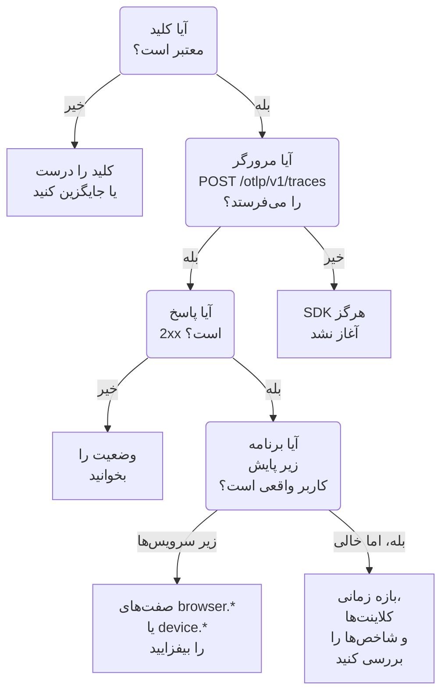

# رفع اشکال RUM

وقتی یک برنامه RUM نیست، خالی است یا **قطع‌شده** نشان می‌دهد، این صفحه را به ترتیب پیش بروید. هر بررسی بخشی از مسیر برنامه شما تا OneUptime را کنار می‌گذارد، به همان ترتیبی که این مشکل‌ها معمولاً پیش می‌آیند.

:::cards
- [کلید را بررسی کنید](#کلید-را-بررسی-کنید): سریع‌ترین بررسی، و هر چیز پس از آن به آن بستگی دارد.
- [بررسی کنید چه چیزی مرورگر را ترک می‌کند](#بررسی-کنید-چه-چیزی-مرورگر-را-ترک-میکند): درخواست صدور در ابزارهای توسعه‌دهنده مرورگرتان.
- [بررسی کنید تله‌متری کجا فرود می‌آید](#بررسی-کنید-تلهمتری-کجا-فرود-میآید): یک برنامه RUM، یا یک سرویس بک‌اند.
- [مشکل‌های بازپخش نشست](#مشکلهای-بازپخش-نشست): خط لوله‌ای جدا، با صفحه‌ای از آنِ خودش.
:::

## تله‌متری RUM کجا می‌ایستد

تله‌متری در راه رسیدن به یک برنامه RUM از سه بررسی می‌گذرد. نخستین بررسی‌ای را که شکست می‌خورد پیدا کنید:



## کلید را بررسی کنید

نخست کلید را بررسی کنید. سریع‌ترین بررسی است، و هیچ چیز پس از آن بدون کلیدی که OneUptime بپذیرد کار نمی‌کند:

```bash
curl -i https://oneuptime.com/otlp/v1/validate \
  -H "x-oneuptime-token: YOUR_TELEMETRY_INGESTION_TOKEN"
```

| پاسخ | یعنی چه |
| --- | --- |
| `200` همراه `"valid": true` | OneUptime کلید را می‌پذیرد. پاسخ `keyType` و `projectId` آن را هم می‌دهد. به بررسی بعدی بروید. |
| `401` همراه `"valid": false` | کلید غایب، ناشناخته، باطل‌شده، خاموش یا منقضی است، و `message` می‌گوید کدام. زیر **تنظیمات پروژه** > **تله‌متری و APM** > **کلیدهای دریافت داده** کلیدی فعال بسازید. |

برنامه وب کلید **مرورگر** لازم دارد، و برنامه موبایل کلید **سرور**: [راه‌اندازی مرورگر](/docs/rum/browser-setup) و [راه‌اندازی موبایل](/docs/rum/mobile-setup) را ببینید. نقطه‌های پایانی صدور هم کلید نادرست را با `401` رد می‌کنند، همان‌گونه که مشخصات OTLP می‌خواهد، پس SDKای که درست رفتار کند این رد شدن را لاگ می‌کند به‌جای آنکه دوباره تلاش کند. آن خط در کنسول مرورگر به‌آسانی از چشم می‌افتد، و این بررسی مستقیم پاسخ می‌دهد.

## بررسی کنید چه چیزی مرورگر را ترک می‌کند

ابزارهای توسعه‌دهنده مرورگرتان را روی صفحه برنامه باز کنید، زبانه Network را برگزینید و برای `otlp` بپالایید. دنبال `POST /otlp/v1/traces` با وضعیت `2xx` می‌گردید.

### اصلاً درخواستی نیست

SDK هرگز آغاز نشد. تقریباً همیشه یکی از این‌هاست:

- `telemetry.ts` نخستین import برنامه شما نیست، یا باندلرتان آن را انداخته است. ابزارگذاری‌ها `fetch` و `XMLHttpRequest` را وصله می‌کنند، پس درخواستی که پیش از وصله زده شود ردیابی نمی‌شود، و فایلی که باندلر برداشته اصلاً چیزی اجرا نمی‌کند.
- پردازشگر دسته‌ای هنوز صادر نکرده است. `BatchSpanProcessor` چند ثانیه صبر می‌کند تا دسته‌ای پر شود، پس پیش از آنکه نتیجه بگیرید چیزی فرستاده نمی‌شود صبر کنید یا به صفحه دیگری بروید.
- یک متغیر محیطی زمان ساخت به‌صورت `undefined` درآمده، پس نشانی صادرکننده خراب است. نشانی را یک بار هنگام آغاز لاگ کنید.

### مرورگر درخواست را مسدود می‌کند

- **خطای Content Security Policy در کنسول.** سیاست صفحه شما هنوز OneUptime را مجاز نمی‌داند. آن را به دستور `connect-src` موجودتان بیفزایید، یا اگر OneUptime را خودتان اجرا می‌کنید میزبان خودتان را به کار ببرید:

  ```text
  connect-src 'self' https://oneuptime.com;
  ```

- **خطای CORS.** نقطه‌های پایانی OTLP درخواست‌ها را از هر مبدأیی می‌پذیرند و سرآیند `x-oneuptime-token` را مجاز می‌دانند، پس شکست واقعی CORS تقریباً همیشه یعنی درخواست هرگز به OneUptime نرسیده: دنبال پراکسی سازمانی، مسدودکننده تبلیغ یا غلطی تایپی در میزبان بگردید. نشانی درخواست را در زبانه Network بررسی کنید.

### درخواست وضعیت خطا می‌گیرد

**`401`.** کلید ناشناخته، باطل‌شده یا منقضی است. [بررسی کلید](#کلید-را-بررسی-کنید) را اجرا کنید، سپس کلیدی فعال به کار ببرید.

**`404`.** نشانی اشتباه است. صادرکننده ردیابی مسیر کامل `/otlp/v1/traces` را لازم دارد. اشتباهی رایج این است که نشانی پایه (`https://oneuptime.com/otlp`) به صادرکننده‌ای داده شود که نشانی کامل انتظار دارد، یا نشانی کامل به صادرکننده‌ای که خودش مسیر را می‌افزاید و به `/otlp/v1/traces/v1/traces` می‌رسد.

**`413`.** دسته بزرگ‌تر از چیزی بود که یک پراکسی اجازه می‌دهد. ورودی خودِ OneUptime روی `/otlp` تا ۴ مگابایت می‌پذیرد، اما پراکسی‌ای که خودتان جلوی OneUptime اجرا می‌کنید می‌تواند سخت‌گیرتر باشد — برای نمونه ingress-nginx مقدار پیش‌فرض `proxy-body-size` را ۱ مگابایت می‌گذارد — پس اگر چنین پراکسی‌ای دارید، محدودیتش را برای `/otlp` هم بالا ببرید. در هر حال، `maxExportBatchSize` کوچک‌تر روی `BatchSpanProcessor` هر صدور را کوچک‌تر می‌کند:

```ts
new BatchSpanProcessor(exporter, { maxExportBatchSize: 100 });
```

مرورگر به‌ندرت دسته‌هایی چنین بزرگ می‌فرستد، مگر آنکه اسپن‌ها صفت‌های بزرگی حمل کنند، مانند کل یک stack trace یا بدنه پاسخ. کوتاه کردن آن‌ها راه‌حل بهتری است.

**`422`.** OneUptime کلید را اینجا رد کرد، و پیام می‌گوید چرا. `Origin https://app.example.com is not allowed for this browser ingestion key.` یعنی مبدأ دقیق صفحه، با طرح و هر درگاهی، در **مبداهای مجاز** کلید نیست. `This telemetry ingestion key has been disabled.` یعنی کسی کلید را خاموش کرده است.

**`429`.** **Requests Per Minute Limit** کلید مصرف شده است: `Too many telemetry requests for this ingestion key. Please retry later.` کلید Browser برای همه بازدیدکنندگانتان با هم ۶۰۰۰ درخواست در دقیقه اجازه می‌دهد، مگر آنکه محدودیت خودتان را روی کلید بگذارید.

**`403` با یک صفحه HTML، یا بدنه‌ای خالی.** OneUptime هر ردی را با JSON پاسخ می‌دهد، پس این یکی از چیزی جلوی آن آمده، معمولاً دیواره آتش برنامه وب روی دامنه خودتان، اگر OneUptime را از راه آن پراکسی می‌کنید. دیواره آتش OTLP/JSON را تجزیه می‌کند و هر صفت اسپن را با قاعده‌های تزریقش می‌سنجد، پس نشانی‌ای با رشته پرس‌وجو روی یک اسپن برای مسدود شدن بس است، و لاگ دیواره آتش قاعده را نام می‌برد. محموله OTLP را فقط روی مسیرهای OTLP از بازرسی کنار بگذارید: [درخواست‌های OpenTelemetry شما هم مسدود می‌شوند](/docs/rum/session-replay-troubleshooting#درخواستهای-opentelemetry-شما-هم-مسدود-میشوند) نشان می‌دهد چگونه، و ضبط‌کننده بازپخش پشت همان دیواره آتش را هم پوشش می‌دهد.

## بررسی کنید تله‌متری کجا فرود می‌آید

درخواست موفق است، اما برنامه به‌جای **محصولات** > **منابع** > **پایش کاربر واقعی** زیر **محصولات** > **سرویس‌ها** پدیدار می‌شود. این رایج‌ترین گزارش است، و علتش تقریباً همیشه منبعی بی صفت‌های کلاینت است. OneUptime دسته‌ای را فقط وقتی RUM بایگانی می‌کند که منبعش یکی از این‌ها را داشته باشد:

| گونه | صفت‌ها |
| --- | --- |
| مرورگر | `browser.platform`، `browser.language`، یا `browser.brands` ناتهی |
| موبایل | `device.id` یا `device.model.identifier`، یا `device.manufacturer` روی منبعی بی هویت میزبان (`host.name`، `host.id` یا `k8s.node.name`) |

یک `service.name` به‌تنهایی سرویسی بک‌اند می‌سازد. SDK مرورگری OpenTelemetry هیچ صفت `browser.*`ای نمی‌افزاید مگر آنکه آشکارساز منبع مرورگر را بیفزایید یا خودتان آن‌ها را بگذارید: [راه‌اندازی مرورگر](/docs/rum/browser-setup) را ببینید.

برای دیدن آنچه واقعاً می‌فرستید، درخواست OTLP را در زبانه Network باز کنید و به محموله‌اش نگاه کنید: `resourceSpans[0].resource.attributes` همان فهرستی است که تصمیم می‌گیرد. اگر هیچ صفت `browser.*` آنجا نیست، SDK آن را نمی‌افزاید، مستنداتش هرچه بگوید.

صفت‌ها را بیفزایید، و دسته بعدی برنامه RUM را می‌سازد. سرویسی که نخست ساخته شد به برنامه RUM تبدیل نمی‌شود، چون این دو رکوردهایی جدایند، پس همین که تله‌متری RUM رسید آن را زیر **محصولات** > **سرویس‌ها** حذف کنید.

> [!NOTE]
> منبعی که تنها صفت کلاینتش `device.manufacturer` است و هویت میزبان هم دارد، به‌جای گوشی یک دستگاه خوانده می‌شود، چون موجودی یک میزبان سازنده‌اش را با همین صفت گزارش می‌دهد. `device.id` یا `device.model.identifier` را بیفزایید، تا دسته هرچه دیگری حمل کند به‌عنوان RUM موبایل بایگانی شود.

## برنامه خالی است

برنامه هست، اما صفحه‌هایش چیزی نشان نمی‌دهند.

- **بازه زمانی را بررسی کنید.** نمای کلی به‌طور پیش‌فرض یک ساعت گذشته را نشان می‌دهد، پس دسته‌ای آزمایشی از امروز صبح بیرون از آن است.
- **چند دقیقه صبر کنید.** دریافت در صف است، و **آخرین مشاهده** به‌جای هر دسته، هر چند دقیقه یک بار تازه می‌شود.
- **پروژه را بررسی کنید.** هر کلید در پروژه خودش می‌نویسد، پس تله‌متری‌ای که با کلید پروژه‌ای دیگر فرستاده شده آنجاست، نه اینجا.

## صفحه کلاینت‌ها خالی است

صفحه **کلاینت‌ها** در وب `browser.platform` و در موبایل `device.model.identifier` را فهرست می‌کند. دو دلیل که خالی می‌ماند در حالی که هر چیز دیگری کار می‌کند:

- **Safari و Firefox.** `browserDetector` رابط UA Client Hints را می‌خواند، که فقط مرورگرهای Chromium دارند. در جاهای دیگر `browser.language` را می‌گذارد، که برای بایگانی تله‌متری به‌عنوان RUM بس است، اما `browser.platform` را نه. برای فهرست شدن آن کلاینت‌ها `browser.platform` را خودتان بگذارید.
- **SDK موبایلی که فقط `device.manufacturer` را می‌گذارد.** این تله‌متری را به‌عنوان RUM موبایل بایگانی می‌کند، اما صفحه **کلاینت‌ها** به `device.model.identifier` نیاز دارد.

## Core Web Vitals می‌گوید «No web vitals reported yet»

کارت فقط از متریک‌هایی پر می‌شود که برنامه‌تان می‌فرستد، پس ردیابی‌ها به‌تنهایی هرگز پرش نمی‌کنند. بررسی کنید اصلاً متریک صادر می‌کنید، نام متریک‌ها همان‌هایی‌اند که OneUptime می‌خواند، و در صفحه **متریک‌ها** برنامه هستند. [کارت می‌گوید «No web vitals reported yet»](/docs/rum/web-vitals#رفع-اشکال) همه بررسی‌ها را پیش می‌برد، از جمله مقدارهایی که وقتی بازدیدکننده پیش از صدور بعدی زبانه را می‌بندد از دست می‌روند.

## وضعیت «قطع‌شده» است در حالی که مردم از برنامه استفاده می‌کنند

برنامه پس از ۱۵ دقیقه بی تله‌متری **قطع‌شده** می‌شود. اگر مردم از برنامه استفاده می‌کنند:

- **شاید نمونه‌برداری همه چیز را بیندازد.** بررسی کنید نمونه‌برداری همیشه‌خاموش یا نرخی بسیار پایین تنظیم نکرده باشید.
- **شاید برنامه فقط در برخی تعامل‌ها تله‌متری بفرستد**، و کسی در آن مدت از آن‌ها استفاده نکرده است.
- **شاید کلید پس از استقرار باطل یا خاموش شده باشد**: [بررسی کلید](#کلید-را-بررسی-کنید) را دوباره اجرا کنید.

برنامه‌ای داخلی یا کم‌ترافیک که شب بازدیدکننده‌ای ندارد واقعاً قطع است. این ایراد نیست.

## مشکل‌های بازپخش نشست

بازپخش نشست خط لوله‌ای جداست با مشکل‌های خودش: اسکریپت ضبط‌کننده، فهرست‌های مجاز مبدأ، رضایت، Content Security Policy و پوشاندن. [رفع اشکال بازپخش نشست](/docs/rum/session-replay-troubleshooting) آن‌ها را پوشش می‌دهد. از آنجا آغاز کنید، و با روشن کردن تشخیص‌های ضبط‌کننده آغاز کنید، چون بیشتر شکست‌هایش عمداً بی‌صدایند:

```js
localStorage.setItem("oneuptime.sessionReplay.debug", "true");
// then reload the page
```

صفحه **سلامت** برنامه، در بخش **بازپخش نشست** آن، و پنل **Test your installation** در **Replay Policy** کلید، فهرست‌های مجاز و سیاست را از سوی کارساز بررسی می‌کنند، و می‌گویند چرا چیزی نمی‌رسد. کنسول مرورگر نیمه‌ای را به شما می‌گوید که کارساز نمی‌بیند.

زیر سیاست پیش‌فرض، ضبط‌کننده تا وقتی کاربر با صفحه تعامل دارد تقریباً هر ۱۵ ثانیه یک قطعه می‌فرستد. زبانه‌ای بیکار چیزی برای فرستادن ندارد، پس نخست کلیک کنید یا ماوس را حرکت دهید؛ پس از آن، نبودن هیچ درخواست قطعه‌ای یعنی چیزی خراب است. اگر برنامه فقط _On error or frustration_ ارسال می‌کند، تا وقتی چیزی خراب نشود سکوت انتظار می‌رود. برای وادار کردن ارسالی و اثبات مسیر در هر دو حالت، `OneUptimeReplay.captureSession()` را صدا بزنید.

این دو خط لوله مستقل‌اند. برنامه RUM سالم برای بارگذاری ضبط‌کننده لازم نیست، و ضبط‌کننده‌ای که کار می‌کند به این معنا نیست که تله‌متری RUM می‌رسد: هر کدام می‌تواند به‌تنهایی شکست بخورد.

## هنوز گیر کرده‌اید

پیش از کمک خواستن این‌ها را جمع کنید. یک رفت‌وبرگشت را صرفه‌جویی می‌کنند:

- فهرست `resource.attributes` از محموله یک درخواست واقعی OTLP.
- وضعیت HTTP آن درخواست.
- `service.name` دقیقی که می‌فرستید، و اینکه پروژه برنامه یا سرویسی با آن نام دارد یا نه.
- اینکه `/otlp/v1/validate` برای کلید در بیلد مستقرشده `200` پاسخ می‌دهد یا نه.

سپس با support@oneuptime.com تماس بگیرید، یا در [GitHub](https://github.com/OneUptime/oneuptime) مسئله‌ای باز کنید.

## گام‌های بعدی

:::cards
- [راه‌اندازی مرورگر](/docs/rum/browser-setup): راه‌اندازی‌ای که این بررسی‌ها فرضش می‌گیرند، گام به گام.
- [راه‌اندازی موبایل](/docs/rum/mobile-setup): کلید و صفت‌هایی که برنامه موبایل لازم دارد.
- [مدیریت برنامه‌ها](/docs/rum/applications): نام‌ها، برچسب‌ها، نگهداشت و وضعیت.
- [رفع اشکال بازپخش نشست](/docs/rum/session-replay-troubleshooting): هر کد ضبط‌کننده، و کاری که باید درباره‌اش کرد.
:::
