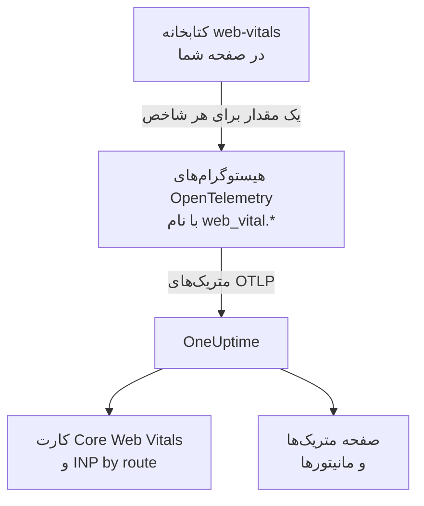
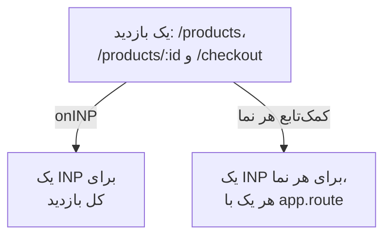

# Core Web Vitals

کارت **Core Web Vitals** در نمای کلی یک برنامه RUM، شاخص‌های LCP، INP، CLS، FCP و TTFB را نشان می‌دهد و هر کدام را با آستانه‌های Google می‌سنجد. OneUptime خودش هیچ‌کدام را اندازه نمی‌گیرد: کارت فقط از متریک‌هایی پر می‌شود که ابزارگذاری مرورگر شما گزارش می‌دهد، و این صفحه نشان می‌دهد چگونه آن‌ها را بفرستید.

:::cards
- [فرستادن](#فرستادن-از-برنامهتان): مقدارهای کتابخانه web-vitals را به‌صورت متریک‌های OpenTelemetry بفرستید.
- [نام‌هایی که OneUptime می‌خواند](#نامهای-متریکی-که-oneuptime-میشناسد): نام‌های متریکی که هر شاخص ممکن است با آن‌ها برسد.
- [برنامه‌های تک‌صفحه‌ای](#برنامههای-تکصفحهای): INP برای هر نما، نه یک مقدار برای هر بارگذاری صفحه.
- [هشدار روی یک شاخص](#هشدار-روی-یک-شاخص): مانیتورهای آماده برای شاخص‌های ضعیف.
:::

## چگونه کار می‌کند

کتابخانه [`web-vitals`](https://github.com/GoogleChrome/web-vitals) هر شاخص را درون صفحه اندازه می‌گیرد؛ همان کتابخانه‌ای که ابزارهای خود Chrome به کار می‌برند. کد شما هر مقدار را روی یک هیستوگرام OpenTelemetry ثبت می‌کند و خط لوله متریک مرورگر آن را به OneUptime صادر می‌کند.



OpenTelemetry هنوز قرارداد نام‌گذاری نهایی برای web vitals ندارد، پس OneUptime هر شاخص را با چند نام جست‌وجو می‌کند و نخستین نامی را که داده دارد به کار می‌برد. برای ابزارگذاری تازه از نام‌های `web_vital.*` استفاده کنید.

## پیش از شروع

- برنامه‌ای وب که مانند [راه‌اندازی مرورگر](/docs/rum/browser-setup) راه‌اندازی شده و خط لوله متریکش را دارد: `MeterProvider` از [افزودن لاگ‌ها و متریک‌ها](/docs/rum/browser-setup#افزودن-لاگها-و-متریکها) همان است که این مقدارها را صادر می‌کند.

## فرستادن از برنامه‌تان

:::steps
### کتابخانه را نصب کنید

```bash
npm install web-vitals
```

### هر شاخص را روی یک هیستوگرام ثبت کنید

`src/web-vitals.ts` را بسازید. هر شاخص یک هیستوگرام است تا صفحه **متریک‌ها** بعداً بتواند صدک‌ها را حساب کند، با مرزهای سطل روی آستانه‌های خوب و ضعیف Google.

```ts title="src/web-vitals.ts"
// Import after ./telemetry
import { metrics } from "@opentelemetry/api";
import { onCLS, onFCP, onINP, onLCP, onTTFB, type Metric } from "web-vitals";

const meter = metrics.getMeter("web-vitals");

// Histograms, so the Metrics tab can compute percentiles later. The bucket
// edges sit on each vital's good / poor limits: a percentile is read from
// the buckets, and the defaults are far too coarse for these ranges.
const buckets = (...edges: number[]) => ({ advice: { explicitBucketBoundaries: edges } });

const lcp = meter.createHistogram("web_vital.lcp", { unit: "ms", ...buckets(0, 1000, 1500, 2000, 2500, 3000, 3500, 4000, 5000, 7500, 10000) });
const inp = meter.createHistogram("web_vital.inp", { unit: "ms", ...buckets(0, 50, 100, 150, 200, 250, 300, 400, 500, 750, 1000, 2000) });
const fcp = meter.createHistogram("web_vital.fcp", { unit: "ms", ...buckets(0, 600, 1200, 1800, 2400, 3000, 4000, 6000, 10000) });
const ttfb = meter.createHistogram("web_vital.ttfb", { unit: "ms", ...buckets(0, 200, 400, 600, 800, 1200, 1800, 2500, 4000) });
const cls = meter.createHistogram("web_vital.cls", { unit: "1", ...buckets(0, 0.025, 0.05, 0.1, 0.15, 0.2, 0.25, 0.4, 0.6, 1) });

function record(
  histogram: { record: (v: number, a?: Record<string, string>) => void },
) {
  return (metric: Metric): void => {
    histogram.record(metric.value, {
      // Keep attributes low-cardinality. Never put a full URL or a user id here.
      "web_vital.rating": metric.rating,
    });
  };
}

onLCP(record(lcp));
onINP(record(inp));
onCLS(record(cls));
onFCP(record(fcp));
onTTFB(record(ttfb));
```

### آن را پس از راه‌اندازی تله‌متری وارد کنید

```ts
import "./telemetry";
import "./web-vitals";
```

### صفحه متریک‌ها را بررسی کنید

چند صفحه را بارگذاری کنید، سپس در صفحه **متریک‌ها** برنامه دنبال `web_vital.lcp` بگردید. وقتی متریک‌ها آنجا بودند، کارت **Core Web Vitals** برای بازه‌ای که برمی‌گزینید پر می‌شود.
:::

## فرستادن آخرین مقدارها پیش از بسته شدن صفحه

`onINP` و `onCLS` وقتی صفحه پنهان می‌شود گزارش می‌دهند، نه در طول بازدید. با فاصله صدور ۳۰ ثانیه‌ای [راه‌اندازی مرورگر](/docs/rum/browser-setup)، بازدیدکننده‌ای که درست پس از آخرین مقدار زبانه را می‌بندد ممکن است پیش از صدور آن برود. اگر کامل بودن مهم است، `exportIntervalMillis` را کوتاه کنید، یا `MeterProvider` را که در `telemetry.ts` ساختید نگه دارید و هنگام پنهان شدن صفحه آن را تخلیه کنید:

```ts
// In telemetry.ts, export the provider you created:
export const meterProvider = new MeterProvider({ /* ... */ });

// Anywhere after setup:
import { meterProvider } from "./telemetry";

document.addEventListener("visibilitychange", () => {
  if (document.visibilityState === "hidden") {
    void meterProvider.forceFlush();
  }
});
```

## نام‌های متریکی که OneUptime می‌شناسد

OneUptime نام‌ها را به همین ترتیب امتحان می‌کند و نخستین نامی که در بازه برگزیده داده دارد برنده است.

| شاخص | نام‌های متریک، هر کدام | واحد |
| --- | --- | --- |
| LCP: Largest Contentful Paint | `web_vital.lcp`، `browser.largest_contentful_paint`، `largest_contentful_paint`، `web.vitals.lcp` | میلی‌ثانیه |
| INP: Interaction to Next Paint | `web_vital.inp`، `browser.interaction_to_next_paint`، `interaction_to_next_paint`، `web.vitals.inp` | میلی‌ثانیه |
| CLS: Cumulative Layout Shift | `web_vital.cls`، `browser.cumulative_layout_shift`، `cumulative_layout_shift`، `web.vitals.cls` | امتیاز |
| FCP: First Contentful Paint | `web_vital.fcp`، `browser.first_contentful_paint`، `first_contentful_paint`، `web.vitals.fcp` | میلی‌ثانیه |
| TTFB: Time to First Byte | `web_vital.ttfb`، `browser.time_to_first_byte`، `time_to_first_byte`، `web.vitals.ttfb` | میلی‌ثانیه |

نام‌های دیگر برای این هستند که برنامه‌ای که از پیش با یک قرارداد رایج در جامعه می‌فرستد، بی هیچ تغییری پدیدار شود.

## آستانه‌های رتبه‌بندی

کارت هر مقدار را با آستانه‌های منتشرشده Core Web Vitals از سوی Google رتبه‌بندی می‌کند:

| شاخص | **Good** | **Needs work** | **Poor** |
| --- | --- | --- | --- |
| LCP | کمتر از ۲۵۰۰ میلی‌ثانیه | ۲۵۰۰ تا ۴۰۰۰ میلی‌ثانیه | ۴۰۰۰ میلی‌ثانیه یا بیشتر |
| INP | کمتر از ۲۰۰ میلی‌ثانیه | ۲۰۰ تا ۵۰۰ میلی‌ثانیه | ۵۰۰ میلی‌ثانیه یا بیشتر |
| CLS | کمتر از ۰٫۱ | ۰٫۱ تا ۰٫۲۵ | ۰٫۲۵ یا بیشتر |
| FCP | کمتر از ۱۸۰۰ میلی‌ثانیه | ۱۸۰۰ تا ۳۰۰۰ میلی‌ثانیه | ۳۰۰۰ میلی‌ثانیه یا بیشتر |
| TTFB | کمتر از ۸۰۰ میلی‌ثانیه | ۸۰۰ تا ۱۸۰۰ میلی‌ثانیه | ۱۸۰۰ میلی‌ثانیه یا بیشتر |

کارت **میانگین** بازه برگزیده را نشان می‌دهد، نه صدک ۷۵ام را که ابزارهای میدانی Google گزارش می‌دهند. این عمدی است: OneUptime صدک‌های یک هیستوگرام را از سطل‌هایش می‌خواند، پس دقت یک صدک به اندازه دقت سطل‌هاست، در حالی که میانگین از مجموع و شمار دقیق هیستوگرام می‌آید. با سطل‌های پیش‌فرض OpenTelemetry (`0, 5, 10, 25, 50, …`) هر مقدار CLS در نخستین سطل می‌افتد و صدک ۷۵ام برای صفحه‌ای که به‌زحمت جابه‌جا می‌شود ۲٫۵ نشان می‌داد.

> [!TIP]
> کارت را به چشم یک روند بخوانید. برای صدک ۷۵ام، با مرزهای سطلی که در بالا آمد ثبت کنید، سپس متریک را در صفحه **متریک‌ها** با تجمیع **P75** نمودار کنید. مانیتور متریک هم همین گزینه را دارد.

## برنامه‌های تک‌صفحه‌ای

`onINP` شاخص INP را همان‌گونه اندازه می‌گیرد که مرورگر تعریفش می‌کند: **یک مقدار برای هر بارگذاری صفحه**. برنامه تک‌صفحه‌ای یک بار بارگذاری می‌شود و سپس با `history.pushState` مسیر را عوض می‌کند، پس بازدیدی از `/products`، `/products/42` و `/checkout` برای کل بازدید یک INP می‌دهد. تعامل‌های همه نماها بر سر همین یک عدد رقابت می‌کنند و ویژگی مسیری که رویش است، صفحه‌ای را نام می‌برد که هنگام گزارش نمایش داده می‌شد، نه صفحه‌ای که کند بود.



برای دیدن INP هر نما، آن را برای هر نما اندازه بگیرید: هر تغییر مسیر نمای جاری را پایان می‌دهد و نمای تازه‌ای آغاز می‌کند و هر نما INP خودش را گزارش می‌دهد. کمک‌تابع زیر این کار را با Event Timing API مرورگر انجام می‌دهد، همان داده‌ای که `onINP` به کار می‌برد، و بخشی را که اشتباه کردن در آن آسان است هم مدیریت می‌کند: کلیکی که ناوبری را **سبب شد** پس از عوض شدن مسیر تحویل داده می‌شود، اما به صفحه‌ای تعلق دارد که رویش کلیک شده بود.

```ts title="src/inp-per-route.ts"
// INP for each view of a single-page app.
type Report = (inpMs: number, route: string) => void;

interface View {
  route: string;
  path: string; // the URL path it was opened for
  start: number; // performance.now() when the view began
  latencies: Map<number, number>; // interactionId -> its slowest entry
}

// Long enough for the click that navigated to be delivered: its entry
// arrives after the next paint, i.e. after the route has changed.
const SETTLE_MS = 1000;

let views: Array<View> = [];
let report: Report = () => {};

// The path, plus the hash when a hash router keeps the route there.
const currentPath = (): string =>
  location.pathname + (location.hash.startsWith("#/") ? location.hash : "");

function close(view: View): void {
  if (!views.includes(view)) return; // already reported
  views = views.filter((v) => v !== view);

  const sorted = [...view.latencies.values()].sort((a, b) => b - a);
  if (sorted.length === 0) return; // nobody interacted: no INP, not 0

  // web-vitals' p98: skip one outlier for every 50 interactions.
  report(sorted[Math.min(sorted.length - 1, Math.floor(sorted.length / 50))]!, view.route);
}

function record(entries: PerformanceEntryList): void {
  for (const entry of entries as Array<PerformanceEventTiming & { interactionId?: number }>) {
    if (!entry.interactionId) continue; // hovers, scrolls: not interactions

    // The view the interaction STARTED in, so the click that navigated
    // counts towards the page it was clicked on.
    const view = [...views].reverse().find((v) => entry.startTime >= v.start);
    if (!view) continue;

    const slowest = view.latencies.get(entry.interactionId) ?? 0;
    view.latencies.set(entry.interactionId, Math.max(slowest, entry.duration));
  }
}

export function observeInpPerRoute(route: string, onReport: Report): void {
  if (typeof PerformanceObserver === "undefined" || !PerformanceObserver.supportedEntryTypes?.includes("event")) return;

  report = onReport;
  views = [{ route, path: currentPath(), start: 0, latencies: new Map() }];

  const observer = new PerformanceObserver((list) => record(list.getEntries()));
  observer.observe({ type: "event", durationThreshold: 40, buffered: true } as PerformanceObserverInit);

  // The tab may never come back: report every view now, then keep
  // measuring the current route as a fresh view.
  document.addEventListener("visibilitychange", () => {
    if (document.visibilityState !== "hidden") return;
    record(observer.takeRecords());
    const current = views[views.length - 1]?.route ?? route;
    [...views].forEach(close);
    views = [{ route: current, path: currentPath(), start: performance.now(), latencies: new Map() }];
  });
}

// Call after every navigation, with the route PATTERN ("/products/:id").
// Safe to call when nothing changed (a router's initial navigation, a
// query-string update): the view only ends when the path does.
export function startView(route: string): void {
  const closing = views[views.length - 1];
  if (!closing || closing.path === currentPath()) return;

  views.push({ route, path: currentPath(), start: performance.now(), latencies: new Map() });
  setTimeout(() => close(closing), SETTLE_MS);
}
```

هر دو تابع **الگوی** مسیر را می‌گیرند، هرگز نشانی را: `/products/42` و `/products/7` باید یک مسیر باشند، وگرنه هر محصول سری جداگانه خودش می‌شود. هر جا مسیریابتان الگو دارد از آن استفاده کنید؛ وگرنه شناسه‌ها را خودتان یکی کنید:

```ts
// "/products/42" -> "/products/:id", also for UUIDs.
export const toRoutePattern = (path: string): string =>
  path.replace(/\/(\d+|[0-9a-f]{8}-[0-9a-f-]{27})(?=\/|$)/gi, "/:id");
```

آنچه کمک‌تابع گزارش می‌دهد را روی همان هیستوگرام `web_vital.inp` ثبت کنید، با مسیر به‌عنوان `app.route`، و **`onINP` را از قطعه کد بالا کنار بگذارید**: نگه داشتن هر دو هر تعامل را دو بار می‌شمارد.

```ts
// src/web-vitals.ts, in place of onINP(record(inp))
import { observeInpPerRoute } from "./inp-per-route";

observeInpPerRoute(toRoutePattern(location.pathname), (inpMs, route) => {
  inp.record(inpMs, {
    "app.route": route,
    "web_vital.rating": inpMs <= 200 ? "good" : inpMs <= 500 ? "needs-improvement" : "poor",
  });
});
```

سپس هر جا مسیریابتان پایان یک ناوبری را اعلام می‌کند، `startView` را فراخوانی کنید. وقتی مسیر نشانی تغییر نکرده باشد فراخوانی را نادیده می‌گیرد، پس مسیریابی که نخستین بارگذاری یا به‌روزرسانی رشته پرس‌وجو را هم گزارش می‌دهد، نما را دو تکه نمی‌کند:

:::tabs
@tab Vue Router
```ts
router.afterEach((to) => startView(to.matched[to.matched.length - 1]?.path ?? toRoutePattern(to.path)));
```
@tab React Router
```tsx
// In a component that stays mounted inside the router
const { pathname } = useLocation();
useEffect(() => startView(toRoutePattern(pathname)), [pathname]);
```
:::

آنچه به دست می‌آورید:

- **INP by route** در نمای کلی، از کندترین، بر پایه `app.route`؛ OneUptime ویژگی `url.template` در OpenTelemetry را هم می‌خواند.
- یک پالایه مسیر برای هشدار: یک مانیتور متریک را روی `web_vital.inp` با `app.route` پالایش کنید تا یک جریان، مانند `/checkout`، را جداگانه زیر نظر بگیرید.
- INP کل برنامه در کارت **Core Web Vitals** همچنان کار می‌کند: همان متریک است، اکنون با یک مقدار برای هر نما به‌جای یکی برای هر بارگذاری صفحه.

مرورگرهای Chromium شناسه‌های تعاملی را که این کار لازم دارد گزارش می‌دهند. Safari هیچ‌کدام را گزارش نمی‌دهد، و به همین دلیل `onINP` هم آنجا چیزی گزارش نمی‌کند. Soft Navigations API آزمایشی Chrome قصد دارد این کار را به‌طور بومی انجام دهد، اما هنوز به‌طور عمومی در دسترس نیست؛ این کمک‌تابع همین امروز کار می‌کند.

> [!NOTE]
> ضبط‌کننده [بازپخش نشست](/docs/telemetry/session-replay) از پیش و بی هیچ کدی INP هر نما را اندازه می‌گیرد: هر ضبط برای هر مسیری که کاربر در آن تعامل کرده یک سطر INP نشان می‌دهد، با عنصر کند و اینکه زمانش چگونه میان تأخیر ورودی، پردازش و نمایش تقسیم شده است.

## مهار کاردینالیتی

ویژگی‌های متریک در هم ضرب می‌شوند. `web_vital.rating` سه مقدار ممکن دارد که اشکالی ندارد، و ویژگی مسیر یا نوع صفحه معمولاً ارزشش را دارد:

```ts
histogram.record(metric.value, {
  "web_vital.rating": metric.rating,
  "app.route": routePattern, // "/product/:id" — the PATTERN, not "/product/8842"
});
```

ثبت نشانی واقعی به‌جای الگوی مسیر، برای هر صفحه محصول یک سری زمانی می‌سازد که صفحه **متریک‌ها** را کند و صورت‌حساب ذخیره‌سازی را بزرگ می‌کند. همین درباره شناسه‌های کاربر، شناسه‌های نشست و اندازه‌های صفحه‌نمایش هم صادق است.

## هشدار روی یک شاخص

صفحه **توصیه‌ها** برنامه برای هر شاخص یک مانیتور آماده پیشنهاد می‌کند. هر کدام میانگین پنج‌دقیقه‌ای متریک خودش را می‌خواند و وقتی به آستانه ضعیف Google برسد فعال می‌شود:

| پیشنهاد | متریک | آستانه فعال شدن | شدت |
| --- | --- | --- | --- |
| **Poor Largest Contentful Paint** | `web_vital.lcp` | ۴۰۰۰ میلی‌ثانیه | **بحرانی** |
| **Poor Interaction to Next Paint** | `web_vital.inp` | ۵۰۰ میلی‌ثانیه | **بحرانی** |
| **Poor Cumulative Layout Shift** | `web_vital.cls` | ۰٫۲۵ | **بحرانی** |
| **Slow First Contentful Paint** | `web_vital.fcp` | ۳۰۰۰ میلی‌ثانیه | **Warning** |
| **Slow Time to First Byte** | `web_vital.ttfb` | ۱۸۰۰ میلی‌ثانیه | **Warning** |

این مانیتورها فقط نام‌های `web_vital.*` را می‌خوانند. اگر برنامه‌تان شاخصی را با نام دیگری می‌فرستد، متریک مانیتور ساخته‌شده را ویرایش کنید. برای هشدار روی یک مسیر، یک پالایه `app.route` به مانیتور بیفزایید. می‌توانید روی هر کدام از این متریک‌ها مانیتور خودتان را هم بسازید: [مانیتور متریک‌ها](/docs/monitor/metrics-monitor) را ببینید.

## رفع اشکال

:::details کارت پیام «No web vitals reported yet» را نشان می‌دهد
کارت فقط از متریک‌هایی پر می‌شود که برنامه‌تان می‌فرستد. به ترتیب بررسی کنید:

1. اصلاً خط لوله متریک دارید: ردیابی‌ها به‌تنهایی هرگز این کارت را پر نمی‌کنند.
2. نام‌های متریک از نام‌هایی‌اند که OneUptime می‌خواند: [نام‌های متریکی که OneUptime می‌شناسد](#نامهای-متریکی-که-oneuptime-میشناسد) را ببینید.
3. متریک‌ها در صفحه **متریک‌ها** برنامه هستند. اگر هستند، صدور کار می‌کند و مشکل از نام یا بازه زمانی است.
4. INP و CLS هنگام پنهان شدن صفحه گزارش می‌شوند، پس یک بازدید کوتاه ممکن است پیش از صدور بعدی تمام شود: [فرستادن آخرین مقدارها پیش از بسته شدن صفحه](#فرستادن-آخرین-مقدارها-پیش-از-بسته-شدن-صفحه) را ببینید.

اگر هیچ‌کدام کمک نکرد، [رفع اشکال RUM](/docs/rum/troubleshooting) کل خط لوله را بررسی می‌کند.
:::

:::details INP گزارش می‌شود، اما نه برای هر مسیر
کارت **INP by route** به ویژگی `app.route`، یا `url.template`، روی `web_vital.inp` نیاز دارد. الگوی مسیر را با هر مقدار ثبت کنید، مانند [برنامه‌های تک‌صفحه‌ای](#برنامههای-تکصفحهای).
:::

:::details مقدارها با گزارش Google فرق دارند
کارت میانگین بازه‌ای را که برگزیده‌اید نشان می‌دهد و Google صدک ۷۵ام بازدیدکنندگان خودش را گزارش می‌دهد. برای مقایسه هم‌سنگ، **P75** را در صفحه **متریک‌ها** نمودار کنید.
:::

## گام‌های بعدی

:::cards
- [راه‌اندازی مرورگر](/docs/rum/browser-setup): خط لوله ردیابی، لاگ و متریکی که این شاخص‌ها روی آن سوارند.
- [مانیتور متریک‌ها](/docs/monitor/metrics-monitor): روی هر شاخصی، برای کل برنامه یا یک مسیر، هشدار بگذارید.
- [بازپخش نشست](/docs/telemetry/session-replay): INP هر نما را بی هیچ کدی در ضبط‌ها ببینید.
- [رفع اشکال RUM](/docs/rum/troubleshooting): همه بررسی‌ها، به همان ترتیبی که مشکل‌ها معمولاً پیش می‌آیند.
:::
