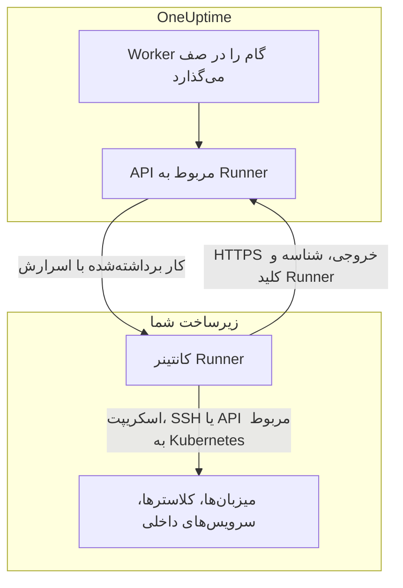
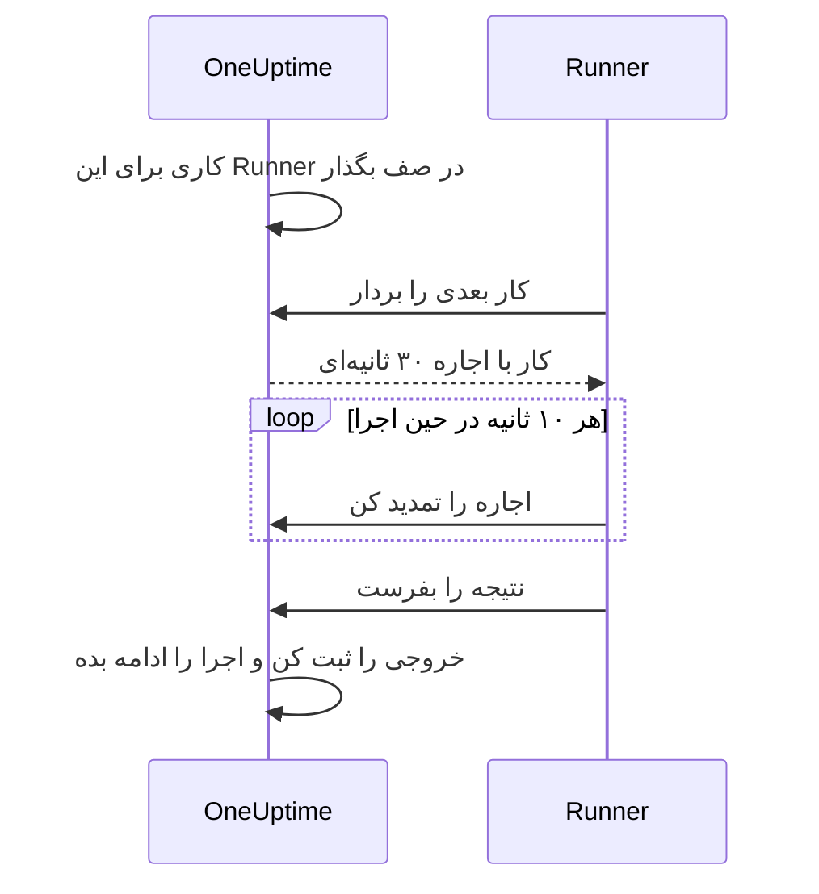

# عامل‌های رانبوک

یک **عامل رانبوک**، که در داشبورد **Runner** نام دارد، پردازه‌ای کوچک و خودمیزبان است که گام‌های JavaScript، Bash، SSH و kubectl رانبوک‌هایتان را **در زیرساخت خودتان** اجرا می‌کند. OneUptime Worker هرگز اسکریپت‌هایتان را اجرا نمی‌کند: آن‌ها را در صف می‌گذارد، و Runner‌ای که نویسنده گام انتخاب کرده هر کار را برمی‌دارد، اجرا می‌کند و نتیجه را بازمی‌فرستد. این صفحه برای کسانی است که Runnerها را نصب و اداره می‌کنند. گامی که هیچ Runnerی انتخاب نکند روی [Runner پیش‌فرض پروژه](#runner-پیشفرض-پروژه) اجرا می‌شود، اگر یکی تعیین کرده باشید؛ وگرنه گام JavaScript روی یک [Runner سراسری](#runnerهای-سراسری) اجرا می‌شود، یکی از Runnerهایی که OneUptime برای همه پروژه‌ها اجرا می‌کند.

:::cards
- [نصب یک Runner](#نصب-یک-runner): از داشبورد تا یک کانتینر متصل، در پنج گام.
- [اختصاص یک گام به یک Runner](#اختصاص-یک-گام-به-یک-runner): گام را به Runner‌ای که باید اجرایش کند وصل کنید.
- [Runner پیش‌فرض پروژه](#runner-پیشفرض-پروژه): Runnerی که گام یا مخزن کدِ بدون Runner روی آن اجرا می‌شود.
- [Runnerهای سراسری](#runnerهای-سراسری): Runnerهایی که OneUptime برای همه پروژه‌ها اجرا می‌کند، و آنچه اجرا می‌کنند.
- [مهلت‌ها](#مهلتها): مهلت برداشتن و مهلت اجرا، و اینکه چگونه با هم کار می‌کنند.
- [متغیرهای محیطی](#متغیرهای-محیطی): آنچه کانتینر هنگام راه‌اندازی می‌خواند.
:::

## چگونه کار می‌کند



1. در OneUptime یک Runner می‌سازید. OneUptime برای آن یک شناسه و یک کلید محرمانه تولید می‌کند.
2. کانتینر Runner را روی میزبانی در زیرساخت خودتان با همان شناسه، کلید و URL مربوط به OneUptime خودتان اجرا می‌کنید.
3. Runner هر ۵ ثانیه از OneUptime کار می‌خواهد و هر ۶۰ ثانیه گزارش می‌دهد که زنده است.
4. وقتی یک گام JavaScript، Bash، SSH یا kubectl می‌نویسید، Runner را از فهرست کشویی زیر **فیلدهای بیشتر** گام انتخاب می‌کنید. گام به آن Runner وصل می‌شود. گامی که هیچ Runnerی انتخاب نکند روی Runner پیش‌فرض پروژه اجرا می‌شود، اگر یکی تعیین کرده باشید، و وگرنه گام JavaScript روی **Runner سراسری** اجرا می‌شود.
5. وقتی گام اجرا می‌شود، Worker کاری را در صف می‌گذارد که `targetAgentId` آن روی همان Runner تنظیم شده است. فقط همان Runner می‌تواند آن را بردارد.
6. Runner کار را به‌صورت محلی اجرا می‌کند — `bash -c <script>` برای Bash و kubectl، یک سندباکس `isolated-vm` برای JavaScript، و یک اتصال SSH که اسکریپت را با bash روی ماشین اجرا می‌کند — نتیجه را ثبت می‌کند، رازهای گام را در آن پنهان می‌کند و آن را بازمی‌فرستد. Worker رانبوک را با آن نتیجه ادامه می‌دهد.

Runner فقط به **HTTPS خروجی** به نمونه OneUptime شما نیاز دارد. هیچ اتصال ورودی‌ای نمی‌پذیرد.

یک Runner فقط شناسه و کلید خودش را نگه می‌دارد. هر چیز دیگری را همراه کاری که برمی‌دارد دریافت می‌کند: اسکریپتی که [متغیرهای رانبوکی](/docs/runbooks/variables) که نام می‌برد در آن جای گذاشته شده‌اند، و کلید یا رمز عبور یک گام SSH یا kubeconfig یک گام kubectl. یک راز را فقط وقتی دریافت می‌کند که آن راز اجازه بدهد. به همین دلیل هر کسی کلید یک Runner را داشته باشد می‌تواند به‌جای آن Runner عمل کند: با کلید مانند رازهایی رفتار کنید که آن Runner اجازهٔ استفاده از آن‌ها را دارد.

## چرا اسکریپت‌ها روی Runner اجرا می‌شوند

اجرای اسکریپت‌ها روی OneUptime Worker دو مشکل داشت:

- **مرز اعتماد.** هر کسی که می‌توانست رانبوک بنویسد می‌توانست روی Worker کد اجرا کند، با دسترسی به هر چیزی که Worker به آن می‌رسید.
- **دسترس‌پذیری.** بیشتر گام‌های مفید روی زیرساخت _شما_ کار می‌کنند («این سرویس را دوباره راه‌اندازی کن»، «رکوردی را در پایگاه داده داخلی ما پیدا کن»)، نه روی زیرساخت OneUptime.

با Runnerها این گام‌ها روی میزبانی اجرا می‌شوند که شما کنترلش می‌کنید، و شما تعیین می‌کنید آن میزبان اجازه چه کاری دارد. گام‌های درخواست HTTP و AI همچنان روی Worker اجرا می‌شوند، چون به چیزی از شبکه شما نیاز ندارند.

## Runnerهای سراسری

Runnerهای سراسری Runnerهایی هستند که OneUptime برای همه پروژه‌ها اجرا می‌کند. گام JavaScript‌ای که Runner خودش را انتخاب نکند روی یکی از آن‌ها اجرا می‌شود، مگر اینکه پروژه یک [Runner پیش‌فرض](#runner-پیشفرض-پروژه) داشته باشد، پس می‌توانید پیش از نصب هر چیزی آن را بنویسید. **رانبوک‌ها → Runnerها** آن‌ها را زیر **Runnerهای سراسری**، بالای Runnerهای خودتان، فهرست می‌کند و فهرست کشویی **Runner** در گام JavaScript اول از همه، یا درست بعد از Runner پیش‌فرض پروژه، **Runner سراسری** را پیشنهاد می‌دهد. فهرست کشویی گام Bash، SSH یا kubectl آن را آخر از همه و خاکستری نشان می‌دهد، با **فقط گام‌های JavaScript را اجرا می‌کند.** این گام‌ها روی Runner خودتان در شبکه خودتان اجرا می‌شوند، هرگز روی Runnerی که همه پروژه‌ها در آن شریک‌اند.

| | Runner سراسری | Runner خودتان |
| --- | --- | --- |
| گام‌هایی که اجرا می‌کند | JavaScript | JavaScript، Bash، SSH و kubectl |
| آنچه یک گام به آن می‌رسد | نشانی‌های عمومی اینترنت | آنچه میزبانش به آن می‌رسد |
| بیشترین زمان اجرای یک گام | ۵ دقیقه | ۱ ساعت |
| متغیرهای راز | آن‌هایی که اجازه می‌دهید Runnerهای سراسری استفاده کنند | آن‌هایی که آن را فهرست کرده‌اند |
| فرمان‌های Bash از OneUptime AI | هرگز | برای قواعد هوش مصنوعی که آن را انتخاب می‌کنند |
| اصلاح‌های کد OneUptime AI | بدون ساخت یا تست برای بازبینی باز می‌شوند | پیش از باز شدن درخواست ادغام ساخته و تست می‌شوند |

یک Runner سراسری گام‌های پروژه‌های بسیاری را اجرا می‌کند، پس هر گام از همه گام‌های دیگر جدا نگه داشته می‌شود:

- هر گام در سندباکس `isolated-vm` خودش اجرا می‌شود که برای همان گام ساخته و پس از آن دور ریخته می‌شود: نه فایلی، نه پردازه‌ای، نه متغیر محیطی، و هیچ چیزی از یک گام به گام بعدی نگه داشته نمی‌شود.
- درخواست‌های HTTP آن فقط به نشانی‌های عمومی اینترنت می‌رسند، هرگز به نشانی خصوصی، loopback یا link-local یا نقطه پایانی فراداده ابری، پس یک Runner سراسری هرگز به شبکه شما نمی‌رسد.
- فقط وقتی یک متغیر راز را دریافت می‌کند که کلید **Runnerهای سراسری می‌توانند از آن استفاده کنند** آن متغیر روشن باشد، و فقط برای گامی از پروژهٔ خودِ متغیر.
- یک پروژه هم‌زمان حداکثر سه گام روی Runnerهای سراسری اجرا می‌کند، پس هیچ پروژه‌ای آن‌ها را فقط برای خودش نگه نمی‌دارد.

یک Runner سراسری اصلاح‌های کد OneUptime AI را هم انجام می‌دهد، در هر مخزن کدی که روی **Runner سراسری** کار می‌کند. هر اصلاح را می‌نویسد و درخواست ادغام را باز می‌کند، اما هیچ دستوری اجرا نمی‌کند، حتی دستورهای آماده‌سازی، ساخت و تست مخزن را، پس درخواست ادغام می‌گوید که راستی‌آزمایی آن رد شده است. فقط به سرورهای Git در اینترنت می‌رسد، از راه HTTPS، مگر در یک OneUptime خودمیزبان، که در آن می‌تواند به سرورهای Git خصوصی‌ای هم برسد که خود سرور اجازه دارد به آن‌ها برسد. فقط برای اصلاح‌هایی که برمی‌دارد کار می‌کند، و توکن یک مخزن را فقط تا وقتی می‌گیرد که روی اصلاحی در آن کار می‌کند. توکن یک مخزن GitHub فقط به همان یک مخزن می‌رسد و وقتی اصلاح تمام شود باطل می‌شود.

برای گامی که باید به شبکه شما برسد، یا برای نگه داشتن گام روی میزبان‌هایی که خودتان کنترل می‌کنید، یکی از Runnerهای خودتان را انتخاب کنید. برای اینکه همه گام‌ها روی Runnerهای خودتان بمانند، **استفاده از Runnerهای سراسری** را در پایین **رانبوک‌ها → Runnerها** خاموش کنید. آنگاه گام JavaScript‌ای که هیچ Runner‌ای انتخاب نکند روی Runner پیش‌فرض پروژه اجرا می‌شود، یا اگر پیش‌فرضی تعیین نشده باشد، شکست می‌خورد و همین را می‌گوید، تا وقتی یکی از Runnerهای شما را انتخاب کند؛ گامی که یکی از Runnerهای شما را انتخاب کرده در هر حال آن را نگه می‌دارد. مخزن کدی که در تنظیماتش در کد هیچ Runnerی انتخاب نکند هم روی Runner پیش‌فرض پروژه کار می‌کند، یا اگر پیش‌فرضی تعیین نشده باشد، روی یک Runner سراسری، و تا وقتی این کلید خاموش است به یکی از Runnerهای شما نیاز دارد؛ [کد](/docs/ai/ai-agent#انتخاب-runner-مخزن) را ببینید.

### Runnerهای سراسری از کجا می‌آیند

در OneUptime Cloud، OneUptime آن‌ها را اجرا می‌کند. یک نصب خودمیزبان به‌طور پیش‌فرض یک Runner سراسری از آن خودش را اجرا می‌کند، همان‌طور که پراب‌های سراسری خودش را اجرا می‌کند: سرویس `global-runner` در Docker Compose و استقرار `globalRunner` در چارت Helm. این Runner کلید خودش، `GLOBAL_RUNNER_KEY`، را دارد و هیچ چیز دیگری از سرور ندارد.

یک مدیر اصلی می‌تواند Runnerهای سراسری بیشتری اضافه کند تا گام‌ها و اصلاح‌های کد را از میزبان‌های دیگر اجرا کنند: در Admin Dashboard، **تنظیمات** و سپس **Runnerهای سراسری** را باز کنید، یکی بسازید، و فرمانی را که **نمایش شناسه و کلید** آن می‌دهد روی میزبانی اجرا کنید که به اینترنت می‌رسد.

برای خاموش کردن Runner سراسری همراه، `GLOBAL_RUNNER_REPLICAS=0` را در `config.env` مربوط به Docker Compose تنظیم کنید، یا `globalRunner.enabled` را در چارت Helm روی `false` بگذارید. بدون هیچ Runner سراسری، **رانبوک‌ها → Runnerها** فقط Runnerهای خودتان را فهرست می‌کند و هر گام JavaScript و هر مخزن کد یکی از آن‌ها را انتخاب می‌کند.

## پیش از شروع

- **میزبانی با Docker** در زیرساخت شما که بتواند از راه HTTPS به URL مربوط به OneUptime شما و به سیستم‌هایی که گام‌هایتان رویشان کار می‌کنند برسد.
- **نقشی که Runner می‌سازد.** Project Owner، Project Admin، Project Member و Runbook Admin می‌توانند Runner بسازند. فقط Project Owner، Project Admin یا Runbook Admin می‌توانند کلید یک Runner را که دستور راه‌اندازی شامل آن است ببینند.

## نصب یک Runner

### 1. رکورد عامل را بسازید

به **رانبوک‌ها → Runnerها** بروید و یک عامل تازه بسازید. روی **ساخت Runner** کلیک کنید و فیلدهای آن را، همه در یک صفحه، پر کنید:

| فیلد | کجا | یادداشت |
| --- | --- | --- |
| **نام** | روی صفحه | نامی خوانا، معمولاً اینکه کجا اجرا می‌شود و به چه چیزی می‌رسد، مثلاً `prod-eu-west-1`. هنگام نوشتن یک گام همین را انتخاب می‌کنید. |
| **توضیحات** | روی صفحه | اختیاری. جمله‌ای درباره اینکه این میزبان به چه چیزی می‌رسد. |
| **رانبوک‌ها را اجرا می‌کند** | زیر **فیلدهای بیشتر** | به‌طور پیش‌فرض روشن. اجازه می‌دهد این Runner گام‌های رانبوک را بردارد. |
| **برچسب‌ها** | زیر **فیلدهای بیشتر** | اختیاری. |

Runner تغییر قابلیت‌هایش را در heartbeat بعدی دریافت می‌کند؛ لازم نیست دوباره راه‌اندازی شود. هوش مصنوعی یک قابلیت نیست. هر مخزن کد در تنظیماتش در کد Runnerی را انتخاب می‌کند که هوش مصنوعی روی آن در مخزن کار می‌کند، و صفحه Runner مخزن‌هایی را که آن را انتخاب کرده‌اند فهرست می‌کند. یک قاعدهٔ هوش مصنوعی Runnerی را برمی‌گزیند که OneUptime AI دستورهایش را روی آن اجرا می‌کند: همین برگزیدن یک Runner در آنجاست که اجازه می‌دهد دستورهای OneUptime AI روی آن اجرا شوند. صفحه Runner قاعده‌های هوش مصنوعی‌ای را هم که آن را برگزیده‌اند فهرست می‌کند.

### 2. دستور نصب را کپی کنید

در ردیف Runner روی **نمایش دستورالعمل‌های راه‌اندازی** کلیک کنید. پنجره **راه‌اندازی Runner** یک دستور `docker run` نشان می‌دهد که شناسه و کلید این Runner از قبل در آن هست. همین دستور در صفحه خود Runner زیر **دستورالعمل‌های راه‌اندازی** هم هست.

فقط Project Owner، Project Admin یا Runbook Admin می‌توانند کلید را بخوانند. دیگران به‌جای دستور «اجازه مشاهده کلید این Runner را ندارید» را می‌بینند.

### 3. آن را روی میزبانی در زیرساخت خودتان اجرا کنید

دستور را روی میزبانی در محیط خودتان اجرا کنید که بتواند:

- از راه HTTPS به نمونه OneUptime شما برسد، و
- آنچه گام‌هایتان نیاز دارند انجام دهد، مثلاً از راه SSH به میزبان‌های دیگر برسد، سرور API یک کلاستر را فرا بخواند یا با یک پایگاه داده حرف بزند.

```bash
docker run --name oneuptime-runner --restart unless-stopped \
  -e ONEUPTIME_RUNNER_ID=<runner-id> \
  -e ONEUPTIME_RUNNER_KEY=<runner-key> \
  -e ONEUPTIME_URL=https://oneuptime.yourdomain.com \
  -d oneuptime/runner:release
```

### 4. بررسی کنید که عامل متصل است

به **رانبوک‌ها → Runnerها** برگردید. ظرف یک دقیقه پس از شروع کانتینر، **وضعیت** Runner باید **متصل** را با یک **آخرین مشاهده** تازه نشان دهد. در صفحه خود Runner، کارت **وضعیت Runner** مقدار **نسخه Runner** و **میزبان** آن را نشان می‌دهد. اگر همچنان **هرگز متصل نشده** یا **قطع‌شده** را نشان دهد، [عیب‌یابی](#عیبیابی) را ببینید.

### 5. عامل را به‌روز نگه دارید

وقتی یک عامل نسخه‌ای قدیمی‌تر از OneUptime شما را اجرا می‌کند، در صفحه‌اش کنار **نسخه Runner** آن یک نشان هشدار نمایش داده می‌شود. آن را انتخاب کنید تا روش ارتقا را ببینید: ایمیج تازه را pull کنید، کانتینر را حذف کنید، سپس دستور نصب گام ۲ را دوباره اجرا کنید. عاملی که chart عامل Kubernetes نصب کرده، به‌جای این با همان chart ارتقا می‌یابد.

```bash
docker pull oneuptime/runner:release
docker rm -f oneuptime-runner
```

## اختصاص یک گام به یک Runner

:::steps
### گامی اضافه کنید که روی یک Runner اجرا می‌شود

در صفحه **گام‌ها** در رانبوکتان یک گام JavaScript، Bash، SSH یا kubectl اضافه کنید.

### Runner را انتخاب کنید

**فیلدهای بیشتر** گام را باز کنید: فهرست کشویی **Runner** آن همه Runnerهای پروژه را نشان می‌دهد و اینکه متصل‌اند یا نه، و خط جمع‌شده نام Runnerی را می‌برد که گام روی آن اجرا می‌شود. اگر پروژه هنوز Runner ندارد، گام همین را می‌گوید و شما را به **Runbooks › Runners** راهنمایی می‌کند. گزینه اول همان است که گامِ بدون Runner روی آن اجرا می‌شود: [Runner پیش‌فرض پروژه](#runner-پیشفرض-پروژه)، با برچسب **پیش‌فرض پروژه**، یا وگرنه، برای گام JavaScript، **Runner سراسری**.

### گام‌ها را ذخیره کنید

روی **ذخیره گام‌ها** کلیک کنید. وقتی اجرایی به این گام می‌رسد، Worker کاری را برای شناسه آن Runner در صف می‌گذارد، و فقط همان Runner می‌تواند آن را بردارد. گامی که روی **Runner سراسری** است منتظر هر Runner سراسری‌ای می‌ماند که آزاد باشد.
:::

Bash با `bash -c` اجرا می‌شود. JavaScript در یک سندباکس `isolated-vm` روی Runner اجرا می‌شود، بدون دسترسی به سیستم فایل یا پردازه‌ها؛ می‌تواند با `axios` APIهای HTTP عمومی را فرا بخواند، اما نشانی‌های یک شبکه خصوصی را نه. یک گام SSH یا kubectl با یک [متغیر رانبوک](/docs/runbooks/variables) راز وارد می‌شود، که باید Runner آن گام را زیر **Runnerهای شما که می‌توانند از آن استفاده کنند** فهرست کرده باشد.

به بیش از یک Runner نیاز دارید؟ آن‌ها را بسازید و هر گام را به Runner درست اختصاص دهید. برای افزونگی، یک Runner اضافه اجرا کنید و گام‌هایتان را بین آن‌ها تقسیم کنید، یا یک رانبوک پشتیبان نگه دارید که گام‌هایش به Runner دیگر اشاره می‌کنند.

## Runner پیش‌فرض پروژه

هر پروژه می‌تواند یکی از Runnerهای خودش را پیش‌فرض خودش کند، همان‌طور که یک پیکربندی Twilio را پیش‌فرض خودش می‌کند. آنگاه هر گام رانبوک که هیچ Runnerی انتخاب نکند روی آن اجرا می‌شود: گام‌های Bash، SSH و kubectl، و گام‌های JavaScript که وگرنه روی یک Runner سراسری اجرا می‌شدند. هوش مصنوعیِ هر مخزن کدی هم که در تنظیماتش در کد هیچ Runnerی انتخاب نکند، روی آن کار می‌کند.

برای اینکه Runnerی پیش‌فرض شود، به **رانبوک‌ها → Runnerها** بروید، منوی **⋯** را در ردیف آن Runner باز کنید، روی **تنظیم به‌عنوان پیش‌فرض پروژه** کلیک کنید و با **تبدیل به پیش‌فرض پروژه** تأیید کنید. یا Runner را باز کنید و در کارت **پیش‌فرض پروژه** آن، **استفاده به‌عنوان پیش‌فرض پروژه** را روشن کنید. فهرست کنار نام پیش‌فرض، **پیش‌فرض پروژه** را نشان می‌دهد و فهرست کشویی **Runner** در گام هم همین را روی گزینه اول نشان می‌دهد. هر پروژه فقط یک Runner پیش‌فرض دارد: پیش‌فرض کردن Runner دیگری جای آن را می‌گیرد. **توقف استفاده به‌عنوان پیش‌فرض پروژه** در همان منو، یا کلید صفحه Runner، استفاده از آن را متوقف می‌کند.

گامی که هیچ Runnerی انتخاب نکند کجا اجرا می‌شود:

| پروژه | گام JavaScript | گام Bash، SSH یا kubectl |
| --- | --- | --- |
| Runner پیش‌فرض دارد | Runner پیش‌فرض | Runner پیش‌فرض |
| ندارد و از Runnerهای سراسری استفاده می‌کند | یک Runner سراسری | هیچ‌جا: گام شکست می‌خورد و می‌گوید Runner ندارد |
| ندارد و از Runnerهای سراسری استفاده نمی‌کند | هیچ‌جا: گام شکست می‌خورد و همین را می‌گوید | هیچ‌جا: گام شکست می‌خورد و می‌گوید Runner ندارد |

گامی که Runnerی انتخاب کرده آن را نگه می‌دارد، پیش‌فرض هرچه باشد، و گام JavaScript همچنان می‌تواند خودش **Runner سراسری** را انتخاب کند. تعیین پیش‌فرض هیچ گام ذخیره‌شده‌ای را تغییر نمی‌دهد.

پیش‌فرض یکی از Runnerهای خود پروژه است که گام‌های رانبوک را اجرا می‌کند: نه یک Runner سراسری، نه Runner داخل خوشه که عامل Kubernetes نصب کرده، و نه Runnerی که **رانبوک‌ها را اجرا می‌کند** آن خاموش است. تا وقتی Runnerی پیش‌فرض است، **رانبوک‌ها را اجرا می‌کند** آن روشن می‌ماند. وقتی پیش‌فرض متصل نیست، فهرست کشویی گام همین را می‌گوید و گامی که روی آن است، مانند هر Runner دیگری، تا گذشتن claim timeout منتظرش می‌ماند.

گام‌های رانبوک و مخزن‌های کدی که Runnerی انتخاب نکنند از پیش‌فرض استفاده می‌کنند، و وقتی Runner دیگری پیش‌فرض شود همراه آن جابه‌جا می‌شوند. قاعدهٔ هوش مصنوعی Runner خودش را انتخاب می‌کند، و قاعدهٔ تازه روی پیش‌فرض شروع می‌کند.

## یادداشت‌های عملیاتی

### مهلت‌ها

دو مهلت روی هر گامی که روی یک Runner اجرا می‌شود اعمال می‌شود:

| مهلت | پیش‌فرض | چه چیزی را کنترل می‌کند |
| --- | --- | --- |
| **مهلت برداشتن** | ۲ دقیقه | مدتی که Worker منتظر می‌ماند تا Runner انتخاب‌شده کار را بردارد. اگر Runner به‌موقع برندارد، گام با پایان مهلت شکست می‌خورد و رانبوک ادامه می‌یابد (یا بسته به **ادامه در صورت شکست** متوقف می‌شود). |
| **مهلت اجرا** | ۳۰ ثانیه | مدتی که Runner پیش از متوقف کردن گام اجازه اجرا به آن می‌دهد. Bash سیگنال `SIGKILL` می‌گیرد؛ سندباکس JavaScript برچیده می‌شود. |

هر دو برای هر گام قابل تنظیم‌اند. **Runbooks › رانبوک شما › گام‌ها** را باز کنید، گام را گسترش دهید و زیر **فیلدهای بیشتر** آن **مهلت اجرا** و **مهلت برداشتن** (بر حسب ثانیه) را تنظیم کنید. برای استفاده از پیش‌فرض، فیلد را خالی بگذارید. هر کدام از ۱ ثانیه تا ۱ ساعت را می‌پذیرد؛ مقدارهای بیرون از این بازه هنگام اجرای گام به درون بازه برده می‌شوند.

پنجره انتظار کل Worker برابر `claim timeout + execution timeout + a few seconds` است. مقدارهایی متناسب با گام انتخاب کنید.

هنگام کم کردن claim timeout دو نکته را به خاطر داشته باشید:

- Runner در هر چرخه polling کار می‌خواهد (`ONEUPTIME_RUNNER_POLL_INTERVAL_MS`، به‌طور پیش‌فرض ۵ ثانیه). claim timeout کوتاه‌تر از یک چرخه ممکن است پیش از آنکه یک Runner کاملاً سالم اصلاً کار را ببیند منقضی شود، و در این صورت گام با همان پیامی شکست می‌خورد که یک Runner آفلاین می‌دهد.
- یک Runner به‌طور پیش‌فرض در هر زمان یک کار اجرا می‌کند (`ONEUPTIME_RUNNER_CONCURRENCY`). تا وقتی یک گام طولانی آن را مشغول کرده، گام‌های دیگری که به همان Runner اشاره می‌کنند تا پایان claim timeout خودشان منتظر می‌مانند. اگر یک execution timeout را تا چند دقیقه بالا می‌برید، claim timeout گام‌هایی را که آن Runner را به اشتراک دارند هم به همان نسبت بالا ببرید، یا Runner دیگری به آن‌ها بدهید.

### اجاره و heartbeat



وقتی یک Runner کاری را برمی‌دارد، یک اجاره کوتاه (به‌طور پیش‌فرض ۳۰ ثانیه) می‌گیرد. در حین اجرای گام، Runner هر ۱۰ ثانیه اجاره را تمدید می‌کند. اگر Runner وسط یک اسکریپت از کار بیفتد یا شبکه‌اش قطع شود، اجاره منقضی می‌شود و Worker به‌جای انتظار بی‌پایان، کار را `TimedOut` علامت می‌زند.

زیرپردازه‌های Bash هنگام انقضای اجاره خودکار لغو **نمی‌شوند** (به سندباکس JavaScript هم، اگر اصلاً تمام شود، اجازه داده می‌شود تمام شود)، اما Worker دیگر منتظرشان نمی‌ماند و Runner پس از آنکه برداشت دیگری جای آن را گرفت نمی‌تواند نتیجه‌ای ثبت کند. اگر اجرای دقیقاً یک‌باره برایتان مهم است، اسکریپت‌ها را طوری طراحی کنید که اجرای دوباره‌شان امن باشد.

### اگر OneUptime Worker وسط یک گام دوباره راه‌اندازی شود

اجرای یک رانبوک از ابتدا تا انتها روی یک Worker انجام می‌شود، پس یک استقرار یا از کار افتادن می‌تواند آن را وسط یک گام قطع کند. آنچه بعد پیش می‌آید به این بستگی دارد که اجرا دوباره برداشته شود یا نه:

- **ادامه می‌یابد.** Worker‌ای که آن را برمی‌دارد کاری را که گام شما از قبل ساخته پیدا می‌کند و **دوباره به آن وصل می‌شود**. به‌جای فرستادن یک رونوشت دیگر از اسکریپت برای Runner شما، منتظر همان کار می‌ماند. اگر Runner از قبل تمام کرده باشد، نتیجه ثبت‌شده همان‌طور به کار می‌رود. یک گام در هر اجرا حداکثر یک بار برای یک Runner فرستاده می‌شود.
- **ادامه نمی‌یابد.** اگر اجرا هرگز دوباره برداشته نشود، یک پاک‌سازی پس از گذشتن آن از پنجره برداشتن و اجرای گام فعلی‌اش، آن را با پیامی که نام گام را می‌برد `Failed` علامت می‌زند. هیچ اجرایی هرگز در `Running` گیر نمی‌ماند.

تنها چیزی که این نمی‌تواند بگوید این است که اسکریپت پیش از ناپدید شدن Worker تا کجا پیش رفته بود. گامی که در میانه اجرا بود با این یادداشت که ممکن است بخشی از آن اجرا شده باشد ناموفق گزارش می‌شود: پیش از اجرای دوباره رانبوک، سامانه هدف را بررسی کنید.

### هیچ عاملی آنلاین نیست

اگر Runner انتخاب‌شده هنگام اجرای گام آفلاین باشد، کار تا گذشتن claim timeout به‌صورت `Pending` منتظر می‌ماند و سپس گام با «No runbook agent picked up this step before the wait window expired.» شکست می‌خورد. صفحه **Runnerها** جایی است که پیش از اجرای جدی یک رانبوک پوشش را بررسی می‌کنید. گامی روی یک Runner سراسری به‌جای آن با «No global Runner picked up this step before the wait window expired.» شکست می‌خورد.

### محدودیت خروجی

stdout و stderr روی هم برای هر گام به **۵۰ KB** محدودند. خروجی طولانی‌تر با یک نشانگر بریده می‌شود. اگر به لاگ کامل نیاز دارید، آن را از اسکریپت در انبار لاگ یا انبار اشیای خودتان بنویسید و URL را با `echo` چاپ کنید.

### لغو

لغو اجرای یک رانبوک، از صفحه اجرا یا از API، بی‌درنگ همه کارهای `Pending`، `Claimed` و `Running` آن را `Cancelled` علامت می‌زند. Runner‌ای که از قبل وسط یک اسکریپت است کار را تمام می‌کند، اما سرور نتیجه را نمی‌پذیرد و هیچ گام بعدی رانبوک فرستاده نمی‌شود.

### هم‌زمانی

هر Runner به‌طور پیش‌فرض در هر زمان یک کار اجرا می‌کند. برای اجازه دادن به بیشتر، `ONEUPTIME_RUNNER_CONCURRENCY` را روی کانتینر تنظیم کنید، اما به یاد داشته باشید که Runner میزبان را با هر چیز دیگری که آنجا اجرا می‌شود شریک است.

## متغیرهای محیطی

Runner هنگام راه‌اندازی این‌ها را می‌خواند:

| متغیر | الزامی | پیش‌فرض | یادداشت |
| --- | --- | --- | --- |
| `ONEUPTIME_URL` | بله | — | URL پایه نمونه OneUptime شما، مثلاً `https://oneuptime.yourdomain.com`. |
| `ONEUPTIME_RUNNER_ID` | بله | — | شناسه Runner از دستور راه‌اندازی آن. |
| `ONEUPTIME_RUNNER_KEY` | بله | — | کلید محرمانه Runner از دستور راه‌اندازی آن. |
| `ONEUPTIME_RUNNER_POLL_INTERVAL_MS` | خیر | `5000` | Runner هر چند وقت یک بار کار تازه می‌خواهد. مقدار کمتر از `1000` به پیش‌فرض برمی‌گردد. |
| `ONEUPTIME_RUNNER_HEARTBEAT_INTERVAL_MS` | خیر | `60000` | Runner هر چند وقت یک بار گزارش می‌دهد که زنده است. مقدار کمتر از `5000` به پیش‌فرض برمی‌گردد. |
| `ONEUPTIME_RUNNER_JOB_HEARTBEAT_INTERVAL_MS` | خیر | `10000` | Runner هر چند وقت یک بار اجاره کار در حال اجرا را تمدید می‌کند. مقدار کمتر از `1000` به پیش‌فرض برمی‌گردد. |
| `ONEUPTIME_RUNNER_CONCURRENCY` | خیر | `1` | بیشینه کارهای هم‌زمان روی این Runner. |
| `ONEUPTIME_RUNNER_ENABLE_RUNBOOKS` | خیر | — | آن را `false` بگذارید تا این Runner، هرچه داشبورد بگوید، برداشتن گام‌های رانبوک را متوقف کند. فقط می‌تواند قابلیت را خاموش کند. |
| `ONEUPTIME_RUNNER_ENABLE_CODE_FIXES` | خیر | — | آن را `false` بگذارید تا این Runner برداشتن اصلاح‌های کد با هوش مصنوعی را متوقف کند، حتی برای مخزن کدی که آن را انتخاب کرده است. |
| `ONEUPTIME_RUNNER_ENABLE_AI_COMMANDS` | خیر | — | آن را `false` بگذارید تا این Runner، هرچه داشبورد بگوید، اجرای دستورهای رفع مشکل با هوش مصنوعی را متوقف کند. |

## چرخاندن کلید عامل

اگر کلیدی نشت کرد، آن را بازنشانی کنید. کلید قدیمی بی‌درنگ از کار می‌افتد.

:::steps
### کلید را بازنشانی کنید

Runner را از **رانبوک‌ها → Runnerها** باز کنید، روی **بازنشانی کلید Runner** کلیک کنید و تأیید کنید. Runner تا وقتی کلید تازه را نداشته باشد دیگر متصل نمی‌شود.

### کانتینر را با کلید تازه اجرا کنید

دستور تازه را از **دستورالعمل‌های راه‌اندازی** Runner کپی کنید، کانتینر قدیمی را حذف کنید و دستور تازه را روی همان میزبان اجرا کنید:

```bash
docker rm -f oneuptime-runner
```

### بررسی کنید که دوباره متصل می‌شود

در **رانبوک‌ها → Runnerها**، **وضعیت** Runner ظرف یک دقیقه دوباره **متصل** می‌شود.
:::

## دسترسی‌ها

مدیریت عامل‌ها در گروه مجوز موجود Runbooks است:

- `CreateRunner`، `EditRunner`، `DeleteRunner`، `ReadRunner` — مدیریت رکوردهای عامل.
- `RunbookAdmin`، `RunbookMember`، `RunbookViewer` (نقش‌ها) — `RunbookAdmin` رانبوک‌ها، قواعدشان و Runnerهایی را که روی آن‌ها اجرا می‌شوند می‌سازد و آن‌ها را اجرا می‌کند. `RunbookMember` رانبوک‌ها و اجراهایشان را باز می‌کند و اجرایشان می‌کند — یک اجرا را شروع می‌کند، گام‌هایش را کامل یا رد می‌کند و لغوش می‌کند — اما هیچ رانبوک یا Runner‌ای را نمی‌سازد، تغییر نمی‌دهد یا حذف نمی‌کند. `RunbookViewer` رانبوک‌ها و اجراهایشان را می‌خواند و چیزی اجرا نمی‌کند. `RunbookAdmin` همه مجوزهای جزئی بالا را در بر می‌گیرد.
- Runnerهای سراسری به هیچ پروژه‌ای تعلق ندارند: فقط یک مدیر اصلی، در Admin Dashboard، Runner سراسری را اضافه، تغییر یا حذف می‌کند. هر کسی که بتواند Runnerهای یک پروژه را بخواند آن‌ها را می‌بیند، و خاموش کردن **استفاده از Runnerهای سراسری** به مجوز ویرایش پروژه نیاز دارد.

فعال کردن یک رانبوک (و در نتیجه فرستادن گام‌هایش به Runnerها) به نقشی نیاز دارد که رانبوک اجرا می‌کند — `ProjectOwner`، `ProjectAdmin`، `ProjectMember`، `RunbookAdmin` یا `RunbookMember` — یا `CreateRunbookExecution`؛ برای کامل کردن، رد کردن یا لغو یک اجرا `EditRunbookExecution` هم پذیرفته است. یک نقش فقط رانبوک‌هایی را اجرا می‌کند که دامنه‌اش به آن‌ها می‌رسد.

کلید یک Runner را فقط Project Owner، Project Admin و Runbook Admin می‌توانند بخوانند.

## API عامل‌ها

برای کنجکاوها: Runner از این endpointها استفاده می‌کند که زیر `/runner-ingest` قرار دارند. مسیر پیش از ادغام، `/runbook-agent-ingest`، همچنان برای عامل‌هایی که هنوز دوباره مستقر نشده‌اند پاسخ داده می‌شود، تا ارتقای سرور آن‌ها را از کار نیندازد. احراز هویت با شناسه و کلید Runner در بدنه JSON (`agentId` و `agentKey`) یا در هدرهای `x-agent-id` و `x-agent-key` انجام می‌شود.

| Endpoint | هدف |
| --- | --- |
| `POST /heartbeat` | نشانه زنده بودن. زمان آخرین مشاهده، نسخه و اطلاعات میزبان Runner را به‌روز می‌کند و قابلیت‌هایی را که پروژه به آن داده برمی‌گرداند. |
| `POST /claim-next-job` | قدیمی‌ترین کار `Pending` را که شناسه این Runner را هدف گرفته به‌صورت اتمی بردار. وقتی کاری نیست `{ job: null }` برمی‌گرداند. یک Runner سراسری به‌جای آن قدیمی‌ترین گامی را برمی‌دارد که منتظر هر Runner سراسری‌ای است. |
| `POST /job/:jobId/heartbeat` | اجاره کار را تمدید کن. وقتی اجاره منقضی شده یا کار تمام شده 404 برمی‌گرداند. |
| `POST /job/:jobId/result` | نتیجه نهایی را ثبت کن. اگر اجاره از قبل منتقل شده باشد نادیده گرفته می‌شود. |
| `POST /disconnect` | خروج هنگام خاموش شدن عادی. |

لازم نیست آن‌ها را دستی فرا بخوانید: کانتینر Runner این کار را می‌کند. این‌ها اینجا مستند شده‌اند تا اگر محدودیتی دارید که عامل ما با آن جور نیست، بتوانید عامل خودتان را بسازید.

## عیب‌یابی

:::details Runner همچنان هرگز متصل نشده یا قطع‌شده را نشان می‌دهد
- لاگ‌های کانتینر را با `docker logs oneuptime-runner` برای خطاهای احراز هویت یا شبکه بررسی کنید.
- بررسی کنید که میزبان به URL مربوط به OneUptime شما می‌رسد، مثلاً با `curl`.
- بررسی کنید که شناسه و کلید بدون فاصله کپی شده‌اند و `ONEUPTIME_URL` همان نشانی‌ای است که OneUptime را با آن باز می‌کنید.

**هرگز متصل نشده** یعنی Runner هرگز گزارش نداده است. **قطع‌شده** یعنی گزارش داده، اما نه در ۵ دقیقه گذشته.
:::

:::details گام‌ها با «No runbook agent picked up this step before the wait window expired.» شکست می‌خورند
Runner گام کار را در مهلت claim timeout خود برنداشت. بررسی کنید که Runner **متصل** است، **رانبوک‌ها را اجرا می‌کند** برایش روشن است و درگیر یک گام طولانی نیست: مگر اینکه `ONEUPTIME_RUNNER_CONCURRENCY` را بالا ببرید، در هر زمان یک کار اجرا می‌کند. claim timeout کوتاه‌تر از بازه polling هم به همین شکل شکست می‌خورد.
:::

:::details گام‌ها با «The runbook agent stopped responding while this step was running.» شکست می‌خورند
Runner کار را برداشت و سپس تمدید اجاره‌اش را متوقف کرد: از کار افتاد، دوباره راه‌اندازی شد یا شبکه‌اش قطع شد. بررسی کنید که آنلاین است، سپس پیش از اجرای دوباره رانبوک، سامانه هدف را بررسی کنید.
:::

:::details Runner در لاگ «No capability is enabled» می‌نویسد
همه قابلیت‌های این Runner خاموش‌اند. در صفحه Runner در OneUptime، **رانبوک‌ها را اجرا می‌کند** را روشن کنید. Runner تغییر را در heartbeat بعدی دریافت می‌کند.
:::

:::details یک گام شکست می‌خورد چون Runner آن اجازهٔ استفاده از یک متغیر راز را ندارد
گام نام متغیر رازی را می‌برد که به Runner آن اجازهٔ استفاده نمی‌دهد، پس آن متغیر به Runner داده نشد و گام اجرا نشد. خطا نام راز و آنچه باید تغییر کند را می‌گوید. در **رانبوک‌ها → تنظیمات → متغیرهای سراسری**، یا در **تنظیمات → متغیرها** ی رانبوک، Runner را زیر **Runnerهای شما که می‌توانند از آن استفاده کنند** اضافه کنید، یا برای گامی روی یک Runner سراسری **Runnerهای سراسری می‌توانند از آن استفاده کنند** را روشن کنید. یا Runnerی را انتخاب کنید که راز اجازه‌اش را می‌دهد.
:::

:::details یک گام kubectl شکست می‌خورد چون Runner آن خیلی قدیمی است
گام با این پیام شکست خورد: "This kubectl step runs a script, and this Runner is too old to run one, so it was not run." Runnerی قدیمی‌تر از اسکریپت‌های kubectl نمی‌تواند اسکریپتی اجرا کند. یک گام Kubernetes که هنگام ارتقا به اسکریپت kubectl منتقل شد، تا وقتی اسکریپت یا kubeconfig آن تغییر نکرده، همچنان روی آن به‌صورت همان عملی اجرا می‌شود که با آن نوشته شده بود. Runner را همان‌طور که [به‌روز نگه داشتن عامل](#5-عامل-را-بهروز-نگه-دارید) نشان می‌دهد به‌روز کنید، سپس رانبوک را دوباره اجرا کنید.
:::

## گام‌های بعدی

:::cards
- [نوشتن یک رانبوک](/docs/runbooks/authoring): گام‌هایی را بنویسید که روی Runner شما اجرا می‌شوند.
- [متغیرهای رانبوک](/docs/runbooks/variables): مقدارها و رازهایی که گام‌هایتان استفاده می‌کنند، و Runnerهایی که آن‌ها را دریافت می‌کنند.
- [پیکربندی و ایمنی رانبوک](/docs/runbooks/configuration): محدودیت‌ها، دسترسی‌ها و مقاوم‌سازی.
:::
