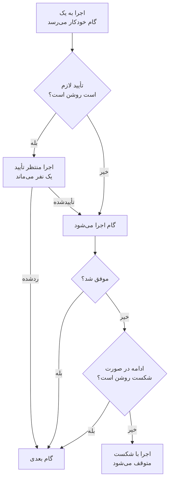

# نوشتن یک رانبوک

رانبوک را به شکل فهرستی مرتب از گام‌ها در صفحه **گام‌ها** می‌نویسید. این صفحه نشان می‌دهد چگونه یک رانبوک بسازید، هر یک از هفت نوع گام را چگونه تنظیم کنید، و شکست‌ها و تأییدها چگونه مسیر یک اجرا را تغییر می‌دهند.

:::cards
- [ساختن یک رانبوک](#ساختن-یک-رانبوک): از رانبوک خالی تا گام‌های ذخیره‌شده.
- [انواع گام](#انواع-گام): Manual، JavaScript، HTTP request، Bash، SSH، kubectl و AI.
- [مدیریت شکست و تأییدها](#مدیریت-شکست-و-تأییدها): وقتی گامی شکست می‌خورد یا منتظر تأیید می‌ماند چه پیش می‌آید.
- [یک مثال کامل](#یک-مثال-کامل): failover پایگاه داده در پنج گام.
:::

## پیش از شروع

- **نقشی که رانبوک می‌نویسد.** Project Owner، Project Admin و Runbook Admin رانبوک می‌سازند و گام‌هایش را ذخیره می‌کنند. با مجوزهای جزئی به **Create Runbook** و **Edit Runbook** نیاز دارید. [دسترسی‌ها](/docs/runbooks/configuration#دسترسیها) را ببینید.
- **یک Runner برای گام‌های Bash، SSH و kubectl.** این گام‌ها روی یک [Runner](/docs/runbooks/agents) در زیرساخت خودتان اجرا می‌شوند، هرگز روی OneUptime Worker. اول یکی نصب کنید. گامی که هیچ Runnerی انتخاب نکند روی [Runner پیش‌فرض پروژه](/docs/runbooks/agents#runner-پیشفرض-پروژه) اجرا می‌شود، اگر یکی تعیین کرده باشید؛ وگرنه گام JavaScript روی یک [Runner سراسری](/docs/runbooks/agents#runnerهای-سراسری) اجرا می‌شود.
- **یک متغیر راز برای گام‌های SSH و kubectl.** کلید، رمز عبور یا kubeconfigی که یک گام با آن وارد می‌شود یک [متغیر رانبوک](/docs/runbooks/variables) راز است. Project Owner و Project Admin متغیرها را می‌سازند، و Runbook Admin آن‌ها را در گام‌هایی که می‌نویسد انتخاب می‌کند. یک گام kubectl می‌تواند به‌جای آن از دسترسی خود Runner استفاده کند.
- **یک ارائه‌دهنده LLM برای گام‌های AI.** [ارائه‌دهندگان LLM](/docs/ai/llm-provider) را ببینید.

## ساختن یک رانبوک

:::steps
### رانبوک‌ها را باز کنید

**محصولات → رانبوک‌ها** را باز کنید. رانبوک‌ها در گروه **داشبوردها و خودکارسازی** هستند.

### رانبوک را بسازید

روی **ساخت رانبوک** کلیک کنید، یک **نام** و در صورت تمایل **توضیحات** درباره کاربرد رانبوک وارد کنید. زیر **فیلدهای بیشتر** کلید **فعال** قرار دارد که به‌طور پیش‌فرض روشن است، و **برچسب‌ها**. رانبوک تازه در صفحه **گام‌ها** خودش باز می‌شود.

### گام‌ها را اضافه کنید

زیر **رانبوک خود را شروع کنید** نوع نخستین گام را انتخاب کنید؛ زیر آخرین گام، **افزودن گام دیگر** همان هفت نوع را پیشنهاد می‌کند. هر گام با **عنوان** و آنچه نوعش لازم دارد باز می‌شود؛ بقیه، مانند **توضیحات** و مهلت‌ها، زیر **فیلدهای بیشتر** جمع شده است. وقتی رانبوک یک گام دارد، **افزودن گام** در بالای کارت یک گام Manual اضافه می‌کند.

### گام‌ها را مرتب کنید

گام‌ها **به ترتیب** اجرا می‌شوند. برای تغییر ترتیب، گام را از دستگیره سمت چپ سرتیترش بکشید؛ با صفحه‌کلید، روی دستگیره فوکوس کنید، Space را بزنید، گام را با کلیدهای جهت‌نما جابه‌جا کنید و دوباره Space را بزنید.

### گام‌ها را ذخیره کنید

روی **ذخیره گام‌ها** کلیک کنید. تا آن موقع ویرایشگر **تغییرات ذخیره‌نشده** را نشان می‌دهد. پس از ذخیره، **ذخیره شد** را می‌بینید و رانبوک آماده [اجرا](/docs/runbooks/running) است.
:::

## ساختار یک گام

هر گام این فیلدها را دارد. یک گام خودکار **عنوان** و تنظیمات نوع خودش را نشان می‌دهد و بقیه را زیر **فیلدهای بیشتر** جمع می‌کند، که می‌گوید کدام‌یک تنظیم شده است:

| فیلد | هدف |
| --- | --- |
| **عنوان** | برچسبی کوتاه که در فهرست گام‌ها و در هر اجرا نمایش داده می‌شود. |
| **توضیحات** | زمینه اختیاری برای پاسخ‌دهنده، به Markdown، زیر **فیلدهای بیشتر**. در یک گام Manual همان **دستورالعمل‌ها** است که فرد می‌خواند و انجام می‌دهد و زیر عنوان نمایش داده می‌شود. |
| **ادامه در صورت شکست** | فقط گام‌های خودکار. وقتی روشن باشد، گامی که شکست می‌خورد اجرا را متوقف نمی‌کند: گام بعدی به هر حال اجرا می‌شود. |
| **تأیید لازم است** | فقط گام‌های خودکار. وقتی روشن باشد، اجرا پیش از این گام می‌ایستد تا کسی آن را تأیید کند، و تنها پس از آن این گام را اجرا می‌کند. نام کلید **پیش از اجرای این گام تأیید لازم است** است، و سربرگ گام **نیازمند تأیید** را نشان می‌دهد. |
| تنظیمات ویژه نوع | اسکریپت، URL، Runner، متغیر راز یا پرامپت. [انواع گام](#انواع-گام) را ببینید. |

## انواع گام

| نوع | کجا اجرا می‌شود | به چه نیاز دارد |
| --- | --- | --- |
| [Manual](#manual) | یک نفر | هیچ |
| [JavaScript](#javascript) | یک Runner | یک Runner |
| [HTTP request](#http-request) | OneUptime Worker | هیچ |
| [Bash](#bash) | یک Runner | یک Runner |
| [SSH](#ssh) | یک Runner | یک Runner و یک متغیر راز برای ورود |
| [kubectl](#kubectl) | یک Runner | یک Runner، و یک متغیر kubeconfig یا دسترسی خود Runner |
| [AI](#ai) | OneUptime Worker | یک ارائه‌دهنده LLM |

در هر گام خودکارِ زیر، **فیلدهای بیشتر** گام نخست **Runner** گام (برای گامی که روی Runner اجرا می‌شود)، سپس **تأیید لازم است** و **ادامه در صورت شکست** را دارد، سپس تنظیمات خودِ گام را - هدرهای یک گام HTTP request، پورت و عبارت عبور کلید یک گام SSH، ارائه‌دهنده و کلیدهای زمینهٔ یک گام هوش مصنوعی - و در آخر **توضیحات** و مهلت‌ها را. وقتی جمع شده است، نام Runner گام را نشان می‌دهد، تا بی‌آنکه بازش کنید ببینید گام کجا اجرا می‌شود.

### Manual

یک آیتم چک‌لیست برای یک نفر: **دستورالعمل‌ها** می‌گویند چه کاری انجام شود یا چه چیزی بررسی شود. اجرا وقتی به گام Manual می‌رسد متوقف می‌شود و در `WaitingForManualStep` (**در انتظار شما**) می‌ماند تا کسی روی **علامت‌گذاری انجام‌شده** یا **رد شدن** کلیک کند. اجرایی که منتظر یک نفر است هرگز منقضی نمی‌شود. گام Manual کلید تأیید ندارد: خودش از پیش اجرا را برای یک نفر متوقف می‌کند.

از آن برای کارهایی استفاده کنید که فقط انسان می‌تواند بررسی یا انجام دهد: «در داشبورد متعادل‌کننده بار تأیید کنید که ترافیک به منطقه ثانویه منتقل شده است.»

### JavaScript

قطعه‌ای JavaScript که در یک سندباکس `isolated-vm` روی یک [عامل رانبوک](/docs/runbooks/agents) اجرا می‌شود، نه روی OneUptime Worker: روی یکی از Runnerهای شما، یا وقتی گام هیچ‌کدام را انتخاب نکند، روی یک [Runner سراسری](/docs/runbooks/agents#runnerهای-سراسری).

| فیلد | چه می‌کند | پیش‌فرض |
| --- | --- | --- |
| **Runner** | زیر **فیلدهای بیشتر**. Runner‌ای که گام را اجرا می‌کند: **Runner سراسری**، یا یکی از Runnerهای شما. فقط Runner‌ای که انتخاب می‌کنید می‌تواند کار را بردارد؛ هر Runner سراسری‌ای می‌تواند گامی را که روی **Runner سراسری** است بردارد. | [Runner پیش‌فرض پروژه](/docs/runbooks/agents#runner-پیشفرض-پروژه)، اگر یکی تعیین کرده باشید؛ وگرنه **Runner سراسری**، وقتی یکی وجود دارد |
| **اسکریپت** | JavaScript‌ای که باید اجرا شود. برای ثبت یک مقدار آن را با `return` برگردانید؛ هر خط `console.log` هم ثبت می‌شود. خطای پرتاب‌شده باعث شکست گام می‌شود. | — |
| **مهلت اجرا** | مدتی که Runner پیش از برچیدن سندباکس اجازه اجرا به قطعه می‌دهد. یک Runner سراسری حداکثر ۵ دقیقه به آن اجازه اجرا می‌دهد. | ۳۰ ثانیه |
| **مهلت برداشتن** | مدتی که Worker منتظر می‌ماند تا Runner کار را بردارد. | ۲ دقیقه |

```javascript
const start = Date.now();
// ... your logic ...
console.log("replica lag checked");
return { durationMs: Date.now() - start };
```

سندباکس ۱۲۸ MB حافظه دارد و به سیستم فایل یا پردازه‌ها دسترسی ندارد. می‌تواند با `axios` درخواست HTTP بفرستد، اما فقط به نشانی‌های عمومی: درخواست به یک شبکه خصوصی، به میزبان خود Runner یا به یک endpoint فراداده ابری رد می‌شود. برای رسیدن به سرویسی در شبکه خودتان از یک گام [Bash](#bash) با `curl` استفاده کنید.

### HTTP request

یک فراخوانی HTTP خروجی که OneUptime Worker انجام می‌دهد. به Runner نیازی نیست.

| فیلد | چه می‌کند | پیش‌فرض |
| --- | --- | --- |
| **متد** | `GET`، `POST`، `PUT`، `PATCH`، `DELETE` یا `HEAD`. | `GET` |
| **URL** | endpoint‌ای که باید فراخوانده شود. | خالی |
| **سرآیندها (JSON)** | زیر **فیلدهای بیشتر**. یک شیء JSON، مثلاً `{ "Authorization": "Bearer ..." }`. هدرهایی که JSON معتبر نیستند باعث شکست گام می‌شوند. | هیچ |
| **بدنه** | برای `POST`، `PUT`، `PATCH` و `DELETE` نمایش داده می‌شود. اگر به‌صورت JSON تجزیه شود به‌صورت JSON فرستاده می‌شود و در غیر این صورت به‌صورت متن. | هیچ |
| **مهلت درخواست** | مدت انتظار برای پاسخ endpoint پیش از شکست گام. | ۳۰ ثانیه |

گام با پاسخ `2xx` یا `3xx` موفق می‌شود و با هر پاسخ دیگری با خطای `HTTP <status>` شکست می‌خورد. تغییر مسیرها دنبال نمی‌شوند. وضعیت، هدرها و بدنه پاسخ تا ۵۰ KB ثبت می‌شوند.

> [!NOTE]
> Worker هرگز نشانی‌های loopback یا link-local، مثل endpoint فراداده ابری، را فرا نمی‌خواند. در OneUptime Cloud فقط نشانی‌های عمومی را فرا می‌خواند. یک OneUptime خودمیزبان به شبکه‌های خصوصی هم می‌رسد، مگر اینکه `DATA_SOURCE_BLOCK_PRIVATE_ADDRESSES` برابر `true` باشد. برای فراخواندن سرویسی در شبکه خودتان از OneUptime Cloud، از یک گام [Bash](#bash) با `curl` استفاده کنید.

به کار می‌آید برای: باز کردن یک حادثه در PagerDuty، ارسال به یک وب‌هوک Slack، فراخواندن API ارائه‌دهنده ابری یا API عمومی خودتان.

### Bash

یک اسکریپت bash که با `bash -c <script>` روی یک [عامل رانبوک](/docs/runbooks/agents) در زیرساخت خودتان اجرا می‌شود. Bash هرگز روی OneUptime Worker اجرا نمی‌شود.

| فیلد | چه می‌کند | پیش‌فرض |
| --- | --- | --- |
| **Runner** | زیر **فیلدهای بیشتر**. Runner‌ای که گام را اجرا می‌کند. فقط همین Runner می‌تواند کار را بردارد. Runnerهای سراسری فقط گام‌های JavaScript را اجرا می‌کنند. | Runner پیش‌فرض پروژه، اگر یکی تعیین کرده باشید |
| **اسکریپت Bash** | اسکریپت. خروجی (stdout و stderr) تا ۵۰ KB ثبت می‌شود و کد خروج غیرصفر باعث شکست گام می‌شود. | — |
| **مهلت اجرا** | مدتی که Runner پیش از کشتن اسکریپت با `SIGKILL` اجازه اجرا به آن می‌دهد. برای گام‌هایی که به‌حق چند دقیقه طول می‌کشند آن را بالا ببرید. | ۳۰ ثانیه |
| **مهلت برداشتن** | مدتی که Worker منتظر می‌ماند تا Runner کار را بردارد. | ۲ دقیقه |

اسکریپت در کانتینر Runner اجرا می‌شود، با ابزارهایی که ایمیج آن همراه دارد، مانند `curl`، `wget` و کلاینت `ssh`، و با دسترسی شبکه میزبانی که روی آن اجرا می‌شود. برای نمونه، بررسی سرویسی که فقط از شبکه شما در دسترس است:

```bash
set -euo pipefail
HTTP_CODE=$(curl -s -o /tmp/resp.txt -w "%{http_code}" "http://payments.internal:8080/health")
echo "HTTP $HTTP_CODE"
cat /tmp/resp.txt
if [[ "$HTTP_CODE" != "200" ]]; then
  echo "Health check failed"
  exit 1
fi
```

اگر Runner انتخاب‌شده هنگام رسیدن اجرا به این گام آفلاین باشد، گام تا **مهلت برداشتن** (به‌طور پیش‌فرض ۲ دقیقه) منتظر می‌ماند و سپس با پایان مهلت شکست می‌خورد. پیش از تکیه بر یک گام Bash، در **رانبوک‌ها → Runnerها** یک عامل اضافه کنید.

> [!TIP]
> گذرواژه‌ها و توکن‌ها را بیرون از اسکریپت نگه دارید. آن‌ها را به‌عنوان [متغیرهای رانبوک](/docs/runbooks/variables) راز ذخیره کنید و جایی که مقدار باید قرار بگیرد بنویسید `{{global.variables.NAME}}`: Runner اسکریپت را با مقدار جایگذاری‌شده دریافت می‌کند، و خروجی گام به‌جای آن `[REDACTED]` نشان می‌دهد.

### SSH

از راه SSH به یک ماشین وارد شوید و آنجا یک اسکریپت bash اجرا کنید. اتصال را Runner باز می‌کند، پس ماشین فقط باید از Runner در دسترس باشد، و کلید یا رمز عبوری که گام با آن وارد می‌شود یک [متغیر رانبوک](/docs/runbooks/variables) راز است که هرگز در گام نوشته نمی‌شود.

| فیلد | چه می‌کند |
| --- | --- |
| **Runner** | زیر **فیلدهای بیشتر**. Runner‌ای که اتصال را باز می‌کند. باید از راه شبکه به ماشین برسد. گامی که هیچ Runnerی انتخاب نکند روی Runner پیش‌فرض پروژه اجرا می‌شود. |
| **SSH به** | کاربر و ماشین، همان‌طور که بعد از `ssh` می‌نویسید: `deploy@10.0.4.21`. |
| **ورود با** | متغیر رازی که کلید خصوصی یا رمز عبور را نگه می‌دارد؛ خودِ مقدار نشان می‌دهد کدام است. فقط متغیرهای راز پیشنهاد می‌شوند، و وقتی Runner گام اجازهٔ استفاده از متغیر انتخاب‌شده را ندارد، گام آن را می‌گوید. |
| **اسکریپت Bash** | روی ماشین با `bash` و به‌عنوان کاربری که گام با آن وارد می‌شود اجرا می‌شود. خروجی تا ۵۰ KB ثبت می‌شود و کد خروج غیرصفر گام را ناموفق می‌کند. |
| **پورت** | زیر **فیلدهای بیشتر**. اگر خالی بماند ۲۲. |
| **عبارت عبور کلید** | زیر **فیلدهای بیشتر**. متغیر رازی که عبارت عبور کلیدی را نگه می‌دارد که عبارت عبور دارد. |
| **مهلت اجرا** | اتصال، ورود و اجرای اسکریپت را با هم در بر می‌گیرد، تا اسکریپتی که گیر کرده نتواند گام را باز نگه دارد. پیش‌فرض ۳۰ ثانیه. |
| **مهلت برداشتن** | مدتی که Worker منتظر می‌ماند تا Runner کار را بردارد. پیش‌فرض ۲ دقیقه. |

برای نمونه، برای راه‌اندازی دوبارهٔ یک سرویس و نشان دادن اینکه دوباره بالا آمده است:

```bash
sudo systemctl restart nginx
systemctl status nginx --no-pager
```

### kubectl

دستورهای kubectl را روی یک خوشه اجرا کنید. اسکریپت با bash روی Runner اجرا می‌شود، که `kubectl` را همراه دارد، و `KUBECONFIG` به خوشه اشاره می‌کند: هر دستور kubectl کار می‌کند، و هر bash دور آن هم.

| فیلد | چه می‌کند |
| --- | --- |
| **Runner** | زیر **فیلدهای بیشتر**. Runnerی که kubectl را اجرا می‌کند. باید به سرور API خوشه برسد. گامی که هیچ Runnerی انتخاب نکند روی Runner پیش‌فرض پروژه اجرا می‌شود. |
| **Kubeconfig** | متغیر رازی که kubeconfig خوشه را نگه می‌دارد، یا **دسترسی خود Runner**: kubeconfig خود Runner، یا حساب سرویس آن وقتی در خوشه اجرا می‌شود. Runner یک kubeconfig را در فایلی می‌نویسد که فقط خودش می‌تواند بخواند، و وقتی اسکریپت تمام شد آن را پاک می‌کند. |
| **اسکریپت** | دستورهای kubectl. خروجی تا ۵۰ KB ثبت می‌شود و کد خروج غیرصفر گام را ناموفق می‌کند. |
| **مهلت اجرا** | مدتی که Runner پیش از متوقف کردن اسکریپت با `SIGKILL` اجازهٔ اجرا به آن می‌دهد. پیش‌فرض ۳۰ ثانیه. |
| **مهلت برداشتن** | مدتی که Worker منتظر می‌ماند تا Runner کار را بردارد. پیش‌فرض ۲ دقیقه. |

برای نمونه، برای راه‌اندازی دوبارهٔ یک deployment و انتظار تا آماده شدن podهای تازه‌اش:

```bash
kubectl rollout restart deployment/checkout-api --namespace checkout
kubectl rollout status deployment/checkout-api --namespace checkout --timeout=120s
```

**نمونه‌ها — برای درج کلیک کنید**، زیر هر اسکریپت، اسکریپت‌های رایجی مانند این‌ها را جای می‌گذارد. به کاربر kubeconfig فقط همان چیزی را بدهید که اسکریپت‌هایتان انجام می‌دهند: یک Role در namespaceهایی که در آن‌ها کار می‌کنند، با فعل‌هایی که به کار می‌برند. اگر سرور API دستوری را رد کند، پیام خودِ kubectl در خروجی گام هست، پس خطای مجوز به شما می‌گوید کدام role binding را باید گسترش دهید.

### AI

در میانه اجرا از هوش مصنوعی بخواهید چیزی را تحلیل یا خلاصه کند یا درباره‌اش تصمیم بگیرد. پاسخ، خروجی گام روی اجرا می‌شود. گام‌های AI روی OneUptime Worker اجرا می‌شوند؛ به Runner نیازی نیست.

| فیلد | چه می‌کند |
| --- | --- |
| **پرامپت** | آنچه هوش مصنوعی باید انجام دهد. برای نمونه: «خروجی گام‌های پیشین را بررسی کن و بگو ادامه رفع مشکل امن است یا نه.» |
| **ارائه‌دهنده LLM** | اختیاری. **پیش‌فرض پروژه** از ارائه‌دهنده پیش‌فرض پروژه استفاده می‌کند. وقتی گام به مدل خاصی نیاز دارد، مثلاً مدلی خودمیزبان برای داده‌ای که نباید از شبکه‌تان خارج شود، یک ارائه‌دهنده را ثابت کنید. [ارائه‌دهندگان LLM](/docs/ai/llm-provider) را ببینید. |
| **افزودن زمینه گام قبلی** | وقتی روشن باشد، هوش مصنوعی همه‌چیز درباره گام‌هایی را که پیش از این گام اجرا شده‌اند می‌بیند: عنوان، نوع، وضعیت، خروجی و پیام‌های خطا. از خروجی هر گام تا ۴٬۰۰۰ نویسه به آن داده می‌شود. |
| **افزودن زمینه تریگر** | وقتی روشن باشد، هوش مصنوعی می‌بیند چه چیزی اجرا را شروع کرده است: حادثه، هشدار یا رویداد تعمیر و نگهداری زمان‌بندی‌شده مرتبط (توضیحات، شدت، وضعیت فعلی، مانیتورهای آسیب‌دیده، علت ریشه‌ای، خط زمانی وضعیت و یادداشت‌های عمومی)، یا کسی که رانبوک را دستی اجرا کرده است. |

برای اینکه انسان در چرخه بماند، **تأیید لازم است** را روی گامِ پس از یک گام AI روشن کنید: هوش مصنوعی تحلیل می‌کند، یک نفر پاسخ آن را می‌خواند، و گام رفع مشکل تنها وقتی اجرا می‌شود که او آن را تأیید کند.

**آنچه هوش مصنوعی هرگز نمی‌بیند.** پاسخ یک گام AI به‌عنوان خروجی گام روی اجرا ذخیره می‌شود، و اجراها را هر کسی که مجوز خواندن رانبوک دارد می‌تواند بخواند، که مخاطبی گسترده‌تر از مخاطبان حادثه است. به همین دلیل زمینه محرک **یادداشت‌های داخلی خصوصی** و **پیام‌های کانال Slack و Microsoft Teams** را کنار می‌گذارد. خروجی گام‌های پیشین برای یافتن اسرار (توکن‌ها، کلیدها، اعتبارنامه‌ها) بررسی می‌شود و این موارد پیش از ارسال به مدل پوشانده می‌شوند. تصویرهای جاسازی‌شده و داده‌های رمزگذاری‌شده طولانی، مانند اسکرین‌شاتی که در توضیحات یک حادثه چسبانده شده، نیز کنار گذاشته می‌شوند و یادداشتی کوتاه جایشان را می‌گیرد.

گام‌های AI مانند هر قابلیت دیگر هوش مصنوعی اندازه‌گیری و صورت‌حساب می‌شوند. گام با پیامی که دلیلش را می‌گوید شکست می‌خورد اگر پرامپتی نداشته باشد، قابلیت‌های هوش مصنوعی برای پروژه خاموش باشند، هیچ ارائه‌دهنده LLM در دسترس نباشد، یا ارائه‌دهنده ثابت‌شده دیگر برای پروژه در دسترس نباشد. اگر بقیه رانبوک باید همچنان اجرا شود، **ادامه در صورت شکست** را روشن کنید.

## مدیریت شکست و تأییدها



به‌طور پیش‌فرض گامی که شکست می‌خورد اجرا را متوقف می‌کند و اجرا را با خطای همان گام به‌عنوان دلیل، `Failed` علامت می‌زند. با روشن بودن **ادامه در صورت شکست**، شکست ثبت می‌شود و گام بعدی اجرا می‌شود، که برای رانبوک‌هایی از نوع «این سه کار را امتحان کن، بعد خبر بده» مناسب است.

**تأیید لازم است** پیش از اجرای یک گام اعمال می‌شود، هر چه پیش از آن رخ داده باشد: اجرا منتظر می‌ماند تا کسی روی **تأیید و اجرا** کلیک کند، و گام اجرا می‌شود، یا روی **رد شدن**، و هرگز اجرا نمی‌شود. آن را برای گامی روشن کنید که چیزی را تغییر می‌دهد - راه‌اندازی دوباره، جابه‌جایی به سرور پشتیبان، کوچک‌کردن مقیاس - تا یک نفر نخست ببیند گام‌های پیش از آن چه یافته‌اند. تأیید متعلق به گام است، پس جابه‌جا کردن گام آن را هم جابه‌جا می‌کند.

:::note
از طریق API و Terraform، این کلید فیلد `requireApprovalBeforeRunning` یک گام است. فیلد `requireApproval` یک گام، که رانبوک‌ها پیش از انتقال تأییدها به گامی که از آن محافظت می‌کنند می‌نوشتند، هنوز کار می‌کند و همان معنای پیشین را دارد: تأییدی پس از آن گام. OneUptime آن را تأییدی پیش از گام بعدی می‌خواند، یا اگر پس از آخرین گام باشد، گامی Manual در پایان با عنوان **Approve the result**.
:::

## ذخیره و ویرایش

تغییرات گام‌ها وقتی اعمال می‌شوند که روی **ذخیره گام‌ها** کلیک کنید. هر اجرا از تصویر لحظه‌ای‌ای کار می‌کند که هنگام شروعش گرفته شده، پس اجراهای در جریان گام‌هایی را که با آن‌ها شروع کرده‌اند نگه می‌دارند و ویرایش هرگز تاریخچه اجراهای گذشته را بازنویسی نمی‌کند.

## یک مثال کامل

رانبوکی برای «DB primary unreachable»:

| # | نوع | چه می‌کند |
| --- | --- | --- |
| 1 | JavaScript | میزبان primary فعلی را از سرویس پیکربندی‌تان بگیرید و ثبتش کنید. |
| 2 | Manual | «تأیید کنید که تأخیر همتاسازی روی secondary کمتر از ۵ ثانیه است.» |
| 3 | HTTP request | `POST` به API هماهنگ‌کننده failover شما. |
| 4 | Manual | «بررسی کنید که نوشتن‌ها اکنون به primary تازه می‌روند.» |
| 5 | HTTP request | `POST` یک پیام رفع وضعیت به یک وب‌هوک Slack. |

پاسخ‌دهنده اجرای گام ۱ را می‌بیند، گام ۲ را تیک می‌زند، اجرای گام ۳ را می‌بیند، گام ۴ را تیک می‌زند، و اجرا با گام ۵ تمام می‌شود. خروجی هر گام برای پس‌کاوی ثبت می‌شود.

## گام‌های بعدی

:::cards
- [اجرای یک رانبوک](/docs/runbooks/running): یک اجرا را شروع کنید و گام‌هایش را کامل، تأیید یا رد کنید.
- [قواعد رانبوک](/docs/runbooks/rules): این رانبوک را خودکار روی حادثه‌های جور شروع کنید.
- [عامل‌های رانبوک](/docs/runbooks/agents): Runner‌ای را که گام‌های اسکریپتی‌تان نیاز دارند نصب کنید.
- [متغیرهای رانبوک](/docs/runbooks/variables): میزبان‌ها، کلیدها، رمزهای عبور و kubeconfigها را بیرون از گام‌هایتان نگه دارید.
:::
