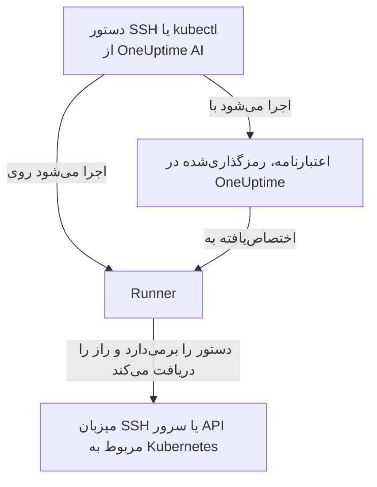

# دسترسی هوش مصنوعی

دسترسی هوش مصنوعی راهی است که دستورهای خودِ OneUptime AI با آن به چیزی می‌رسند که میزبان خودِ یک Runner **نیست**: سروری از راه SSH، یا سرور API یک خوشهٔ Kubernetes که چارت عامل Kubernetes را اجرا نمی‌کند. هر دسترسی یک اعتبارنامه است: همان دسترسی به‌صورت یک شیء مدیریت‌شده، در حالت سکون رمزگذاری‌شده، به Runnerهای مشخص اختصاص‌یافته و به‌جای نوشته شدن در یک دستور، انتخاب‌شده توسط OneUptime AI. گام‌های رانبوک از آن‌ها استفاده نمی‌کنند: یک گام SSH یا kubectl با یک [متغیر رانبوک](/docs/runbooks/variables) راز وارد می‌شود. Runnerی قدیمی‌تر از این نسخه استثناست: یک گام Kubernetes را که از یک عمل منتقل شده، با اعتبارنامه‌ای که آن گام نام می‌برد اجرا می‌کند، تا وقتی اسکریپت یا kubeconfig گام تغییر کند.

آن‌ها را در **رانبوک‌ها → Runnerها → دسترسی هوش مصنوعی** مدیریت کنید.

:::cards
- [ساختن یک اعتبارنامه](#ساختن-یک-اعتبارنامه): دسترسی آن و Runnerهایی که اجازه استفاده از آن را دارند.
- [کمترین سطح دسترسی در سمت مقابل](#کمترین-سطح-دسترسی-در-سمت-مقابل): محدود کنید کلید یا توکن چه کاری می‌تواند بکند.
- [Runnerهایی که دستورهای OneUptime AI را اجرا می‌کنند](#runnerهایی-که-دستورهای-oneuptime-ai-را-اجرا-میکنند): چه کسی می‌تواند به چنین Runnerی اعتبارنامهٔ SSH بدهد.
:::

## اعتبارنامه چگونه به کار می‌رود

OneUptime AI یک دستور SSH را با یکی از اعتبارنامه‌های SSH اختصاص‌یافته به Runnerی که روی آن اجرا می‌شود اجرا می‌کند، و یک دستور kubectl برای خوشه‌ای که چارت عامل Kubernetes را اجرا نمی‌کند را با اعتبارنامهٔ Kubernetes متصل به همان خوشه، همان‌طور که [AI SRE](/docs/ai/ai-sre) نشان می‌دهد. وقتی Runner دستور را برمی‌دارد، OneUptime بررسی می‌کند که اعتبارنامه به آن اختصاص یافته باشد، راز را رمزگشایی می‌کند و آن را فقط در پاسخ به همان برداشت تحویل می‌دهد. راز هرگز روی کار ذخیره نمی‌شود و هرگز از API خواندنی نیست.

## پیش از شروع

- **نقشی که اعتبارنامه‌ها را مدیریت می‌کند.** Project Owner و Project Admin، یا هر کسی با مجوز **Create Runbook Credential**. نقش Runbook Admin شامل آن نیست. اختصاص یک اعتبارنامه SSH به Runner‌ای که دستورهای OneUptime AI را اجرا می‌کند به **Read Runbook Credential** هم نیاز دارد؛ [Runnerهایی که دستورهای OneUptime AI را اجرا می‌کنند](#runnerهایی-که-دستورهای-oneuptime-ai-را-اجرا-میکنند) را ببینید.
- **طرحی که آن‌ها را شامل شود.** در OneUptime Cloud، اعتبارنامه‌های رانبوک به طرح **Growth** یا بالاتر نیاز دارند.
- **یک [Runner](/docs/runbooks/agents)** که از راه شبکه به میزبان یا سرور API کلاستر برسد.

## ساختن یک اعتبارنامه

:::steps
### دسترسی هوش مصنوعی را باز کنید

**رانبوک‌ها → Runnerها → دسترسی هوش مصنوعی** را باز کنید و روی **ساخت Credential** کلیک کنید.

### نام بگذارید و نوعش را انتخاب کنید

در گام **Credential** یک **نام** وارد کنید، مثلاً `prod-cluster`، یک **توضیحات** اختیاری و **نوع**: **SSH** یا **Kubernetes**. نوع بعداً قابل تغییر نیست؛ به‌جای آن یک اعتبارنامه تازه بسازید.

### دسترسی را وارد کنید

:::tabs
@tab SSH
زیر **میزبان SSH**، **نام میزبان**، **پورت** (اگر خالی باشد ۲۲) و **نام کاربری** را وارد کنید. زیر **احراز هویت SSH** در **ورود با** انتخاب کنید: **کلید خصوصی** ، که هر جا انتخاب دارید بهتر است، و سپس **Private Key (PEM)** را همراه با **Private Key Passphrase** آن، اگر دارد، بچسبانید؛ یا برای میزبانی بدون دسترسی با کلید **رمز عبور** ، و سپس **رمز عبور** را وارد کنید.
@tab Kubernetes
زیر **Kubernetes**، **API Server URL** را وارد کنید، مثلاً `https://10.0.0.1:6443`، همراه با **Service Account Token** و **CA Certificate (PEM)**، تا Runner بتواند سرور API را راستی‌آزمایی کند. CA را فقط وقتی خالی بگذارید که سرور API گواهی‌ای ارائه کند که Runner از قبل به آن اعتماد دارد.
:::

### آن را به Runnerها اختصاص دهید

در گام **Runnerها**، Runnerهایی را که اجازه استفاده از اعتبارنامه را دارند انتخاب کنید، سپس روی **ساخت Credential** کلیک کنید. اعتبارنامه‌ای که به هیچ Runner‌ای اختصاص نیافته قابل استفاده در هیچ دستوری نیست.

### بگذارید OneUptime AI از آن استفاده کند

OneUptime AI دستورهای SSH خود را روی Runnerی اجرا می‌کند که **دستورهای رفع مشکل با هوش مصنوعی را اجرا می‌کند** در آن روشن است، با یکی از اعتبارنامه‌های SSH اختصاص‌یافته به آن. یک اعتبارنامهٔ Kubernetes به‌محض اینکه همراه با یکی از Runnerهایش به یک خوشه متصل شود به کار می‌رود: [AI SRE](/docs/ai/ai-sre) را ببینید.
:::

## چه چیزی ذخیره می‌شود

| نوع | فیلدها |
| --- | --- |
| SSH | نام میزبان، پورت (پیش‌فرض ۲۲)، نام کاربری، و یا یک کلید خصوصی PEM (با عبارت عبور اختیاری) یا یک رمز عبور. |
| Kubernetes | URL سرور API، توکن یک حساب سرویس و گواهی CA کلاستر. |

## مقدارهای محرمانه فقط‌نوشتنی‌اند

کلیدهای خصوصی، عبارت‌های عبور، رمزهای عبور و توکن‌های حساب سرویس در حالت سکون رمزگذاری می‌شوند و API **هرگز آن‌ها را برنمی‌گرداند**: نه به داشبورد، نه به یک گردش کاری و نه در یک خروجی. جدول می‌تواند نشان دهد یک اعتبارنامه *چیست*، بی‌آنکه هرگز نشان دهد چه در خود دارد.

پس برای یک مقدار محرمانه «نمایش» وجود ندارد، فقط «جایگزینی»: وارد کردن دوباره مقدار همان راه چرخاندن آن است. اگر مقدار اصلی را گم کرده‌اید، روی سامانه هدف کلید تازه‌ای صادر کنید و اعتبارنامه را به‌روز کنید.

## اختصاص یک اعتبارنامه به Runnerها

یک اعتبارنامه فقط برای Runnerهایی قابل استفاده است که آن را به آن‌ها اختصاص می‌دهید. دستوری که نام اعتبارنامه‌ای را می‌برد که به Runner آن اختصاص نیافته، **به‌جای اجرا شکست می‌خورد** — Runnerی که بی‌صدا هیچ کاری نمی‌کند دقیقاً مثل Runnerی به نظر می‌رسد که کار کرده است.

اختصاص همان مرز دسترسی است، پس آن را محدود نگه دارید: Runner‌ای که فقط یک کلاستر را دوباره راه‌اندازی می‌کند به کلید SSH میزبان‌های پایگاه داده شما نیاز ندارد.

### Runnerهایی که دستورهای OneUptime AI را اجرا می‌کنند

روی Runner‌ای که **دستورهای رفع مشکل با هوش مصنوعی را اجرا می‌کند** در آن روشن است، OneUptime AI برای دستورهایی که آنجا اجرا می‌کند از میان اعتبارنامه‌های SSH اختصاص‌یافته به آن Runner انتخاب می‌کند. بنابراین یک اعتبارنامه SSH فقط از راه کسی که اجازه خواندن اعتبارنامه‌های رانبوک را دارد (**Read Runbook Credential**، یا یک Project Owner یا Project Admin) به چنین Runner‌ای می‌رسد، هر کدام که اول ذخیره شود:

- **اختصاص اعتبارنامه.** ساختن یک اعتبارنامه SSH با چنین Runner‌ای، یا افزودن چنین Runner‌ای به یک اعتبارنامه، به آن مجوز نیاز دارد. بدون آن، ذخیره رد می‌شود و نام Runner آورده می‌شود: اعتبارنامه را به Runnerهایی اختصاص دهید که دستورهای رفع مشکل با هوش مصنوعی را اجرا نمی‌کنند، یا از کسی که مجوز را دارد بخواهید آن را اختصاص دهد.
- **روشن کردن کلید.** روشن کردن **دستورهای رفع مشکل با هوش مصنوعی را اجرا می‌کند** برای Runner‌ای که اعتبارنامه SSH دارد به همان مجوز نیاز دارد.

حذف Runnerها از یک اعتبارنامه، ذخیره یک اعتبارنامه با همان Runnerهایی که از قبل دارد، و اعتبارنامه‌های Kubernetes به چیزی بیشتر نیاز ندارند: دستورهای kubectl مربوط به OneUptime AI با اعتبارنامه‌ای اجرا می‌شوند که به کلاسترشان بسته شده است. اختصاص اعتبارنامه‌ها و روشن کردن کلید از سوی کسی که این مجوز را ندارد در هر پروژه یکی‌یکی ذخیره می‌شوند، تا این دو نتوانند با هم از بررسی‌هایشان بگذرند؛ ذخیره‌ای که در حین ذخیره دیگری برسد منتظر آن می‌ماند و اگر بیش از حد طول بکشد با *Try again in a moment* رد می‌شود. دوباره ذخیره کنید.

گام یک گردش کاری به‌عنوان Project Admin عمل می‌کند، اما مجوز خواندن اعتبارنامه‌های رانبوکِ یک Project Admin را قرض نمی‌گیرد: یک گام فقط وقتی آن را دارد که کسی که آخرین بار گام‌های گردش کاری را ذخیره کرده آن را داشته باشد. [گام‌های گردش کاری چه کاری می‌توانند بکنند](/docs/workflows/configuration#گامهای-گردش-کاری-چه-کاری-میتوانند-بکنند) را ببینید.

## کمترین سطح دسترسی در سمت مقابل

OneUptime نمی‌تواند محدود کند که اعتبارنامه شما روی سامانه هدف اجازه چه کاری دارد: این کار سامانه هدف است، و ارزش انجام دادن دارد:

- **SSH** — کلید را به رمز عبور ترجیح دهید، به کاربر فقط دستورهایی را که نیاز دارد بدهید (هر جا عملی است، یک دستور اجباری یا یک shell محدود)، و کلید شخصی یک مدیر را دوباره به کار نبرید.
- **Kubernetes** — حساب سرویس را به Roleی متصل کنید که فقط همان کاری را مجاز کند که به OneUptime AI اجازه می‌دهید، در namespaceهایی که اجازهٔ عمل در آن‌ها را دارد. حساب سرویسی که فقط اجازهٔ خواندن دارد به OneUptime AI امکان بررسی می‌دهد و هر اصلاحی را رد می‌کند.

## چه کسی آن‌ها را می‌بیند

ساختن، ویرایش و حذف اعتبارنامه‌ها به مجوزهای اعتبارنامه رانبوک (یا Project Owner/Admin) نیاز دارد. خواندن یک اعتبارنامه فقط فیلدهای غیرمحرمانه‌اش را نشان می‌دهد.

توجه کنید که **کلید عامل** یک Runner هم‌ارز اعتبارنامه‌های اختصاص‌یافته به آن Runner است: هر چیزی که کلید را داشته باشد می‌تواند به‌عنوان آن Runner کار بردارد و اعتبارنامه دریافت کند. به همین دلیل کلیدهای عامل را فقط Project Owner، Project Admin و Runbook Admin می‌توانند بخوانند: با آن‌ها همان رفتاری را داشته باشید که با خود اعتبارنامه‌ها دارید.

## گام‌های بعدی

:::cards
- [متغیرهای رانبوک](/docs/runbooks/variables): رازهایی که گام‌های SSH و kubectl با آن‌ها وارد می‌شوند.
- [عامل‌های رانبوک](/docs/runbooks/agents): Runner‌ای را نصب کنید که اعتبارنامه به آن اختصاص می‌یابد.
- [پیکربندی و ایمنی رانبوک](/docs/runbooks/configuration): دسترسی‌ها و مقاوم‌سازی برای کل پشته رانبوک.
:::
