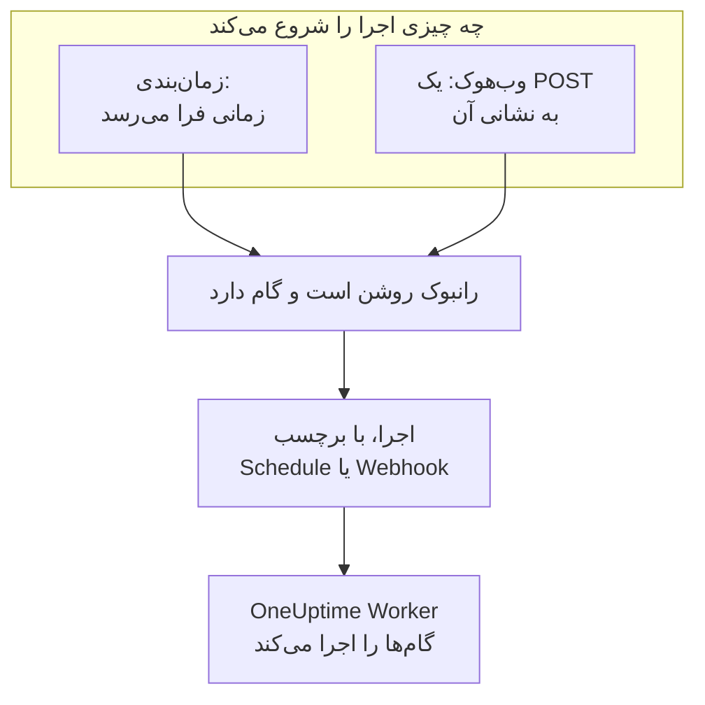

# تریگرهای رانبوک

یک رانبوک می‌تواند خودبه‌خود شروع شود: طبق زمان‌بندی، یا وقتی ابزار دیگری نشانی وب‌هوک آن را فراخوانی می‌کند. برای کارهای روزمره، مانند پاک‌سازی شبانه یا بررسی هفتگی گواهی‌ها، از زمان‌بندی استفاده کنید و برای شروع رانبوک از یک سامانه هشدار، خط لوله CI یا یک اسکریپت، از وب‌هوک. هر دو در صفحه **تریگرها** رانبوک تنظیم می‌شوند.

:::cards
- [اجرا طبق زمان‌بندی](#اجرا-طبق-زمانبندی): هر چند دقیقه، هر روز، در روزهای خاصی از هفته، یا با یک عبارت cron.
- [فراخوانی وب‌هوک](#فراخوانی-وبهوک): شروع یک اجرا با یک درخواست POST به نشانی رانبوک.
- [مقدارهایی که فراخوانی وب‌هوک می‌فرستد](#مقدارهایی-که-فراخوانی-وبهوک-میفرستد): گام‌ها JSONی را که فراخواننده می‌فرستد چگونه می‌خوانند.
- [عیب‌یابی](#عیبیابی): زمان‌بندی‌ای که اجرا نمی‌شود، فراخوانی‌ای که رد می‌شود.
:::

## یک تریگر چگونه اجرا را شروع می‌کند



یک تریگر اجرا را همان‌طور شروع می‌کند که **اجرا همین حالا** شروع می‌کند: اجرا گام‌های کنونی رانبوک را انجام می‌دهد و به هیچ رخداد، هشدار یا رویداد نگهداری زمان‌بندی‌شده‌ای وصل نیست. هر اجرا ثبت می‌کند که چه چیزی آن را شروع کرد. **اجراها** رانبوک و **رانبوک‌ها → اجراها** این را زیر **فعال‌شده توسط** نشان می‌دهند، همراه با زمانی که اجرای زمان‌بندی‌شده موعدش بود یا نشانی‌ای که وب‌هوک را فراخوانی کرد، و هر دو فهرست را می‌توان بر پایه آن پالایش کرد.

## پیش از شروع

- رانبوکی با دست‌کم یک گام که کلید **اجرای این رانبوک** آن در صفحه **تنظیمات** روشن باشد.
- اجازه ویرایش رانبوک و اجرای آن. [چه کسانی می‌توانند تریگر تنظیم کنند](#چه-کسانی-میتوانند-تریگر-تنظیم-کنند) را ببینید.

## اجرا طبق زمان‌بندی

:::steps
### صفحه تریگرهای رانبوک را باز کنید
رانبوک را از **رانبوک‌ها** باز کنید و در منوی کناری آن روی **تنظیمات → تریگرها** کلیک کنید. **تنظیمات** جمع‌شده آغاز می‌شود: برای نمایش **تریگرها** رویش کلیک کنید.

### زمان‌بندی را تنظیم کنید
روی **تنظیم زمان‌بندی** کلیک کنید. در **زمان اجرا** یک **تکرار** و آنچه لازم دارد را انتخاب کنید. همان‌طور که آن را تغییر می‌دهید، کادر گفت‌وگو زمان‌بندی را در یک جمله می‌گوید، مانند «هر روز کاری ساعت 09:00 اجرا می‌شود»، و اجراهای بعدی‌اش را فهرست می‌کند.

### منطقه زمانی را بررسی کنید
**منطقه زمانی** با منطقه زمانی خود شما شروع می‌شود. زمان‌های زمان‌بندی طبق ساعت این منطقه خوانده می‌شوند.

### ذخیره کنید
روی **ذخیره زمان‌بندی** کلیک کنید. زمان‌بندی روشن می‌شود و کارت آن را در یک جمله همراه با **اجراهای بعدی** نشان می‌دهد.
:::

| **تکرار** | آنچه انتخاب می‌کنید | برای نمونه |
| --- | --- | --- |
| **هر چند دقیقه** | **هر**: 1، 2، 3، 4، 5، 6، 10، 12، 15، 20 یا 30 دقیقه | هر 15 دقیقه |
| **هر چند ساعت** | **هر**: 1، 2، 3، 4، 6، 8 یا 12 ساعت، و **دقیقه پس از ساعت** | هر 2 ساعت در دقیقه :30 |
| **هر روز** | **ساعت روز** | هر روز ساعت 09:00 |
| **در روزهای انتخابی** | **در این روزها**، با **روزهای کاری** و **هر روز** به‌عنوان میان‌بر، و **ساعت روز** | هر روز کاری ساعت 09:00 |
| **سفارشی (عبارت cron)** | **عبارت cron** | `0 2 1 * *`: ساعت 02:00 روز اول هر ماه |

عبارت cron پنج فیلد دارد: دقیقه، ساعت، روز ماه، ماه و روز هفته. رانبوک‌ها حداکثر دقیقه‌ای یک بار اجرا می‌شوند، پس فیلد ثانیه وجود ندارد. کادر گفت‌وگو عبارتی را که نمی‌تواند بخواند، یا عبارتی را که هرگز اجرا نمی‌شود، مانند `0 0 31 2 *`، توضیح می‌دهد و تا وقتی نتواند اجرا شود چیزی ذخیره نمی‌کند.

سپس کارت زمان‌بندی، سه اجرای بعدی آن طبق ساعت منطقه، کاری که وقتی اجرایی هنوز در جریان است یا زمانی از دست رفته انجام می‌دهد، و **آخرین اجرای زمان‌بندی‌شده** را همراه با **مشاهده اجرا** نشان می‌دهد. **ویرایش زمان‌بندی** همان کادر گفت‌وگو را باز می‌کند، و کلید **اجرا طبق این زمان‌بندی** زمان‌بندی را بدون از دست دادنش متوقف می‌کند.

### اگر اجرایی هنوز در جریان است

اجرا تا وقتی در صف است، در حال اجراست یا منتظر است کسی گامی را کامل یا تأیید کند، در جریان به شمار می‌آید؛ هر طور که شروع شده باشد. تنظیم **اگر اجرایی هنوز در جریان است** زمان‌بندی، که در کادر گفت‌وگو زیر **فیلدهای بیشتر** جمع شده است، تعیین می‌کند زمانی که در این هنگام فرا می‌رسد چه کند:

| تنظیم | چه رخ می‌دهد |
| --- | --- |
| **رد کردن آن زمان** (پیش‌فرض) | چیزی شروع نمی‌شود. زمان‌بندی منتظر زمان بعدی‌اش می‌ماند. |
| **پس از پایان آن اجرا شود** | یک اجرا منتظر می‌ماند و وقتی اجرای در جریان تمام شد شروع می‌شود. زمان‌های دیگری که در این میان فرا می‌رسند چیزی را شروع نمی‌کنند. |

### اگر OneUptime زمانی را از دست داد

اگر OneUptime در زمان زمان‌بندی‌شده از کار افتاده بود یا در حال ارتقا بود، آن زمان به محض اینکه بیش از 5 دقیقه دیر شود از دست رفته به شمار می‌آید. **اگر OneUptime زمانی را از دست داد** تعیین می‌کند وقتی OneUptime بازگشت چه رخ دهد:

| تنظیم | چه رخ می‌دهد |
| --- | --- |
| **پس از بازگشت OneUptime یک بار اجرا شود** (پیش‌فرض) | یک اجرا شروع می‌شود، هر چند زمان که از دست رفته باشد، با برچسب «یک بار برای جبران زمان‌هایی که OneUptime از دست داد اجرا شد». |
| **رد کردن زمان‌های از دست رفته** | تا زمان بعدی چیزی شروع نمی‌شود. |

زمان‌هایی که در مدت خاموش بودن زمان‌بندی یا رانبوک می‌گذرند از دست رفته به شمار نمی‌آیند: روشن کردن دوباره هر یک از آن‌ها از زمان بعدی ادامه می‌دهد.

### منطقه‌های زمانی و ساعت تابستانی

زمان‌ها در تمام سال طبق ساعت منطقه خوانده می‌شوند. زمان‌بندی ساعت 09:00 در Europe/London در زمستان و تابستان ساعت 09:00 به وقت لندن اجرا می‌شود. در شبی که ساعت‌ها جلو کشیده می‌شوند، زمانی که آن شب وجود ندارد یک ساعت دیرتر روی ساعت اجرا می‌شود. وقتی ساعت‌ها عقب کشیده می‌شوند و یک ساعت دو بار می‌آید، زمان‌بندی‌ای که هر ساعت اجرا می‌شود در هر دو اجرا می‌شود و هر زمان‌بندی دیگری یک بار، در اولی.

## فراخوانی وب‌هوک

:::steps
### وب‌هوک را روشن کنید
در صفحه **تریگرها** رانبوک، **اجرا هنگام فراخوانی این نشانی** را روشن کنید. رانبوک نشانی خودش را می‌گیرد.

### نشانی را کپی کنید
**نشانی وب‌هوک** پوشانده شده است: برای دیدنش روی **نمایش** کلیک کنید، یا برای کپی کردن کامل آن روی **کپی نشانی**. **امتحان کنید** یک فرمان `curl` برای شروع دارد.

### از ابزار خود فراخوانی کنید
یک درخواست `POST` به نشانی بفرستید، با یک شیء JSON به‌عنوان بدنه، یا بدون بدنه:

```bash
curl -X POST "https://oneuptime.com/runbook/webhook/RUNBOOK_ID/SECRET_KEY" \
  -H "Content-Type: application/json" \
  -d '{"host": "web-1", "reason": "Disk almost full"}'
```

### اجرا را بررسی کنید
پاسخ، اجرایی را که شروع کرد نام می‌برد: `{"runbookExecutionId": "...", "status": "Scheduled"}`. اجرا در **اجراها** رانبوک است، جایی که **فعال‌شده توسط** می‌گوید **وب‌هوک**، و صفحه آن زیر **ورودی‌ها** نشان می‌دهد فراخوانی چه فرستاد.
:::

**ارسال درخواست آزمایشی** یک `POST` با بدنه‌ای که خودتان می‌نویسید به نشانی می‌فرستد، همان‌طور که ابزار دیگری می‌فرستد، و به اجرایی که شروع کرد پیوند می‌دهد. این یک اجرای واقعی رانبوک است.

### پاسخی که فراخوانی می‌گیرد

| پاسخ | چه وقت |
| --- | --- |
| `200` | اجرا شروع شد. بدنه آن را نام می‌برد. |
| `400` | بدنه یک شیء JSON نیست، بیش از 32 سطح تودرتوست یا یک نویسه NUL دارد، یا رانبوک گامی ندارد. |
| `403` | وب‌هوک یا رانبوک خاموش است. |
| `404` | هیچ وب‌هوک رانبوکی در این نشانی پاسخ نمی‌دهد: شناسه رانبوک یا کلید اشتباه است، یا نشانی بازنشانی شده است. |
| `405` | درخواست یک `GET` است. `GET` هرگز اجرایی را شروع نمی‌کند، پس پیش‌نمایش پیوند در یک برنامه گفت‌وگو نمی‌تواند تصادفاً آن را اجرا کند. |
| `413` | بدنه بزرگ‌تر از 64 کیلوبایت است. |
| `429` | وب‌هوک در یک دقیقه گذشته 30 اجرا شروع کرده، 10 اجرای آن هنوز در جریان است، یا یک نشانی در یک دقیقه بیش از 120 بار وب‌هوک‌های رانبوک را فراخوانی کرده است، یا نشانی‌های یک /64 از IPv6 روی هم بیش از 1200 بار. هرجا ممکن باشد، سرآیند `Retry-After` می‌گوید کی دوباره تلاش کنید. |
| `503` | OneUptime اکنون نمی‌تواند فراخوانی‌ها را بشمارد. یک دقیقه دیگر دوباره تلاش کنید. |

فراخوانی ردشده چیزی را شروع نمی‌کند و بدنه آن دلیل را در یک جمله می‌گوید، مانند "This runbook is turned off, so it was not started. Turn it on with Run this runbook, under the runbook's Settings."

### نشانی را خصوصی نگه دارید

نشانی کلید مخفی رانبوک را در خود دارد: هر کسی آن را داشته باشد می‌تواند رانبوک را شروع کند. کلید 43 نویسه تصادفی است، در زمان ثابت مقایسه می‌شود، و کلید اشتباه همان پاسخی را می‌گیرد که اگر چنین رانبوکی وجود نداشت می‌گرفت.

اگر نشانی فاش شد، روی **بازنشانی نشانی** کلیک کنید. رانبوک نشانی تازه‌ای می‌گیرد و نشانی قدیمی بلافاصله از کار می‌افتد، پس نشانی تازه را به هر ابزاری که آن را فراخوانی می‌کند بدهید. خاموش و دوباره روشن کردن وب‌هوک همان نشانی را نگه می‌دارد.

## مقدارهایی که فراخوانی وب‌هوک می‌فرستد

مقدارهای سطح بالای بدنه ورودی‌های اجرا می‌شوند. آن‌ها به صورت داده به گام‌ها می‌رسند، هرگز به صورت متنی که در یک اسکریپت یا فرمان چسبانده شود:

| نوع گام | ورودی‌ها را چگونه می‌خواند |
| --- | --- |
| Bash و kubectl | متغیرهای محیطی: یک `ONEUPTIME_INPUT_<NAME>` برای هر مقدار سطح بالا، `ONEUPTIME_INPUTS` با کل شیء به صورت JSON، و `ONEUPTIME_TRIGGER` با آنچه اجرا را شروع کرد، مانند `Webhook` یا `Schedule`. |
| JavaScript | `args.inputs`، شیء همان‌گونه که فرستاده شد، و `args.trigger`. |
| AI | در پرامپت خود، با برچسب داده‌ای از بیرون OneUptime، وقتی **افزودن زمینه تریگر** روشن باشد. |
| HTTP request و SSH | به هیچ وجه. نشانی، اسکریپت و هدف آن‌ها همان است که رانبوک می‌گوید، و هیچ چیزی که فراخواننده بفرستد آن‌ها را تغییر نمی‌دهد. |

نام هر متغیر، نام مقدار با حروف بزرگ است و هر نویسه‌ای جز حرف یا رقم به صورت `_` نوشته می‌شود: `host-name` به `ONEUPTIME_INPUT_HOST_NAME` تبدیل می‌شود. متن همان‌طور که هست فرستاده می‌شود، عددها و `true` یا `false` همان‌طور که نوشته شده‌اند، و شیءها و فهرست‌ها به صورت JSON. هر گام حداکثر 100 متغیر از این دست می‌گیرد، و نامی بلندتر از 100 نویسه به هیچ متغیری تبدیل نمی‌شود؛ هر مقدار همچنان در `ONEUPTIME_INPUTS` هست. هر نام با `ONEUPTIME_` شروع می‌شود، پس فراخواننده نمی‌تواند `PATH` یا هیچ متغیر دیگری را که Runner می‌خواند تنظیم کند.

این مقدارها را فراخواننده تعیین می‌کند، پس پیش از عمل بر پایه آن‌ها بررسی‌شان کنید:

```bash
set -euo pipefail
case "$ONEUPTIME_INPUT_HOST" in
  web-1|web-2|web-3) ;;
  *) echo "Unknown host: $ONEUPTIME_INPUT_HOST"; exit 1 ;;
esac
curl -fsS -X POST "http://$ONEUPTIME_INPUT_HOST.internal:8080/restart"
```

```javascript
const host = args.inputs.host;
if (!["web-1", "web-2", "web-3"].includes(host)) {
  throw new Error(`Unknown host: ${host}`);
}
console.log(`Started by ${args.trigger} for ${host}`);
return { host };
```

## چه کسانی می‌توانند تریگر تنظیم کنند

زمان‌بندی یا وب‌هوک بدون حضور کسی اجرا را شروع می‌کند، پس تنظیم آن به اجازه ویرایش رانبوک و اجرای آن نیاز دارد: Project Owner، Project Admin یا Runbook Admin، یا **Edit Runbook** همراه با Project Member، Runbook Member یا **Create Runbook Execution**. برچسب‌هایی که یک نقش به آن‌ها محدود است به حساب می‌آیند، همان‌طور که برای **اجرا همین حالا**. دیدن یا بازنشانی نشانی وب‌هوک هم همین را لازم دارد.

خاموش کردن زمان‌بندی یا وب‌هوک چیزی را شروع نمی‌کند، پس فقط اجازه ویرایش رانبوک را لازم دارد. کسی که می‌تواند رانبوک را ویرایش کند ولی نمی‌تواند اجرایش کند، صفحه **تریگرها** را با **تنظیم زمان‌بندی** قفل‌شده می‌بیند و به او گفته می‌شود چه کسانی نشانی وب‌هوک را می‌بینند.

## عیب‌یابی

:::details طبق زمان‌بندی چیزی اجرا نمی‌شود
رانبوک خاموش است یا گامی ندارد: کارت می‌گوید کدام. **اجرای این رانبوک** را در صفحه **تنظیمات** رانبوک روشن کنید، یا در صفحه **گام‌ها** آن گام اضافه کنید. اگر کارت می‌گوید زمان‌بندی متوقف است، **اجرا طبق این زمان‌بندی** را روشن کنید.
:::

:::details یک زمان زمان‌بندی‌شده چیزی را شروع نکرد
اجرایی هنوز در جریان بود و زمان‌بندی چنین زمان‌هایی را رد می‌کند، یا OneUptime آن زمان را از دست داد و زمان‌بندی زمان‌های از دست رفته را رد می‌کند. [اگر اجرایی هنوز در جریان است](#اگر-اجرایی-هنوز-در-جریان-است) و [اگر OneUptime زمانی را از دست داد](#اگر-oneuptime-زمانی-را-از-دست-داد) را ببینید.
:::

:::details ذخیره زمان‌بندی با "You do not have permission to set up this runbook's schedule or webhook." ناموفق است
تنظیم یک تریگر علاوه بر اجازه ویرایش رانبوک، اجازه اجرای آن را هم لازم دارد. Runbook Admin را درخواست کنید، یا افزون بر **Edit Runbook**، Runbook Member یا **Create Runbook Execution** را.
:::

:::details پاسخ فراخوانی "No runbook webhook answers at this URL." است
نشانی بازنشانی شده یا اشتباه کپی شده است. آن را دوباره از صفحه **تریگرها** رانبوک کپی کنید.
:::

:::details پاسخ فراخوانی "This runbook's webhook is turned off, so the runbook was not started." است
**اجرا هنگام فراخوانی این نشانی** را در صفحه **تریگرها** رانبوک روشن کنید. نشانی همان قبلی است.
:::

## گام‌های بعدی

:::cards
- [اجرای یک رانبوک](/docs/runbooks/running): یک اجرا چه نشان می‌دهد و چگونه آن را پیش ببرید.
- [نوشتن یک رانبوک](/docs/runbooks/authoring): گام‌هایی را بنویسید که یک تریگر اجرا می‌کند.
- [پیکربندی و ایمنی رانبوک](/docs/runbooks/configuration): محدودیت‌ها، اجازه‌ها و سخت‌سازی.
:::
