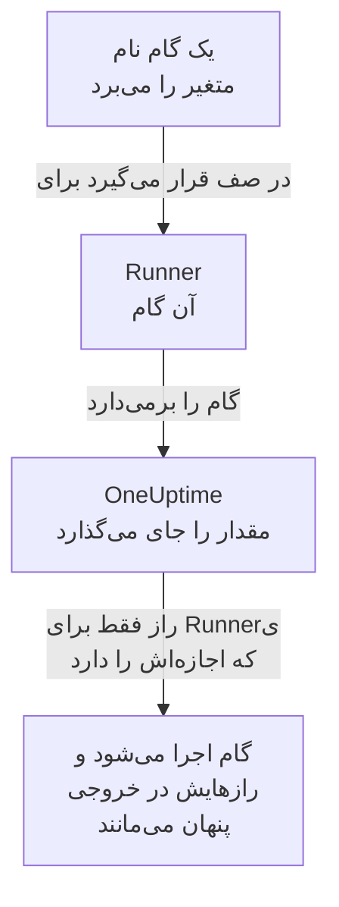

# متغیرهای رانبوک

متغیر رانبوک مقداری است که گام‌های شما به‌جای نگه داشتن خودِ آن، با نامش از آن استفاده می‌کنند: یک میزبان، یک namespace یا یک URL، یا یک راز مانند کلید SSH، رمز عبور، kubeconfig یا توکن API. مقدار را یک بار تغییر دهید، و هر گامی که نامش را می‌برد در اجرای بعدی از مقدار تازه استفاده می‌کند. راز رمزگذاری می‌شود، دیگر هرگز نمایش داده نمی‌شود و در آنچه گام‌ها چاپ می‌کنند پنهان می‌ماند.

:::cards
- [ساختن یک متغیر](#ساختن-یک-متغیر): یک مقدار ساده، یا یک راز و Runnerهایی که اجازه استفاده از آن را دارند.
- [استفاده از متغیر در یک گام](#استفاده-از-متغیر-در-یک-گام): در یک اسکریپت یا یک درخواست HTTP، یا به‌عنوان ورود یک گام SSH و kubeconfig یک گام kubectl.
- [چه کسی راز را دریافت می‌کند](#چه-کسی-راز-را-دریافت-میکند): Runnerهای شما، Runnerهای سراسری وقتی اجازه دهید، و خودِ OneUptime برای یک گام درخواست HTTP.
:::

## متغیر چگونه به یک گام می‌رسد



یک گام نام متغیر را نگه می‌دارد، هرگز مقدارش را. وقتی Runner آن گام آن را برمی‌دارد، OneUptime مقدار را جای می‌گذارد - در اسکریپت، در ماشین و ورود یک گام SSH، یا در kubeconfig یک گام kubectl - و آن را فقط به همان Runner می‌دهد. گامی که نام متغیری را می‌برد که اجازه داشتنش را ندارد، به‌جای اجرا شدن با نام به‌جای مقدار، با ذکر دلیل شکست می‌خورد.

گام‌های Bash، JavaScript، SSH، kubectl و درخواست HTTP از متغیرها استفاده می‌کنند. گام‌های هوش مصنوعی آن‌ها را جای نمی‌گذارند. OneUptime یک گام درخواست HTTP را خودش می‌فرستد، بدون Runner، پس گام هر متغیری را که نامش را می‌برد می‌گیرد، رازها را هم، و آن‌ها را در پاسخی که ثبت می‌کند پنهان می‌کند.

## متغیرهای سراسری و متغیرهای رانبوک

| | متغیرهای سراسری | متغیرهای خودِ یک رانبوک |
| --- | --- | --- |
| محل مدیریت | **رانبوک‌ها → تنظیمات → متغیرهای سراسری** | **تنظیمات → متغیرها** ی رانبوک |
| استفاده‌کننده | هر رانبوک پروژه | فقط گام‌های همان رانبوک |
| نوشتن در یک گام | `{{global.variables.NAME}}` | `{{local.variables.NAME}}` |

یک نام، بدون توجه به بزرگی و کوچکی حروف، یک بار در میان متغیرهای سراسری پروژه و یک بار در میان متغیرهای خودِ یک رانبوک به کار می‌رود. متغیر یک رانبوک می‌تواند با یک متغیر سراسری هم‌نام باشد: هر کدام به شیوهٔ خودش نوشته می‌شود.

## پیش از شروع

- **نقشی که متغیرها را مدیریت می‌کند.** Project Owner و Project Admin، یا مجوز **Create Runbook Variable**. Runbook Admin متغیرها را می‌خواند تا آن‌ها را در گام‌هایی که می‌نویسد انتخاب کند، اما تغییرشان نمی‌دهد.
- **طرحی که آن‌ها را شامل شود.** در OneUptime Cloud، متغیرهای رانبوک به طرح **Growth** یا بالاتر نیاز دارند.

## ساختن یک متغیر

:::steps
### متغیرها را باز کنید

**رانبوک‌ها → تنظیمات → متغیرهای سراسری** یا **تنظیمات → متغیرها** ی یک رانبوک را باز کنید و روی **ساخت متغیر** کلیک کنید.

### نامش را بگذارید و مقدارش را وارد کنید

در گام **متغیر** یک **نام** وارد کنید: حروف، اعداد، خط تیره و زیرخط، تا ۱۰۰ نویسه، مانند `PROD_DB_SSH_KEY`. **راز** از ابتدا روشن است: کلید، رمز عبور، توکن یا kubeconfig را در **مقدار راز** بچسبانید و روی **بعدی** کلیک کنید. برای مقداری که هر کسی می‌تواند بخواند، مانند یک میزبان، **راز** را خاموش کنید، آن را در **مقدار** وارد کنید و روی **ساخت متغیر** کلیک کنید. **توضیحات** اختیاری زیر **فیلدهای بیشتر** است.

### انتخاب کنید چه کسی می‌تواند از راز استفاده کند

در گام **چه کسی می‌تواند از آن استفاده کند**، Runnerهای خود را زیر **Runnerهای شما که می‌توانند از آن استفاده کنند** انتخاب کنید. در سروری با [Runnerهای سراسری](/docs/runbooks/agents#runnerهای-سراسری)، **Runnerهای سراسری می‌توانند از آن استفاده کنند** به گام‌های این پروژه که روی یک Runner سراسری اجرا می‌شوند هم اجازهٔ استفاده از راز را می‌دهد: تا وقتی پروژه از Runnerهای سراسری استفاده می‌کند، از ابتدا روشن است. راز به یکی از این دو نیاز دارد. روی **ساخت متغیر** کلیک کنید.
:::

اینکه یک متغیر راز است یا نه، بعداً قابل تغییر نیست. به‌جای آن، آن را حذف کنید و با همان نام دوباره بسازید: گام‌ها متغیرها را با نامشان صدا می‌زنند، پس همچنان کار می‌کنند. Runner درون‌خوشه‌ای یک خوشه، همانی که چارت عامل Kubernetes نصب می‌کند، هرگز رازی دریافت نمی‌کند.

## مقدارهای راز فقط‌نوشتنی هستند

مقدار یک راز در حالت سکون رمزگذاری می‌شود و API **هرگز آن را برنمی‌گرداند**: نه به داشبورد، نه به یک گردش کار و نه به یک خروجی‌گیری. فهرست جایی که یک متغیر ساده مقدارش را نشان می‌دهد **راز** می‌نویسد، و ستون **Runnerها** ی آن نشان می‌دهد هر راز به کدام Runnerها می‌رسد. برای تغییر آن، در ردیفش روی **جایگزینی مقدار** کلیک کنید: مقدار تازه رمزگذاری می‌شود، مقدار قبلی برای همیشه از بین می‌رود و گام‌ها در اجرای بعدی مقدار تازه را می‌گیرند.

وقتی یک گام رازی را که به آن داده شده چاپ می‌کند، Runner پیش از آنکه خروجی میزبانش را ترک کند آن را با `[REDACTED]` جایگزین می‌کند، و OneUptime پیش از ذخیرهٔ خروجی دوباره این کار را می‌کند. یک خط از یک کلید خصوصی، یا توکن درون یک kubeconfig، هم پنهان می‌شود. رازی کوتاه‌تر از ۴ نویسه جست‌وجو نمی‌شود.

## استفاده از متغیر در یک گام

:::tabs
@tab در یک اسکریپت
در یک اسکریپت Bash، JavaScript، SSH یا kubectl، ارجاع را جایی بنویسید که مقدار باید قرار بگیرد:

```bash
curl -s -X POST \
  -H "Authorization: Bearer {{global.variables.CDN_API_TOKEN}}" \
  "https://api.cdn.example.com/v1/purge"
```
@tab در یک درخواست HTTP
ارجاع را در URL، هدرها یا بدنهٔ یک [گام درخواست HTTP](/docs/runbooks/authoring#http-request) بنویسید:

```json
{ "Authorization": "Bearer {{global.variables.API_TOKEN}}" }
```
@tab ورود SSH
یک [گام SSH](/docs/runbooks/authoring#ssh) متغیر رازی را که کلید خصوصی یا رمز عبورش را نگه می‌دارد زیر **ورود با** انتخاب می‌کند، و عبارت عبور کلیدش را زیر **فیلدهای بیشتر → عبارت عبور کلید**. خودِ مقدار نشان می‌دهد که کلید است یا رمز عبور.
@tab Kubeconfig
یک [گام kubectl](/docs/runbooks/authoring#kubectl) متغیر رازی را که kubeconfig خوشه را نگه می‌دارد زیر **Kubeconfig** انتخاب می‌کند، یا **دسترسی خود Runner** را تا از دسترسی Runner استفاده کند.
:::

در صفحهٔ **گام‌ها** ی یک رانبوک، هر اسکریپت و هر درخواست HTTP زیر **متغیرها — برای کپی کلیک کنید** متغیرهایی را که گامش می‌تواند استفاده کند فهرست می‌کند، و ویرایشگر وقتی گامی نام متغیری را می‌برد که وجود ندارد، یا رازی را که Runner آن اجازهٔ استفاده‌اش را ندارد، اعلام می‌کند.

## چه کسی راز را دریافت می‌کند

| چه کسی گام را اجرا می‌کند | یک متغیر ساده | یک راز |
| --- | --- | --- |
| یکی از Runnerهای شما | همیشه | وقتی راز آن را زیر **Runnerهای شما که می‌توانند از آن استفاده کنند** فهرست کرده باشد |
| یک Runner سراسری | همیشه | وقتی **Runnerهای سراسری می‌توانند از آن استفاده کنند** روشن باشد، برای گامی از پروژهٔ خودِ راز |
| خودِ OneUptime، برای یک گام درخواست HTTP | همیشه | همیشه |

گامی که نام رازی را می‌برد که Runner آن اجازهٔ استفاده‌اش را ندارد شکست می‌خورد، نام راز و آنچه باید تغییر کند را می‌گوید، و چیزی تحویل داده نمی‌شود.

## رازها و اعتبارنامه‌های رانبوک متغیر شدند

متغیرهای رانبوک جای رازهای رانبوک را گرفتند، و جای اعتبارنامه‌هایی را که گام‌های SSH و Kubernetes نام می‌بردند. هنگام ارتقای OneUptime، آنچه هر پروژه داشت یک بار منتقل شد، تا هر رانبوک همان‌طور که اجرا می‌شد اجرا شود:

- هر راز رانبوک یک متغیر سراسری راز با همان نام، همان مقدار، همان Runnerها و همان کلید برای Runnerهای سراسری شد؛
- `{{runbookSecrets.NAME}}` در یک اسکریپت به `{{global.variables.NAME}}` بازنویسی شد، و شکل قدیمی همچنان متغیر سراسری `NAME` را می‌خواند؛
- هر اعتبارنامه‌ای که یک گام نام می‌برد به متغیرهای سراسری راز با همان Runnerها تبدیل شد که به نام آن نام‌گذاری شده‌اند: `<name>-ssh-key` (و برای کلیدی که عبارت عبور داشت، `<name>-ssh-key-passphrase`)، `<name>-ssh-password` یا `<name>-kubeconfig`؛
- هر گام SSH که یک اعتبارنامه را نام می‌برد با آن‌ها به ماشینش وارد می‌شود و دستورش را به‌عنوان اسکریپتش اجرا می‌کند، و هر گام Kubernetes به یک گام kubectl تبدیل شد که همان `kubectl patch` را اجرا می‌کند که عملش انجام می‌داد، و به دسترسی‌ای بیش از آنچه گام داشت نیاز ندارد.

Runnerی قدیمی‌تر از این نسخه (14.0.79) نمی‌تواند اسکریپت kubectl اجرا کند: گام kubectl را ناموفق می‌کند و می‌گوید که Runner باید به‌روز شود. هر گام Kubernetes که این‌گونه منتقل شد، نخست اعتبارنامه و عملش را کنار اسکریپتش برای چنین Runnerی نگه داشت؛ آن‌ها همراه اعتبارنامه‌های رانبوک کنار رفتند، پس هر گام kubectl به Runnerی از نسخهٔ 14.0.79 یا جدیدتر نیاز دارد.

اعتبارنامه‌های رانبوک از آن پس حذف شدند، و گامی که هنوز نام اعتبارنامه‌ای را می‌برد پیش از آن به همین شیوه منتقل شد. گامی که نام یک اعتبارنامه را می‌برد دیگر اجرا نمی‌شود، و صفحهٔ گام‌هایش **تبدیل به گام اسکریپت** را پیشنهاد می‌دهد؛ ذخیره‌ای از راه API یا Terraform که به یک گام اعتبارنامه‌ای بدهد رد می‌شود. [اعتبارنامه‌های رانبوک حذف شده‌اند](/docs/installation/upgrading#اعتبارنامههای-رانبوک-حذف-شدهاند) را ببینید.

## گام‌های بعدی

:::cards
- [نوشتن رانبوک](/docs/runbooks/authoring): گام‌های SSH و kubectl را که از یک متغیر استفاده می‌کنند بنویسید.
- [عامل‌های رانبوک](/docs/runbooks/agents): Runnerی را نصب کنید که راز به آن تحویل داده می‌شود.
- [پیکربندی و ایمنی رانبوک](/docs/runbooks/configuration): مجوزها و مقاوم‌سازی برای کل پشتهٔ رانبوک.
:::
