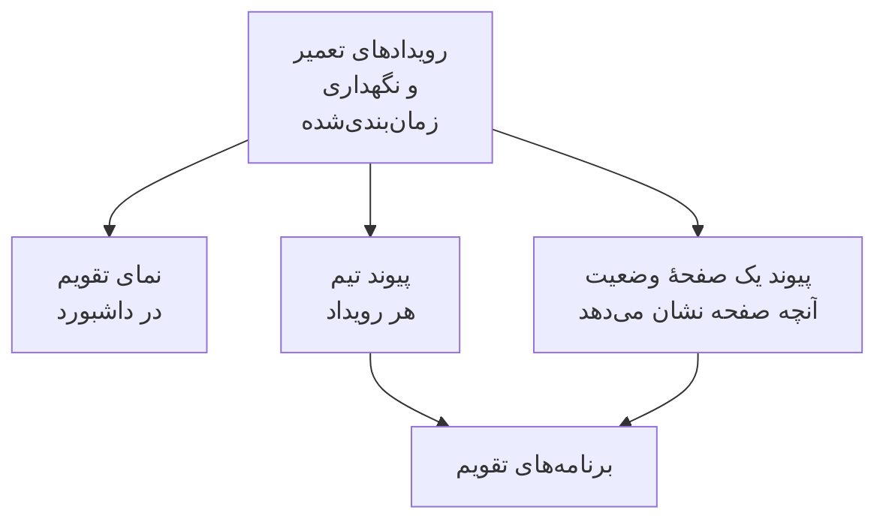

# تقویم تعمیر و نگهداری

تقویم تعمیر و نگهداری، تعمیر و نگهداری زمان‌بندی‌شدهٔ شما را بر اساس تاریخ نشان می‌دهد: در صفحه‌ای جداگانه در داشبورد، در برنامه‌های تقویم خود تیمتان از راه یک پیوند مخفی، و در تقویم کسانی که صفحه‌های وضعیت شما را دنبال می‌کنند. در صفحهٔ آن، تقویم‌هایی از بیرون پروژه، مانند تعطیلات رسمی یا یک دورهٔ توقف تغییرات، می‌توانند کنار رویدادهای شما نمایش داده شوند. این صفحه صفحهٔ تقویم، تقویم‌های خارجی، پیوند تقویم تیم، تقویم یک صفحهٔ وضعیت و آنچه هر رویداد تقویم در خود دارد را توضیح می‌دهد.

:::cards
- [صفحهٔ تقویم](#صفحهٔ-تقویم): هر رویداد روی یک ماه، یک هفته یا یک روز، به رنگ وضعیتش.
- [تقویم‌های خارجی](#تقویمهای-خارجی): تعطیلات رسمی، توقف تغییرات یا تعمیر و نگهداری تیمی دیگر، کنار رویدادهای شما.
- [پیوند تقویم تیم](#پیوند-تقویم-تیم): هر رویداد پروژه در Google Calendar، Outlook یا تقویم Apple.
- [تقویم یک صفحهٔ وضعیت](#تقویم-یک-صفحهٔ-وضعیت): آنچه یک صفحهٔ وضعیت نشان می‌دهد، در تقویم بازدیدکنندگانش.
- [آنچه یک رویداد تقویم در خود دارد](#آنچه-یک-رویداد-تقویم-در-خود-دارد): عنوان، بازهٔ زمانی، وضعیت و پیوندی برای بازگشت.
:::



## صفحهٔ تقویم

**تعمیر و نگهداری زمان‌بندی‌شده** > **تقویم تعمیر و نگهداری** را در بخش **تقویم** منوی کناری باز کنید. **همه رویدادها** همین رویدادها را به‌صورت فهرست نشان می‌دهد.

- تقویم روی همین ماه باز می‌شود و امروز علامت خورده است. **ماه**، **هفته** و **روز** تعیین می‌کنند چه مقدار نشان دهد؛ با پیکان‌ها حرکت کنید و با **امروز** برگردید. زمان‌ها به منطقهٔ زمانی خود شما هستند.
- هر رویداد یک بلوک به رنگ وضعیتش است، و نام رنگ وضعیت‌ها زیر تقویم آمده است. برای باز کردن یک رویداد روی آن کلیک کنید.
- فیلترهای بالای تقویم همان‌طور کار می‌کنند که در فهرست: یک وضعیت، یک برچسب یا یک مالک را برگزینید تا فقط همان رویدادها را ببینید.
- روزی که هنوز نیامده، وقتی نشانگر را روی هفته‌اش می‌برید یک **+** نشان می‌دهد. این دکمه **ساخت رویداد تعمیر و نگهداری زمان‌بندی‌شده** را باز می‌کند و **شروع در** را روی همان روز می‌گذارد، در ساعتی که فرم امروز برمی‌گزید. آن را فقط وقتی می‌بینید که بتوانید رویداد بسازید.
- هر نما تا ۵۰۰ رویداد نشان می‌دهد. ماهی شلوغ‌تر این را می‌گوید: آن را با فیلترها محدود کنید یا یک هفته را ببینید.

**همه رویدادها** پیش‌تر میان یک فهرست و یک تقویم جابه‌جا می‌شد. اگر مرورگرتان آخرین بار آن را روی تقویم گذاشته بود، **همه رویدادها** یک بار **تقویم تعمیر و نگهداری** را باز می‌کند و از آن به بعد فهرست است.

## تقویم‌های خارجی

صفحهٔ تقویم می‌تواند رویدادهای تقویم‌هایی از بیرون پروژه را هم نشان دهد: تعطیلات رسمی، دورهٔ توقف تغییراتی که شرکتتان در تقویمی دیگر نگه می‌دارد، یا تعمیر و نگهداری تیمی دیگر. OneUptime هر کدام را از پیوند iCalendar (`.ics`) آن می‌خواند و رویدادهایش را کنار رویدادهای شما، کم‌رنگ‌تر و به رنگ خود آن تقویم، می‌کشد. آن‌ها فقط‌خواندنی‌اند: هرگز رویداد تعمیر و نگهداری نمی‌شوند، دربارهٔ آن‌ها به کسی اطلاع داده نمی‌شود و هرگز در پیوندهای تقویم خود پروژه نمی‌آیند.

:::steps
### افزودن تقویم

**افزودن تقویم خارجی** را در منوی **⋯** تقویم برگزینید، یا **تعمیر و نگهداری زمان‌بندی‌شده** > **تنظیمات تقویم** را در بخش **تنظیمات** منوی کناری باز کنید و روی **افزودن تقویم خارجی** کلیک کنید. **نام** را پر کنید و پیوند را در **پیوند تقویم** بچسبانید. **فیلدهای بیشتر** شامل **رنگ** و **تازه‌سازی** آن است، یعنی هر چند وقت یک بار خوانده شود: **هر ساعت**، مگر آنکه گزینهٔ دیگری انتخاب کنید.

### بررسی اینکه خوانده شده است

OneUptime تقویم تازه را بی‌درنگ می‌خواند. پس از خوانده شدن، **وضعیت** آن **کار می‌کند** را نشان می‌دهد و **آخرین خواندن** می‌گوید کی خوانده شد و چند رویداد نگه داشت. خواندنی که ناموفق بوده **کار نمی‌کند** را با دلیل و کاری که باید کرد نشان می‌دهد.

### نمایش یا پنهان کردن آن

هر تقویم خارجی زیر تقویم یک کلید با نام خودش دارد. پنهان کردن یکی فقط برای خود شما آن را پنهان می‌کند؛ مرورگرتان این انتخاب را برای پروژه به خاطر می‌سپارد.
:::

پیوند را از تنظیمات اشتراک‌گذاری خود تقویم کپی کنید: در Google Calendar نشانی مخفی آن با قالب iCal، در Outlook پیوند ICS یک تقویم منتشرشده، و در هر برنامهٔ دیگر پیوند `.ics` یا `webcal://` آن. پیوند می‌تواند خصوصی باشد: OneUptime آن را رمزگذاری‌شده نگه می‌دارد، دیگر هرگز نشانش نمی‌دهد و **تغییر پیوند** جایگزینش می‌کند.

| کار | چه پیش می‌آید |
| --- | --- |
| **اکنون بخوان** | تقویم را همین حالا می‌خواند، به‌جای خواندن بعدی. |
| **تغییر پیوند** | پیوندش را جایگزین می‌کند. رویدادهای پیوند قبلی فراموش می‌شوند و پیوند تازه بی‌درنگ خوانده می‌شود. |
| **خاموش کردن** | خواندنش را متوقف می‌کند و رویدادهایش را تا **روشن کردن** از همه پنهان می‌کند. |

هر تقویم رویدادهایش را از ۹۰ روز پیش تا یک سال بعد نگه می‌دارد، تا ۲٬۰۰۰ رویداد، اول نزدیک‌ترین‌ها به امروز. تقویم بزرگ‌تر از ۵ مگابایت خوانده نمی‌شود. رویدادهای تکرارشونده، استثناهایشان و منطقه‌های زمانی‌شان همان‌طور خوانده می‌شوند که برنامهٔ تقویم نوشته است، و رویداد تمام‌روز در هر منطقهٔ زمانی روی تاریخ خودش می‌ماند. یک پروژه می‌تواند تا ۲۰ تقویم خارجی داشته باشد، و یک نمای تقویم تا ۵۰۰ رویداد آن‌ها را می‌کشد.

نقش‌هایی که رویدادهای تعمیر و نگهداری زمان‌بندی‌شده را می‌سازند، ویرایش و حذف می‌کنند، تقویم‌های خارجی را هم می‌افزایند، تغییر می‌دهند و برمی‌دارند، و هر کسی که بتواند رویدادها را بخواند آن‌ها را روی تقویم می‌بیند. OneUptime هرگز نشانی‌ای روی سرور خودش یا نشانی فرادادهٔ ابر را نمی‌خواند، و OneUptime Cloud نشانی‌های یک شبکهٔ خصوصی را رد می‌کند. یک سرور خودمیزبان می‌تواند تقویمی را در شبکهٔ خود شما بخواند، مگر آنکه `DATA_SOURCE_BLOCK_PRIVATE_ADDRESSES` برابر `true` باشد.

## پیوند تقویم تیم

**اشتراک در تقویم**، زیر تقویم، پیوند تقویم پروژه را باز می‌کند: یک پیوند iCalendar (`.ics`) مخفی که هر رویداد تعمیر و نگهداری زمان‌بندی‌شدهٔ پروژه را به Google Calendar، Outlook، تقویم Apple یا هر برنامه‌ای می‌آورد که با یک URL در تقویمی مشترک می‌شود.

:::steps
### پیوند را منتشر کنید

روی **انتشار پیوند** کلیک کنید. هر پروژه یک پیوند برای کل تیم دارد، پس این کار فقط یک بار لازم است.

### آن را به برنامهٔ تقویم خود بیفزایید

**Google Calendar** برنامهٔ Google Calendar را باز می‌کند که می‌پرسد آیا تقویم افزوده شود. **تقویم Apple / Outlook** پیوند را در برنامهٔ تقویم رایانه یا تلفن شما باز می‌کند. **کپی پیوند** آن را برای هر برنامهٔ دیگری کپی می‌کند.

### بررسی کنید که کار می‌کند

بخش **وضعیت** می‌گوید یک برنامهٔ تقویم آخرین بار کی پیوند را خوانده است، و کدام برنامه. پیوند تازه تا وقتی برنامه‌ای آن را بخواند **در انتظار نخستین همگام‌سازی** نشان می‌دهد.
:::

پیوند این شکلی است:

```text
https://<your host>/api/scheduled-maintenance-calendar/project/<token>/maintenance.ics
```

> [!WARNING]
> هر کس این پیوند را داشته باشد، بدون ورود به سامانه هر رویداد تعمیر و نگهداری زمان‌بندی‌شدهٔ پروژه را می‌بیند. با آن مثل یک گذرواژه رفتار کنید و اگر اشتباهی هم‌رسانی شد، آن را دوباره بسازید.

### چه کسی می‌تواند پیوند را ببیند

پیوند هر رویداد پروژه را نشان می‌دهد، پس پنجره آن را فقط به کسانی نشان می‌دهد که می‌توانند هر رویداد را بخوانند. کسی که نقشش او را به برخی رویدادها محدود می‌کند، بر اساس برچسب یا به رویدادهایی که مالکشان است، به جای آن دلیلش را می‌شنود.

| کار | چه کسی می‌تواند انجامش دهد |
| --- | --- |
| کپی کردن پیوند | هر کسی که بتواند هر رویداد تعمیر و نگهداری زمان‌بندی‌شدهٔ پروژه را بخواند |
| **انتشار پیوند** | هر کسی که بتواند رویدادهای تعمیر و نگهداری زمان‌بندی‌شده را بسازد هم |
| **ساخت دوباره پیوند**، **غیرفعال کردن پیوند** | هر کسی که بتواند رویدادهای تعمیر و نگهداری زمان‌بندی‌شده را ویرایش کند هم |

### مدیریت پیوند

**ساخت دوباره پیوند** و **غیرفعال کردن پیوند** در منوی **⋯** بالای پنجره هستند.

| کار | چه پیش می‌آید |
| --- | --- |
| **ساخت دوباره پیوند** | پیوندی تازه می‌سازد. پیوند قدیمی تا ۳۰ روز تقویمی خالی می‌دهد تا برنامه‌هایی که آن را دارند نسخهٔ خود را پاک کنند؛ پس از آن پیدا نمی‌شود. با پیوند تازه دوباره مشترک شوید. |
| **غیرفعال کردن پیوند** | پیوند را نگه می‌دارد، اما تا **فعال کردن پیوند** تقویمی خالی می‌دهد. |

تقویم هر رویداد را از ۹۰ روز پیش تا یک سال بعد در خود دارد، تا ۱٬۰۰۰ رویداد.

## تقویم یک صفحهٔ وضعیت

کسانی که یک صفحهٔ وضعیت را دنبال می‌کنند، می‌توانند تعمیر و نگهداری زمان‌بندی‌شدهٔ آن را به تقویم خود ببرند. در صفحهٔ رویدادهای زمان‌بندی‌شدهٔ صفحهٔ وضعیت، **اشتراک در تقویم** برنامهٔ Google Calendar، برنامهٔ تقویم دستگاهشان یا پیوندی برای کپی را پیشنهاد می‌دهد. پیوند همان نشانی صفحه است که `/maintenance.ics` پس از آن می‌آید، مانند `https://status.example.com/maintenance.ics`.

- **آنچه در آن است.** دقیقاً آنچه صفحه نشان می‌دهد: رویدادهای بازهٔ تاریخچهٔ صفحه، هر رویدادی که هنوز شروع نشده و هر رویدادی که در جریان است، تا وقتی **قابل مشاهده در صفحه وضعیت** روشن باشد، و از **زمان انتشار** آن اگر یکی برگزیده باشید. آنچه هر رویداد بر آن اثر می‌گذارد همان‌طور نام برده می‌شود که صفحه منابعش را نام می‌برد، هرگز با نام‌های خود مانیتورهای شما.
- **صفحهٔ خصوصی.** برنامهٔ تقویم نمی‌تواند وارد سامانه شود، پس صفحهٔ خصوصی هیچ **اشتراک در تقویم** پیشنهاد نمی‌دهد و پیوندش تقویمی خالی می‌دهد که می‌گوید صفحه خصوصی است.
- **یک رویداد.** **افزودن به تقویم** در صفحهٔ یک رویداد فقط همان رویداد را می‌افزاید: Google Calendar با آن رویدادِ پرشده باز می‌شود، یا رویداد به‌صورت فایلی دانلود می‌شود که برنامهٔ تقویم دستگاه آن را باز می‌کند. روی صفحهٔ خصوصی هم برای بازدیدکننده‌ای که وارد شده کار می‌کند، و وقتی رویداد تمام شده باشد پیشنهاد نمی‌شود.

## آنچه یک رویداد تقویم در خود دارد

هر تقویم، چه تقویم تیم و چه تقویم یک صفحهٔ وضعیت، رویداد را به یک شکل می‌نویسد.

| بخش | آنچه در آن است |
| --- | --- |
| عنوان | عنوان رویداد |
| شروع و پایان | بازهٔ برنامه‌ریزی‌شده‌اش، به UTC؛ برنامهٔ تقویم آن را به منطقهٔ زمانی خود شما نشان می‌دهد |
| توضیحات | توضیحاتش به‌صورت متن ساده، وضعیتش، آنچه بر آن اثر می‌گذارد و پیوندی به رویداد؛ پیوند تیم صفحه‌های وضعیتش را هم نام می‌برد |
| حالت | لغوشده، وقتی رویداد لغو شده باشد: تکمیل‌شده بی‌آنکه هرگز در جریان بوده باشد |
| آزاد یا مشغول | آزاد، تا یک بازهٔ تعمیر و نگهداری هرگز زمان در دسترس بودن شما را نگیرد |
| دسته‌ها | برچسب‌هایش؛ تقویم یک صفحهٔ وضعیت آن‌ها را فقط وقتی نشان می‌دهد که صفحه برچسب‌ها را نشان دهد |

رویدادی که در OneUptime ویرایش شود، در هر تقویمی که آن را دارد سر جای خود به‌روز می‌شود، و رویدادی که حذف شود یا از یک صفحهٔ وضعیت برداشته شود، در تازه‌سازی بعدی از تقویم بیرون می‌رود.

## تقویم‌ها هر چند وقت تازه می‌شوند

برنامه‌های تقویم پیوند اشتراک را طبق زمان‌بندی خودشان می‌خوانند. Google Calendar هر چند ساعت یک بار این کار را می‌کند، گاهی فقط روزی یک بار؛ تقویم Apple و Outlook معمولاً هر ساعت. OneUptime هر تقویم را حداکثر پنج دقیقه نگه می‌دارد، پس انتظاری که می‌بینید از برنامهٔ تقویم است. گام‌های هر برنامه در [فیدهای تقویم](/docs/on-call/calendar-feeds#اشتراک-در-برنامه-تقویم) آمده است که برای نوبت‌های آنکال هم به همین شکل کار می‌کنند.

## عیب‌یابی

:::details برنامهٔ تقویم دیگر رویدادهای تازه را نشان نمی‌دهد
پیوند دوباره ساخته یا غیرفعال شده است: **اشتراک در تقویم** را باز کنید تا وضعیتش را ببینید. پیوندی که دوباره ساخته شده، باید با پیوند تازه دوباره مشترک شود؛ پیوندی که غیرفعال شده با **فعال کردن پیوند** برمی‌گردد.
:::

:::details Google Calendar نمی‌تواند پیوند را بیفزاید
Google Calendar پیوند را از سرورهای Google می‌خواند، پس سرور OneUptime باید از اینترنت در دسترس باشد. برای سرور خودمیزبان، [فیدهای تقویم](/docs/on-call/calendar-feeds#عیبیابی) را ببینید.
:::

:::details رویدادی در تقویم یک صفحهٔ وضعیت نیست
تقویم صفحه همان چیزی را دارد که صفحه نشان می‌دهد. بررسی کنید که رویداد آن صفحه را نام برده باشد، **قابل مشاهده در صفحه وضعیت** در **تنظیمات** آن روشن باشد، **زمان انتشار** آن، اگر دارد، فرا رسیده باشد، و در بازهٔ تاریخچهٔ صفحه شروع شده باشد.
:::

:::details یک تقویم خارجی «کار نمی‌کند» را نشان می‌دهد
دلیل زیر **کار نمی‌کند** در **وضعیت** آن آمده است: تقویمی در پیوند نیست، پیوند به ورود نیاز دارد یا دیگر به اشتراک گذاشته نشده، سرورش خطا داده، تقویم بزرگ‌تر از ۵ مگابایت است، یا رویدادها را آن‌قدر تکرار می‌کند که پردازشش ممکن نیست. پیوند را با **تغییر پیوند** درست کنید، یا وقتی تقویم برگشت از **اکنون بخوان** استفاده کنید. تا آن زمان، تقویم رویدادهای آخرین خواندن موفقش را نشان می‌دهد.
:::

## گام‌های بعدی

:::cards
- [ساخت رویدادهای تعمیر و نگهداری](/docs/scheduled-maintenance/creating-events): فرم، فیلد به فیلد، و آنچه پس از آن پیش می‌آید.
- [مشترکان و اطلاعیه‌ها](/docs/status-pages/subscribers#رویدادهای-نگهداری-زمانبندیشده): آنچه مشترکان یک صفحهٔ وضعیت دربارهٔ تعمیر و نگهداری می‌شنوند.
- [فیدهای تقویم](/docs/on-call/calendar-feeds): همین نوع پیوند، برای نوبت‌های آنکال.
:::
