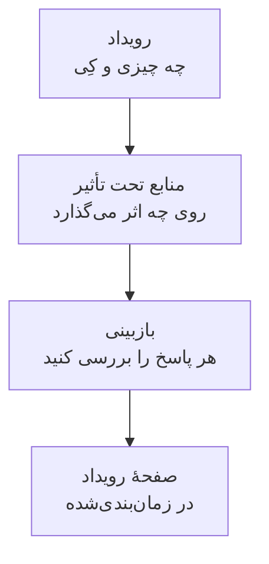

# ساخت رویدادهای تعمیر و نگهداری

تعمیر و نگهداری را در دو گام کوتاه زمان‌بندی کنید: بگویید چه اتفاقی و کِی می‌افتد، سپس بر چه چیزهایی اثر می‌گذارد و چه کسانی باید باخبر شوند. فقط عنوان را باید تایپ کنید؛ بقیه با یک مقدار پیش‌فرض معقول شروع می‌شود. این صفحه فرم را مرور می‌کند، و اینکه در لحظهٔ ساخت رویداد چه رخ می‌دهد، چگونه بعداً تغییرش دهید، و چگونه از راه کد رویداد بسازید.

:::cards
- [ساخت رویداد](#ساخت-رویداد): دو گام و یک بازبینی.
- [وقتی آن را می‌سازید چه رخ می‌دهد](#وقتی-آن-را-میسازید-چه-رخ-میدهد): شماره، قواعد، مالکان و نخستین پیام‌های آن.
- [تغییر رویداد در آینده](#تغییر-رویداد-در-آینده): بازه، منابع، صفحه‌های وضعیت و یادداشت‌های آن.
- [ساخت رویدادها از راه کد](#ساخت-رویدادها-از-راه-کد): API، Terraform، گردش‌های کاری و گفتگو.
:::

## چگونه کار می‌کند

فرم دو پرسش می‌پرسد، در هر گام یکی، و پیش از ساخت رویداد همه‌چیز را در یک بازبینی نشان می‌دهد. رویداد در وضعیت زمان‌بندی‌شدهٔ شما شروع می‌شود و صفحه‌اش باز می‌شود.



## پیش از شروع

- **نقش شما.** ساخت رویداد به **مالک پروژه**، **مدیر پروژه**، **عضو پروژه**، **مدیر تعمیر و نگهداری زمان‌بندی‌شده** یا **عضو تعمیر و نگهداری زمان‌بندی‌شده** نیاز دارد، یا به نقشی سفارشی با **Create Scheduled Maintenance**.
- **صفحه‌های وضعیت شما.** برای خبر دادن به مشتریان، به صفحهٔ وضعیتی نیاز دارید که رویدادهای تعمیر و نگهداری زمان‌بندی‌شده را نشان دهد. [نمای کلی صفحات وضعیت](/docs/status-pages/index) را ببینید.

## ساخت رویداد

:::steps
### باز کردن فرم

به **تعمیر و نگهداری زمان‌بندی‌شده** > **همه رویدادها** بروید و روی **ساخت رویداد تعمیر و نگهداری زمان‌بندی‌شده** کلیک کنید. فرم روی نخستین گامش، **رویداد**، باز می‌شود.

### گفتن اینکه چه اتفاقی و کِی می‌افتد

یک **عنوان** تایپ کنید، و اگر کمک می‌کند **توضیحات** را اضافه کنید: Markdown است و روی صفحه‌های وضعیت شما نشان داده می‌شود. **شروع در** از قبل ساعت کامل بعدی در ساعت شماست، و **پایان در** یک ساعت پس از آن؛ فقط وقتی اشتباه‌اند تغییرشان دهید. جابه‌جا کردن **شروع در** **پایان در** را هم همراهش جابه‌جا می‌کند، تا طول بازه حفظ شود. **مالکان** و **برچسب‌ها** زیر **فیلدهای بیشتر**، به‌صورت بسته، منتظرند.

### انتخاب آنچه تحت تأثیر است

روی **بعدی** کلیک کنید تا به **منابع تحت تأثیر** برسید. مانیتورهایی را که کار به آن‌ها مربوط است زیر **مانیتورها** انتخاب کنید. به محض انتخاب یکی، **تغییر وضعیت مانیتور به** زیر آن‌ها ظاهر می‌شود: وضعیتی که مانیتورها هنگام شروع رویداد به آن تغییر می‌کنند. سپس هر **سایر منابع تحت تأثیر** را انتخاب کنید، مانند میزبان‌ها، خوشه‌ها، پایگاه‌های داده، سایت‌های شبکه یا سرویس‌ها.

### انتخاب اینکه چه کسانی باخبر شوند

صفحه‌های وضعیت را زیر **نمایش رویداد در این صفحات وضعیت** انتخاب کنید. **اعلان‌های مشترکان**، که بسته است، در یک خط می‌گوید به چه کسانی و کِی خبر داده می‌شود؛ بازش کنید تا **هنگام زمان‌بندی رویداد**، **هنگام شروع رویداد**، **هنگام پایان رویداد** یا **یادآوری‌های پیش از رویداد** را تغییر دهید.

### ساختن آن

روی **بعدی** کلیک کنید تا بازبینی را ببینید، آن را بررسی کنید، سپس روی **ساخت رویداد تعمیر و نگهداری زمان‌بندی‌شده** کلیک کنید. صفحهٔ خود رویداد باز می‌شود.
:::

تا وقتی صفحهٔ وضعیتی انتخاب نکنید چیزی فرستاده نمی‌شود: رویدادی که روی هیچ صفحهٔ وضعیتی نشان داده نشود به هیچ مشترکی خبر نمی‌دهد.

## فیلدهای فرم

| فیلد                                 | گام                | مقدار آغازین                    | چه می‌کند                                                                        |
| ------------------------------------ | ------------------ | ------------------------------- | -------------------------------------------------------------------------------- |
| **عنوان**                            | **رویداد**         | خالی، و الزامی                  | رویداد را همه‌جا نام می‌برد، روی صفحه‌های وضعیت شما هم.                          |
| **توضیحات**                          | **رویداد**         | خالی                            | کار را با Markdown برای مشتریان شما توضیح می‌دهد.                                |
| **شروع در**                          | **رویداد**         | ساعت کامل بعدی                  | زمانی که رویداد خودبه‌خود شروع می‌شود.                                           |
| **پایان در**                         | **رویداد**         | یک ساعت پس از **شروع در**       | زمانی که رویداد خودبه‌خود تمام می‌شود. باید پس از **شروع در** باشد.              |
| **مالکان**                           | **رویداد**         | هیچ‌کس                          | افراد و تیم‌هایی که مالک رویدادند و از آن باخبر می‌شوند.                         |
| **برچسب‌ها**                         | **رویداد**         | هیچ                             | برچسب‌هایی که قواعد و فیلترها می‌توانند با آن‌ها تطبیق دهند.                     |
| **مانیتورها**                        | **منابع تحت تأثیر** | هیچ                            | مانیتورهایی که تا وقتی رویداد در جریان است بررسی نمی‌شوند.                       |
| **تغییر وضعیت مانیتور به**           | **منابع تحت تأثیر** | بدون تغییر                     | وضعیتی که آن مانیتورها در طول رویداد نشان می‌دهند. به محض انتخاب مانیتور پرسیده می‌شود. |
| **سایر منابع تحت تأثیر**             | **منابع تحت تأثیر** | هیچ                            | میزبان‌ها، خوشه‌ها، پایگاه‌های داده، سایت‌های شبکه، سرویس‌ها و موارد دیگر.         |
| **نمایش رویداد در این صفحات وضعیت**  | **منابع تحت تأثیر** | هیچ                            | صفحه‌های وضعیتی که رویداد را نشان می‌دهند و به مشترکانشان خبر می‌دهند.            |
| **اعلان‌های مشترکان**                | **منابع تحت تأثیر** | هر سه زمان روشن، بدون یادآوری  | اینکه به مشترکان آن صفحه‌ها کِی خبر داده می‌شود.                                 |

دو چیز در حین کار فرم را برایتان پر می‌کنند:

- **منابع پیوندخورده.** وقتی مانیتوری انتخاب می‌کنید، میزبان‌ها، خوشه‌ها، سرویس‌ها و منابع دیگری که به آن پیوند خورده‌اند زیر **سایر منابع تحت تأثیر** اضافه می‌شوند، و خطی زیر فیلد نامشان را می‌آورد. هر کدام را که نمی‌خواهید حذف کنید. منابع ابری اضافه نمی‌شوند: یک رویداد تعمیر و نگهداری منبع ابری ندارد.
- **صفحه‌های وضعیت پیشنهادی.** زیر **نمایش رویداد در این صفحات وضعیت**، صفحه‌هایی که مانیتورهای شما را نشان می‌دهند پیشنهاد می‌شوند: روی نام یک صفحه کلیک کنید تا اضافه شود، یا روی **افزودن همه**. چیزی خودبه‌خود برایتان انتخاب نمی‌شود. [رویدادهای تعمیر و نگهداری زمان‌بندی‌شده](/docs/status-pages/subscribers#رویدادهای-نگهداری-زمانبندیشده) را ببینید.

## شروع از یک منبع یا یک قالب

در زبانهٔ **تعمیر و نگهداری زمان‌بندی‌شده** یک میزبان، یک خوشهٔ Kubernetes، Proxmox، Ceph یا Docker Swarm، یک میزبان Docker یا Podman، یک vCenter، یک آرایهٔ ذخیره‌سازی، یک ناوگان IoT، یک پایگاه داده، یک سرویس یا یک سایت شبکه، **ساخت رویداد تعمیر و نگهداری زمان‌بندی‌شده** همان فرم را باز می‌کند و آن منبع از پیش زیر **سایر منابع تحت تأثیر** انتخاب شده است، و زبانه رویدادهایی را که بر آن اثر می‌گذارند فهرست می‌کند. زبانهٔ یک قلم موجودی، میزبان، سرویس یا خوشهٔ Kubernetes‌ای را انتخاب می‌کند که آن قلم به آن اشاره دارد.

**ساخت از روی قالب**، کنار دکمهٔ ساخت، از شما می‌خواهد **انتخاب قالب تعمیر و نگهداری زمان‌بندی‌شده** را انجام دهید، سپس فرم را پرشده از قالب باز می‌کند. [قالب‌ها و رویدادهای تکرارشونده](/docs/scheduled-maintenance/templates) را ببینید.

## وقتی آن را می‌سازید چه رخ می‌دهد

لحظه‌ای که روی **ساخت رویداد تعمیر و نگهداری زمان‌بندی‌شده** کلیک می‌کنید، OneUptime این گام‌ها را به همین ترتیب انجام می‌دهد:

1. **یک شماره و یک وضعیت می‌گیرد.** شماره از شمارنده‌ای برای هر پروژه می‌آید و با پیشوند شما نشان داده می‌شود (`SM-42`). رویداد در وضعیت زمان‌بندی‌شدهٔ شما شروع می‌شود، هر وضعیتی که درخواست نام ببرد.
2. **ابزارهای گفتگوی شما از آن باخبر می‌شوند.** قواعد Slack و Microsoft Teams زیر **فضای کاری** آن را در کانال‌هایشان منتشر می‌کنند، و یک قاعده می‌تواند برای رویداد کانالی بسازد. فید آن ثبت می‌کند که ساخته شده است.
3. **خط زمانی وضعیتش آغاز می‌شود.** نخستین ردیف **خط زمانی حالت** آن، وضعیت زمان‌بندی‌شدهٔ شماست.
4. **مالکان و برچسب‌ها اضافه می‌شوند**: آن‌هایی که انتخاب کردید، سپس آن‌هایی که قواعد مالکیت و برچسبِ منطبق اضافه می‌کنند.
5. **قواعد رانبوک به کار می‌افتند** و رانبوک‌هایی را که با رویداد منطبق‌اند آغاز می‌کنند.
6. **یادآوری‌ها زمان‌بندی می‌شوند**، وقتی یک قاعدهٔ یادآوری منطبق باشد، برای مالکانش.

در کمتر از یک دقیقه، به مشترکان صفحه‌های وضعیت آن خبر داده می‌شود که زمان‌بندی شده است، مگر آنکه **هنگام زمان‌بندی رویداد** را خاموش کرده باشید. محرک گردش کار **On Create Scheduled Maintenance Event** هر گردش کاری را که روی آن ساخته شده آغاز می‌کند، و مالکانش اگر آن اعلان را روشن کرده باشند از آن باخبر می‌شوند: [تنظیمات اعلان](/docs/notifications/notification-settings) را ببینید.

## تغییر رویداد در آینده

همه‌چیزِ فرم را می‌توان در صفحه‌های خود رویداد تغییر داد، جز سه زمان خبر دادن به مشترکان، که یک بار و هنگام ساخت رویداد تعیین می‌شوند.

| برای تغییر                                  | بروید به                                                                       |
| ------------------------------------------- | ------------------------------------------------------------------------------ |
| عنوان، بازه یا برچسب‌ها                     | **ویرایش** در کارت **Maintenance Details** در **نمای کلی** آن، گام **رویداد**   |
| صفحه‌های وضعیت یا یادآوری‌ها                | همان **ویرایش**، گام **صفحات وضعیت**                                            |
| مانیتورها، وضعیتشان یا منابع دیگر           | **ویرایش** در کارت **منابع تحت تأثیر**                                         |
| توضیحات                                     | **توضیحات** در منوی کناری آن                                                   |
| مالکان                                      | **مالکان** در منوی کناری آن                                                    |

**تغییر وضعیت مانیتور به** تا شروع رویداد قابل تغییر است. پس از آن، کارت آن را فقط‌خواندنی نشان می‌دهد، چون مانیتورها از قبل در آن وضعیت‌اند. هر ویرایش ورودی‌ای به **فید تعمیر و نگهداری زمان‌بندی‌شده** اضافه می‌کند که آنچه را تغییر داده نام می‌برد؛ ذخیره بدون هیچ تغییری چیزی اضافه نمی‌کند.

## نوشتن یادداشت در حین پیشرفت کار

- **یادداشت‌های عمومی** به‌روزرسانی‌هایی برای مشتریان شمایند: روی صفحه‌های وضعیت رویداد نشان داده می‌شوند، و هر کدام می‌تواند با **Notify status page subscribers** به مشترکان آن صفحه‌ها خبر دهد.
- **یادداشت‌های خصوصی** فقط برای تیم شمایند.

یادداشت را در صفحهٔ **یادداشت‌های عمومی** یا **یادداشت‌های خصوصی** رویداد بنویسید، یا از منوی **اقدام‌ها** در **فید تعمیر و نگهداری زمان‌بندی‌شده** با **Add Public Note** یا **افزودن یادداشت خصوصی**. همان منو با **Execute Runbook** یک رانبوک اجرا می‌کند. قالب یادداشت متنی را که تیم شما اغلب می‌نویسد پر می‌کند: [قواعد و تنظیمات تعمیر و نگهداری](/docs/scheduled-maintenance/settings#قالبهای-یادداشت) را ببینید.

## ساخت رویدادها از راه کد

مدل رویداد یک API استاندارد دارد، پس `POST /api/scheduled-maintenance` یک رویداد می‌سازد. با یک کلید API از **تنظیمات پروژه** > **پیشرفته** > **کلیدهای API** احراز هویت کنید که در سرآیند `apikey` فرستاده می‌شود؛ کلید پروژه را مشخص می‌کند.

```bash
curl -X POST https://oneuptime.com/api/scheduled-maintenance \
  -H "apikey: $ONEUPTIME_API_KEY" \
  -H "Content-Type: application/json" \
  -d '{
    "data": {
      "title": "Database upgrade",
      "description": "Writes pause for a few minutes while the primary restarts.",
      "startsAt": "2030-06-01T02:00:00Z",
      "endsAt": "2030-06-01T04:00:00Z"
    }
  }'
```

| فیلد                                                  | نکته‌ها                                                                                   |
| ----------------------------------------------------- | ----------------------------------------------------------------------------------------- |
| `title`, `startsAt`, `endsAt`                          | الزامی، مانند فرم.                                                                        |
| `monitors`, `statusPages`, `labels`                   | مانیتورها، صفحه‌های وضعیت و برچسب‌های رویداد، همه از پروژهٔ کلید API.                     |
| `changeMonitorStatusToId`                             | وضعیت مانیتوری که مانیتورهایش هنگام شروع به آن تغییر می‌کنند.                              |
| `currentScheduledMaintenanceStateId`                  | نادیده گرفته می‌شود: هر رویداد در وضعیت زمان‌بندی‌شدهٔ شما شروع می‌شود.                   |
| `shouldStatusPageSubscribersBeNotifiedOnEventCreated` | کلید **هنگام زمان‌بندی رویداد**. دو زمان دیگر فیلدهای خودشان را دارند.                    |

همین رویداد به‌صورت کد، منبع Terraform با نام `oneuptime_scheduled_maintenance_event` است: [نمونه‌ها](/docs/terraform/examples#نگهداری-زمانبندیشده) را ببینید. یک گردش کار با گام **Create One Scheduled Maintenance Event** خود رویداد می‌سازد، و `/oneuptime maintenance` فرم را در Slack باز می‌کند: [Slack](/docs/workspace-connections/slack#ایجاد-حادثه-و-نگهداری-از-slack) را ببینید.

## عیب‌یابی

:::details پایان در می‌گوید باید پس از شروع در باشد
بازه باید به ترتیب باشد: رویداد پس از شروعش تمام می‌شود. اول **شروع در** را جابه‌جا کنید، چون **پایان در** همراهش می‌آید، سپس **پایان در** را تنظیم کنید.
:::

:::details تغییر وضعیت مانیتور به در فرم نیست
فقط وقتی رویداد مانیتوری دارد پرسیده می‌شود. یکی را زیر **مانیتورها** انتخاب کنید تا درست زیر آن‌ها ظاهر شود.
:::

:::details تغییر وضعیت مانیتور به دیگر قابل تغییر نیست
رویداد شروع شده و مانیتورهایش از قبل در آن وضعیت‌اند. این وضعیت از لحظهٔ شروع رویداد تا پایانش اعمال می‌شود.
:::

## گام‌های بعدی

:::cards
- [وضعیت‌های تعمیر و نگهداری](/docs/scheduled-maintenance/states): چه چیزی رویداد را شروع و تمام می‌کند، و چگونه آن را دستی جلو ببرید.
- [قالب‌ها و رویدادهای تکرارشونده](/docs/scheduled-maintenance/templates): پاسخ‌های فرم را برای دفعهٔ بعد ذخیره کنید.
- [مشترکان و اطلاعیه‌ها](/docs/status-pages/subscribers#رویدادهای-نگهداری-زمانبندیشده): دقیقاً به چه کسانی و کِی خبر داده می‌شود.
- [قواعد و تنظیمات تعمیر و نگهداری](/docs/scheduled-maintenance/settings): مالکان، برچسب‌ها و یادآوری‌ها را خودکار اضافه کنید.
:::
