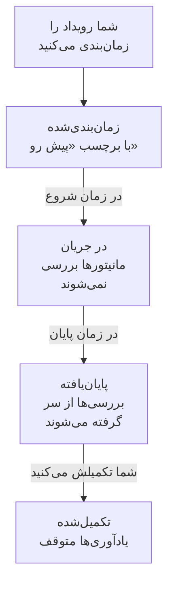

# نمای کلی تعمیر و نگهداری زمان‌بندی‌شده

رویداد تعمیر و نگهداری زمان‌بندی‌شده پیش از انجام کارِ برنامه‌ریزی‌شده همه را از آن باخبر می‌کند: ارتقای پایگاه داده، تغییر شبکه، انتقال به سرورهای تازه. OneUptime رویداد را سر وقت شروع و تمام می‌کند، تا وقتی کار ادامه دارد بررسی مانیتورهایی را که تحت تأثیر آن‌اند متوقف می‌کند، و رویداد را روی صفحه‌های وضعیت شما نشان می‌دهد تا قطعی برنامه‌ریزی‌شده هرگز شبیه از کار افتادن سرویس به نظر نرسد. این صفحه توضیح می‌دهد رویداد چگونه پیش می‌رود، هر چیز در داشبورد کجاست، و رویداد چه چیزهایی را در بقیهٔ OneUptime تغییر می‌دهد.

:::cards
- [رویداد چگونه پیش می‌رود](#رویداد-چگونه-پیش-میرود): از زمان‌بندی‌شده تا تکمیل‌شده، بیشتر به‌طور خودکار.
- [رویدادها از کجا می‌آیند](#رویدادها-از-کجا-میآیند): فرم ساخت، قالب‌ها، زمان‌بندی، فرم‌ها، گفتگو و کد.
- [رویداد بر چه چیزهایی اثر می‌گذارد](#رویداد-بر-چه-چیزهایی-اثر-میگذارد): مانیتورها، صفحه‌های وضعیت، مشترکان و هشدارها.
- [صفحه‌های خود رویداد](#صفحههای-خود-رویداد): نمای کلی، خط زمانی، یادداشت‌ها و تنظیمات آن.
:::

## رویداد چگونه پیش می‌رود

هر رویداد یک بازهٔ زمانی برنامه‌ریزی‌شده دارد، یعنی **شروع در** و **پایان در** آن، و در فهرست وضعیت‌های تعمیر و نگهداری شما رو به پایین حرکت می‌کند. کاری که هر دقیقه اجرا می‌شود رویداد را در هر دو سر بازه جلو می‌برد، پس شما کار را یک بار زمان‌بندی می‌کنید و OneUptime بقیه را انجام می‌دهد.

رویداد تازه در **زمان‌بندی‌شده** شروع می‌شود. در **شروع در** خود به **در جریان** می‌رود: OneUptime بررسی مانیتورهای آن را متوقف می‌کند و اگر برایشان وضعیتی انتخاب کرده باشید، آن‌ها را در همان وضعیت نشان می‌دهد. در **پایان در** خود به **پایان‌یافته** می‌رود: بررسی‌ها از سر گرفته می‌شوند و هر مانیتور به حالت عملیاتی برمی‌گردد. **تکمیل‌شده** گام آخر است و هیچ چیز خودبه‌خود به آن نمی‌رسد: یک نفر، یک دکمهٔ گفتگو یا API کار را تأییدشده علامت می‌زند، که یادآوری‌های مالکان را هم متوقف می‌کند.

می‌توانید رویدادی را زودتر شروع یا تمام کنید، یا وضعیت‌های خودتان را میان این چهار وضعیت اضافه کنید. [وضعیت‌های تعمیر و نگهداری](/docs/scheduled-maintenance/states) را ببینید.

## تعمیر و نگهداری و اطلاعیه‌ها

هر دو چیزی را به بازدیدکنندگان صفحه‌های وضعیت شما می‌گویند. برای کاری که شروع و پایان دارد از رویداد تعمیر و نگهداری استفاده کنید، و برای هر چیز دیگری که باید بخوانند از اطلاعیه.

|                              | تعمیر و نگهداری زمان‌بندی‌شده                                           | اطلاعیه                                        |
| ---------------------------- | ----------------------------------------------------------------------- | ---------------------------------------------- |
| **چیست**                     | کار برنامه‌ریزی‌شده، با یک بازهٔ زمانی                                   | پیامی برای بازدیدکنندگان صفحهٔ وضعیت شما        |
| **مانیتورهایش**              | تا وقتی ادامه دارد بررسی نمی‌شوند، و در وضعیتی که انتخاب می‌کنید نشان داده می‌شوند | بدون تغییر                          |
| **چگونه پیش می‌رود**         | از میان وضعیت‌های تعمیر و نگهداری شما، سر وقت                           | از زمان شروعش تا زمان پایانش نشان داده می‌شود، اگر زمان پایان داشته باشد |
| **چه وقت به مشترکان خبر داده می‌شود** | وقتی زمان‌بندی می‌شود، شروع می‌شود و پایان می‌یابد، و اگر بخواهید پیش از شروع | یک بار، وقتی نمایشش آغاز می‌شود |
| **شماره‌ها در پروژهٔ تازه**   | `SM-42`                                                                 | ندارد                                          |

اطلاعیه‌ها در [مشترکان و اطلاعیه‌ها](/docs/status-pages/subscribers#اطلاعیهها) توضیح داده شده‌اند.

## رویدادها از کجا می‌آیند

- **فرم ساخت.** در فهرست رویدادها، یا در زبانهٔ **تعمیر و نگهداری زمان‌بندی‌شده** یک میزبان، خوشه، سرویس، سایت شبکه یا منبع دیگر، روی **ساخت رویداد تعمیر و نگهداری زمان‌بندی‌شده** کلیک کنید؛ از زبانهٔ یک منبع، همان منبع از پیش برایتان انتخاب می‌شود. [ساخت رویدادهای تعمیر و نگهداری](/docs/scheduled-maintenance/creating-events) را ببینید.
- **قالب.** **ساخت از روی قالب** فرم را از قالبی پر می‌کند که برای کارهای پرتکرار ذخیره کرده‌اید. [قالب‌ها و رویدادهای تکرارشونده](/docs/scheduled-maintenance/templates) را ببینید.
- **زمان‌بندی.** قالب تکرارشونده طبق یک زمان‌بندی، مثلاً هر هفته یا هر ماه، رویداد تازه‌ای می‌سازد بی‌آنکه کسی فرم را باز کند.
- **فرم.** فرمی که ارسال‌هایش رویداد تعمیر و نگهداری می‌سازند، یک درخواست تغییر را به رویداد تبدیل می‌کند. [ارسال چه چیزی ایجاد می‌کند](/docs/forms/on-submit#ارسال-چگونه-به-یک-رویداد-تعمیر-و-نگهداری-زمانبندیشده-تبدیل-میشود) را ببینید.
- **گفتگو.** `/oneuptime maintenance` در Slack، یا `maintenance` که در Microsoft Teams برای ربات OneUptime نوشته شود، فرم را در ابزار گفتگوی شما باز می‌کند. [Slack](/docs/workspace-connections/slack#ایجاد-حادثه-و-نگهداری-از-slack) را ببینید.
- **کد.** API در `/api/scheduled-maintenance`، منبع Terraform با نام `oneuptime_scheduled_maintenance_event`، و گام **Create One Scheduled Maintenance Event** در یک گردش کار.

## تعمیر و نگهداری در داشبورد کجاست

**تعمیر و نگهداری زمان‌بندی‌شده** را از منوی **محصولات** در نوار بالا باز کنید. فهرست رویدادها در `/dashboard/{projectId}/scheduled-maintenance-events` است و منوی کناری آن همه‌چیزِ مربوط به تعمیر و نگهداری را در خود دارد:

| بخش           | آنجا چه می‌کنید                                                                                                            |
| ------------- | -------------------------------------------------------------------------------------------------------------------------- |
| **نمای کلی**  | **همه رویدادها** و **رویدادهای در جریان**، که نشانش تعداد رویدادهای در جریانِ همین حالا را می‌شمارد.                       |
| **تقویم** | **تقویم تعمیر و نگهداری**: هر رویداد روی یک ماه، یک هفته یا یک روز، کنار تقویم‌هایی از بیرون پروژه که می‌افزایید. |
| **فضای کاری** | **Slack** و **Microsoft Teams**، هر کدام که پروژه وصل کرده باشد، یا **اتصال Slack یا Teams** وقتی هیچ‌کدام وصل نیست.       |
| **قواعد**     | **قواعد مالکیت**، **قواعد رانبوک**، **قواعد برچسب**، **Reminder Rules**.                                                    |
| **تنظیمات**   | **وضعیت رویداد**، **قالب‌های رویداد**، **قالب‌های یادداشت**، **فیلدهای سفارشی**، **اندازه‌گیری‌ها**، **تنظیمات تقویم**، **شماره‌گذاری**.        |

**نمای کلی** و **تقویم** باز هستند؛ **فضای کاری**، **قواعد**، **تنظیمات** و **توسعه‌دهنده** بسته شروع می‌شوند، و هر بخش وقتی در یکی از صفحه‌هایش باشید خودبه‌خود باز می‌شود. **توسعه‌دهنده** شامل **Terraform**، **API** و **دستیارهای هوش مصنوعی** برای مدیریت تعمیر و نگهداری از راه کد است. همه‌چیزِ مربوط به تعمیر و نگهداری اینجاست، نه در **تنظیمات پروژه**.

فهرست ستون‌های **شماره تعمیر و نگهداری زمان‌بندی‌شده**، **عنوان**، **وضعیت فعلی**، **منابع تحت تأثیر**، **نمایش‌داده‌شده در صفحه وضعیت**، **شروع در**، **مدت**، **پایان در**، **برچسب‌ها** و **مالکان** را نشان می‌دهد. رویدادها را انتخاب کنید تا روی چند رویداد با هم کار کنید: **علامت‌گذاری به‌عنوان {{state}}**، **تغییر وضعیت**، **تخصیص به من**، **Add Owner**، **Remove Owner**، **Add Labels**، **Remove Labels** یا **حذف**. منوی **⋯** در انتهای ردیف هر رویداد همین کارها را فقط برای همان رویداد انجام می‌دهد: گام‌های **علامت‌گذاری به‌عنوان {{state}}** تا وقتی رویداد می‌تواند آن‌ها را بردارد، **تغییر وضعیت**، **تخصیص به من** تا وقتی مالک آن نیستید، و **Add Owner**.

**تقویم تعمیر و نگهداری** در بخش **تقویم** همان رویدادها را روی یک ماه، یک هفته یا یک روز نشان می‌دهد و می‌تواند تقویم‌هایی از بیرون پروژه را هم کنارشان نشان دهد. [تقویم تعمیر و نگهداری](/docs/scheduled-maintenance/calendar) را ببینید.

## رویداد بر چه چیزهایی اثر می‌گذارد

تا وقتی رویدادی در جریان است، OneUptime قطعی‌ای را که آن رویداد برنامه‌ریزی کرده مورد انتظار می‌داند:

- **مانیتورهایش بررسی نمی‌شوند.** بررسی هر مانیتورِ زیر **مانیتورها** متوقف می‌شود و صفحه‌های هر کدام **این مانیتور غیرفعال است** را نشان می‌دهند. اگر **تغییر وضعیت مانیتور به** را انتخاب کرده باشید، مانیتورها همان وضعیت را نشان می‌دهند، روی صفحه‌های وضعیت شما هم. وقتی رویداد تمام یا حذف شود، بررسی‌ها از سر گرفته می‌شوند و هر مانیتور به حالت عملیاتی برمی‌گردد، مگر آنکه رویداد در جریانِ دیگری هنوز آن را نگه داشته باشد.
- **منابع دیگرش آرام می‌مانند.** مانیتور تله‌متری‌ای که بسیاری از میزبان‌ها، خوشه‌ها، پایگاه‌های داده یا سرویس‌ها را با یک سری برای هر کدام زیر نظر دارد، برای سری‌ای که منبعش زیر پوشش رویداد است هیچ حادثه یا هشداری نمی‌سازد، در حالی که سری‌های دیگر به هشدار دادن ادامه می‌دهند.
- **سایت‌های شبکه و SLOها دست نگه می‌دارند.** سایت شبکه‌ای که زیر پوشش رویداد است، قطعی برنامه‌ریزی‌شده‌اش را دیگر به حساب سایت‌های بالادستش نمی‌گذارد، و قواعد نرخ مصرف یک SLO تا وقتی یکی از مانیتورهایش در تعمیر و نگهداری است چیزی نمی‌سازند. [سایت‌های شبکه](/docs/monitor/network-sites#تعمیر-و-نگهداری-زمانبندیشده-برای-سایتهای-شبکه) و [هشدارها و حوادث نرخ مصرف](/docs/slo/burn-rate-alerts#تعمیر-و-نگهداری-زمانبندیشده) را ببینید.
- **صفحه‌های وضعیت شما آن را نشان می‌دهند.** رویداد روی صفحه‌های وضعیتی که انتخاب کرده‌اید ظاهر می‌شود، اول به‌عنوان پیش رو، بعد در جریان، بعد پایان‌یافته، تا وقتی **قابل مشاهده در صفحه وضعیت** در **تنظیمات** آن روشن باشد.
- **مشترکان از آن باخبر می‌شوند.** به‌طور پیش‌فرض، به مشترکان آن صفحه‌ها وقتی رویداد زمان‌بندی می‌شود، وقتی شروع می‌شود و وقتی تمام می‌شود خبر داده می‌شود، و اگر یادآوری تنظیم کنید پیش از شروع هم یادآوری می‌گیرند. [رویدادهای تعمیر و نگهداری زمان‌بندی‌شده](/docs/status-pages/subscribers#رویدادهای-نگهداری-زمانبندیشده) را ببینید.
- **تیم شما از آن باخبر می‌شود.** به مالکانش طبق [تنظیمات اعلان](/docs/notifications/notification-settings) خودشان خبر داده می‌شود، و قواعد Slack و Microsoft Teams زیر **فضای کاری** آن را در کانال‌های شما منتشر می‌کنند.

## صفحه‌های خود رویداد

رویدادی را از فهرست باز کنید تا صفحه‌هایش را ببینید. منوی کناری آن شامل این‌هاست:

| بخش منوی کناری    | صفحه‌ها                                                                                        |
| ----------------- | --------------------------------------------------------------------------------------------- |
| **نمای کلی** | **نمای کلی**، **خط زمانی حالت**، **توضیحات**، **رانبوک‌ها** |
| **تیم** | **مالکان** |
| **اعلان‌ها**        | **گزارش‌های اعلان** و **گزارش‌های هوش مصنوعی**: هر پیامی که دربارهٔ رویداد فرستاده شده، و کاری که هوش مصنوعی برایش انجام داده |
| **یادداشت‌ها**    | **یادداشت‌های خصوصی** و **یادداشت‌های عمومی**                                                   |
| **توسعه‌دهنده**   | **Terraform**، **API** و **دستیارهای هوش مصنوعی**: رویدادی که از راه کد مدیریت می‌شود           |
| **پیشرفته**       | **فیلدهای سفارشی**، **تنظیمات**، **گزارش‌های ممیزی**، **حذف رویداد**                            |

**نمای کلی**، **تیم** و **یادداشت‌ها** باز هستند؛ بخش‌های دیگر تا وقتی رویشان کلیک نکنید بسته می‌مانند.

- **نمای کلی** — سربرگ شمارهٔ رویداد، عنوان و وضعیتش را نشان می‌دهد، اینکه چقدر تا شروعش مانده یا چقدر است که ادامه دارد، و دکمه‌هایی که آن را جلو می‌برند. زیر آن، **شروع**، **پایان** و **مدت** بازهٔ برنامه‌ریزی‌شده را در منطقهٔ زمانی شما نشان می‌دهند. **فید تعمیر و نگهداری زمان‌بندی‌شده** هر اتفاقی را که برای رویداد افتاده ثبت می‌کند، کنار کارت‌های **Maintenance Details** و **منابع تحت تأثیر**، و کارت‌های **اندازه‌گیری‌ها** و **فیلدهای سفارشی** وقتی پروژهٔ شما چنین چیزهایی داشته باشد.
- **خط زمانی حالت** — هر وضعیتی که رویداد در آن بوده، کِی و چه مدت. [وضعیت‌های تعمیر و نگهداری](/docs/scheduled-maintenance/states#خط-زمانی-وضعیت) را ببینید.
- **یادداشت‌های عمومی** — به‌روزرسانی‌هایی برای صفحه‌های وضعیت شما و مشترکانشان. **یادداشت‌های خصوصی** فقط برای تیم شماست.
- **تنظیمات** — **قابل مشاهده در صفحه وضعیت**، که رویداد را روی صفحه‌های وضعیتش نشان می‌دهد یا پنهان می‌کند، و **فرستادن یادآوری‌ها**، که تا تکمیل رویداد به مالکانش یادآوری می‌کند. هر کلید همان لحظه‌ای که آن را تغییر دهید ذخیره می‌شود.

## عیب‌یابی

:::details رویداد در زمان شروعش شروع نشد
کاری که رویدادها را شروع می‌کند هر دقیقه اجرا می‌شود، پس یک دقیقه صبر کنید. اگر سربرگ **Start overdue** را نشان می‌دهد، رویداد بیش از دو دقیقه از شروعش گذشته است: آن را با دکمهٔ سربرگ شروع کنید، که هر کاری را که آن کار انجام می‌دهد انجام می‌دهد، و **خط زمانی حالت** آن را باز کنید تا ببینید کجا بوده است.
:::

:::details یک مانیتور در طول تعمیر و نگهداری همچنان بررسی شد
فقط مانیتورهایی که رویداد زیر **مانیتورها** نام می‌برد بررسی‌شان متوقف می‌شود، و فقط تا وقتی رویداد در جریان است. مانیتورِ میزبان یا سرویسی که رویداد زیر **سایر منابع تحت تأثیر** نام می‌برد همچنان بررسی می‌شود. برای افزودن مانیتور، کارت **منابع تحت تأثیر** رویداد را ویرایش کنید.
:::

:::details رویداد روی صفحهٔ وضعیت من نیست
بررسی کنید که رویداد آن صفحه را زیر **نمایش رویداد در این صفحات وضعیت** نام برده باشد، و **قابل مشاهده در صفحه وضعیت** در **تنظیمات** رویداد روشن باشد. سپس خود صفحهٔ وضعیت را بررسی کنید: باید رویدادهای تعمیر و نگهداری زمان‌بندی‌شده را نشان دهد، و رویدادی که پیش از بازهٔ تاریخچهٔ صفحه شروع شده، که اگر تغییرش نداده باشید ۱۴ روز است، دیگر فهرست نمی‌شود.
:::

## گام‌های بعدی

:::cards
- [ساخت رویدادهای تعمیر و نگهداری](/docs/scheduled-maintenance/creating-events): فرم، فیلد به فیلد، و اینکه بعد چه رخ می‌دهد.
- [وضعیت‌های تعمیر و نگهداری](/docs/scheduled-maintenance/states): چه چیزی رویداد را شروع و تمام می‌کند، و وضعیت‌های خودتان.
- [قالب‌ها و رویدادهای تکرارشونده](/docs/scheduled-maintenance/templates): رویدادی را دوباره به کار ببرید، یا آن را هر هفته زمان‌بندی کنید.
- [قواعد و تنظیمات تعمیر و نگهداری](/docs/scheduled-maintenance/settings): مالکان، برچسب‌ها، رانبوک‌ها و یادآوری‌ها، به‌طور خودکار.
:::
