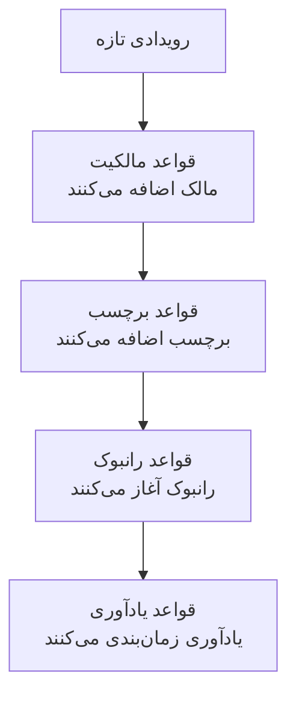

# قواعد و تنظیمات تعمیر و نگهداری

پیکربندی تعمیر و نگهداری درون **تعمیر و نگهداری زمان‌بندی‌شده** است، نه در **تنظیمات پروژه**: قواعدی که روی هر رویداد تازه کار می‌کنند، و تنظیماتی که به هر رویداد پروژه شکل می‌دهند. این صفحه مرجع هر کدام از آن‌هاست، و اینکه چه کسی می‌تواند تغییرشان دهد.

:::cards
- [قواعدی که رویداد تازه از آن‌ها می‌گذرد](#قواعدی-که-رویداد-تازه-از-آنها-میگذرد): به ترتیب، و اینکه هر کدام چه می‌کند.
- [قواعد یادآوری](#قواعد-یادآوری): تا تکمیل رویداد به مالکان یادآوری کنید.
- [تنظیمات](#تنظیمات): قالب‌های یادداشت، فیلدهای سفارشی، اندازه‌گیری‌ها و شماره‌گذاری.
- [چه کسی می‌تواند این‌ها را تغییر دهد](#چه-کسی-میتواند-اینها-را-تغییر-دهد): نقش‌های تعمیر و نگهداری، و طرح‌ها.
:::

## تنظیمات تعمیر و نگهداری کجاست

**تعمیر و نگهداری زمان‌بندی‌شده** را از منوی **محصولات** در نوار بالا باز کنید. بخش‌های **قواعد** و **تنظیمات** منوی کناری آن بسته شروع می‌شوند، پس اول بازشان کنید. هر صفحهٔ اینجا برای کل پروژه است، در نشانی‌ای که با `/dashboard/{projectId}/scheduled-maintenance-events/settings/` شروع می‌شود.

| صفحهٔ قواعد        | چه می‌کند                                                           |
| ------------------ | ------------------------------------------------------------------- |
| **قواعد مالکیت**   | به رویدادهای منطبق مالک اضافه می‌کند.                               |
| **قواعد رانبوک**   | برای رویدادهای منطبق رانبوک آغاز می‌کند.                            |
| **قواعد برچسب**    | به رویدادهای منطبق برچسب اضافه می‌کند.                              |
| **Reminder Rules** | در فاصله‌هایی معین به مالکان یادآوری می‌کند تا رویداد تکمیل شود.    |

بخش **تنظیمات** شامل **وضعیت رویداد** است، که در [وضعیت‌های تعمیر و نگهداری](/docs/scheduled-maintenance/states) توضیح داده شده، **قالب‌های رویداد**، که در [قالب‌ها و رویدادهای تکرارشونده](/docs/scheduled-maintenance/templates) توضیح داده شده، و سپس **قالب‌های یادداشت**، **فیلدهای سفارشی**، **اندازه‌گیری‌ها**، **تنظیمات تقویم** و **شماره‌گذاری**. **تنظیمات تقویم** در [تقویم تعمیر و نگهداری](/docs/scheduled-maintenance/calendar#تقویمهای-خارجی) توضیح داده شده و بقیه در ادامه.

بخش **فضای کاری** شامل قواعد Slack و Microsoft Teams است که رویدادها را در کانال‌ها منتشر می‌کنند. [Slack](/docs/workspace-connections/slack#قواعد-اعلان) و [Microsoft Teams](/docs/workspace-connections/microsoft-teams#قواعد-اعلان) را ببینید.

## قواعدی که رویداد تازه از آن‌ها می‌گذرد

قواعد در اینکه چند انطباق چگونه حل می‌شود با هم فرق دارند:

- **قواعد مالکیت**، **قواعد برچسب** و **قواعد رانبوک** همه وقتی منطبق باشند عمل می‌کنند. مالکان و برچسب‌هایی که چند قاعده اضافه می‌کنند یک بار اضافه می‌شوند.
- **Reminder Rules** از بالای فهرستشان رو به پایین بررسی می‌شوند، و نخستین انطباق برنده است. برای تغییر جای یک قاعده آن را بکشید؛ قاعدهٔ تازه به انتهای فهرست می‌رود.

قاعدهٔ تازه فعال شروع می‌شود؛ برای متوقف کردنش **فعال** را در فرم ویرایش آن خاموش کنید، و فهرست برای هر قاعده یک **فعال** سبز یا یک **غیرفعال** قرمز نشان می‌دهد. قواعد مالکیت، برچسب و رانبوک روی رویدادهایی کار می‌کنند که پس از ذخیرهٔ آن‌ها ساخته می‌شوند. برای اعمال یک قاعدهٔ مالکیت یا برچسب بر رویدادهایی که از قبل دارید، از **اجرا همین حالا** استفاده کنید: [اجرای قواعد روی منابع موجود](/docs/configuration/run-rules-now) را ببینید.

## قواعد مالکیت و برچسب

**قواعد مالکیت** کاربران و تیم‌های مالک را به رویدادهای تازهٔ منطبق اضافه می‌کنند، و **قواعد برچسب** برچسب اضافه می‌کنند. ساختن یک قاعده دو گام دارد: **تطبیق**، یعنی شرط‌ها، سپس **مالکان** یا **برچسب‌ها**، یعنی آنچه قاعده اضافه می‌کند.

| شرط                                                             | با چه منطبق است                                                            |
| --------------------------------------------------------------- | -------------------------------------------------------------------------- |
| **مانیتورها**، **برچسب‌های رویداد**، **برچسب‌های مانیتور**      | رویدادهایی که هر یک از مانیتورها یا برچسب‌های انتخابی شما را دارند.        |
| **عنوان رویداد**، **توضیحات رویداد**، **نام مانیتور**، **توضیحات مانیتور** | یک الگو، به‌صورت عبارت باقاعده، بدون توجه به بزرگی و کوچکی حروف. |

یک قاعده فقط وقتی منطبق است که هر شرطی که پر کرده‌اید برقرار باشد؛ شرطی که خالی بماند نادیده گرفته می‌شود.

- **یک قاعده می‌تواند به ارث ببرد.** زیر **به ارث بردن مالکان** یا **به ارث بردن برچسب‌ها**، که بسته است، شش کلید مالکان یا برچسب‌های مانیتورها، میزبان‌ها، خوشه‌های Kubernetes، میزبان‌های Docker، میزبان‌های Podman و سرویس‌های رویداد را منتقل می‌کنند.
- **قاعدهٔ تازه باید چیزی اضافه کند**: دست‌کم یک مالک یا برچسب انتخاب کنید، یا یک کلید را روشن کنید.
- **اطلاع به مالکان**، زیر **فیلدهای بیشتر** در یک قاعدهٔ مالکیت، تعیین می‌کند آیا به افراد اضافه‌شده خبر داده شود یا نه.

[قواعد برچسب و مالکیت](/docs/configuration/label-and-owner-rules) فرم را گام به گام، برای هر نوع منبع، شرح می‌دهد.

## قواعد رانبوک

**قواعد رانبوک** وقتی رویداد تازه‌ای منطبق باشد یک رانبوک آغاز می‌کنند، مثلاً یک چک‌لیست پیش از هر ارتقای پایگاه داده. آن‌ها بر همان چیزهایی منطبق می‌شوند که قواعد مالکیت و برچسب؛ رویدادها شدت ندارند، پس قواعد رانبوک تعمیر و نگهداری شدتی پیشنهاد نمی‌کنند. اجرا به رویداد پیوست می‌شود، در صفحهٔ **رانبوک‌ها** آن. [قواعد رانبوک](/docs/runbooks/rules) را ببینید.

## قواعد یادآوری

**تعمیر و نگهداری زمان‌بندی‌شده** > **قواعد** > **Reminder Rules** تا تأیید کار به مالکان رویداد یادآوری می‌کند. هر رویداد نخستین قاعده‌ای را می‌گیرد که از بالای فهرست رو به پایین با آن منطبق باشد.

:::steps
### انتخاب رویدادهایی که باید یادآوری شوند

روی **ساخت Scheduled Maintenance Reminder Rule** کلیک کنید. در **تطبیق**، **همه رویدادهای تعمیر و نگهداری زمان‌بندی‌شده** را انتخاب‌شده بگذارید تا دربارهٔ هر رویداد یادآوری شود، یا **فقط آن دسته از رویدادهای تعمیر و نگهداری زمان‌بندی‌شده که با شرط‌ها مطابقت دارند** را انتخاب کنید و سپس برچسب‌هایی را که قاعده بر آن‌ها اعمال می‌شود زیر **برچسب‌ها** برگزینید.

### تنظیم فاصله

در **یادآوری‌ها**، **بازه یادآوری (دقیقه)** را تنظیم کنید، یعنی هر چند وقت یک بار به مالکان یادآوری شود، و در **یادآوری به مالکان** انتخاب کنید چه زمانی. **نام** تا وقتی نام خودتان را وارد نکنید همراه هر دو تغییر می‌کند، مانند «یادآوری هر 30 دقیقه در حین انجام»، و **توضیحات** زیر **فیلدهای بیشتر** است. سپس قاعده را بسازید.
:::

| پاسخ | چه زمانی به مالکان یادآوری می‌شود |
| --- | --- |
| **در حین انجام** | از شروع رویداد تا پایان آن. قاعدهٔ تازه با همین پاسخ آغاز می‌شود. |
| **پیش از شروع** | از زمانی که رویداد زمان‌بندی می‌شود تا شروع آن. |
| **پیش از شروع و در حین انجام** | از زمانی که رویداد زمان‌بندی می‌شود تا پایان آن. |

قاعده‌ای که از راه API یا Terraform ذخیره شده و منتظر شروع رویداد می‌ماند و با شروع آن متوقف می‌شود، هرگز یادآوری نمی‌فرستد: فهرست آن را با **هرگز یادآوری نمی‌فرستد** نشان می‌دهد، و فرمش از شما می‌خواهد پاسخی را انتخاب کنید.

مالکان هر یادآوری را به‌صورت **Maintenance reminder** دریافت می‌کنند، که برای هر عضو تازه از راه ایمیل روشن است. ذخیره، تغییر یا حذف یک قاعدهٔ یادآوری، هر رویدادی را که تکمیل نشده دوباره تطبیق می‌دهد. برای توقف یادآوری‌های یک رویداد، **فرستادن یادآوری‌ها** را در صفحهٔ **تنظیمات** آن خاموش کنید؛ همان لحظه‌ای که تغییرش دهید ذخیره می‌شود.

این یادآوری‌ها برای تیم شماست. یادآوری‌هایی که مشترکان صفحهٔ وضعیت شما پیش از شروع رویداد می‌گیرند روی خود رویداد، زیر **یادآوری‌های پیش از رویداد**، تنظیم می‌شوند.

## تنظیمات

### قالب‌های یادداشت

**تعمیر و نگهداری زمان‌بندی‌شده** > **تنظیمات** > **قالب‌های یادداشت** متن‌های آماده برای به‌روزرسانی‌های تعمیر و نگهداری را نگه می‌دارد. کارت **قالب‌های یادداشت عمومی یا خصوصی برای رویدادهای تعمیر و نگهداری زمان‌بندی‌شده** آن‌ها را فهرست می‌کند؛ **ساخت قالب یادداشت تعمیر و نگهداری زمان‌بندی‌شده** یک **نام قالب**، یک **توضیحات قالب** و **یادداشت** را می‌خواهد. قالب وقتی پیشنهاد می‌شود که کسی یادداشتی عمومی یا خصوصی روی رویداد می‌نویسد، و وقتی وضعیتش را تغییر می‌دهد، و متن آن پیش از انتشار قابل ویرایش است. برخلاف قالب‌های یادداشت حادثه، قالب‌های یادداشت تعمیر و نگهداری هیچ متغیری را پر نمی‌کنند.

### فیلدهای سفارشی

**تعمیر و نگهداری زمان‌بندی‌شده** > **تنظیمات** > **فیلدهای سفارشی** فیلدهای خودتان را به هر رویداد اضافه می‌کند، مانند یک تیکت تغییر یا سطح مشتری. آن‌ها را در صفحهٔ **فیلدهای سفارشی** رویداد پر کنید، یا از راه API به‌صورت `customFields`. یک فیلد می‌تواند به‌جای تایپ شدن، مقدارش را از یک فیلد سفارشی مانیتور کپی کند: [فیلدهایی که از مانیتور کپی می‌شوند](/docs/incidents/settings#فیلدهای-کپیشده-از-مانیتور) را ببینید، که برای رویدادها هم به همین شکل کار می‌کند.

### اندازه‌گیری‌ها

**تعمیر و نگهداری زمان‌بندی‌شده** > **تنظیمات** > **اندازه‌گیری‌ها** زمانی را که کارها در هر رویداد می‌برند اندازه می‌گیرد. **تأخیر در شروع** را انتخاب کنید، از شروع برنامه‌ریزی‌شده تا شروع رویداد، **تجاوز از زمان** را، از پایان برنامه‌ریزی‌شده تا پایان آن، یا **مدت نگهداری** را، از شروع تا پایان آن؛ یا با **مورد دیگر** دو لحظهٔ دلخواه خودتان را. هر اندازه‌گیری در صفحهٔ رویداد نشان داده می‌شود و به‌صورت `oneuptime.scheduled-maintenance.measurement.<key>` در نمودار رسم می‌شود. [اندازه‌گیری‌ها](/docs/incidents/settings#اندازهگیریها) را ببینید، که برای رویدادها هم به همین شکل کار می‌کند.

### شماره‌گذاری

**تعمیر و نگهداری زمان‌بندی‌شده** > **تنظیمات** > **شماره‌گذاری** متنی را که جلوی شمارهٔ رویدادها می‌آید تعیین می‌کند: `SM-` در پروژهٔ تازه، یا `#` وقتی پیشوندی نباشد. **به‌روزرسانی** **پیشوند شماره تعمیر و نگهداری زمان‌بندی‌شده** را می‌پرسد، و در حین تایپ پیش‌نمایشی از شماره نشان می‌دهد. فقط رویدادهایی که پس از آن ساخته شوند پیشوند تازه را می‌گیرند؛ رویدادهای موجود شماره‌هایشان را نگه می‌دارند. قواعد پیشوند در [پیشوندهای شماره](/docs/incidents/settings#پیشوندهای-شماره) آمده است.

کارت **شماره بعدی** زیر آن شماره‌ای را تعیین می‌کند که رویداد بعدی می‌گیرد، تا شماره‌های ابزاری دیگر ادامه پیدا کنند: دکمهٔ **به‌روزرسانی** فیلد **شماره بعدی تعمیر و نگهداری زمان‌بندی‌شده** را باز می‌کند، که باید از بزرگ‌ترین شماره تاکنون بزرگ‌تر باشد. [شماره‌های بعدی](/docs/incidents/settings#شمارههای-بعدی) را ببینید.

> [!NOTE]
> در OneUptime Cloud، فیلدهای سفارشی به طرح **Growth** یا بالاتر نیاز دارند، و افزودن و تغییر وضعیت‌ها و قالب‌های تعمیر و نگهداری هم همین‌طور.

## گردش‌های کاری

هر مدل تعمیر و نگهداری محرک‌ها و اقدام‌های گردش کاری دارد که به نام خودش نام‌گذاری شده‌اند: **On Create Scheduled Maintenance Event**، **On Update Scheduled Maintenance Event**، **On Create or Update Scheduled Maintenance Event** و **On Delete Scheduled Maintenance Event**، همین‌ها برای **Scheduled Maintenance State Timeline** و بقیه، و اقدام‌هایی مانند **Create One Scheduled Maintenance Event** و **Update One Scheduled Maintenance Event**. تعریف‌های فیلد سفارشی و مقادیر اندازه‌گیری استثنا هستند: گام گردش کاری ندارند. [نمای کلی گردش‌های کاری](/docs/workflows/index) را ببینید.

## چه کسی می‌تواند این‌ها را تغییر دهد

| نقش                               | چه کاری می‌تواند بکند                                                                                |
| --------------------------------- | ---------------------------------------------------------------------------------------------------- |
| **بیننده تعمیر و نگهداری زمان‌بندی‌شده**  | رویدادها را می‌خواند، و هیچ چیزی را تغییر نمی‌دهد.                                                   |
| **عضو تعمیر و نگهداری زمان‌بندی‌شده**  | رویدادها را با یادداشت‌ها، خط‌های زمانی وضعیت و مالکانشان می‌سازد، تغییر می‌دهد و حذف می‌کند، و هر دو نوع قالب را هم. |
| **مدیر تعمیر و نگهداری زمان‌بندی‌شده**   | هر کاری که عضو می‌کند، و افزون بر آن وضعیت‌های تعمیر و نگهداری را می‌سازد، تغییر می‌دهد و حذف می‌کند. |

قواعد، فیلدهای سفارشی و اندازه‌گیری‌ها به **مالک پروژه** یا **مدیر پروژه** نیاز دارند، یا به نقشی سفارشی با دسترسی مخصوص آن صفحه، مانند **Create Scheduled Maintenance Owner Rule**. قواعد رانبوک **مدیر رانبوک‌ها** را هم می‌پذیرند. **عضو پروژه** مانند **عضو تعمیر و نگهداری زمان‌بندی‌شده** با رویدادها و قالب‌ها کار می‌کند. [کاربران، تیم‌ها و دسترسی‌ها](/docs/permissions/index) را ببینید.

## عیب‌یابی

:::details یک قاعدهٔ مالکیت کسی را به رویداد تازه اضافه نکرد
قاعده را باز کنید و شرط‌هایش را بررسی کنید: هر شرطی که پر کرده‌اید باید برقرار باشد. الگوی عنوان یک عبارت باقاعده است، پس `db upgrade` با "DB-Upgrade" منطبق نمی‌شود؛ `db.upgrade` بنویسید. همچنین قاعده فقط روی رویدادهایی کار می‌کند که پس از ذخیره‌اش ساخته شده‌اند: برای رویدادهایی که از قبل دارید از **اجرا همین حالا** استفاده کنید.
:::

:::details مالکان یادآوری‌ای نگرفتند
بررسی کنید که یک قاعدهٔ یادآوری با برچسب‌های رویداد منطبق باشد، **فرستادن یادآوری‌ها** رویداد روشن باشد، و **Maintenance reminder** در تنظیمات اعلان مالکان روشن باشد. قاعده‌ای با **در حین انجام** پیش از شروع رویداد چیزی نمی‌فرستد.
:::

## گام‌های بعدی

:::cards
- [وضعیت‌های تعمیر و نگهداری](/docs/scheduled-maintenance/states): صفحهٔ وضعیت رویداد، و اینکه هر وضعیت چه می‌کند.
- [قالب‌ها و رویدادهای تکرارشونده](/docs/scheduled-maintenance/templates): صفحهٔ قالب‌های رویداد، با جزئیات.
- [قواعد برچسب و مالکیت](/docs/configuration/label-and-owner-rules): فرم قاعده، گام به گام.
- [تنظیمات اعلان](/docs/notifications/notification-settings): اینکه هر مالک چگونه انتخاب می‌کند چه چیزی به او برسد.
:::
