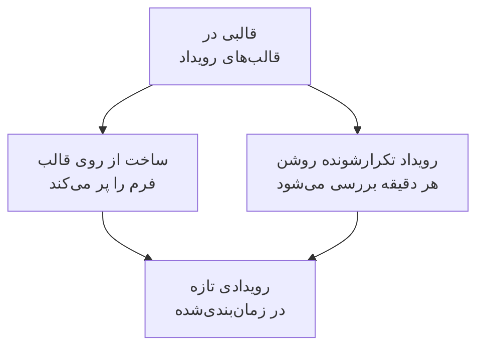

# قالب‌ها و رویدادهای تکرارشونده

قالب تعمیر و نگهداری زمان‌بندی‌شده رویدادی را که اغلب زمان‌بندی می‌کنید ذخیره می‌کند: عنوان و توضیحاتش، مانیتورهایی که متوقف می‌کند، صفحه‌های وضعیتی که روی آن‌ها نشان داده می‌شود، و اینکه به چه کسانی خبر داده می‌شود. با یک قالب فرم را با یک کلیک پر کنید، یا آن را تکرارشونده کنید تا OneUptime رویداد را هر هفته، هر ماه یا با هر فاصله‌ای که انتخاب کنید برایتان زمان‌بندی کند.

:::cards
- [ساخت قالب](#ساخت-قالب): گام‌های فرم، با یک نام در ابتدا و یک زمان‌بندی در انتها.
- [استفاده از قالب](#استفاده-از-قالب): یک رویداد تازه را از روی آن پر کنید.
- [رویدادهای تکرارشونده](#رویدادهای-تکرارشونده): بگذارید OneUptime خودش رویداد را زمان‌بندی کند.
- [تغییر یا توقف قالب](#تغییر-یا-توقف-قالب): ویرایشش کنید، زمان‌بندی‌اش را متوقف کنید، یا حذفش کنید.
:::

## چگونه کار می‌کند

قالب یک نقطهٔ شروع است. رویدادی که از روی آن ساخته شود نسخه‌ای با مقادیر خودش است: تغییر قالب در آینده فقط رویدادهایی را تغییر می‌دهد که پس از آن ساخته می‌شوند.

## پیش از شروع

- **طرح شما.** در OneUptime Cloud، قالب‌ها به طرح **Growth** یا بالاتر نیاز دارند.
- **نقش شما.** ساخت قالب به **مالک پروژه**، **مدیر پروژه**، **عضو پروژه**، **مدیر تعمیر و نگهداری زمان‌بندی‌شده** یا **عضو تعمیر و نگهداری زمان‌بندی‌شده** نیاز دارد، یا به نقشی سفارشی که بتواند قالب‌های تعمیر و نگهداری زمان‌بندی‌شده بسازد.

## ساخت قالب

:::steps
### باز کردن قالب‌ها

به **تعمیر و نگهداری زمان‌بندی‌شده** > **تنظیمات** > **قالب‌های رویداد** بروید. **تنظیمات** در منوی کناری بسته شروع می‌شود: اول بازش کنید. روی **ساخت قالب تعمیر و نگهداری زمان‌بندی‌شده** کلیک کنید.

### نام‌گذاری قالب

در **اطلاعات قالب**، به آن یک **نام قالب** و یک **توضیحات قالب** بدهید تا تیم شما بداند کِی از آن استفاده کند. هر دو الزامی‌اند.

### توصیف رویداد

در **رویداد**، **عنوان** و **توضیحات** را پر کنید؛ هر رویدادی که از روی قالب ساخته شود با آن‌ها شروع می‌شود. **مالکان** و **برچسب‌ها** زیر **فیلدهای بیشتر** منتظرند.

### انتخاب آنچه تحت تأثیر است

در **منابع تحت تأثیر**، **مانیتورها**، **تغییر وضعیت مانیتور به** برای آن‌ها، هر **سایر منابع تحت تأثیر**، صفحه‌های وضعیت زیر **نمایش رویداد در این صفحات وضعیت**، و **اعلان‌های مشترکان** را انتخاب کنید.

### تصمیم دربارهٔ تکرار

در **تکرارشونده**، برای قالبی که دستی به کار می‌برید **رویداد تکرارشونده** را خاموش بگذارید، یا روشنش کنید و زمان‌بندی‌اش را پر کنید. روی **بعدی** کلیک کنید تا بازبینی را ببینید، سپس قالب را بسازید.
:::

قالب حتی وقتی هیچ مانیتوری را نام نمی‌برد **تغییر وضعیت مانیتور به** را می‌پرسد: این وضعیت بر مانیتورهایی هم اعمال می‌شود که هنگام زمان‌بندی رویداد از روی آن اضافه می‌کنید. زیر **سایر منابع تحت تأثیر**، قالب میزبان‌ها، خوشه‌های Kubernetes، میزبان‌های Docker، میزبان‌های Podman و سرویس‌ها را می‌پذیرد.

## قالب چه چیزهایی را پر می‌کند

| بخشی از رویداد                                    | ساخت از روی قالب                     | رویداد تکرارشونده               |
| ------------------------------------------------- | ------------------------------------ | ------------------------------- |
| **عنوان** و **توضیحات**                           | پرشده، و می‌توانید تغییرشان دهید     | کپی‌شده                         |
| **مانیتورها** و **تغییر وضعیت مانیتور به**        | پرشده                                | کپی‌شده                         |
| **سایر منابع تحت تأثیر**                          | پرشده                                | کپی‌شده                         |
| صفحه‌های وضعیت و **اعلان‌های مشترکان**            | پرشده                                | کپی‌شده                         |
| **مالکان** و **برچسب‌ها**                         | پرشده                                | کپی‌شده                         |
| **شروع در** و **پایان در**                        | ساعت کامل بعدی، به مدت یک ساعت       | محاسبه‌شده از روی زمان‌بندی      |

## استفاده از قالب

:::steps
### انتخاب قالب

در **تعمیر و نگهداری زمان‌بندی‌شده** > **همه رویدادها**، روی **ساخت از روی قالب** کلیک کنید و قالبی را زیر **انتخاب قالب تعمیر و نگهداری زمان‌بندی‌شده** برگزینید.

### بررسی فرم

روی **ساخت از روی قالب** کلیک کنید. فرم ساخت با پاسخ‌های قالب که از پیش پر شده‌اند باز می‌شود. بازه را تنظیم کنید، و هر چه این رویداد لازم دارد تغییر دهید.

### ساختن رویداد

با **بعدی** گام‌ها را طی کنید، سپس در بازبینی روی **ساخت رویداد تعمیر و نگهداری زمان‌بندی‌شده** کلیک کنید.
:::

وقتی پروژه هنوز هیچ قالبی ندارد، **ساخت از روی قالب** همین را می‌گوید و به **قالب‌های رویداد** پیوند می‌دهد.

## رویدادهای تکرارشونده

قالب تکرارشونده رویداد را طبق یک زمان‌بندی می‌سازد. شما تعیین می‌کنید نخستین رویداد کِی ساخته شود، کِی شروع شود و کِی تمام شود؛ هر رویداد بعدی همان فاصله‌ها را نگه می‌دارد، یک بازه دیرتر.

| فیلد                                                     | معنایش                                                                                             |
| -------------------------------------------------------- | -------------------------------------------------------------------------------------------------- |
| **رویداد تکرارشونده**                                    | زمان‌بندی را روشن می‌کند.                                                                          |
| **زمان‌بندی اولین رویداد در**                            | زمانی که OneUptime نخستین رویداد را می‌سازد، یعنی زمانی که به مشترکانش خبر داده می‌شود زمان‌بندی شده است. |
| **شروع اولین رویداد در**                                 | زمانی که نخستین رویداد شروع می‌شود.                                                                |
| **پایان اولین رویداد در**                                | زمانی که نخستین رویداد تمام می‌شود.                                                                |
| **می‌خواهید این رویداد هر چند وقت یک بار تکرار شود؟**    | یک عدد و یک واحد: ساعت، روز، هفته، ماه یا سال.                                                     |

برای نمونه، یک بازهٔ هفتگی که نخستین رویدادش دوشنبه برای شنبهٔ پس از آن ساخته می‌شود:

| رویداد       | ساخته‌شده          | شروع               | پایان              |
| ------------ | ------------------ | ------------------ | ------------------ |
| نخستین       | `2030-06-03 09:00` | `2030-06-08 02:00` | `2030-06-08 04:00` |
| دومی         | `2030-06-10 09:00` | `2030-06-15 02:00` | `2030-06-15 04:00` |

**زمان‌بندی اولین رویداد در** را به همان اندازه پیش از شروع بگذارید که می‌خواهید مشتریانتان زودتر از کار باخبر شوند. هنگام ساخت قالب هر سه زمان باید در آینده باشند، رویداد باید پیش از شروع و پایانش ساخته شود، و باید پیش از پایانش شروع شود؛ فرم می‌گوید یک زمان کدام قاعده را می‌شکند.

کاری هر دقیقه قالب‌های تکرارشونده را بررسی می‌کند. وقتی زمان بعدی یک قالب فرا می‌رسد، آن زمان را یک بازه جلو می‌برد و رویداد را می‌سازد. فهرست قالب‌ها آن زمان را در ستون **رویداد تکرارشونده** خود نشان می‌دهد، و برای قالبی که تکرار نمی‌شود، **خیر** را نشان می‌دهد. رویدادی که از روی زمان‌بندی ساخته می‌شود مانند هر رویداد دیگری است: قواعدش اجرا می‌شوند، مالکانش اضافه می‌شوند، و به مشترکانش خبر داده می‌شود که زمان‌بندی شده است.

## تغییر یا توقف قالب

قالبی را از فهرست باز کنید تا صفحه‌اش را ببینید:

- **جزئیات قالب تعمیر و نگهداری زمان‌بندی‌شده** نشان می‌دهد رویدادهای تازه با چه چیزی شروع می‌شوند. **ویرایش** آن از **اطلاعات قالب**، **رویداد**، **صفحات وضعیت** و **تکرارشونده** می‌گذرد.
- **منابع تحت تأثیر** **مانیتورها**، **تغییر وضعیت مانیتور به** آن‌ها و **سایر منابع تحت تأثیر** آن را در بر دارد، با **ویرایش** مخصوص خودش.
- **مالکان** افراد و تیم‌هایی را فهرست می‌کند که مالک هر رویدادِ زمان‌بندی‌شده از روی آن‌اند.

تغییرها بر رویدادهایی اعمال می‌شوند که پس از ذخیره‌شان ساخته می‌شوند؛ رویدادهایی که از قبل ساخته شده‌اند مقادیر خود را نگه می‌دارند. برای توقف یک زمان‌بندی، **رویداد تکرارشونده** را در **ویرایش** خاموش کنید، یا قالب را حذف کنید. قالبی که خاموش شده زمان‌بندی‌اش را نگه می‌دارد: دوباره روشنش کنید، و از زمان بعدی زمان‌بندی ادامه می‌دهد و زمان‌هایی را که خاموش بوده رد می‌کند. حذف قالب رویدادهایی را که ساخته باقی می‌گذارد.

## عیب‌یابی

:::details ساخت قالب تکرارشونده می‌گوید یک زمان باید در آینده باشد
هنگام ساخت، هر سه زمانِ نخستین باید پس از اکنون باشند. آن‌ها را جلو ببرید: زمان‌بندی سپس از نخستین رویداد ادامه می‌یابد.
:::

:::details قالب تکرارشونده هیچ رویدادی نساخت
بررسی کنید **رویداد تکرارشونده** هنوز روشن باشد، و به زمان ستون **رویداد تکرارشونده** فهرست نگاه کنید: رویداد در آن زمان ساخته می‌شود، نه در زمان شروعش. این کار هر دقیقه اجرا می‌شود، پس یک دقیقه صبر کنید.
:::

:::details رویدادی که از قالب ساخته شده منبعی را که انتخاب کرده بودم ندارد
قالب زیر **سایر منابع تحت تأثیر** میزبان‌ها، خوشه‌های Kubernetes، میزبان‌های Docker، میزبان‌های Podman و سرویس‌ها را می‌پذیرد. انواع دیگر منابع را با **ویرایش** در کارت **منابع تحت تأثیر** به خود رویداد اضافه کنید.
:::

## گام‌های بعدی

:::cards
- [ساخت رویدادهای تعمیر و نگهداری](/docs/scheduled-maintenance/creating-events): فرمی که قالب پر می‌کند.
- [وضعیت‌های تعمیر و نگهداری](/docs/scheduled-maintenance/states): هر رویداد پس از ساخته شدن چگونه پیش می‌رود.
- [قواعد و تنظیمات تعمیر و نگهداری](/docs/scheduled-maintenance/settings): به هر رویداد تازه خودکار مالک و برچسب بدهید.
- [نمای کلی تعمیر و نگهداری زمان‌بندی‌شده](/docs/scheduled-maintenance/index): جایگاه قالب‌ها در بقیهٔ تعمیر و نگهداری.
:::
