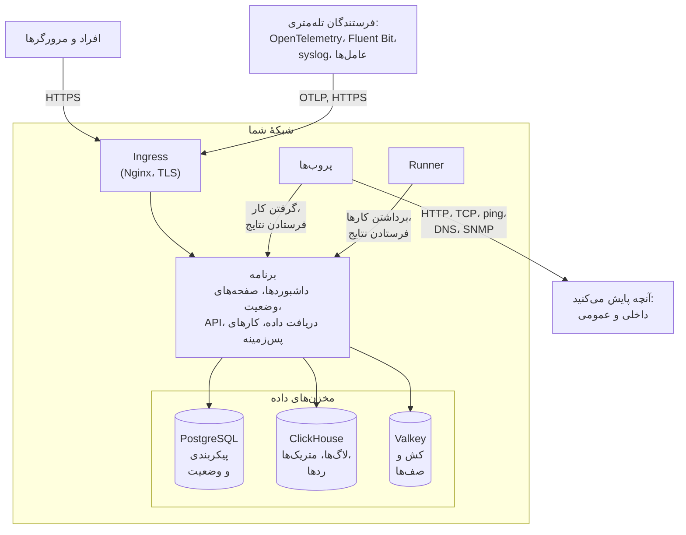

# معماری

یک نصب خودمیزبان OneUptime از چند کانتینر تشکیل می‌شود: یک ingress که هر درخواستی از آن وارد می‌شود، یک ایمیج برنامه که کار را انجام می‌دهد، پروب‌هایی که بررسی‌های مانیتورهای شما را اجرا می‌کنند، و سه مخزن داده. این صفحه نشان می‌دهد این‌ها چطور کنار هم قرار می‌گیرند، هر کدام چه می‌کند و کدام اتصال‌ها از مرز شبکهٔ شما عبور می‌کنند.

## این نمودار چه نشان می‌دهد

- افراد از راه **ingress** به OneUptime می‌رسند، که TLS را پایان می‌دهد و هر درخواست را به برنامه می‌فرستد: Dashboard، صفحه‌های وضعیت، API، و هر نقطهٔ دریافتی که تله‌متری به آن فرستاده می‌شود.
- **برنامه** وضعیت خود را در PostgreSQL می‌خواند و می‌نویسد، تله‌متری را در ClickHouse نگه می‌دارد، و از Valkey (انشعاب دارای مجوز BSD از Redis 7.2) برای کش و برای صف‌هایی که کارهای پس‌زمینه‌اش پردازش می‌کنند استفاده می‌کند.
- **پروب‌ها** می‌توانند درون کلاستر شما (توصیه می‌شود) و/یا جای دیگری در شبکهٔ شما اجرا شوند. آن‌ها می‌توانند این‌ها را پایش کنند:
  - سرویس‌های داخلی/خصوصی پشت دیوار آتش شما.
  - منابع خارجی/عمومی در اینترنت.
- نتایج پروب‌ها به برنامه فرستاده می‌شوند، در Valkey به صف می‌روند و کارهای پس‌زمینه آن‌ها را پردازش می‌کنند و در مخزن‌های داده‌تان می‌نویسند. پروبی که جای دیگری در شبکهٔ شماست، از راه ingress و با نشانی OneUptime شما به برنامه می‌رسد.
- تله‌متری (متریک‌ها، ردها، لاگ‌ها و بیشتر) را همان برنامه دریافت می‌کند و در ClickHouse ذخیره می‌شود.

> [!NOTE]
> اگر به‌جای نمونه‌های داخلی از PostgreSQL، Valkey (یا Redis) یا ClickHouse خارجی استفاده کنید، برنامه به‌جای آن‌ها به نقطه‌های پایانی خارجی شما وصل می‌شود. جریان منطقی همان می‌ماند.

## اجزا

| جزء | سرویس Docker Compose | چارت Helm | چه می‌کند |
| --- | --- | --- | --- |
| Ingress | `ingress` | `nginx` | TLS را پایان می‌دهد، نام میزبان و دامنه‌های صفحه‌های وضعیت شما را سرو می‌کند و هر درخواست را به برنامه می‌فرستد. |
| برنامه | `app` | `app` | Dashboard، صفحه‌های وضعیت، نقطه‌های پایانی API و دریافت داده، و اگر جدایشان نکنید، کارهای پس‌زمینه. |
| Worker | بخشی از `app` | `worker` (به‌طور پیش‌فرض خاموش) | کارهای پس‌زمینه در پادهای جداگانهٔ خودشان، تا پردازش سنگین صف هرگز با درخواست‌های API رقابت نکند. |
| Telemetry writer | بخشی از `app` | `telemetryWriter` (به‌طور پیش‌فرض خاموش) | لایه‌ای با اندازهٔ ثابت که هر درج در ClickHouse را انجام می‌دهد، تا درج‌ها هر قدر هم workerها مقیاس بگیرند محدود بمانند. |
| پروب | `probe-1` | `probes` | بررسی‌های مانیتور را اجرا می‌کند و نتایج را برمی‌گرداند. هر پروب همراه، یک پروب سراسری است که همهٔ پروژه‌ها می‌توانند از آن استفاده کنند. |
| Runner | `runner` | `runner` | Runner خودِ نمونه، که می‌تواند اصلاح کد با هوش مصنوعی را برای هر پروژه اجرا کند. گام‌های رانبوک روی [Runnerهایی](/docs/runbooks/agents) اجرا می‌شوند که خودتان همان جایی نصب می‌کنید که باید اجرا شوند. |
| PostgreSQL | `postgres` | `postgresql`، یا `postgresOperator.cnpg` | پروژه‌ها، مانیتورها، حادثه‌ها، کاربران و هر تنظیم و وضعیت دیگر. |
| ClickHouse | `clickhouse` | `clickhouse`، یا `clickhouseOperator.altinity` | لاگ‌ها، متریک‌ها، ردها، استثناها، پروفایل‌ها و لاگ‌های مانیتور. |
| Valkey | `valkey` | `valkey` | کش، صف‌های کار و وضعیت کوتاه‌مدت، مانند رسیدهای پوش در انتظار. |

همهٔ نقش‌های برنامه یک ایمیج‌اند: Docker Compose آن‌ها را در یک کانتینر `app` اجرا می‌کند، و چارت Helm می‌تواند worker و telemetry writer را به‌صورت استقرارهای جداگانه اجرا کند. برای تعیین اندازهٔ هر لایه، [اندازه‌گذاری و برنامه‌ریزی ظرفیت](/docs/installation/sizing) را ببینید.

## اتصال‌های رو به بیرون از شبکهٔ شما

برنامه فقط برای چیزهایی که روشن می‌کنید به بیرون وصل می‌شود. هر یک از این‌ها اختیاری است، و هر کدام صفحه‌ای دارد که نشانی‌های دقیقی را که باید مجاز کنید نام می‌برد:

| اتصال خروجی | برای چه | بیشتر بخوانید |
| --- | --- | --- |
| ایمیل (SMTP، یا API سرویس SendGrid) | اعلان‌ها و دعوت‌نامه‌ها | [SMTP](/docs/emails/smtp) |
| Twilio | پیامک و تماس تلفنی | [یکپارچه‌سازی Twilio](/docs/self-hosted/twilio-integration) |
| رلهٔ پوش OneUptime، یا Expo | اعلان‌های پوش موبایل | [اعلان‌های پوش](/docs/self-hosted/push-notifications) |
| Slack و Microsoft Teams | اعلان‌ها و کنش‌های فضای کاری | [یکپارچه‌سازی Slack](/docs/self-hosted/slack-integration) |
| یک ارائه‌دهندهٔ LLM، مانند OpenAI، Anthropic، Microsoft Foundry یا مدلی که خودتان اجرا می‌کنید | OneUptime AI | [ارائه‌دهندگان LLM](/docs/ai/llm-provider) |
| `oneuptime.com` | فعال‌سازی آنلاین مجوز Enterprise | [نسخه سازمانی](/docs/self-hosted/enterprise) |

اتصال‌های جهت مخالف - SendGrid که ایمیل ورودی را تحویل می‌دهد، و Slack و Microsoft Teams که فراخوانی برگشتی انجام می‌دهند - نیاز دارند که ingress از اینترنت در دسترس باشد. اینکه برنامه و پروب‌ها به کدام نشانی‌های خصوصی برسند با شماست: [دسترسی به شبکه خصوصی](/docs/self-hosted/private-network-access) را ببینید.

## گام‌های بعدی

:::cards
- [Docker Compose](/docs/installation/docker-compose): همهٔ اجزا را روی یک ماشین نصب کنید.
- [اندازه‌گذاری و برنامه‌ریزی ظرفیت](/docs/installation/sizing): هر لایه چقدر CPU، حافظه و دیسک نیاز دارد.
- [پروب‌های سفارشی](/docs/probe/custom-probe): یک پروب را درون شبکه‌ای دیگر اجرا کنید.
- [نسخه سازمانی](/docs/self-hosted/enterprise): ایمیج‌های Enterprise چه چیزی اضافه می‌کنند و مجوزدهی چطور کار می‌کند.
:::
