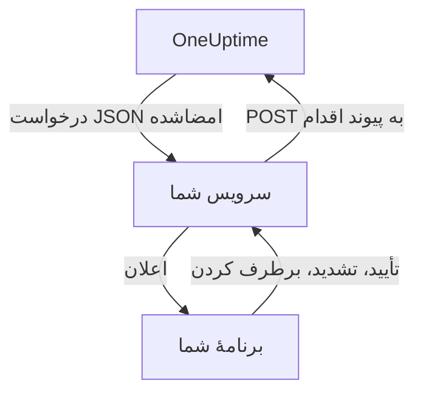

# کانال‌های اعلان سفارشی

یک کانال سفارشی فراخوان‌های آنکال را به سرویسی می‌فرستد که خودتان اجرا می‌کنید: برنامهٔ خود شرکتتان، یک سامانهٔ پیجر، یا درگاهی که آنچه را از شبکهٔ شما بیرون می‌رود بررسی می‌کند. آن را یک بار برای کل سرور می‌افزایید، و همه می‌توانند بی‌آنکه چیزی تنظیم کنند از راه آن فراخوانده شوند. در Admin Dashboard نام آن‌ها **Custom Channels** است.

> [!NOTE]
> کانال‌های سفارشی بخشی از [OneUptime Enterprise Edition](/docs/self-hosted/enterprise) هستند و به پروانهٔ Enterprise‌ای نیاز دارند که آن‌ها را در بر بگیرد. Community Edition صفحهٔ **Custom Channels** ندارد و چیزی به هیچ کانالی نمی‌فرستد. [بدون پروانه](#بدون-پروانه) را ببینید.

:::cards
- [افزودن یک کانال](#افزودن-یک-کانال): یک نام، یک URL و یک رمز امضا.
- [آنچه سرویس شما دریافت می‌کند](#آنچه-سرویس-شما-دریافت-میکند): برای هر فرد در هر فراخوان، یک درخواست JSON امضاشده.
- [اقدام روی یک فراخوان](#اقدام-روی-یک-فراخوان): تأیید، تشدید یا برطرف کردن از برنامهٔ خودتان.
- [تحویل و تلاش دوباره](#تحویل-و-تلاش-دوباره): وقتی سرویس شما از کار افتاده چه می‌شود.
- [اعلان‌های دیگر](#اعلانهای-دیگر): اعلان‌های مالکان، یادداشت‌ها و نوبت‌ها، برای کسانی که آن‌ها را می‌خواهند.
- [بدون پروانه](#بدون-پروانه): چه چیزی متوقف می‌شود و چه چیزی نگه داشته می‌شود.
:::

## چگونه کار می‌کند



وقتی یک سیاست آنکال کسی را فرا می‌خواند و قاعدهٔ آنکال آن فرد از این کانال استفاده می‌کند، OneUptime درخواستی به URL کانال می‌فرستد. این درخواست می‌گوید فراخوان برای چه کسی است (نام و ایمیل او) و دربارهٔ چیست، و پیوندهایی دارد که سرویس شما وقتی فرد آن را در برنامهٔ شما تأیید، تشدید یا برطرف می‌کند، فرا می‌خواند.

## افزودن یک کانال

1. در Admin Dashboard، **تنظیمات** و سپس **اعلان‌ها** > **Custom Channels** را در منوی کناری باز کنید (**اعلان‌ها** در آغاز بسته است) و **Add** را برگزینید.
2. در گام **Channel**، این‌ها را پر کنید:
   - **نام**: آنچه افراد در روش‌های اعلان و قواعد آنکال خود می‌بینند، برای نمونه `CorpoApp`.
   - **Webhook URL**: جایی که OneUptime هر فراخوان را به آن می‌فرستد. می‌تواند در شبکهٔ خصوصی شما باشد.
   - **Signing Secret**: OneUptime یکی برایتان می‌سازد. آن را در سرویس خود کپی کنید، که هر درخواست را با آن بررسی می‌کند. با ویرایش کانال می‌توانید دوباره آن را ببینید.
3. در گام **Delivery**، ذخیره کنید و سپس **Send test** را برگزینید تا یک [درخواست آزمایشی](#درخواستهای-آزمایشی) به سرویس شما فرستاده شود.

در گام **Delivery**، گزینهٔ **Page everyone through this channel** روشن است. در این حالت OneUptime کانال را به قواعد آنکال همهٔ افراد در هر پروژه، و به قواعد هر کسی که بعداً به پروژه‌ای بپیوندد، می‌افزاید و از آن برای رسیدن به پاسخ‌دهنده‌ای استفاده می‌کند که برای رویداد رخ‌داده قاعده‌ای ندارد. آن را خاموش کنید تا افراد خودشان کانال را به قواعدشان بیفزایند.

افراد کانال را در **تنظیمات کاربر**، سپس **روش‌های اعلان**، سپس **Custom Channels** می‌بینند، همراه با دکمهٔ **Send test**، و در قواعد آنکال خود آن را با نام `Custom Channel: CorpoApp` برمی‌گزینند. لازم نیست چیزی تنظیم کنند: به سرویس شما گفته می‌شود هر فراخوان برای چه کسی است.

برای توقف ارسال بدون تغییر قواعد هیچ‌کس، کانال را ویرایش کنید و **روشن** را خاموش کنید. فراخوان‌هایی که به آن می‌رفتند، در گزارش آنکال به‌عنوان فرستاده‌نشده ثبت می‌شوند. حذف یک کانال همهٔ قواعد آنکالی را که از آن استفاده می‌کنند حذف می‌کند.

## آنچه سرویس شما دریافت می‌کند

هر فراخوان یک درخواست `POST` با بدنهٔ JSON است:

| سرآیند | چه چیزی در آن است |
| --- | --- |
| `Content-Type` | `application/json` |
| `X-OneUptime-Event` | رویداد، مانند `on-call.incident.created` |
| `X-OneUptime-Signature` | `sha256=` و HMAC-SHA256 هگزادسیمالِ بدنهٔ خام، ساخته‌شده با رمز امضای کانال |

```json title="An incident page"
{
  "version": 1,
  "event": "on-call.incident.created",
  "notificationId": "5f2c8a1e-6b1d-4c3a-9e7f-2a4b6c8d0e1f",
  "sentAt": "2026-10-27T03:14:15.000Z",
  "channel": { "id": "0b7e…", "name": "CorpoApp" },
  "title": "New Incident INC-42: API latency high",
  "message": "A new incident has been created: INC-42 (API latency high) in Agency A. Click to view details.",
  "project": { "id": "8d1f…", "name": "Agency A" },
  "team": { "id": "2c9a…", "name": "SRE" },
  "user": { "id": "4e6b…", "name": "Jane Tan", "email": "jane@example.com" },
  "recordType": "incident",
  "record": {
    "id": "9a3c…",
    "number": "INC-42",
    "title": "API latency high",
    "description": "p95 latency above 2 seconds for 5 minutes.",
    "severity": "Critical",
    "state": "Created",
    "url": "https://oneuptime.example.com/dashboard/8d1f…/incidents/9a3c…"
  },
  "onCallPolicy": { "id": "1d4e…", "name": "Primary" },
  "escalationRule": { "id": "7b2f…", "name": "Level 1" },
  "isPageAgain": false,
  "actions": {
    "acknowledge": "https://oneuptime.example.com/api/custom-notification-channel/page/5f2c…/acknowledge?token=…",
    "escalate": "https://oneuptime.example.com/api/custom-notification-channel/page/5f2c…/escalate?token=…",
    "resolve": "https://oneuptime.example.com/api/custom-notification-channel/page/5f2c…/resolve?token=…"
  }
}
```

| فیلد | چیست |
| --- | --- |
| `version` | `1`. به این نسخه فقط فیلد افزوده می‌شود. |
| `event` | `on-call.incident.created`، `on-call.alert.created`، `on-call.incidentEpisode.created`، `on-call.alertEpisode.created`، `notification` برای [اعلان‌های دیگر](#اعلانهای-دیگر)، یا `test` |
| `notificationId` | یکی برای هر فرد در هر فراخوان. از آن برای کنار گذاشتن درخواستی که پیش‌تر رسیدگی کرده‌اید استفاده کنید. |
| `title`، `message` | آمادهٔ نمایش، همان‌طور که یک اعلان پوش نشانشان می‌داد |
| `user` | فراخوان برای چه کسی است. حساب او را در برنامهٔ خود با `email` یا `id` پیدا کنید. |
| `team` | تیمی که فرد از راه آن فراخوانده شد، یا `null` وقتی مستقیم فراخوانده شده است |
| `recordType`، `record` | فراخوان دربارهٔ چیست: یک `incident`، `alert`، `incidentEpisode` یا `alertEpisode` |
| `onCallPolicy`، `escalationRule` | سیاست و سطحی که فرد را فراخواند |
| `isPageAgain` | `true` وقتی رکورد مدتی پیش تأیید شده و هنوز برطرف نشده است |
| `actions` | پیوندهایی که سرویس شما برای [اقدام روی فراخوان](#اقدام-روی-یک-فراخوان) فرا می‌خواند |

فراخوانی که برای چند نفر است، برای هر نفر یک درخواست است، هر کدام با پیوندهای خودِ همان فرد، تا OneUptime بداند چه کسی پاسخ داد. عنوان، پیام و توضیح روی هم حداکثر 16,384 نویسه‌اند؛ توضیح بلندتر بریده می‌شود و با «… (truncated — see OneUptime for the full text)» پایان می‌یابد.

### بررسی امضا

پیش از تجزیهٔ بدنهٔ خام درخواست، HMAC آن را حساب کنید و با سرآیند مقایسه کنید:

```javascript title="Node.js"
const crypto = require("crypto");

function isFromOneUptime(rawBody, signatureHeader, secret) {
  const expected =
    "sha256=" + crypto.createHmac("sha256", secret).update(rawBody).digest("hex");
  const received = String(signatureHeader || "");

  return (
    received.length === expected.length &&
    crypto.timingSafeEqual(Buffer.from(received), Buffer.from(expected))
  );
}
```

## اقدام روی یک فراخوان

وقتی فرد دکمه‌ای را در برنامهٔ شما می‌زند، سرویس شما یک درخواست `POST` به پیوند متناظر در `actions` می‌فرستد. به کلید API نیازی نیست: هر پیوند توکنی برای همان یک فراخوان دارد که 7 روز معتبر است، و اقدام به نام فردی که فراخوانده شده ثبت می‌شود.

| اقدام | چه می‌کند |
| --- | --- |
| `acknowledge` | فراخوان فرد، و همراه با آن حادثه، هشدار یا اپیزود را تأیید می‌کند |
| `escalate` | فرد نمی‌تواند آن را بپذیرد: سطح بعدی سیاست آنکال را همین حالا فرا می‌خواند و دیگر او را فرا نمی‌خواند |
| `resolve` | حادثه، هشدار یا اپیزود را برطرف می‌کند، اگر دسترسی‌های خود فرد اجازه دهد |

```bash title="Acknowledge a page"
curl -X POST "https://oneuptime.example.com/api/custom-notification-channel/page/5f2c…/acknowledge?token=…"
```

پاسخ می‌گوید چه اتفاقی افتاد، با واژه‌هایی که برنامهٔ شما می‌تواند همان‌طور که هست نشان دهد:

```json title="The answer"
{
  "action": "acknowledge",
  "result": "acknowledged",
  "message": "Acknowledged."
}
```

`result` یکی از `acknowledged`، `alreadyAcknowledged`، `escalated`، `notEscalated`، `resolved` و `alreadyResolved` است. پیوند منقضی یا نادرست با وضعیت 4xx و یک پیام رد می‌شود.

## اعلان‌های دیگر

فراخوان‌ها تنها اعلان‌هایی نیستند که افراد دریافت می‌کنند: OneUptime همچنین به آن‌ها خبر می‌دهد وقتی وضعیت حادثه‌ای که مالکش هستند تغییر می‌کند، وقتی یادداشتی منتشر می‌شود، وقتی نوبت آنکالشان آغاز می‌شود، و موارد دیگر. هر فرد در **تنظیمات کاربر** > **تنظیمات اعلان** انتخاب می‌کند که هر کدام کجا برود، و تا وقتی کانالی روشن است، آنجا ستون **Custom Channels** وجود دارد. این ستون برای همه خاموش است تا وقتی خودشان روشنش کنند.

یک اعلان به هر کانالی که روشن است می‌رود، برای هر کانال یک درخواست، با `event` برابر با `notification`:

```json title="A notification"
{
  "version": 1,
  "event": "notification",
  "notificationId": null,
  "sentAt": "2026-10-27T03:20:00.000Z",
  "channel": { "id": "0b7e…", "name": "CorpoApp" },
  "title": "Incident INC-42 acknowledged",
  "message": "Incident INC-42 (API latency high) was acknowledged in Agency A.",
  "project": { "id": "8d1f…", "name": "Agency A" },
  "team": null,
  "user": { "id": "4e6b…", "name": "Jane Tan", "email": "jane@example.com" },
  "recordType": null,
  "record": null,
  "onCallPolicy": null,
  "escalationRule": null,
  "isPageAgain": false,
  "actions": null,
  "notificationType": "Send incident state changed notification when I am the owner of the incident",
  "url": "https://oneuptime.example.com/dashboard/8d1f…/incidents/9a3c…"
}
```

`title` و `message` همان چیزی است که اعلان پوش فرد می‌گفت. `notificationType` تنظیمی را نام می‌برد که اعلان برای آن فرستاده شد، و `url` به آنچه اعلان درباره‌اش است پیوند می‌دهد، یا `null` است. کاری برای انجام دادن نیست، پس `actions` برابر `null` است.

## تحویل و تلاش دوباره

یک درخواست وقتی تحویل‌شده به شمار می‌آید که سرویس شما ظرف 10 ثانیه با وضعیت 2xx پاسخ دهد. درخواستی که به آن پاسخ نداد، یا با 408، 429 یا وضعیت 5xx پاسخ داد، پس از 1 ثانیه و سپس پس از 4 ثانیهٔ دیگر دوباره فرستاده می‌شود: روی هم سه تلاش. با هر وضعیت 4xx دیگری دوباره فرستاده نمی‌شود.

نتیجهٔ هر تلاش در گزارش آنکال فرد ثبت می‌شود، با نام کانال و وضعیتی که سرویس شما پاسخ داد، و هرگز با URL. فراخوانی که تحویل نشود، سیاست آنکال را متوقف نمی‌کند: اگر کسی تأیید نکند، طبق معمول تشدید می‌شود. اگر سرویس شما تنها راه رسیدن به افراد است، یک قاعدهٔ ایمیل یا پیامک را پایین‌تر در قواعدتان نگه دارید.

## درخواست‌های آزمایشی

دکمهٔ **Send test** در صفحهٔ Admin Dashboard یا در روش‌های اعلان یک فرد، درخواستی می‌فرستد که در آن `event` برابر `test` است، فردی که دکمه را زد در `user` می‌آید، و `notificationId`، `record` و `actions` برابر `null` هستند. از آن برای آزمودن سرویس خود پیش از رسیدن یک فراخوان واقعی استفاده کنید.

## بدون پروانه

کانال‌های سفارشی در دورهٔ آزمایشی 14 روزهٔ Enterprise Edition و دورهٔ مهلت 30 روزه پس از انقضای پروانه کار می‌کنند. پس از آن، یا با پروانه‌ای که آن‌ها را در بر نمی‌گیرد:

- **چیزی به هیچ کانال سفارشی فرستاده نمی‌شود.** فراخوانی که به یکی از آن‌ها می‌رفت، در گزارش آنکال فرد به‌عنوان فرستاده‌نشده ثبت می‌شود، و آزمایش هم همین‌طور.
- **کانال‌ها دیگر پیشنهاد نمی‌شوند.** از روش‌های اعلان، قواعد آنکال و تنظیمات اعلان افراد بیرون می‌روند، و آمادگی و ارسال جایگزین دیگر آن‌ها را به شمار نمی‌آورند.
- **صفحه فقط‌خواندنی است.** می‌توانید کانال‌ها را ببینید و حذف کنید، اما نمی‌توانید بیفزایید یا تغییرشان دهید، و هیچ‌کس نمی‌تواند قاعده یا تنظیم اعلانی را به یکی از آن‌ها نشانه بگیرد.
- **چیزی حذف نمی‌شود.** کانال‌ها، و قواعد آنکال و تنظیماتی که از آن‌ها استفاده می‌کنند، نگه داشته می‌شوند.

به محض فعال شدن یک پروانه، همه چیز بدون راه‌اندازی دوباره از سر گرفته می‌شود. کسانی که هنگام متوقف بودن کانال‌های سفارشی به پروژه‌ای پیوستند، در قواعدشان کانالی که همه را فرا می‌خواند ندارند: می‌توانند خودشان آن را بیفزایند.
