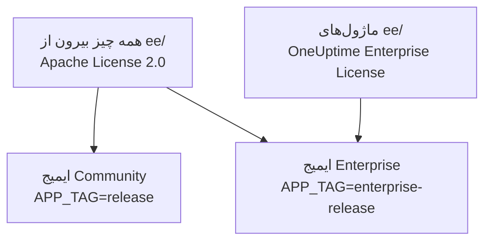
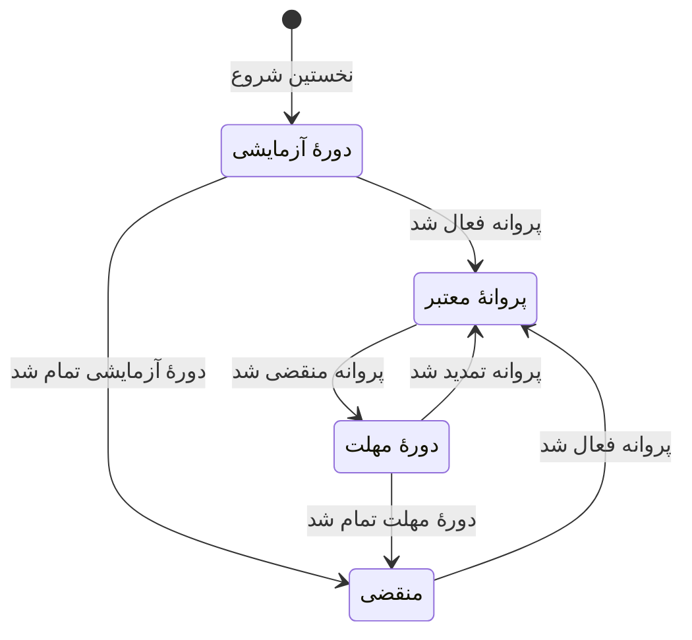

# نسخه سازمانی

‏OneUptime از یک مخزن ساخته می‌شود و در دو نسخه عرضه می‌شود:

- **Community Edition**: کل سکوی پایش، حادثه و مشاهده‌پذیری، از جمله ورود یکپارچهٔ SAML و OpenID Connect، که متن‌باز و تحت Apache License 2.0 است و میزبانی آن روی سرور خودتان در هر مقیاسی رایگان است.
- **Enterprise Edition**: همان Community Edition به‌علاوهٔ ماژول‌های سازمانی پوشهٔ [`ee/`](https://github.com/OneUptime/oneuptime/tree/master/ee) مخزن. این ماژول‌ها تأمین SCIM و قابلیت‌های حاکمیت و مدیریت نمونه را اضافه می‌کنند. آن‌ها تحت [OneUptime Enterprise License](https://github.com/OneUptime/oneuptime/blob/master/ee/LICENSE) هستند، و استفادهٔ تولیدی از آن‌ها به پروانهٔ Enterprise برای تعداد کاربرانتان نیاز دارد.

این دو نسخه ایمیج‌های کانتینری جداگانه‌اند. ایمیج Community هیچ کدی از `ee/` ندارد. ‏OneUptime Cloud نسخهٔ Enterprise Edition را اجرا می‌کند، و در ابر طرح شما تعیین می‌کند کدام‌یک از این قابلیت‌ها را دارید.



> [!NOTE]
> **ورود یکپارچه در هر نسخه‌ای هست.** ورود با SAML و OIDC به پروژه‌ها و صفحه‌های وضعیت، SSO سراسری و «Require SSO for login» بخشی از Community Edition هستند، و هیچ وضعیت پروانه‌ای آن‌ها را خاموش نمی‌کند.

این صفحه توضیح می‌دهد هر نسخه چه چیزهایی دارد، Enterprise Edition را چگونه اجرا کنید، پروانه چگونه کار می‌کند و وقتی نسخه را عوض می‌کنید چه رخ می‌دهد.

:::cards
- [مقایسهٔ نسخه‌ها](#هر-نسخه-چه-چیزهایی-دارد): آنچه Enterprise Edition اضافه می‌کند.
- [اجرای ایمیج Enterprise](#اجرای-enterprise-edition): فقط یک تنظیم، روی Kubernetes یا Docker Compose.
- [فعال‌سازی پروانه](#پروانه): آنلاین با یک کلید، یا آفلاین با یک توکن امضاشده.
- [وقتی پروانه منقضی می‌شود](#وقتی-پروانه-منقضی-شده-یا-وجود-ندارد): چه چیزی متوقف می‌شود، چه چیزی هرگز متوقف نمی‌شود، و چطور همه چیز برمی‌گردد.
:::

## هر نسخه چه چیزهایی دارد

| قابلیت | Community | Enterprise | OneUptime Cloud |
| --- | --- | --- | --- |
| پایش، هشدارها، حادثه‌ها، کشیک، صفحه‌های وضعیت، لاگ‌ها، متریک‌ها، ردگیری‌ها، استثناها، داشبوردها، گردش‌های کاری، قابلیت‌های هوش مصنوعی، API و Terraform | بله | بله | همهٔ طرح‌ها |
| ورود با گذرواژه، احراز هویت دومرحله‌ای، تیم‌ها، نقش‌ها و کلیدهای API | بله | بله | همهٔ طرح‌ها |
| [SSO با SAML و OpenID Connect](/docs/identity/sso) برای ورود به پروژه | بله | بله | طرح Scale و بالاتر |
| SSO با SAML و OpenID Connect برای ورود به صفحهٔ وضعیت خصوصی | بله | بله | طرح Scale و بالاتر |
| [SSO و OIDC سراسری (برای کل نمونه)](/docs/identity/global-sso) | بله | بله | کاربرد ندارد |
| [تأمین SCIM](/docs/identity/scim) برای پروژه‌ها و صفحه‌های وضعیت | خیر | بله | طرح Scale و بالاتر |
| تنظیمات انطباق تیم | خیر | بله | طرح Scale و بالاتر |
| لاگ‌های ممیزی | خیر | بله | طرح Enterprise |
| بازنویسی‌های نگهداری: نگهداری بر اساس نوع تله‌متری (لاگ‌ها، ردگیری‌ها، متریک‌ها، پروفایل‌ها، با قاعده‌هایی بر اساس شدت لاگ و وضعیت ردگیری)، و نگهداری برای هر سرویس و هر منبع | خیر | بله | طرح Scale و بالاتر |
| داشبوردهای **Health** در بخش مدیریت: نمای کلی نمونه، صف‌های پس‌زمینه، لاگ‌های نمونه، PostgreSQL، ‏Valkey، خوشهٔ ClickHouse، لاگ‌های عیب‌یابی و دریافت تله‌متری | خیر | بله | کاربرد ندارد |
| **Query Console** در بخش مدیریت | خیر | بله | در دسترس نیست |
| هشدارهای سلامت PostgreSQL و Valkey ‏(Redis) | خیر | بله | کاربرد ندارد |
| نمای ظرفیت ClickHouse، هشدارهای ظرفیت و پاک‌سازی خودکار دیسک | بله | بله | کاربرد ندارد |
| وضعیت مهاجرت‌ها، بستهٔ پشتیبانی و پراب‌های سراسری در داشبورد مدیریت | بله | بله | کاربرد ندارد |
| مدیریت پروانهٔ Enterprise، صندلی‌ها و نمونه‌ها | خیر | بله | کاربرد ندارد |

ورود یکپارچه در هر دو نسخه «Require SSO for login» را برای پروژه‌ها، صفحه‌های وضعیت خصوصی و کل نمونه در بر دارد.

هر نسخه‌ای نگهداری پیش‌فرض تله‌متری پروژه را دارد، در **تنظیمات پروژه** > **تله‌متری و APM** > **نگهداری داده**. بازنویسی‌های نگهداری چیزی است که Enterprise Edition روی آن اضافه می‌کند.

در OneUptime Cloud، قابلیت پولی را همیشه می‌توان در هر طرحی خاموش کرد. بازنویسی نگهداری‌ای که یک دورهٔ آزمایشی (یا رفتن به طرحی پایین‌تر) تنظیم‌شده باقی گذاشته، همچنان روی تله‌متری تازه اعمال می‌شود، پس در طرح‌های پایین‌تر از Scale صفحه‌های نگهداری آن را زیر کارت ارتقا با دکمهٔ **حذف بازنویسی** نشان می‌دهند. حذف کردن در هر طرحی کار می‌کند؛ تنظیم دوبارهٔ آن به طرح Scale نیاز دارد. تله‌متری‌ای که از قبل ذخیره شده، نگهداری‌ای را که با آن ذخیره شده حفظ می‌کند. به همین ترتیب، تا وقتی پروژه هنوز SSO را الزامی می‌کند، **تنظیمات پروژه** > **امنیت** > **SSO** کلید **الزامی کردن SSO برای ورود** را زیر کارت ارتقای خود نشان می‌دهد تا بتوان آن را خاموش کرد.

ردیف‌های «کاربرد ندارد» قابلیت‌های مدیریت نمونه‌اند. در OneUptime Cloud، خود OneUptime نمونه را برای شما اداره می‌کند.

## اجرای Enterprise Edition

هر دو نسخه پیکربندی، پایگاه‌های داده و داده‌های یکسانی به کار می‌برند. عوض کردن نسخه فقط ایمیجی را که اجرا می‌کنید تغییر می‌دهد و هیچ چیز دیگری را نه. در هیچ جهتی به مهاجرت نیاز نیست.

:::tabs
@tab Kubernetes
نوع ایمیج را در `values.yaml` خود تنظیم کنید:

```yaml title="values.yaml"
image:
  type: enterprise-edition
```

سپس طبق معمول ارتقا دهید:

```bash
helm upgrade my-oneuptime oneuptime/oneuptime -f values.yaml
```

آنگاه چارت گونهٔ `enterprise-` هر برچسب ایمیج را می‌کشد، برای نمونه `oneuptime/app:enterprise-release`، یا وقتی `image.tag` را ثابت کرده‌اید `enterprise-<version>` را. برای اجرای Community Edition مقدار `image.type: community-edition` (پیش‌فرض) را تنظیم کنید.
@tab Docker Compose
مقدار `APP_TAG` را در `config.env` خود تنظیم کنید:

```bash title="config.env"
APP_TAG=enterprise-release
```

برای ثابت کردن یک انتشار از `enterprise-<version>` استفاده کنید. سپس ایمیج‌ها را بکشید و بازراه‌اندازی کنید:

```bash
npm run update
```

برای بازگشت به Community Edition، مقدار `APP_TAG=release` **و** `IS_ENTERPRISE_EDITION=false` را تنظیم کنید. تا وقتی `IS_ENTERPRISE_EDITION=true` تنظیم شده باشد، `npm run update` مقدار `APP_TAG` را به `enterprise-release` برمی‌گرداند، و ایمیج Community از راه‌اندازی خودداری می‌کند.
:::

### `IS_ENTERPRISE_EDITION` منسوخ شده است

ایمیجی که اجرا می‌کنید نسخه را تعیین می‌کند. `IS_ENTERPRISE_EDITION` دیگر قابلیت‌های سازمانی را روشن نمی‌کند و در انتشاری آینده حذف خواهد شد. می‌توانید آن را تنظیم‌نشده بگذارید.

تنظیم `IS_ENTERPRISE_EDITION=true` روی ایمیج Community قابلیت‌های سازمانی را روشن **نمی‌کند**. به‌جای آن، برنامه **از راه‌اندازی خودداری می‌کند**، تا ارتقایی که روی ایمیج Community فرود می‌آید هرگز نتواند بی‌صدا تأمین SCIM (از جمله لغو تأمین) و ثبت ممیزی را متوقف کند. خطا می‌گوید چه چیزی را تنظیم کنید: `APP_TAG=enterprise-<version>` برای نگه داشتن Enterprise Edition، یا `IS_ENTERPRISE_EDITION=false` برای اجرای Community Edition. با Helm این اتفاق نمی‌افتد: چارت این متغیر را از `image.type` به دست می‌آورد.

‏`ONEUPTIME_EDITION=community` ایمیج Enterprise را مانند Community Edition اجرا می‌کند. این برای امتحان کردن تنزل نسخه پیش از انجام آن مفید است. ایمیج Enterprise خودش `ONEUPTIME_EDITION=enterprise` را تنظیم می‌کند؛ آن را با چیزی جز `community` بازنویسی نکنید.

## پروانه

پروندهٔ [`LICENSE`](https://github.com/OneUptime/oneuptime/blob/master/LICENSE) در ریشهٔ مخزن مشخص می‌کند کدام پروانه چه چیزی را پوشش می‌دهد: هر چیزی در پوشهٔ `ee/` تحت [OneUptime Enterprise License](https://github.com/OneUptime/oneuptime/blob/master/ee/LICENSE) است، مؤلفه‌های شخص ثالث پروانه‌هایی را که مالکانشان با آن‌ها عرضه‌شان می‌کنند حفظ می‌کنند، و همهٔ چیزهای دیگر تحت Apache License 2.0 هستند.

نصب تازهٔ Enterprise Edition به‌صورت یک **دورهٔ آزمایشی 14 روزه** اجرا می‌شود که از نخستین باری که نصب Enterprise Edition را شروع می‌کند شمرده می‌شود. دورهٔ آزمایشی برای ارزیابی است: استفادهٔ تولیدی از Enterprise Edition به اشتراکی تحت OneUptime Enterprise License نیاز دارد. پیش از پایان دورهٔ آزمایشی یک پروانه فعال کنید: پس از آن، SCIM، ثبت ممیزی و بازنویسی‌های نگهداری متوقف می‌شوند و پیکربندی سازمانی فقط‌خواندنی می‌شود ([وقتی پروانه منقضی شده یا وجود ندارد](#وقتی-پروانه-منقضی-شده-یا-وجود-ندارد) را ببینید). برای گرفتن پروانه با [sales@oneuptime.com](mailto:sales@oneuptime.com) تماس بگیرید.

پروانه از **برچسب نسخه** مدیریت می‌شود که مدیران اصلی آن را در سرصفحهٔ داشبورد مدیریت و در پانویس Dashboard می‌بینند. این برچسب وضعیت پروانه، میزان استفاده از صندلی‌ها و، برای مدیران اصلی، شناسهٔ نمونه را نشان می‌دهد.

### فعال‌سازی آنلاین (کلید پروانه)

:::steps
1. به‌عنوان مدیر اصلی وارد شوید و برچسب نسخه را باز کنید.
2. کلید پروانهٔ خود را وارد و اعتبارسنجی کنید.
:::

نصب کلید را نزد OneUptime بررسی می‌کند و پروانه‌ای را که دریافت می‌کند ذخیره می‌کند. از آن پس با یک همگام‌سازی روزانه پروانه را به‌روز نگه می‌دارد. برای گرفتن فوری تغییرها، مانند صندلی‌های اضافه یا تمدید، از **Refresh license** روی برچسب نسخه استفاده کنید.

فعال‌سازی آنلاین به HTTPS خروجی از سرور OneUptime به `https://oneuptime.com` نیاز دارد. اگر سرور فقط از راه یک رله به اینترنت می‌رسد، `ENTERPRISE_LICENSE_SERVER_URL` را روی نشانی `https://` رله تنظیم کنید. رله باید `/api/enterprise-license/` را به oneuptime.com بفرستد.

### فعال‌سازی آفلاین (نصب‌های جدا از شبکه)

نصبی که هیچ مسیری به اینترنت ندارد می‌تواند به‌جای کلید از یک **توکن پروانهٔ امضاشده** استفاده کند:

:::steps
1. به‌عنوان مدیر اصلی وارد شوید، برچسب نسخه را باز کنید و **شناسهٔ نمونه** را یادداشت کنید.
2. از OneUptime ‏([sales@oneuptime.com](mailto:sales@oneuptime.com)) یک توکن پروانهٔ آفلاین برای آن شناسهٔ نمونه بخواهید.
3. توکن را در فیلد توکن برچسب نسخه بچسبانید و فعالش کنید.
:::

نصب خودش توکن را با کلیدهای امضای OneUptime که درون انتشار شما ساخته شده‌اند بررسی می‌کند. هرگز با OneUptime تماس نمی‌گیرد. توکنی که برای یک شناسهٔ نمونه صادر شده، از سوی هر نصب دیگری رد می‌شود، و توکنی که بدون شناسهٔ نمونه صادر شده (مانند توکنی که نصبِ فعال‌شده به‌صورت آنلاین دریافت می‌کند) هم رد می‌شود. برای تمدید یا افزودن صندلی، پیش از انقضای توکن فعلی یک توکن تازه فعال کنید.

> [!IMPORTANT]
> **فعال‌سازی آفلاین به انتشاری نیاز دارد که به کلید امضای پروانهٔ OneUptime اعتماد کند.** اگر انتشار شما هنوز آن کلید را ندارد، فعال‌سازی با «this build does not trust the key that signed this token» شکست می‌خورد. در این صورت آنلاین فعال کنید، یا به انتشاری ارتقا دهید که این کلید را دارد.

### همگام‌سازی روزانهٔ پروانه چه می‌فرستد

نصبی که به‌صورت آنلاین فعال شده، روزی یک گزارش برای OneUptime می‌فرستد. این گزارش شامل این‌هاست:

- کلید پروانه؛
- شناسهٔ نمونه (شناسه‌ای تصادفی که نصب می‌سازد) و نام میزبانی که نصب با آن پیکربندی شده (`HOST`)؛
- نسخهٔ OneUptime که نصب اجرا می‌کند؛
- تعداد کاربران نصب؛
- یک **هش SHA-256** از نشانی ایمیل هر کاربر، با حروف کوچک. ‏OneUptime از این هش‌ها استفاده می‌کند تا فردی را که روی چند نصب شما حساب دارد یک صندلی بشمارد. نشانی‌های ایمیل خام کاربران عادی هرگز فرستاده نمی‌شوند؛
- نشانی‌های ایمیل **مدیران اصلی** نصب، تا OneUptime بتواند دربارهٔ تمدید و سقف صندلی‌ها با شما تماس بگیرد.

پاسخ، پروانه را همان‌طور که OneUptime در آن روز می‌شناسد برمی‌گرداند: نام شرکت، تاریخ انقضا، سقف صندلی‌ها، شمار کل کاربران در همهٔ نصب‌های شما و نصب‌هایی که روی این پروانه ثبت شده‌اند. نسخه‌های تکثیری دیگر نصب، تغییر را در حدود یک دقیقه دریافت می‌کنند.

وقتی پروانه را فعال یا تازه‌سازی می‌کنید، نصب فقط کلید پروانه، شناسهٔ نمونه، نام میزبان و نسخه را می‌فرستد.

هیچ چیز دیگری فرستاده نمی‌شود. هیچ دادهٔ پایش، تله‌متری، لاگ یا پیکربندی‌ای از نصب بیرون نمی‌رود. ‏Community Edition هیچ‌کدام از این‌ها را نمی‌فرستد، و نصبی که به‌صورت آفلاین فعال شده هم نمی‌فرستد.

### وقتی پروانه منقضی شده یا وجود ندارد

همهٔ قابلیت‌های سازمانی در دورهٔ آزمایشی 14 روزه، و تا 30 روز پس از انقضای پروانه (دورهٔ مهلت)، کار می‌کنند. برچسب نسخه پیش از پایان هر یک از این دو هشدار می‌دهد. پس از آن، تا وقتی پروانه‌ای فعال شود، **SCIM، ثبت ممیزی و بازنویسی‌های نگهداری متوقف می‌شوند**، درست مانند Community Edition، و پیکربندی سازمانی فقط‌خواندنی می‌شود. ورود یکپارچه قابلیتی سازمانی نیست: ورود با SAML و OIDC، ‏SSO سراسری و «Require SSO for login» در هر وضعیت پروانه یکسان کار می‌کنند.



| وضعیت | چه رخ می‌دهد |
| --- | --- |
| **پروانهٔ معتبر** | همهٔ قابلیت‌های سازمانی کار می‌کنند. کاربر تازه بیش از تعداد صندلی‌های پروانه‌دار افزوده نمی‌شود. کاربران موجود هرگز حذف نمی‌شوند. |
| **دورهٔ آزمایشی یا دورهٔ مهلت** (نخستین 14 روزِ نصبی بدون پروانه، یا 30 روز پس از انقضای پروانه)، یا نصبی که پروانه‌ای دارد که تاریخ انقضایش هرگز ثبت نشده | همهٔ قابلیت‌های سازمانی کار می‌کنند و برچسب نسخه هشداری نشان می‌دهد. در دورهٔ مهلتِ پس از انقضا، سقف صندلی‌ها همچنان اعمال می‌شود. نصبی که پروانه‌ای بدون تاریخ انقضای ثبت‌شده دارد، همان دورهٔ آزمایشی 14 روزهٔ نصب بدون پروانه را می‌گذراند، و سقف صندلی‌ها اعمال نمی‌شود، چون سابقهٔ پروانه‌ای که در اختیار دارد از پیش ناقص است. |
| **پس از دورهٔ آزمایشی یا دورهٔ مهلت** (پروانهٔ منقضی، ناموجود یا نامعتبر، یا پروانه‌ای که این قابلیت را در بر ندارد) | تأمین SCIM، ثبت ممیزی و بازنویسی‌های نگهداری **متوقف می‌شوند** (پایین‌تر را ببینید). پیکربندی سازمانی **فقط‌خواندنی** می‌شود: می‌توانید آن را ببینید و حذف کنید، اما نمی‌توانید بسازید یا تغییر دهید. یک تغییر همیشه کار می‌کند تا بتوانید به یک حادثه پاسخ دهید: جایگزین کردن توکن حامل SCIM. صفحه‌های تنظیمات SCIM این کار را در حالی که همه چیز دیگر فقط‌خواندنی است پیشنهاد می‌دهند: **بازنشانی توکن Bearer** روی یک پیکربندی SCIM، که توکن تازه را یک بار نشان می‌دهد. از راه API، فقط `bearerToken` را بفرستید (دست‌کم 32 نویسه). ثبت ممیزی را نمی‌توان روشن یا گسترده‌تر کرد. داشبوردهای سازمانی Health و Query Console قفل می‌شوند. سقف صندلی‌ها دیگر اعمال نمی‌شود. |

آنچه با منقضی شدن پروانه متوقف می‌شود:

- **تأمین SCIM متوقف می‌شود.** درخواست‌های SCIM ارائه‌دهندهٔ هویت شما، از جمله لغو تأمین، رد می‌شوند، و قفل‌های تیمی SCIM برداشته می‌شوند، تا تیم‌هایی که گروه‌های push در SCIM مدیریتشان می‌کنند دستی ویرایش‌پذیر شوند.
- **ثبت ممیزی دیگر چیزی ثبت نمی‌کند.** لاگ‌های ممیزی که تا آن زمان ثبت شده‌اند نگه داشته می‌شوند.
- **بازنویسی‌های نگهداری دیگر اعمال نمی‌شوند.** تله‌متری تازه به اندازهٔ نگهداری پیش‌فرض پروژه نگه داشته می‌شود. تله‌متری‌ای که از قبل ذخیره شده، نگهداری‌ای را که با آن نوشته شده حفظ می‌کند. همچنان می‌توانید یک بازنویسی را از راه API پاک کنید، اما نمی‌توانید بازنویسی‌ای تنظیم کنید.

آنچه متوقف **نمی‌شود**:

- **ورود یکپارچه.** ورود با SAML و OIDC به پروژه‌ها، صفحه‌های وضعیت خصوصی، کل نمونه (SSO سراسری) و برنامه‌های موبایل، و «Require SSO for login»، بخشی از هر نسخه‌اند. پروانهٔ منقضی هیچ‌کدام از این‌ها را تغییر نمی‌دهد، و پیکربندی ورود یکپارچه همچنان ویرایش‌پذیر می‌ماند.
- **پایش اصلی هرگز تحت تأثیر قرار نمی‌گیرد**: مانیتورها، هشدارها، حادثه‌ها، کشیک، صفحه‌های وضعیت و تله‌متری همه به کار ادامه می‌دهند.
- **مدیران اصلی همیشه می‌توانند با گذرواژهٔ خود وارد شوند.**
- **هیچ چیز حذف نمی‌شود.** پیکربندی SCIM، لاگ‌های ممیزی و بازنویسی‌های نگهداری همان‌طور که هستند می‌مانند.

**به محض فعال شدن یک پروانه همه چیز از سر گرفته می‌شود**، بدون راه‌اندازی دوباره: تأمین SCIM، ثبت ممیزی و بازنویسی‌های نگهداری با همان پیکربندی‌ای که دارید برمی‌گردند. ‏OneUptime فقط وقتی آن‌ها را خاموش می‌کند که بداند پروانه منقضی شده است. تا وقتی نتواند وضعیت پروانه را بخواند، برای نمونه لحظه‌ای هنگام شروع سرور، SCIM، ثبت ممیزی و بازنویسی‌های نگهداری روشن می‌مانند.

> [!WARNING]
> **اگر ارائه‌دهندهٔ هویت شما کاربران را از راه SCIM لغو تأمین می‌کند، پیش از پایان دورهٔ آزمایشی یا دورهٔ مهلت یک پروانه فعال کنید.** پس از آن، SCIM دیگر افرادی را که نزد ارائه‌دهندهٔ هویت حذف می‌کنید لغو تأمین نمی‌کند: حساب‌های OneUptime آن‌ها می‌مانند، و مگر اینکه «Require SSO for login» شامل آن‌ها شود، هر کسی که هنوز به صندوق ایمیل چنین حسابی دسترسی دارد می‌تواند گذرواژه‌ای تنظیم کند و وارد شود. اگر می‌گذارید پروانه منقضی شود، این کاربران را خودتان در OneUptime حذف کنید.

## رفتن از Enterprise به Community

پیکربندی شما در پایگاه داده می‌ماند. بازگشت به ایمیج Enterprise همه چیز را همان‌طور که بود برمی‌گرداند، به شرطی که نصب پروانهٔ معتبر داشته باشد یا هنوز در دورهٔ آزمایشی یا دورهٔ مهلت باشد. ورود یکپارچه تغییر نمی‌کند: ورود با SAML و OIDC، ‏SSO سراسری و «Require SSO for login» روی هر دو ایمیج یکسان کار می‌کنند. روی ایمیج Community:

- **SCIM متوقف می‌شود.** نقطه‌های پایانی تأمین آن دیگر وجود ندارند، پس فراخوانی‌های SCIM که IdP آغاز می‌کند شکست می‌خورند. این شامل لغو تأمین SCIM هم می‌شود.
- **قفل‌های تیمی SCIM برداشته می‌شوند**، تا تیم‌هایی که گروه‌های push در SCIM مدیریتشان می‌کردند دستی ویرایش‌پذیر شوند. سرور هنگام شروع در لاگ ثبت می‌کند قفل‌های تیمی SCIM کدام پروژه‌ها برداشته شد.
- **ثبت ممیزی متوقف می‌شود.** لاگ‌های ممیزی که تا آن زمان ثبت شده‌اند نگه داشته می‌شوند، اما صفحه‌های لاگ ممیزی پیام ارتقا نشان می‌دهند.
- **بازنویسی‌های نگهداری دیگر اعمال نمی‌شوند.** تله‌متری تازه به اندازهٔ نگهداری پیش‌فرض پروژه نگه داشته می‌شود، و کارت‌های نگهداری در **تنظیمات پروژه** > **تله‌متری و APM** > **نگهداری داده** و در صفحهٔ تنظیمات هر سرویس و هر منبع پیام ارتقا نشان می‌دهند. بازنویسی‌ها در پایگاه داده می‌مانند و وقتی برگردید دوباره اعمال می‌شوند.
- **صفحه‌های تنظیمات سازمانی پیام ارتقا نشان می‌دهند.** از راه API همچنان می‌توانید پیکربندی سازمانی را بخوانید و حذف کنید و توکن حامل SCIM را بازنشانی کنید، اما نمی‌توانید هیچ چیز دیگری بسازید یا تغییر دهید. ثبت ممیزی را نمی‌توان روشن کرد.
- **داشبوردهای سازمانی Health، ‏Query Console و هشدارهای سلامت PostgreSQL و Valkey متوقف می‌شوند.** پایش ظرفیت و پاک‌سازی ClickHouse، وضعیت مهاجرت‌ها و بستهٔ پشتیبانی به کار ادامه می‌دهند.

> [!CAUTION]
> **پیش از اینکه نصبی را که ارائه‌دهندهٔ هویتش کاربران را از راه SCIM لغو تأمین می‌کند به ایمیج Community ببرید، بررسی کنید چه کسانی دسترسی دارند.** بدون SCIM، افرادی که نزد ارائه‌دهندهٔ هویت حذف می‌کنید حساب‌های OneUptime خود را نگه می‌دارند، و مگر اینکه «Require SSO for login» شامل آن‌ها شود، هر کسی که هنوز به صندوق ایمیل چنین حسابی دسترسی دارد می‌تواند گذرواژه‌ای تنظیم کند و وارد شود. نخست این کاربران را حذف کنید.

## رفع اشکال

:::details برنامه پس از ارتقا از راه‌اندازی خودداری می‌کند
مقدار `IS_ENTERPRISE_EDITION=true` روی ایمیج Community تنظیم شده است. برای نگه داشتن Enterprise Edition مقدار `APP_TAG=enterprise-<version>` را، یا برای اجرای Community Edition مقدار `IS_ENTERPRISE_EDITION=false` را تنظیم کنید، سپس `npm run update` را دوباره اجرا کنید.
:::

:::details فعال‌سازی آفلاین با «this build does not trust the key that signed this token» شکست می‌خورد
انتشار شما پیش از آنکه به کلید امضای پروانهٔ OneUptime اعتماد کند ساخته شده است. آنلاین فعال کنید، یا به انتشاری ارتقا دهید که این کلید را دارد.
:::

:::details درخواست‌های SCIM ارائه‌دهندهٔ هویت شما رد می‌شوند
روی ایمیج Enterprise، پروانه منقضی شده است: یک پروانه فعال کنید تا تأمین بدون راه‌اندازی دوباره از سر گرفته شود. روی ایمیج Community، نقطه‌های پایانی SCIM اصلاً وجود ندارند.
:::

## گام‌های بعدی

:::cards
- [ارتقا](/docs/installation/upgrading): رفتن به انتشاری تازه، و جابه‌جایی میان ایمیج‌های نسخه‌ها.
- [SSO](/docs/identity/sso): ورود یکپارچه، در هر نسخه.
- [SSO سراسری](/docs/identity/global-sso): یک ارائه‌دهندهٔ هویت برای کل نمونه.
- [SCIM](/docs/identity/scim): کاربران و تیم‌ها را از ارائه‌دهندهٔ هویت خود تأمین کنید.
:::
