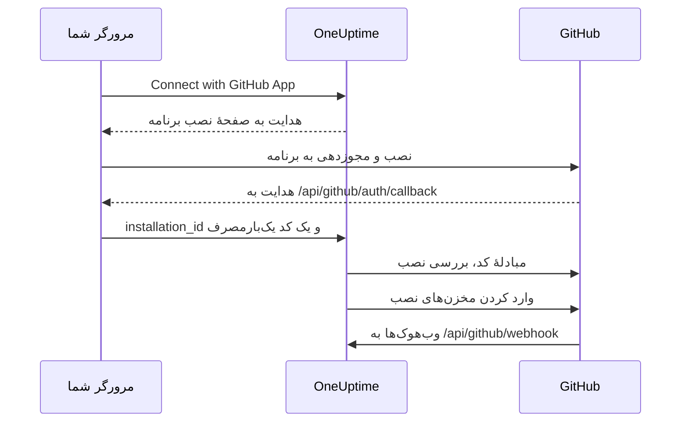

# یکپارچه‌سازی GitHub

OneUptime خودمیزبان خود را با یک GitHub App که مال خودتان است به GitHub وصل کنید. وقتی برنامه از OneUptime نصب شد، مخزن‌های آن نصب به پروژهٔ شما وارد و همگام نگه داشته می‌شوند، کارهای رفع با هوش مصنوعی pull request باز می‌کنند، و تیم شما می‌تواند با نام بردن از برنامه در GitHub کار را به آن بسپارد.

این صفحه برای کسی است که سرور OneUptime را اداره می‌کند: برنامه را یک بار می‌سازید و سپس هر پروژه آن را از **مخازن کد** وصل می‌کند.

:::cards
- [ساختن GitHub App](#ساختن-github-app): برنامه را با نشانی‌ها، مجوزها و رویدادهای درست ثبت کنید.
- [پیکربندی OneUptime](#پیکربندی-oneuptime): شش مقدار برنامه را به سرور بدهید.
- [وصل کردن مخزن‌ها](#وصل-کردن-مخزنها): برنامه را از OneUptime نصب کنید.
- [عیب‌یابی](#عیبیابی): پیام‌های مخازن کد چه معنایی دارند.
:::

## چگونه کار می‌کند

نصب در OneUptime آغاز می‌شود، نه در GitHub: پیوندی که OneUptime شما را با آن به GitHub می‌فرستد، همان چیزی است که نصب را به پروژهٔ شما گره می‌زند.



- هدایت مرورگر، نصب و یک کد OAuth یک‌بارمصرف را با خود می‌آورد. OneUptime کد را مبادله می‌کند تا تأیید کند حساب GitHub‌ای که برنامه را نصب کرده آن نصب را مدیریت می‌کند، و سپس مخزن‌های آن را وارد می‌کند.
- وب‌هوک‌ها فهرست مخزن‌ها را همگام نگه می‌دارند و کار را به برنامه می‌سپارند: اشاره‌ها، واگذاری‌ها، برچسب‌های راه‌انداز و درخواست‌های بازبینی. GitHub هر کدام را با webhook secret امضا می‌کند و OneUptime هر کدام را که نتواند تأیید کند رد می‌کند.

## پیش از شروع

- یک حساب GitHub که بتواند برای سازمان یا کاربری که برنامه روی آن نصب می‌شود GitHub App بسازد. برای نصب روی یک سازمان، باید مالک آن باشید یا درخواست را به تأیید یکی از مالکان برسانید.
- یک نام میزبان HTTPS عمومی برای OneUptime که GitHub برای وب‌هوک‌ها بتواند به آن برسد. [دسترسی شبکه](#دسترسی-شبکه-برای-استقرارهای-خودمیزبان) را ببینید.
- دسترسی به پیکربندی سرور: `config.env` برای Docker Compose، یا مقادیر Helm برای Kubernetes.

## ساختن GitHub App

:::steps
### تنظیمات GitHub App را باز کنید

- **برای یک سازمان:** `https://github.com/organizations/YOUR_ORG/settings/apps`
- **برای یک حساب شخصی:** `https://github.com/settings/apps`

**New GitHub App** را برگزینید.

### فرم ثبت را پر کنید

| فیلد | مقدار |
| --- | --- |
| **GitHub App name** | هر نام یکتایی، برای نمونه `OneUptime`. آن را دقیق یادداشت کنید: همان `GITHUB_APP_NAME` است. |
| **Homepage URL** | `https://your-oneuptime-domain.com` |
| **Callback URL** | `https://your-oneuptime-domain.com/api/github/auth/callback` |
| **Request user authorization (OAuth) during installation** | روشن. **این الزامی است**: یادداشت زیر را ببینید. |
| **Setup URL** | `https://your-oneuptime-domain.com/api/github/auth/callback`، اگر GitHub اجازهٔ وارد کردنش را بدهد (پایین‌تر را ببینید). |
| **Redirect on update** | اختیاری. پس از اینکه کسی نصبی را در GitHub تغییر دهد، OneUptime او را به **مخازن کد** می‌برد. |
| **Webhook URL** | `https://your-oneuptime-domain.com/api/github/webhook`، با وب‌هوک در حالت **Active**. |
| **Webhook secret** | یک رشتهٔ تصادفی طولانی. آن را یادداشت کنید: همان `GITHUB_APP_WEBHOOK_SECRET` است. **الزامی**: OneUptime وب‌هوک‌های امضانشده را رد می‌کند، پس تنظیم نکردن `GITHUB_APP_WEBHOOK_SECRET` به‌جای پذیرفتن داده‌های تأییدنشده، همگام‌سازی مخزن‌ها را متوقف می‌کند. |

به گفتهٔ مستندات GitHub، با روشن بودن **Request user authorization (OAuth) during installation** [نمی‌توانید Setup URL وارد کنید](https://docs.github.com/en/apps/creating-github-apps/registering-a-github-app/about-the-setup-url): کاربران پس از نصب برنامه به‌جای آن به Callback URL فرستاده می‌شوند. هر دو به یک نشانی OneUptime اشاره می‌کنند، پس در هر حال هدایت به جای درست می‌رسد.

> [!IMPORTANT]
> **چرا «Request user authorization (OAuth) during installation» الزامی است.** پس از یک نصب، GitHub با یک `installation_id` در نشانی برمی‌گرداند. این عدد به‌تنهایی چیزی دربارهٔ مالک نصب ثابت نمی‌کند — هر کسی می‌تواند عدد دیگری تایپ کند. با روشن بودن این گزینه، GitHub یک `code` یک‌بارمصرف OAuth هم برمی‌گرداند که به حساب GitHub‌ای که نصب را انجام داده گره خورده است، و OneUptime آن را مبادله می‌کند تا پیش از وصل کردن نصب به پروژهٔ شما تأیید کند که آن حساب واقعاً نصب را مدیریت می‌کند.
>
> بدون آن، OneUptime از وصل کردن نصب خودداری می‌کند و داشبورد خطایی نشان می‌دهد که از شما می‌خواهد این تنظیم را روشن کنید. این عمدی است: پذیرفتن شناسهٔ نصب بدون تأیید به یک پروژهٔ OneUptime اجازه می‌داد مخزن‌های سازمان دیگری را از آن خود کند.

### مجوزها را تنظیم کنید

زیر **Permissions & events**، این **Repository permissions** را تنظیم کنید:

| مجوز | دسترسی | OneUptime آن را برای چه به کار می‌برد |
| --- | --- | --- |
| Contents | Read and write | خواندن فایل‌های مخزن و push کردن شاخه‌های pull requestهای رفع با هوش مصنوعی |
| Pull requests | Read and write | باز کردن و به‌روزرسانی pull requestها و انتشار بازبینی‌ها |
| Issues | Read and write | انتشار نظرهای برنامه — **از جمله روی pull requestها**، که GitHub گفت‌وگوی آن‌ها را از راه API مربوط به issues می‌گذراند |
| Checks | Read-only | اختیاری. خواندن نتیجهٔ CI در pull requestهای رفع. بدون آن، وضعیت CI آن‌ها تأییدنشده می‌ماند |
| Metadata | Read-only | فرادادهٔ پایهٔ مخزن (GitHub آن را الزامی می‌داند) |

**آنچه برنامه را تعاملی می‌کند Issues: Read and write است.** بدون آن، اشاره‌ها دریافت می‌شوند و سپس وقتی برنامه می‌خواهد پاسخ دهد بی‌صدا شکست می‌خورند — GitHub نظرهای گفت‌وگوی pull requestها را از API مربوط به issues ارائه می‌کند، پس همین یک مجوز سرنوشت هر پاسخی را که برنامه می‌نویسد تعیین می‌کند. [کار با OneUptime از GitHub](/docs/ai/github-app) را ببینید.

OneUptime به هیچ مجوز سازمانی یا حسابی نیاز ندارد.

### مشترک رویدادهای وب‌هوک شوید

OneUptime از دو دسته رویداد استفاده می‌کند و هر کدام کار متفاوتی انجام می‌دهد.

**همگام‌سازی مخزن‌ها** — `installation` و `installation_repositories`. GitHub Appها این‌ها را خودکار دریافت می‌کنند؛ این رویدادها مجموعهٔ مخزن‌های وصل‌شده را با جایی که برنامه نصب شده هماهنگ نگه می‌دارند.

**برنامهٔ تعاملی** — باید صریحاً مشترک این رویدادها شوید، و هر کدام راه مشخصی را برای سپردن کار به برنامه فعال می‌کند:

| رویداد | چه چیزی را ممکن می‌کند |
| --- | --- |
| **Issue comment** | فرمان‌های `@mention` در issueها **و** در pull requestها |
| **Issues** | واگذاری یک issue به برنامه، و برچسب راه‌انداز مخزن |
| **Pull request** | درخواست بازبینی از برنامه |
| **Pull request review** | اشاره‌ای که در متن یک بازبینی ارسال‌شده نوشته شده است |
| **Pull request review comment** | اشاره در یک نظر درون‌خطی در diff |

اگر مشترک هیچ‌کدام از این‌ها نباشید، GitHub App همچنان مخزن‌ها را وصل می‌کند و همچنان از OneUptime pull requestهای رفع باز می‌کند — فقط هرگز به چیزی که در GitHub نوشته می‌شود پاسخ نمی‌دهد. این رایج‌ترین علت «ربات مرا نادیده می‌گیرد» است. برای اینکه فرمان‌ها چیستند و چه کسی می‌تواند آن‌ها را بدهد، [کار با OneUptime از GitHub](/docs/ai/github-app) را ببینید.

رویدادهای دیگر (**Push**، **Workflow run**) تأیید و نادیده گرفته می‌شوند؛ مشترک شدن در آن‌ها اعلان یا خودکارسازی CI/CD را فعال نمی‌کند.

### جایی را که برنامه می‌تواند نصب شود برگزینید

زیر **Where can this GitHub App be installed?** برگزینید:

- **Only on this account** - برای استفادهٔ خصوصی/داخلی
- **Any account** - اگر می‌خواهید دیگران هم برنامهٔ شما را نصب کنند

### برنامه را بسازید و شناسه‌هایش را یادداشت کنید

**Create GitHub App** را برگزینید. GitHub صفحهٔ تنظیمات برنامه را باز می‌کند. **App ID** را در بالای صفحه و **Client ID** را در بخش **About** یادداشت کنید.

### یک client secret بسازید

زیر **Client secrets**، **Generate a new client secret** را برگزینید. بی‌درنگ آن را کپی کنید: GitHub فقط یک بار آن را نشان می‌دهد.

### یک کلید خصوصی بسازید

زیر **Private keys**، **Generate a private key** را برگزینید. GitHub یک فایل `.pem` دانلود می‌کند. آن را امن نگه دارید: OneUptime با آن به‌عنوان برنامه احراز هویت می‌کند.
:::

## پیکربندی OneUptime

:::tabs
@tab Docker Compose
`config.env` در هر خط یک مقدار دارد، پس کلید خصوصی را با کدگذاری base64 در یک خط بدهید. OneUptime آن را رمزگشایی می‌کند:

```bash
base64 < private-key.pem | tr -d '\n'
```

```bash title="config.env"
GITHUB_APP_ID=YOUR_APP_ID
GITHUB_APP_NAME=YOUR_APP_NAME
GITHUB_APP_CLIENT_ID=YOUR_CLIENT_ID
GITHUB_APP_CLIENT_SECRET=YOUR_CLIENT_SECRET
GITHUB_APP_PRIVATE_KEY=YOUR_BASE64_ENCODED_PRIVATE_KEY
GITHUB_APP_WEBHOOK_SECRET=YOUR_WEBHOOK_SECRET
```

تغییر را با `npm run start` اعمال کنید که کانتینرها را از نو می‌سازد. `docker compose restart` فایل `config.env` را دوباره نمی‌خواند.
@tab Kubernetes
```yaml title="values.yaml"
gitHubApp:
  id: "YOUR_APP_ID"
  name: "YOUR_APP_NAME" # The exact name of your GitHub App
  clientId: "YOUR_CLIENT_ID"
  clientSecret: "YOUR_CLIENT_SECRET"
  privateKey: "<BASE64_ENCODED_PRIVATE_KEY_CONTENT>"
  webhookSecret: "YOUR_WEBHOOK_SECRET"
```

`privateKey` خود PEM را هم به‌صورت یک بلوک چندخطی (`privateKey: |`) می‌پذیرد. تغییر را با `helm upgrade` اعمال کنید.
:::

وقتی OneUptime دوباره بالا آمد، **مخازن کد** به‌جای **GitHub App is not configured on this server** گزینهٔ **Connect with GitHub App** را نشان می‌دهد.

### مرجع متغیرهای محیطی

| Docker Compose (`config.env`) | Helm (`values.yaml`) | مقدار |
| --- | --- | --- |
| `GITHUB_APP_ID` | `gitHubApp.id` | **App ID**. برای احراز هویت به‌عنوان برنامه به کار می‌رود. |
| `GITHUB_APP_NAME` | `gitHubApp.name` | نام دقیق برنامه. پیوند نصب و شناسهٔ `@mention` برنامه (با حروف کوچک و خط تیره به‌جای فاصله) از آن ساخته می‌شوند. بدون آن، **مخازن کد** نمی‌تواند وصل شود. |
| `GITHUB_APP_CLIENT_ID` | `gitHubApp.clientId` | **Client ID**. برای بررسی اینکه چه کسی برنامه را نصب کرده لازم است. |
| `GITHUB_APP_CLIENT_SECRET` | `gitHubApp.clientSecret` | client secret‌ای که ساختید. همراه client ID لازم است. |
| `GITHUB_APP_PRIVATE_KEY` | `gitHubApp.privateKey` | کلید خصوصی: خود PEM، یا PEM با کدگذاری base64. |
| `GITHUB_APP_WEBHOOK_SECRET` | `gitHubApp.webhookSecret` | webhook secret. هر وب‌هوک با آن تأیید می‌شود و بدون آن هیچ وب‌هوکی پذیرفته نمی‌شود. |

هر شش مقدار الزامی‌اند.

## وصل کردن مخزن‌ها

اتصال را از OneUptime آغاز کنید، نه از صفحهٔ برنامه در GitHub: پیوندی که OneUptime شما را با آن به GitHub می‌فرستد، همان چیزی است که نصب را به پروژهٔ شما گره می‌زند.

:::steps
1. به داشبورد OneUptime خود وارد شوید
2. به **محصولات** > **وظایف** > **مخازن کد** بروید
3. روی **Connect with GitHub App** کلیک کنید. OneUptime شما را به GitHub می‌برد
4. سازمان یا حسابی را که برنامه باید روی آن نصب شود برگزینید و تعیین کنید به کدام مخزن‌ها دسترسی داشته باشد: **All repositories** (همهٔ مخزن‌های کنونی و آینده) یا **Only select repositories**
5. روی **Install** کلیک کنید (یا **Save**، اگر برنامه از پیش آن‌جا نصب شده است)
6. GitHub شما را به **مخازن کد** برمی‌گرداند و همهٔ مخزن‌های نصب وارد می‌شوند. مخزن‌هایی که بعداً به نصب افزوده یا از آن حذف شوند، خودکار همگام می‌مانند.
:::

**چه کسی می‌تواند وصل کند.** وصل کردن، مخزن‌های نصب را به پروژه وارد می‌کند، پس به اجازهٔ افزودن مخزن کد نیاز دارد: **Project Owner**، **Project Admin**، **Project Member**، **Settings Admin**، **Settings Member**، یا تیمی با **Create Code Repository**. تیمی که این مجوز را مسدود کند، آن را پس می‌گیرد. در OneUptime Cloud مخزن‌های کد به طرح Growth یا بالاتر نیاز دارند. برای هر کس دیگر، کارت قفل است و می‌گوید چه چیزی لازم است.

**ظرف ۱۵ دقیقه و در همان مرورگر کار را تمام کنید.** پیوند یک بار، به مدت ۱۵ دقیقه، در همان مرورگری کار می‌کند که آن را آغاز کرده است. وقتی GitHub شما را برمی‌گرداند، OneUptime پیش از وارد کردن هر چیزی مجوز را دوباره بررسی می‌کند.

## دسترسی شبکه برای استقرارهای خودمیزبان

### جهت ترافیک و نقطه‌های پایانی

| ترافیک | دسترسی لازم |
| --- | --- |
| از OneUptime به GitHub | DNS و HTTPS خروجی روی TCP ۴۴۳ به `api.github.com` برای توکن‌های GitHub App و فراخوانی‌های API مخزن‌ها، و به `github.com` برای مبادلهٔ توکن OAuth و عملیات Git از راه HTTPS |
| از GitHub به OneUptime | HTTPS عمومی روی TCP ۴۴۳ به `POST /api/github/webhook` برای همگام‌سازی نصب‌ها و دسترسی به مخزن‌ها، و برای برنامهٔ تعاملی |
| از مرورگر کاربر به OneUptime | دسترسی به داشبورد و `GET /api/github/auth/callback` برای هدایت‌های نصب و مجوزدهی؛ این‌ها می‌توانند فقط از راه VPN کاربر در دسترس بمانند |

callback یک [هدایت در مرورگر](https://docs.github.com/en/apps/creating-github-apps/registering-a-github-app/about-the-user-authorization-callback-url) است، در حالی که وب‌هوک درخواستی از سرورهای GitHub است. اتصال VPN یک کاربر به GitHub دسترسی به وب‌هوک نمی‌دهد. دامنه‌های بالا درخواست‌های اصلی یکپارچه‌سازی را پوشش می‌دهند؛ ابزارهای اضافی مخزن، دانلودها، LFS یا بسته‌ها ممکن است به مقصدهای دیگری نیاز داشته باشند. این تنظیمات دربارهٔ GitHub.com است؛ تغییر فایروال پشتیبانی از نام میزبان GitHub Enterprise Server را پیکربندی نمی‌کند.

### استقرارهای خصوصی و امنیت فراخوان‌های بازگشتی

`/api/github/webhook` را از راه یک دروازهٔ عمومی در دسترس بگذارید که DNS عمومی، یک گواهی HTTPS مورد اعتماد عموم با زنجیرهٔ کامل و یک مسیر خصوصی تا ingress در OneUptime داشته باشد. TCP ۴۴۳ ورودی به دروازه را مجاز کنید و هدایت عمومی را به همین مسیر POST محدود کنید. اگر کاربران از راه VPN به داشبورد و callback مرورگر دسترسی دارند، آن‌ها را روی ingress خصوصی نگه دارید؛ DNS دوپاره می‌تواند همان نام میزبان را در داخل و بیرون ارائه کند.

`HOST=oneuptime.example.com` و `HTTP_PROTOCOL=https` را در `config.env`، یا `host: oneuptime.example.com` و `httpProtocol: https` را در Helm تنظیم کنید. پیکربندی را اعمال کنید و صبر کنید تا OneUptime دوباره راه‌اندازی شود. این مقادیر نشانی‌ها را می‌سازند؛ DNS، TLS یا دسترسی شبکه فراهم نمی‌کنند. اگر نام میزبان تغییر کند، نشانی‌های webhook، callback، setup و صفحهٔ اصلی GitHub App را به‌روز کنید.

روش، مسیر اصلی، رشتهٔ پرس‌وجو، بدنه، `Content-Type`، `X-Hub-Signature-256`، `X-GitHub-Event` و `X-GitHub-Delivery` را نگه دارید. میزبان عمومی و طرح HTTPS را از راه سرآیندهای مورد اعتماد پراکسی نگه دارید. وب‌هوک را از SSO مرورگر، CAPTCHA و صفحه‌های ورود پراکسی معاف کنید. بررسی SSL در GitHub را روشن نگه دارید و در هر دو سامانه همان `GITHUB_APP_WEBHOOK_SECRET` را پیکربندی کنید: OneUptime درخواست‌های امضانشده را رد می‌کند و بدون این راز نمی‌تواند وب‌هوک‌ها را اعتبارسنجی کند. [راهنمای GitHub دربارهٔ اعتبارسنجی وب‌هوک‌ها](https://docs.github.com/en/webhooks/using-webhooks/validating-webhook-deliveries) را ببینید.

اگر IP مبدأ وب‌هوک‌ها را هم محدود می‌کنید، از محدوده‌های کنونی `hooks` در Meta API مربوط به GitHub استفاده کنید و آن‌ها را مرتب به‌روز کنید؛ محدوده‌های اجراکننده‌های GitHub Actions را جایگزین آن‌ها نکنید و بررسی امضا را کنار نگذارید. GitHub هشدار می‌دهد که [نشانی‌هایش تغییر می‌کنند و فهرست منتشرشده کامل نیست](https://docs.github.com/en/authentication/keeping-your-account-and-data-secure/about-githubs-ip-addresses).

### تأیید دسترسی و شناخت محدودیت‌ها

:::steps
1. از **مخازن کد** یک نصب را وصل کنید.
2. در تنظیمات GitHub App، **Advanced** را باز کنید و **Recent Deliveries** را ببینید. یک تحویل را دوباره بفرستید و تأیید کنید که دروازه آن را هدایت می‌کند و OneUptime آن را می‌پذیرد.
3. یک مخزن آزمایشی را به نصب بیفزایید یا از آن حذف کنید و بررسی کنید که فهرست مخزن‌ها در OneUptime هم دنبالش تغییر کند.
:::

GitHub [عیب‌یابی تحویل‌ها](https://docs.github.com/en/webhooks/testing-and-troubleshooting-webhooks/viewing-webhook-deliveries) را مستند کرده و [تأیید 2xx ظرف ده ثانیه](https://docs.github.com/en/webhooks/using-webhooks/best-practices-for-using-webhooks) را الزامی می‌داند. یک GET از مرورگر به وب‌هوک، یک POST امضاشده را نمی‌آزماید.

> [!WARNING]
> بدون دسترسی ورودی، مجوزدهی در مرورگر و عملیات خروجی API و Git ممکن است کار کنند، اما وب‌هوک‌ها به OneUptime نمی‌رسند: نصب‌های حذف‌شده و تغییرات دسترسی به مخزن‌ها همگام نمی‌شوند، و برنامه هرگز به اشاره‌ها، واگذاری‌ها یا درخواست‌های بازبینی پاسخ نمی‌دهد.

[تنظیم دسترسی به شبکهٔ خصوصی](/docs/self-hosted/private-network-access) درخواست‌های خروجی به مقصدهای خصوصی را کنترل می‌کند و وب‌هوک را برای GitHub در دسترس نمی‌گذارد.

## عیب‌یابی

### اتصال کامل نشد

وقتی GitHub شما را برمی‌گرداند و نصب وصل نشده است، **مخازن کد** پیام **GitHub وصل نشد** را همراه یک جمله به زبان شما نشان می‌دهد که دلیلش را می‌گوید. بقیهٔ صفحه مثل همیشه بارگذاری می‌شود، پس می‌توانید همان‌جا دوباره وصل کنید. پاسخ خود GitHub هرگز نشان داده نمی‌شود: آن پاسخ همراه دلیل در لاگ سرور OneUptime است.

| صفحه می‌گوید | چه باید کرد |
| --- | --- |
| **"این پیوند اتصال نامعتبر است، منقضی شده یا قبلاً استفاده شده است. لطفاً از نو شروع کنید."** | پیوند یک بار، به مدت ۱۵ دقیقه، در همان مرورگری کار می‌کند که آن را آغاز کرده است. از **مخازن کد** از نو شروع کنید و ظرف ۱۵ دقیقه در همان مرورگر کار را در GitHub تمام کنید. نصب برنامه از صفحهٔ آن در GitHub، آن را به هیچ پروژه‌ای وصل نمی‌کند. |
| **"شما اجازه افزودن مخازن کد به این پروژه را ندارید."** | وصل کردن به اجازهٔ افزودن مخزن کد نیاز دارد ([وصل کردن مخزن‌ها](#وصل-کردن-مخزنها) را ببینید). از یکی از مدیران پروژه بخواهید آن را بدهد. وقتی GitHub شما را برمی‌گرداند این دوباره بررسی می‌شود، پس مجوزی که در این فاصله گرفته شده باشد، اتصال را این‌جا هم پایان می‌دهد. |
| **"برای اتصال GitHub به طرح ... نیاز است."** | در OneUptime Cloud مخزن‌های کد به طرحی نیاز دارند که جمله نام می‌برد. طرح پروژه را ارتقا دهید و دوباره وصل کنید. |
| **"GitHub تأیید نکرد که چه کسی برنامه را نصب کرده است، بنابراین نصب بررسی نشد."** | **Request user authorization (OAuth) during installation** را در تنظیمات GitHub App روشن کنید ([ساختن GitHub App](#ساختن-github-app) را ببینید) و دوباره وصل کنید. |
| **"OneUptime نتوانست تأیید کند که حساب GitHub شما می‌تواند این نصب را مدیریت کند."** | حساب GitHub‌ای که نصب را تمام کرده، آن را مدیریت نمی‌کند. برنامه را با حسابی نصب کنید که مالک سازمان یا کاربری است که برنامه روی آن نصب می‌شود، یا از یکی از مالکان بخواهید. |
| **"GitHub هیچ نصبی را برنگرداند."** | وقتی یکی از اعضای سازمان به‌جای نصب برنامه آن را درخواست می‌کند، یکی از مالکان سازمان باید ابتدا درخواست را تأیید کند. پس از تأیید دوباره وصل کنید. |
| **"GitHub App روی این سرور OneUptime راه‌اندازی نشده است."** | هم `GITHUB_APP_CLIENT_ID` و هم `GITHUB_APP_CLIENT_SECRET` را تنظیم کنید ([پیکربندی OneUptime](#پیکربندی-oneuptime) را ببینید) و OneUptime را دوباره راه‌اندازی کنید. |
| **"OneUptime نتوانست اتصال را کامل کند. لطفاً دوباره تلاش کنید."** | GitHub با خطا پاسخ داد، یا هنگام کامل کردن، یک درخواست یا یک نوشتن ناموفق بود. لاگ سرور OneUptime می‌گوید کدام. دوباره تلاش کنید؛ اگر تکرار شد، لاگ و تنظیمات GitHub App را بررسی کنید. |

### مشکلات دیگر

:::details مخازن کد می‌گوید "GitHub App is not configured on this server"
`GITHUB_APP_NAME` تنظیم نشده است. آن را همراه پنج مقدار دیگر روی نام دقیق برنامه بگذارید و OneUptime را دوباره راه‌اندازی کنید.
:::

:::details پس از نصب برنامه به OneUptime برگردانده نمی‌شوم
بررسی کنید که **Callback URL** برنامه `https://your-oneuptime-domain.com/api/github/auth/callback` باشد، و اگر **Setup URL** تنظیم شده، آن هم همین باشد. هر دو باید به همان نقطهٔ پایانی `/api/github/auth/callback` روی نام میزبان `HOST` اشاره کنند.
:::

:::details Recent Deliveries در GitHub پیام "Invalid webhook signature" را نشان می‌دهد
webhook secret در GitHub App با `GITHUB_APP_WEBHOOK_SECRET` فرق دارد، `GITHUB_APP_WEBHOOK_SECRET` تنظیم نشده است، یا یک پراکسی بدنهٔ درخواست را تغییر داده است. در هر دو همان راز را تنظیم کنید، OneUptime را دوباره راه‌اندازی کنید و مطمئن شوید که دروازه بدنه را بدون تغییر هدایت می‌کند.
:::

:::details رویدادهای وب‌هوک دریافت نمی‌شوند
بررسی کنید که نشانی وب‌هوک از راه HTTPS به‌طور عمومی در دسترس باشد، سپس در تنظیمات GitHub App زیر **Advanced > Recent Deliveries** هر تلاش و پاسخ آن را ببینید. تا وقتی `GITHUB_APP_WEBHOOK_SECRET` تنظیم نشده باشد، وب‌هوک‌ها رد می‌شوند.
:::

:::details مخزن‌ها یا کارهای رفع با خطای احراز هویت شکست می‌خورند
OneUptime با `GITHUB_APP_ID` و `GITHUB_APP_PRIVATE_KEY` به‌عنوان برنامه احراز هویت می‌کند. بررسی کنید که App ID درست باشد و کلید، PEM کامل با خط‌های `BEGIN` و `END` آن باشد، یا همان PEM با کدگذاری base64. اگر برنامه از GitHub حذف نصب شده است، آن را دوباره از **مخازن کد** وصل کنید.
:::

:::details پس از نصب، مخزن‌هایی کم است
در تنظیمات نصب در GitHub بررسی کنید که نصب به کدام مخزن‌ها دسترسی دارد. مخزن‌هایی که آن‌جا اضافه می‌کنید، تا وقتی وب‌هوک‌ها به OneUptime برسند، خودکار وارد می‌شوند.
:::

:::details برنامه اشاره‌ها در GitHub را نادیده می‌گیرد
به برنامه **Issues: Read and write** بدهید و آن را مشترک رویدادهای تعاملی در [مشترک رویدادهای وب‌هوک شوید](#مشترک-رویدادهای-وبهوک-شوید) کنید. افزون بر این، اشاره‌ها فقط با شناسه‌ای که از `GITHUB_APP_NAME` ساخته می‌شود جور درمی‌آیند، پس آن را روی نام واقعی برنامه بگذارید.
:::

## بهترین شیوه‌های امنیتی

- **رازها را مرتب عوض کنید.** هر چند وقت یک بار client secret و کلید خصوصی تازه بسازید.
- **webhook secret را تنظیم‌شده نگه دارید.** OneUptime وب‌هوک‌هایی را که نتواند تأیید کند رد می‌کند.
- **دسترسی به مخزن‌ها را محدود کنید.** فقط مخزن‌هایی را به نصب بدهید که باید وصل شوند.
- **تحویل وب‌هوک‌ها را زیر نظر داشته باشید.** مرتب تحویل‌های ناموفق یا فعالیت مشکوک را بررسی کنید.
- **کلیدهای خصوصی را بیرون از کنترل نسخه نگه دارید.**

## گام‌های بعدی

:::cards
- [کار با OneUptime از GitHub](/docs/ai/github-app): فرمان‌هایی که می‌توان به برنامه داد، و چه کسی می‌تواند آن‌ها را بدهد.
- [کارهای رفع](/docs/ai/ai-agent): عامل هوش مصنوعی چگونه pull requestهای رفع را باز می‌کند.
- [دسترسی به شبکه خصوصی](/docs/self-hosted/private-network-access): بگذارید گردش‌کارها و وب‌هوک‌ها به ابزارهای داخلی برسند.
:::
