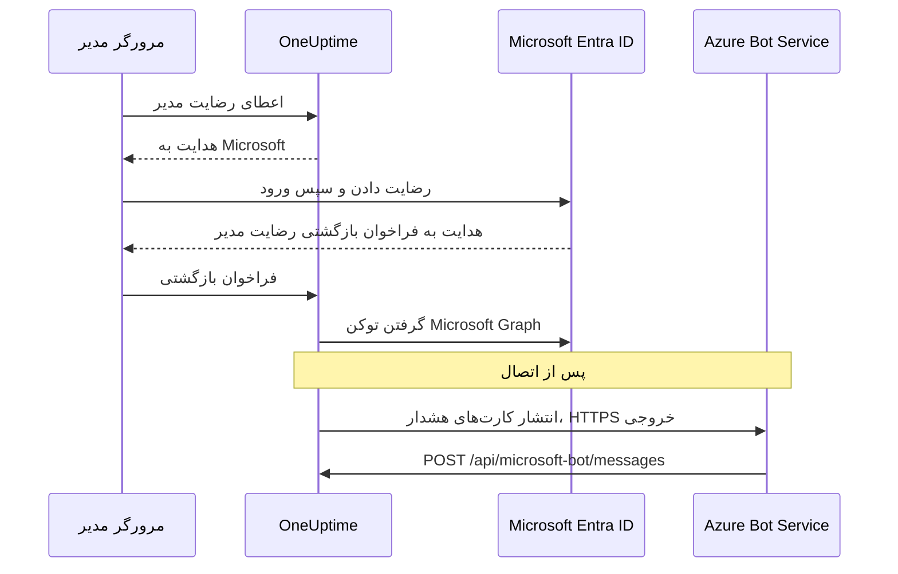
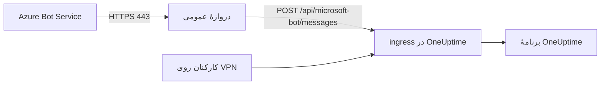

# یکپارچه‌سازی Microsoft Teams

OneUptime خودمیزبان خود را به Microsoft Teams وصل کنید. یک برنامه در Microsoft Entra ID ثبت می‌کنید، برای آن یک Azure Bot می‌سازید، اعتبارنامه‌های برنامه را به OneUptime می‌دهید و بستهٔ برنامهٔ Teams را که سرور شما می‌سازد نصب می‌کنید. پس از آن OneUptime هشدارها و رخدادها را در کانال‌ها و گفت‌وگوهای شما منتشر می‌کند و تیم شما از همان Teams به آن‌ها رسیدگی می‌کند.

این صفحه برای کسی است که سرور OneUptime را اداره می‌کند. وقتی Teams وصل شد، قواعد اعلان برای هر پروژه جداگانه تنظیم می‌شوند: [Microsoft Teams](/docs/workspace-connections/microsoft-teams) را ببینید.

:::cards
- [راه‌اندازی یکپارچه‌سازی](#راهاندازی-یکپارچهسازی): نُه گام، از پورتال Azure تا نخستین تیم شما.
- [متغیرهای محیطی](#متغیرهای-محیطی): سه مقداری که OneUptime از ثبت برنامه نیاز دارد.
- [دسترسی شبکه](#دسترسی-شبکه): نقطهٔ پایانی ربات که Microsoft باید بتواند به آن برسد.
- [عیب‌یابی](#عیبیابی): نقطه‌های پایانی دست‌نیافتنی، نصب‌های جاافتاده و اتصال‌های ناموفق.
:::

## چگونه کار می‌کند

OneUptime برای یکپارچه‌سازی با Teams از یک Azure Bot استفاده می‌کند. ترافیک در هر دو جهت جریان دارد و این دو جهت از هم مستقل‌اند: OneUptime برای انتشار پیام‌ها Microsoft را فرا می‌خواند، و Azure Bot Service وقتی کسی دکمه‌ای را می‌زند، به ربات پیام می‌دهد یا آن را به یک گفت‌وگو می‌افزاید، سرور شما را فرا می‌خواند.



یک Incoming Webhook یا نشانی گردش کار Teams جای نقطهٔ پایانی پیام‌رسانی این ربات را نمی‌گیرد.

تماس‌های تصویری (یک جلسهٔ Teams برای یک رخداد) از این ربات استفاده نمی‌کنند: آن‌ها ثبت برنامهٔ جداگانهٔ خود را لازم دارند که در [تماس‌های تصویری](/docs/workspace-connections/video-calls#اتصال-یککلیکی-روی-یک-سرور-خودمیزبان) شرح داده شده است.

## پیش از شروع

- یک اشتراک Azure برای منبع Azure Bot.
- حسابی که بتواند در Microsoft Entra ID ثبت برنامه بسازد، و یک مدیر Microsoft 365 که رضایت مدیر را اعطا کند.
- یک نام میزبان HTTPS عمومی برای OneUptime که Azure Bot Service بتواند به آن برسد. [دسترسی شبکه](#دسترسی-شبکه) را ببینید.
- دسترسی به پیکربندی سرور: `config.env` برای Docker Compose، یا مقادیر Helm برای Kubernetes.
- برای وصل کردن یک پروژه، نقش **Project Owner**، **Project Admin** یا **Project Member** در آن پروژه.

## راه‌اندازی یکپارچه‌سازی

:::steps
### گام ۱: ثبت برنامهٔ Azure را بسازید

در [پورتال Azure](https://portal.azure.com) بخش **App registrations** را باز کنید و **New registration** را برگزینید. فرم را پر کنید:

- **Name:** oneuptime
- **Supported account types:** Accounts in this organizational directory only (Single tenant)
- **Redirect URI:** Web - `https://your-oneuptime-domain.com/api/microsoft-teams/auth`

**Register** را برگزینید و سپس یک نشانی هدایت Web دوم بیفزایید: `https://your-oneuptime-domain.com/api/microsoft-teams/admin-consent/callback`. مقدار **Application (client) ID** و **Directory (tenant) ID** را یادداشت کنید: بعداً به هر دو نیاز دارید.

> [!NOTE]
> **چرا تک‌مستأجر:** یک استقرار خودمیزبان OneUptime به یک سازمان خدمت می‌کند و ربات آن برای همان یک مستأجری ثبت شده است که در `MICROSOFT_TEAMS_APP_TENANT_ID` (گام ۶) تعیین می‌کنید. ثبت برنامه به‌صورت چندمستأجری این دامنه را گسترش نمی‌دهد و فقط یک راه تازه برای شکست می‌افزاید: کاربران مهمان / B2B که مستأجر خانگی Microsoft آن‌ها با مستأجر شما فرق دارد، با شناسهٔ مستأجر خودشان به ربات می‌رسند و OneUptime نمی‌تواند آن را به پروژهٔ شما ربط دهد. اگر پیش‌تر یک برنامهٔ چندمستأجری ثبت کرده‌اید، همچنان کار می‌کند؛ فقط مطمئن شوید که `MICROSOFT_TEAMS_APP_TENANT_ID` مستأجر خود شماست، و انتظار داشته باشید که حساب‌های مهمان برای استفاده از ربات به حسابی در مستأجر شما نیاز داشته باشند.

### گام ۲: مجوزهای برنامه را پیکربندی کنید

در ثبت برنامه، **API permissions** را باز کنید، **Add a permission** را برگزینید و **Microsoft Graph** را انتخاب کنید.

**مجوزهای تفویضی را بیفزایید** (وقتی برنامه از طرف کاربری که وارد شده است عمل می‌کند):

- **User.Read** - برای گرفتن اطلاعات نمایهٔ کاربر احرازشده (نام نمایشی، ایمیل) در جریان OAuth لازم است
- **Team.ReadBasic.All** - برای فهرست کردن تیم‌هایی که کاربر عضو آن‌هاست، هنگام انتخاب تیمی که باید وصل شود، لازم است
- **Channel.ReadBasic.All** - برای خواندن اطلاعات کانال‌ها و فهرست کردن کانال‌های تیم‌ها برای تحویل اعلان‌ها لازم است
- **ChannelMessage.Send** - برای فرستادن اعلان‌های هشدار و رخداد به کانال‌های Teams لازم است

**مجوزهای برنامه را بیفزایید** (وقتی برنامه به‌عنوان خودش و بدون کاربر واردشده عمل می‌کند):

- **Team.ReadBasic.All** - برای فهرست کردن همهٔ تیم‌های سازمان پس از اعطای رضایت مدیر لازم است
- **Channel.ReadBasic.All** - برای بررسی وجود کانال‌ها و گرفتن جزئیات آن‌ها لازم است
- **TeamsAppInstallation.ReadForTeam.All** - برای عیب‌یابی لازم است. به OneUptime اجازه می‌دهد بخواند کدام بستهٔ برنامه واقعاً در یک تیم نصب است و آن را با شناسهٔ کلاینت این استقرار مقایسه کند، تا وقتی ارسالی شکست خورد بتواند بگوید *کدام* یک از علت‌های ممکن رخ داده است. بدون آن، OneUptime نمی‌تواند «نصب نشده» را از «نصب شده، اما بستهٔ کس دیگری است» تشخیص دهد و فقط حرف Microsoft را بازگو می‌کند؛ و همین مهم‌ترین دلیلی است که اشکال‌زدایی این یکپارچه‌سازی به‌جای چند دقیقه چند روز طول می‌کشد. آن را اعطا کنید.
- **Chat.ReadBasic.WhereInstalled** - اختیاری. به OneUptime اجازه می‌دهد نام هر گفت‌وگویی را که برنامهٔ OneUptime در آن است بخواند. بدون آن، هر گفت‌وگو این امکان را از راه مجوز **ChatSettings.Read.Chat** در مانیفست (پایین‌تر) می‌دهد، و گفت‌وگویی که با یک مانیفست قدیمی‌تر افزوده شده، فقط پس از به‌روزرسانی برنامه در آن این مجوز را دارد.

`ChannelMessage.Send` فقط یک مجوز تفویضی است؛ در [مرجع مجوزهای Microsoft Graph](https://learn.microsoft.com/en-us/graph/permissions-reference#channelmessagesend) نسخه‌ای به‌عنوان مجوز برنامه ندارد. آن را در فهرست مجوزهای تفویضی بالا نگه دارید.

سپس **Grant admin consent** را برای سازمان خود برگزینید.

خود ربات از مجوزهای رضایت ویژهٔ منبع (RSC) استفاده می‌کند که در مانیفست برنامهٔ Teams تعریف شده‌اند. این مجوزها نه در Entra ID، بلکه وقتی برنامه در یک تیم یا گفت‌وگو نصب یا به‌روز می‌شود اعطا می‌شوند:

- **ChannelMessage.Send.Group** - به ربات اجازه می‌دهد به کانال‌های تیم پیام بفرستد
- **ChannelMessage.Read.Group** - به ربات اجازه می‌دهد پیام‌های کانال را برای فرمان‌های تعاملی بخواند
- **Channel.Create.Group** - به ربات اجازه می‌دهد در صورت نیاز کانال بسازد
- **ChatMessage.Read.Chat** - به ربات اجازه می‌دهد پیام‌های گفت‌وگوهایی را که به آن‌ها افزوده شده بخواند (برای فرمان‌های تعاملی)
- **ChatMember.Read.Chat** - به ربات اجازه می‌دهد اعضای گفت‌وگوهایی را که به آن‌ها افزوده شده بخواند (برای نام‌گذاری گفت‌وگوها در OneUptime)
- **ChatSettings.Read.Chat** - به OneUptime اجازه می‌دهد نام گفت‌وگوهای گروهی‌ای را که برنامه به آن‌ها افزوده شده بخواند. Teams نام یک گفت‌وگوی گروهی را به‌طور قابل‌اعتماد برای ربات نمی‌فرستد، پس بدون آن یک گفت‌وگوی گروهیِ نام‌دار با نام اعضایش نمایش داده می‌شود
- **TeamsAppInstallation.Read.Group** - به OneUptime اجازه می‌دهد مطمئن شود برنامه در تیمی که قرار است در آن منتشر کند نصب است

اگر مانیفست برنامه را پیش از وجود این مجوزها بارگذاری کرده‌اید، آن را دوباره از **تنظیمات پروژه** > **فضای کاری** > **Microsoft Teams** دانلود کنید و به‌عنوان به‌روزرسانی برنامهٔ OneUptime در Teams بارگذاری کنید. Teams مجوزهای تیم و گفت‌وگو را وقتی اعطا می‌کند که برنامه در آن تیم یا گفت‌وگو نصب یا به‌روز شود، پس به‌روزرسانی را در هر تیم و هر گفت‌وگویی که برنامه را دارد بپذیرید. دربارهٔ گفت‌وگوها، [یک گفت‌وگوی گروهی با نام اعضایش نمایش داده می‌شود](#یک-گفتوگوی-گروهی-با-نام-اعضایش-نمایش-داده-میشود) را ببینید.

### گام ۳: یک رمز کلاینت بسازید

در ثبت برنامه، **Certificates & secrets** را باز کنید و **New client secret** را برگزینید. یک توضیح بیفزایید، مدت انقضا را انتخاب کنید (۲۴ ماه انتخاب معقولی است) و **Add** را برگزینید. مقدار رمز را بی‌درنگ کپی کنید: Azure آن را فقط یک بار نشان می‌دهد.

> [!IMPORTANT]
> **Value** رمز را کپی کنید، نه **Secret ID** آن را. مقدار، رشتهٔ بلندتر است.

### گام ۴: یک Bot Service بسازید

در پورتال Azure یک منبع **Azure Bot** بسازید:

- **Bot handle:** oneuptime-bot
- **Subscription** و **Resource group:** مال خودتان
- **Pricing tier:** برای آزمایش F0 (Free) کافی است
- **Type of App:** Single Tenant، با ثبت برنامهٔ موجود: **Application (client) ID** و **Directory (tenant) ID** آن از گام ۱

**Review + create** و سپس **Create** را برگزینید. وقتی ربات مستقر شد، صفحهٔ **Configuration** آن را باز کنید، **Messaging endpoint** را روی `https://your-oneuptime-domain.com/api/microsoft-bot/messages` بگذارید و ذخیره کنید.

**پیش از ادامه، نقطهٔ پایانی را بررسی کنید.** Azure Bot Service این نشانی را از اینترنت عمومی فرا می‌خواند، پس آن را از جایی بیرون از شبکهٔ خود بیازمایید: نه از درون خوشه، و نه از راه VPNای که میزبان را می‌بیند در حالی که Azure نمی‌بیند:

```bash
curl -sS -i https://your-oneuptime-domain.com/api/microsoft-bot/messages
```

به‌جای نگاه کردن فقط به کد وضعیت، از `-i` استفاده کنید: در یک 404، **تنها چیزی که می‌گوید چه کسی آن را ساخته، بدنهٔ پاسخ است**، و همین تمایز کل تشخیص است.

- **405** پاسخ درست است و یعنی کار شما تمام است. نقطهٔ پایانی فقط POST می‌پذیرد، پس یک GET پاسخ `405 Method Not Allowed` را همراه `Allow: POST` و شرحی از نقطهٔ پایانی می‌گیرد. رسیدن به آن دقیقاً همان چیزی است که آزموده می‌شود.
- **یک 404 با بدنهٔ JSON `{"message":"Page not found - /api/microsoft-bot/messages"}`** از OneUptime می‌آید، پس درخواست *رسیده است*. یا این استقرار از پاسخ 405 بالا قدیمی‌تر است (نسخه‌های قدیمی‌تر این مسیر را فقط برای POST ارائه می‌کردند، پس یک GET به گردانندهٔ عمومی «not found» می‌افتاد)، یا چیزی جلوی OneUptime مسیر را بازنویسی می‌کند و پیشوند `/api` را پیش از آنکه برنامه آن را ببیند حذف می‌کند (مقصر همیشگی یک ingress در Kubernetes با `rewrite-target: /` است).
- **یک 404 با صفحهٔ خطای HTML** از nginx، ingress شما یا یک متعادل‌کنندهٔ بار، عکس آن را می‌گوید: درخواست هرگز به OneUptime نرسیده است و آنچه جلوی آن است `/api` را به برنامه هدایت نمی‌کند.
- **خطای TLS، پایان مهلت یا رد اتصال** یعنی Azure هم به آن نمی‌رسد. [عیب‌یابی نقطهٔ پایانی پیام‌رسانی](#دکمههای-کارت-unable-to-reach-app-را-نشان-میدهند-و-گفتوگوها-هرگز-ظاهر-نمیشوند) را در پایین ببینید.

### گام ۵: کانال Microsoft Teams را به ربات بیفزایید

در منبع Azure Bot، **Channels** را باز کنید و **Microsoft Teams** را بیفزایید. مگر نیاز ویژه‌ای داشته باشید، گزینه‌های پیش‌فرض پیام‌رسانی را نگه دارید و ذخیره کنید. بدون این کانال، ربات هرگز در گفت‌وگوهای Teams آماده‌سازی نمی‌شود.

### گام ۶: متغیرهای محیطی OneUptime را پیکربندی کنید

اعتبارنامه‌های برنامه را به OneUptime بدهید:

:::tabs
@tab Docker Compose
```bash title="config.env"
MICROSOFT_TEAMS_APP_CLIENT_ID=YOUR_TEAMS_APP_CLIENT_ID
MICROSOFT_TEAMS_APP_CLIENT_SECRET=YOUR_TEAMS_APP_CLIENT_SECRET
MICROSOFT_TEAMS_APP_TENANT_ID=YOUR_MICROSOFT_TENANT_ID
```

تغییر را با `npm run start` اعمال کنید که کانتینرها را از نو می‌سازد. `docker compose restart` فایل `config.env` را دوباره نمی‌خواند.
@tab Kubernetes
```yaml title="values.yaml"
microsoftTeamsApp:
  clientId: YOUR_TEAMS_APP_CLIENT_ID
  clientSecret: YOUR_TEAMS_APP_CLIENT_SECRET
  tenantId: YOUR_MICROSOFT_TENANT_ID
```

برای نگه‌داشتن مقدارها در یک Secret از Kubernetes که خودتان مدیریت می‌کنید، به‌جای آن `microsoftTeamsApp.existingSecret` را تنظیم کنید: `name` آن و کلیدهای `clientIdKey`، `clientSecretKey` و `tenantIdKey`. تغییر را با `helm upgrade` اعمال کنید.
:::

وقتی OneUptime دوباره بالا آمد، **تنظیمات پروژه** > **فضای کاری** > **Microsoft Teams** به‌جای راهنمای راه‌اندازی، کارت **اعطای رضایت مدیر** را نشان می‌دهد.

### گام ۷: رضایت مدیر را در OneUptime اعطا کنید

**تنظیمات پروژه** > **فضای کاری** > **Microsoft Teams** را باز کنید و **اعطای رضایت مدیر** را برگزینید. به‌عنوان مدیر Microsoft 365 وارد Microsoft شوید و مجوزها را بپذیرید. Microsoft شما را به همان صفحه برمی‌گرداند و کارت **Admin Consent Completed** را نشان می‌دهد: اکنون پروژه به مستأجر شما وصل است.

سپس **Connect my account with Microsoft Teams** را برگزینید تا حساب خودتان را پیوند دهید. دیگر اعضای پروژه همین کار را از **تنظیمات کاربر** > **فضای کاری** > **Microsoft Teams** انجام می‌دهند.

### گام ۸: مانیفست برنامهٔ Teams را بارگذاری کنید

پس از رضایت مدیر، **تنظیمات پروژه** > **فضای کاری** > **Microsoft Teams** کارت **Action Required: Install This Deployment's App on Microsoft Teams** را نشان می‌دهد. **دانلود فایل zip مانیفست اپلیکیشن** را برگزینید: این بسته شناسهٔ ربات این استقرار را دارد.

در Microsoft Teams، **Apps > Manage your apps** را باز کنید، **Upload an app** و سپس **Upload a custom app** را برگزینید و فایل zip دانلودشده را انتخاب کنید.

> [!WARNING]
> برای یک استقرار خودمیزبان، «OneUptime» را از فروشگاه Microsoft Teams نصب نکنید. برنامهٔ فروشگاه به ربات OneUptime Cloud اشاره می‌کند، پس Teams آن را می‌پذیرد و سپس هر پیامی را که این استقرار می‌فرستد رد می‌کند.

### گام ۹: OneUptime را به هر تیم بیفزایید (الزامی)

بارگذاری مانیفست برنامه را برای **خود شما** نصب می‌کند. این کار به ربات دسترسی به کانال‌های هیچ تیمی **نمی‌دهد**. Microsoft فقط در تیمی پیام می‌پذیرد که برنامه به آن افزوده شده باشد، پس باید این کار را در هر تیمی که در آن اعلان می‌خواهید انجام دهید:

1. در Microsoft Teams، روی «...» کنار **نام تیم** (نه نام کانال) کلیک کنید
2. **Manage team** > **Apps** > **More apps** را برگزینید
3. **OneUptime** را جست‌وجو کنید و روی **Add** کلیک کنید

نکته‌ها:

- نصب OneUptime برای خودتان، یا افزودن آن به یک گفت‌وگو، نصبی **دیگر** است. هیچ‌کدام اجازه نمی‌دهد در کانال‌های یک تیم منتشر کند.
- **کانال‌های خصوصی** به برنامه‌ای نیاز دارند که در خود کانال نصب شده باشد: کانال را باز کنید > «...» > **Manage channel** > **Apps** > **Add an app**. نصب در سطح تیم کانال‌های خصوصی را پوشش نمی‌دهد.
- **کانال‌های مشترک** اصلاً نمی‌توانند اعلان دریافت کنند: Microsoft Teams از ربات در کانال‌های مشترک پشتیبانی نمی‌کند. OneUptime آن‌ها را در انتخابگر کانال پنهان می‌کند.
- اگر **Manage team > Apps > More apps** خالی یا خاکستری است، سیاست راه‌اندازی برنامه‌های Teams شما برنامه‌های سفارشی را مسدود می‌کند. آن را در مرکز مدیریت Teams، زیر **Teams apps > Manage apps** و **Setup policies** درست کنید.
:::

## متغیرهای محیطی

| Docker Compose (`config.env`) | Helm (`values.yaml`) | مقدار |
| --- | --- | --- |
| `MICROSOFT_TEAMS_APP_CLIENT_ID` | `microsoftTeamsApp.clientId` | **Application (client) ID**. همین مقدار شناسهٔ ربات در بستهٔ برنامهٔ Teams هم هست، پس باید یک GUID باشد. |
| `MICROSOFT_TEAMS_APP_CLIENT_SECRET` | `microsoftTeamsApp.clientSecret` | **Value** رمز کلاینت، نه شناسهٔ آن. |
| `MICROSOFT_TEAMS_APP_TENANT_ID` | `microsoftTeamsApp.tenantId` | **Directory (tenant) ID**. ربات در این مستأجر به‌عنوان یک برنامهٔ تک‌مستأجری احراز هویت می‌کند. |
| `HOST` | `host` | نام میزبان عمومی شما. نشانی‌های هدایت، نقطهٔ پایانی پیام‌رسانی و بستهٔ برنامهٔ Teams از روی آن ساخته می‌شوند. |
| `HTTP_PROTOCOL` | `httpProtocol` | `https`. Azure Bot Service فقط نقطه‌های پایانی HTTPS را فرا می‌خواند. |

هر سه مقدار `MICROSOFT_TEAMS_APP_*` الزامی‌اند:

- بدون شناسهٔ کلاینت، صفحهٔ Microsoft Teams به‌جای **اعطای رضایت مدیر** راهنمای راه‌اندازی را نشان می‌دهد.
- بدون شناسهٔ کلاینت یا رمز، اتصال با پیام **"Microsoft Teams روی این سرور OneUptime راه‌اندازی نشده است."** پایان می‌یابد.
- بدون شناسهٔ مستأجر، ربات نمی‌تواند احراز هویت کند، پس هم انتشار و هم نقطهٔ پایانی ربات شکست می‌خورند.

## دسترسی شبکه

Microsoft برای [ربات خودمیزبان یک نقطهٔ پایانی HTTPS در دسترس عموم](https://learn.microsoft.com/en-us/azure/bot-service/bot-service-resources-faq-security?view=azure-bot-service-4.0) لازم می‌داند. یک نشانی IP خصوصی، یک نام DNS داخلی یا اتصال VPN یکی از کارکنان، به Azure Bot Service دسترسی به OneUptime نمی‌دهد.

| جهت | مقصد | هدف |
| --- | --- | --- |
| از OneUptime به Microsoft | HTTPS روی TCP ۴۴۳ به Microsoft Graph، هویت Microsoft و سرویس‌های Bot Framework | مبادلهٔ توکن، جست‌وجوی تیم‌ها و کانال‌ها، و تحویل اعلان‌ها |
| از Microsoft به OneUptime | `POST /api/microsoft-bot/messages` | پیام‌های ربات، رویدادهای نصب در گفت‌وگوها و کنش‌های کارت |
| از مرورگر کاربر به OneUptime | `/api/microsoft-teams/auth` و `/api/microsoft-teams/admin-consent/callback` | هدایت‌های ورود و رضایت مدیر |

هدایت‌های ثبت برنامه به `/api/microsoft-teams/auth` و `/api/microsoft-teams/admin-consent/callback` از راه مرورگر کاربر برمی‌گردند. آن مرورگر باید به OneUptime برسد، برای نمونه از راه شبکهٔ سازمانی یا VPN شما. پیام‌های ربات و کنش‌های کارت از سرورهای Microsoft می‌آیند و به ingress در دسترس خودشان نیاز دارند. تحویل خروجی هشدارها به‌تنهایی اتصال ورودی را تأیید نمی‌کند.

### انتشار نقطهٔ پایانی ربات از یک استقرار خصوصی



:::steps
1. DNS عمومی نام میزبان OneUptime را به یک پراکسی معکوس یا متعادل‌کنندهٔ بار رو به اینترنت اشاره دهید. TCP ۴۴۳ ورودی را مجاز کنید و یک گواهی TLS مورد اعتماد عموم را با زنجیرهٔ کامل ارائه دهید.
2. دروازه را مستقیماً یا از راه VPN سایت‌به‌سایت / پیوند خصوصی خودتان به ingress خصوصی OneUptime وصل کنید و درگاه سرویس مبدأ را مجاز کنید. یک سرویس `ClusterIP` در Kubernetes به ingressای در دسترس یا مسیر دیگری از دروازه نیاز دارد. پایگاه‌های داده و دیگر سرویس‌های داخلی را خصوصی نگه دارید.
3. `/api/microsoft-bot/messages` را از راه آن دروازه منتشر کنید و **Messaging endpoint** در Azure Bot گام ۴ را روی نشانی کامل HTTPS عمومی بگذارید. متد، پیشوند `/api`، رشتهٔ پرس‌وجو، بدنه و سرآیند `Authorization` را دست‌نخورده نگه دارید. `Host` عمومی را حفظ کنید و برای میزبان عمومی و طرح HTTPS سرآیندهای بازارسال مورد اعتماد تنظیم کنید. به این مسیر هدایت، SSO مرورگر، CAPTCHA یا ورود پراکسی نیفزایید؛ آداپتور Bot Framework در OneUptime باید درخواست را دریافت و احراز هویت کند.
4. در صورت نیاز، مسیرهای دیگر را خصوصی نگه دارید. با DNS دوپاره، کارکنان می‌توانند همان نام میزبان را از راه شبکهٔ سازمانی یا VPN به ingress خصوصی برسانند. آن ingress هم باید HTTPS را با گواهی معتبر برای نام میزبان ارائه دهد و هدایت‌های مرورگرِ جدول بالا را مجاز کند. دسترسی به مبدأ را به دروازه و کلاینت‌های داخلی مجاز محدود کنید.
5. در `config.env` مربوط به Docker Compose مقدار `HOST=oneuptime.example.com` و `HTTP_PROTOCOL=https` را بگذارید، یا در مقادیر Helm مقدار `host: oneuptime.example.com` و `httpProtocol: https` را. نمونه را با دامنهٔ خود جایگزین کنید، به‌روزرسانی استقرار را اعمال کنید و صبر کنید تا برنامه دوباره راه‌اندازی شود. این مقدارها فقط نشانی می‌سازند؛ DNS، TLS یا دسترسی شبکه را فراهم نمی‌کنند. اگر نام میزبان عوض شد، نقطهٔ پایانی Azure Bot و هدایت‌های ثبت برنامه را به‌روز کنید و مانیفست Teams را دوباره دانلود و بارگذاری کنید.
:::

[تنظیمات دسترسی به شبکهٔ خصوصی](/docs/self-hosted/private-network-access) در OneUptime درخواست‌های خروجی به سرویس‌های داخلی را کنترل می‌کند. روشن کردن `ALLOW_PRIVATE_NETWORK_WEBHOOKS` نقطهٔ پایانی ربات را برای Microsoft دست‌یافتنی نمی‌کند.

### دسترسی خروجی و محدودیت‌های IP

تفکیک DNS و HTTPS خروجی را از برنامهٔ OneUptime مجاز کنید. از `graph.microsoft.com`، `login.microsoftonline.com`، نقطه‌های پایانی احراز هویت و کانال Bot Framework، و نشانی سرویس رابطی که برای هر گفت‌وگو داده می‌شود استفاده کنید. رابط جایگزین در ابر تجاری `https://smba.trafficmanager.net/teams/` است؛ نشانی‌های سرویس گفت‌وگوها ممکن است فرق کنند. [راهنمای دیوارهٔ آتش Microsoft](https://learn.microsoft.com/en-us/azure/bot-service/bot-service-resources-faq-security?view=azure-bot-service-4.0) را به کار ببرید و ترافیک مسدودشده را هنگام آزمایش بررسی کنید؛ این فهرست کاملی از نام‌های میزبان نیست.

Microsoft از فهرست‌های ثابت IP مجاز برای ترافیک ورودی Bot Framework پشتیبانی نمی‌کند، چون نشانی‌های مبدأ آن تغییر می‌کنند. بازه‌های IP رسانه‌ای کلاینت‌های Teams مبدأ وب‌هوک‌های ربات را نشان نمی‌دهند. به‌جای اینکه IP مبدأ را دلیل هویت بدانید، احراز هویت Bot Framework را روشن نگه دارید.

### آزمایش و استقرار بدون دسترسی ورودی

با گام ۴، DNS عمومی، TLS و مسیریابی را از بیرون شبکه و VPN خود بررسی کنید. سپس Teams را وصل کنید، یک اعلان آزمایشی بفرستید، به ربات پیام دهید و دکمهٔ یک کارت را بزنید. کنش را در OneUptime تأیید کنید و عیب‌یابی تحویل Microsoft را با لاگ‌های دروازه و برنامه تطبیق دهید. یک مسیر GET در دسترس یا یک اعلان تحویل‌شده به‌تنهایی یک POST ورودی احرازشدهٔ ربات را تأیید نمی‌کند.

برای توسعه، [راهنمای Microsoft برای آزمایش محلی ربات‌های Teams](https://learn.microsoft.com/en-us/microsoftteams/platform/bots/how-to/authentication/add-authentication#testing-the-bot-locally-in-teams) شرح می‌دهد که چگونه یک سرویس محلی را با یک تونل در دسترس بگذارید. به پراکسی‌ای بازارسال کنید که نقطهٔ پایانی ربات را مجاز می‌کند و به‌جای مسیر نمونهٔ Microsoft یعنی `/api/messages` از `/api/microsoft-bot/messages` استفاده کنید. هر بار که نشانی عمومی تونل عوض شد، نام میزبان پیکربندی‌شده و نقطهٔ پایانی Azure Bot را به‌روز کنید، پس از آزمایش تونل را متوقف کنید و در محیط تولید از یک ingress پایدار استفاده کنید. تونل هم دسترسی ورودی باز می‌کند.

> [!WARNING]
> اگر یک سیاست اتصال ورودی را ممنوع کند، یکپارچه‌سازی کامل ربات Teams نمی‌تواند کار کند: فرمان‌ها، کنش‌های کارت و کشف گفت‌وگوها به رسیدن Microsoft به OneUptime وابسته‌اند. Azure Bot Private Endpoint این نیاز را برطرف نمی‌کند. [دستورالعمل‌های جداسازی شبکهٔ](https://learn.microsoft.com/en-us/azure/bot-service/dl-network-isolation-how-to?view=azure-bot-service-4.0) Microsoft جداسازی Direct Line را شرح می‌دهند و می‌گویند غیرفعال کردن دسترسی شبکهٔ عمومی پیکربندی کانال‌های Teams را خراب می‌کند. یک نصب کاملاً جداشده نمی‌تواند از Teams استفاده کند.

## عیب‌یابی

با این بررسی‌ها شروع کنید:

- ثبت برنامه مجوزهای بالا را دارد و رضایت مدیر اعطا شده است.
- نشانی‌های هدایت دقیقاً مطابق‌اند (`your-oneuptime-domain.com` را با دامنهٔ واقعی خود جایگزین کنید).
- متغیرهای محیطی تنظیم شده‌اند و OneUptime پس از تنظیم آن‌ها دوباره راه‌اندازی شده است.
- نقطهٔ پایانی پیام‌رسانی ربات از اینترنت در دسترس است و ربات کانال Microsoft Teams را دارد.
- بستهٔ برنامهٔ Teams که بارگذاری کرده‌اید همانی است که از این استقرار دانلود شده است.

### دکمه‌های کارت "Unable to reach app" را نشان می‌دهند و گفت‌وگوها هرگز ظاهر نمی‌شوند

این نشانه‌ها معمولاً یعنی **Azure Bot Service نمی‌تواند فعالیت‌های احرازشده را به نقطهٔ پایانی پیام‌رسانی شما برساند**. مسیریابی، احراز هویت ربات و پیکربندی پروژه را بررسی کنید.

بخش گیج‌کننده این است که کارت‌های هشدار همچنان به Teams می‌رسند و همین یکپارچه‌سازی را تقریباً سالم نشان می‌دهد. این‌طور نیست: دو جهت از هم مستقل‌اند و فقط یکی از آن‌ها کار می‌کند:

| جهت | چگونه می‌رود | آیا Azure باید به شما برسد؟ |
| --- | --- | --- |
| OneUptime یک کارت هشدار در یک کانال منتشر می‌کند | OneUptime با رمز کلاینت شما احراز هویت می‌کند و Microsoft را فرا می‌خواند | **نه** |
| شما دکمه‌ای را روی آن کارت می‌زنید | Azure Bot Service یک POST به `/api/microsoft-bot/messages` می‌فرستد | **بله** |
| شما به ربات `help` می‌فرستید | Azure Bot Service یک POST به `/api/microsoft-bot/messages` می‌فرستد | **بله** |
| یک گفت‌وگو در **Microsoft Teams Chats** ثبت می‌شود | Azure Bot Service یک فعالیت ربات را با POST به `/api/microsoft-bot/messages` می‌فرستد | **بله** |

پس هشداری که می‌رسد فقط همان ارسال خروجی را تأیید می‌کند؛ هر مجوز Graph یا نقطهٔ پایانی ورودی ربات را تأیید نمی‌کند. قابلیت‌های تعاملی نیاز دارند که فعالیت‌های ورودی ربات با موفقیت پردازش شوند.

OneUptime گفت‌وگوها را از روی فعالیت‌های ربات ثبت می‌کند، مانند نصب برنامه، افزوده شدن ربات به گفت‌وگو یا پیامی که در آن گفت‌وگو به ربات فرستاده می‌شود. همهٔ این‌ها از همان نقطهٔ پایانی ورودی می‌رسند. اگر پس از افزودن برنامه و پیام دادن به آن، فهرست **Microsoft Teams Chats** خالی بماند، یعنی هیچ گفت‌وگویی برای آن پروژه ثبت نشده است؛ درخواست‌های ورودی، خطاهای احراز هویت و نگاشت مستأجر به پروژه را بررسی کنید. کلیک روی **Refresh Chats** گفت‌وگوهایی را که OneUptime ذخیره کرده دوباره می‌خواند و نام هر گفت‌وگوی گروهی ذخیره‌شده را دوباره از Microsoft می‌خواند.

**به این ترتیب عیب‌یابی کنید:**

1. **دنبال POST بگردید، نه 404ها.** بیشتر بررسی‌ها همین‌جا به بیراهه می‌روند:

   ```bash
   grep 'POST /api/microsoft-bot/messages' <your access log>
   ```

   اگر هیچ خط POSTای نیست، مطمئن شوید که لاگ دسترسی درست درخواست‌ها را ثبت می‌کند و سپس نقطهٔ پایانی پیکربندی‌شده در Azure و مسیر شبکه را بررسی کنید. اگر POSTها می‌رسند، پاسخ‌هایشان و خطاهای احراز هویت یا نگاشت پروژه در OneUptime را بررسی کنید. خط‌های `GET` که 404 برمی‌گردانند بررسی جداگانه‌ای‌اند؛ یادداشت پایین را ببینید.

2. **نقطهٔ پایانی را از بیرون شبکهٔ خود فرا بخوانید،** مانند گام ۴، با `curl -i` تا بدنه را ببینید. یک `405` ثابت می‌کند که مسیر فعال است و از جایی که فرمان را اجرا کرده‌اید در دسترس است. خطای TLS، پایان مهلت یا رد اتصال پاسخ شماست.

3. **زنجیرهٔ گواهی را بررسی کنید.** Azure به HTTPS با گواهی مورد اعتماد عموم نیاز دارد که با زنجیرهٔ کامل ارائه شود. یک گواهی خودامضا، یک CA داخلی یا یک گواهی میانی جاافتاده، دست‌دهی TLS را پیش از آنکه OneUptime درخواست را ببیند شکست می‌دهد، پس لاگ دسترسی شما خالی می‌ماند و به نظر می‌رسد Azure هرگز تلاش نکرده است:

   ```bash
   openssl s_client -connect your-oneuptime-domain.com:443 -servername your-oneuptime-domain.com -verify_return_error </dev/null
   ```

4. **بررسی کنید که میزبان به‌طور عمومی تفکیک‌پذیر باشد.** یک نام DNS خصوصی، یک رکورد split-horizon یا یک ingress فقط‌داخلی به شما و VPN شما می‌رسد، اما برای Azure نادیدنی می‌ماند. آن را از شبکه‌ای تفکیک کنید که به شبکهٔ شما دسترسی ندارد.

5. **نقطهٔ پایانی را در منبع Azure Bot تأیید کنید**: باید با طرح و مسیرش دقیقاً با این استقرار مطابق باشد: `https://your-oneuptime-domain.com/api/microsoft-bot/messages`.

**یک 404 روی `GET /api/microsoft-bot/messages` نه خرابی است و نه دلیلی بر اینکه Azure نتوانسته به شما برسد.** این نقطهٔ پایانی همیشه فقط POST پذیرفته است، پس در نسخه‌های پیش از این، یک GET از مرورگر به گردانندهٔ عمومی «not found» در OneUptime می‌افتاد و به‌صورت `{"message":"Page not found - /api/microsoft-bot/messages"}` برمی‌گشت. این شبیه یک مسیر گم‌شده است و بیش از یک مدیر را به جست‌وجوی پسرفتی فرستاده که وجود نداشت؛ اما ببینید واقعاً چه چیزی را ثابت می‌کند: OneUptime آن پاسخ را ساخته است، پس درخواست به برنامه رسیده است. اندازهٔ آن ۵۸ بایت است، و به همین دلیل در لاگ دسترسی به‌صورت `"GET /api/microsoft-bot/messages HTTP/1.1" 404 58` دیده می‌شود.

این نسخه به یک GET با `405 Method Not Allowed` و شرحی از خودش پاسخ می‌دهد، پس این تمایز دیگر نیازی به توضیح ندارد. اگر هنوز روی نسخهٔ قدیمی‌تری هستید، دربارهٔ یک 404 از روی بدنه‌اش داوری کنید: JSON از OneUptime یعنی درخواست رسیده است؛ صفحهٔ خطای HTML از پراکسی شما یعنی نرسیده است.

### یک گفت‌وگوی گروهی با نام اعضایش نمایش داده می‌شود

Teams نام یک گفت‌وگوی گروهی را به‌طور قابل‌اعتماد برای ربات نمی‌فرستد، پس OneUptime آن را از Microsoft Graph می‌خواند. این کار به مجوز **ChatSettings.Read.Chat** در مانیفست نیاز دارد که هر گفت‌وگو وقتی برنامهٔ OneUptime در آن نصب یا به‌روز می‌شود اعطا می‌کند. گفت‌وگوهایی که برنامه با یک مانیفست قدیمی‌تر به آن‌ها افزوده شده این مجوز را ندارند، و **Refresh Chats** آن‌ها را علامت می‌زند. به یکی از این دو راه درستش کنید:

1. مانیفست را دوباره از **تنظیمات پروژه** > **فضای کاری** > **Microsoft Teams** دانلود کنید، آن را به‌عنوان به‌روزرسانی برنامهٔ OneUptime در Teams بارگذاری کنید، به‌روزرسانی را در هر یک از آن گفت‌وگوها بپذیرید و سپس روی **Refresh Chats** کلیک کنید.
   - Teams بارگذاری را فقط وقتی به‌عنوان به‌روزرسانی می‌پذیرد که نسخهٔ آن از نسخهٔ نصب‌شده بالاتر باشد. ایمیج‌های انتشار آن را از روی `APP_VERSION` تنظیم می‌کنند. ساختی که `APP_VERSION` ندارد از یک مقدار جایگزین ثابت استفاده می‌کند که فقط وقتی OneUptime مانیفست را تغییر دهد عوض می‌شود؛ اگر Teams بگوید بسته جدیدتر نیست، پیش از بارگذاری `version` مانیفست را بالا ببرید.
   - اگر مستأجر شما مجوزهای گفت‌وگو را فقط به برنامه‌های از پیش تأییدشده می‌دهد، ابتدا **ChatSettings.Read.Chat** را به سیاست پیش‌تأیید OneUptime بیفزایید (برای نمونه `Update-MgBetaTeamAppPreapproval -TeamsAppId <app id> -ResourceSpecificApplicationPermissionsAllowedForChats @('ChatMember.Read.Chat','ChatMessage.Read.Chat','ChatSettings.Read.Chat')`)، وگرنه برنامهٔ به‌روزشده به گفت‌وگوها افزوده نمی‌شود.
2. یا به ثبت برنامه مجوز برنامهٔ **Chat.ReadBasic.WhereInstalled** (گام ۲) را همراه رضایت مدیر اعطا کنید و سپس روی **Refresh Chats** کلیک کنید. این کار بدون به‌روزرسانی تک‌تک گفت‌وگوها، یک‌جا همهٔ گفت‌وگوهایی را که برنامه در آن‌هاست پوشش می‌دهد. OneUptime تا وقتی توکن کنونی Microsoft Graph منقضی نشده از آن استفاده می‌کند، پس ممکن است تا یک ساعت طول بکشد تا مجوز تازه‌اعطاشده اثر کند.

گفت‌وگوی گروهی‌ای که در Teams نامی ندارد، به‌عمد با نام اعضایش نمایش داده می‌شود. گفت‌وگویی که در Teams نامش عوض شود، دفعهٔ بعد که کسی روی **Refresh Chats** کلیک کند نام تازه‌اش را می‌گیرد.

### بررسی پیکربندی ربات این استقرار

```bash
curl -sS https://your-oneuptime-domain.com/api/microsoft-bot/test | jq
```

این فرمان گزارش می‌دهد که OneUptime به‌طور محلی چه می‌بیند: آیا `MICROSOFT_TEAMS_APP_CLIENT_ID` و `MICROSOFT_TEAMS_APP_CLIENT_SECRET` تنظیم شده‌اند، این استقرار انتظار چه نقطهٔ پایانی پیام‌رسانی‌ای را دارد، و از همه سودمندتر، **شناسهٔ ربات**ی که بستهٔ برنامهٔ Teams شما باید داشته باشد.

این فرمان فقط متغیرهای محیطی را می‌خواند و نه چیز دیگری. Azure را فرا نمی‌خواند، پس نمی‌تواند به شما بگوید آیا منبع Azure Bot وجود دارد، آیا نقطهٔ پایانی پیام‌رسانی آن به اینجا اشاره می‌کند، آیا کانال Teams روشن است، آیا رمز هنوز معتبر است یا آیا Azure می‌تواند به شما برسد. خود پاسخ این را می‌گوید و فهرست می‌کند چه چیزی را بررسی کرده و چه چیزی را نه، تا هرگز با چراغ سبز اشتباه گرفته نشود.

تنها بررسی تعیین‌کننده‌ای که ممکن می‌کند: `botId` برگشتی را با شناسهٔ ربات برنامهٔ OneUptime نصب‌شده در Teams مقایسه کنید. اگر فرق داشته باشند، آن بسته نمی‌تواند از این استقرار پیام بگیرد؛ گام ۸ را ببینید.

### "The OneUptime app is not installed in the Microsoft Teams team ..."

OneUptime این را با Microsoft Graph بررسی کرده و برنامه واقعاً در آن تیم (یا، برای یک کانال خصوصی، در آن کانال) نیست. **گام ۹** بالا را کامل کنید. OneUptime می‌تواند با مجوزهای برنامهٔ Graph هر کانال مستأجر شما را فهرست کند، اما فقط در تیم‌هایی می‌تواند *منتشر کند* که برنامه عضو آن‌هاست.

### "Microsoft Teams refused the message ... because the OneUptime bot is not a member of that conversation"

Microsoft انتشار را رد کرد (به زبان خودش `BotNotInConversationRoster`) و OneUptime **نتوانست** تأیید کند که برنامه وجود ندارد، پس چنین فرضی نکنید. علت‌ها را به ترتیب زیر بررسی کنید؛ دو مورد نخست، از دید Teams، درست مانند یک راه‌اندازی صحیح به نظر می‌رسند.

1. **برنامهٔ داخل تیم بستهٔ دیگری است.** دیدن نمادی به نام «OneUptime» در **Manage team > Apps** کافی نیست: آنچه اهمیت دارد این است که شناسهٔ ربات آن بسته همان `MICROSOFT_TEAMS_APP_CLIENT_ID` *این* استقرار باشد. برنامهٔ عمومی OneUptime در فروشگاه Teams به ربات OneUptime Cloud اشاره می‌کند و هرگز انتشارهای استقرار خودمیزبان شما را نمی‌پذیرد. فقط مانیفستی که از **تنظیمات پروژه** > **فضای کاری** > **Microsoft Teams** (گام ۸) دانلود شده برای استقرار شما ساخته شده است. اگر تردید دارید، برنامه را از تیم حذف کنید، مانیفست خودتان را دوباره بارگذاری کنید و همان را بیفزایید.
2. **Azure Bot کانال Microsoft Teams ندارد.** **گام ۵** را کامل کنید. بدون آن، ربات هرگز در گفت‌وگوهای Teams آماده‌سازی نمی‌شود، پس در فهرست اعضای هیچ کانالی نیست، حتی اگر برنامه بی‌مشکل نصب شود و فهرست برنامه‌ها درست به نظر برسد.
3. **برنامه برای خود شما، یا در یک گفت‌وگو، نصب شده اما نه در تیم.** **گام ۹** را کامل کنید.
4. **کانال خصوصی است.** نصب در سطح تیم کانال‌های خصوصی را پوشش نمی‌دهد؛ نکته‌های گام ۹ را ببینید.

**TeamsAppInstallation.ReadForTeam.All** (گام ۲) را اعطا کنید تا OneUptime به‌جای فهرست کردن این علت‌ها، بگوید کدام‌یک است.

### اعلان‌ها در یک تیم کار می‌کنند اما در تیم دیگر نه

نصب برای هر تیم جداگانه است. افزودن OneUptime به یک تیم هیچ اثری روی تیم دیگر ندارد، و وصل کردن یکپارچه‌سازی هم ندارد: آن کار دسترسی *خواندن* Graph را در سراسر مستأجر می‌دهد، و به همین دلیل انتخابگر کانال ممکن است کانال‌هایی از تیم‌هایی را نشان دهد که ربات نمی‌تواند در آن‌ها منتشر کند. **گام ۹** را در هر تیمی که در آن اعلان می‌خواهید کامل کنید.

### "قاعده آزمایش" کار می‌کند اما اعلان‌های واقعی هرگز نمی‌رسند

بررسی کنید قاعده واقعاً کدام مقصدها را روشن دارد. یک قاعده فقط همان چیزی را می‌آزماید که برایش تنظیم شده است: با روشن بودن **Create Microsoft Teams Channel**، آزمایش یک کانال می‌سازد و در آن منتشر می‌کند، که فقط ثابت می‌کند ربات می‌تواند *در تیمی که آن کانال در آن ساخته شد* منتشر کند و هیچ چیزی دربارهٔ تیم‌های دیگر نمی‌گوید. **تنظیمات پروژه** > **اعلان‌ها** > **گزارش‌های اعلان** هر ارسال آزمایشی را ثبت می‌کند، از جمله خطای دقیق Microsoft وقتی ارسالی شکست بخورد.

### "Sorry, I couldn't find your project configuration"

مستأجر Microsoftای که فعالیت ربات از آن آمده، مستأجر وصل‌شده به هیچ پروژهٔ OneUptimeای نیست. شناسهٔ مستأجر را در لاگ‌های سرور خود بررسی کنید:

```bash
grep "Project auth not found for tenant ID" <your app logs>
```

آن را با مستأجری که برای پروژه ذخیره شده مقایسه کنید:

```sql
SELECT "projectId", "workspaceProjectId"
FROM "WorkspaceProjectAuthToken"
WHERE "workspaceType" = 'MicrosoftTeams';
```

اگر مطابق نیستند، کاربری که به ربات پیام می‌دهد وارد مستأجر Microsoft دیگری شده است (اغلب یک حساب مهمان / B2B که مستأجر خانگی‌اش مستأجر شما نیست). از او بخواهید از حسابی در مستأجر وصل‌شده استفاده کند، یا به‌جای گفت‌وگوی ۱:۱، ربات را در کانالی از تیم وصل‌شده با @ نام ببرد.

### "This Microsoft 365 organization is connected to more than one OneUptime project"

دو یا چند پروژهٔ OneUptime یک مستأجر Microsoft را وصل کرده‌اند. پیام ربات فقط شناسهٔ مستأجر را دارد، پس OneUptime نمی‌تواند بداند منظور شما کدام پروژه است و به‌جای حدس زدن، رد می‌کند. Microsoft Teams را از همهٔ پروژه‌ها به‌جز یکی جدا کنید.

### "Microsoft Teams App Client ID must be a valid GUID"

وقتی `MICROSOFT_TEAMS_APP_CLIENT_ID` یک GUID نباشد، **دانلود فایل zip مانیفست اپلیکیشن** از ساختن بسته خودداری می‌کند، چون Teams برای شناسهٔ برنامه و ربات یک GUID لازم دارد. **Application (client) ID** را دوباره از صفحهٔ نمای کلی ثبت برنامه کپی کنید، آن را تنظیم کنید و پیکربندی را اعمال کنید.

### اتصال کامل نشد

وقتی Microsoft شما را برمی‌گرداند و اتصال برقرار نشده است (هنگام اعطای رضایت مدیر یا ورود با Microsoft)، صفحهٔ Microsoft Teamsای که از آن شروع کرده بودید (**تنظیمات پروژه** > **فضای کاری** > **Microsoft Teams**، یا اگر حساب خود را وصل می‌کردید، **تنظیمات کاربر** > **فضای کاری** > **Microsoft Teams** خودتان) **Microsoft Teams وصل نشد** را همراه یک جمله به زبان شما نشان می‌دهد که دلیلش را می‌گوید. بقیهٔ صفحه مثل همیشه بارگذاری می‌شود، پس می‌توانید همان‌جا دوباره تلاش کنید. پاسخ خود Microsoft (برای نمونه یک کد `AADSTS`) هرگز نشان داده نمی‌شود: آن پاسخ همراه دلیل در لاگ سرور OneUptime است.

| صفحه می‌گوید | چه باید کرد |
| --- | --- |
| **"این پیوند اتصال نامعتبر است، منقضی شده یا قبلاً استفاده شده است. لطفاً از نو شروع کنید."** | پیوند یک بار، به مدت ۱۵ دقیقه، در همان مرورگری کار می‌کند که آن را آغاز کرده است. از صفحهٔ Microsoft Teams از نو شروع کنید و ظرف ۱۵ دقیقه در همان مرورگر کار را تمام کنید. |
| **"شما اجازه اتصال این پروژه به Microsoft Teams را ندارید."** | اعطای رضایت مدیر برای پروژه به **Project Owner**، **Project Admin** یا **Project Member** نیاز دارد. وقتی Microsoft شما را برمی‌گرداند، دوباره بررسی می‌شود. |
| **"شما دیگر عضو این پروژه نیستید."** | برای وصل کردن حساب Microsoft خودتان، باید هنگامی که Microsoft شما را برمی‌گرداند عضو پروژه باشید. |
| **"شما به سازمان Microsoft 365 دیگری غیر از سازمانی که این اتصال برای آن است وارد شده‌اید."** | با حسابی از سازمان Microsoft 365ای وارد شوید که رضایت مدیر را اعطا کرده، یا پروژه به آن وصل است. |
| **"سازمان Microsoft 365 شما هنوز هیچ تیمی ندارد."** | در Microsoft Teams یک تیم بسازید و سپس دوباره رضایت مدیر را اعطا کنید. |
| **"اتصال لغو شد، بنابراین چیزی تغییر نکرد."** | رضایت در Microsoft اعطا نشد. از نو شروع کنید و آن را بپذیرید. |
| **"Microsoft Teams روی این سرور OneUptime راه‌اندازی نشده است."** | شناسهٔ کلاینت و رمز برنامهٔ Microsoft Teams را تنظیم کنید ([گام ۶](#گام-۶-متغیرهای-محیطی-oneuptime-را-پیکربندی-کنید) را ببینید) و OneUptime را دوباره راه‌اندازی کنید. |
| **"OneUptime نتوانست اتصال را کامل کند. لطفاً دوباره تلاش کنید."** | Microsoft با خطا پاسخ داد، یا یک درخواست یا نوشتن هنگام تکمیل شکست خورد. لاگ سرور OneUptime می‌گوید کدام. دوباره تلاش کنید؛ اگر باز هم رخ داد، لاگ و تنظیمات ثبت برنامه را بررسی کنید. |

می‌خواهیم این یکپارچه‌سازی را بهتر کنیم، پس از بازخورد شما در [hello@oneuptime.com](mailto:hello@oneuptime.com) استقبال می‌کنیم.

## گام‌های بعدی

:::cards
- [Microsoft Teams](/docs/workspace-connections/microsoft-teams): قواعد اعلان و خلاصه‌ها را برای پروژه بسازید.
- [یکپارچه‌سازی Slack](/docs/self-hosted/slack-integration): برنامهٔ Slack را هم روی سرور خود راه‌اندازی کنید.
- [دسترسی به شبکهٔ خصوصی](/docs/self-hosted/private-network-access): بگذارید گردش‌های کار و وب‌هوک‌ها به ابزارهای داخلی برسند.
:::
