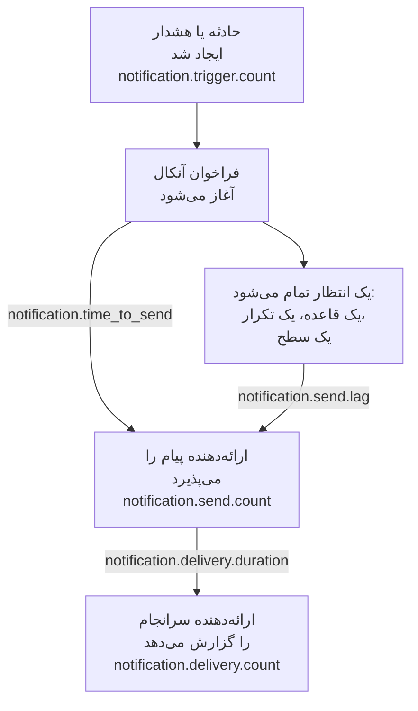

# متریک‌های تحویل اعلان

OneUptime ثبت می‌کند که اعلان‌هایی که می‌فرستد چگونه پیش می‌روند: چند حادثه و هشدار به آن‌ها نیاز دارند، آیا هر پیام به ارائه‌دهنده‌اش رسیده است، فرستادن یک فراخوان آنکال چقدر طول کشیده و آیا به تلفن رسیده است. تله‌متری خود OneUptime را به یک پروژهٔ OneUptime یا به هر بک‌اند OpenTelemetry بفرستید تا برای افرادی که نصب شما به آن‌ها خدمت می‌دهد اهداف تحویل تعیین کنید و بررسی کنید که به آن‌ها پایبند می‌مانید.

:::cards
- [روشن کردن آن‌ها](#روشن-کردن-آنها): دو تنظیم، و بدون آن‌ها هیچ چیزی ثبت نمی‌شود.
- [متریک‌ها](#متریکها): هفت متریک، از محرک تا تلفن.
- [زمان‌سنجی یک فراخوان](#زمانسنجی-یک-فراخوان): زمان تا ارسال و تأخیر ارسال از چه لحظه‌ای شمرده می‌شوند.
- [SLOهایی برای شروع](#sloهایی-برای-شروع): چهار هدف، پرس‌وجو به پرس‌وجو.
:::

## چگونه کار می‌کند



هر پیام در `notification.send.count` شمرده می‌شود، در هر کانال، نه فقط فراخوان‌های آنکال. دو زمان، `notification.time_to_send` و `notification.send.lag`، فقط فراخوان‌های آنکال را پوشش می‌دهند.

## روشن کردن آن‌ها

تا وقتی OneUptime یک صادرکنندهٔ OpenTelemetry نداشته باشد، هیچ چیزی ثبت نمی‌شود: بدون آن، متریک‌ها هزینه‌ای ندارند و هیچ‌جا نگه داشته نمی‌شوند. آن را با یک [کلید دریافت](/docs/telemetry/ingestion-keys) از نوع Server از همان پروژه به یک پروژهٔ OneUptime، یا به هر بک‌اندی که OTLP را روی HTTP می‌پذیرد، نشانه بگیرید.

:::tabs
@tab Kubernetes
```yaml
openTelemetryExporter:
  endpoint: https://oneuptime.example.com/otlp
  headers: x-oneuptime-token=YOUR_INGESTION_KEY
```
استقرارهای `app` و `worker` آن‌ها را می‌فرستند: `app.disableTelemetryCollection` و `worker.disableTelemetryCollection` را روی `false`، مقدار پیش‌فرضشان، نگه دارید.
@tab Docker Compose
```bash
OPENTELEMETRY_EXPORTER_OTLP_ENDPOINT=https://oneuptime.example.com/otlp
OPENTELEMETRY_EXPORTER_OTLP_HEADERS=x-oneuptime-token=YOUR_INGESTION_KEY
DISABLE_TELEMETRY_FOR_APP=false
```
آن‌ها را در `config.env` تنظیم کنید، سپس `npm start` را اجرا کنید. `DISABLE_TELEMETRY_FOR_APP` به‌طور پیش‌فرض `true` است، و در آن صورت هیچ چیزی فرستاده نمی‌شود.
:::

OneUptime هم به نقطهٔ پایانی و هم به سرآیندها نیاز دارد: بدون سرآیند هیچ چیزی نمی‌فرستد. هر سرآیند را به شکل `name=value` بنویسید و چند سرآیند را با `;` از هم جدا کنید. یک مقدار می‌تواند `=` داشته باشد. OneUptime خودش `/v1/metrics` را به نقطهٔ پایانی اضافه می‌کند، و همین تنظیمات ردها و لاگ‌های خود آن را هم می‌فرستند. هر متریک به محض اینکه OneUptime نخستین بار آن را ثبت کند ظاهر می‌شود: `notification.send.count` با نخستین پیام فرستاده‌شده.

### فرستادن دلتاها به یک پروژهٔ OneUptime

OneUptime شمارنده‌ها و هیستوگرام‌ها را همان‌طور می‌فرستد که OpenTelemetry به‌طور پیش‌فرض می‌فرستد: هر نقطه مجموع جاری از زمان شروع آن فرایند سرور را در خود دارد. کاوشگر متریک نقطه‌های هر گام از نمودار را با هم جمع می‌زند، پس شمارش‌ها و صدک‌های یک بازهٔ زمانی را فقط از دلتاها دقیق می‌خواند، یعنی نقطه‌هایی که آنچه را از نقطهٔ قبلی تاکنون رخ داده در خود دارند. وقتی متریک‌ها به یک پروژهٔ OneUptime می‌روند، دلتا بفرستید:

:::tabs
@tab Kubernetes
```yaml
extraEnv:
  - name: OTEL_EXPORTER_OTLP_METRICS_TEMPORALITY_PREFERENCE
    value: delta
```
فهرست خود یک سرویس جای فهرست سراسری چارت را می‌گیرد: اگر `app.extraEnv` یا `worker.extraEnv` را تنظیم می‌کنید، آن را آنجا هم اضافه کنید.
@tab Docker Compose
```yaml title="docker-compose.override.yml"
services:
  app:
    environment:
      OTEL_EXPORTER_OTLP_METRICS_TEMPORALITY_PREFERENCE: delta
```
آن را کنار `docker-compose.yml` بسازید، یا این را به فایلی که دارید اضافه کنید، سپس `npm start` را اجرا کنید.
:::

این برای هر متریکی که OneUptime دربارهٔ خودش می‌فرستد صدق می‌کند. بک‌اندی که مجموع‌های جاری را خودش می‌خواند، مانند Prometheus، به هیچ تغییری نیاز ندارد.

## متریک‌ها

| متریک | نوع | واحد | به چه پاسخ می‌دهد |
| --- | --- | --- | --- |
| `notification.trigger.count` | شمارنده | `1` | چند رکورد به اعلان نیاز داشتند |
| `notification.send.count` | شمارنده | `1` | هر پیامی که به یک ارائه‌دهنده سپرده شد چگونه پیش رفت |
| `notification.send.duration` | هیستوگرام | `ms` | ارائه‌دهنده چقدر طول کشید تا آن را بگیرد |
| `notification.time_to_send` | هیستوگرام | `ms` | یک فراخوان چقدر پس از محرکش به ارائه‌دهنده‌اش رسید |
| `notification.send.lag` | هیستوگرام | `ms` | اعلانی که بعداً فرستاده می‌شود چقدر پس از موعدش به ارائه‌دهنده‌اش رسید |
| `notification.delivery.count` | شمارنده | `1` | پیام‌هایی که ارائه‌دهندگان پذیرفتند چگونه به پایان رسیدند |
| `notification.delivery.duration` | هیستوگرام | `ms` | یک پیام چقدر پس از پذیرفته شدن توسط ارائه‌دهنده‌اش به پایان رسید |

هر ویژگی یکی از چند مقدار ثابت را دارد، هرگز یک پروژه، یک شخص، یک شماره تلفن یا یک رکورد. تنها استثنا شناسه و نام یک کانال سفارشی است: هر نصب تعداد انگشت‌شماری از آن‌ها دارد، و تشخیص آن‌ها از هم دقیقاً هدف است.

### رکوردهایی که به افراد اعلان می‌دهند

`notification.trigger.count` هر حادثه، هشدار، اپیزود حادثه و اپیزود هشدار را هنگام ایجاد شدن می‌شمارد.

| ویژگی | مقادیر |
| --- | --- |
| `notification.trigger.type` | `incident`، `alert`، `incident_episode`، `alert_episode` |
| `notification.trigger.source` | `automatic` وقتی OneUptime آن را از یک مانیتور یا یک قاعده ایجاد کرده است؛ `manual` وقتی یک شخص یا API این کار را کرده است |
| `monitor.type` | نوع مانیتوری که یک حادثه یا یک هشدار را ایجاد کرده است، مانند `Incoming Request`، `Logs` یا `Metrics`؛ وقتی هیچ مانیتوری آن را ایجاد نکرده باشد حذف می‌شود |

### پیام‌هایی که به یک ارائه‌دهنده سپرده می‌شوند

`notification.send.count` هر پیامی را که به یک ارائه‌دهنده سپرده می‌شود می‌شمارد، و `notification.send.duration` زمان فراخوانی ارائه‌دهنده را می‌سنجد. هر دو این ویژگی‌ها را دارند:

| ویژگی | مقادیر |
| --- | --- |
| `notification.channel` | `email`، `sms`، `call`، `whatsapp`، `telegram`، `push`، `webhook`، `slack`، `microsoft_teams`، `mattermost`، `custom_channel` |
| `notification.provider` | `twilio`، `sms_and_call_gateway`، `smtp`، `sendgrid`، `amazon_ses`، `mailgun`، `postmark`، `resend`، `microsoft_graph`، `expo`، `push_relay`، `web_push`، `meta_whatsapp`، `telegram_bot_api`، `slack`، `microsoft_teams`، `mattermost`، `webhook`، `custom_channel`، یا `none` وقتی هیچ چیزی به هیچ‌کدام سپرده نشده است |
| `notification.provider.config` | `global` برای حساب و تنظیمات خود نصب؛ `project` برای حساب Twilio، سرور SMTP، وب‌هوک یا اتصال فضای کاری خود یک پروژه، که رفع خطاهایشان با خود پروژه است |
| `notification.on_call_page` | `true` برای اعلان یک فراخوان آنکال، در غیر این صورت `false` |
| `outcome` | `success`، `failure` یا `not_sent`، مانند زیر |
| `notification.destination` | Slack، Microsoft Teams و Mattermost: `direct_message` به یک شخص، `channel` برای پستی در یک کانال یا گفتگوی گروهی Teams، `incoming_webhook` برای یک وب‌هوک ورودی، مانند وب‌هوک یک مشترک صفحهٔ وضعیت. وب‌هوک‌ها: `status_page_subscriber` برای وب‌هوک خودِ یک مشترک صفحهٔ وضعیت. برای وب‌هوک یک شخص و همهٔ کانال‌های دیگر نمی‌آید |
| `notification.custom_channel.id`، `notification.custom_channel.name` | فقط کانال‌های سفارشی: شناسهٔ کانال، و نام آن که به 100 نویسه کوتاه شده است |

- `success`: ارائه‌دهنده پیام را پذیرفت.
- `failure`: ارائه‌دهنده آن را رد کرد یا در دسترس نبود، یا فرستادن آن شکست خورد. کانال گفتگویی که پیدا نشد شکستی بدون مدت زمان است.
- `not_sent`: عمداً فرستاده نشد. پروژه کانال را خاموش کرده، موجودی‌اش خیلی کم است یا مسدود شده است، پوش روی این سرور خاموش است، یا یک کانال سفارشی خاموش، حذف‌شده یا خارج از پوشش مجوز است. نرخ موفقیت این‌ها را کنار می‌گذارد: این‌ها کار کردن تنظیمات‌اند، نه شکست سکو.

پیامی به وب‌هوک خودِ یک مشترک صفحهٔ وضعیت یک بار شمرده می‌شود، هر چند بار هم که امتحان شده باشد: `success` وقتی نقطهٔ پایانی با وضعیت 2xx پاسخ داد، و `failure` وقتی با وضعیت دیگری پاسخ داد، در دسترس نبود یا نشانی‌اش مجاز نیست.

### آنچه به تلفن رسید

`notification.delivery.count` می‌شمارد که هر پیامی که یک ارائه‌دهنده پذیرفت چگونه به پایان رسید، همان‌طور که ارائه‌دهنده بعداً گزارش می‌دهد، یک بار برای هر پیام. `notification.delivery.duration` می‌سنجد که این چقدر پس از پذیرفته شدن توسط ارائه‌دهنده بود. هر دو `notification.channel`، `notification.provider`، `notification.provider.config`، `notification.on_call_page` و `outcome`، وضعیت نهایی، را دارند:

| کانال | ارائه‌دهنده | `outcome` | مدت زمان |
| --- | --- | --- | --- |
| `sms` | `twilio` | `delivered`، `undelivered`، `failed` | تا وقتی Twilio وضعیت را گزارش کند |
| `call` | `twilio` | `answered`، `not_answered`، `failed` | تا وقتی تماس پاسخ داده شد، وگرنه تا وقتی پایان یافت |
| `push` | `expo`، `push_relay` | `delivered`، `undelivered`، `failed` | زمان‌سنجی نمی‌شود: رسید می‌گوید آیا Apple یا Google پوش را گرفت، نه اینکه چه زمانی |
| `whatsapp` | `meta_whatsapp` | `delivered`، `failed` | تا وقتی Meta وضعیت را گزارش کند |

تماسی که زنگ خورد و پاسخی نگرفت، اشغال بود یا رد شد، `not_answered` است. پوشی به اپی که دیگر وجود ندارد `undelivered` است، و پیام WhatsApp خوانده‌شده تحویل‌شده به حساب می‌آید. `notification.provider.config` فقط برای پیامک و تماس روی حساب Twilio خود یک پروژه `project` است.

وضعیت‌ها فقط جایی می‌رسند که ارائه‌دهنده بتواند آن‌ها را گزارش کند:

- پیامک و تماس: از راه Twilio، وقتی Twilio بتواند به سرور شما در `HOST` آن برسد (به [یکپارچه‌سازی Twilio](/docs/self-hosted/twilio-integration#۳-دسترسی-شبکه-را-پیکربندی-کنید) نگاه کنید). درگاه پیامک و تماس هیچ وضعیتی گزارش نمی‌کند.
- WhatsApp: وقتی وب‌هوک Meta برای نصب شما راه‌اندازی شده باشد.
- پوش: از رسیدهای Expo، که OneUptime حدود 15 دقیقه پس از پوش می‌خواند، از راه رلهٔ پوش هم. نصبی که پوش را فرستاده آن را می‌شمارد.
- ایمیل، Telegram، وب‌هوک‌ها، گفتگو و کانال‌های سفارشی هیچ وضعیت نهایی‌ای گزارش نمی‌کنند.

## زمان‌سنجی یک فراخوان

### زمان تا ارسال

`notification.time_to_send` از محرک یک فراخوان تا پذیرفته شدن اعلان توسط ارائه‌دهنده‌اش جریان دارد. فقط اعلان‌هایی را زمان‌سنجی می‌کند که با آغاز فراخوان موعدشان می‌رسد: افراد نخستین قاعدهٔ تشدید، با قواعد آنکالشان که منتظر هیچ چیزی نمی‌مانند، و هر سطحی که فراخوان چون به کسی نرسیده بی‌درنگ به آن می‌رود. انتظارهایی که پیکربندی آنکال می‌خواهد تأخیر سکو نیستند، پس کنار گذاشته می‌شوند: آن‌ها در [تأخیر ارسال](#تأخیر-ارسال) هستند. فقط اعلان‌هایی که ارائه‌دهنده‌شان پذیرفته زمان‌سنجی می‌شوند؛ یک شکست در `notification.send.count` دیده می‌شود.

| ویژگی | مقادیر |
| --- | --- |
| `notification.channel` | مانند `notification.send.count` |
| `notification.page.start` | زمان از کجا جریان دارد، مانند زیر |
| `notification.trigger.type` | رکوردی که فراخوان برای آن است: `incident`، `alert`، `incident_episode`، `alert_episode` |
| `notification.custom_channel.id`، `notification.custom_channel.name` | فقط کانال‌های سفارشی |

| `notification.page.start` | زمان از این لحظه جریان دارد |
| --- | --- |
| `monitor_data_received` | وقتی OneUptime داده‌ای را دریافت کرد که مانیتور را به کار انداخت: یک درخواست ورودی، گزارش یک عامل سرور، یک ایمیل ورودی، بررسی یک کاوشگر، یک SNMP trap یا یک نمونه‌برداری از دستگاه شبکه. زمانی که داده در صف برای ارزیابی منتظر ماند را هم شامل می‌شود. |
| `record_created` | وقتی حادثه، هشدار یا اپیزود ایجاد شد: توسط یک مانیتور تله‌متری، یک قاعده یا یک شخص، و برای بررسی نبودن، مانند ضربان قلبی که متوقف شد. |
| `page_started` | وقتی یک فراخوان بعداً آغاز شد: یک شخص، یک گردش کار یا قاعده‌ای که اکنون منطبق است آن را آغاز کرد، یا فراخوانی مستقیم است. برای فراخوانی که قاعدهٔ آنکالش یا OneUptime AI نگهش داشت، وقتی توقفش به پایان رسید، یا وقتی آغاز شد اگر زودتر بود. برای فراخوان دوباره، وقتی مهلت پس از تأیید به پایان رسید. پس کارگری که دیر به هر کدام رسید در این زمان دیده می‌شود. |

برای یک درخواست ورودی، زمان از آخرین درخواستی که نقطهٔ پایانی دریافت کرده جریان دارد، پس ممکن است کمی کوتاه‌تر نشان دهد.

### تأخیر ارسال

`notification.send.lag` از لحظه‌ای که موعد اعلانی که بعداً فرستاده می‌شود رسید تا پذیرفته شدن آن توسط ارائه‌دهنده‌اش جریان دارد. دو کارگر این‌ها را می‌فرستند، هر کدام دقیقه‌ای یک بار، پس کارگری که سر وقت است تا حدود یک دقیقه نشان می‌دهد، و کارگری که عقب افتاده نشان می‌دهد چقدر.

| `notification.schedule` | موعد می‌رسد وقتی |
| --- | --- |
| `rule_wait` | قاعدهٔ آنکالی از یک شخص که منتظر می‌ماند، مانند «پس از 10 دقیقه با من تماس بگیر»: همان مقدار پس از فراخوانده شدن شخص. هرگز پیش از آخرین باری که کارگر قواعد او را مرور کرد نیست، پس قاعده‌ای که بعداً افزوده یا تغییر داده شده از آن زمان موعدش می‌رسد. |
| `repeat` | پوشی که تا وقتی کسی تأیید کند تکرار می‌شود: هر بار که بازه‌اش تمام می‌شود. |
| `escalation` | یک سطح تشدید بعدی: وقتی سطح پیش از آن انتظارش را به پایان رساند، یا بی‌درنگ وقتی شخصی فراخوان را به نفر بعد می‌سپارد. |
| `policy_repeat` | سیاستی که دوباره از نخستین سطحش آغاز می‌شود: وقتی انتظار آخرین سطحش تمام شد. |

این متریک نیز `notification.channel`، `notification.trigger.type` و، برای کانال‌های سفارشی، `notification.custom_channel.id` و `notification.custom_channel.name` را دارد. اعلانی که با آغاز فراخوانش موعدش می‌رسد هرگز در آن نیست، حتی وقتی کارگری فراخوان را دیر آغاز کرد، پس از یک توقف یا به‌عنوان فراخوان دوباره: در زمان تا ارسال است.

### سطل‌های هیستوگرام

هر هیستوگرام لبه‌های سطل خودش را دارد، بر حسب میلی‌ثانیه، که طوری تنظیم شده‌اند که بتوان یک هدف را در یک لبه خواند:

| هیستوگرام | لبه‌های سطل، بر حسب میلی‌ثانیه |
| --- | --- |
| `notification.send.duration` | `5, 10, 25, 50, 100, 250, 500, 1000, 2500, 5000, 10000, 30000, 60000, 120000` |
| `notification.time_to_send` | `250, 500, 1000, 2000, 5000, 10000, 15000, 30000, 60000, 120000, 300000, 600000, 1800000, 3600000` |
| `notification.send.lag` | `1000, 5000, 10000, 15000, 30000, 45000, 60000, 75000, 90000, 120000, 180000, 300000, 600000, 1800000, 3600000` |
| `notification.delivery.duration` | `500, 1000, 2000, 5000, 10000, 15000, 30000, 60000, 120000, 300000, 600000, 1800000, 3600000, 14400000, 86400000` |

یک صدک از سطل‌ها محاسبه می‌شود، و به‌صورت وسط سطلی که در آن می‌افتد رسم می‌شود. پس آن را با لبهٔ یک سطل مقایسه کنید: P95 برای `notification.time_to_send` در 30000 یا کمتر یعنی 95% فراخوان‌ها 30 ثانیه یا کمتر طول کشیدند.

## SLOهایی برای شروع

چهار هدف که بیشتر نصب‌ها می‌توانند وعده دهند، هر کدام ساخته‌شده از یک یا دو پرس‌وجو در کاوشگر متریک پروژه‌ای که متریک‌ها را دریافت می‌کند. وقتی متریک‌ها به‌صورت دلتا برسند، یک بازهٔ زمانی را دقیق می‌خوانند: به [فرستادن دلتاها به یک پروژهٔ OneUptime](#فرستادن-دلتاها-به-یک-پروژهٔ-oneuptime) نگاه کنید.

### ساختن یک هدف در کاوشگر متریک

:::steps
1. [کاوشگر متریک](/docs/telemetry/metrics-explorer) پروژه را باز کنید، و روی نخستین متریک هدف کلیک کنید. پرس‌وجوی آن `a` است.
2. تجمیع آن را زیر **تجمیع بر اساس** انتخاب کنید. سپس **فیلترها و گروه‌بندی** را باز کنید، و هر یک از شرط‌های آن را زیر **فیلتر بر اساس ویژگی‌ها** اضافه کنید.
3. برای پرس‌وجوی دوم، روی **افزودن متریک** کلیک کنید، و `b` را به همان شکل تنظیم کنید.
4. برای یک فرمول، روی **افزودن فرمول** کلیک کنید، و آن را در **فرمول** بنویسید.
5. برای اینکه وقتی هدف از دست می‌رود باخبر شوید، روی **اقدام‌ها** > **ساخت مانیتور از این نما** کلیک کنید، و وقتی مقدار از هدف گذشت هشدار دهید: به [مانیتور متریک‌ها](/docs/monitor/metrics-monitor) نگاه کنید.
:::

برای دنبال کردن یک هدف در طول 30 روز با بودجهٔ خطا، آن مانیتور را به یک [SLO](/docs/slo/introduction) وصل کنید: زمانی را که هدف از دست رفته بود می‌شمارد.

### پیامک‌های آنکال به Twilio می‌رسند

حداکثر 1% از پیامک‌های آنکالی که از راه حساب Twilio خود نصب فرستاده می‌شوند شکست می‌خورند، پس 99% پذیرفته می‌شوند.

| پرس‌وجو | متریک | تجمیع | شرط‌ها |
| --- | --- | --- | --- |
| `a` | `notification.send.count` | **جمع** | `notification.channel = sms`، `notification.on_call_page = true`، `notification.provider.config = global`، `outcome != not_sent` |
| `b` | `notification.send.count` | **جمع** | همان، با `outcome = failure` |

فرمول `$b / $a * 100` سهم شکست‌خورده است، و هدف تا وقتی برقرار است که این مقدار در 1 یا کمتر بماند. گامی بدون شکست هیچ نقطه‌ای رسم نمی‌کند، چون `b` نقطه‌ای ندارد. `outcome != not_sent` آنچه را تنظیمات خود پروژه‌ها نگه داشته‌اند کنار می‌گذارد، و `global` حساب‌های Twilio خود پروژه‌ها را. در نصبی که پیامک‌ها را از راه درگاه پیامک و تماس خود می‌فرستد، همین پرس‌وجوها همان درگاه را می‌سنجند. برای کانالی دیگر، `sms` را عوض کنید: `call`، `push` یا `email`.

### فراخوان‌ها در 30 ثانیه فرستاده می‌شوند

95% فراخوان‌های آنکال در 30 ثانیه پس از محرکشان به ارائه‌دهنده‌شان می‌رسند.

| پرس‌وجو | متریک | تجمیع | شرط‌ها |
| --- | --- | --- | --- |
| `a` | `notification.time_to_send` | **P95** | `notification.page.start != page_started` |

هدف تا وقتی برقرار است که `a` در 30000 یا کمتر بماند. فراخوان‌هایی که بعداً آغاز شده‌اند از زمان آغاز یا موعدشان زمان‌سنجی می‌شوند، نه از یک محرک، پس کنار گذاشته می‌شوند. بر اساس `notification.page.start` گروه‌بندی کنید تا صف مانیتورها (`monitor_data_received`) را جدا از بقیه ببینید، یا بر اساس `notification.channel` تا کانال کُند را پیدا کنید.

### اعلان‌هایی که بعداً فرستاده می‌شوند در 90 ثانیه فرستاده می‌شوند

99% اعلان‌هایی که پس از یک انتظار فرستاده می‌شوند در 90 ثانیه پس از رسیدن موعدشان به ارائه‌دهنده‌شان می‌رسند.

| پرس‌وجو | متریک | تجمیع | شرط‌ها |
| --- | --- | --- | --- |
| `a` | `notification.send.lag` | **P99** | — |

هدف تا وقتی برقرار است که `a` در 90000 یا کمتر بماند. بر اساس `notification.schedule` گروه‌بندی کنید تا ببینید کدام کارگر عقب افتاد: `rule_wait` و `repeat` مال یک کارگرند، `escalation` و `policy_repeat` مال دیگری.

### پیامک‌های آنکال به تلفن می‌رسند

حداکثر 5% از پیامک‌های آنکالی که Twilio برای حساب خود نصب پذیرفت تحویل داده نمی‌شوند.

| پرس‌وجو | متریک | تجمیع | شرط‌ها |
| --- | --- | --- | --- |
| `a` | `notification.delivery.count` | **جمع** | `notification.channel = sms`، `notification.on_call_page = true`، `notification.provider.config = global` |
| `b` | `notification.delivery.count` | **جمع** | همان، با `outcome != delivered` |

فرمول `$b / $a * 100` سهم تحویل‌نشده است. اپراتورها و تلفن‌های خاموش بخشی از آن را تعیین می‌کنند، پس هدف را از روی آنچه در چند هفته می‌بینید تعیین کنید. برای تماس‌ها، از `call` و `outcome != answered` استفاده کنید. Twilio باید بتواند به سرور شما برسد: به [آنچه به تلفن رسید](#آنچه-به-تلفن-رسید) نگاه کنید.

## عیب‌یابی

:::details هیچ متریک اعلانی نمی‌رسد
بررسی کنید که `OPENTELEMETRY_EXPORTER_OTLP_ENDPOINT` و `OPENTELEMETRY_EXPORTER_OTLP_HEADERS` هر دو تنظیم شده باشند، و در Docker Compose اینکه `DISABLE_TELEMETRY_FOR_APP` برابر `false` باشد، سپس OneUptime را دوباره راه‌اندازی کنید. OneUptime هنگام راه‌اندازی، وقتی نتواند سرآیندی را بخواند یا هیچ چیزی نفرستد، یک هشدار در لاگ‌ها ثبت می‌کند. یک متریک فقط وقتی چیزی ثبت شده باشد ظاهر می‌شود، پس ابتدا یک اعلان بفرستید.
:::

:::details یک شمارش فقط بالا می‌رود، یا یک صدک به‌سختی تکان می‌خورد
متریک‌ها به‌صورت مجموع‌های جاری می‌رسند. دلتا بفرستید: به [فرستادن دلتاها به یک پروژهٔ OneUptime](#فرستادن-دلتاها-به-یک-پروژهٔ-oneuptime) نگاه کنید.
:::

:::details هیچ وضعیت نهایی‌ای نمی‌رسد
وضعیت‌های نهایی از ارائه‌دهندگان می‌آیند، بعداً، و فقط جایی که بتوانند آن‌ها را گزارش کنند: به [آنچه به تلفن رسید](#آنچه-به-تلفن-رسید) نگاه کنید. در نصبی که Twilio نمی‌تواند به آن برسد، پیامک‌ها و تماس‌ها فرستاده‌شده شمرده می‌شوند، اما هرگز تحویل‌شده نه.
:::

## گام‌های بعدی

:::cards
- [کاوشگر متریک](/docs/telemetry/metrics-explorer): هر متریکی را نمودار کنید، ترکیب کنید و مقایسه کنید.
- [مانیتور متریک‌ها](/docs/monitor/metrics-monitor): وقتی هدفی از دست می‌رود هشدار دهید.
- [یکپارچه‌سازی Twilio](/docs/self-hosted/twilio-integration): بگذارید Twilio گزارش دهد چه چیزی به تلفن رسید.
- [قواعد تشدید](/docs/on-call/escalation-rules): انتظارهایی که تأخیر ارسال از آن‌ها شمرده می‌شود.
:::
