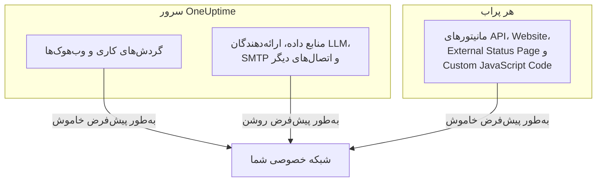

# دسترسی به شبکه خصوصی

‏OneUptime از فرستادن برخی درخواست‌های خروجی به میزبان‌هایی که به محدوده‌ای خصوصی، بازگشتی یا محلی-پیوند تفکیک می‌شوند خودداری می‌کند. اگر کوشیده‌اید گردش کاری‌ای را به سمت ابزاری داخلی بفرستید، این پیام را دیده‌اید:

> Webhook URL resolves to a private, loopback, or link-local address and is not allowed

این پیش‌فرض برای محصول میزبانی‌شده درست است، جایی که هر کسی می‌تواند ثبت‌نام کند و هدف وب‌هوک ورودی‌ای غیرقابل‌اعتماد است. روی نمونه‌ای خودمیزبان، جلوی کاری عادی را می‌گیرد: فرستادن هشدار به Mattermost، ‏Jira یا سامانه تیکت خودمیزبانی که فقط روی شبکه خودتان وجود دارد.

این صفحه توضیح می‌دهد چگونه آن را آگاهانه و در محدوده‌ای تنگ مجاز کنید. سه کلید درباره‌اش تصمیم می‌گیرند، هر کدام برای نوع اتصال خودش، و روی ماشین‌های مختلفی پیکربندی می‌شوند:

| چه چیزی را می‌خواهید درون شبکه برسید | تنظیم کجا قرار دارد | پیش‌فرض در نصب خودمیزبان |
| --- | --- | --- |
| گردش‌های کاری، وب‌هوک‌های پروژه، وب‌هوک‌های کاربر کشیک | محیط **سرور API** | نشانی‌های خصوصی رد می‌شوند |
| منابع داده، ارائه‌دهندگان LLM، سرورهای SMTP، کشف OIDC و اتصال‌های دیگر | محیط **سرور API** | نشانی‌های خصوصی مجازند |
| **مانیتورهای** API، ‏Website، ‏External Status Page و Custom JavaScript Code | محیط خودِ **پراب** | نشانی‌های خصوصی رد می‌شوند |



نوع‌های مانیتور شبکه‌بومی مانند Ping، ‏Port، ‏SSL Certificate، ‏DNS، ‏DNSSEC، ‏SNMP / Network Device، ‏SQL Query، ‏Database Health، ‏Synthetic و Network Path حامل‌های خودشان را به کار می‌برند. تنظیم این صفحه حامل‌های HTTPای را اداره می‌کند که محتوای دلخواه پاسخ را به پروژه برمی‌گردانند: مانیتورهای API، ‏Website، ‏External Status Page و Custom JavaScript Code.

:::cards
- [وب‌هوک‌ها و گردش‌های کاری](#وبهوکها-و-گردشهای-کاری): به وب‌هوکی اجازه دهید به درون شبکه شما پست کند.
- [سایر اتصال‌های خروجی](#سایر-اتصالهای-خروجی): منابع داده، ارائه‌دهندگان LLM و سرورهای ایمیل.
- [پراب‌ها و مانیتورها](#پرابها-و-مانیتورها): بگذارید پرابی سایت‌های خصوصی را بررسی کند.
- [تأیید اینکه کار می‌کند](#تأیید-اینکه-کار-میکند): بخوانید پیام رد نام کدام کلید را می‌برد.
:::

## چه چیزی مسدود است، و چه چیزی را می‌توان باز کرد

هدف‌های مسدود در دو رده قرار می‌گیرند.

| رده | محدوده‌ها | آیا می‌توان مجازش کرد؟ |
| --- | --- | --- |
| **خصوصی** | RFC-1918 ‏(`10.0.0.0/8`، `172.16.0.0/12`، `192.168.0.0/16`)، CGNAT ‏(`100.64.0.0/10`)، محلی-یکتای IPv6 ‏(`fc00::/7`) و محلی-سایت (`fec0::/10`) | بله |
| **ممنوع** | بازگشتی (`127.0.0.0/8`، `::1`)، نشانی نامشخص، محلی-پیوند (`169.254.0.0/16`، `fe80::/10`)، چندپخشی، رزروشده، همه‌پخشی، و نام‌های `localhost` و `metadata.google.internal` | فقط با نام بردن میزبان یا CIDR دقیق در فهرست مجاز وب‌هوک. هرگز برای مانیتورها. |

نقطه پایانی فراداده ابری `169.254.169.254` به دلیلی در رده ممنوع قرار دارد. روی ماشین مجازی ابری، این نقطه پایانی اعتبارنامه‌های IAM نمونه را به هر چیزی می‌دهد که بتواند از آن ماشین درخواست HTTP بفرستد، پس هیچ تنظیم فراگیری هرگز آن را باز نمی‌کند.

املاهای IPv6 که هدفی IPv4 را درون خود حمل می‌کنند — نگاشت‌شده IPv4 ‏(`::ffff:10.0.0.5`)، NAT64، ‏6to4، ‏Teredo — بر پایه نشانی IPv4ای که به آن می‌رسند دسته‌بندی می‌شوند، پس نمی‌توان با آن‌ها نشانی‌ای ممنوع را از کنار اجازه رده خصوصی عبور داد.

## وب‌هوک‌ها و گردش‌های کاری

این مقصدها پوشش داده می‌شوند، چون هدف نشانی‌ای است که عضوی احرازهویت‌شده از پروژه شما نوشته است:

- مؤلفه‌های **API** در گردش کاری (GET / POST / PUT / PATCH / DELETE)
- درخواست‌های HTTPای که مؤلفه **Custom JavaScript** در گردش کاری می‌فرستد
- اعلان‌های وب‌هوک پروژه (حادثه‌ها، هشدارها، مانیتورها، کشیک، نگهداری زمان‌بندی‌شده، رویدادهای صفحه وضعیت)
- **وب‌هوک‌های کاربر** در کشیک

پوشش داده **نمی‌شوند**، و هرگز نخواهند شد: **وب‌هوک‌های مشترکان صفحه وضعیت**. هر بازدیدکننده صفحه وضعیت عمومی می‌تواند یکی ثبت کند، پس شل کردن این مقصد به هر کسی روی اینترنت اجازه می‌داد سرور شما را وادار کند به درون شبکه خصوصی‌تان POST کند. این قابل پیکربندی نیست.

اتصال‌های خروجی‌ای که وب‌هوک نیستند — منابع داده بیرونی، ارائه‌دهندگان LLM، سرورهای SMTP (تنظیمات SMTP یک پروژه و مؤلفه **Email** در گردش کاری)، نقطه‌های پایانی توکن OAuth در SMTP، کشف OIDC و گام‌های HTTP رانبوک — جداگانه با `DATA_SOURCE_BLOCK_PRIVATE_ADDRESSES` اداره می‌شوند و از پیش روی نصب‌های خودمیزبان محدوده‌های خصوصی را مجاز می‌کنند. [سایر اتصال‌های خروجی](#سایر-اتصالهای-خروجی) را ببینید.

### پیکربندی سرور API

یکی یا هر دوی این‌ها را روی سرور API تنظیم کنید و آن را بازراه‌اندازی کنید. به‌طور پیش‌فرض خاموش‌اند، پس نمونه‌ای که هیچ‌کدام را تنظیم نکند دقیقاً مانند قبل رفتار می‌کند.

| متغیر | مقدار Helm | چه چیزی را مجاز می‌کند |
| --- | --- | --- |
| `ALLOW_PRIVATE_NETWORK_WEBHOOKS` | `webhooks.allowPrivateNetwork` | کل رده خصوصی را، وقتی روی `true` تنظیم شود. |
| `PRIVATE_NETWORK_WEBHOOK_ALLOWLIST` | `webhooks.privateNetworkAllowlist` | میزبان‌ها و CIDRهایی را که نام می‌برد، از هر رده‌ای که باشند. |

:::tabs
@tab Docker Compose
```bash title="config.env"
ALLOW_PRIVATE_NETWORK_WEBHOOKS=true
PRIVATE_NETWORK_WEBHOOK_ALLOWLIST=mattermost.internal,*.svc.cluster.local,10.20.0.0/16
```
@tab Kubernetes
```yaml title="values.yaml"
webhooks:
  allowPrivateNetwork: true
  privateNetworkAllowlist: "mattermost.internal,10.20.0.0/16"
```
:::

روی Docker Compose، فایل `config.env` خطی به شکل `ALLOW_PRIVATE_NETWORK_WEBHOOKS=false` دارد: به‌جای افزودن خطی دوم همان را تغییر دهید، سپس `npm run start` را اجرا کنید. روی Kubernetes، انتشار را ارتقا دهید.

مدخل‌های فهرست مجاز را می‌توان با ویرگول، فاصله یا خط جدید جدا کرد، و هر کدام می‌تواند یکی از این‌ها باشد:

- نام میزبان — `mattermost.internal`
- جانشین — `*.svc.cluster.local` (با زیردامنه‌ها تطبیق می‌کند، نه با خودِ پسوند)
- نشانی IPv4 یا IPv6 — `10.20.30.40`، `fd00::1`
- یک CIDR — `10.20.0.0/16`، `fd12:3456::/32`

طرح، درگاه، مسیر یا اطلاعات کاربرِ یک مدخل حذف می‌شود، پس چسباندن نشانی وب‌هوکی که از پیش دارید کار می‌کند.

نام میزبانی که در فهرست مجاز نام برده شود **بدون بررسی DNS** مورد اعتماد است — هدف از نام بردنش همین است، چون انتظار می‌رود به جایی تفکیک شود که فهرست مسدود ردش می‌کند. مدخل نشانی هم با متن تحت‌اللفظی درون نشانی و هم با هر نشانی‌ای که DNS برایش برمی‌گرداند تطبیق داده می‌شود.

> [!CAUTION]
> **هرگز `169.254.169.254`، یا هر محدوده‌ای که آن را دربر دارد، در فهرست مجاز نگذارید.** روی ماشین مجازی ابری، این کار اعتبارنامه‌های IAM نمونه شما را به هر عضو پروژه می‌دهد.

## سایر اتصال‌های خروجی

نگهبان دومی اتصال‌های خروجی‌ای را پوشش می‌دهد که هدفشان را عضوی از پروژه انتخاب می‌کند اما وب‌هوک نیستند:

- منابع داده بیرونی (اتصال‌های PostgreSQL، ‏MySQL، ‏SQL Server، ‏ClickHouse، ‏Elasticsearch و REST API)، اتصال‌های رویداد امنیتی مانند Splunk، و فیدهای اطلاعات تهدید
- ارائه‌دهندگان LLM، از جمله Ollama یا vLLM خودمیزبان
- سرورهای SMTP — تنظیمات SMTP یک پروژه و مؤلفه **Email** در گردش کاری — و نشانی‌های توکن OAuth در SMTP و گردش کاری
- کشف OIDC برای ورود یکپارچه
- تأیید دامنه سفارشی صفحه وضعیت و داشبورد
- گام‌های HTTP رانبوک
- نشانی API ‏Grafana OnCall که یک درون‌ریزی از آن می‌خواند (**تنظیمات پروژه** > **پایه** > **درون‌ریزی از ابزاری دیگر**)

این نگهبان برعکسِ تنظیمات وب‌هوک کار می‌کند. روی نصب خودمیزبان، به‌طور پیش‌فرض رده خصوصی را **مجاز می‌کند**، چون پایگاه داده، سرور ایمیل یا سرور مدلی که این‌ها به آن وصل می‌شوند معمولاً روی شبکه خودتان است. رده ممنوع — بازگشتی، محلی-پیوند و نقطه پایانی فراداده ابری — در هر حال رد می‌شود، و فهرست مجازی برای آن وجود ندارد.

مقدار `DATA_SOURCE_BLOCK_PRIVATE_ADDRESSES` این نگهبان را سخت‌گیرتر می‌کند. آن را روی `true` تنظیم کنید تا رده خصوصی برای این اتصال‌ها هم رد شود، برای نمونه وقتی پروژه‌های نمونه شما از آنِ کسانی است که نباید به شبکه داخلی‌تان برسند:

:::tabs
@tab Docker Compose
```bash title="config.env"
DATA_SOURCE_BLOCK_PRIVATE_ADDRESSES=true
```
@tab Kubernetes
```yaml title="values.yaml"
outboundConnections:
  blockPrivateNetwork: true
```
:::

این تنظیم بر ارائه‌دهنده سراسری LLM اثر ندارد، که آن را یک مدیر پیکربندی می‌کند و نه یک پروژه (با متغیرهای `GLOBAL_LLM_PROVIDER_*`، مقدار `vllm.globalProvider` در چارت Helm، یا در داشبورد مدیریت زیر **تنظیمات** > **ارائه‌دهندگان LLM سراسری**): چنین ارائه‌دهنده‌ای همچنان می‌تواند به نشانی‌های خصوصی برسد، هرچند بازگشتی و محلی-پیوند برای آن هم رد می‌مانند.

فقط مقدار دقیق `true` آن را روشن می‌کند. روی نمونه‌ای با `BILLING_ENABLED=true` همیشه روشن است، هرچه تنظیم کنید. تغییر نمی‌دهد که تنظیمات وب‌هوک بالا یا تنظیم پراب پایین به کدام هدف‌ها اجازه می‌دهند؛ هر دروازه جداگانه پیکربندی می‌شود. ولی شکل پیام‌های رد را، برای وب‌هوک‌ها و درخواست‌های گردش کاری هم، تغییر می‌دهد: وقتی روشن باشد، نام میزبان ردشده بدون گفتن اینکه به چه نشانی‌ای تفکیک شده گزارش می‌شود ([تأیید اینکه کار می‌کند](#تأیید-اینکه-کار-میکند) را ببینید).

روی Docker Compose، فایل `config.env` خطی به شکل `DATA_SOURCE_BLOCK_PRIVATE_ADDRESSES=false` دارد (اگر `config.env` شما قدیمی‌تر از آن است، اضافه‌اش کنید). به‌جای افزودن خطی دوم، همان خط را به `true` تغییر دهید، سپس `npm run start` را اجرا کنید تا کانتینرها با مقدار تازه از نو ساخته شوند؛ `docker compose restart` فایل `config.env` را دوباره نمی‌خواند. روی Kubernetes، آن را در فایل values خود تنظیم کنید و انتشار را ارتقا دهید؛ چارت آن را به پادهای app و worker می‌دهد.

وقتی روشن باشد، نام میزبان ردشده بدون گفتن اینکه به چه نشانی‌ای تفکیک شده گزارش می‌شود، برای نمونه _«LLM provider host ollama.internal could not be reached.»_ نامی که اصلاً تفکیک نشود هم همین پیام را می‌گیرد، تا اعضای پروژه نتوانند با این فیلدها بفهمند کدام نام‌های داخلی وجود دارند. نشانی‌ای که به‌صورت IP وارد شده همچنان همراه با دلیل نام برده می‌شود، برای نمونه _«LLM provider host 10.0.4.12 is not allowed: private network address.»_ با `LOG_LEVEL=DEBUG`، برنامه نشانی‌ای را که هر نام ردشده به آن تفکیک شده در لاگ ثبت می‌کند.

## پراب‌ها و مانیتورها

چهار نوع مانیتور تحت تأثیر قرار می‌گیرند: **API**، **وب‌سایت**، **External Status Page** و **Custom JavaScript Code**. روی پرابی پیش‌فرض می‌توانند به هدف‌های عمومی HTTP(S) برسند، اما فضای نشانی خصوصی را رد می‌کنند. مانیتورهای API، ‏Website و External Status Page نتایج DNS را برای هر اتصال تأیید و سنجاق می‌کنند و هر تغییر مسیری را دوباره تأیید می‌کنند؛ Custom JavaScript Code همان سیاست نشانی را در پل محیط ایزوله‌اش اعمال می‌کند.

این کلید را **فرایند پراب از محیط خودش** می‌خواند، نه از محیط سرور API، و هر پرابی آن را می‌خواند: پراب‌های همراه Docker Compose، پراب‌هایی که چارت Helm مستقر می‌کند، و هر [پراب سفارشی](/docs/probe/custom-probe) که خودتان اجرا می‌کنید. هر کسی که پرابی را مستقر می‌کند محیطش را در اختیار دارد، و همان کسی است که می‌داند آن پراب کدام شبکه را می‌بیند — پراب سفارشی معمولاً ماشینی دیگر است، اغلب در دست شخصی دیگر، و هرگز پیکربندی سرور API را نمی‌خواند.

:::tabs
@tab Docker Compose
فایل `config.env` از پیش خطی به شکل `PROBE_ALLOW_PRIVATE_NETWORK_MONITORS=false` دارد: به‌جای افزودن خطی دوم، همان خط را به `true` تغییر دهید، چون وقتی متغیری دو بار بیاید خط بعدی برنده است. سپس `npm run start` را اجرا کنید که کانتینرها را با مقدار تازه از نو می‌سازد؛ `docker compose restart` فایل `config.env` را دوباره نمی‌خواند. هر پراب همراه همان یک خط را می‌خواند، پس بر `probe-1` و، جایی که پشته‌تان پراب دومی اجرا می‌کند، بر `probe-2` اعمال می‌شود.

```bash title="config.env"
PROBE_ALLOW_PRIVATE_NETWORK_MONITORS=true
```
@tab Kubernetes
آن را برای هر پراب جداگانه در فایل values خود تنظیم کنید و انتشار را ارتقا دهید. هر مدخل زیر `probes:` پرابی جداگانه است، پس روی هر کدام که باید به نشانی‌های خصوصی برسد تنظیمش کنید:

```yaml title="values.yaml"
probes:
  one:
    allowPrivateNetworkMonitors: true
```
:::

روی پراب سفارشی، `PROBE_ALLOW_PRIVATE_NETWORK_MONITORS=true` را در محیط خودِ آن پراب تنظیم کنید و آن را بازراه‌اندازی کنید. مقدار باید دقیقاً `true` باشد؛ هر چیز دیگری، مانند `TRUE` یا `1`، کلید را خاموش نگه می‌دارد و پراب این را، هر مقداری که `LOG_LEVEL` داشته باشد، در هشداری هنگام راه‌اندازی می‌گوید.

پراب‌های همراه **پراب‌های سراسری** هستند: خودشان را با `REGISTER_PROBE_KEY` نمونه ثبت می‌کنند، و هر پروژه‌ای روی نمونه می‌تواند انتخابشان کند. پس روشن کردن کلید برای پرابی همراه به مانیتورهای **هر پروژه‌ای روی نمونه** اجازه می‌دهد از طریق آن به نشانی‌های خصوصی برسند. این معمولاً همان چیزی است که نصبی تک‌تیمی می‌خواهد. جایی که پروژه‌ها نباید این دسترسی را با هم شریک شوند — تیم‌های جدا، یا مشتریانی که میزبانی‌شان می‌کنید — آن را روی پراب‌های همراه خاموش بگذارید و به‌جایش درون هر شبکه پرابی خصوصی (سفارشی) مستقر کنید که کلید فقط روی همان روشن باشد.

یک استثنا هست. پرابی که خودش را با `REGISTER_PROBE_KEY` ثبت می‌کند و `BILLING_ENABLED=true` را در محیط خودش دارد — پراب سراسری محصول میزبانی‌شده با ثبت‌نام آزاد، جایی که هر کسی می‌تواند ثبت‌نام کند و همه پروژه‌ها پراب‌های سراسری را با هم شریک‌اند — حتی با کلید روشن فقط‌عمومی می‌ماند، و هنگام راه‌اندازی هشداری در لاگ ثبت می‌کند که کلید را نادیده می‌گیرد. پراب‌های همراه Docker Compose و چارت Helm مقدار `BILLING_ENABLED` نمونه را خودکار می‌گیرند؛ آن را به هر پراب `REGISTER_PROBE_KEY` دیگری که برای چنین نمونه‌ای اجرا می‌کنید هم بدهید. پراب راه دیگری برای فهمیدن سراسری بودنش ندارد، پس پراب سراسری‌ای که در داشبورد مدیریت ساخته و با `PROBE_ID` و `PROBE_KEY` اجرا شده، کلید را مانند پرابی خصوصی رعایت می‌کند: اگر پروژه‌ها نباید شبکه آن پراب را شریک شوند، کلید را آنجا روشن نکنید. پراب خصوصی روی هر نمونه‌ای کلید را رعایت می‌کند.

هر پراب هنگام راه‌اندازی سیاست مؤثر شبکه خصوصی‌اش را در لاگ ثبت می‌کند: اینکه پایش شبکه خصوصی روشن است یا خاموش، و چرا. مقداری که نادیده گرفته می‌شود، و پراب سراسری‌ای که کلید آن را به روی همه پروژه‌ها باز می‌کند، در هر `LOG_LEVEL` به‌صورت هشدار ثبت می‌شوند. خط معمولی روشن یا خاموش، و JSON ‏«Probe environment» که همان تصمیم را زیر `privateNetworkMonitors` ثبت می‌کند، در `LOG_LEVEL=INFO` ثبت می‌شوند، که پیش‌فرض چارت Helm است؛ Docker Compose با `LOG_LEVEL=ERROR` عرضه می‌شود، پس برای دیدنشان آنجا `LOG_LEVEL=INFO` را تنظیم کنید. وقتی مانیتوری روی پرابی که تازه تغییرش داده‌اید همچنان رد می‌شود، اول آن لاگ را بررسی کنید.

روشن کردنش بازگشتی، محلی-پیوند یا نقطه پایانی فراداده ابری را باز **نمی‌کند**. آن‌ها روی هر پرابی رد می‌مانند، که بیش از همه برای پراب‌هایی مهم است که در شبکه‌ای اجرا می‌شوند که نویسنده مانیتور مالکش نیست.

> [!WARNING]
> روی پراب‌هایی که به نمایندگی از دیگران اداره می‌کنید، آن را خاموش بگذارید.

## تأیید اینکه کار می‌کند

گردش کاری یا مانیتور را دوباره اجرا کنید. اگر همچنان رد شد، پیام خطا نام می‌برد که کدام دروازه بسته است:

- _«...points to a private network address and is not allowed. Self-hosted instances can allow this by setting `ALLOW_PRIVATE_NETWORK_WEBHOOKS`...»_ — تنظیم سرور API وجود ندارد.
- _«...private network address... Set PROBE_ALLOW_PRIVATE_NETWORK_MONITORS=true on the probe running this monitor to allow it.»_ — پرابی خصوصی (سفارشی) مانیتور را اجرا کرده، و کلیدش خاموش است. توجه کنید که این روی پراب تنظیم می‌شود، نه روی سرور API.
- _«...private network address... Set PROBE_ALLOW_PRIVATE_NETWORK_MONITORS=true on the probe running this monitor to allow it (probes.<name>.allowPrivateNetworkMonitors in the Helm chart). This is a global probe, so that allows it for every project on this instance; otherwise, select a private probe deployed on that network.»_ — پرابی همراه (سراسری) مانیتور را اجرا کرده، و کلیدش خاموش است. اگر هر پروژه‌ای روی نمونه مجاز است به آن شبکه برسد، آن را همان‌طور که بالاتر آمد برای آن پراب روشن کنید؛ وگرنه روی مانیتور پرابی خصوصی انتخاب کنید.
- _«...Global probes cannot monitor private network addresses. Deploy and select a private probe for this target.»_ — پرابی سراسری با `BILLING_ENABLED=true` در محیطش مانیتور را اجرا کرده. پراب‌های سراسری خودثبت آنجا، کلیدشان هر چه بگوید، فقط‌عمومی می‌مانند؛ پرابی خصوصی درون شبکه هدف مستقر کنید و آن را روی مانیتور انتخاب کنید.
- _«Monitor target host ... could not be reached.»_ — مانیتور API، ‏Website یا External Status Page که هدفش یک **نام میزبان** است، هم وقتی نام به نشانی ردشده‌ای تفکیک شود و هم وقتی DNS شکست بخورد، همین را گزارش می‌کند، تا نتوان با مانیتور نقشه نام‌های داخلی موجود را کشید. جزئیات خطایی که همراهش نشان داده می‌شود در هر دو حالت از `PROBE_ALLOW_PRIVATE_NETWORK_MONITORS` نام می‌برد؛ نمی‌گوید کدام حالت رخ داده است. اگر نام به نشانی خصوصی اشاره دارد، لاگ راه‌اندازی پراب را برای سیاست شبکه خصوصی‌اش بررسی کنید؛ اگر خاموش است، راه‌حل همان راه‌حل پیام‌های بالاست. با `LOG_LEVEL=DEBUG`، پراب دلیل دقیق رد شدن هر نام را هم در لاگ ثبت می‌کند.
- _«Request URL could not be reached.»_ — همین قاعده برای مانیتور **Custom JavaScript Code**: اسکریپتی که یک **نام میزبان** را درخواست می‌کند، هم وقتی نام به نشانی ردشده‌ای تفکیک شود و هم وقتی DNS شکست بخورد، همین را دریافت می‌کند. با `LOG_LEVEL=DEBUG`، پراب دلیل دقیق را در لاگ ثبت می‌کند.
- _«Webhook URL could not be reached.»_ یا، از گردش کاری، _«Request URL could not be reached.»_ — نمونه با `DATA_SOURCE_BLOCK_PRIVATE_ADDRESSES=true` (یا `BILLING_ENABLED=true`) اجرا می‌شود، پس **نام میزبان** ردشده توضیح داده نمی‌شود: یا به نشانی ردشده‌ای تفکیک شده یا اصلاً تفکیک نشده است. با `LOG_LEVEL=DEBUG`، برنامه یا worker کدام‌یک را، همراه نشانی، در لاگ ثبت می‌کند.
- _«...points to a private, loopback, or link-local address and is not allowed.»_ — هدف در رده ممنوع است. برای وب‌هوک، اگر واقعاً لازمش دارید، میزبان یا CIDR دقیق را در `PRIVATE_NETWORK_WEBHOOK_ALLOWLIST` نام ببرید. برای مانیتور، هیچ راه گریزی وجود ندارد.
- _«...hostname could not be resolved via DNS.»_ — کانتینر نمی‌تواند نام را تفکیک کند. بررسی کنید که با هدف شبکه‌ای مشترک داشته باشد.

## یادداشت‌های امنیتی

باز کردن این دسترسی، تغییری واقعی در چیزهایی است که می‌توان نمونه OneUptime شما را وادار کرد به آن‌ها برسد، پس ارزش دارد آگاهانه درباره‌اش تصمیم بگیرید:

- **فهرست مجاز را به کلید بولی فراگیر ترجیح دهید.** نام بردن `mattermost.internal` اجازه‌ای بسیار کوچک‌تر از باز کردن هر نشانی RFC-1918 است.
- **هر کسی که بتواند گردش کاری یا مانیتور API، ‏Website، ‏External Status Page یا Custom JavaScript Code بسازد، می‌تواند به هر چیزی که مجاز کرده‌اید برسد.** با عضویت در آن پروژه‌ها متناسب با این رفتار کنید.
- **بدنه پاسخ برمی‌گردد.** مؤلفه API در گردش کاری وضعیت، سرآیندها و بدنه را به لاگ گردش کاری برمی‌گرداند، پس میزبان مجاز خواندنی است، نه فقط نوشتنی.
- **تغییر مسیرها هرگز دنبال نمی‌شوند** در درخواست‌های وب‌هوک، پس میزبان عمومی مجاز نمی‌تواند سرور را در پرش دوم به میزبانی داخلی بفرستد.
- **هرجا می‌توانید، به‌جای کل نمونه، به ازای پراب محدود کنید.** پرابی که درون یک شبکه مستقر شده اجازه‌ای تنگ‌تر از باز کردن ترافیک خروجی سرور API است.

## گام‌های بعدی

:::cards
- [پراب‌های سفارشی](/docs/probe/custom-probe): پرابی را درون شبکه‌ای اجرا کنید که باید بررسی‌اش کند.
- [پیکربندی گردش کاری](/docs/workflows/configuration): گام‌های گردش کاری به چه چیزهایی می‌رسند و چه می‌کنند.
- [ارائه‌دهندگان LLM](/docs/ai/llm-provider): هوش مصنوعی OneUptime را به مدلی در شبکه خودتان وصل کنید.
- [معماری](/docs/self-hosted/architecture): کدام بخش از نصب خودمیزبان هر اتصال را برقرار می‌کند.
:::
