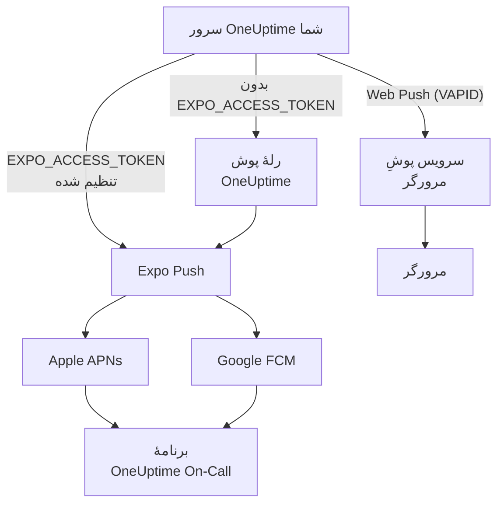
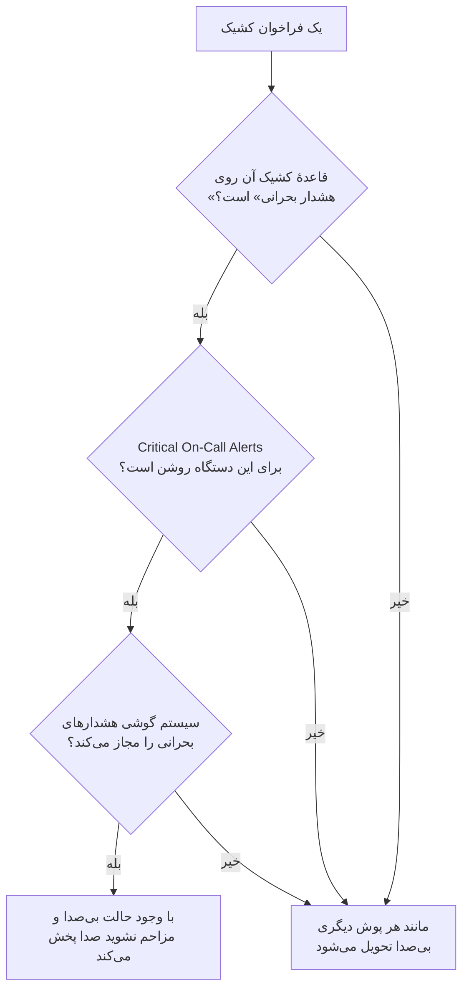

# اعلان‌های پوش

‏OneUptime افراد را روی گوشی از راه برنامهٔ موبایل **OneUptime On-Call** و در مرورگر از راه Web Push فرا می‌خواند. پوش‌های موبایل با **Expo Push** فرستاده می‌شوند: یک نمونهٔ خودمیزبان به‌طور پیش‌فرض آن‌ها را از راه رلهٔ پوش OneUptime می‌فرستد، پس فقط به دسترسی شبکهٔ خروجی به رله نیاز دارد و به هیچ اطلاعات ورود Expo، Apple یا Google از آنِ خودش نیاز ندارد.

:::cards
- [شیوهٔ فرستادن پوش‌ها را برگزینید](#راهاندازی-خودمیزبان): رلهٔ پوش، یا توکن دسترسی Expo خودتان.
- [دیوار آتش را باز کنید](#دسترسی-شبکه): نشانی‌هایی که سرور شما و دستگاه‌های افرادتان به آن‌ها می‌رسند.
- [در حالت بی‌صدا هم زنگ بزنید](#هشدارهای-بحرانی-کشیک-نادیده-گرفتن-حالت-بیصدا): بگذارید فراخوان‌های کشیک روی گوشیِ بی‌صدا هم به صدا درآیند.
- [پوش‌هایی را که هرگز نمی‌رسند درست کنید](#رفع-اشکال): هر یک از خطاهای Expo چه معنایی دارد.
- [پوش را خاموش کنید](#خاموش-کردن-پوش-برای-کل-سرور): هیچ چیزی را از راه Expo، رله یا مرورگرها نفرستید.
:::

## چگونه کار می‌کند



برنامهٔ موبایل OneUptime یک توکن Expo Push را نزد بک‌اند ثبت می‌کند. بک‌اند اعلان‌ها را از راه رلهٔ پوش OneUptime می‌فرستد، یا وقتی `EXPO_ACCESS_TOKEN` پیکربندی شده باشد مستقیم به Expo. ‏Expo پیام‌ها را برای تحویل به دستگاه به Apple APNs یا Google FCM می‌فرستد.

اعلان‌های پوش وب همچنان از کلیدهای VAPID و پروتکل Web Push استفاده می‌کنند.

## راه‌اندازی خودمیزبان

با برنامهٔ موبایل رسمی و رلهٔ پیش‌فرض، سرور به اطلاعات ورود Expo نیازی ندارد. برای تحویل مستقیم از راه Expo، `EXPO_ACCESS_TOKEN` را با اطلاعات ورودی پیکربندی کنید که برای پروژهٔ Expo برنامهٔ شما مناسب است. ‏Web Push به `VAPID_PUBLIC_KEY`، `VAPID_PRIVATE_KEY` و `VAPID_SUBJECT` نیاز دارد.

| متغیر | مقدار Helm | پیش‌فرض | چه می‌کند |
| --- | --- | --- | --- |
| `PUSH_NOTIFICATION_RELAY_URL` | `pushNotification.relayUrl` | `https://oneuptime.com/api/notification/push-relay/send` | تا وقتی `EXPO_ACCESS_TOKEN` تنظیم نشده، پوش‌های موبایل به کجا می‌روند. |
| `EXPO_ACCESS_TOKEN` | `expo.accessToken` | خالی | پوش‌های موبایل را با توکن پروژهٔ Expo شما مستقیم به Expo می‌فرستد. |
| `PUSH_NOTIFICATION_RELAY_SERVER_ENABLED` | `pushNotification.relayServerEnabled` | خالی | پوش‌های موبایل سرورهای دیگر OneUptime را با `EXPO_ACCESS_TOKEN` همین سرور رله می‌کند. خالی یعنی خاموش، مگر اینکه `BILLING_ENABLED` برابر `true` باشد. |
| `VAPID_PUBLIC_KEY` | `vapid.publicKey` | خالی | نیمهٔ عمومی جفت‌کلیدی که مرورگرها با آن مشترک می‌شوند. |
| `VAPID_PRIVATE_KEY` | `vapid.privateKey` | خالی | نیمهٔ خصوصی، که هر پوش وب را امضا می‌کند. |
| `VAPID_SUBJECT` | `vapid.subject` | `mailto:support@oneuptime.com` | نشانی تماسی که سرویس‌های پوش مرورگرها می‌توانند با آن به شما برسند. |

یک جفت‌کلید VAPID را یک بار با `npx web-push generate-vapid-keys` بسازید و نگهش دارید: مرورگرهایی که با یک جفت‌کلید مشترک شده‌اند، وقتی آن تغییر کند دیگر پوش دریافت نمی‌کنند.

:::tabs
@tab Docker Compose
```bash title="config.env"
VAPID_PUBLIC_KEY=your-public-key
VAPID_PRIVATE_KEY=your-private-key
VAPID_SUBJECT=mailto:oncall@example.com
# Leave unset to send mobile pushes through the push relay.
EXPO_ACCESS_TOKEN=
```
@tab Kubernetes
```yaml title="values.yaml"
vapid:
  publicKey: your-public-key
  privateKey: your-private-key
  subject: mailto:oncall@example.com
# Leave empty to send mobile pushes through the push relay.
expo:
  accessToken:
```

:::details نگه داشتن کلید خصوصی در یک Secret
`vapid.privateKey` کلید خصوصی را در مقدارهای انتشار نگه می‌دارد، که Helm آن‌ها را با هر بازبینی ذخیره می‌کند. برای اینکه کلید خصوصی در آن‌ها نباشد، آن را در یک Secret در Kubernetes، در namespace مربوط به OneUptime، زیر `privateKey`، بگذارید و به‌جایش نام همان Secret را بدهید:

```bash
kubectl create secret generic oneuptime-vapid \
  --namespace oneuptime \
  --from-literal=privateKey=your-private-key
```

```yaml title="values.yaml"
vapid:
  publicKey: your-public-key
  existingSecret:
    name: oneuptime-vapid
  subject: mailto:oncall@example.com
```

`vapid.privateKey` یا `vapid.existingSecret.name` را تنظیم کنید، نه هر دو را: چارت این دو را با هم نمی‌پذیرد. اگر Secret شما کلید خصوصی را زیر کلید دیگری نگه می‌دارد، نام آن کلید را در `vapid.existingSecret.privateKeyKey` بدهید. کلید عمومی در `vapid.publicKey` می‌ماند: هر مرورگری آن را دریافت می‌کند.
:::
:::

## دسترسی شبکه

| جهت | مقصد | پروتکل / پورت | چه وقت لازم است |
| --- | --- | --- | --- |
| OneUptime → رلهٔ پوش پیش‌فرض | `https://oneuptime.com/api/notification/push-relay/send`, `https://oneuptime.com/api/notification/push-relay/receipts` | HTTPS / TCP 443 | پوش موبایل وقتی `EXPO_ACCESS_TOKEN` تنظیم نشده است. |
| OneUptime → Expo | `https://exp.host/--/api/v2/push/send`, `https://exp.host/--/api/v2/push/getReceipts` | HTTPS / TCP 443 | پوش موبایل مستقیم وقتی `EXPO_ACCESS_TOKEN` تنظیم شده است. |
| OneUptime → سرویس پوش مرورگر | نقطهٔ پایانی HTTPS ذخیره‌شده در اشتراک پوش مرورگر | HTTPS / معمولاً TCP 443 | ‏Web Push. |
| برنامهٔ موبایل یا مرورگر → OneUptime | نام میزبان OneUptime شما | HTTPS / TCP 443 | ورود، ثبت دستگاه و باز کردن پیوندهای اعلان. |

اگر `PUSH_NOTIFICATION_RELAY_URL` را تغییر دهید، نام میزبان مقصد و پورت پیکربندی‌شدهٔ آن را مجاز کنید. یک رلهٔ سفارشی باید API رلهٔ OneUptime را پیاده‌سازی کند. این پیش‌فرض‌ها و جابه‌جایی میان رله و تحویل مستقیم در [پیکربندی OneUptime](https://github.com/OneUptime/oneuptime/blob/master/config.example.env) و [سرویس پوش](https://github.com/OneUptime/oneuptime/blob/master/packages/Common/Server/Services/PushNotificationService.ts) تعریف شده‌اند. درخواست‌های مستقیم به Expo از نقطهٔ پایانی‌ای استفاده می‌کنند که در [راهنمای ارسال Expo](https://docs.expo.dev/push-notifications/sending-notifications/) آمده است. ‏OneUptime رسیدهای تحویل را از رله در همان نشانی، با `/receipts` به‌جای `/send`، می‌خواند. رله‌ای که این مسیر را ندارد همچنان پوش‌ها را تحویل می‌دهد؛ در آن صورت دستگاهی که برنامه‌اش حذف شده، فقط وقتی شناخته می‌شود که پوش بعدی به آن رد شود.

یک سرور خودمیزبان OneUptime فقط با `PUSH_NOTIFICATION_RELAY_SERVER_ENABLED=true` و `EXPO_ACCESS_TOKEN` خودش پوش‌های سرورهای دیگر را رله می‌کند؛ بدون این تنظیم، در آن نشانی با 404 پاسخ می‌دهد. آن را فقط روی سروری روشن کنید که سرورهای دیگر OneUptime شما از طریق آن می‌فرستند، و فقط به همان سرورها اجازه دهید به آن نشانی برسند.

برای Web Push، میزبان‌های واقعی نقطه‌های پایانی اشتراک را برای مرورگرهایی که تیم شما به کار می‌برد مجاز کنید. ‏OneUptime ‏`fcm.googleapis.com`، `android.googleapis.com`، `push.services.mozilla.com`، `notify.windows.com` و `push.apple.com` را همراه با زیردامنه‌هایشان می‌پذیرد. نمونه‌های رایج `updates.push.services.mozilla.com` و `web.push.apple.com` هستند. [اشتراک پوش مرورگر](https://developer.mozilla.org/en-US/docs/Web/API/PushSubscription) مقصد را تعیین می‌کند؛ مجاز کردن فقط Expo یا رلهٔ OneUptime، Web Push را فعال نمی‌کند.

تفکیک DNS و TLS خروجی را از فرایند OneUptime که اعلان‌ها را می‌فرستد مجاز کنید. مخزن اعتماد آن باید گواهی مقصد را اعتبارسنجی کند، و پراکسی‌ها باید درخواست‌های API را بدون احراز هویت تعاملی عبور دهند. ارائه‌دهندگان پوش هیچ وب‌هوکی را روی سرور OneUptime شما فرا نمی‌خوانند، پس وقتی دستگاه‌های کاربران از راه VPN یا اتصال خصوصی دیگری به سرور می‌رسند، سرور می‌تواند خصوصی بماند. سروری که به رله‌اش یا سرویس‌های پوش بیرونی دسترسی ندارد نمی‌تواند این اعلان‌ها را تحویل دهد.

اتصال دستگاه‌ها نیازمندی جداگانه‌ای است. دستگاه‌های iOS به دسترسی به APNs نیاز دارند، معمولاً TCP 5223 با TCP 443 به‌عنوان جایگزین؛ برای بازه‌های مقصد [نیازمندی‌های شبکهٔ فعلی Apple](https://support.apple.com/en-us/102266) را ببینید. دستگاه‌های Android به دسترسی به FCM روی TCP 5228–5230 و 443 نیاز دارند؛ از [راهنمای فعلی Google دربارهٔ میزبان‌ها و دیوار آتش](https://firebase.google.com/docs/cloud-messaging/network-configuration) استفاده کنید. لازم نیست این پورت‌های دستگاه روی OneUptime به‌صورت ورودی باز شوند، و جریان موبایلِ سرور به‌جای اتصال مستقیم به APNs/FCM از رله یا Expo استفاده می‌کند.

:::steps
1. ‏DNS و HTTPS را از کانتینر یا پادی که اعلان‌ها را می‌فرستد تا مقصد شیوهٔ تحویل خود بررسی کنید: رله، Expo یا سرویس پوش یک مرورگر.
2. از **تنظیمات کاربر** > **روش‌های اعلان** > **Push Notifications** با **اعلان آزمایشی** یک آزمایش بفرستید و مطمئن شوید روی یک دستگاه ثبت‌شده می‌رسد. برای Web Push هر مرورگر را جداگانه آزمایش کنید.
3. خطاهای رله، Expo یا پوش وب را در لاگ‌های OneUptime بررسی کنید؛ ارسال موفق به API به‌تنهایی تحویل روی دستگاه را تأیید نمی‌کند.
:::

برای پوش‌های موبایل، OneUptime حدود 15 دقیقه پس از هر پوش رسید تحویل Expo را هم می‌خواند: پوشی که هرگز به دستگاه نرسیده، سپس در لاگ پوش به‌صورت تحویل‌نشده نمایش داده می‌شود و، برای یک فراخوان کشیک، روی خط زمانی کشیک.

## خاموش کردن پوش برای کل سرور

اگر هیچ چیز نباید از راه Expo، رلهٔ پوش یا سرویس پوش یک مرورگر از شبکهٔ شما بیرون برود، یک مدیر اصلی می‌تواند پوش را در **Admin Dashboard** > **تنظیمات** > **Push Notifications** خاموش کند: **Send push notifications** را خاموش کنید و تأیید کنید.

تا وقتی پوش خاموش است:

- در هیچ پروژه‌ای چیزی به گوشی‌ها یا مرورگرها پوش نمی‌شود.
- هیچ دستگاهی را نمی‌توان ثبت کرد. زبانهٔ **Push Notifications** هر فرد در **تنظیمات کاربر** > **روش‌های اعلان** می‌گوید که پوش خاموش است، و قاعده‌های کشیک هیچ دستگاه پوشی پیشنهاد نمی‌کنند.
- فراخوان از راه قاعدهٔ پوش فرستاده نمی‌شود. در گزارش‌های آنکالِ آن فرد نوشته می‌شود `Push notification not sent: Push notifications are turned off on this server.`
- آمادگی کشیک دستگاه‌های پوش را غیرقابل‌استفاده به شمار می‌آورد، و ارسال جایگزین از آن‌ها می‌گذرد. کسی که تنها روش تأییدشده‌اش یک دستگاه پوش است، «در دسترس نیست» نشان داده می‌شود.

برای اینکه همچنان روی گوشی به افراد برسید، یک [کانال سفارشی](/docs/self-hosted/custom-notification-channels) برای برنامه یا درگاه خودتان بیفزایید. هر سرور OneUptime ظرف 10 ثانیه پس از هر تغییر، کلید را دوباره می‌خواند. وقتی پوش دوباره روشن شود، دستگاه‌ها دفعهٔ بعد که برنامهٔ موبایل باز شود، یا از راه مرورگر، دوباره ثبت می‌شوند.

## هشدارهای بحرانی کشیک (نادیده گرفتن حالت بی‌صدا)

به‌طور پیش‌فرض یک اعلان پوش از گوشی پیروی می‌کند: گوشیِ بی‌صدا ساکت می‌ماند، و حالت مزاحم نشوید اعلان را نگه می‌دارد. برای کسی که کشیک است این پیش‌فرض در ساعت سه بامداد نادرست است، پس برنامهٔ موبایل تنظیمی برای هر دستگاه دارد – **Settings > Notifications > Critical On-Call Alerts** – که به *فقط فراخوان‌های کشیک* اجازه می‌دهد از هر دو عبور کنند و صدا پخش کنند.

دامنه عمداً تنگ است. فقط فراخوان‌هایی واجد شرایط‌اند که یک قاعدهٔ اعلان کشیک می‌سازد. اشتراک‌های مالکان، اطلاعیه‌های یادداشت‌های تازه، به‌روزرسانی‌های تغییر وضعیت و اعلان‌های مانیتور هرگز ارتقا داده نمی‌شوند، هر چه این تنظیم بگوید.



برای اینکه یک فراخوان حالت بی‌صدا را نادیده بگیرد، هر چهار چیز باید برقرار باشند. اگر حتی یکی نباشد، فراخوان باز هم تحویل می‌شود - فقط بی‌صدا.

1. **فرد کشیک آن را برای آن دستگاه روشن کرده است.** برای هر دستگاه جدا، به‌طور پیش‌فرض خاموش، در `UserPush.isCriticalAlertEnabled` ذخیره می‌شود. گوشی و تبلت یک نفر تصمیم‌های جداگانه‌اند. نسخه‌های برنامه پس از 1.6.0 هر بار که باز شوند آن را دوباره گزارش می‌کنند، و تا وقتی تنظیمات خود گوشی هشدارهای بحرانی را اجازه ندهند آن را خاموش گزارش می‌کنند، تا فهرست دستگاه‌ها همان کاری را نشان دهد که گوشی واقعاً انجام می‌دهد.
2. **قاعدهٔ کشیکی که فراخوان را فرستاده آن را می‌خواهد.** در **تنظیمات کاربر** > **قواعد آنکال**، هر قاعده‌ای که به یک گوشی اعلان می‌دهد روی «هشدار بحرانی»، که پیش‌فرض است، یا روی «عادی» تنظیم شده که از تنظیمات صدای گوشی پیروی می‌کند - تا فرد کشیک برای یک رخداد بحرانی بیدار شود و برای رخدادی جزئی بی‌صدا باخبر شود. برای هر قاعده در `UserNotificationRule.pushNotificationLevel` ذخیره می‌شود.
3. **سرور فراخوان را بحرانی علامت می‌زند.** برای iOS، محمولهٔ صدای بحرانی APNs به‌علاوهٔ `interruptionLevel: critical` را می‌فرستد، و برای Android یک کانال اعلان بحرانی را هدف می‌گیرد: `oncall_critical`، یا کانال خودِ زنگ هشدارِ انتخاب‌شده ([انتخاب صدای زنگ هشدار](#انتخاب-صدای-زنگ-هشدار) را ببینید).
4. **سیستم‌عامل اجازه می‌دهد**، و همین‌جاست که دو پلتفرم با هم فرق دارند.

:::tabs
@tab iOS
هشدارهای بحرانی در iOS به مجوز (entitlement) ‏`com.apple.developer.usernotifications.critical-alerts` نیاز دارند، که Apple آن را بنا به درخواست، برای هر حساب توسعه‌دهنده، به برنامه‌هایی می‌دهد که افراد را از رویدادهای فوری آگاه می‌کنند. آن را از [فرم درخواست Critical Alerts در Apple](https://developer.apple.com/contact/request/notifications-critical-alerts-entitlement/) درخواست کنید.

برنامهٔ رسمی **OneUptime On-Call** در App Store از **نسخهٔ 1.5.0** این مجوز را دارد. نسخه‌های پیشین آن را ندارند، و iOS هرگز به آن‌ها هشدار بحرانی پیشنهاد نمی‌کند؛ پس پیش از روشن کردن تنظیم، برنامه را به‌روز کنید.

اگر برنامه را خودتان می‌سازید، این مجوز اختیاری است. یک پروفایل تأمین نمی‌تواند مجوزی را حمل کند که به تیم داده نشده، و بیلدی که مجوزی را اعلام کند که نمی‌تواند حملش کند **امضا نمی‌شود**. فقط پروفایل `production` در `packages/MobileApp/eas.json` آن را روشن می‌کند، چون Apple آن را به تیمی داده که برنامهٔ رسمی را منتشر می‌کند. فورکی که با تیم Apple خودش امضا می‌کند، باید آن مدخل `env` را حذف کند تا Apple این مجوز را به آن تیم هم بدهد. پس از آن، هنگام ساخت روشنش کنید:

```bash
EXPO_IOS_CRITICAL_ALERTS_ENTITLEMENT=true npx expo prebuild
```

یا `EXPO_IOS_CRITICAL_ALERTS_ENTITLEMENT: "true"` را به بلوک `env` پروفایل ساخت در `packages/MobileApp/eas.json` بیفزایید.

روی دستگاه، **Settings > Notifications > Critical On-Call Alerts** را در برنامه روشن کنید و وقتی iOS پرسید، هشدارهای بحرانی را مجاز کنید. ‏iOS کلید **Critical Alerts** را برای برنامه زیر **Settings > Notifications > OneUptime On-Call** در تنظیمات iOS فقط پس از آنکه برنامه اجازه را درخواست کرد اضافه می‌کند؛ پس پیش از روشن کردن تنظیم در برنامه، آن کلید وجود ندارد. اگر درخواست را رد کنید، بعداً می‌توانید با همان کلید در تنظیمات iOS هشدارهای بحرانی را مجاز کنید.

روی بیلدی که این مجوز را ندارد، iOS نه درخواستی نشان می‌دهد نه کلیدی، و صفحهٔ تنظیمات برنامه می‌گوید این نسخهٔ برنامه نمی‌تواند هشدار بحرانی دریافت کند. فرد کشیک را به جست‌وجوی کلیدی که iOS نشان نمی‌دهد نمی‌فرستد.
@tab Android
‏Android گام تأیید از سوی سازنده ندارد، اما دور زدن مزاحم نشوید را کاربر در یک صفحهٔ سیستمی می‌دهد، نه با یک درخواست درون برنامه. وقتی فرد کشیک تنظیم را روشن می‌کند، برنامه **Settings > Notifications > Do Not Disturb access** را برایش باز می‌کند و هنگام بازگشتش دوباره بررسی می‌کند.

دو سازوکار در کار است، و موارد متفاوتی را پوشش می‌دهند:

- هر کانال اعلان بحرانی - `oncall_critical` و کانال هر صدای زنگ هشدار - ‏`bypassDnd` را درخواست می‌کند، که مزاحم نشوید را پوشش می‌دهد و به دسترسی‌ای که بالا آمد نیاز دارد.
- همهٔ این کانال‌ها از جریان صوتی **زنگ هشدار** استفاده می‌کنند، که روی گوشی‌ای که فقط زنگش بی‌صداست شنیده می‌شود. این نیمه به هیچ اجازه‌ای نیاز ندارد.

‏Android تنظیمات یک کانال را هنگام نخستین ساخت آن ثابت می‌کند، پس نمی‌توان آن‌ها را با به‌روزرسانی برنامه تغییر داد - فقط با انتشار یک شناسهٔ کانال تازه.
:::

برای بررسی اینکه کار می‌کند، از **تنظیمات کاربر** > **روش‌های اعلان** > **Push Notifications** یک اعلان آزمایشی به دستگاه بفرستید. وقتی هشدارهای بحرانی روی دستگاه فعال باشند، آزمایش هم به‌صورت هشدار بحرانی فرستاده می‌شود - پس نخست گوشی را بی‌صدا کنید، تا بشنوید آیا یک فراخوان واقعی به شما می‌رسد. همین فهرست نشان می‌دهد که هشدارهای بحرانی روی هر دستگاه روشن است یا نه، و برای گوشی‌ای که روشن نیست، چگونه روشنشان کنید.

### انتخاب صدای زنگ هشدار

یک فراخوان بحرانی صدای هشدار بحرانیِ خود گوشی را پخش می‌کند، مگر اینکه فرد کشیک صدای دیگری برگزیند. در برنامه، **Settings > Notifications > Alarm sound**، که پس از روشن شدن Critical On-Call Alerts نمایش داده می‌شود، پنج زنگ هشدار بلندتر را پیشنهاد می‌کند که برای بیدار کردن افراد ساخته شده‌اند: Klaxon، Siren، Digital alarm، Smoke alarm و Rising alarm که آرام شروع می‌شود و پیوسته بلندتر می‌شود. هر کدام را می‌توان پیش از انتخاب پخش کرد و شنید. این انتخاب متعلق به دستگاه است و در `UserPush.criticalAlertSound` ذخیره می‌شود، و اعلان آزمایشی هم همان را پخش می‌کند.

- ‏**iOS**: فراخوان نام صدا را می‌برد، و iOS آن را از درون برنامه با وجود حالت بی‌صدا با میزان صدایی پخش می‌کند که در همان صفحه انتخاب شده است: ۲۵٪، ۵۰٪، ۷۵٪ یا ۱۰۰٪ که پیش‌فرض است. میزان صدا در `UserPush.criticalAlertVolume` ذخیره می‌شود.
- ‏**Android**: هر زنگ هشدار کانال اعلان خودش را دارد (`oncall_critical_klaxon`، `oncall_critical_siren` و مانند آن‌ها)، چون Android صدای یک کانال را هنگام ساخت کانال ثابت می‌کند. سرور فراخوان را روی کانال زنگ هشدارِ انتخاب‌شده می‌فرستد، و با بلندی زنگ هشدار گوشی پخش می‌شود.

یک دستگاه تا زمانی که نسخه‌ای از برنامه را اجرا نکند که این انتخاب را پیشنهاد می‌کند، صدای سیستم را نگه می‌دارد؛ پس برای یک برنامهٔ قدیمی‌تر هرگز زنگ هشداری فرستاده نمی‌شود که آن را ندارد.

### تکرار فراخوان تا زمان تأیید

یک قاعدهٔ پوش می‌تواند فراخوانش را دوباره بفرستد تا زمانی که کسی آن را تأیید کند. در **تنظیمات کاربر** > **قواعد آنکال**، هنگام افزودن یک قاعدهٔ پوش **تکرار تا زمان تأیید** را تنظیم کنید، یا بعداً آن را در ردیف قاعده تغییر دهید: هر دقیقه، یا هر ۲، ۳، ۵، ۱۰، ۱۵ یا ۳۰ دقیقه. فراخوان با همین بازه دوباره فرستاده می‌شود، حداکثر ۱۰ بار دیگر، و به محض اینکه حادثه، هشدار یا اپیزود تأیید شود متوقف می‌شود. برای هر قاعده در `UserNotificationRule.repeatEveryMinutes` ذخیره می‌شود، که در آن ۰، که پیش‌فرض است، فراخوان را فقط یک بار می‌فرستد.

## رفع اشکال

### اعلان‌های پوش نمی‌رسند

- مطمئن شوید برنامهٔ موبایل با EAS Build ساخته شده است (Expo Go از اعلان‌های پوش پشتیبانی نمی‌کند)
- بررسی کنید دستگاه در جدول `UserPush` پایگاه دادهٔ شما ثبت شده باشد
- لاگ‌های سرور OneUptime را برای خطاهای Expo Push API بررسی کنید
- مطمئن شوید دستگاه اتصال اینترنت فعال دارد و مجوزهای اعلان روشن‌اند
- **تنظیمات کاربر** > **روش‌های اعلان** > **Push Notifications** را بررسی کنید: دستگاهی که با **اعلان دریافت نمی‌شود** علامت خورده، دیگر اعلان دریافت نمی‌کند و باید دوباره ثبت شود (پایین را ببینید)

### کلید Critical Alerts در تنظیمات iOS نیست

- ‏OneUptime On-Call را از App Store به‌روز کنید. نسخه‌های پیش از 1.5.0 بدون مجوز هشدار بحرانی Apple ساخته شده‌اند، و iOS اصلاً برایشان کلید Critical Alerts نشان نمی‌دهد
- ‏**Settings > Notifications > Critical On-Call Alerts** را در برنامه روشن کنید. ‏iOS این کلید را فقط پس از آنکه برنامه اجازه را درخواست کرد به تنظیمات خودش اضافه می‌کند، و برنامه هنگام روشن شدن این تنظیم درخواست می‌کند
- حذف و افزودن دوبارهٔ قاعده‌های اعلان کشیک یا دستگاه‌های پوش این را تغییر نمی‌دهد. این تنظیم به برنامهٔ روی دستگاه تعلق دارد، نه به یک قاعده

### هشدارهای بحرانی حالت بی‌صدا را نادیده نمی‌گیرند

- بررسی کنید کلید برای **همان** دستگاه روشن باشد - این تنظیم برای هر دستگاه جداست، و نصب دوباره یا گوشی تازه‌ای که از صفر راه‌اندازی شده ثبت دستگاه تازه‌ای می‌سازد (گوشی‌ای که از پشتیبان گوشی قبلی راه‌اندازی شده، به محض اینکه گوشی قبلی دیگر اعلان دریافت نکند، ثبت آن را همراه با تنظیمی که برنامه داشت بر عهده می‌گیرد)
- قاعدهٔ کشیک آن شدت را در **تنظیمات کاربر** > **قواعد آنکال** بررسی کنید: قاعدهٔ پوشی که روی «عادی» تنظیم شده از تنظیمات صدای گوشی پیروی می‌کند، هر چه کلید دستگاه بگوید
- ‏**iOS**: مطمئن شوید بیلد مجوز هشدار بحرانی Apple را دارد (بالا را ببینید)، و Critical Alerts زیر iOS Settings > Notifications > OneUptime On-Call مجاز است
- ‏**Android**: مطمئن شوید برنامه زیر Settings > Notifications > Do Not Disturb access دسترسی مزاحم نشوید دارد
- ‏**Android**: اگر صدای زنگ هشداری انتخاب کرده‌اید، کانال اعلانِ خودِ آن هم باید اجازه داشته باشد مزاحم نشوید را نادیده بگیرد؛ اگر چنین نباشد، صفحهٔ Alarm sound برنامه آن را می‌گوید
- صفحهٔ تنظیمات می‌گوید کدام‌یک از این‌ها کم است؛ وضعیت فعلی را از سیستم‌عامل می‌خواند، نه اینکه به آخرین درخواست برنامه اعتماد کند، و آنچه را می‌یابد به سرور می‌گوید

### پوش‌هایی که «تحویل‌نشده» علامت خورده‌اند

پذیرفتن یک پوش از سوی Expo به این معنا نیست که به دستگاه رسیده است: Apple یا Google هنوز می‌توانند آن را رد کنند. ‏OneUptime رسید تحویل هر پوش موبایل را حدود 15 دقیقه پس از فرستادن می‌خواند، و وقتی `EXPO_ACCESS_TOKEN` تنظیم نشده از راه رلهٔ پوش. وقتی رسید خطایی گزارش کند، لاگ پوش و خط زمانی کشیکِ آن فراخوان از فرستاده‌شده به **Push notification not delivered** تغییر می‌کنند، همراه با کد خطای Expo:

- `DeviceNotRegistered`: برنامهٔ موبایل از دستگاه حذف شده، یا توکن پوش آن دیگر معتبر نیست. بخش بعد را ببینید.
- `MessageRateExceeded`: در زمانی کوتاه اعلان‌های بیش از حد به دستگاه فرستاده شد. پوش‌های بعدی به آن طبق معمول فرستاده می‌شوند.
- `MessageTooBig`: اعلان بزرگ‌تر از آن بود که سرویس‌های پوش می‌پذیرند. ‏OneUptime اعلان‌ها را کوتاه می‌کند تا جا شوند، پس این نباید رخ دهد؛ اگر رخ داد لطفاً گزارش کنید.
- `InvalidCredentials` یا `MismatchSenderId`: اطلاعات ورود پوشِ پروژهٔ Expo که پوش را فرستاده معتبر نیست. با `EXPO_ACCESS_TOKEN`، اطلاعات ورود پوش پروژهٔ Expo خود را بررسی کنید؛ با رلهٔ پیش‌فرض، با پشتیبانی OneUptime تماس بگیرید.

وقتی Expo پوشی را بی‌درنگ رد کند، لاگ پوش همان لحظه دلیلش را نشان می‌دهد. از راه رلهٔ پوش هم همین‌طور است: رله به‌جای پاسخ با خطای سرور، کد خطای Expo را منتقل می‌کند.

### خطاهای «DeviceNotRegistered» در لاگ‌ها

‏Expo وقتی `DeviceNotRegistered` را گزارش می‌کند که برنامهٔ موبایل از دستگاه حذف شده باشد یا توکن پوش دستگاه دیگر معتبر نباشد. معمولاً این را در رسید تحویل یک پوش می‌گوید، که OneUptime حدود 15 دقیقه پس از پوش می‌خواند، و گاهی پوش را بی‌درنگ رد می‌کند. در هر دو حالت OneUptime فرستادن به آن دستگاه را متوقف می‌کند. دستگاه به‌جای حذف، به‌عنوان دستگاهی که اعلان دریافت نمی‌کند علامت می‌خورد، پس قاعده‌های اعلانش می‌مانند، و لاگ پوش و خط زمانی کشیکِ فراخوانی که نرسید دلیلش را می‌گویند. **تنظیمات کاربر** > **روش‌های اعلان** > **Push Notifications** آن را به‌صورت **اعلان دریافت نمی‌شود** نشان می‌دهد. دستگاه‌ها و روش‌های اعلان دیگرِ مالکش همچنان فراخوانده می‌شوند.

برای بازگرداندن دستگاه، در حالی که وارد شده‌اید برنامهٔ موبایل را روی آن باز کنید. برنامه دوباره ثبت می‌شود، که توکن پوشش را نزد Expo تازه می‌کند، و دستگاه با قاعده‌هایش دوباره اعلان دریافت می‌کند. اگر برنامه حذف شده بود، آن را دوباره نصب کنید و وارد شوید. رسید پوشی که پیش از ثبت دوبارهٔ برنامه فرستاده شده، دستگاه را علامت نمی‌زند. وقتی یک برنامهٔ موبایل به‌روز روی گوشی تازه‌ای از پشتیبان گوشی قبلی راه‌اندازی می‌شود، توکن پوشی را که پیش‌تر داشت به OneUptime می‌گوید؛ اگر دستگاه گوشی قبلی دیگر اعلان دریافت نکند، گوشی تازه آن را همراه با قاعده‌هایش بر عهده می‌گیرد.

از راه رلهٔ پوش (بدون `EXPO_ACCESS_TOKEN`) هم همین‌طور کار می‌کند: رله هنگام فرستادن یک پوش `DeviceNotRegistered` را گزارش می‌دهد، و رسیدهای تحویلی را که نمونهٔ شما از آن می‌پرسد می‌خواند.

اگر هیچ‌کدام از این‌ها کمک نکرد، همراه با خطاهای لاگ‌های OneUptime خود از راه [hello@oneuptime.com](mailto:hello@oneuptime.com) با ما تماس بگیرید.

## گام‌های بعدی

:::cards
- [برنامه‌های موبایل](/docs/mobile-desktop-apps/index): برنامهٔ OneUptime On-Call را نصب کنید و وارد شوید.
- [رفع اشکال برنامهٔ موبایل](/docs/mobile-desktop-apps/faq-troubleshooting): مشکلات ورود و اعلان روی گوشی را برطرف کنید.
- [قاعده‌های تشدید](/docs/on-call/escalation-rules): تصمیم بگیرید چه کسی و چه وقت فراخوانده شود.
- [دسترسی به شبکه خصوصی](/docs/self-hosted/private-network-access): سرور شما در شبکهٔ خودتان به چه چیزهایی می‌تواند برسد.
:::
