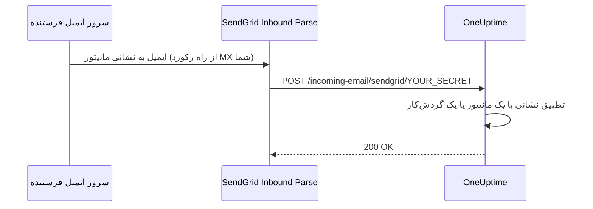

# ایمیل ورودی SendGrid

**Incoming Email Monitor** در OneUptime به شما امکان می‌دهد بر اساس ایمیل‌هایی که به نشانی‌های یکتا و ویژهٔ هر مانیتور فرستاده می‌شوند، هشدار بسازید و حل کنید. این برای یکپارچه‌سازی با سامانه‌های قدیمی، ابزارهای هشدار یا هر سرویسی که می‌تواند ایمیل بفرستد مفید است.

همین راه‌اندازی به گردش‌کارها هم اجازه می‌دهد ایمیل دریافت کنند: گردش‌کاری با تریگر **Incoming Email** نشانی خودش را روی همان دامنه می‌گیرد، و هر ایمیلی که به آن برسد گردش‌کار را آغاز می‌کند. [تریگرها](/docs/workflows/triggers#incoming-email) را ببینید.

این راهنما توضیح می‌دهد چطور SendGrid Inbound Parse را راه‌اندازی کنید تا ایمیل‌های ورودی را به نمونهٔ خودمیزبان OneUptime شما بفرستد. OneUptime Cloud به هیچ‌یک از این‌ها نیاز ندارد: نشانی‌هایش از همان ابتدا کار می‌کنند.

:::cards
- [پیش از شروع](#پیشنیازها): یک حساب SendGrid، یک دامنه و یک نشانی HTTPS عمومی.
- [راه‌اندازی](#دستورالعمل-راهاندازی): هفت گام، از رکورد MX تا یک ایمیل آزمایشی.
- [متغیرهای محیطی](#مرجع-متغیرهای-محیطی): سه تنظیم و مقدارهای پیش‌فرضشان.
- [رفع اشکال](#رفع-اشکال): ایمیل‌هایی که هرگز نمی‌رسند، و وب‌هوک‌هایی که شکست می‌خورند.
:::

## چگونه کار می‌کند



1. شما در OneUptime یک **Incoming Email Monitor** می‌سازید
2. ‏OneUptime برای آن مانیتور یک نشانی ایمیل یکتا می‌سازد (برای نمونه، `monitor-abc123@inbound.yourdomain.com`)
3. وقتی ایمیلی به آن نشانی فرستاده می‌شود، SendGrid آن را دریافت می‌کند و از راه وب‌هوک به OneUptime می‌فرستد
4. ‏OneUptime ایمیل را بر پایهٔ معیارهایی که پیکربندی کرده‌اید ارزیابی می‌کند تا هشدار بسازد یا حل کند

## پیش‌نیازها

- یک حساب SendGrid با دسترسی به Inbound Parse
- دامنه‌ای که در اختیار شماست و به تنظیمات DNS آن دسترسی دارید
- یک نقطهٔ پایانی HTTPS عمومی که وب‌هوک‌های SendGrid را به نمونهٔ OneUptime شما می‌فرستد

## دسترسی شبکه

در Inbound Parse، این SendGrid است که اتصال به OneUptime را آغاز می‌کند. مجاز کردن فقط دسترسی خروجی OneUptime به اینترنت کافی نیست.

| جهت | مقصد | پروتکل / پورت | هدف |
| --- | --- | --- | --- |
| SendGrid → OneUptime | `https://your-oneuptime-domain.com/incoming-email/sendgrid/YOUR_SECRET` | HTTPS / TCP 443 | تحویل ایمیل تجزیه‌شده به‌صورت یک POST چندبخشی. |
| سرورهای ایمیل فرستنده → SendGrid | `mx.sendgrid.net`، که رکورد MX عمومی دامنهٔ ورودی شما انتخابش می‌کند | SMTP / TCP 25 | دریافت ایمیل در SendGrid؛ این اتصال به سرور OneUptime شما نمی‌رسد. |
| OneUptime → SendGrid، فقط وقتی ارسال ایمیل با ارائه‌دهندهٔ SendGrid جداگانه پیکربندی شده باشد | `api.sendgrid.com` | HTTPS / TCP 443 | فرستادن ایمیل‌های اعلان از راه Mail Send API. |

‏DNS نام میزبان وب‌هوک را منتشر کنید و گواهی‌ای ارائه دهید که کلاینت‌های عمومی به آن اعتماد دارند. یک استقرار خصوصی OneUptime می‌تواند فقط مسیر وب‌هوک را از راه یک پراکسی معکوس یا دروازهٔ عمومی که از داخل به OneUptime می‌رسد در دسترس بگذارد. مسیر، راز، نوع محتوا و بدنهٔ چندبخشی درخواست را دست‌نخورده نگه دارید، و بگذارید POST بدون ورود تعاملی یا چالش مرورگر عبور کند. سرور OneUptime به شنوندهٔ SMTP ورودی نیاز ندارد. [راه‌اندازی Inbound Parse در SendGrid](https://www.twilio.com/docs/sendgrid/for-developers/parsing-email/setting-up-the-inbound-parse-webhook) را ببینید.

`INBOUND_EMAIL_WEBHOOK_SECRET` را روی یک مقدار تصادفی قوی بگذارید و `YOUR_SECRET` را در URL با همان مقدار جایگزین کنید. مسیر به آخرین بخش مسیر نیاز دارد. وقتی راز پیکربندی شده باشد، OneUptime مقدار آن را بررسی می‌کند؛ خالی گذاشتن متغیر این بررسی را خاموش می‌کند. URL کامل و نشانی‌های ایمیل مانیتورها را محرمانه نگه دارید، از جمله در لاگ‌های پراکسی. ‏OneUptime در حال حاضر سرآیندهای امضاشدهٔ Inbound Parse در SendGrid یا توکن‌های OAuth را اعتبارسنجی نمی‌کند. اگر به این سازوکارها نیاز دارید، طبق [مستندات امنیت وب‌هوک SendGrid](https://www.twilio.com/docs/sendgrid/for-developers/parsing-email/securing-your-parse-webhooks) دروازه‌ای پیکربندی کنید که پیش از فرستادن به OneUptime آن‌ها را اعتبارسنجی کند.

‏SendGrid فهرست قابل اتکایی از IPهای مبدأ ثابت برای Inbound Parse ارائه نمی‌دهد. IPهای ارسال ایمیل آن و نشانی‌هایی که برای `mx.sendgrid.net` به دست می‌آیند، فهرست مجاز وب‌هوک نیستند. به‌جای ثابت کردن یک نتیجهٔ DNS فعلی، [راهنمای دیوار آتش SendGrid](https://support.sendgrid.com/hc/en-us/articles/44375457225371-How-to-Configure-Firewall-Settings-for-SendGrid-Webhook-and-Inbound-Parse-IPs) را دنبال کنید.

‏Inbound Parse از ارسال ایمیل خروجی جداست. دریافت ایمیل‌های مانیتور نیازی ندارد که OneUptime با API سرویس SendGrid تماس بگیرد. اگر SendGrid را برای فرستادن اعلان‌ها هم انتخاب کنید، تفکیک DNS و HTTPS خروجی به `api.sendgrid.com` را مجاز کنید؛ [Mail Send](https://www.twilio.com/docs/sendgrid/api-reference/mail-send/mail-send) برای ارسال به هیچ فراخوانی برگشتی ورودی نیاز ندارد. اگر به‌جای آن از SMTP استفاده می‌کنید، سرور و پورت SMTP پیکربندی‌شده در OneUptime را مجاز کنید.

## دستورالعمل راه‌اندازی

:::steps
### دامنهٔ ایمیل ورودی خود را برگزینید

زیردامنه‌ای را برگزینید که فقط برای دریافت ایمیل برای OneUptime است، مانند `inbound.yourdomain.com`، `email.yourdomain.com` یا `monitor.yourdomain.com`. از آن فقط برای ایمیل به مانیتورها و گردش‌کارهای OneUptime استفاده می‌شود، پس هیچ صندوق ایمیلی از شما روی آن نیست.

### رکورد MX آن را به SendGrid نشانه بروید

یک رکورد MX اضافه کنید که ایمیل‌های زیردامنه را به SendGrid بفرستد:

| نوع | میزبان/نام | اولویت | مقدار |
| --- | --- | --- | --- |
| MX | inbound | 10 | mx.sendgrid.net |

اگر دامنهٔ شما `example.com` است و از `inbound.example.com` استفاده می‌کنید، رکورد چنین است:

```text
inbound.example.com.  IN  MX  10  mx.sendgrid.net.
```

انتشار تغییرات DNS ممکن است تا 48 ساعت طول بکشد، اما معمولاً در چند ساعت کامل می‌شود.

### دامنه را در SendGrid احراز کنید

دامنهٔ دریافت‌کننده باید به یکی از [دامنه‌های احرازشدهٔ شما در SendGrid](https://www.twilio.com/docs/sendgrid/ui/account-and-settings/inbound-parse) تعلق داشته باشد. در [داشبورد SendGrid](https://app.sendgrid.com) به **Settings** > **Sender Authentication** بروید، روی **Authenticate Your Domain** کلیک کنید و رکوردهای DNS خواسته‌شده را اضافه کنید (رکوردهای CNAME برای DKIM).

### وب‌هوک Inbound Parse را اضافه کنید

در داشبورد SendGrid به **Settings** > **Inbound Parse** بروید و روی **Add Host & URL** کلیک کنید. آن را مانند زیر پر کنید، سپس روی **Add** کلیک کنید:

| فیلد | مقدار |
| --- | --- |
| **Receiving Domain** | زیردامنهٔ ورودی شما (برای نمونه، `inbound.yourdomain.com`) |
| **Destination URL** | `https://your-oneuptime-domain.com/incoming-email/sendgrid/YOUR_SECRET` |
| **Check incoming emails for spam** | اختیاری - اگر بخواهید فعالش کنید |
| **Send raw, full MIME message** | بدون تیک بگذارید (لازم نیست) |
| **POST the raw, full MIME message** | بدون تیک بگذارید (لازم نیست) |

### پیکربندی OneUptime

متغیرهای ایمیل ورودی را با همان رازی که در Destination URL است تنظیم کنید:

:::tabs
@tab Docker Compose
```bash title="config.env"
INBOUND_EMAIL_PROVIDER=SendGrid
INBOUND_EMAIL_DOMAIN=inbound.yourdomain.com
INBOUND_EMAIL_WEBHOOK_SECRET=replace-with-a-strong-random-secret
```
@tab Kubernetes
```yaml title="values.yaml"
inboundEmail:
  provider: "SendGrid"
  domain: "inbound.yourdomain.com"
  webhookSecret: "replace-with-a-strong-random-secret"
```
:::

سپس آن‌ها را اعمال کنید: در Docker Compose دستور `npm run start` را اجرا کنید، که کانتینرها را با مقدارهای تازه دوباره می‌سازد، یا در Kubernetes نسخهٔ Helm را ارتقا دهید.

### یک مانیتور Incoming Email بسازید

[یک مانیتور Incoming Email بسازید](/docs/monitor/incoming-email-monitor#ساخت-مانیتور-ایمیل-ورودی). صفحهٔ **نمای کلی** آن نشانی‌اش را نشان می‌دهد، مانند `monitor-abc123def456@inbound.yourdomain.com`، و معیارهایش تعیین می‌کنند کدام ایمیل‌ها هشدار می‌سازند و کدام آن را حل می‌کنند.

گردش‌کارها از همان دامنه استفاده می‌کنند. تریگر **Incoming Email** را به یک گردش‌کار اضافه کنید و روی آن کلیک کنید: نشانی‌اش (`workflow-…@inbound.yourdomain.com`) بالای تنظیماتش است. تا وقتی متغیرهای ایمیل ورودی بالا تنظیم نشده‌اند، تریگر می‌گوید سرور برای دریافت ایمیل راه‌اندازی نشده است.

### یک ایمیل آزمایشی بفرستید

ایمیلی با موضوعی که با معیارهای مانیتور جور است به نشانی آن بفرستید. خلاصهٔ مانیتور ایمیل را نشان می‌دهد، و وقتی معیارها جور باشند یک هشدار ساخته می‌شود.
:::

## مرجع متغیرهای محیطی

| متغیر | مقدار Helm | توضیح | الزامی | پیش‌فرض |
| --- | --- | --- | --- | --- |
| `INBOUND_EMAIL_PROVIDER` | `inboundEmail.provider` | ارائه‌دهندهٔ ایمیل ورودی. SendGrid تنها گزینه است. | خیر | `SendGrid` |
| `INBOUND_EMAIL_DOMAIN` | `inboundEmail.domain` | زیردامنهٔ پیکربندی‌شده برای ایمیل‌های ورودی. تا وقتی تنظیم نشود، ایمیل ورودی خاموش است. | بله | خالی |
| `INBOUND_EMAIL_WEBHOOK_SECRET` | `inboundEmail.webhookSecret` | رازی که با آخرین بخش URL وب‌هوک مقایسه می‌شود: `/incoming-email/sendgrid/YOUR_SECRET`. آن را برای نقطه‌های پایانی عمومی پیکربندی کنید؛ مقدار خالی اعتبارسنجی را خاموش می‌کند. | توصیه‌شده | خالی |

اینکه یک مانیتور Incoming Email بر چه چیزهایی می‌تواند تطبیق دهد - موضوع، فرستنده، متن، گیرنده، و اینکه آیا ایمیلی به‌موقع رسیده است - در [انواع فیلتر موجود](/docs/monitor/incoming-email-monitor#نوعهای-فیلتر-در-دسترس) آمده است.

## رفع اشکال

:::details ایمیل‌ها دریافت نمی‌شوند
1. **انتشار DNS را بررسی کنید:** `dig MX inbound.yourdomain.com` باید `mx.sendgrid.net` را برگرداند.
2. **تنظیمات Inbound Parse در SendGrid را بررسی کنید:** در داشبورد SendGrid، زیر **Settings** > **Inbound Parse**، دامنه و URL وب‌هوک خود را بررسی کنید.
3. **لاگ‌های OneUptime را بررسی کنید:** در لاگ‌های سرویس `app` در OneUptime به دنبال درخواست‌های وب‌هوک ایمیل ورودی و هر خطایی بگردید. ‏SendGrid لاگ مفصلی برای Inbound Parse نگه نمی‌دارد، پس همین لاگ‌ها سابقهٔ چیزهایی‌اند که رسیده‌اند.
:::

:::details وب‌هوک‌ها شکست می‌خورند
1. **مسیر عمومی وب‌هوک را بررسی کنید:** URL کامل، همراه با رازش، باید از اینترنت به OneUptime برسد. URL بدون آخرین بخش رازش با مسیر جور نیست.
2. **قواعد دیوار آتش را بررسی کنید:** درخواست‌های HTTPS POST به مسیر وب‌هوک را بدون تغییر مسیر به صفحهٔ ورود یا چالش مرورگر مجاز کنید، و IPهای ارسال ایمیل SendGrid را به‌عنوان فهرست مجاز مبدأ وب‌هوک به کار نبرید.
3. **گواهی SSL را بررسی کنید:** برای نام میزبان وب‌هوک از یک گواهی معتبر و مورد اعتماد عموم استفاده کنید و زنجیرهٔ گواهی آن را هم بگنجانید.
:::

:::details مانیتور هشدار نمی‌سازد
1. **معیارها را بررسی کنید:** بررسی کنید معیارهای ساخت هشدار با محتوای ایمیل جور باشند، و پیش از استفاده از الگوها، نخست با رشته‌های دقیق آزمایش کنید.
2. **مانیتور را بررسی کنید:** مطمئن شوید غیرفعال نیست و نوعش Incoming Email است.
3. **خلاصهٔ مانیتور را مرور کنید:** بررسی کنید ایمیل دریافت و پردازش شده است یا نه، و لاگ‌های ارزیابی را بخوانید تا ببینید معیارها چطور جور شدند.
:::

:::details تریگر می‌گوید سرور برای دریافت ایمیل راه‌اندازی نشده است
`INBOUND_EMAIL_DOMAIN` روی سرور خالی است. آن را تنظیم کنید، تغییر را اعمال کنید و تریگر گردش‌کار را دوباره باز کنید.
:::

## بهترین شیوه‌های امنیتی

1. **از HTTPS استفاده کنید:** همیشه برای نقطهٔ پایانی وب‌هوک خود از HTTPS استفاده کنید
2. **راز وب‌هوک:** `INBOUND_EMAIL_WEBHOOK_SECRET` را پیکربندی کنید و برای اعتبارسنجی بیشتر آن را در URL وب‌هوک خود بگنجانید (برای نمونه، `/incoming-email/sendgrid/your-secret`)
3. **تأیید دامنه:** برای امنیت بهتر ایمیل، دامنهٔ خود را در SendGrid تأیید کنید
4. **دسترسی را محدود کنید:** فقط برای منابع ایمیل مورد اعتماد مانیتور بسازید
5. **لاگ‌ها را پایش کنید:** لاگ‌های ایمیل ورودی را به‌طور منظم برای فعالیت مشکوک مرور کنید

## گام‌های بعدی

:::cards
- [Incoming Email Monitor](/docs/monitor/incoming-email-monitor): معیارها، قالب‌های نشانی و نمونه‌ها.
- [تریگرهای گردش‌کار](/docs/workflows/triggers): یک گردش‌کار را با یک ایمیل آغاز کنید.
- [دسترسی به شبکه خصوصی](/docs/self-hosted/private-network-access): سرور شما در شبکهٔ خودتان به چه چیزهایی می‌تواند برسد.
- [معماری](/docs/self-hosted/architecture): وب‌هوک در یک نصب خودمیزبان کجا فرود می‌آید.
:::
